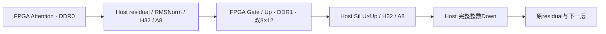

# ScaleLLM MLP Gate/Up-only 双DDR设计方案

版本：**GU-only v1.0**；日期：2026-10-24；项目：M006；架构负责人：A021。

状态：**AUTHORIZED_FOR_IMPLEMENTATION / 已授权实施。** 用户明确“可以开始进行”，本合同冻结供新版本工程使用；GU-only实现验证结果仍为NOT_RUN，不代表功能或物理已通过。本方案从FPGA删除Down矩阵计算，将Down完整移到Host执行并保留模型数学。当前GU+Down工程、原设计、运行记录和失败证据保留历史身份，不覆盖或改名冒充本方案结果。

工程根：`/home/user/EDA-202/zhuowenjun/Workspace/ScaleLLM_MLP_fix`。有效机器合同为[abi_gu_only.json](../project/hardware/source/mlp_linear/abi_gu_only.json)，包含完整寄存器/descriptor/错误/通道及v7语义，可直接供新版本生成器消费；原增量draft只保留历史。当前v6 `abi.json` SHA为`6fc3662574ef951c30883bb2415292fe4d49de812bcb83947a91691080eb7633`，不修改它或当前R005输入。

## 1. 目标、边界与不变量

目标是静态移除Down专属硬件及共享路径中仅服务Down的部分，释放存储、累加和宽控制/汇聚资源；在保留GU数值与并行尺寸的前提下，重新建立可布线的整板实现。

| 项目 | 下一版约定 |
| --- | --- |
| FPGA职责 | 完整Attention；MLP Gate和Up线性投影 |
| Host职责 | MLP输入H32/A8；GU输出的SiLU×Up、宽H32/A8；完整Down投影；原残差及层间流程 |
| 模型 | 32层，hidden4096、intermediate14336；保留原Down权重和计算 |
| GU并行度 | 两个物理8×12分支，合计16row×12列；每组32个K元素；两个分支同时处理不同8行 |
| 数值 | format05逐位整数规则；GU与原实现逐位相同；Host Down与原整数Down逐位相同 |
| 内存职责 | Attention所有逻辑half及tensor访问物理DDR0；GU所有逻辑half、tensor及metadata访问物理DDR1 |
| 时钟 | core100 MHz、两个DDR UI200 MHz；原时钟/CDC/复位契约保留 |
| Attention | 算法、权重布局、CSR、叶子RTL与正常任务行为保持；MLP正常ACK不得清理Attention |
| 暂不承诺 | 新资源净差、必然布通、Host吞吐不降、板级运行或模型指标已通过 |

仅让软件停止发送DOWN不满足目标：新生产图必须没有Down scheduler、S54累加器、Down输出队列/repack、Down metadata AB及8192bit Down输出存储/串行器。最终核验实际elaborated/synthesized层次，不只检查模块文件名。

## 2. DDR已分离，为什么仍会冲突

实际接口分工如下，两个引擎不交叉访问对方物理DDR：

| 来源 | 板级路径 | 物理终点 |
| --- | --- | --- |
| Attention tensor | M_AXI_DATA → d0_smc/S00 → d0_mig_slice | DDR0 |
| Attention两个逻辑weight half | dedicated reader → M_AXI_WEIGHT_C0 → d0_smc/S01 | DDR0 |
| GU tensor/metadata | M_AXI_MLP_DATA → d1_smc/S00 → d1_mig_slice | DDR1 |
| GU两个逻辑weight half | dedicated reader → M_AXI_WEIGHT_C1 → d1_smc/S02 | DDR1 |
| Host访问 | host_split分别进入d0/d1 SmartConnect | 各自选中的DDR |

`gate_ddr0_base/gate_ddr1_base`是历史逻辑half名称，并不表示GU跨两个物理DDR。源码和已生成BD的接口边一致，见[实际BD核查记录](../project/E013_mlp_linear_only_hardware/experiment_source/gu_only/ddr_binding.json)。该记录证明工程连接，不能代替上板并发测试。

分DDR解决的是外部存储通道归属。DDR AXI/CDC、metadata、DSP阵列及控制信号仍在同一FPGA内部占用CLB、INT路由节点和跨SLR连线；独立DDR不等于独占SLR或独立布线网络。现有route的node overlap属于静态布线资源冲突，不是证据表明两个引擎误用了同一DDR地址，也不能通过改变Host任务先后自动消除。

## 3. 现有物理证据与新SLR原则

当前GU+Down版本R004实现失败，报告473423条未完成布线信号、545088个node overlaps；没有可用于归因的完整失败route DCP。R005读取的是此前保存的Physopt DCP，下面位置/资源/扇出均属于该阶段，不冒充最终失败route的完整网归属。

| 已有原生观察 | 对本方案的意义 |
| --- | --- |
| branch0主要在SLR1，branch1主要在SLR2 | 旧RTL“两个outer SLR”注释不是当前布局事实 |
| SLR1占49193/49260 CLB站点，99.86%；SLR0/2为91.43%/93.70% | 局部站点与打包空间极紧，不能只看全板LUT余量 |
| 相邻SLR SLL用量为48.17%和31.79% | 总跨界资源未满不代表局部入口、交叉点和pin密度可布通 |
| Down repack input_fire扇出6185，SLR1/2 loads为3113/3072 | 删除Down能去掉一条本次实际存在的宽跨区控制链 |
| tensor output_error118_out扇出8196，SLR1/2为4100/4096 | Down宽输出捕获/序列化必须随计算一并删除 |
| GU tag pass仍有6149/6148，GU repack input_fire仍4650 | GU-only仍保留明确的宽控制风险，不能保证仅删Down就布通 |

来源：[每SLR利用率](../project/hardware/vivado/reports/m006_slr_AT001_physopt_slr/utilization_slr.rpt:69)、[跨SLR扇出](../project/hardware/vivado/reports/m006_slr_AT001_physopt_slr/crossing_global.rpt:118)。这些数值是网的loads/站点占用，不能相加当拥塞贡献率。局部拥塞报告中出现Down accumulator支持其为合理裁剪对象，但不是删除后改善幅度的预测。

下一版按以下原则重做物理组织：

1. **按GU-only新综合网表作轻量预算。** 统计Attention、两个GU branch、GU metadata AB、cache、GU repack、tensor和DDR端口的LUT/FF/control sets/BRAM/URAM/DSP与主要连接宽度；结合硬资源列和固定I/O位置决定布局。不给branch0预先指定迁入SLR0，也不机械沿用SLR1/2。
2. **以本地控制和跨区接口为单位。** branch内dot归约、S37恢复、S44累加和结果保持尽量成簇；入口/出口使用真实寄存器或弹性边界，避免FIFO全宽共指针/CE跨分区扩散。宽数据位数与控制扇出分别评估，不把所有信号都交给全局复制属性。
3. **metadata须结合实际容量安排。** GU AB仍448 URAM，超过单SLR可容纳的320，不能要求整套metadata和branch全部挤在一个SLR；根据银行/字宽分段及消费者连接预算安排，保持AB语义和带宽。
4. **站点余量是设计目标，不是未测承诺。** 同时观察CLB站点、LUTRAM/SRL、控制集合、pack-thru和局部pin密度；不得只用LUT百分比制定分区，也不预设某个百分比即可布通。
5. **重新判断旧物理优化。** 当前继承M003按旧native clock-region分组的42个head/39个tail CE LUT及DONT_TOUCH。先区分协议必需寄存器与历史位置优化；不盲目保留旧分组作为新分区依据，也不一次性删除所有保护。变化必须有功能等价与新物理范围证据。

保留可归因的两类版本：**A版只做Down静态裁剪及其导致的GU专化/必要接口变化；B版才针对A版新证据做GU控制locality改造。** G2/G3分别保存源身份及功能证据；不要求为每个小改动跑一轮整板implementation。首次新综合/布局后只做一次有界预算和明确候选选择，不复刻旧图的全面诊断或多轮无依据盲跑。

## 4. 目标数据流与硬件结构

每个cohort包含16行。单层流程为：Attention输出 → 原residual/RMSNorm → Host生成GU输入 → FPGA GU → Host生成Down输入并完成Down → 原residual/下一层。32层均执行完整数学链。两个cohort可流水重叠，单个cohort的层依赖不得绕过Host Down。

FPGA GU数据流：REC576 reader/parser → 128group cache → GU gather/scheduler → 两个8×12 GU branch → S24投影repack → GU DMA writer。metadata scheduler从GU AB驻留bank供给同一事务的weight code/shift。输出只有一条GU记录流。

| 当前文件/模块范围 | 必须静态删除或修改 | 保留与验收 |
| --- | --- | --- |
| `hap_mlp_linear_compute16_s54` | 删除P_DOWN状态、Down顺序cache adapter、Down scheduler与GU/Down宽mux | 单GU命令、reader、gather、GU输出；不自动发第二命令 |
| shared dual/local slice | 删除两S54累加器、Down输出队列、Down模式/tile路由 | 两个8×12真实核、S44累加、分支本地clear/credit及GU结果join |
| kernel slice/lane | 从仅固定GU模式推进到真实37bit guard/queue；删除S45-only存储和Down tag | S17 dot、S33 raw、S37 guard及溢出检查；3072个共享乘法DSP仍服务GU |
| tensor DMA | 删除Down8192bit payload寄存器、serializer、长度/记录选择 | REC576输入、6144bit GU记录捕获、AXI256流、4KiB拆分及最终B屏障 |
| cache/parser | 实际存储深度448→128，仅支持GU | 完整记录提交、canonical/padding检查、seal/holding/安全clear |
| metadata resident | 删除两个Down bank及其valid/count/read路径 | GU A/B两bank；只凭完整GU计数commit |
| metadata DMA/scheduler | 删除Down load/issue/delivery阶段与等待 | GU计数/顺序/drain；新增weight-meta padding硬件检查 |
| job/CSR | 新ABI与GU-only准入；Down字段保留零 | 原子descriptor、首错、DONE/ACK、epoch、ABORT/fatal恢复 |
| resource/production/board | 选新GU-only源码闭合图；移除不存在流的busy/quiescent依赖 | Attention真实层次、专属DDR连接、时钟/CDC、全局故障屏障 |
| Host/runtime/artifacts | 新CPU Down节点；不再stage或提交FPGA Down | 原工件严格验证、数值身份、请求/层/epoch/slot租约和错误退出 |

新图使用独立`*_gu_only.sv`变体或静态generate选择，manifest只能选择一个同名生产模块定义。原GU+Down文件保留作历史和数值对照。新manifest、生成头文件、project和报告目录显式绑定GU-only版本，不能复用有语义变化的旧DCP。

`DOWN_MODE_ENABLE=0`本身不等于裁剪完成：当前lane仍定义45bit guard memory、align_raw_s45与模式FIFO。37bit版本须明确改变实际存储/数据路径，并在真实层次中验证不存在Down accumulator/queue/repack/metadata和S45-only路径；不能以关闭opcode替代结构证据。

## 5. 数值合同与Host完整Down

### 5.1 共同定义

S24/F16表示24位有符号定点、16位小数，**不是FP16**。W4为−8…7；activation以U8的q和U8 zero-point表示，中心化值`a=q-zp`属于−255…255。ScaleCode包含U8 code和U6 shift，表达`code×2^(-shift)`；两个shift先扩展为U7再相加。

所有权重字节、原SiLU ROM、量化规则和矩阵坐标保持。验收目标是相对于既有format05整数模型新增误差为0；原模型量化相对浮点模型的误差属于原数值合同，不能混同于迁移可接受误差。禁止通过FP32/TF32 GEMM、重新量化或放松逐位比较来替代精确Down。

### 5.2 Host预处理和FPGA GU

- `after_attention`已有residual与RMSNorm，不能再做一次。有限FP32归一化结果按原half-away边界转S24/F16并饱和。
- H32执行五级蝶形，乘11585后half-away右移16；GU输入为S24→S27，SwiGLU产品为S32→S35，不能把后者先截到S24。
- 每group32的min/max包含0；q、zero-point和ScaleCode采用原nearest-even整数除法。全零group的q/zero-point/code/shift均为0；非零code允许1…255。S35范围差超过4,269,834,239时拒绝，不静默clip量化范围。
- GU每输出列每组执行`dot=sum32(a*w4)`并检查S17；`raw=dot*code_a*code_w`检查S33。非零总shift20…44，按`raw×2^(24-total_shift)`对齐F24，右移必须为有符号算术右移，检查S37。
- S33左移前必须先充分符号扩展，不能在33位或36位内左移后再扩展。128组精确累加检查S44，最后half-away右移8并饱和S24/F16。组内对齐不使用末端舍入规则。

### 5.3 Host Down

Host解码G/U交错S24输出，使用冻结SiLU表（8192存储项加原隐含端点）、原边界/地址舍入和S48乘法规则计算S32 SwiGLU产品；随后S35 H32/A8得到与原FPGA DOWN输入相同的q和metadata。可直接使用内存数组，不必再序列化并上传REC576，但数值步骤不能省略或重复。

原`mlp_down_c0/c1/meta`工件在Host严格校验并解码：每个half记录128 B，对应8列×32个有符号W4；两half拼16列。record顺序为448个输入group，每组256个16列output tile。metadata每记录32 B，前16 B code、后12 B打包shift、末4 B padding必须0；禁止将列/half/group顺序错换。

对每个row、output column、group：

1. `dot=sum32((q-zp)*w4)`，检查S17；`raw=dot*code_a*code_w`，检查S33。
2. 非零总shift12…44；对齐F24后检查S45。右移保留算术截断规则，零code贡献0。
3. 按group0…447精确累加，检查S54，不在中途饱和或舍入。
4. 完成448组后half-away-from-zero右移8，再饱和S32/F16，输出16×4096，与原FPGA Down出口完全相同。

合法数值可用int64精确承载；参考oracle采用独立Python整数实现，优化路径采用按row/column/group分块的整数实现。oracle不能调用待测优化内核或照抄其输出。先验证尾列、不同group/行/列的权重与code/shift、零code、负数右移、半值舍入、S45/S54边界和S32饱和，再验证真实层和32层。旧8row fixture不是16row整层证明。出现非法数值或权重错误，停止该请求，不产出伪成功层结果。

纯Python标量oracle只用于有界输出列、完整448组和边界对照，不能把约0.94G MAC的纯Python全shape逐项运算放进每次回归。完整16×4096生产输出由高效整数实现与独立向量化整数参考/真实工件校验覆盖，两实现先分别通过标量oracle；记录wall time、RSS、线程数、是否包含权重解码及预热。参考实现与优化实现不能共享待测乘加/恢复核心。

## 6. 数据布局、cache与metadata

| 数据 | 精确规格 |
| --- | --- |
| GU输入 | 128条REC576，73728 B，AXI256共2304 beat |
| REC576 | 512 B row-major U8 q；48 B逐row U24 activation metadata；16 B零padding |
| U24 activation metadata | bits7:0 zp、15:8 code、21:16 shift、23:22为0 |
| GU输出 | G0/U0…G895/U895；每条16row×16列×3 B=768 B；1792条共1376256 B |
| 内核GU内部pass | 2×ceil(14336/12)×128=305920；12列尾pass为8列 |
| GU weight/meta record | 2×896×128=229376条；每half权重128 B/条，metadata物理32 B/条 |
| GU metadata加载 | 7340032 B物理payload；6422528 B有效224bit内容；Down记录数为0 |
| cache | 16row×128group×280bit；同一group响应含4096bit q和384bit metadata |

REC576必须完整18beat且padding/reserved/canonical检查成功后才提交cache；错误后discard剩余已接受输入，不能将“接收了beat”算成已提交合法输入。cache写顺序0…127，计数器须表示128；保留9bit外部group时先检查高位/范围再截7bit RAM地址，禁止group128别名group0。seal必须恰好128条，读响应未消费时保持，不先清owner。

GU weight metadata的末4 B padding与REC576的末16 B padding是不同边界。当前loader仅截取224bit，不能声称它已经检查weight-meta padding。新Host继续严格验证工件；新GU-only loader显式检查beat[255:224]==0，首次错误锁存METADATA_BANK_OR_DMA=`0x2120`。目标加载bank立即无效、禁止commit/激活，停止继续提交metadata并排空已接受AXI；不能用clear丢弃在途事务。

inactive-bank预取出错不直接改写active bank的字节、generation或选择，但沿现有全局MLP metadata-fatal路径fail-closed：阻止新准入、撤销当前epoch资格、升级reset_required。**没有已接受GU任务时不得凭配置descriptor伪造DONE；有真实active GU且受该fault影响时，必须按原首错/fatal规则冻结该任务失败DONE并继续真实排空；已有未ACK DONE保持原身份/首错/计数，只升级reset_required。** 不能用“不造DONE”取消真实owner的失败响应。受控hard_clear满足屏障后撤销resident有效性，Host恢复后重新加载/commit并发布新epoch。测试分别覆盖无任务、active GU并行inactive预取、已有未ACK DONE；成功commit或继续使用旧epoch均不允许。

GU A/B bank每bank229376条，完整加载后才可commit。一次加载/commit无需等待Down计数；inactive-bank预取仍受无非法切换、无pending事务等原规则约束。scheduler每GU恰好交付229376条；GU完成必须等metadata请求/响应、cache pending、weight reader/CDC、kernel/repack和writer B全部退役。

## 7. ABI、准入、地址和生命周期

### 7.1 身份与能力

| 项目 | GU-only值 |
| --- | --- |
| NUMERIC_FORMAT_ID | `0x48384605`，保持format05 |
| MEMORY_LAYOUT_ID / WEIGHT_LAYOUT_ID | `0x4D303032` / `0x57344635`，原地址/权重字节身份保持 |
| MLP_ABI_VERSION，0x104 | `0x00070000` |
| MLP_LINEAR_ABI_ID，0x300 | `0x4D4C0002` |
| MLP_CAPABILITIES，0x304 | `0x1D`：GU、cohort16、REC576、GU交错输出；DOWN bit1=0 |
| BUFFER_LAYOUT_VERSION，0x308 | 1，六槽与GU偏移保持 |
| 合法opcode | 完整32bit值必须等于1；2、0x101及其它值均不合法 |

Host先校验ABI与能力，旧v6控制程序不能自动兼容v7。ABI变化不重新定义权重：旧schema2/新schema3工件仍严格验证并归一到weight-layout身份；禁止拿runtime ABI直接拒绝合法旧权重，或为了通过而跳过哈希/布局检查。Down虽然不上传FPGA，仍是Host必须验证和使用的模型工件。

### 7.2 Descriptor和保留寄存器

START锁存544bit、17个32bit字，低字在前：command_id、request_id、cohort_buffer、layer_id、opcode、numeric_format、input_base、output_base、input_bytes、output_bytes、buffer_generation、expected_meta_generation、expected_weight_epoch、GU half0 base、GU half1 base、保留Down half0、保留Down half1。活动与DONE快照不受后续CSR配置写入影响。

command/request ID允许0；buffer_generation/epoch非0且不复用；layer为0…31、cohort为0/1，buffer为0…5且buffer//3==cohort。两个保留Down字必须0，非零候选报BAD_ADDRESS。故障/维护、busy和未ACK DONE的更高优先级拒绝保持；仅在健康idle到opcode检查时，非法完整32bit opcode报BAD_OPCODE=`0x1010`。

| 寄存器 | 下一版行为 |
| --- | --- |
| 0x134/0x138 DOWN_HALF0/1_BASE；0x170 META_DOWN_BASE | 读0；按WSTRB合并后有效值为0才可写，否则SLVERR无副作用 |
| 0x164/0x168 META_DOWN_COUNT；0x254 META_DMA_DOWN_COUNT；0x2AC DOWN_SATURATION_COUNT | 只读0，写拒绝；不虚构Down活动 |
| 0x30C opcode；0x310/0x314长度；0x318 generation；0x31C epoch | 普通配置寄存器；START按新合同完整验证 |
| 0x320 JOB_ACTION | full strobe；仅START bit0或ABORT bit2单动作；组合/保留位拒绝 |
| 0x324 JOB_STATUS | busy bit0、completion bit1、error bit2、quiescent bit3、reset_required bit4、phase bits15:8 |
| 0x328起DONE身份/计数；0x2A0 ACK；0x374 ADMISSION_ERROR清除 | 保持身份确认、首诊断及安全释放语义 |

保留零寄存器只检查合并后的有效值；未被WSTRB选中的非零data不能导致误拒，zero-strobe为无副作用。RO任意写、未定义或未对齐访问拒绝；旧START入口拒绝，不能绕过v7准入。非法DOWN不能触发MLP tensor/meta/weight AR/AW、cache begin/write、job_clear、compute或DONE更新；并发Attention合法访问不应被误判为MLP副作用。

### 7.3 地址、epoch和租约

所有硬件地址为DDR1 local byte offset，范围小于`0x80000000`，用33bit加法检查溢出；Host选择DDR1 aperture，不把aperture地址写入CSR。GU两个weight half基址为0和`0x01C00000`。slot base=`0x10000000+buffer_id×0x800000`，GU input偏移0、output偏移`0x100000`，长度只接受73728/1376256 B。旧Down input/output偏移`0x300000/0x400000`保留未使用，不重新挤占或改变layout ID。

epoch绑定非零epoch_id、layer_id、实际GU active bank/generation和两GU基址。commit要求无active/validation/未ACK DONE、无fault/maintenance/切owner、MLP通路排空、active GU metadata有效且无loading/pending commit；同一个当前epoch ID重交拒绝。active metadata身份变化、受控hard_clear或core reset撤销epoch，正常ACK/job_clear保留。

FPGA层租约在双cohort GU均成功、身份ACK完成、硬件排空且GU输出复制到Host自有buffer后可释放，允许预取下一层。Host Down另持不可变layer-specific权重句柄和中间buffer租约，直到CPU Down/残差消费者完成；不能因FPGA切层覆盖CPU正在读的权重或输出。单cohort下一层必须等本层Host Down和原层间操作结束。

### 7.4 完成、错误与恢复

正常生命周期为Validate → Load128条并seal → ArmOutput → GU Compute → Drain → 不可变DONE → 身份ACK和安全job_clear。compute_done不等于DDR写完成；成功要求最终B响应、所有在途流/CDC/metadata/cache退役且计数精确。计数饱和不回卷：input_bytes按完整合法cache提交，output_bytes按OKAY B确认，record_count按writer接受的完整GU记录；stall按每拍任一valid&&!ready的并集统计。

输入padding/canonical错误可discard完整已接受输入后失败DONE，禁止compute/输出；首错不被后错覆盖，后续fatal可以升级reset_required。健康任务ABORT继续完成已接受内部推进并走受控维护；BRESP等边界完整错误停止新burst，保留合法discard/排空；RLAST损坏/global freeze不得假装quiescent，必要时只core reset恢复。

fatal可冻结一次失败DONE而仍busy/nonquiet；ACK须ID匹配、completion有效、busy=0、quiescent=1、reset_required=0且无maintenance。受控hard_clear仅在真实transport屏障后执行，撤销metadata/epoch，保留未ACK DONE身份/首错/计数和ADMISSION_ERROR；core reset清除快照，Host先保存诊断。正常GU/ACK不得清理Attention。默认watchdog仍10,000,000 core周期，生产不能静默关闭；测试可缩短验证边界。

Host的START写成功返回值不单独证明准入。持控制锁清并回读ADMISSION_ERROR、写descriptor/START，再有序读取诊断及status，拒绝则退出，不无限等待completion；真实XDMA可见性仍属于系统/板级验收。

## 8. 资源预算和Host成本

下表为当前AT004同一正式整板Synthesized报告内可裁对象占用，层级互不包含，不是新综合净差。

| 对象 | LUT | FF | RAMB36 | URAM | DSP |
| --- | ---: | ---: | ---: | ---: | ---: |
| Down scheduler，已含S32 repack | 13947 | 16880 | 0 | 0 | 1 |
| 两个S54 accumulator | 41830 | 16038 | 192 | 0 | 0 |
| 两个Down output queue | 3230 | 12356 | 0 | 0 | 0 |
| 两个Down metadata bank | 1461 | 2124 | 0 | 224 | 0 |
| 合计 | **60468** | **47398** | **192** | **224** | **1** |

S32 repack自身8290 LUT/8282 FF已经计入scheduler，不能重复相加。额外mux、S45存储和模式控制可简化，但其净收益需新综合；放置/打包/复制会变化。GU仍使用共享3072DSP，不能按删除三矩阵中的一个估计省1/3 DSP。GU AB448加Attention80构成528 URAM的目标结构需求，正式结果仍验实际netlist。

cache逻辑容量由16×448×280=2,007,040bit降到573,440bit，减少71.43%；280bit宽同步端口在448/128深度下均可能落入512深BRAM配置，不能承诺64 RAMB36同比下降。首版保持原group响应带宽，cache重新组织属于另一个可评估变量，不混入首轮删除Down的收益账。

每cohort Host Down需16×14336×4096=939,524,096整数MAC；32层双cohort共60,129,542,144 MAC。这只是Down点积工作量，不含解包、scale恢复、SiLU/H32/A8或搬运。CPU向量化、分块、线程和权重缓存性能必须实测，不能承诺原吞吐。原Down输入258048 B上传和输出262144 B下载都消失，每cohort少520192 B；GU输入/输出仍1449984 B（73728+1376256）。Down两half权重共29,360,128 B、metadata3,670,016 B每层不再stage到FPGA，但Host必须保存并读取原工件。传输减少与CPU增加分别测量。

新硬件命令数：每层每cohort Attention+GU，共32×2×2=128；MLP硬件命令64。CPU Down是依赖图任务，不生成虚构硬件completion。Host计时分别报告预处理、GU传输/硬件、CPU Down、层间操作和流水重叠后的端到端延迟，避免将重叠时间直接相加。

## 9. 实施矩阵与验收

硬件是主线。A021维护本方案/schema与阶段判断；A022持RTL/TB/构建/单重EDA所有权；Host负责人由Root分配明确文件范围，不能与其他人覆盖编辑。普通修复连续执行，无逐项审批门。

| 阶段 | 交付与主要文件范围 | 依赖与退出条件 |
| --- | --- | --- |
| G0 合同/新图 | 新GU-only manifest、schema生成头、生产shape/ABI检查；独立构建输出目录 | v7/caps0x1D，源闭合且不双编；当前历史输入不改 |
| G1 Host数值支撑 | `host/scalellm_mlp_linear.py`扩展或独立GU-only Host模块；model独立oracle、工件decoder、CPU tests | 原权重/ROM身份与S17→S54→S32规则；先小shape/448组，再真实层；与G2并行 |
| G2 静态删Down | 新compute/resource/production、metadata、tensor、job/CSR、128group cache/parser | 真实层次无Down专属模块；GU metadata/长度正确；完整32bit非法opcode/保留字段拒绝无副作用 |
| G3 GU37bit专化 | dual/local/slice/lane新变体及逐lane/整核对照TB | 与旧核down=0比较数值、格式错、overflow、valid顺序、stall/clear；guard先扩展再移位；真实存储37bit |
| G4R 硬件整合 | 真实生产层次TB、GU-only board入口和轻量源/shape检查 | G0/G2/G3及足够独立gold；128输入group、全GU调度/尾列、metadata/epoch/错误排空/Attention边界闭合 |
| G4H Host系统 | CPU Down调度、Host租约、residual/层依赖、命令计数与32层链 | G1及接口就绪；完整16row/真实层/32层数值与吞吐验收，独立推进 |
| G5 新综合/物理 | 新netlist资源、每SLR预算、明确分区候选、一个完整物理流程及必要有界取证 | **依赖G4R，不等待G4H完成**；通过功能与生产图后即可启动，不用完整应用链阻塞硬件 |

G2和G3分别留功能证据及源hash，首次物理A版不同时混入GU locality改造。硬件仿真所需数值gold可先由独立小规模oracle提供，不等待优化Host Down吞吐或真实32层任务。G5后若有明确热点，再建立B版单变量locality改造，不原样重复失败implementation。

必须覆盖的验收集合：

- **数值：** GU全128组、row/column/group/K变化、合法总shift两端/零code/负数移位/尾8列/S44边界；Host Down全448组、S45/S54/S32边界和独立实现对照。不得降低断言迎合DUT。
- **接口：** opcode2及0x101等高位非法；busy/fatal/未ACK优先级；Down保留CSR partial/zero WSTRB；cache group128/高位地址不别名；GU metadata padding/count/commit/epoch失效。
- **真实整合：** 两cohort同epoch GU、最后B延迟、输出背压、REC前缀错误discard、ABORT、BRESP可排空、真实framing故障/core reset、未ACK DONE与ADMISSION_ERROR保留；不能用mock quiescent替代。
- **结构与Attention：** Down所有专属层次/S45-only路径缺席，真实双8×12 GU和Attention存在；专属DDR连接和时钟不变；拒绝MLP命令时不要求并发合法Attention的DDR0流量为0。
- **物理：** 分别报告综合、opt、place、route；要求合法ROUTED_FULLY、无剩余冲突/unrouted，再独立判setup/hold/pulse-width、unconstrained、DRC、CDC。native退出0或综合成功不能替代物理通过。
- **证据：** 工具版本、所有选中源/ROM/include/IP/DCP/约束身份、真实命令/退出码、资源停止与owned进程记录；同阶段/同整板口径比较，诊断采样和包围clock_region占用不充当全量失败网归因。

G3数值边界显式覆盖code1/127/128/255、activation/weight零code及非法zero+shift、总shift19/20/23/24/44/45与U6求和126不回绕；负值`-1 >> 1 = -1`，不能改成toward-zero或提前half-away。格式错误/guard overflow独立诊断和计数不能随S45裁剪消失。

证据复用按依赖：未变源码/shape的全GU scheduler、H32/A8/SiLU/REC codec和未改DDR/AXI叶子可复用其限定证据；旧AT021 GU独立gold可复用作输入，**新37bit核必须实跑**。cache/parser、CSR、tensor、job和production因opcode/range/metadata/epoch/控制变化必须重新验证，旧AT011/012/018/025/027/030/028/031 PASS不自动继承。有界硬件整合可取GU N128、K仍128：2048条metadata=65536 B、16条输出=12288 B、2816内部事务；另保留默认N14336全shape调度/长度证据。将旧Down错误场景改成GU实例，不能因少一个opcode漏掉恢复覆盖。Attention源SHA与BD连线只是静态隔离支撑，不等于并发功能已验。

重EDA沿现有单owner协议：最多32个可用CPU、RSS192GiB，Vivado单流程maxThreads8，独立IP/OOC最多4jobs；可用内存低于64GiB连续30秒或磁盘低于30GiB触发保护。资源停止必须记录为停止/失败，不能判PASS；当前R005只读取证不因新方案热改输入或并发另一套重EDA。

## 10. 风险与完成定义

| 风险 | 对策与可判定结果 |
| --- | --- |
| Down删后GU仍拥塞 | 用新综合的站点/连接预算处理保留GU tag/repack/metadata；不预承诺布通，不只看总资源下降 |
| 关闭模式但硬件未裁 | 真实层次和存储位宽缺席检查，区分固定mode与37bit专化 |
| Host Down成为瓶颈 | 先保证整数等价，再独立优化分块/线程/缓存；报告性能而非改数值 |
| epoch已切层但CPU仍读旧buffer | FPGA与Host Down分别持租约，使用不可变层权重句柄和明确buffer生命周期 |
| ABI更新误拒旧权重或误接旧Host | runtime能力与工件布局分离；v7 Host显式发现；旧schema严格校验后归一 |
| 错误路径删状态导致假排空 | 删除不存在Down谓词，保留真实GU/DDR/CDC屏障和故障注入，不清在途事务 |
| 旧物理保护不适合新图 | 先建A版轻量基线，再按证据调整B版；保护与分区变化单独留账 |

硬件完成意味着GU-only真实生产图通过功能/故障验证、新综合和合法物理实现，并分别达到时序/约束/DRC/CDC合同；Host系统完成意味着完整Down整数等价及真实层/32层调度链验证。二者可并行推进，不能相互冒充。bitstream、上板、模型指标和最终吞吐如尚未执行，必须独立标NOT_RUN。

本文件、独立完整机器合同和实施矩阵已获用户授权供工程连续实施；**GU-only功能、综合、物理与Host性能结果仍NOT_RUN，后续由实际证据更新。** 原[GU+Down设计](ScaleLLM_MLP_Linear_Only_Dual_DDR_Design.md)保留历史，不再作为下一版必须保留FPGA Down的目标。
