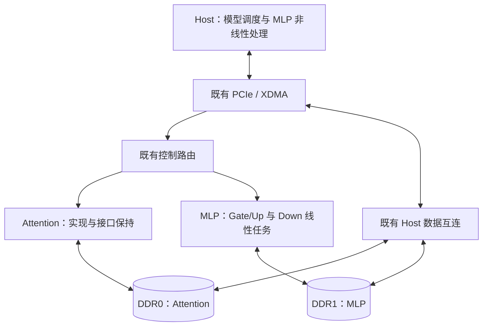
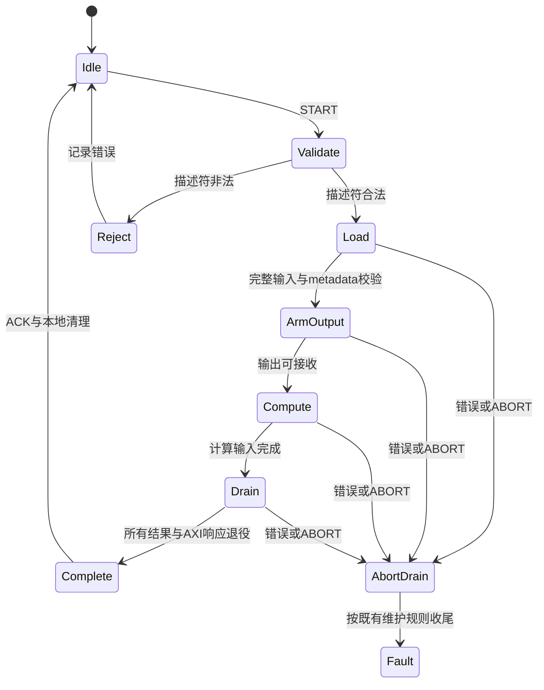

# ScaleLLM：双 DDR 下的 MLP 线性投影专用化与 Host 协同设计

> **最终职责：Attention 保持现有实现；保留 DDR0/DDR1 双通道。FPGA 的 MLP 部分只执行 Gate、Up、Down 的量化线性投影及必要的尺度恢复、累加和输出处理。MLP 的两次 H32、动态 A8 量化、ScaleCode 编码、SwiGLU 全部迁到 Host。**
>
> 本文是待实现的详细设计规范。文中的新命令、新缓冲区、新 CSR、新调度策略均为本方案提出的设计，不代表当前仓库已经实现、仿真通过或布局布线成功。

| 项目 | 内容 |
| --- | --- |
| 文档版本 | 1.0 |
| 日期 | 2026-10-24 |
| 核验仓库 | https://github.com/zwj276765037-lab/ScaleLLM |
| 固定源码基线 | `0c0d2cdba00ef8e91cc96e678ca4e0b68c4cda60`，2026-10-20 提交 |
| 目标平台 | VCU118 / xcvu9p-flga2104-2L-e |
| 基线工程配置 | Vivado 2025.2；core 100 MHz；DDR0/DDR1 UI 各 200 MHz |
| 本轮交付 | 架构、数值、接口、内存、调度、实施与验收规范 |
| 本轮实施状态 | 未修改生产 RTL，未启动 EDA，未产生新 bitstream 或板卡测量 |

**阅读顺序：** 第 1–5 节说明分工与数据流；第 6–10 节定义数值、数据格式、地址与命令；第 11–14 节说明 RTL 和 Host 的实现；第 15–19 节给出资源、性能、实施与验收要求。附录列出公式、检查表及固定提交的源码索引。

---

## 1. 决策与边界

### 1.1 已确定的决定

1. **保留双 DDR 架构。** Attention 使用物理 DDR0，MLP 使用物理 DDR1；Host 通过既有 PCIe/XDMA 访问两者。
2. **Attention 不做算法或实现改造。** 保留其计算 RTL、H32、量化器、投影阵列、QK/Softmax/PV/RoPE/KV 路径、命令格式、CSR、数值格式、时钟和 CDC 行为。
3. **MLP FPGA 只保留线性投影。** Gate、Up、Down 的 A8W4 点积、zero-point 中心化、ScaleCode 恢复、跨组累加、最终舍入/饱和留在 FPGA。
4. **MLP 两处 H32 均在 Host。** “移除 H32”指移出 MLP 硬件，算法中的 Hadamard 仍保留，不能丢掉与既有权重预处理相匹配的变换。
5. **MLP 动态量化和编码均在 Host。** 包含 group32 Min/Max、zero-point 求解、A8 整数生成、ScaleCode 的 code/shift 编码。
6. **MLP SwiGLU 在 Host。** 包含 SiLU 和与 Up 的逐元素乘法。
7. **首版保留现有 MLP 共享乘加核的尺寸及数值路径。** 不默认改成两套 4×12、不增加三套独立 Gate/Up/Down 阵列。
8. **用两个独立硬件任务替代完整 MLP 命令：`GATE_UP` 与 `DOWN`。** 两者之间由 Host 完成非线性与输入准备。

此前讨论过的“MLP 保留 H32、量化放 Host”方案不属于本版。不得据其九步流程实现额外的 H32 往返接口。

### 1.2 改造目标如何衡量

主要目标是减少 MLP 的量化、非线性、宽数据汇合和跨阶段控制负担，给布局布线留出空间。需要分别考察：

- **电路规模：** LUT、FF、DSP、BRAM、URAM，以及各模块与各 SLR 的分布。
- **互连压力：** 跨 SLR 数据与控制网络、高扇出 CE/reset、宽 MUX、ready/valid 链和局部拥塞。
- **功能与数值：** 投影和整层 MLP 与基线的逐位一致性。
- **系统代价：** Host 计算、额外 PCIe 激活传输、权重换层及任务空闲时间。

三次大矩阵运算仍全部由 FPGA 执行，数学 MAC 总量不变。删除量化/非线性不能直接等同于删除相同比例的 DSP，也不能预先保证下一次 route 成功。

### 1.3 设计、证据与建议的标识

- **基线事实：** 来自固定提交的源码、设计契约或已保存结果，使用 [Sxx] 引用。
- **本版规范：** 本文选择的新接口、地址和行为，供后续实现。
- **后续可选项：** 不属于首版范围，不能在实现中未经记录自动替换首版方案。

本文件不覆盖或重写历史实验结果；新实现必须保存自己的源码、工件和报告身份。

## 2. 当前基线与问题

### 2.1 当前 MLP 原本承担完整子层

基线 MLP 路径为：

```text
Host residual / RMSNorm
→ S24 输入
→ FPGA 输入 H32、A8 量化、输入缓存
→ Gate / Up 投影与恢复
→ FPGA SiLU × Up
→ FPGA 产品 H32、A8 量化、448 组产品缓存
→ Down 投影与恢复
→ S32 输出
→ Host residual / RMSNorm
```

其中 Gate/Up 与 Down 使用同一套双 8×12 物理计算内核。每个分支拥有一个共享点积/恢复 kernel，以及分别用于 Gate/Up 和 Down 的 S44、S54 累加器。Gate/Up 按局部 pass 交替执行；Down 在后续阶段复用这些 kernel。[S02][S03][S04]

### 2.2 本次不能只“删实例”

旧设计将许多完成条件绑定到完整 MLP：

- Gate/Up scheduler 等待 SwiGLU 产生全部 448 组量化产品才结束。
- serial command 等待 Gate/Up 完成且产品 cache full，才自动进入 Down。
- metadata scheduler 在完整命令结束时同时检查 Gate/Up 与 Down 的消费总数。
- tensor DMA 固定处理 S24 输入及最终 Down S32 输出。

因此，移出 SwiGLU 后，必须一起修改命令生命周期、metadata 计数、输入接口、输出 DMA 和完成条件。直接删除实例而沿用旧 done/full 条件会导致死锁、提前完成或计数错误。[S03][S05][S06][S07]

### 2.3 已有物理结果的边界

固定基线的结果记录：place 与 physopt 完成，route 自然失败；physopt 后 LUT 为 801,147、DSP 为 5,451、URAM 为 752，CLB 站点占用为 98.65%。这些是整板统计，不是 MLP 子模块的独立资源账，也不是本方案改造后的结果。基线尚无合法布线 Fmax、可用 bitstream 或真实板级吞吐。[S01]

本方案必须取得新的层次资源和物理证据，不能把上述总量按“删了几个算子”直接扣减。

## 3. 新的软硬件职责

### 3.1 职责表

| 工作 | Host | FPGA Attention | FPGA MLP |
| --- | --- | --- | --- |
| 原有 Attention 计算与预处理 | 保留既有 Host 边界 | **全部按现状保留** | 无 |
| Attention 后 residual、MLP 前 RMSNorm | **执行** | 无新增 | 不执行 |
| MLP 输入 H32、归一化与舍入 | **执行** | 不借用其 H32 | 不执行 |
| MLP 输入 Min/Max、A8、zero-point、ScaleCode 编码 | **执行** | 不修改其量化器 | 不执行 |
| Gate、Up 的量化线性投影 | 下发任务 | 无 | **执行** |
| Gate/Up 的 ScaleCode 恢复、S44 累加、最终 S24 输出 | 提供元数据 | 无 | **执行** |
| SiLU、与 Up 逐元素乘法 | **执行** | 无 | 不执行 |
| 产品 H32、归一化、A8 与 ScaleCode 编码 | **执行** | 无 | 不执行 |
| Down 的量化线性投影 | 下发任务 | 无 | **执行** |
| Down 的 ScaleCode 恢复、S54 累加、最终 S32 输出 | 提供元数据 | 无 | **执行** |
| MLP 后 residual、下一层 RMSNorm | **执行** | 无新增 | 不执行 |
| 权重工件验证、层切换、请求依赖调度 | **执行** | 沿用既有接口 | 提供命令与状态接口 |
| FPGA 本地 FIFO、缓存、DMA、AXI/CDC 与流控 | 管理所有权 | 按现状保留 | **保留必要支撑逻辑** |

**编码与恢复必须分开：** Host 生成 activation code/shift；FPGA 使用它们与 weight code/shift 恢复点积结果。把编码迁出不等于删除线性核中的恢复。

### 3.2 新硬件只有两类 MLP 任务

| 任务 | 输入 | 输出 | 不包含的工作 |
| --- | --- | --- | --- |
| `GATE_UP` | 128 组 cohort16 A8 激活及元数据；Gate/Up W4 和权重元数据 | Gate、Up 各 16×14336 的 S24/F16 | H32、动态量化、SiLU、产品计算 |
| `DOWN` | 448 组 cohort16 A8 产品激活及元数据；Down W4 和权重元数据 | 16×4096 的 S32/F16 | 产品 H32、动态量化、residual、RMSNorm |

两个任务使用同一套 MLP 引擎，同一时刻最多一个硬件任务在飞。`GATE_UP` 内部仍允许按 pass 交错 Gate/Up；Host 不需要为每个 pass 发命令。

### 3.3 三次线性投影的工作量不变

首版固定形状：16 行，hidden=4096，intermediate=14336，group=32；32 层。模型具体身份以既有工件 manifest 为准，不因某个文件名或模块名重新选模型。[S08]

| 投影 | 数学形状 | 每层、每 cohort16 的有用 MAC |
| --- | --- | ---: |
| Gate | (16×4096) × (4096×14336) | 939,524,096 |
| Up | 同上 | 939,524,096 |
| Down | (16×14336) × (14336×4096) | 939,524,096 |
| 合计 | 三次投影 | **2,818,572,288** |

这些是由形状推导的有用稠密 MAC，不含量化、恢复、DMA 或尾列无效 lane 的内部发射开销。现有两套 8×12 内核的结构核算合计为 3072 个 DSP48E2，首版保留它们；该数字不等于全部 MLP DSP。[S04][S08]

## 4. 双 DDR 与 Attention 保持条件

### 4.1 物理路由不改变

| 数据类型 | 物理通道 | 保留端口 | 保留时钟域 |
| --- | --- | --- | --- |
| Attention 两个逻辑 half-stream 的权重 | DDR0 | `M_AXI_WEIGHT_C0`，512-bit read | DDR0 UI 200 MHz |
| Attention tensor、metadata、输出 | DDR0 | `M_AXI_DATA`，256-bit read/write | core 100 MHz，经既有互连转换 |
| MLP Gate/Up/Down 两个逻辑 half-stream 的权重 | DDR1 | `M_AXI_WEIGHT_C1`，512-bit read | DDR1 UI 200 MHz |
| MLP 新 A8 输入、Gate/Up 输出、Down 输出、metadata | DDR1 | `M_AXI_MLP_DATA`，256-bit read/write | core 100 MHz，经既有互连转换 |

内部历史命名 `c0/c1` 或 `ddr0/ddr1` 表示逻辑半流，不允许据名称将 MLP 某半权重重新路由到物理 DDR0。MLP CSR 中的地址继续使用 DDR1 内的 local byte offset；只有 Host 地址转换添加 `0x80000000`。[S09][S10]

### 4.2 目标连接



该图表示板级职责。Host 完成 MLP 中间计算，不建立 DDR0→DDR1 的新硬件激活直通链，也不增加跨两个 DDR UI 域的宽数据 CDC。

### 4.3 “Attention 不修改”的可检验定义

1. Attention 计算与控制源文件、参数、生产编译选择、数值格式和权重工件保持基线。
2. Attention CSR 窗口 `0x000–0x0FF`、命令身份和原完成语义保持。
3. DDR0 地址分配及其权重、tensor、metadata、RoPE/KV 保留区不挪动、不借给 MLP。
4. 保留 Attention 的 H32 和量化器。共享源文件不能因为 MLP 不再使用而全局删除或改算法。
5. 保留时钟、复位、CDC、DDR0 路由和既有维护协议的行为。
6. 允许在集成层重新连接 MLP 实例，但改动必须限制在 MLP 分支，不能改变 Attention 端口协议。
7. 整板重新布局可能改变物理位置；“RTL 不改”不意味着无需重新验证 Attention 时序或保证原坐标完全相同。

`SHARED` 模式继续允许两个引擎工作。正常 MLP 任务间的初始化使用 **MLP 本地 clear**，不得每次都触发全局 maintenance、owner 切换或 Attention reset。

## 5. 一层模型的新执行流程

| 顺序 | 位置 | 输入与工作 | 下一步 |
| --- | --- | --- | --- |
| 1 | Host | 读回 Attention 输出，保留既有 FP32 residual 与 RMSNorm；沿用原 S24 输入转换 | Host 输入 H32 |
| 2 | Host | 输入 H32；动态 A8；zero-point；ScaleCode 编码；打包新 A8 记录 | H2C 写 DDR1 GU 输入区 |
| 3 | FPGA MLP | `GATE_UP`：装载 A8 cache，执行两投影，恢复、S44 累加，写 Gate/Up S24 记录 | completion，Host C2H |
| 4 | Host | 解包 Gate/Up；按原数值规则执行 SiLU×Up；得到 S32；产品 H32；A8 与 ScaleCode 编码 | H2C 写 DDR1 Down 输入区 |
| 5 | FPGA MLP | `DOWN`：装载 A8 cache，执行 Down，恢复、S54 累加，写 S32 输出 | completion，Host C2H |
| 6 | Host | 按既有规则将 S32/F16 解码；FP32 residual；下一层 input RMSNorm | 提交下一层 Attention |

Gate/Up 和 Down 之间，硬件没有一个悬挂的“半条完整 MLP 命令”。两条硬件任务各自完成并 ACK；Host 的层权重租约与数学依赖跨越这段间隙，见第 13 节。

Host 在执行期间仍可运行另一个 cohort 的准备任务，Attention 引擎也可独立执行已就绪的工作。真实重叠以硬件 busy 与传输时间证据为准，不能仅用两个 Host future 的生命周期重叠作证。

## 6. 数值合约：迁移计算位置，保持结果定义

### 6.1 格式定义

`S24/F16` 表示有符号 24-bit 整数、16 个小数位；不是 FP16。首版保持 format05 的算术语义。改变传输 ABI 不等于改变数值 format。

| 边界 | 格式 | 执行位置 |
| --- | --- | --- |
| RMSNorm 后供 MLP 预处理的输入 | S24/F16 | Host 形成 |
| 输入 normalized H32 结果 | S27/F16 | Host |
| Gate/Up 输入 | U8，附每 row/group 的 24-bit metadata | Host 生成，FPGA 使用 |
| 中心化激活 | S9，范围 −255…255 | FPGA 线性入口 |
| group32 点积 | S17 | FPGA |
| Gate/Up group 恢复结果 | S37/F24 | FPGA |
| Gate/Up 累加 | S44/F24，128 组 | FPGA |
| Gate/Up 最终投影 | S24/F16 | FPGA→Host |
| SiLU 与乘积 | SiLU 输出 S24/F16；乘法中间 S48/F32；最终 S32/F16 | Host |
| 产品 normalized H32 结果 | S35/F16 | Host |
| Down 输入 | U8＋24-bit metadata | Host 生成，FPGA 使用 |
| Down group 恢复结果 | S45/F24 | FPGA |
| Down 累加 | S54/F24，448 组 | FPGA |
| Down 最终输出 | S32/F16 | FPGA→Host |

S24/S32/S35 不能因为都叫 activation 而相互截断代替。[S02][S11][S12][S13]

### 6.2 Host H32

复现现有五级蝶形加减和 normalized H32：采用现有系数 `11585 / 65536`，以及原有 signed half-away-from-zero 舍入。输入路径保留 S24→蝶形 S29→normalized S27；产品路径保留 S32→蝶形 S37→normalized S35。

Host 不得为了复用旧 S24 接口，把 SwiGLU 产品先压回 S24。首版参考运算使用足够宽的整数中间量；若使用固定宽度向量化实现，要证明乘法、差值与移位不溢出。使用 FP32 执行这些整数步骤不能自动保证逐位一致。[S11][S12]

### 6.3 Host Min/Max A8 与 ScaleCode 编码

每个 row/group32 独立计算，定义：

```text
L = min(0, x[0], ..., x[31])
H = max(0, x[0], ..., x[31])
D = H - L

D == 0：
    q[0..31] = 0，zero_point = 0，code = 0，shift = 0
D > 0：
    zero_point = clamp_U8(RNE((-L) × 255 / D))
    q[i] = clamp_U8(RNE((255 × x[i] + zero_point × D) / D))
    code, shift = 原 format05 的 ScaleCode 编码(D, F16)
```

`RNE` 是 round-to-nearest、ties-to-even。边界负数与超过上界的 affine numerator 按旧量化器的 clamp 分支处理。

量化 q 和 zero-point 使用原始 Min/Max 范围；ScaleCode 用于后续重建，不能改成先用近似 scale 再量化 q。编码算法以现有整数参考和已验证 RTL 为准，尤其是 shift 扫描、阈值、round-div-even 以及 canonical zero。[S13][S14][S15]

产品 S35 量化还必须保留原 format05 的可表示性检查：若包含零后的 `D=H−L > 4,269,834,239`（F16 原始整数单位），Host 报数值格式错误并拒绝提交 DOWN，不能仅把 code 夹到 255 后继续执行。基线 S35 RTL 对该情况增加 `format_error_count`，生产 SwiGLU 前端据此判错。`mlp_fixed.py` 的量化 helper 本身没有这个拒绝检查，必须由新 Host 生产入口显式补足；helper 只能作为计算参考，不能单独代替完整错误合约。[S15][S33][S35]

### 6.4 FPGA 线性恢复

每个 group 的计算保持：

```text
a[i] = U8[i] - zero_point
dot  = sum(a[i] × W4[i])                    # S17
raw  = dot × activation_code × weight_code # S33
guard = 按 24 - (activation_shift + weight_shift) 对齐到 F24
accumulator += guard
```

Gate/Up 使用 S37 guard、S44 累加；Down 使用 S45 guard、S54 累加。shift 合法范围分别按现有规则检查：Gate/Up 非零路径 20…44，Down 非零路径 12…44；零路径沿用原核行为。

**guard 的算术右移与投影末尾的舍入不是同一规则。** 保持现有 guard 算术移位；最终投影才按 half-away-from-zero 右移 8，再饱和为 S24 或 S32。不能统一替换为一种“通用 round”。[S02][S04][S16]

### 6.5 Host SwiGLU

首版复现现有 SiLU 表及端点规则，而不是默认调用浮点框架的 SiLU 后宣称逐位一致：

- Gate≤−16：返回 0。
- Gate≥+16：返回 Gate。
- 中间区间：沿用步长 2^-8 的现有表和地址取整规则。
- SiLU 的 S24/F16 结果乘 Up 的 S24/F16，形成 S48/F32。
- 按既有 half-away-from-zero 右移 16，得到 S32/F16；保留原溢出检查。

表文件和生成参考的哈希进入数值 manifest。若以后选择不同的浮点实现，须作为独立数值变更验证，不能混入本版接口迁移。[S17]

### 6.6 不修改权重工件

Gate/Up/Down 的 W4、离线 Hadamard 配套处理、权重 code/shift 和原始导出记录顺序保持。Host 每次换层仍校验工件身份、大小和哈希。首版不重新量化权重，不更改 group32，不改模型 checkpoint。

## 7. 新 MLP 数据 ABI

本节为**新设计规范**，与基线“输入 packed S24、只输出 Down S32”的 ABI 不兼容。必须通过新的 MLP ABI/布局标识协商，禁止静默误读。

### 7.1 共通规则

- 字节序：little-endian。
- 有符号数：二进制补码。
- 数据布局：group/tile major，记录内 row-major，行内 lane-major。
- 描述符携带身份和地址；大张量 payload 不在每条记录重复插入全套身份。
- FPGA 内部 FIFO 必须将 payload 与必要的 opcode、tile、matrix、last 标签绑定传递。
- reserved/padding 必须为 0；错误记录不允许被当成成功输入。

### 7.2 A8 输入：每个 group 固定 576 字节

一个 group 表示 16 行各自的 32 个量化激活。

| 记录字节偏移 | 长度 | 内容 |
| --- | ---: | --- |
| 0…511 | 512 B | row0…row15，每行 32 个 U8 |
| 512…559 | 48 B | row0…row15，每行一个 24-bit little-endian metadata |
| 560…575 | 16 B | 全 0 padding |

记录不携带显式 group 序号，序号由 tensor 中的位置确定。硬件可以核验长度、接收计数、内部标签与保留位，但不能仅凭 payload 判断 Host 是否把两个内容合法的 group 交换或重复打包。Host 的打包顺序、工件身份和端到端参考对照负责覆盖这类错误。

每行 metadata：

```text
bits  7:0   zero_point
bits 15:8   scale_code
bits 21:16  scale_shift
bits 23:22  0
```

一个记录正好 18 个 AXI256 beat。metadata 不是每行单独 beat 对齐，其中有行 metadata 跨越 beat；解析器必须按上述字节布局实现。

| 输入 | groups | 总字节 | KiB | AXI256 beats |
| --- | ---: | ---: | ---: | ---: |
| GATE_UP | 128 | 73,728 | 72 | 2,304 |
| DOWN | 448 | 258,048 | 252 | 8,064 |

原始紧凑 payload 分别为 70 KiB、245 KiB；576 B 规范增加的 padding 分别为 2 KiB、7 KiB。后续流量报告应采用已落地的 72/252 KiB，而不能继续混用 70/245 KiB。

### 7.3 Gate/Up 输出：单一交错记录流

首版采用一条连续输出 tensor，顺序固定为：

```text
G0, U0, G1, U1, ..., G895, U895
```

每个 Gi/Ui 包含 16 行×16 相邻 intermediate 列，元素为 packed S24/F16，每元素 3 B：

- 每条记录：16×16×3 = **768 B = 24 AXI256 beat**。
- 每矩阵：896 条记录。
- 整个 GATE_UP：1792 条记录，**1,376,256 B = 1344 KiB = 43,008 beat**。

Host 按记录序号的奇偶拆出 Gate/Up，不能按旧“最终 Down 输出”格式解释。

现有 repacker 的标签可用于生成全局 tile：

```text
tile16 = 3 × block48 + record_index
matrix = 0 为 Gate，1 为 Up
最后完整 GU 记录：tile16 == 895 且 matrix == 1
```

最后一个 48 列 block 只有 32 个有效列，因此只产生 record0/1。**现有 `out_last_record` 只是局部 block 结束标志，不能直接作为整条 GU 命令的 tensor-last。**[S05][S18]

### 7.4 Down 输出

保持外部 tile16-major 的 S32/F16：

- 256 个 tile，每 tile 16 行×16 列。
- 每条记录：16×16×4 = **1024 B = 32 beat**。
- 总量：**262,144 B = 256 KiB = 8192 beat**。
- tile 计数为 0…255；不能使用内部 342 个 12 列计算 tile 的编号直接写外部 tensor。

### 7.5 AXI burst 与记录边界相互独立

576 B、768 B、1024 B 是逻辑记录尺寸，不代表强制一个 AXI burst。必须满足 AXI 的 4 KiB 边界及既有最大 burst 限制。

例如 576 B 的第 7 号记录从页内偏移 4032 B 开始，只剩 64 B 到页边界：先传 2 个 256-bit beat，再在下一页传剩余 16 beat。输入解析器保持本条记录的 beat_index，不能遇到 RLAST 就把 group_index 加一。

输出 packer 同样不能将 WLAST 当成 tensor-last；一条记录可以跨多个 burst。既有 DMA 已有按剩余长度、最大 burst、4 KiB 剩余空间拆分的逻辑，可复用相同原则。[S19]

## 8. DDR 地址与缓冲区规划

### 8.1 保留的物理地址规则

每路 DDR 可用地址范围为 2 GiB。Host aperture：

```text
DDR0_host_address = DDR0_local_offset
DDR1_host_address = 0x80000000 + DDR1_local_offset
```

FPGA 内部与 CSR 使用 local offset。将 Host aperture 地址写进 kernel 本地地址字段属于格式错误。[S10]

### 8.2 DDR0：完全保留

DDR0 的 Attention 权重、激活、metadata、RoPE、既有 KV 保留区保持 `scalellm_memory.py` 基线分配。不通过压缩或挪动 Attention 区域给 MLP 腾空间。

当前 KV 地址区是保留区这一事实不变；本项目改造不因此新增完整长上下文 KV 生命周期、跨请求管理或任意长度生成能力。[S09]

### 8.3 DDR1：保留权重与 metadata，新增 MLP tensor 区

下表地址均为 DDR1 local，范围采用左闭右开：

| 区域 | 地址范围 | 本版处理 |
| --- | --- | --- |
| 当前层 MLP W4 权重槽 | `[0x00000000, 0x05400000)` | 保留，84 MiB |
| 旧六槽 activation 区 | `[0x06000000, 0x06600000)` | 保留地址占位；新 ABI 不使用 |
| metadata A 的 DDR staging 区 | `[0x06800000, 0x07400000)` | 保留 12 MiB 预留 |
| metadata B 的 DDR staging 区 | `[0x07400000, 0x08000000)` | 保留 12 MiB 预留 |
| **新六槽 tensor 区** | **`[0x10000000, 0x13000000)`** | **新增，6×8 MiB** |

权重槽仍分为 Gate/Up 的两个逻辑半份和 Down 的两个逻辑半份，起点分别为 0、28 MiB、56 MiB、70 MiB。旧区域事实来自当前 Host 布局；新 tensor 区为本文件提出的分配。[S10]

### 8.4 每个 8 MiB tensor 槽的布局

```text
slot_base = 0x10000000 + buffer_id × 0x00800000
buffer_id ∈ [0,5]
```

| 相对 slot_base 偏移 | 名称 | 预留容量 | 首版有效 payload |
| --- | --- | ---: | ---: |
| `+0x000000` | GU_A8 | 1 MiB | 72 KiB |
| `+0x100000` | GU_OUT_INTERLEAVED | 2 MiB | 1344 KiB |
| `+0x300000` | DOWN_A8 | 1 MiB | 252 KiB |
| `+0x400000` | DOWN_OUT | 1 MiB | 256 KiB |
| `+0x500000` | RESERVED | 3 MiB | 不读写 |

GU_OUT 的实际有效范围到 `+0x250000`，不会侵入 DOWN_A8。预留 2 MiB 不代表 DMA 应写满 2 MiB；DMA 长度必须是 1,376,256 B。

六槽基址为：

```text
buffer 0: 0x10000000     buffer 3: 0x11800000
buffer 1: 0x10800000     buffer 4: 0x12000000
buffer 2: 0x11000000     buffer 5: 0x12800000
```

继续使用 cohort0 的槽 0–2、cohort1 的槽 3–5，并按层轮换。但 buffer_id 不足以表示所有权：必须同时携带 request_id、layer_id、buffer_generation，防止下一 pair 或下一次轮换误认旧结果。

### 8.5 地址与所有权检查

Host 与 FPGA admission 均按各自职责检查：

- opcode 对应的确切 payload 长度、组数和输出记录数。
- 地址加长度不发生 32-bit 溢出，且完整半开范围落在合法 DDR1 区域。
- 至少 64 B 对齐的 tensor 基址；规范槽基址天然满足更强对齐。
- 输入输出区域不重叠，不侵入权重、metadata、其他活跃 buffer。
- CPU 读取 GU_OUT 完成之前，不允许复用该输出槽。
- completion ACK 释放硬件命令槽，不自动释放尚在 Host 使用的 DDR tensor。

**三类对象必须分开：** DDR 的六个 buffer_id、片上工作 cache、权重 metadata A/B bank。新片上工作 cache 不再使用 buffer_id 的奇偶来选择第二个命令 bank。

## 9. 新 MLP 命令与控制 ABI

### 9.1 版本与地址隔离

Attention 窗口 `0x000–0x0FF` 完全不变。既有 router 将 `>=0x100` 的控制访问送到 MLP，控制 aperture 为 4 KiB；因此可以在 MLP 分支扩展 `0x300–0x37F`，不修改 Attention 地址译码。[S20]

**本节地址和新版本值为拟定规范，不是当前硬件已经存在的寄存器。** 实现时须从机器可读寄存器表生成 RTL/Host 定义，并再次检查全部地址唯一性。

- 原数值 `FULL_FORMAT_ID=0x48384605` 保持。
- 原 `MEMORY_LAYOUT_ID=0x4D303032` 继续表示 DDR0/DDR1 专属物理路由；它不能单独证明新 tensor 格式兼容。
- MLP 本地旧 ABI 版本寄存器 `0x104` 升级为拟定值 `0x00060000`，以使旧 Host 在初始化时失败。
- 新增 `MLP_LINEAR_ABI_ID=0x4D4C0001` 及 `MLP_BUFFER_LAYOUT_VERSION=1`。
- Host 必须同时核对数值格式、物理 DDR 布局、MLP ABI 和 buffer 布局。
- 新版本不提供“旧完整 MLP 命令”的伪兼容执行；旧 full-command START 和旧 S24 tensor-load 入口返回明确错误。

继续保留 owner/maintenance/metadata 等既有接口的定义，只有属于 MLP 新任务的控制与完成语义发生升级。

### 9.2 两类操作

| mlp_opcode | 名称 | 固定输入组数 | 固定输出 |
| ---: | --- | ---: | --- |
| 1 | GATE_UP | 128 | 1792 条交错 S24 记录 |
| 2 | DOWN | 448 | 256 条 S32 记录 |
| 0、其他 | 非法 | — | 不启动 DMA 或计算 |

外层 engine/op_id 仍保留 Attention=0、MLP=1 的分类；`mlp_opcode` 是 MLP 内部新字段，不占用或重定义 Attention 的投影 op_id。

### 9.3 命令描述符

下列字段在 START 被接受时原子锁存，执行期间不得被后续 CSR 写入改变：

| 字段 | 含义 |
| --- | --- |
| command_id | 每个 GU、DOWN 分别分配的新全局命令 ID |
| request_id / cohort_id | 所属模型请求与 cohort |
| layer_id | 0…31 |
| buffer_id / buffer_generation | 外部 tensor 槽及其当前所有权版本 |
| mlp_opcode | GU 或 DOWN |
| numeric_format_id | format05 的数值定义 |
| input_base / output_base | DDR1 local byte offset |
| input_bytes / output_bytes | 必须匹配 opcode 的固定长度 |
| weight bases | 保留既有逻辑 half-stream 基址定义 |
| expected_meta_generation | 当前层 metadata 版本 |
| weight_epoch_id | Host 当前拥有的层权重租约身份 |

固定首版不开放任意 shape。输入组数、K、N、尾列 mask 和输出记录数由 opcode 确定，防止通用化配置扩大硬件控制范围。

### 9.4 建议扩展 CSR 表

已有 `0x118/0x11C/0x120/0x124/0x128` 等命令 ID、层号、格式、输入输出地址字段，以及权重地址、request/cohort/buffer 字段可继续作为配置寄存器；以下补充新字段与完成快照。具体保留字段按当前控制模块对照生成，不能凭相近偏移猜测。[S21]

| 地址 | 名称 | 属性 | 规范 |
| --- | --- | --- | --- |
| 0x300 | MLP_LINEAR_ABI_ID | RO | 0x4D4C0001 |
| 0x304 | MLP_CAPABILITIES | RO | bit0 GU；bit1 DOWN；bit2 cohort16；bit3 A8_REC576；bit4 GU_INTERLEAVED；其余 0 |
| 0x308 | MLP_BUFFER_LAYOUT_VERSION | RO | 1 |
| 0x30C | MLP_OPCODE | RW | 1 或 2 |
| 0x310 | MLP_INPUT_BYTES | RW | 73728 或 258048 |
| 0x314 | MLP_OUTPUT_BYTES | RW | 1376256 或 262144 |
| 0x318 | MLP_BUFFER_GENERATION | RW | 非复用的 buffer 版本 |
| 0x31C | MLP_EXPECTED_WEIGHT_EPOCH | RW | 必须匹配已提交的 epoch |
| 0x320 | MLP_JOB_ACTION | WO | 单次仅一个动作：bit0 START、bit2 ABORT；bit1及其余位保留为0 |
| 0x324 | MLP_JOB_STATUS | RO | 位定义见本节；含busy、completion_valid、error、phase、quiescent |
| 0x328 | DONE_OPCODE | RO | 完成命令的 opcode |
| 0x32C | DONE_BUFFER_GENERATION | RO | 完成快照 |
| 0x330 | DONE_WEIGHT_EPOCH | RO | 完成快照 |
| 0x334 | DONE_META_GENERATION | RO | 完成快照 |
| 0x338 | DONE_COMMAND_ID | RO | 完成快照 |
| 0x33C | DONE_REQUEST_ID | RO | 完成快照 |
| 0x340 | DONE_COHORT_BUFFER | RO | [31:16] buffer_id；[15:0] cohort_id，与现有配置字段位序一致 |
| 0x344 | DONE_LAYER | RO | 完成快照 |
| 0x348 | DONE_INPUT_BYTES | RO | 实际接受的完整输入 payload |
| 0x34C | DONE_OUTPUT_BYTES | RO | 已确认完成的输出 payload |
| 0x350 | DONE_ERROR_CODE | RO | 0 为成功；非零需按错误表处理 |
| 0x354 | JOB_COMPUTE_CYCLES | RO | 本命令计算窗口周期 |
| 0x358 | JOB_LOAD_CYCLES | RO | 输入装载周期 |
| 0x35C | JOB_STORE_DRAIN_CYCLES | RO | 输出/响应排空周期 |
| 0x360 | JOB_STALL_CYCLES | RO | 定义明确的停顿计数，不与总周期相加误算 |
| 0x364 | JOB_RECORD_COUNT | RO | 完整输出记录数 |
| 0x368 | WEIGHT_EPOCH_ACTIVE | RO | 当前 FPGA 记录的 epoch |
| 0x36C | WEIGHT_EPOCH_COMMIT | WO | WData[31:0]为新的非零epoch ID；合法时原子绑定layer/meta/weight bases |
| 0x370 | ADMISSION_ERROR | RO | 首次尚未清除的START/epoch commit拒绝原因；与DONE_ERROR_CODE分开 |
| 0x374 | ADMISSION_ERROR_CLEAR | WO | full strobe写1清除ADMISSION_ERROR；其他值拒绝 |
| 0x378–0x37F | RESERVED | — | 读返回0；写返回SLVERR且无副作用 |

保留现有 `0x2A0` 的 command_id 匹配 ACK 入口，并将其连接至新的线性任务 completion：Host 以 full strobe 写入已核验的 `DONE_COMMAND_ID`，仅当该 completion 有效、身份匹配且符合原恢复条件时才释放快照。错误 ID、迟到或重复 ACK 返回 SLVERR，不得清除另一条任务的结果。新 ACTION 不再提供无身份 ACK。[S21]

`MLP_JOB_STATUS` 固定位定义：

- bit0：busy，表示已接受任务仍在执行或排空。
- bit1：completion_valid，表示有稳定、尚未ACK的完成快照。
- bit2：job_error，表示当前任务或其完成结果有错误；准入拒绝独立记录在ADMISSION_ERROR。
- bit3：quiescent，表示所有MLP硬件事务通路排空；它不等于completion已ACK。
- bit4：reset_required，表示故障仍需原受控维护/复位处理，不能靠ACK恢复。
- bits7:5：保留0。
- bits15:8：phase，0 Idle、1 Validate、2 Load、3 ArmOutput、4 Compute、5 Drain、6 Complete、7 AbortDrain、8 Fault。
- bits31:16：保留0。

新 ACTION、epoch commit 与 admission-error clear 均采用 full strobe 写。ACTION 的全0、保留位或复合动作写入返回 SLVERR。ABORT 仅作用于当前活动任务；提交方须串行化控制访问，并以当前配置command_id与已锁存活动身份匹配后才能受理。AW/W 独立握手必须保留，不要求地址与数据同拍。

epoch commit 的受理条件为：`completion_valid=0`，MLP 全通路 quiescent，未处于 fault/维护切换，metadata active bank 有效且不存在 loading/commit-pending。受理时原子锁存新的非零 epoch ID、配置 layer_id、实际 active_metadata_generation，以及四个固定 weight base；START 必须逐项匹配此绑定，不能只比较一个 epoch ID。正常job clear与ACK保持该绑定；受控hard clear/reset使其失效。

START还必须核对实际active metadata的bank/generation与epoch绑定相符。若后续metadata操作改变了active bank或generation，旧epoch绑定立即失效；完成新的合法epoch commit前不能继续START。加载非active bank不等于已经允许切换当前层的所有权。

epoch commit 表示 Host 已完成权重 staging 并承担相应所有权；它不是对 DDR 权重内容的硬件哈希验证。Host 必须先完成数据写入和验证，再提交 epoch。运行内不复用epoch ID与command_id的责任由Host保持，硬件只核验当前绑定。

### 9.5 新旧接口保护

新 Host 不允许在新标识读取失败后退回旧 S24 输入方式。旧 Host 因 MLP ABI 版本不匹配或旧 START 被拒绝而失败，不能得到“成功但输出错误”的假象。

对只读版本字段的 full/partial/zero-strobe 写入均不改变状态。所有输入长度、地址、opcode及epoch绑定检查在任何输入DMA、计算或输出写入前完成。AXI-Lite START写响应在描述符准入校验后返回：拒绝时SLVERR并锁存ADMISSION_ERROR，不占in-flight，不产生任务completion，也不修改已有active job或DONE快照；成功时OKAY并进入Load。Host将SLVERR/提交写失败视为本次提交失败，不能继续等待这个command_id的completion。

Host在诊断后通过0x374清除准入错误再重试，新的拒绝不得静默覆盖尚未读取的首个原因。ADMISSION_ERROR只作诊断，不是永久的busy/fault条件；合法清除不影响活动任务、DONE快照或epoch。真正的fatal状态仍按原维护规则处理。

## 10. 一条线性任务的生命周期

### 10.1 硬件拥有完整的 load→compute→store

首版 Host 在写好 DDR1 tensor 后提交任务。MLP job 控制器负责输入装载、输出路径准备、计算和排空。Host 不再单独通过旧 tensor bridge 启动 S24 load。



Compute→Drain 的转移不能被当成对 Host 的完成通知。故障是否可安全重新接收任务，沿用既有错误类别；fatal AXI/描述符问题不能用 ACK 或 soft clear 假装恢复。

### 10.2 完成必须同时满足的条件

GATE_UP 成功完成至少要求：

- 接受并核验 128 个 A8 输入 group。
- Gate/Up 对应的权重与 metadata 记录全部消费，相关 reader/CDC 队列排空。
- 1792 条最终 S24 记录按正确次序进入输出并写完。
- request/tag/repack/output 队列中没有未退役事务。
- 输出 DMA 完成，所有写响应已确认；没有错误 RRESP/BRESP/RLAST。

DOWN 同理，但输入为 448 组、输出为 256 条 S32 记录。完成后的快照在 ACK 前稳定保持，不能被下一命令覆盖。

### 10.3 metadata scheduler 按操作检查

| 命令 | 预期 Gate/Up metadata 消费 | 预期 Down metadata 消费 |
| --- | ---: | ---: |
| GATE_UP | 229376 条 | 0 |
| DOWN | 0 | 114688 条 |

首版仍可在 epoch 开始时一次加载该层完整 Gate/Up＋Down metadata。**加载计数与某条命令的消费计数是不同指标。** 未执行另一投影阶段不应被判为丢失 metadata。[S06]

### 10.4 正常清理与异常维护分开

正常 GU→DOWN 或不同 cohort 的任务切换，只清理 MLP 的 valid、pending、tag、计数、局部累加协议和 cache 所有权。大 payload RAM 通过覆盖与 valid 控制，不做全局复位树。

必须将新的命令局部 `job_clear` 与 resident metadata 的 hard clear 分开。基线 `mlp_engine_clear` 同时连接 metadata scheduler 和 resident A/B bank，而后者的 clear 会撤销 `bank_valid` 并将 `active_generation` 清零，因此不能直接把这条旧清理线接到每个job/ACK。[S22][S34]

`job_clear` 只清命令侧scheduler/FIFO/tag、A8工作cache所有权、累加协议和本命令计数；不得撤销resident metadata A/B的valid、active_bank、active_generation，不得清除weight epoch绑定，也不得覆盖未ACK的completion。完成快照及计数须先锁存；metadata读响应全部排空后，才清命令侧读协议状态。同一epoch中的四条GU/DOWN任务因此能够复用resident metadata。

真正的 abort/维护继续遵守原协议：暂停新接收、排空已接受事务、核验 quiescence，再 clear。若需要共享维护，会影响两引擎，必须记录；正常任务切换不能经此路径暂停 Attention。[S09][S22]

## 11. RTL 重构方案

### 11.1 首版目标层次

以下名称是建议的新模块名，不是当前已经存在的实现：

```text
现有 production_core / 双DDR外壳
    MLP linear job control
    MLP A8 load + projection store DMA
    MLP 私有 A8 command cache
    GU scheduler + gather + S24 repacker
    Down scheduler + W4 repacker + S32 repacker
    现有双8×12 shared kernel + S44/S54 accumulators
    现有权重reader / metadata banks与loader（按opcode适配）
```

不修改 Attention 叶子模块，不建立新的全板 H32 共享单元，不让 MLP 复用 Attention 的 cache。

### 11.2 新建一套 MLP 命令私有 A8 cache

首版选择统一存放两类命令输入：

- 物理最大容量：16 行×448 group×280 bit，**245 KiB 逻辑 payload**。
- GATE_UP 装载前 128 组；DOWN 装载 448 组。
- 单条 MLP 命令独占 cache，不预取下一条命令。
- GU 和 DOWN 是两个命令，跨命令中间数据由 Host/DDR 持有；cache 可以重新装载。
- 16 个 row bank，或两个 8-row 物理半区，保持局部读写与寄存响应。

原输入双 bank 为 140 KiB，原 Down 量化产品 cache 为 245 KiB；新共享工作 cache 将这部分逻辑容量从 385 KiB 降为 245 KiB，减少 140 KiB。**这只是 payload 容量推导，不是 BRAM 物理块节省的测量。** 实际还有深度映射、响应队列和控制开销。[S23][S24]

新 cache 需要两种读取 adapter：

| adapter | 行为 |
| --- | --- |
| GU 随机重放 | 复用原 request/response 语义，按 group 读，严格保持数据、metadata、group 标签配对 |
| Down 顺序重放 | 按 group0…447 推进；仅在 Down scheduler 接受后推进，当前 group 由 scheduler 锁存并服务其全部输出 tile |

必须满足：

1. `expected_groups` 从已锁存 opcode 派生，seal/full 条件为 128 或 448，不能固定等待 448。
2. group 地址统一为足够容纳 448 的 9 bit；GU 旧 7-bit 请求零扩展，返回高位校验为 0。
3. GU 的旧 activation_bank 在 MLP adapter 中固定为 0；不再接受声称存在的 bank1。
4. cache 从本命令 load 接受至所有读取响应与使用者排空独占，不能凭最后一条读请求发出就释放。
5. seal 后不可写，未 seal 不可读；新 load 不能覆盖活跃 cache。
6. row data 与 metadata 原子写入；两个 8-row 半区若采用独立接口，必须保持组标签和握手一致。
7. 新建 MLP 私有模块，不通过将 Attention 共用 cache 的 BANK_COUNT 改成 1 来实现；原模块含地址拼接和零宽度参数风险。

### 11.3 Gate/Up scheduler 的拆分位置

保留：

- 16→48→12 列权重 gather 与 ping-pong。
- activation request FIFO、projection tag FIFO。
- 12→16 的 S24 repacker。
- 权重与激活的有序配对、尾列 mask、数值检查。

在 `u_projection_repack` 出口，将原 `u_swiglu` 消费者替换为 GU 输出 FIFO/DMA。输出使用现有 matrix/block/record 标签形成新 ABI 的记录序号。payload 与标签按同一次握手入队。

重写 done：以 1792 条输出及队列/reader 排空为依据；删除等待 448 组 SwiGLU activation 的完成条件。不要把 record 的“产生”、FIFO 的“接受”与 DDR 的“写入完成”混成一个事件。[S05]

### 11.4 Down 输入替换

Down scheduler 继续按 group-major 遍历：固定一个 group，扫描全部 342 个内部 12 列 tile，再读取下一 group。使用新 A8 cache adapter 替代旧 SwiGLU→产品 cache 的供数路径。

保留 Down 的 48→12 W4 重排、S54 部分和 bank、12→16 S32 输出重排及局部弹性队列。[S16][S25]

### 11.5 从生产 MLP 层次移除的计算

| 当前模块/计算 | 本版处理 |
| --- | --- |
| `hap_mlp_input_frontend16_compact_cache` 内 H32/量化 | 以新的 A8 load/cache 路径替代 |
| `hap_mlp_hadamard32_s24_fold4` | MLP 生产层次不再实例化 |
| `hap_mlp_swiglu_product_frontend16_q4` 及其 row producer | MLP 生产层次不再实例化 |
| `hap_mlp_silu_mul` | MLP 生产层次不再实例化 |
| `hap_mlp_hadamard32_s32_norm_stream` | MLP 生产层次不再实例化 |
| `hap_mlp_robust_a8_quantizer_s35` | MLP 生产层次不再实例化 |
| 原完整 MLP full/serial 自动推进状态机 | 替换为按 opcode 的线性任务控制 |
| 旧 tensor DMA 的 S24 输入假设 | 替换为 A8_REC576；补 GU S24 输出 |

“不实例化”不要求删除源文件。源文件保留可用于历史回归；Attention 仍在使用的 `hap_robust_a8_quantizer` 等共享模块必须保留原行为。

### 11.6 避免新接口重新制造布线压力

- DMA 使用分 beat 的局部寄存与记录组装，避免用一条大移位寄存器配全局 CE。
- 维持已有 kernel 分支的局部 ingress、tag 和输出缓冲。
- 新 job 的 opcode 在接受时锁存，并在本地流水边界传递；不让一个高层 phase 信号直接驱动全板宽 payload 选择。
- 正常 cache/job clear 只复位协议有效性，不全清 payload。
- 单一 output 流可避免两个 GU 输出 DMA 的仲裁，但不能把全部 6144-bit S24 输出变成跨 SLR 的无寄存组合扇出。
- 输入 parser、repacker 与 DMA 的 backpressure 在本地有限 FIFO 处终止，保留持续停顿的安全性。

这些是实现约束，需要网表与物理报告验证，不能仅凭 RTL 中写了 FIFO 就认定时序已经解决。

## 12. Host 软件改造

### 12.1 数值处理函数

建议以清晰函数边界实现，名称仅作设计示意：

```python
def prepare_gate_up_input(hidden_fp32, norm_weight):
    # 与当前Host边界相同的FP32 RMSNorm，以及原S24舍入/饱和。
    x_s24 = existing_norm_and_s24_boundary(hidden_fp32, norm_weight)
    h_s27 = hadamard32_s24_exact(x_s24)
    q_u8, meta_u24 = minmax_a8_scalecode_exact(h_s27)
    return pack_a8_rec576(q_u8, meta_u24)

def prepare_down_input(gu_payload):
    gate_s24, up_s24 = unpack_gu_interleaved_s24(gu_payload)
    product_s32 = silu_table_mul_exact(gate_s24, up_s24)
    h_s35 = hadamard32_s32_exact(product_s32)
    reject_unrepresentable_scale_groups(h_s35, diff_q16_max=4_269_834_239)
    q_u8, meta_u24 = minmax_a8_scalecode_exact(h_s35)
    return pack_a8_rec576(q_u8, meta_u24)
```

示意函数不能掩盖 norm 重复执行：若现有 boundary ops 已完成 RMSNorm，则接口应直接接收其结果，仅执行原 S24 边界及后续预处理。

可以复用 `fixbit_v2.py`、`mlp_fixed.py` 的整数参考建立 oracle；这些参考不等于已优化的 CPU 高吞吐实现。先完成逐位对照，再对 Host 实现做向量化或编译优化，优化前后都要逐位一致。[S14][S15]

### 12.2 runtime 状态

每个 cohort 的层内状态更新为：

```text
ATTENTION_READY
→ ATTENTION_RUNNING
→ HOST_AFTER_ATTENTION_AND_GU_PREP
→ GU_READY（可能因epoch暂不可准入）
→ GU_RUNNING
→ HOST_SWIGLU_AND_DOWN_PREP
→ DOWN_READY
→ DOWN_RUNNING
→ HOST_AFTER_DOWN
→ 下一层 ATTENTION_READY 或 COMPLETE
```

Attention backend 的命令语义不变。MLP backend 接收两个 opcode，不在单次 backend 调用中包住整个 Host SwiGLU 阶段。

Host CPU 任务完成后发布 ready 事件，中央调度器决定硬件准入；不要让唯一 MLP worker 阻塞等待未来 epoch。

### 12.3 身份与计数

每条 GU 和 DOWN 分配不同的全局 command_id。completion scoreboard 核验：

```text
(request_id, command_id, cohort_id, layer_id,
 buffer_id, buffer_generation, engine_op_id,
 mlp_opcode, weight_epoch_id, metadata_generation)
```

外层 op_id 同为 MLP 不能区分 GU 与 DOWN，必须扩展 scoreboard、trace 与 completion 身份。

每 pair 两个 cohort、每个 32 层：

- 原命令数：2×32×(Attention＋完整MLP)=128。
- 新命令数：2×32×(Attention＋GU＋DOWN)=**192**。
- 其中 Attention 64 条、MLP 128 条。

board runner 的期望计数、跨 pair command_id 续号、重复实验统计和结果日志均需同步更新。[S26][S27]

### 12.4 buffer 所有权

建议使用显式状态，而非仅靠层号取模：

| 对象 | 持有至何时 |
| --- | --- |
| GU_A8 | GU 输入 DMA 完成，且本任务不会再次读取DDR |
| GU_OUT | Host C2H及解包完成 |
| Host Gate/Up/product | DOWN_A8 生成并安全持久化、后续验证需要结束 |
| DOWN_A8 | DOWN 输入 DMA 完成 |
| DOWN_OUT | Host C2H与residual消费完成 |
| DDR tensor slot | 所有相关对象释放且没有迟到completion |

buffer_generation 每次重新分配递增。异常命令不得通过复用同一 buffer_id 掩盖旧事务。

## 13. 双 cohort 调度与单层权重槽

### 13.1 为什么需要新的层权重租约

DDR1 只有一个 84 MiB 层权重槽。旧完整 MLP 命令内部连续执行 Gate/Up 和 Down，权重租约自然覆盖整个过程。拆成两个命令后，Host 计算 SwiGLU 时 MLP 引擎空闲，但后续 Down 仍依赖该层权重。

如果仅在 GU done 后释放槽并装入另一层权重，迟到的 DOWN 可能读到错误层。首版采用 **MLP layer epoch**：同一 pair 的两个 cohort 在同一层的 GU/DOWN 共用一个不可被覆盖的权重周期。

### 13.2 epoch 的身份与开始

epoch 由 Host 中央 owner 管理，至少记录：

```text
run_id、pair_id、epoch_sequence、layer_id、
weight_manifest_identity、metadata_generation、
participants={(request0,cohort0),(request1,cohort1)}
```

对硬件使用运行内不复用的 32-bit weight_epoch_id。Host 保留它与完整身份的映射；溢出前需排空并重新初始化会话，不能静默回绕。

epoch 开始时：

1. 确认上一 epoch 已释放，MLP 无未退役任务。
2. 向 DDR1 装载该层完整 W4 权重。
3. 按既有 A/B 协议装载、核验并提交该层 metadata。
4. 提交新的 weight_epoch_id。
5. 准入该层已 ready 的 GU/DOWN。

不能只用 `generation=layer_id+1` 作为 epoch 身份，因为下一 pair 会重复同一 layer_id。

### 13.3 epoch 内的调度规则

- 仅接收当前层、当前 pair 的 MLP 命令。
- 每个参与者依次经历 GU 完成→Host 中间计算→DOWN 就绪→DOWN 完成。
- 已就绪 DOWN 优先；同类候选按等待年龄或 round-robin，避免饥饿。
- 等待 cohort0 的 Host 计算时，可以执行 cohort1 的同层 GU 或已就绪 DOWN。
- Attention 引擎独立推进；快 cohort 可以开始下一层 Attention 和 Host GU 输入准备。
- 下一层 GU 保持 blocked-ready，直到当前 epoch 结束。
- 下一层的预处理数据不得触发下一层权重 staging 或 metadata commit。

**这引入了 MLP 按层的双 cohort 完成屏障。** 它以更强同步换取单权重槽安全与同层装载复用；不能把它描述成所有阶段都没有 cohort 屏障。Attention 没有新增同样的层屏障。

### 13.4 epoch 释放

只有满足以下条件才允许覆盖权重槽：

- 两个已冻结参与者的 DOWN 均成功完成并 ACK。
- MLP 权重、metadata、cache 响应、kernel tag 与输出 DMA 均 quiescent。
- 没有属于本 epoch 的未处理异常。

Host 尚在读取最终输出时，可以保留对应输出 buffer，而释放不再被计算使用的权重租约；两个所有权对象分别记录。

同层权重槽复用仅减少 Host 的重复 staging。两个 cohort 的硬件投影各自仍会从 DDR1 读取权重，不能宣称矩阵 DDR 读流量也自动减半。

### 13.5 必须避免的死锁

**禁止：** 将 GU(L+1) 提交到唯一 MLP worker，再在 backend 内等待 epoch(L) 结束。这样可能占住 worker，让 epoch(L) 尚未执行的 DOWN 无法进入。

**正确结构：**

```python
on_host_task_finished(event):
    update_cohort_readiness(event)
    enqueue_ready_candidate(event)

schedule_mlp_if_idle():
    candidates = ready_jobs_matching(active_epoch)
    job = choose_ready_down_first_then_fair_gu(candidates)
    if job is not None:
        submit_one_hardware_job(job)  # 不等待未来epoch

on_down_completed_and_acked(job):
    mark_epoch_participant_finished(job)
    if all_participants_finished() and hardware_is_quiescent():
        release_epoch()
        schedule_next_epoch_when_ready()
```

Host worker 不持 MLP/AXI-Lite/H2C 锁等待 epoch；两个 Host worker 也不能都阻塞于未来层，从而饿死当前层的 SwiGLU 任务。旧 `stager.mlp_weights()` 的单次调用 context manager 应重构为中央事件式租约，而不是跨异步回调长期嵌套持锁。[S28]

### 13.6 失败与取消

参与者失败时，epoch 进入 FAILED_DRAIN，停止下一 epoch 的准入。按错误类别处理在途事务、维护和必要 reset；不得简单从参与者集合删除失败者来释放权重槽。

模型因果依赖由 Host scoreboard 保证，例如禁止同一模型请求未完成 GU 就提交 DOWN。硬件线性引擎则验证本次任务的格式、地址、epoch、metadata 和数据完整性；它不需要保留整条模型历史，也可以在独立验证中运行具有合法输入的 DOWN 单任务。

## 14. 错误、复位与维护

### 14.1 错误分类

| 错误类别 | 示例 | 处理要求 |
| --- | --- | --- |
| 提交前可拒绝 | opcode/版本/长度/地址/epoch 不匹配 | 不发起 DMA，不启动计算，返回明确拒绝原因 |
| Host 数值准备失败 | 非法输入、不能满足格式契约、SwiGLU 溢出 | 不提交硬件任务；将对应参与者置为失败 |
| 记录错误 | 非零保留位、接收计数或内部 group 标签错误、metadata 不合法 | 当前任务失败，阻止错误结果继续传播 |
| 内部协议错误 | tag 不匹配、FIFO overflow、错误 tile/last | 保存诊断，停止新命令，按维护规则排空或冻结 |
| AXI/reader fatal | 错误 RRESP/BRESP、异常 RLAST、半流描述符不匹配 | 保留原 fatal freeze/reset-required 规则 |
| 命令超时 | 所有权或进度长时间不符合预期 | 记录最后进度，启动已定义 abort；不能直接重用 buffer |

实现错误码表必须列出是否已产生写入、是否需要 drain、是否允许局部恢复、是否要求系统 reset；不能所有错误都只暴露一个 done。

### 14.2 状态保全

失败 completion 包含完整命令身份、opcode、epoch、实际输入/输出计数及首个错误原因。部分输出不视为有效 tensor；Host 不得接着做 residual。

quiescent 必须覆盖缓存读响应、kernel/tag、metadata 请求、权重 reader/CDC、数据 DMA 与输出写响应。跨时钟域状态必须沿既有同步或快照协议传播。

单独清某个内部模块不能撤销 AXI 对端已接受的事务。保留原受控复位与维护边界，不把“能重新 start”作为错误恢复正确的证明。[S09]

## 15. 数据量、性能与资源预期

### 15.1 新接口的激活流量

以下是第 7 节具体 padded ABI 下，每层、每 cohort16 的有效 tensor payload：

| 方向与数据 | KiB | 字节 |
| --- | ---: | ---: |
| H2C：GU_A8 | 72 | 73,728 |
| C2H：GU_OUT | 1344 | 1,376,256 |
| H2C：DOWN_A8 | 252 | 258,048 |
| C2H：DOWN_OUT | 256 | 262,144 |
| H2C 合计 | **324** | **331,776** |
| C2H 合计 | **1600** | **1,638,400** |
| 双向合计 | **1924** | **1,970,176** |

即每层约 1.879 MiB，32 层每 cohort **60.125 MiB**，双 cohort 每 pair **120.25 MiB**。

基线完整 MLP 的外部输入/输出激活为 192+256=448 KiB/层/cohort。新方案多 1476 KiB，约为原激活 payload 的 4.295 倍。这个比例只描述激活，不代表总 PCIe 流量或端到端时延也按同样倍数变化。[S07][S10]

### 15.2 权重与 metadata 不能从账中消失

| 每层权重内容 | W4 payload | padded weight metadata |
| --- | ---: | ---: |
| Gate＋Up | 56 MiB | 7 MiB |
| Down | 28 MiB | 3.5 MiB |
| 合计 | **84 MiB** | **10.5 MiB** |

每条 weight metadata 是 224 有效 bit，加 4 B padding 构成 32 B 外部记录。首版沿用原格式。[S10][S29]

在本版 pair/epoch 策略下，若该层尚未驻留，一次层切换需要 Host 装载 84+10.5=**94.5 MiB**。两个 cohort 可复用该次装载；32 层每 pair 为 **3024 MiB**，另外再加新激活的 120.25 MiB，以及 Attention 的既有传输。

这是一种明确调度条件下的 payload 核算，不是板级吞吐预测。必须注意：

- FPGA 计算两个 cohort 仍分别读取 84 MiB W4，单层两次共 168 MiB 的 DDR1 权重读 payload。
- Host 权重 staging 写、metadata DMA 读、激活写读都占用 DDR1 资源。
- PCIe H2C/C2H、DDR 访问和 Host 算法可能部分重叠，不能将所有时间简单相加，也不能假设完全重叠。
- DDR1 的带宽不能用 DDR0+DDR1 的总带宽替代；DDR0 继续用于 Attention。

### 15.3 性能测量必须分层

至少报告：

1. Host 输入 H32/A8/ScaleCode 的时间。
2. FPGA GU 的 input-load、compute、store-drain 时间。
3. GU C2H、Host SwiGLU/H32/A8/ScaleCode、Down H2C 的时间。
4. FPGA Down 的分阶段时间。
5. 权重与 metadata 的换层 staging 时间。
6. epoch 等待、MLP 空闲、Attention 计算窗口、两引擎真正 busy 重叠。
7. 单 cohort 完整层、完整 32 层，以及双 cohort pair 的 wall time。
8. 包含 Host residual、RMSNorm、embedding、最终处理的完整应用时间。

“warm”需要说明排除什么：可以单独报告工件已在 Host RAM 中的情景，但运行必需的逐层 PCIe 权重搬运不能从主性能指标里静默排除。Host 参考实现如果使用慢速 Python 整数循环，应单独标记；正确性 oracle 的时间不代表优化后 CPU 实现的性能。

### 15.4 预期减少与仍然保留的资源

| 类型 | 预期变化方向 | 不能提前声称的结论 |
| --- | --- | --- |
| 两处 MLP H32、两类动态量化、SiLU、产品乘法 | 生产 MLP 层次移除 | 未综合前不能给总面积节省百分比 |
| 输入与产品工作缓存 | 逻辑 payload 385→245 KiB | 不等于物理 BRAM 数恰好同比下降 |
| 原产品 row ring、汇合和完整 MLP 自动控制 | 移除或简化 | 新 DMA、tag 和 job 控制仍有成本 |
| 双8×12 MAC 与 group 级恢复 | 保留 | 不会因迁出 SwiGLU 自动少 2/3 DSP |
| Gate/Up S44、Down S54 及部分和存储 | 保留 | 仍可能是局部布线和资源压力来源 |
| weight metadata A/B、reader、CDC | 首版保留并适配 | URAM 或 DDR 压力不一定显著下降 |

优先用新综合的层次报告回答“减负是否足够”。如果主要拥塞仍集中在保留的线性核、metadata 或累加路径，必须据新证据继续处理，不能把已删除算法数量作为可布线证明。

## 16. 实施工作包与依赖

这是后续工程执行计划，不表示本次文档生成已经执行这些工作。

| 工作包 | 具体交付 | 必须满足的退出条件 |
| --- | --- | --- |
| W0：冻结基线与接口 | 源码哈希、Attention不改清单、新CSR/数据布局/地址表、模型工件身份 | 新旧语义清楚，地址/长度自动核对通过 |
| W1：Host数值与打包 | 输入H32/A8、SwiGLU、产品H32/A8、REC576与GU解包 | 与旧整数参考逐位一致，保留原S24边界 |
| W2：纯线性计算拆分 | GU在S24 repacker出口拆开、Down接外部A8、op-aware metadata/done | 两个独立任务在仿真中数值正确且可完成 |
| W3：MLP私有共享cache与DMA | max448group缓存、两类read adapter、576B parser、GU/Down writer | 长停顿、跨4KiB、尾记录、队列排空正确 |
| W4：控制与集成 | 新MLP ABI、描述符快照、身份匹配ACK、job clear与metadata hard clear分离、旧入口拒绝 | Attention窗口和DDR0行为保持，错误与维护测试通过 |
| W5：Host runtime与epoch | 双cohort状态、两phase身份、权重租约、buffer所有权 | 无锁等待死锁，192命令/pair计数正确，异常可追踪 |
| W6：新综合与资源归因 | 完整板级新网表、逐模块资源、扇出/跨SLR/拥塞风险清单 | 移除层次真实消失，新增逻辑成本可解释，约束有效 |
| W7：完整物理实现 | opt、place、physopt、route、时序/DRC/CDC与资源报告 | 合法route与全部必要时序/规则检查通过 |
| W8：板级闭环 | bitstream身份、两个单任务、整层、32层双cohort、性能日志 | 数值、地址、身份和实测性能具备可复核证据 |

功能工作包可按接口依赖分工，但同一 RTL 文件及共享文档仍保持单一编辑负责人。工程执行遵守仓库既有资源和 EDA owner 约定。

### 16.1 建议的文件级改动清单

| 现有文件/模块 | 改动方向 |
| --- | --- |
| `hap_mlp_full_command16_v5_s54` / `hap_mlp_serial_ddr_command16_v5_s54` | 以新的线性 job top 替代自动完整 MLP 控制 |
| `hap_mlp_gate_up_v5_scheduler16_q4` | 暴露 S24 repack 输出，移除内嵌SwiGLU依赖，重写done |
| `hap_mlp_down_v5_scheduler16_s54` | 尽量保留计算调度，适配新的A8供数 |
| `hap_mlp_shared_dual_slice16x12_s44_s54` | 保留点积/恢复/累加数值；仅为新job边界做必要接线 |
| `hap_mlp_tensor_dma_bridge` | 替换旧固定S24输入假设，加入REC576/GU output |
| `hap_mlp_metadata_scheduler` | 按opcode选取、计数与核验 |
| `hap_mlp_axil_control` | 新ABI、action、descriptor、completion、版本保护 |
| `hap_attention_mlp_production_core` / `resource_top` | 仅修改MLP分支接线及其busy/quiescent，Attention接口不变 |
| `scalellm_memory.py` | 新MLP槽/布局validator；DDR0常量保持 |
| `scalellm_hardware.py` | GU/DOWN独立提交；新长度、版本和completion核验 |
| `scalellm_hostops.py` | MLP预处理与中间处理扩展；已有Attention边界数值保持 |
| `scalellm_runtime.py` / `scalellm_board.py` | 新状态、epoch、计数、trace与性能口径 |
| 新MLP私有cache及接口schema | 新建，不修改Attention共用cache/量化器行为 |

必须同步生产 source manifest、宏定义和约束选择器。源文件不再实例化但仍被历史测试使用时保留；不能用清理目录代替实际层次检查。

## 17. 验证矩阵

### 17.1 数值与数据格式

| 验证对象 | 关键用例 | 通过条件 |
| --- | --- | --- |
| Host输入H32 | 零、正负边界、交替符号、真实S24输入 | S27逐位一致 |
| Host产品H32 | S32产品、最大动态范围、真实层数据 | S35逐位一致，无隐式S24/S32截断 |
| A8与ScaleCode | 全零、常量、包含零、RNE ties、shift/code边界 | q、zero-point、code、shift逐项一致 |
| S35格式超范围 | D=4,269,834,239及4,269,834,240，超范围但helper夹码返回的情况 | 前者按原规则处理，后者报错且不提交DOWN |
| HostSwiGLU | −16/+16附近、表地址ties、正负乘积、舍入/溢出 | S32与现有整数/RTL参考一致 |
| 线性kernel | 零点非零、W4正负极值、shift合法边界 | group guard、累加和最终投影一致 |
| GU输出 | 所有896tile、两个matrix、最后32列block、持续背压 | G0/U0顺序正确，1792记录无重复缺失 |
| Down输出 | 448groups、342内部tile、256外部tile | 列位置、末尾mask、S32输出一致 |
| REC576 | row10 metadata跨beat、非零padding、缺失/多余beat | 正确解包或明确拒绝 |
| DMA | 4KiB边界、最大burst、独立AW/W/R/B停顿 | 不跨非法burst边界，不丢记录/标签 |

数值 oracle 应独立于待测 RTL 控制流程，以数学整数参考和冻结输入工件为依据。既有模型辅助函数的默认 ROWS 可能为 8，cohort16 验证应显式覆盖全部16行，不能把只测前8行当完整通过。

### 17.2 命令、缓存与调度

- GU 与 DOWN 单独执行、交替执行、连续两个 GU、连续两个 DOWN。
- GU cache 装128组即可 seal；DOWN 必须448组；错误组数不能启动。
- GU随机重放超范围、DOWN重复/跳组、seal后写、未seal读、busy时覆盖。
- 最后一条输出产生后持续阻塞DMA，确认不能提前completion。
- completion未ACK时再次START，确认不会覆盖快照。
- 错误command_id、迟到或重复ACK，确认不会释放另一任务completion。
- 错误opcode、字节数、format/ABI、metadata generation、weight_epoch。
- epoch ID相同但layer/meta/weight bases不同，确认准入被拒绝；metadata loading或completion未ACK时不能commit新epoch。
- 同一epoch内GU→ACK→DOWN及两个cohort四条任务连续执行，确认resident metadata有效性、generation与weight epoch保持，仅命令局部状态清理。
- 两个cohort在Host中间计算时间显著不同，确认当前epoch的DOWN不会被下一层GU挡住。
- 某cohort失败/取消、迟到completion、跨pair重复layer_id、buffer槽轮换。
- 普通job clear不暂停Attention；真正abort继续满足既有维护语义。
- 全部需要的timeout、fatal/reset-required行为按错误类别验证。

### 17.3 Attention 保持验证

1. 对冻结Attention源文件、参数、宏、工件做哈希/差异核对。
2. 以同样输入、权重、metadata、RoPE执行原Attention测试，输出逐位一致。
3. Attention单独模式和SHARED模式均测试。
4. 在MLP与Host长停顿期间，验证DDR0访问和Attention状态不会被MLP正常切换错误阻塞或污染。
5. 重新核查Attention时钟、CDC、例外约束、IO和复位路径的覆盖。
6. 保留原有固定cohort/context能力边界；本次不得宣称新增长上下文服务能力。

### 17.4 完整链验证

以同一个模型工件manifest和固定workload比较：

```text
原完整MLP整数参考
vs.
Host预处理 → FPGA GU → Host中间处理 → FPGA DOWN
```

逐层保存输入、量化metadata、Gate/Up、SwiGLU产品、Down输出及哈希。首版目标是相同数值合约下逐位一致；若不一致，定位到具体边界，不能只用一个较高cosine掩盖未知格式错误。

在单层闭环正确后，再验证32层、双cohort、跨pair及连续重复运行。软件fake backend测试只证明调度逻辑的一部分，不能代替真实RTL、物理实现或板级结果。

## 18. 综合、布局布线与验收

### 18.1 综合后先回答四个问题

1. **该移除的是否真的消失？** 新生产MLP层次中，两处H32、量化器、SiLU、产品乘法实例应为0；Attention对应实例仍存在。
2. **保留的线性核是否按预期？** 两个8×12分支及正确的恢复/S44/S54路径，没有意外复制出第二套完整MLP。
3. **新接口是否抵消了收益？** 分别列出新cache、DMA parser/writer、FIFO、控制和旧模块的LUT/FF/BRAM/URAM增减。
4. **互连热点是否转移？** 检查opcode/clear/ready/CE的高扇出、跨SLR宽数据、MUX和metadata读取路径。

综合资源表至少包含：

```text
Attention；MLP kernel/recovery；S44；S54；
MLP A8 cache；GU gather/repack；Down repack；
metadata banks/loader；新DMA；新控制；其他平台IP。
```

资源比对使用同一device、生产参数和可比较阶段，不将历史OOC报告与新整板结果直接相减。对不同阶段数字必须明确标注。

### 18.2 物理实现要求

- 从新RTL和新manifest重新综合并生成实现输入，不能沿用旧完整MLP网表冒充新设计。
- 约束选择器须匹配新层次，检查空集合、过宽匹配、意外保留旧Pblock/CE对象。
- DDR0/DDR1、时钟、CDC与Attention接口约束保持语义；MLP新层次的局部约束单独适配。
- 完整完成opt、place、physopt、route，保存原生返回状态和全阶段报告。
- 路由合法、无未路由/重叠资源冲突，不能只引用“route命令结束”。
- 100MHz core及各接口的setup、hold、pulse-width均通过；检查所有时钟，不以降频推算替代实测闭合。
- DRC、CDC、时钟交互和约束覆盖无未解释的重大问题；既有合法例外需有明确依据。

如果新place仍接近原全板/局部站点极高占用，或者旧式全局CE/宽MUX路径仍主导，不能把少量资源下降当成足够改善。应根据新归因决定下一项MLP局部改造，避免对同一结构盲目重跑。

### 18.3 本版不自动包含的进一步优化

如保留部分仍然阻塞，可单独评估：

- 缩小MLP物理行/列并行度，并增加相应时间复用。
- 简化或重新组织Down部分和bank。
- 减少weight metadata驻留容量或改变其供数方式。
- 小窗口A8预取代替完整工作cache。

这些会涉及新的吞吐、存储、协议或数值验证。本文件不把它们写成已选择、已实现或必然有效的措施，也不以改变Attention来补偿MLP问题。

### 18.4 最终验收清单

| 验收项 | 必需证据 |
| --- | --- |
| 职责实现 | Host执行全部MLP H32/A8/编码/SwiGLU；FPGA只含规定投影计算和必要支撑 |
| 双DDR保持 | 实际网表端口/地址/CDC路由与本规范一致 |
| Attention保持 | 源/参数/ABI检查＋数值回归＋SHARED模式验证 |
| 数据ABI | REC576、GU交错S24、Down S32、地址和长度测试 |
| 数值 | 单任务、整层、完整模型边界的逐位或明确既有容差验证 |
| 生命周期 | 身份、cache、completion、ACK、epoch、异常排空全部覆盖 |
| 资源 | 新整板和分层次/分SLR资源，收益与新增成本清楚 |
| 物理 | 合法布线；全部必要时序与规则检查闭合 |
| 板级 | 对应bitstream/Host版本/工件哈希下真实闭环与日志 |
| 性能 | Host、DMA、权重staging、硬件任务与应用wall time分项及整体实测 |

“写完RTL”“仿真通过”“综合完成”“布局完成”“合法route”“可用bitstream”“上板运行”是不同状态，报告必须分别给出。

## 19. 实现交接与结果记录

每次候选应保存：

- 新源码commit及修改文件哈希。
- 设备、工具版本、宏/参数、source manifest、XDC身份。
- Host数值实现与新ABI schema版本。
- 模型/权重/metadata/SiLU表/workload身份。
- 新旧接口payload与地址验证结果。
- 功能、协议、Attention回归、双cohort/epoch测试结果。
- 新综合、物理阶段、板级与性能报告路径。
- 已知限制与未完成验收项。

本文件作为后续实现合同的输入。工程开始时应以本版最终职责为准更新正式项目目标与对应实现合同，避免旧“FPGA完整MLP”要求与新分工同时生效；历史结果仍按原版本保存。

### 19.1 仍需由实现取证的事项

以下事项需要在实现和验证阶段记录结果；本文件已经确定职责和首版方案：

| 事项 | 本版已选方案 | 待验证内容 |
| --- | --- | --- |
| 算法分工 | FPGA只保留GU/Down投影；Host全部中间处理 | 端到端数值一致 |
| 双DDR | DDR0 Attention、DDR1 MLP | 新网表与运行行为 |
| 外部tensor布局 | REC576、GU交错S24、Down S32 | parser/writer、对齐与真实DMA |
| 片上输入cache | 单命令max448group共享cache | 时序、BRAM映射、随机/顺序adapter |
| 权重调度 | 双cohort同层epoch | 无死锁、异常退出、实际利用率 |
| 投影并行度 | 保留双8×12 | 资源与可布线性是否已足够改善 |
| Host数值代码 | 逐位复现原整数合约 | 真实CPU优化后的耗时 |
| 性能目标 | 先完成正确且可布线的协同链 | 无预先承诺的tokens/s或一次route保证 |

---

## 附录 A：关键计算与边界速查

### A.1 记录公式

```text
A8 record:        16×32×1 + 16×3 + 16 padding = 576 B
GU input:        128×576 = 73,728 B
DOWN input:      448×576 = 258,048 B
GU output record:16×16×3 = 768 B
GU output:       2×896×768 = 1,376,256 B
DOWN output:     256×16×16×4 = 262,144 B

GU element byte:
    base + (2×tile16 + is_up)×768 + (row×16 + lane)×3

DOWN element byte:
    base + tile16×1024 + (row×16 + lane)×4

A8 value byte:
    base + group×576 + row×32 + lane

A8 metadata byte:
    base + group×576 + 512 + row×3
```

### A.2 每层/cohort16的预期计数

| 项目 | GATE_UP | DOWN |
| --- | ---: | ---: |
| 输入group | 128 | 448 |
| A8输入AXI256 beat | 2304 | 8064 |
| 源weight/metadata记录 | 229376 | 114688 |
| 内部12列计算pass事务 | 305920 | 153216 |
| 最终输出记录 | 1792 | 256 |
| 输出AXI256 beat | 43008 | 8192 |
| 有用MAC | 1,879,048,192 | 939,524,096 |

内部事务计数推导：GU为2×ceil(14336/12)×128；Down为ceil(4096/12)×448。无效尾列仍占内部pass位置，但不计有用MAC。实现时核对这些计数对应的握手边界，不能将权重源记录数当成计算pass事务数。[S08]

### A.3 五条不能混淆的规则

1. **Host生成ScaleCode，FPGA使用ScaleCode恢复。**
2. **两个MLP任务共享乘加核，但GU的S44与Down的S54累加状态仍分别存在。**
3. **DDR1里的六个tensor槽、片上工作cache、metadata A/B bank是三种不同对象。**
4. **同层权重装载复用不等于两个cohort的DDR权重读取只发生一次。**
5. **Attention源代码保持不变，仍需在新整板网表和SHARED运行中重新验证。**

## 附录 B：给实现负责人的首轮检查表

- [ ] 仅使用本文件最终分工：MLP的H32、量化、编码、SwiGLU全部Host。
- [ ] 冻结Attention源、参数、ABI、DDR0布局、时钟CDC与参考输出。
- [ ] 新ABI拒绝旧S24完整MLP启动，不允许静默兼容。
- [ ] 使用72/252KiB的REC576长度，未混用旧70/245KiB紧凑量。
- [ ] GU输出顺序G0/U0…，明确block-last与tensor-last。
- [ ] metadata消费计数按opcode区分。
- [ ] max448group cache的GU seal为128组。
- [ ] 正常job clear与resident metadata hard clear分开，保留generation/epoch；不每次触发共享maintenance。
- [ ] Host保留S35量化的可表示性拒绝规则，旧helper夹码行为不被当作成功。
- [ ] ACK核对command_id；epoch commit明确绑定layer/meta/weight bases。
- [ ] 双phase各有独立command_id，completion回显opcode/epoch/buffer generation。
- [ ] epoch等待在中央admission，不阻塞唯一MLP worker或占满Host workers。
- [ ] 权重epoch覆盖同层两个cohort的GU与Down，异常不会提前覆盖权重槽。
- [ ] 单任务与整层逐位验证后再进入新综合。
- [ ] 新综合确认MLP非线性层次移除、Attention对应层次仍在。
- [ ] 完整合法route与全部时序/规则检查通过后，才宣称物理实现成功。
- [ ] 性能报告计入Host中间计算和必须的权重staging。

## 附录 C：固定提交的源码与证据索引

所有链接固定到本文基线提交；后续实现应另记录新提交。源码内容优先于历史文档中已经过时的内存布局描述。

| 编号 | 证据 | 本文使用范围 |
| --- | --- | --- |
| [S01] | 当前硬件指标 | 基线物理结果与未上板状态 |
| [S02] | MLP双分支共享计算 | kernel、S44/S54、缓冲与共享关系 |
| [S03] | MLP serial command | 原完整阶段及Down启动条件 |
| [S04] | A8W4物理kernel | 双8×12、DSP打包、恢复接口 |
| [S05] | Gate/Up scheduler | repack出口、SwiGLU嵌入、旧done条件 |
| [S06] | metadata scheduler | 旧全命令消费计数 |
| [S07] | tensor DMA | 原输入/输出固定格式 |
| [S08] | V5调度模型 | 固定形状、pass与权重量推导 |
| [S09] | M002双DDR合同 | 通道、CDC、维护、布局ID |
| [S10] | Host memory layout | 实际DDR地址、大小与Host aperture |
| [S11] | MLP输入H32 | S24→S27、normalized定点语义 |
| [S12] | MLP产品H32 | S32→S35、精度与范围 |
| [S13] | A8输入量化器 | Min/Max、RNE、编码职责 |
| [S14] | fixbit_v2整数参考 | 输入H32与量化参考 |
| [S15] | mlp_fixed整数参考 | 产品量化、ScaleCode、SwiGLU参考 |
| [S16] | Down S54累加器 | group-major部分和及最终输出 |
| [S17] | SiLU乘法模块 | ROM、边界与舍入 |
| [S18] | GU S24 repacker | 列顺序、matrix与局部last |
| [S19] | AXI256 DMA | burst/4KiB切分原则 |
| [S20] | 控制路由 | Attention/MLP窗口隔离 |
| [S21] | MLP AXI-Lite控制 | 现有CSR、身份、命令接收 |
| [S22] | production core | 两引擎集成、完成与维护 |
| [S23] | 输入前端cache | 旧输入H32/量化与双bank |
| [S24] | Down activation cache | 原448组存储与full条件 |
| [S25] | Down scheduler | 顺序group、342内部tile |
| [S26] | Host runtime | 当前双cohort、identity与调度 |
| [S27] | Board runner | 完整模型runner与命令统计 |
| [S28] | Artifact stager | 单层MLP权重槽租约 |
| [S29] | Metadata DMA | 224-bit内容与32B padded记录 |
| [S30] | Board build脚本 | 实际生产模块选择与双DDR连接 |
| [S31] | Host boundary ops | 既有residual/RMSNorm和定点打包 |
| [S32] | Host hardware backend | metadata generation和旧MLP提交 |
| [S33] | 产品S35量化器 | ScaleCode可表示性上界与format_error_count |
| [S34] | Resident metadata A/B | hard clear撤销bank valid与active generation |
| [S35] | 原SwiGLU产品前端 | 将产品量化format错误传播为生产任务错误 |

[S01]: https://github.com/zwj276765037-lab/ScaleLLM/blob/0c0d2cdba00ef8e91cc96e678ca4e0b68c4cda60/results/hardware_metrics.md
[S02]: https://github.com/zwj276765037-lab/ScaleLLM/blob/0c0d2cdba00ef8e91cc96e678ca4e0b68c4cda60/project/hardware/rtl/mlp/hap_mlp_shared_dual_slice16x12_s44_s54.sv
[S03]: https://github.com/zwj276765037-lab/ScaleLLM/blob/0c0d2cdba00ef8e91cc96e678ca4e0b68c4cda60/project/hardware/rtl/mlp/hap_mlp_serial_ddr_command16_v5_s54.sv
[S04]: https://github.com/zwj276765037-lab/ScaleLLM/blob/0c0d2cdba00ef8e91cc96e678ca4e0b68c4cda60/project/hardware/rtl/mlp/hap_a8w4_slice8x12_group_s37.sv
[S05]: https://github.com/zwj276765037-lab/ScaleLLM/blob/0c0d2cdba00ef8e91cc96e678ca4e0b68c4cda60/project/hardware/rtl/mlp/hap_mlp_gate_up_v5_scheduler16_q4.sv
[S06]: https://github.com/zwj276765037-lab/ScaleLLM/blob/0c0d2cdba00ef8e91cc96e678ca4e0b68c4cda60/project/hardware/rtl/integration/hap_mlp_metadata_scheduler.sv
[S07]: https://github.com/zwj276765037-lab/ScaleLLM/blob/0c0d2cdba00ef8e91cc96e678ca4e0b68c4cda60/project/hardware/rtl/integration/hap_mlp_tensor_dma_bridge.sv
[S08]: https://github.com/zwj276765037-lab/ScaleLLM/blob/0c0d2cdba00ef8e91cc96e678ca4e0b68c4cda60/project/hardware/model/v5_schedule_contract.py
[S09]: https://github.com/zwj276765037-lab/ScaleLLM/blob/0c0d2cdba00ef8e91cc96e678ca4e0b68c4cda60/project/hardware/source/m002_dedicated_ddr.md
[S10]: https://github.com/zwj276765037-lab/ScaleLLM/blob/0c0d2cdba00ef8e91cc96e678ca4e0b68c4cda60/project/hardware/host/scalellm_memory.py
[S11]: https://github.com/zwj276765037-lab/ScaleLLM/blob/0c0d2cdba00ef8e91cc96e678ca4e0b68c4cda60/project/hardware/rtl/mlp/hap_mlp_hadamard32_s24_fold4.sv
[S12]: https://github.com/zwj276765037-lab/ScaleLLM/blob/0c0d2cdba00ef8e91cc96e678ca4e0b68c4cda60/project/hardware/rtl/mlp/hap_mlp_hadamard32_s32_norm_stream.sv
[S13]: https://github.com/zwj276765037-lab/ScaleLLM/blob/0c0d2cdba00ef8e91cc96e678ca4e0b68c4cda60/project/hardware/rtl/attention/hap_robust_a8_quantizer.sv
[S14]: https://github.com/zwj276765037-lab/ScaleLLM/blob/0c0d2cdba00ef8e91cc96e678ca4e0b68c4cda60/project/hardware/model/fixbit_v2.py
[S15]: https://github.com/zwj276765037-lab/ScaleLLM/blob/0c0d2cdba00ef8e91cc96e678ca4e0b68c4cda60/project/hardware/model/mlp_fixed.py
[S16]: https://github.com/zwj276765037-lab/ScaleLLM/blob/0c0d2cdba00ef8e91cc96e678ca4e0b68c4cda60/project/hardware/rtl/mlp/hap_mlp_down_group_major_accum_s54.sv
[S17]: https://github.com/zwj276765037-lab/ScaleLLM/blob/0c0d2cdba00ef8e91cc96e678ca4e0b68c4cda60/project/hardware/rtl/mlp/hap_mlp_silu_mul.sv
[S18]: https://github.com/zwj276765037-lab/ScaleLLM/blob/0c0d2cdba00ef8e91cc96e678ca4e0b68c4cda60/project/hardware/rtl/mlp/hap_mlp_projection_repack12_to16_s24_history2.sv
[S19]: https://github.com/zwj276765037-lab/ScaleLLM/blob/0c0d2cdba00ef8e91cc96e678ca4e0b68c4cda60/project/hardware/rtl/attention/hap_axi256_dma.sv
[S20]: https://github.com/zwj276765037-lab/ScaleLLM/blob/0c0d2cdba00ef8e91cc96e678ca4e0b68c4cda60/project/hardware/rtl/integration/hap_attention_mlp_axil_router.sv
[S21]: https://github.com/zwj276765037-lab/ScaleLLM/blob/0c0d2cdba00ef8e91cc96e678ca4e0b68c4cda60/project/hardware/rtl/integration/hap_mlp_axil_control.sv
[S22]: https://github.com/zwj276765037-lab/ScaleLLM/blob/0c0d2cdba00ef8e91cc96e678ca4e0b68c4cda60/project/hardware/rtl/integration/hap_attention_mlp_production_core.sv
[S23]: https://github.com/zwj276765037-lab/ScaleLLM/blob/0c0d2cdba00ef8e91cc96e678ca4e0b68c4cda60/project/hardware/rtl/mlp/hap_mlp_input_frontend16_compact_cache.sv
[S24]: https://github.com/zwj276765037-lab/ScaleLLM/blob/0c0d2cdba00ef8e91cc96e678ca4e0b68c4cda60/project/hardware/rtl/mlp/hap_mlp_down_activation_cache16.sv
[S25]: https://github.com/zwj276765037-lab/ScaleLLM/blob/0c0d2cdba00ef8e91cc96e678ca4e0b68c4cda60/project/hardware/rtl/mlp/hap_mlp_down_v5_scheduler16_s54.sv
[S26]: https://github.com/zwj276765037-lab/ScaleLLM/blob/0c0d2cdba00ef8e91cc96e678ca4e0b68c4cda60/project/hardware/host/scalellm_runtime.py
[S27]: https://github.com/zwj276765037-lab/ScaleLLM/blob/0c0d2cdba00ef8e91cc96e678ca4e0b68c4cda60/project/hardware/host/scalellm_board.py
[S28]: https://github.com/zwj276765037-lab/ScaleLLM/blob/0c0d2cdba00ef8e91cc96e678ca4e0b68c4cda60/project/hardware/host/scalellm_artifacts.py
[S29]: https://github.com/zwj276765037-lab/ScaleLLM/blob/0c0d2cdba00ef8e91cc96e678ca4e0b68c4cda60/project/hardware/rtl/integration/hap_mlp_meta_dma_loader.sv
[S30]: https://github.com/zwj276765037-lab/ScaleLLM/blob/0c0d2cdba00ef8e91cc96e678ca4e0b68c4cda60/project/hardware/vivado/scripts/create_vcu118_board.tcl
[S31]: https://github.com/zwj276765037-lab/ScaleLLM/blob/0c0d2cdba00ef8e91cc96e678ca4e0b68c4cda60/project/hardware/host/scalellm_hostops.py
[S32]: https://github.com/zwj276765037-lab/ScaleLLM/blob/0c0d2cdba00ef8e91cc96e678ca4e0b68c4cda60/project/hardware/host/scalellm_hardware.py
[S33]: https://github.com/zwj276765037-lab/ScaleLLM/blob/0c0d2cdba00ef8e91cc96e678ca4e0b68c4cda60/project/hardware/rtl/mlp/hap_mlp_robust_a8_quantizer_s35.sv
[S34]: https://github.com/zwj276765037-lab/ScaleLLM/blob/0c0d2cdba00ef8e91cc96e678ca4e0b68c4cda60/project/hardware/rtl/mlp/hap_mlp_weight_meta_resident_ab.sv
[S35]: https://github.com/zwj276765037-lab/ScaleLLM/blob/0c0d2cdba00ef8e91cc96e678ca4e0b68c4cda60/project/hardware/rtl/mlp/hap_mlp_swiglu_product_frontend16_q4.sv


