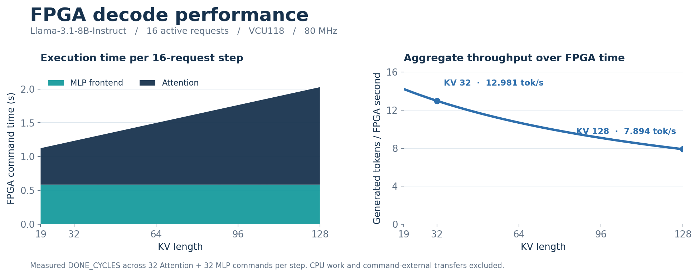
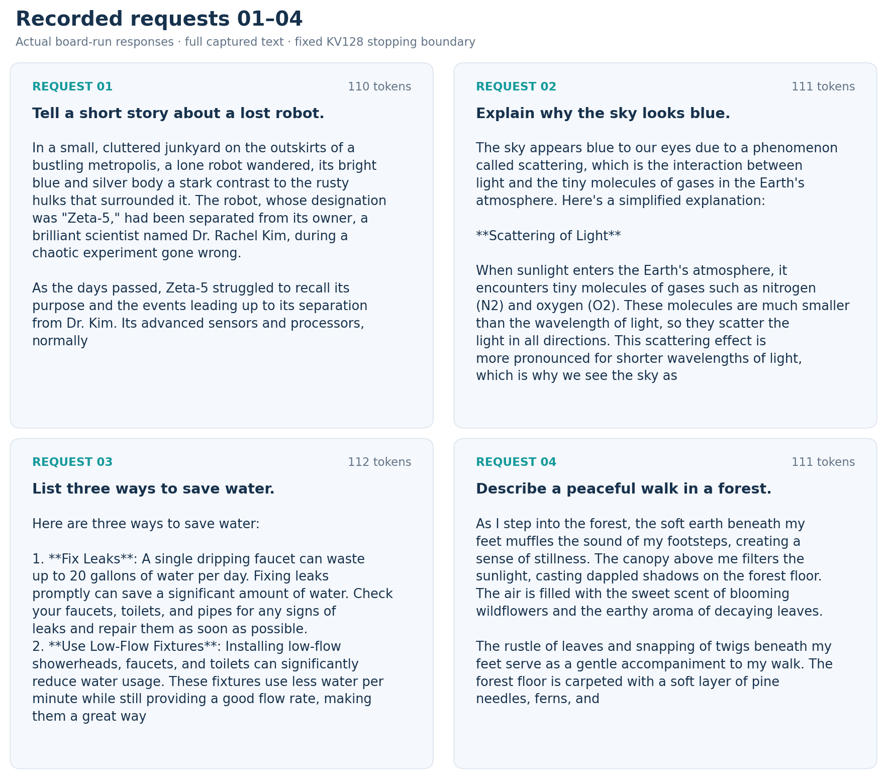
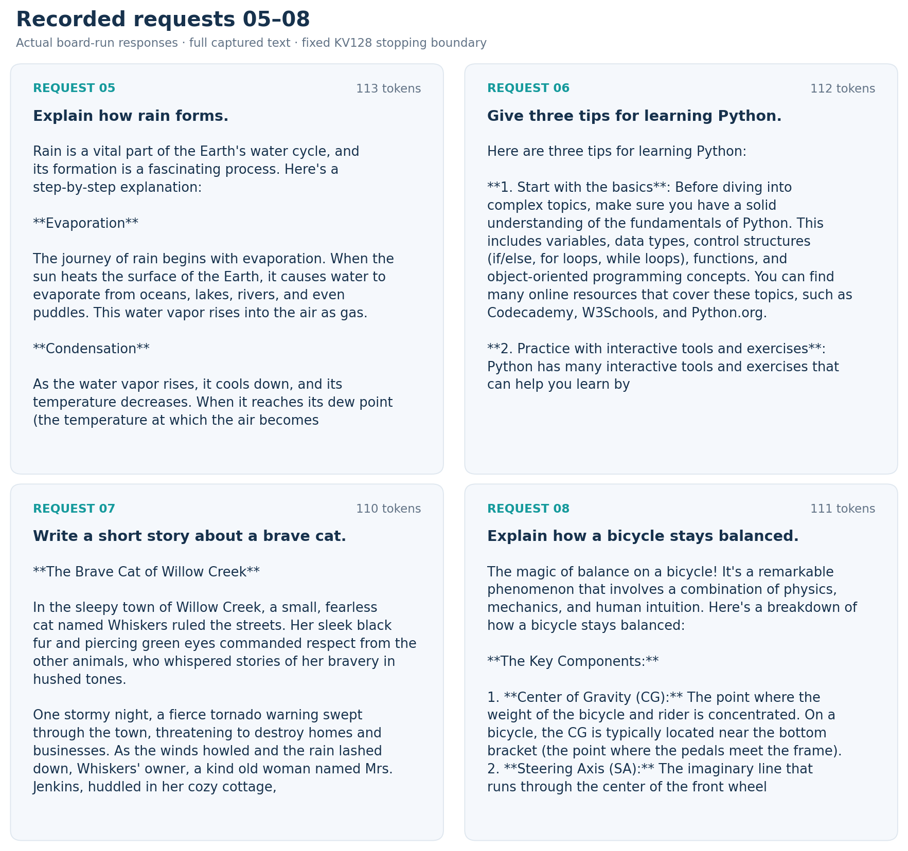
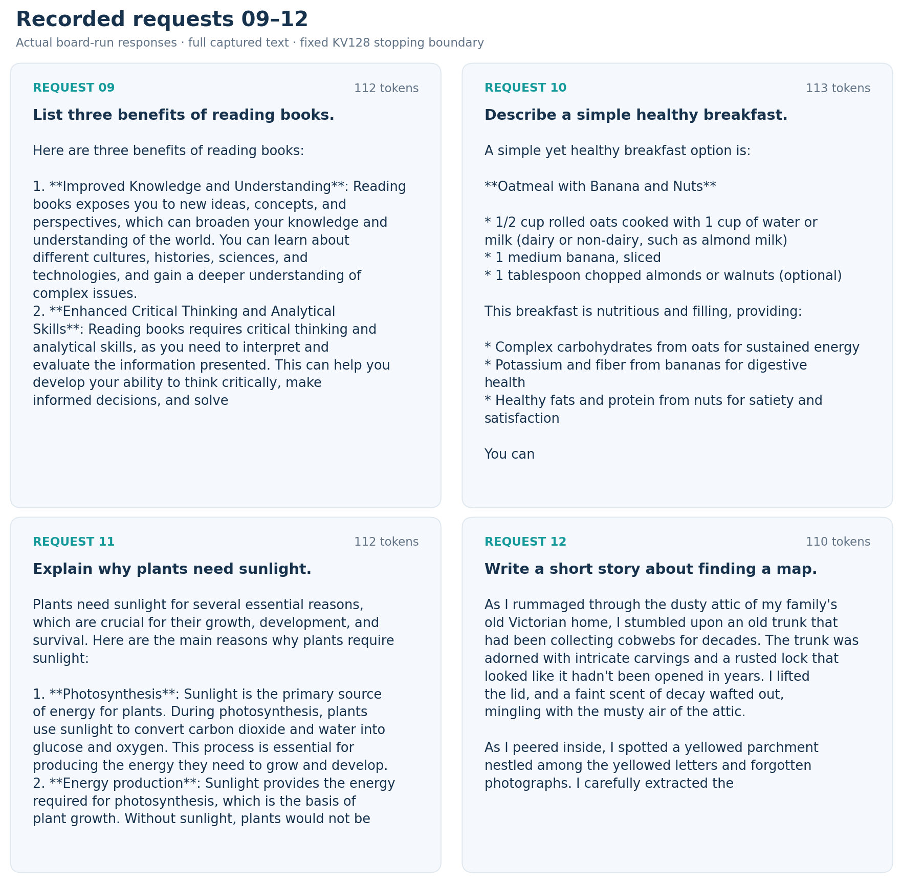
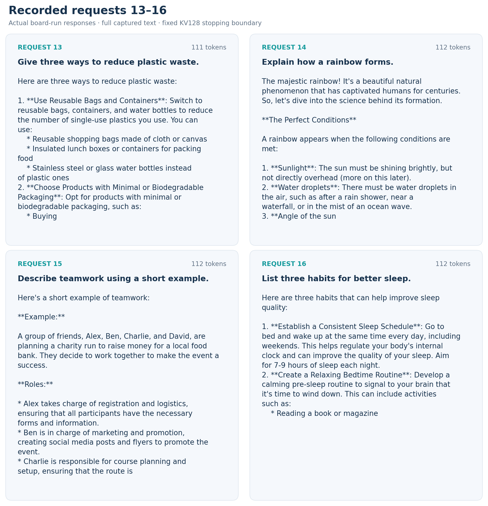

<div align="center">

# ScaleLLM

**Llama-3.1-8B-Instruct · 16 concurrent requests · FPGA decode**

VCU118 / XCVU9P &nbsp; · &nbsp; Decode16 &nbsp; · &nbsp; 80 MHz &nbsp; · &nbsp; KV up to 128

[FPGA performance](#fpga-performance) &nbsp;·&nbsp; [16 requests & outputs](#16-requests--their-recorded-outputs) &nbsp;·&nbsp; [Download measurements](docs/evidence/kv128_chat16/DOWNLOADS.md) &nbsp;·&nbsp; [Run on hardware](docs/DEPLOYMENT.md)

</div>

| Active requests | Executed steps | Generated tokens | FPGA commands |
| :---: | :---: | :---: | :---: |
| **16** | **128** | **1,784** | **8,192** |

Real incremental inference with the released 80 MHz bitstream: all 16 requests reach position 127 using their own valid, committed KV history. The measurements below come from the FPGA's command cycle counters.

## FPGA performance



One decode step emits **16 tokens** and executes **32 Attention + 32 MLP commands**. The table reports their accumulated FPGA execution time and `16 / FPGA time` throughput.

| KV length | Attention | MLP frontend | FPGA time / step | Aggregate FPGA-time throughput |
| ---: | ---: | ---: | ---: | ---: |
| 20 | 0.546444 s | 0.586748 s | **1.133192 s** | **14.119 token/s** |
| 32 | 0.645800 s | 0.586758 s | **1.232558 s** | **12.981 token/s** |
| 64 | 0.910592 s | 0.586770 s | **1.497361 s** | **10.685 token/s** |
| 96 | 1.175346 s | 0.586740 s | **1.762085 s** | **9.080 token/s** |
| 128 | 1.440162 s | 0.586734 s | **2.026896 s** | **7.894 token/s** |

**Timing boundary:** `Σ DONE_CYCLES / 80 MHz`. CPU Down, LM head, other host work and transfers outside hardware commands are excluded. These are FPGA execution metrics; complete-model wall-clock results are available in the [measurement report](docs/evidence/kv128_chat16/README.md#measured-speed).

[Performance CSV: all 128 steps](docs/evidence/kv128_chat16/results/fpga_performance_rounds.csv) · [8,192 raw command records](docs/evidence/kv128_chat16/results/commands.csv) · [Vector figure](docs/evidence/kv128_chat16/showcase/fpga_performance.svg)

## 16 requests & their recorded outputs

All **16 actual requests and their complete captured responses** are shown below. Each generates **110–113 tokens**; together they produce **1,784 tokens**. The run stops at the fixed position-127 boundary, so some responses end mid-sentence. Prompt chat-template delimiters are hidden for readability; generated wording and Markdown markers are preserved.









[Read / copy all 16 responses](docs/evidence/kv128_chat16/REQUESTS_AND_OUTPUTS.md) · [Exact generated token IDs](docs/evidence/kv128_chat16/results/tokens.json) · [Original text log](docs/evidence/kv128_chat16/results/outputs.txt)

## Data & reproduction

The complete board dataset contains raw command and PMBus traces, target input/output/KV captures, exact token records, original receipts and analysis tools. **196 archived files** have been verified; the original **116-file Dell transfer** and **11 derived results** pass independent unpack/recomputation checks.

[Download the complete dataset](docs/evidence/kv128_chat16/DOWNLOADS.md) · [Validation receipt](docs/evidence/kv128_chat16/validation.json) · [Measurement methods](docs/evidence/kv128_chat16/README.md) · [VCCINT telemetry](docs/evidence/kv128_chat16/README.md#what-the-power-data-measures)

```bash
# Verify, unpack and recompute the recorded board measurements offline.
python3 tools/kv128_board_release.py --output outputs/kv128_board --recompute

# Regenerate the performance plot and all 16 response cards (Matplotlib required).
python3 tools/plot_kv128_showcase.py
```

<details>
<summary><b>Hardware, numerical scope and release identity</b></summary>

The FPGA executes Q/K/V and O projection paths, RoPE, KV handling, QK/Softmax/PV, and MLP Gate/Up plus SiLU×Up, with online Hadamard/A8 and scale recovery. CPU work includes embedding, normalization/residuals, Down and the LM head. See [architecture](docs/HARDWARE_ARCHITECTURE.md) and [deployment](docs/DEPLOYMENT.md).

| Placed resource | Used |
| --- | ---: |
| LUT | 701,775 |
| FF | 954,554 |
| BRAM36-equivalent | 709 |
| URAM | 304 |
| DSP | 5,389 |

Core: 80 MHz. DDR user interfaces: 200 MHz. Tool: Vivado 2025.2. This measurement retained the release RTL and bitstream without synthesis, implementation or reprogramming. [Resource/timing evidence](docs/PERFORMANCE_AND_RESOURCES.md).

[Released bitstream](bitstream/ScaleLLM_Final_Decode16_80MHz.bit), SHA-256:

```text
96df1a5c1bf4174921bc02ccd88df4066dece3d62b491acb3106bb90ac0ffc85
```

Command protocol, full-step commit history and recorded LM-head/token consistency checks pass. An independent full-model numerical oracle has not been established. The optional active1 attempt produced no valid command data. Operator-level cycle simulations are a separate experiment, not included in the FPGA counter metrics displayed here.

This fixed-length run retains 16 active requests through position 127; no EOS token occurred. The [earlier 16×32-token run](docs/evidence/inference_chat16/outputs.txt) is preserved separately.

</details>

Project source: [Apache-2.0](LICENSE). External dependencies and model terms: [NOTICE](NOTICE).
