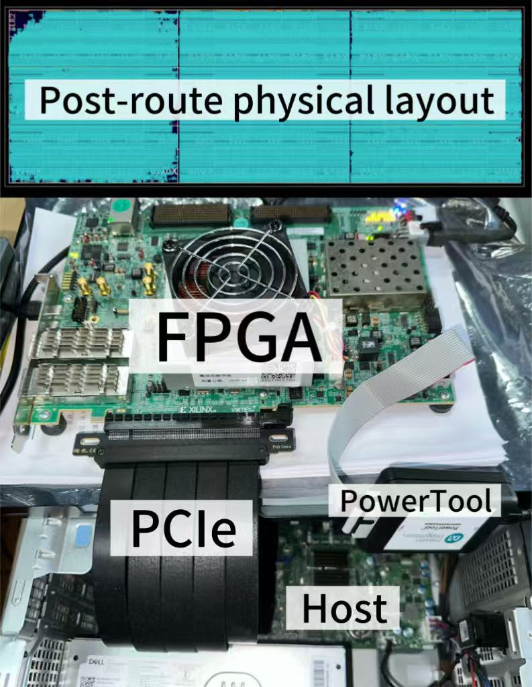
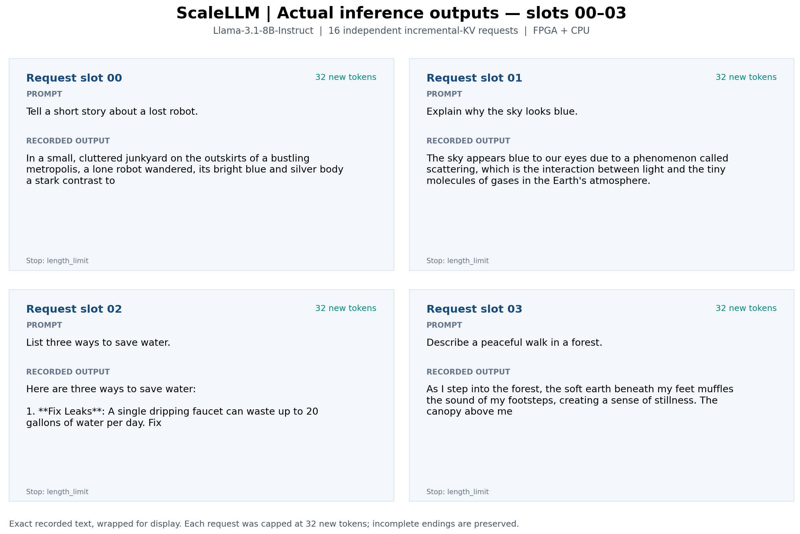
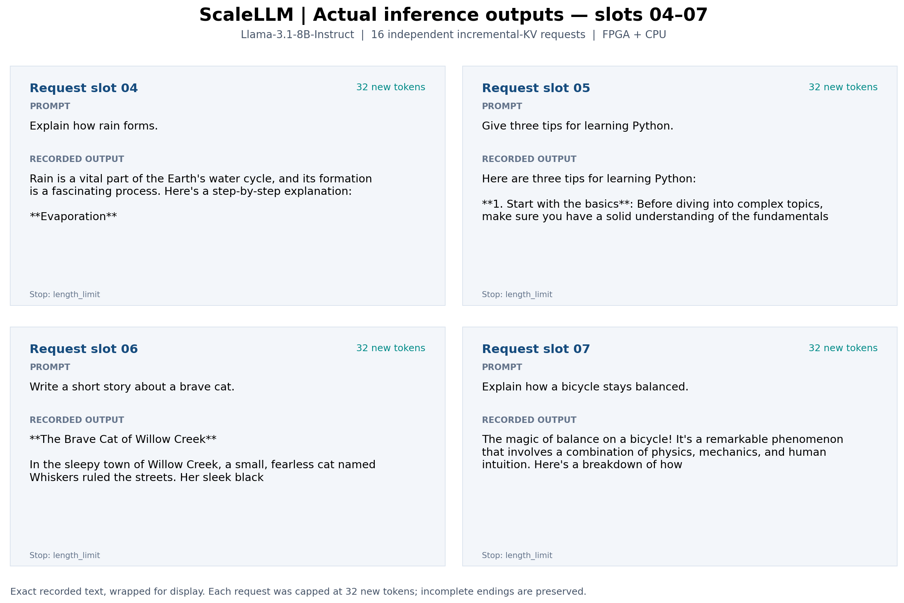
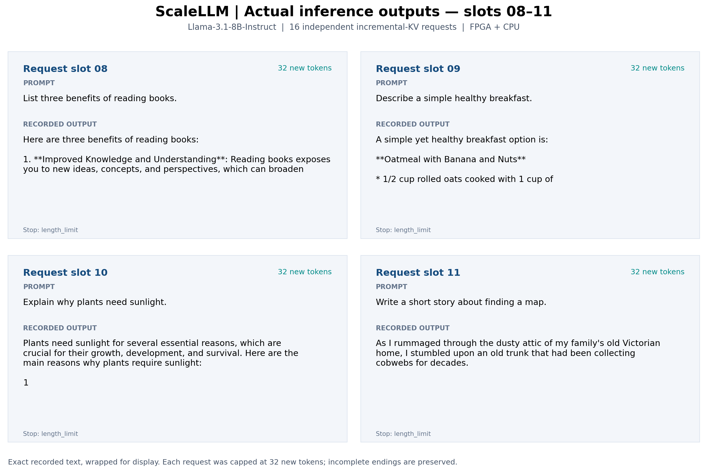
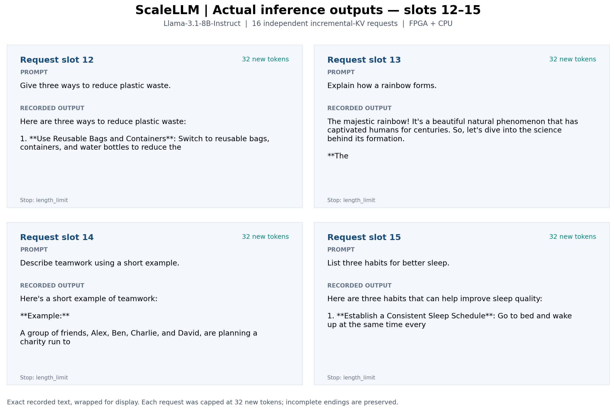

<div align="center">

# ScaleLLM

**Llama-3.1-8B-Instruct · 16 concurrent requests · FPGA decode**

VCU118 / XCVU9P &nbsp; · &nbsp; Decode16 &nbsp; · &nbsp; 80 MHz &nbsp; · &nbsp; All-DSP ScaleCode recovery

[Latest results](#latest-published-evidence) &nbsp;·&nbsp; [Hardware resources](#hardware-resources) &nbsp;·&nbsp; [DSP optimization](#scalecode-dsp-optimization) &nbsp;·&nbsp; [FPGA performance](#fpga-performance) &nbsp;·&nbsp; [Board validation](#board-validation) &nbsp;·&nbsp; [Experimental platform](#experimental-platform) &nbsp;·&nbsp; [16 requests & outputs](#16-requests--their-recorded-outputs) &nbsp;·&nbsp; [Download & verify](#data--reproduction)

</div>

| Requests | Executed rounds | Generated tokens | FPGA commands |
| :---: | :---: | :---: | :---: |
| **16** | **50** | **512** | **3,200** |

The **`Resource_optimization`** branch publishes the all-DSP ScaleCode recovery implementation and its **2026-11-15 Dell / VCU118 board validation**. Each request generates 32 tokens using its own committed KV history. The complete output file matches the sealed reference byte for byte.

[Version guide](resource_optimization/README.md) · [Tested bitstream](resource_optimization/hardware/bitstream/ScaleLLM_Final_Decode16_80MHz.bit) · [106 frozen source inputs](resource_optimization/hardware/source/) · [Complete evidence release](https://github.com/zwj276765037-lab/ScaleLLM/releases/tag/resource-optimization-20261115)

## Latest published evidence

README updated **2026-11-15 (Asia/Shanghai)**. Hardware and measurements for this version are under **`resource_optimization/`**.

| Evidence | Latest result | Scope |
| --- | --- | --- |
| [Hardware resources](#hardware-resources) | **53.50% LUT**, **84.40% DSP**, **92.05% occupied CLB** | Final routed Decode16 implementation on XCVU9P |
| [DSP optimization](#scalecode-dsp-optimization) | **12,824 fewer LUTs**, **192 more DSPs** | All-DSP versus wider-only DSP recovery at the same post-physopt stage |
| [Physical acceptance](resource_optimization/results/physical/final_physical_acceptance.json) | Setup **+0.009 ns**, hold **+0.008 ns** | Zero failing endpoints; complete routing; all 94 bus-skew constraints met |
| [Board inference](#board-validation) | **512 tokens**, **3,200 commands**, exact reference outputs | Original 16-request workload, 32 generated tokens per request |
| [Operator replays](resource_optimization/results/board/replay/report.json) | **12/12 full outputs byte-exact** | Selected Gate/Up and Attention commands at KV32 and KV128 |

The final design closes timing at 80 MHz. SLR1 occupied CLBs remain **99.11%**; **Down projection remains on the CPU**. The resource reduction does not establish capacity for moving Down onto the FPGA.

## Hardware resources

The implementation targets the **VCU118 / XCVU9P**. The compute core runs at **80 MHz**, and the two DDR controller user interfaces run at **200 MHz**.

| Resource | Used | Available | Utilization |
| --- | ---: | ---: | ---: |
| LUT | **632,446** | 1,182,240 | **53.50%** |
| CLB registers | **936,372** | 2,364,480 | **39.60%** |
| Occupied CLB | **136,026** | 147,780 | **92.05%** |
| BRAM36 equivalent | **709** | 2,160 | **32.82%** |
| URAM | **304** | 960 | **31.67%** |
| DSP | **5,773** | 6,840 | **84.40%** |

These counts come from the **final routed** design. CLB registers include 936,370 flip-flops and two AND/OR-configured registers. BRAM36 equivalent is 695 RAMB36 + 28 RAMB18 / 2. Occupied CLBs across SLR0 / SLR1 / SLR2 are **92.46% / 99.11% / 84.57%**.

| Final routed check | Result |
| --- | ---: |
| Setup WNS / TNS | **+0.009 ns / 0** |
| Hold WHS / THS | **+0.008 ns / 0** |
| Failing setup / hold / pulse-width endpoints | **0 / 0 / 0** |
| Fully routed / routable nets | **1,625,124 / 1,625,124** |
| Routing errors | **0** |
| DRC Error / Critical Warning | **0 / 0** |
| Bus-skew constraints | **94 MET**, minimum slack **+3.103 ns** |

[Routed utilization](resource_optimization/results/physical/route/utilization.rpt) · [Per-SLR resources](resource_optimization/results/physical/route/utilization_slr.rpt) · [Final timing](resource_optimization/results/physical/route/timing_summary.rpt) · [Resource CSV](resource_optimization/results/resources.csv) · [Bus-skew audit](resource_optimization/results/physical/final_bus_skew_audit/result.json)

## ScaleCode DSP optimization

The hardware change is confined to four `use_dsp` attributes in [the ScaleCode recovery leaf](resource_optimization/hardware/source/project/hardware/rtl/mlp/hap_a8w4_scalecode_recover2_lut.sv): `no` becomes `yes`. The 96 recovery leaves use **four DSPs each**, or **384 DSPs** in total. The other frozen RTL, ROM, ABI and XDC inputs are unchanged.

Two candidates were compared in the same build context at **post-physopt**, before routing:

| Recovery mapping | LUT | DSP | Occupied CLB |
| --- | ---: | ---: | ---: |
| Wider multiplications in DSP (`dsp_raw_only`) | 645,270 | 5,581 | 132,516 |
| All multiplications in DSP (`dsp_all`) | **632,446** | **5,773** | **136,026** |
| All minus wider-only | **−12,824** | **+192** | **+3,510** |

All-DSP recovery reduces LUT use while increasing DSP use and occupied CLBs. Final routing, bitstream generation and board validation were completed for **`dsp_all`**. The wider-only run stopped at the former eight-hour limit; it has no final routing result. Fixed elapsed-time termination was subsequently disabled for the completed all-DSP run.

The historical **701,775-LUT / 5,389-DSP** baseline is from a different implementation at the Fully Placed stage. Its full difference from the new routed counts is not a controlled measure of the DSP change.

[Comparison CSV](resource_optimization/results/comparison_post_physopt.csv) · [Original candidate reports](resource_optimization/results/comparison/) · [Source identity and build record](resource_optimization/README.md#hardware-change-and-source-identity)

## FPGA performance

The following two steps are from **this version's board run**. Each has 16 active requests, emits 16 tokens and executes **32 Attention + 32 MLP frontend commands**.

| KV length | Attention | MLP frontend | FPGA time / step | Aggregate FPGA-time throughput |
| ---: | ---: | ---: | ---: | ---: |
| 20 | 0.546501 s | 0.586741 s | **1.133243 s** | **14.119 token/s** |
| 32 | 0.645753 s | 0.586765 s | **1.232518 s** | **12.982 token/s** |

**Timing boundary:** `Σ DONE_CYCLES / 80 MHz`; throughput is `16 / FPGA time`. The rows are recomputed from commands **1,217–1,280** and **1,985–2,048** in [the recorded run](resource_optimization/results/board/inference/run.json). CPU Down, LM head, other host work and transfers outside hardware commands are excluded.

Across all 3,200 commands, the recorded FPGA counter total is **4,657,997,368 cycles**, or **58.224967 s**. The model window takes **3,312.597651 s**; the complete native process, including startup asset hashes, takes **3,368.984946 s (56 min 8.985 s)**. These wall times include host work and transfers.

Requests retire when they reach 32 generated tokens, so the 50-round run is not a fixed-16-request KV sweep. This image has selected operator replay coverage at KV128; a complete 128-step model run and new power measurements have not been performed.

[Raw command counters and round times](resource_optimization/results/board/inference/run.json) · [Board regression audit](resource_optimization/results/board/inference/regression.json) · [Historical KV128 performance](docs/evidence/kv128_chat16/README.md) · [Historical power measurements](docs/evidence/kv128_sevenrail_power/REPORT.md)

## Board validation

The exact new bitstream was programmed into **volatile SRAM** on the Dell-connected VCU118. An initial all-ones PCIe read was resolved by restarting the exact XDMA device. The installed driver was unchanged and configuration Flash was not written.

| Check | Result |
| --- | --- |
| Programmed image, ABI, clocks, formats and final idle state | **PASS** |
| DDR0 / DDR1 write and readback | **196,608 bytes each, byte-exact** |
| Selected Gate/Up and Attention replays | **12/12 full outputs byte-exact** |
| Original requests and generated tokens | **16 × 32 = 512 tokens** |
| Complete rounds / hardware commands | **50 / 3,200** |
| Token, position, epoch and retirement history | **PASS** |
| Submission, two completion snapshots, output and ACK audit | **PASS**, 934,209 IO records |
| Complete output file against sealed reference | **Byte-identical** |
| Native exit / final device state | **0 / idle**, handles closed, lease released |

The 12 replays cover Gate/Up layer 0 and Attention layers 0, 8, 16, 24 and 31 at each of KV32 and KV128. Six selected KV32 commands within the full run also match the reference input and output hashes. The complete [outputs.json](resource_optimization/results/board/inference/outputs.json) is 12,126 bytes with SHA-256 `975c342521ebe538da25cf9d52426c7a65c57632fa256375c2930ce26e04a034`.

[Regression checks](resource_optimization/results/board/inference/regression.json) · [Operator replay results](resource_optimization/results/board/replay/report.json) · [Board closure receipt](resource_optimization/results/board/board_stage_closure.json) · [Transfer verification](resource_optimization/results/board/transfer_verification.json)

## Experimental platform

The experiment uses the **VCU118 board**, dual DDR4 and a **PCIe connection to the Dell host**. The photograph below is the shared platform reference from `main`; its upper layout panel belongs to the historical baseline. The current implementation's physical evidence is the [routed checkpoint and reports](resource_optimization/README.md#complete-raw-evidence-and-routed-checkpoint).

<p align="center">
  
</p>

| Component | Configuration |
| --- | --- |
| FPGA | VCU118, XCVU9P (`xcvu9p-flga2104-2L-e`) |
| Weight memory | Two DDR4-1600 channels, 2 GiB each; **25.6 GB/s nominal aggregate bandwidth** |
| Host interface | PCIe Gen3 ×8 with XDMA |
| Compute / DDR interface clocks | **80 MHz / 200 MHz** |
| Implementation tool | Vivado 2025.2 |
| Board programming | Vivado Hardware Manager 2022.2; volatile SRAM |

The FPGA executes Attention projections, RoPE, KV handling, QK/Softmax/PV and MLP Gate/Up with SiLU×Up. The host executes embedding, normalization, residual operations, **Down projection** and the LM head. PowerTool appears in the platform photograph; power measurements linked above retain their historical bitstream identity.

[Hardware architecture](docs/HARDWARE_ARCHITECTURE.md) · [This version's source](resource_optimization/hardware/source/) · [Programming and verification](resource_optimization/README.md#verify-and-use-the-publication)

## 16 requests & their recorded outputs

All **16 requests and their complete 32-token responses** are shown below. Together they produce **512 tokens**. Each request stops at its length limit, so some responses end mid-sentence. The cards are reused from the sealed reference: this version's complete output file is byte-identical to that reference. Prompt delimiters are hidden for readability; generated wording and Markdown markers are preserved.









[Exact outputs and token IDs from this run](resource_optimization/results/board/inference/outputs.json) · [Read / copy the matching reference text](docs/evidence/inference_chat16/outputs.txt) · [Original requests](examples/requests16.json)

## Data & reproduction

The branch contains the **tested bitstream**, all **106 frozen source inputs**, final resource and timing reports, both DSP candidates' comparison evidence and readable board results. The supporting release provides the complete raw evidence and final routed checkpoint:

| Download | Contents | Size |
| --- | --- | ---: |
| [Tested bitstream](resource_optimization/hardware/bitstream/ScaleLLM_Final_Decode16_80MHz.bit) | Board-validated Decode16 / 80 MHz image | 80.16 MB |
| [Complete raw evidence ZIP](https://github.com/zwj276765037-lab/ScaleLLM/releases/download/resource-optimization-20261115/ScaleLLM_Resource_optimization_20261115_evidence.zip) | 520 original files plus manifest; full XDMA trace, build logs and board evidence | 23.20 MB |
| [Final routed DCP](https://github.com/zwj276765037-lab/ScaleLLM/releases/download/resource-optimization-20261115/ScaleLLM_Resource_optimization_Decode16_80MHz_routed.dcp) | Implemented design checkpoint | 668.82 MB |
| [SHA256SUMS](https://github.com/zwj276765037-lab/ScaleLLM/releases/download/resource-optimization-20261115/SHA256SUMS) | Hashes for the ZIP and DCP | 242 bytes |

Sizes use decimal MB. [Exact sizes, hashes and download URLs](resource_optimization/downloads.json) · [Release](https://github.com/zwj276765037-lab/ScaleLLM/releases/tag/resource-optimization-20261115)

```bash
# Verify the version files, frozen source inputs and exact tested bitstream.
python3 resource_optimization/verify_publication.py

# Also verify downloaded evidence and the routed checkpoint.
python3 resource_optimization/verify_publication.py \
  --archive /path/to/ScaleLLM_Resource_optimization_20261115_evidence.zip \
  --checkpoint /path/to/ScaleLLM_Resource_optimization_Decode16_80MHz_routed.dcp

# Recompute the recorded board audit offline; no hardware access is needed.
unzip /path/to/ScaleLLM_Resource_optimization_20261115_evidence.zip -d raw
python3 raw/mlp_scalecode_dsp_board/board_test/scripts/verify_inference.py \
  --repository-root . --board-test-root raw/mlp_scalecode_dsp_board/board_test
```

The archived audit was reproduced offline: all 512 tokens, 50 rounds and 3,200 commands pass, and the recomputed output and audit files match the original bytes. [Programming instructions and build provenance](resource_optimization/README.md) describe the exact source closure, tool dependencies and as-run scripts.

<details>
<summary><b>Numerical scope and release identity</b></summary>

This version's [bitstream](resource_optimization/hardware/bitstream/ScaleLLM_Final_Decode16_80MHz.bit) has SHA-256:

```text
5d78519aa10695be564f668d5a41a0e5554e282c31d39f648534a7dc01ab72f7
```

The board evidence establishes regression equivalence to the sealed reference, including complete token outputs, selected operator outputs and the hardware submission/completion/ACK chain. An independent complete-model mathematical oracle remains **NOT_ESTABLISHED**. This version has no new power measurement or complete 128-step model run.

The root `project/hardware`, `bitstream` and `deploy` directories retain the historical **`96df1a5c…`** image and its identity checks. Use **`resource_optimization/`** for the new hardware, programming entry and results. Historical KV128 performance, power reports and layout imagery keep their earlier measurement scope.

The raw evidence preserves failed attempts and original receipts. The build-time bitstream receipt says `board_programming=NOT_RUN`; the later board closure records the actual November 15 PASS. Model weights, vendor tools, licenses and installed drivers are external dependencies. As-run build scripts preserve original machine paths; adapting them does not guarantee identical placement or bitstream bytes.

[Detailed version guide](resource_optimization/README.md) · [Machine-readable results](resource_optimization/results/summary.json) · [Historical experiment index](docs/EXPERIMENTS.md)

</details>

Project source: [Apache-2.0](LICENSE). External dependencies and model terms: [NOTICE](NOTICE).
