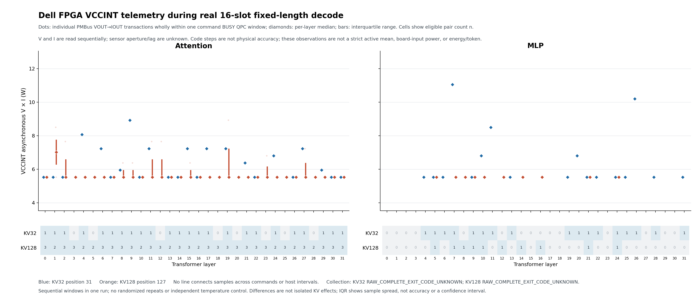

# ScaleLLM — 16-request FPGA inference on VCU118

ScaleLLM runs **Llama-3.1-8B-Instruct** with 16 independent incremental-KV request slots on an AMD/Xilinx **VCU118 (XCVU9P)**. The published Decode16 design uses an **80 MHz core**, **200 MHz DDR user interfaces**, and Vivado **2025.2**. This repository contains the tested bitstream, RTL/project generator, host runtime, deployment instructions and measured evidence.

The latest completed board experiment reaches **KV=128 with all 16 requests active**: **128 steps, 8,192 FPGA commands, and 1,784 actual generated tokens**. The complete collected dataset, exact token outputs, timing records, PMBus raw data and offline verification tools are now published in [KV128 board measurements](docs/evidence/kv128_chat16/README.md).

## Latest measured results

The original 16 prompts are processed by real incremental inference through position 127. Each request has valid, committed KV at positions 0–126 before that step. All 32 layers, CPU postprocessing, the final LM head and token commit complete before stopping.

| Same instrumented run; 16 requests, all 32 layers | KV32 / position31 | KV128 / position127 |
| --- | ---: | ---: |
| Attention command cycles, sum of 32 commands | 51,663,975 | 115,212,977 |
| MLP command cycles, sum of 32 commands | 46,940,628 | 46,938,732 |
| FPGA command time, total cycles / 80 MHz | 1.2325575375 s | 2.0268963625 s |
| Complete measured step wall time | 71.312 s | 97.453 s |
| Actual generated tokens in the step | 16 | 16 |
| Aggregate measured step throughput | 0.2243662 token/s | 0.1641817 token/s |

The complete model timing window is **9,843.491879 s**, yielding **0.1812365 generated token/s across the 16 requests**. It includes asset initialization, CPU/FPGA computation, transfers and runtime observation/capture, with exact boundaries documented in the [measurement report](docs/evidence/kv128_chat16/README.md#measured-speed). Capture overhead was not separately established or subtracted.

FPGA command time is a separate counter-derived metric. It excludes CPU Down and work outside the command; it must not be presented as full-model end-to-end latency. The latest run is a fixed-length workload with 110–113 generated tokens per request. It is not the older 16×32-token experiment, and 128 execution steps do not mean 128 generated tokens per request. EOS retirement was disabled to retain 16 active slots; no EOS token actually occurred in these recorded trajectories.

[All prompts and generated text](docs/evidence/kv128_chat16/results/outputs.txt) · [Exact token IDs](docs/evidence/kv128_chat16/results/tokens.json) · [8,192 command records](docs/evidence/kv128_chat16/results/commands.csv) · [Machine-readable summary](docs/evidence/kv128_chat16/results/summary.json)

## Measured power: VCCINT telemetry

The new measurements read **VCCINT regulator output voltage/current through PMBus**. Only complete sequential V/I read pairs contained within a command's conservative BUSY window are selected:

| KV | Command | Eligible pairs | Commands covered | Telemetry V×I median | Range |
| --- | --- | ---: | ---: | ---: | ---: |
| 32 | Attention | 24 | 24/32 | 5.7375 W | 5.525–8.925 W |
| 32 | MLP | 17 | 17/32 | 5.5250 W | 5.525–11.050 W |
| 128 | Attention | 87 | 32/32 | 5.5250 W | 5.525–8.925 W |
| 128 | MLP | 10 | 10/32 | 5.5250 W | 5.525–5.525 W |

These are **conditional telemetry observations**, not a precise execution-period average or whole-board input power. Sensor measurement history/update lag is unknown; V and I are read sequentially, and command coverage is incomplete. Observed POUT code spacing is 2 W and V×I code spacing is 0.425 W. Repeated readings or extra decimal places do not imply constant power or higher physical accuracy. **Strict active mean power, whole-board input power, active energy and J/token remain unestablished.**



[SVG](docs/evidence/kv128_chat16/results/vccint_kv32_kv128_conditional.svg) · [Raw-data scope and limitations](docs/evidence/kv128_chat16/README.md#what-the-power-data-measures) · [Power summary](docs/evidence/kv128_chat16/results/power_summary.json)

## Complete dataset and offline reproduction

The [KV128 evidence directory](docs/evidence/kv128_chat16/README.md) contains online CSV/JSON/text/figures and the complete compressed board-data archive. Its manifest preserves all collected main-run data, 12 target input/output/KV captures, original receipts, failed attempts and analysis scripts. **116 Dell main-run files totaling 790,194,966 bytes passed SHA-256 transfer verification.** Archive parts, when needed, are stored directly in Git; no Git LFS installation is required.

After cloning, verify and unpack the archive and recompute the measurements offline:

```bash
python3 tools/kv128_board_release.py --output outputs/kv128_board --recompute
```

This uses Python 3.10+ and its standard library; it does not connect to the board. It verifies every packaged file, then checks command/commit history, captured payload hashes, actual token records and PMBus statistics against the published outputs. See the [publisher-side validation receipt](docs/evidence/kv128_chat16/validation.json).

Protocol, transfer, complete-step commit and recorded LM-head/token consistency checks pass. An independent complete-model numerical oracle is **not established**. The optional single-active-request attempt failed before issuing a command and has no valid performance result. Operator-level cycle simulation is still being completed and is not included as a board measurement in this release.

## Hardware and host boundary

| FPGA, 80 MHz core | CPU host |
| --- | --- |
| Attention: online Hadamard H32 → A8 → Q/K/V; RoPE, per-request KV, QK/Softmax/PV; online H32 → A8 → O projection | Embedding, normalization and residual additions |
| MLP: online H32 → A8 → Gate/Up with scale recovery → SiLU(gate) × Up | Post-product H32/A8, **Down matrix multiplication**, final normalization and LM head |

Each request has its own KV position and epoch. One step processes one position for each active request through all 32 layers; tokens are committed at the step boundary. Requests share weights and the accelerator. Down runs on the CPU; there is no GPU dependency. See [architecture and numerical boundaries](docs/HARDWARE_ARCHITECTURE.md).

The placed design uses **701,775 LUTs, 954,554 FFs, 709 BRAM36-equivalent tiles, 304 URAMs and 5,389 DSPs**. The final routed timing report gives WNS +0.017 ns and WHS +0.002 ns. These resource counts are from placement, not routed utilization. See [original resource/timing reports](docs/PERFORMANCE_AND_RESOURCES.md).

The tested [80 MHz bitstream](bitstream/ScaleLLM_Final_Decode16_80MHz.bit) is 80,159,263 bytes, with SHA-256:

```text
96df1a5c1bf4174921bc02ccd88df4066dece3d62b491acb3106bb90ac0ffc85
```

The new measurements retain this release and its production RTL without synthesis, implementation, programming or reset. Independent configuration-memory readback was not performed; the recorded identity chain is explained in the evidence report.

## Run the supplied bitstream

```bash
git clone --branch main https://github.com/zwj276765037-lab/ScaleLLM.git
cd ScaleLLM
python3 deploy/scalellm.py dry-run
```

Physical inference requires a Windows x64 host, PCIe-connected VCU118, the documented XDMA driver, and a licensed Llama-3.1-8B-Instruct checkpoint. Follow [Deployment](docs/DEPLOYMENT.md) for dependencies, model export, configuration, device checks and programming. After setup:

```powershell
.\.venv\Scripts\python.exe deploy/scalellm.py --config deploy/config.local.json prepare --messages examples/messages16.json --result outputs/prepared16
.\.venv\Scripts\python.exe deploy/scalellm.py --config deploy/config.local.json preflight --models --device --requests outputs/prepared16/requests.json
.\.venv\Scripts\python.exe deploy/scalellm.py --config deploy/config.local.json run --requests outputs/prepared16/requests.json --result outputs/chat16
```

These are the standard runtime commands, not an automatic replay of the fixed-length KV128 measurement wrapper. The archive preserves the as-run capture code and requests. See [Inference](docs/INFERENCE.md) for lifecycle/counter semantics and [driver preparation](deploy/driver/README.md) for driver requirements and its recorded source-provenance limitation.

## Rebuild, historical evidence and license

[Build hardware](docs/BUILD_HARDWARE.md) documents the Vivado 2025.2 build. The supplied bitstream has a fixed identity; physical results from a rebuild may differ. The portable runtime's validation scope is documented in [runtime validation](docs/evidence/final/runtime_validation.json) and [release review](docs/evidence/final/release_validation.json).

The earlier [16×32-token outputs](docs/evidence/inference_chat16/outputs.txt), [counter-derived performance](docs/PERFORMANCE_AND_RESOURCES.md) and [seven-regulator full-run power experiment](docs/evidence/power_chat16/README.md) remain archived. Their different workload and measurement windows are not relabelled as the new KV128 results. The older seven-rail full-run average includes host/transfer gaps and is not a strict command-active or whole-board input figure.

See [Workspace layout](docs/WORKSPACE_LAYOUT.md) for the original source map. Project-authored source is [Apache-2.0](LICENSE). Model/tokenizer assets, AMD tools/IP/board files, power-tool binaries and drivers retain their own terms; see [NOTICE](NOTICE). The dataset contains measured traces and captured tensors, not the model-weight checkpoint or vendor tool binaries.
