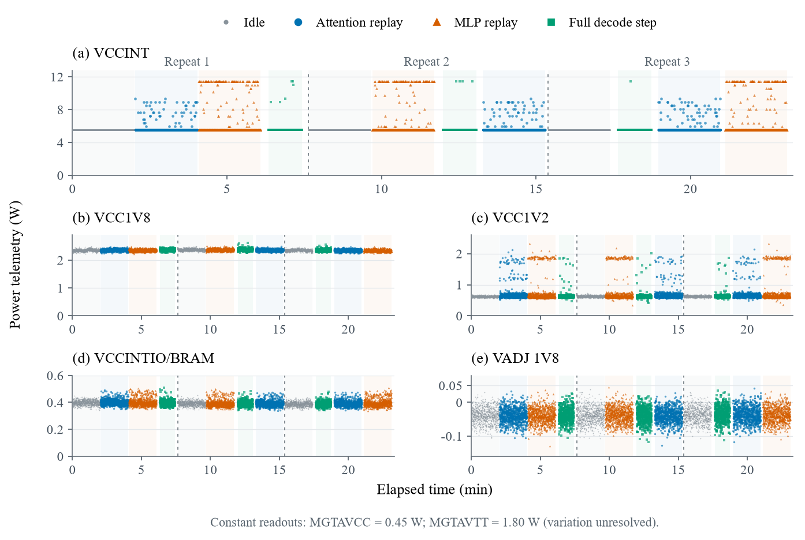
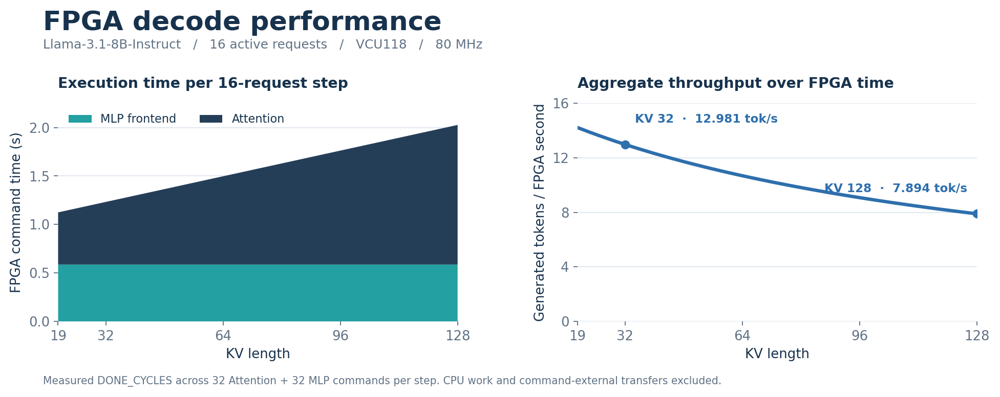
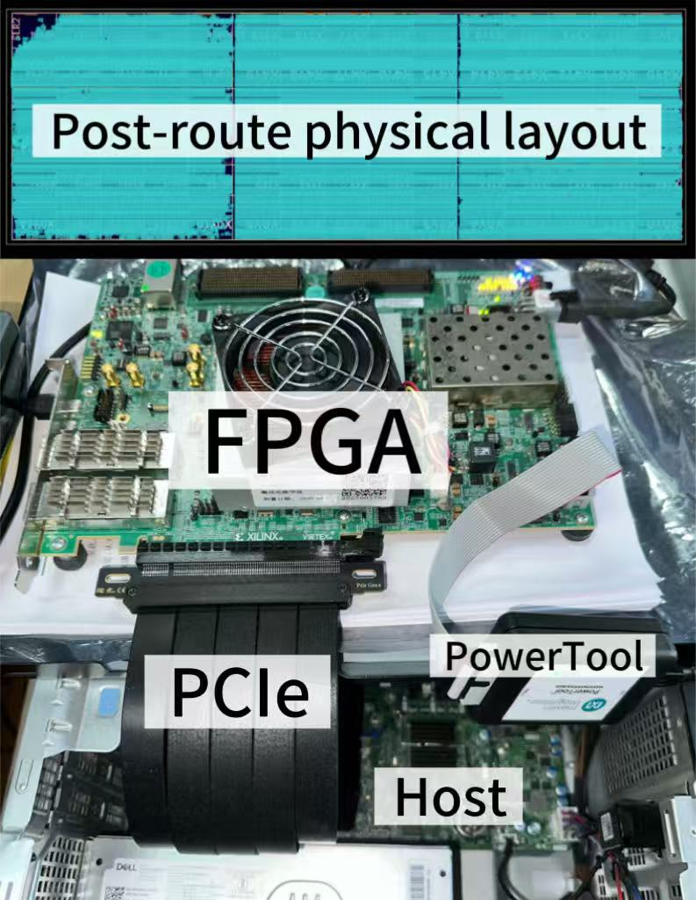
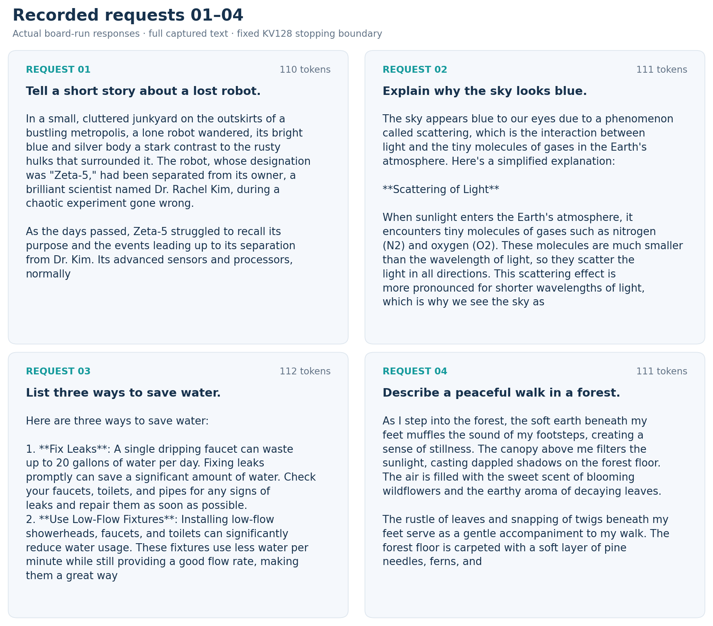
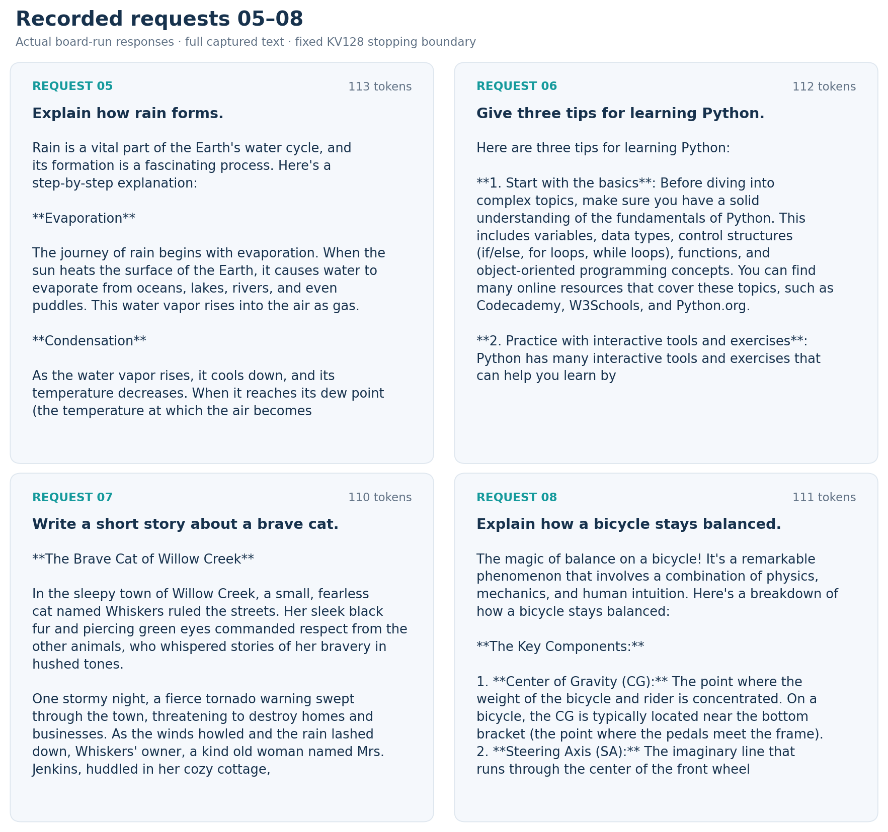
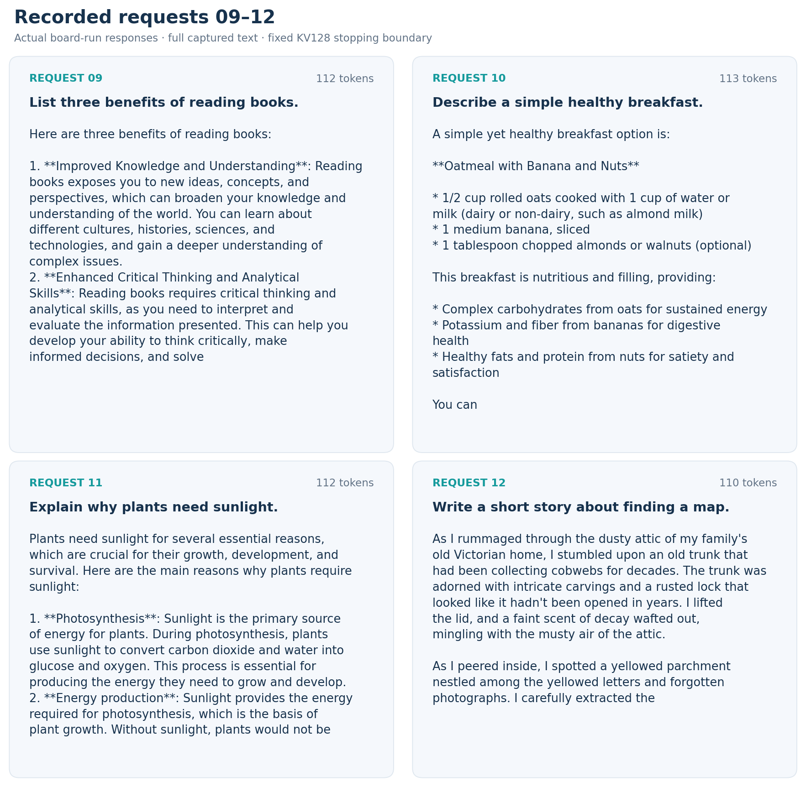
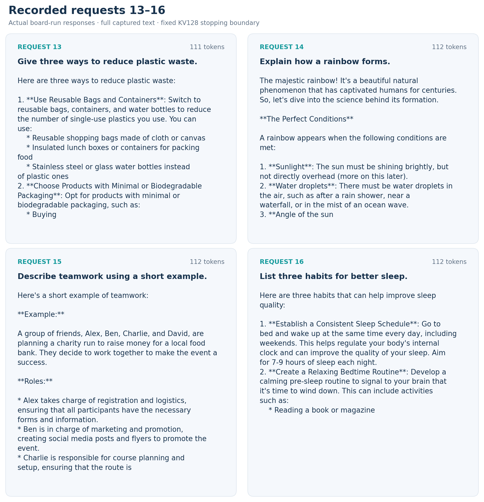

<div align="center">

# ScaleLLM

**Llama-3.1-8B-Instruct · 16 concurrent requests · FPGA decode**

VCU118 / XCVU9P &nbsp; · &nbsp; Decode16 &nbsp; · &nbsp; 80 MHz &nbsp; · &nbsp; KV up to 128

[Latest results](#latest-published-evidence) &nbsp;·&nbsp; [Experiment index](docs/EXPERIMENTS.md) &nbsp;·&nbsp; [FPGA performance](#fpga-performance) &nbsp;·&nbsp; [Hardware resources](#hardware-resources) &nbsp;·&nbsp; [Layout & platform](#post-route-layout-and-experimental-platform) &nbsp;·&nbsp; [16 requests & outputs](#16-requests--their-recorded-outputs) &nbsp;·&nbsp; [Power retest](#seven-rail-power-retest) &nbsp;·&nbsp; [Download evidence](docs/EXPERIMENTS.md#downloads-provenance-and-limits) &nbsp;·&nbsp; [Run on hardware](docs/DEPLOYMENT.md)

</div>

| Active requests | Executed steps | Generated tokens | FPGA commands |
| :---: | :---: | :---: | :---: |
| **16** | **128** | **1,784** | **8,192** |

Real incremental inference with the released 80 MHz bitstream: all 16 requests reach position 127 using their own valid, committed KV history. FPGA performance below uses hardware command cycle counters. Hardware resources, routed timing and power telemetry are reported with their respective measurement boundaries.

## Latest published evidence

README updated **2026-11-04 (Asia/Shanghai)**. The released Decode16 / 80 MHz bitstream is unchanged.

| Evidence | Latest result | Scope |
| --- | --- | --- |
| [Seven-rail PMBus retest](#seven-rail-power-retest) | **11.18 W**, repeat SD **0.04 W**, for a complete KV128 decode step | Three repeats; 32 layers plus CPU work; sum of seven selected regulator outputs |
| [Board inference](#fpga-performance) | **2.026896 s / step**, **7.894 token/s** at KV128 | FPGA command time only; 16 tokens per step; host wall time reported separately |
| [Hardware resources](#hardware-resources) | **59.36% LUT**, **78.79% DSP** | Fully placed Decode16 implementation on XCVU9P |
| [Layout & experimental platform](#post-route-layout-and-experimental-platform) | **VCU118**, dual DDR4, PCIe Gen3 ×8 | Post-route layout, host connection and PowerTool setup |

**Power measurement boundary:** 11.18 W is the complete-step seven-regulator-output telemetry mean. Whole-board input power and a strict command-BUSY power mean remain unestablished. The overall power dataset is **PARTIAL_WITH_LIMITS**; Attention/MLP replay means cover only the measured portions of their windows.

[Read the latest power report](docs/evidence/kv128_sevenrail_power/REPORT.md) · [Download raw power evidence (56.1 MB ZIP)](https://github.com/zwj276765037-lab/ScaleLLM/releases/download/evidence-kv128-sevenrail-20261102/ScaleLLM_KV128_SevenRail_PMBus_20261102.zip) · [Release, checksums and validation](https://github.com/zwj276765037-lab/ScaleLLM/releases/tag/evidence-kv128-sevenrail-20261102)

## Seven-rail power retest

The released image was measured with 16 active requests at KV128/position127. A complete step includes all 32 layers, CPU operators, LM head and token commit. These values sum **seven selected regulator outputs**, not all board inputs. Each repeat uses a time-weighted mean over its stated coverage; the table gives the equally weighted mean and sample standard deviation across three repeats. Repeat SD describes reproducibility, not sensor accuracy.

| Workload, n=3 | Mean ± repeat SD / W | Time support |
| --- | ---: | --- |
| Idle | 11.112 ± 0.012 | Complete windows |
| Repeated Attention | 11.339 ± 0.019 | 97.06–98.53% common coverage only |
| Repeated MLP frontend | 12.077 ± 0.036 | 97.50–97.92% common coverage only |
| Complete KV128 step | **11.182 ± 0.041** | **Complete windows** |



[Download this figure (PNG)](docs/evidence/kv128_sevenrail_power/showcase/sevenrail_power_telemetry.png) · [Repeat means and coverage chart](docs/evidence/kv128_sevenrail_power/results/main_004_v2_summary.png)

The six Attention/MLP full-window means remain null; gaps were not filled or discarded to claim complete coverage. VCCINT V×I has a 0.425 W code step versus READ_POUT's 2 W, but the two MGT rails remain constant-coded. Unknown sensor averaging/lag, sequential reads and current-offset ambiguity prevent a strict physical BUSY mean. The original launcher FAIL caused by an unobserved BUSY transition, and its unknown sampler exit, remain preserved. Overall measurement status is **PARTIAL_WITH_LIMITS**.

[Complete report and seven-rail tables](docs/evidence/kv128_sevenrail_power/REPORT.md) · [CSV, PNG/SVG and raw archive](docs/evidence/kv128_sevenrail_power/DOWNLOADS.md) · [Power methods](docs/POWER_MEASUREMENT.md)

## FPGA performance



One decode step emits **16 tokens** and executes **32 Attention + 32 MLP commands**. The table reports their accumulated FPGA execution time and `16 / FPGA time` throughput.

| KV length | Attention | MLP frontend | FPGA time / step | Aggregate FPGA-time throughput |
| ---: | ---: | ---: | ---: | ---: |
| 20 | 0.546444 s | 0.586748 s | **1.133192 s** | **14.119 token/s** |
| 32 | 0.645800 s | 0.586758 s | **1.232558 s** | **12.981 token/s** |
| 64 | 0.910592 s | 0.586770 s | **1.497361 s** | **10.685 token/s** |
| 96 | 1.175346 s | 0.586740 s | **1.762085 s** | **9.080 token/s** |
| 128 | 1.440162 s | 0.586734 s | **2.026896 s** | **7.894 token/s** |

**Timing boundary:** `Σ DONE_CYCLES / 80 MHz`. CPU Down, LM head, other host work and transfers outside hardware commands are excluded. These are FPGA execution metrics; complete-model wall-clock results are available in the [measurement report](docs/evidence/kv128_chat16/README.md#measured-speed).

[Performance CSV: all 128 steps](docs/evidence/kv128_chat16/results/fpga_performance_rounds.csv) · [8,192 raw command records](docs/evidence/kv128_chat16/results/commands.csv) · [Vector figure](docs/evidence/kv128_chat16/showcase/fpga_performance.svg)

The complete host–FPGA step takes **71.312 s at KV32** and **97.453 s at KV128**, emitting 16 tokens in each target step: **0.224366** and **0.164182 token/s**, respectively. Across the recorded run, 1,784 generated tokens in the defined 9,843.491879 s model window give **0.181236 token/s**. These wall times include host computation, transfers and capture overhead; they are not the FPGA-time throughput in the table above.

## Hardware resources

The released Decode16 design targets the **VCU118 / XCVU9P**. The compute core
runs at **80 MHz**, and the two DDR controller user interfaces run at **200 MHz**.

| Resource | Used | Available | Utilization |
| --- | ---: | ---: | ---: |
| LUT | **701,775** | 1,182,240 | **59.36%** |
| CLB registers | **954,554** | 2,364,480 | **40.37%** |
| BRAM36 equivalent | **709** | 2,160 | **32.82%** |
| URAM | **304** | 960 | **31.67%** |
| DSP | **5,389** | 6,840 | **78.79%** |

These counts come from the **Fully Placed** utilization report. CLB registers
include 954,552 flip-flops and two AND/OR-configured registers; BRAM36 equivalent
is 695 RAMB36 + 28 RAMB18 / 2. Resource counts were not separately reported after
the subsequent routing and hold-repair steps.

| Final routed check | Result |
| --- | ---: |
| Setup WNS | **+0.017 ns** |
| Hold WHS | **+0.002 ns** |
| Failing setup / hold / pulse-width endpoints | **0 / 0 / 0** |
| Routing errors | **0** |

[Placed resource report](docs/evidence/final/resources_placed_slr.rpt) ·
[Final timing report](docs/evidence/final/timing_final.rpt) ·
[Report identities and measurement stages](docs/evidence/final/resources_timing_manifest.json)

## Post-route layout and experimental platform

The upper panel shows the FPGA's post-route physical layout. The photograph
below identifies the **VCU118 board**, its **PCIe connection to the host**, and
the **PowerTool** connection used for PMBus telemetry.

<p align="center">
  
</p>

| Component | Configuration |
| --- | --- |
| FPGA | VCU118, XCVU9P (`xcvu9p-flga2104-2L-e`) |
| Weight memory | Two DDR4-1600 channels, 2 GiB each; **25.6 GB/s nominal aggregate bandwidth** |
| Host interface | PCIe Gen3 ×8 with XDMA |
| Compute / DDR interface clocks | **80 MHz / 200 MHz** |
| Implementation tool | Vivado 2025.2 |
| Power monitoring | PowerTool / PMBus, seven selected regulator output rails |

The FPGA executes Attention projections, RoPE, KV handling, QK/Softmax/PV,
and MLP Gate/Up with SiLU×Up. The host executes embedding, normalization and
residual operations, Down projection and the LM head. The power readings cover
the selected regulator outputs; whole-board input power is not measured.

[Hardware architecture](docs/HARDWARE_ARCHITECTURE.md) ·
[Deployment instructions](docs/DEPLOYMENT.md) ·
[Power measurement method](docs/POWER_MEASUREMENT.md)

## 16 requests & their recorded outputs

All **16 actual requests and their complete captured responses** are shown below. Each generates **110–113 tokens**; together they produce **1,784 tokens**. The run stops at the fixed position-127 boundary, so some responses end mid-sentence. Prompt chat-template delimiters are hidden for readability; generated wording and Markdown markers are preserved.









[Read / copy all 16 responses](docs/evidence/kv128_chat16/REQUESTS_AND_OUTPUTS.md) · [Exact generated token IDs](docs/evidence/kv128_chat16/results/tokens.json) · [Original text log](docs/evidence/kv128_chat16/results/outputs.txt)

## Data & reproduction

The new [seven-rail power archive](docs/evidence/kv128_sevenrail_power/DOWNLOADS.md) preserves 229 members, including original register codes/timestamps, command traces, failed receipts and frozen offline analysis. Its 56,091,268 bytes are SHA-verified; numerical recomputation reproduces the final analysis JSON byte for byte:

```bash
python3 tools/release/verify_power_repeat_asset.py \
  --download outputs/ScaleLLM_KV128_SevenRail_PMBus_20261102.zip --recompute
```

The earlier board-only package remains available separately. It contains raw command and PMBus traces, target input/output/KV captures, exact token records, original receipts and analysis tools. Its **196 archived files** have been verified; the original **116-file Dell transfer** and **11 derived results** pass independent unpack/recomputation checks.

[Download the complete dataset](docs/evidence/kv128_chat16/DOWNLOADS.md) · [Validation receipt](docs/evidence/kv128_chat16/validation.json) · [Measurement methods](docs/evidence/kv128_chat16/README.md) · [VCCINT telemetry](docs/evidence/kv128_chat16/README.md#what-the-power-data-measures)

```bash
# Verify, unpack and recompute the recorded board measurements offline.
python3 tools/kv128_board_release.py --output outputs/kv128_board --recompute

# Regenerate the performance plot and all 16 response cards (Matplotlib required).
python3 tools/plot_kv128_showcase.py
```

<details>
<summary><b>Numerical scope and release identity</b></summary>

The FPGA executes Q/K/V and O projection paths, RoPE, KV handling, QK/Softmax/PV, and MLP Gate/Up plus SiLU×Up, with online Hadamard/A8 and scale recovery. CPU work includes embedding, normalization/residuals, Down and the LM head. See [architecture](docs/HARDWARE_ARCHITECTURE.md) and [deployment](docs/DEPLOYMENT.md).

Resource counts and routed timing are listed in [Hardware resources](#hardware-resources).

[Released bitstream](bitstream/ScaleLLM_Final_Decode16_80MHz.bit), SHA-256:

```text
96df1a5c1bf4174921bc02ccd88df4066dece3d62b491acb3106bb90ac0ffc85
```

Command protocol, full-step commit history and recorded LM-head/token consistency checks pass. An independent full-model numerical oracle has not been established. The optional active1 attempt produced no valid command data.

Current PMBus evidence includes **seven-rail repeated-window telemetry**, with complete coverage for idle/full-step windows and partial coverage for Attention/MLP replay windows. Earlier VCCINT conditional observations and historical full-trajectory seven-rail integration retain their own scopes. None establishes whole-board input power or a strict physical command-active mean. See [power methods and corrections](docs/POWER_MEASUREMENT.md).

This fixed-length run retains 16 active requests through position 127; no EOS token occurred. The [earlier 16×32-token run](docs/evidence/inference_chat16/outputs.txt) is preserved separately.

</details>

Project source: [Apache-2.0](LICENSE). External dependencies and model terms: [NOTICE](NOTICE).
