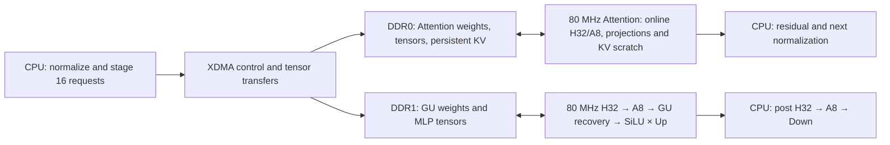

# Decode16 hardware architecture

The current top is `scalellm_final_decode16_bd_wrapper`, targeting the VCU118
`xcvu9p-flga2104-2L-e`. The compute clock is 80 MHz; each DDR UI runs at 200 MHz.
The final source manifest binds 79 RTL/header files, two frozen ROMs, the ABI,
five recursive source lists and six constraints. The older prefill implementation
remains in the `prefill` branch.

## Compute and host boundary

A command operates on sixteen fixed request slots. Active slots have independent
positions and KV epochs; they do not need the same prompt or sequence length.
The supported model shape has 32 layers, hidden size 4096, intermediate size
14336, 32 query heads, eight KV heads and context up to 128.

Both accelerator inputs are normalized, row-major signed S24/F16
`[16,4096]` (196,608 bytes). Attention returns the same shape and format.
MLP performs input H32, A8 quantization, Gate/Up W4 computation with its existing
scale restoration, then frozen SiLU × Up. It returns signed S32/F16
`[16,14336]` (917,504 bytes), in tile16/slot/lane order. Inactive rows are zero.
The CPU performs post-product H32/A8 and Down, residuals, normalization,
embedding and the language-model head.

Attention retains the shared sixteen-row projection array, implemented as two
eight-row waves. Q/K/V and output projection share that array and its online
**Hadamard H32 → A8 quantization** frontend. The normalized input passes through
H32/A8 before Q/K/V projection; the attention context passes through H32/A8
again before output projection. Both transformations run on the FPGA.
The shared frontend instantiates
[`hap_hadamard32_norm_stream`](../project/hardware/rtl/attention/hap_hadamard32_norm_stream.sv)
followed by the A8 quantizers in
[`hap_attention_frontend_8row`](../project/hardware/rtl/attention/hap_attention_frontend_8row.sv).
Q/K use a host
RoPE table for each request's absolute position. Current quantized K/V append
to persistent DDR0 storage. After successful write responses and the matching
write barrier, active slots reload their own complete visible KV prefix into
scratch and compute 32 query heads. Query head `h` uses KV head `h/4`.

MLP input H32 uses five signed butterflies, coefficient 11585 and half-away
right shift 16. Existing MinMax A8/ScaleCode rules and canonical zero handling
are preserved. GU group contributions use S37/F24 and 128-group sums use
S44/F24; terminal half-away right shift 8 and saturation produce S24/F16.
Frozen table SiLU feeds S48 multiplication and half-away right shift 16 to the
S32/F16 product. The product is retained at S32 precision at this boundary.

## Board integration and transport

XDMA uses PCIe Gen3 ×8, a 256-bit host AXI path, one read and one write channel,
a 1 MiB control BAR0 and a 4 GiB BAR2 aperture. Two DDR4 controllers use
64-bit component interfaces and 512-bit AXI, with 200 MHz UI clocks.
The constructor explicitly checks the board presets, clock metadata, address
maps, MIG slices and generated IP configuration.

Attention input/output buffers and persistent KV occupy DDR0. MLP buffers and
staged GU weights occupy DDR1. Dedicated data routes separate the two engines;
weight transport uses the shared ordered DDR return channels. The final W8
reader reserves response FIFO capacity for accepted bursts before issuing
additional reads. This prevents outstanding weight reads from monopolizing
an ordered return path while the compute consumer pauses for KV data.

Attention and MLP commands execute serially. Six staging buffer IDs identify
whole sixteen-row transfer buffers. They are distinct from request slot IDs.
The persistent KV reservation spans `[0x60000000,0x70000000)` in DDR0-local space.

## Command contract

The authoritative register and descriptor map is
[`abi.json`](../project/hardware/source/final/abi.json). Magic is `0x53463136`,
ABI version is `0x00010000`, required capability bits are `0x3f`, and the clock
identity is 80,000,000 Hz. Generated SV constants are checked against that JSON.

START atomically captures a 256-byte descriptor containing operation, command
ID, layer, active mask, buffer/weight generations, tensor addresses and lengths,
and sixteen position/epoch pairs. Completion retains that captured descriptor,
result and byte/cycle counters until the matching ACK. Invalid commands fail
before persistent KV writes. An aborted or failed request position remains
uncommitted; the host commits a visible decode step after all 32 layers and
host boundaries succeed.

Reset and ready boundaries use the original XPM-backed synchronizers and reset
gates. The six XDC files are published byte-for-byte from the reader011 source
freeze; the portable constructor does not add whole-domain timing waivers.

## Evidence boundaries

The published bitstream is the original reader011 candidate with SHA256
`96df1a5c1bf4174921bc02ccd88df4066dece3d62b491acb3106bb90ac0ffc85`.
Its final post-route hold-repair checkpoint has global WNS +0.017 ns,
WHS +0.002 ns and WPWS 0.000 ns, with zero failing setup, hold or pulse endpoints.
All 1,712,169 routable nets are fully routed, with zero routing errors.

Resource reports are explicitly separated: synthesis uses 730,715 LUTs,
971,057 FFs, 709 BRAM36 equivalents, 304 URAM and 5,389 DSPs. The placement
report uses 701,775 LUTs and 954,554 FFs with the same block-memory/DSP totals.
No final routed utilization report is included; the placement counts precede
routing and hold repair. Default bit-generation DRC had zero Errors or Critical
Warnings and 15,802 Warnings. These reports do not establish exhaustive CDC,
reset analog behavior or equivalence of every vendor IP internal endpoint.
See [`PERFORMANCE_AND_RESOURCES.md`](PERFORMANCE_AND_RESOURCES.md) for board
validation and runtime measurements, and [`BUILD_HARDWARE.md`](BUILD_HARDWARE.md)
for the separately scoped fresh-build check.

The original incremental strategy, route recovery and two global native hold
repairs are documented in [PHYSICAL_CLOSURE.md](PHYSICAL_CLOSURE.md). The portable
builder provides each repair as an explicit, single-invocation stage; a fresh
run must satisfy its own timing, routing and DRC gates before bit generation.
