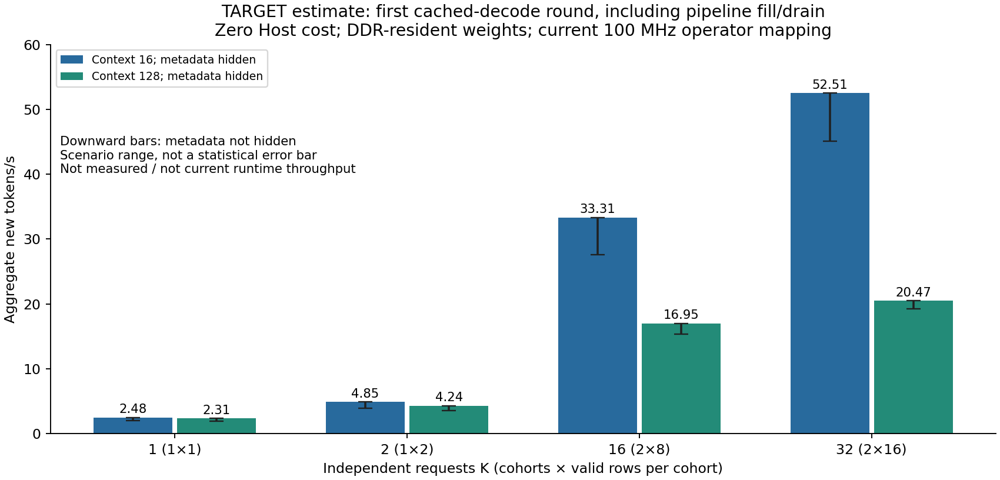
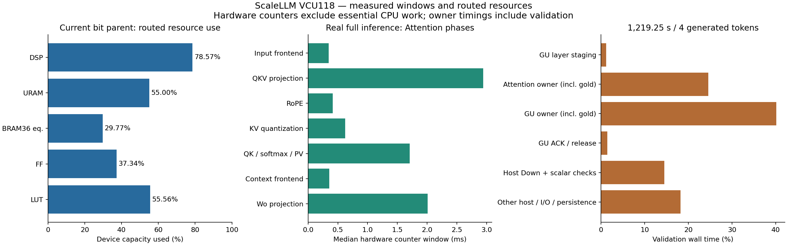
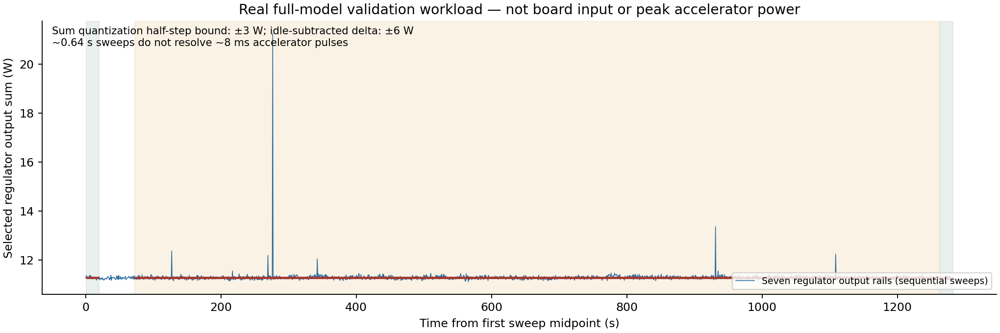

# ScaleLLM：目标架构性能估算、实测依据、功耗与完整资源报告

更新日期：2026-10-25。用户当前主问题是**“设想的缓存和并行调度全部实现后，能达到多少性能”**。前半先给这个目标的可计算估算；后半保留当前真实Llama板测、功耗、全部5,022层级资源及可复算证据。目标估算沿用当前100MHz算子实测，但明确包含尚待实现的KV/请求隔离/地址布局/调度变化；并非宣称当前bit已有这些能力。

## 1. 用户目标：KV缓存＋增量decode＋并行调度的性能估算

**在Host及时完成Down等工作、全模型Attention/GU权重驻留双DDR、metadata预取被掩蔽的目标下：16个独立并发请求估算约33.3 token/s（上下文16），或16.9 token/s（上下文128）。** 若有32个独立请求，分成两批各16行，可接近约52.5/20.5 token/s；后续连续decode轮次摊薄填排的服务率上界约53.2/20.6 token/s。单请求保留当前权重广播计算结构时约2.3–2.5 token/s，不能只加KVcache就直接得到16倍单流加速。

这些是**目标架构条件估算**，按用户要求不把当前CPU验证耗时压入主表，也不把估算标为已实现性能。当前完整程序仍是prefix重算、串行；原始约1.98 token/s只描述它的硬件窗口折算，不再作为目标缓存decode架构的主结论。



### 1.1 请求数、每批行数与可达吞吐必须分开

`K`是全系统同时存在的独立请求数；`b`是每个cohort实际打包的独立新token行数。1cohort只运行一个批次；2cohort允许Attention与GU跨层交叠。表中“轮完成时间”是这些请求各完成一个新token的32层轮次中最后一个输出时间，包含模型的流水填排；不含Host成本。metadata未掩蔽列在该轮额外计入32层最小搬入拍数99.615ms，供保守敏感性比较，尚不包含所有控制bubble。

| 每请求上下文S | 并发请求K | cohort数×有效row b | 轮完成(ms) | aggregate token/s（meta全掩蔽） | meta全不掩蔽token/s |
| --- | --- | --- | --- | --- | --- |
| 16 | 1 | 1×1 | 403.0 | **2.48** | 1.99 |
| 16 | 2 | 1×2 | 412.0 | **4.85** | 3.91 |
| 16 | 2 | 2×1 | 476.1 | **4.20** | 3.47 |
| 16 | 16 | 2×8 | 480.4 | **33.31** | 27.59 |
| 16 | 32 | 2×16 | 609.4 | **52.51** | 45.13 |
| 128 | 1 | 1×1 | 432.8 | **2.31** | 1.88 |
| 128 | 2 | 1×2 | 471.7 | **4.24** | 3.50 |
| 128 | 2 | 2×1 | 477.0 | **4.19** | 3.47 |
| 128 | 16 | 2×8 | 944.1 | **16.95** | 15.33 |
| 128 | 32 | 2×16 | 1563.6 | **20.47** | 19.24 |

单请求`K=1`每轮就是单流新增token延迟；多请求的aggregate不能再当作每个请求的token/s，单流公平服务率约为aggregate/K。例如K16/S16约33.31 aggregate对应每请求约2.08 token/s，而非每个请求33.31。K2合成一个2行批次可能比拆成两批各1行更快，因为拆批重复读取完整矩阵权重；并行并不自动消除小batch低利用率。

当前GU v7绑定两个cohort，Attention固定16query且一个causal上下文。表中单cohort/有效row模式、独立请求KV/position及padding隔离都是目标接口/调度要求，需要新实现与数值回归；单请求现版不能直接执行表中模式。K16可以拆为两批8请求，K32才能把两个16行cohort都填满。不能将“batch16”同时解释为16总请求和两批各16请求。

### 1.2 从实测和RTL推导的成本模型

本模型保留16行算子的固定权重流，不假设小batch所有成本按行数线性缩小。全部数值可从[目标场景CSV](evidence/performance_resources/target_architecture_scenarios.csv)与[analysis.json的target_architecture](evidence/performance_resources/analysis.json)复算。

- QKV＋Wo投影固定部分`P=4.957111ms/cohort`；输入/context前端＋RoPE＋新KV量化等行相关部分`O16=1.740553ms`。取`O(b)=O16×b/16`是未来valid-row跳过无效行的目标假设。
- GU保留完整矩阵读取/store覆盖`Gfixed=7.351925ms`，输入LOAD取`0.083211ms×b/16`；未把历史prefix的16行算力当作一个增量token必然可独享的16倍吞吐。
- QK/softmax/PV按`Q(b,S)=32heads×b×(113+26S)/100MHz`估算。RTL每key有4次K请求/响应（8拍）、8次V tile请求/响应（16拍），softmax exp/prob约2拍/key；固定项113拍/head用当前16行causal的真实171008拍校准，`32×Σ(k=1..16)(113+26k)=171008`。这是有RTL依据的仿射校准模型，S128尚未实际测量，新增cache/仲裁/空泡会改变它。
- 因此`A(b,S)=P+O16×b/16+Q(b,S)`，`G(b)=Gfixed+0.083211ms×b/16`。KV cache省掉历史token的QKV/MLP重算，但每个新query仍要处理S个历史KV；新16请求各S16时Q项是2.70848ms，而旧同一prefix的16行causal平均只有8.5key、Q项1.71008ms。
- 单cohort轮时间`T=32×(A+G)`。两cohort可按`A0(L)→A1(L)||G0(L)→A0(L+1)||G1(L)`跨层交叠，`T≈64×max(A,G)+min(A,G)`。G0下一层仍等G1上一层完成ACK/release；Attention可领先一层并把输出暂存。此处没有人为加每层Attention/GU全drain的barrier。

有两个持续就绪的独立cohort、跨后续decode轮摊薄填排时，两个引擎的服务率是`b/[32×max(A,G)]`。b16得到53.16 token/s（S16）、20.56 token/s（S128）。约59的旧口径来自原causal16行平均8.5key且把16行等价吞吐视为输出；对独立请求增量decode需要上述上下文修正。相同请求下一个未知token仍必须等上一token的全32层＋LM head反馈，跨token依赖不能被pipeline忽略。

主表为第一轮32层包含填排；若持续生成且不另加step全局barrier，K16拆2×8的稳态约33.81/17.08 token/s（S16/S128），K32拆2×16约53.16/20.56。只需两个足够独立且持续ready的cohort，不要求字面无限请求；Host反馈延迟、EOS请求退场、短序列及调度bubble会降低它。CSV的`steady_state_aggregate_tokens_per_s`单列此值，不与首轮实际模型混淆。

当前RTL SHARED mode会同时打开Attention/GU，且两引擎的metadata/权重路径独立，因此Attention层号领先GU有架构基础；当前Host Attention guard仍要求GU idle、调度仍串行，目标需改该软件调度/依赖检查并验证DDR争用、缓冲生命周期、clear/ACK顺序。新增调度不是简单把两函数放进线程。

### 1.3 权重驻留容量、带宽与metadata条件

真实导出manifest逐层大小相同，32层Attention权重＋metadata **1,426,063,360B（1.328125GiB）**，GU权重＋metadata **2,113,929,216B（1.96875GiB）**。每个DDR的Host可达aperture为2GiB。因此在**重新排布地址**后，可把全部A放DDR0、全部GU放DDR1；DDR0剩688MiB，DDR1剩32MiB，不能误称全模型A/GU必然每step从PCIe重载。

KV12每32元素记录400bit＝50B；K/V×8heads×4groups为每token每layer3200B。16请求×128上下文×32层共200MiB，可放DDR0剩余空间；32请求同上下文为400MiB，仍在容量内。DDR1剩32MiB可容纳当前两cohort激活/输出与有限scratch，但不能保留原固定offset大stage布局同时又假装权重全驻留，必须重新冻结地址表。KV从DDR到计算local cache的带宽、双缓冲和每请求隔离仍需实现；S128每cohort16请求全层KV读取至少200MiB，旧local cache仅一个请求，不能假定多请求已片上常驻。

**主目标表还假设KV预取被掩蔽。** 若没有掩蔽，在DDR有效带宽8GB/s下，K16/S128每完整32层轮次至少增加`200MiB/8GB/s=26.214ms`的KV搬运；K32为52.429ms，S16则分别3.277/6.554ms。CSV另列`kv_unhidden_s_at_beta_or_8GBps`和不掩蔽后的吞吐；这些应与metadata不掩蔽成本按实际是否重叠组合，不能误认为下面仅权重β表已经含全部history流量。

全DDR驻留不等于全片上驻留：每层仍需读取Attention约40MiB、GU约56MiB权重。现DDR接口为512bit×200MHz＝每通道12.8GB/s理论线速；完整32层读取下限分别104.858ms、146.801ms，且尚未计metadata/激活/仲裁。小batch将所有算子耗时直接除16会要求约百GB/s量级权重供给，违反现接口约束。

A metadata81920×32B、GU metadata229376×32B从DDR搬到URAM，一拍一条时每层至少0.8192/2.29376ms。A现为单metadata store，GU为双bank；目标要用独立prefetch/双缓冲和层间调度掩蔽这些搬入，不能因32层metadata也放DDR而删掉成本。完全不能掩蔽时每32层轮次额外至少99.615ms，主表已给此敏感性。控制/epoch/DDR空泡不包含在这个最小拍数里。

以每通道有效DDR带宽参数β，把投影固定项改为`max(P,40MiB/β)`、GU固定项改为`max(Gfixed,56MiB/β)`，保持metadata全掩蔽：

| 上下文 | 并发请求/两cohort | β=4GB/s | β=8GB/s | β=12.8GB/s（理论接口） |
| --- | --- | --- | --- | --- |
| 16 | 16 | 16.76 | 32.97 | 33.31 |
| 16 | 32 | 32.97 | 50.98 | 52.51 |
| 128 | 16 | 12.26 | 16.62 | 16.95 |
| 128 | 32 | 16.63 | 20.23 | 20.47 |

上表单位均为aggregate token/s，带宽是情景参数，非新增DDR实测。若权重未驻留，当前大块H2C约0.92GB/s的实测量级意味着每一完整32层A/GU权重＋meta约3.54GB需要约3.85s传输，必须另加或被充分跨批摊薄；不能默认PCIe标称带宽。全驻留时这一启动成本可从稳态decode摊去。

### 1.4 更激进的算力重映射、Host与功耗范围

若另行重构投影/GU，把16行空间算力全部转供单query，且解决权重带宽/片上复用，那么按全部相关时间/16的纯算力模型，单请求S16/S128可分别约33.7/63.5ms（29.7/15.7 token/s）。这只是**需要额外数据流/缓存重设计的算力上界**，不是现DDR权重流可达到的承诺；可复算敏感性保存在`aggressive_row_remap`，不混入主目标表。

Host及时供给是用户指定的目标假设，不表示Down在FPGA。本次HostDown＋标量验证约44.18s/新token，完整验证wall约304.81s/新token；这些现状另列实测章节，不用于压低目标零Host主表。若要求Host＋FPGA真正达到主表吞吐，必须有相应速度的HostDown/归一化/LM head实现与流水供给；本次没有匹配CPU/GPU baseline，不给加速倍数。

可提出一个有原生层级数量依据的**条件资源预算**：A metadata现为80 URAM，增加一整bank做ping-pong会再用80 URAM，总量528→608/960（63.33%）；local KV现为88 RAMB36＋2 RAMB18，复制一个bank以重叠下一请求装载会增加89 BRAM36等价tile，总量643→732/2160（33.89%）。这仅是可选结构的存储预算，不是新增实现后的综合/布局布线结果；额外LUT/FF、AXI调度、地址隔离、时序和SLR代价未测，不能填0。GU已有双metadata bank，不重复预算其448 URAM。

目标并行KV架构的资源增量与高占空比功耗尚无实现报告。本MD后面的656,898 LUT/5,374 DSP是当前已测bit，不能当作新增多请求cache/controller的最终资源；当前低占空比七rail功耗也不能按吞吐比例外推未来满载W数。这里不给无证据的目标功耗单值。S128是当前KV单窗口容量；4K上下文需要扩展容量、地址/循环和数值覆盖，不能线性当作当前已支持。

### 1.5 目标功耗与能效为何暂不能给可信单值

已测七rail在独立验证负载下约11–12W是有效的**窗口平均**，不是高占空比目标功耗。若强行采用线性模型，`Ptarget≈Pidle+(ΔPGU/dGU)×uGU+(ΔPA/dA)×uA`，其中d为已测compute窗口占比、u为目标引擎服务利用率，那么GU的`1.120853W/0.156788≈7.15W`、Attention的`0.489294W/0.131369≈3.72W`只是假设的活动增量系数。

两差分本身各有保守±6W量化边界，除以低占空比后分别放大到约**±38.3W和±45.7W**；两个引擎接近满利用时合计不确定可达约±80W，另有idle量化、采样混叠、rail误差和不同诊断数据的翻转率差异。此时即使公式的中心值约20–22W，也没有可用的预测精度，故不列为目标功耗承诺，更不能用它或当前约11W去配52.5token/s宣称token/J。

得到可信目标功耗，需要实际目标cache/调度和代表性真实模型输入形成高占空比，继续测同七rail并保留采样/量化边界；若要整板或Host＋FPGA能效，还必须采12V输入或系统输入功率。当前完整推理联合采样只补足**已实现验证工作负载**的功耗，不替代这些目标条件。

## 2. 当前实现的实测依据与读数层次

真实运行完成两条请求、各两次生成，32层/步；128次Attention、128次GU全输出比对、128次HostDown、64次epoch释放均通过。`Hi` 生成 `[2181,596]` → `It's`，`Hello` 生成 `[9906,0]` → `Hello!`，第一token确实反馈第二完整前向。

| 指标 | 数值 | 适用范围 |
| --- | ---: | --- |
| 完整验证型推理wall吞吐 | **0.00328071 token/s** | 4个新token / 1219.247s；含CPU独立gold、IO与耐久记录 |
| 进程生命周期吞吐 | 0.00313003 token/s | 包含启动、资产全SHA、环境准备；1277.941s |
| FPGA compute窗口串行折算 | 1.9830 token/s | 只累计Attention/GU内部窗口，**不含必需HostDown及Host工作** |
| FPGA load/store代理串行折算 | 1.9725 token/s | GU用LOAD+store；不是精确START→DONE，不是系统实测吞吐 |
| 理想双引擎服务率上界 | 3.7168 token/s | 无限独立请求、零传输/HostDown/调度的数学上界；当前未实现并发 |
| 当前bit全器件资源 | 656,898 LUT / 882,867 FF / 5,374 DSP | 布线后；643 BRAM36等价tile、528 URAM |
| 功耗测量边界 | 7路FPGA稳压器输出功耗和 | 不是12V整板输入，更不是Host+板卡整机功耗 |

**不能把约1.97或3.72 token/s写成已经达到的Llama端到端吞吐。** 它们是剔除必需CPU阶段及传输的硬件服务时间折算。当前单请求每个生成token仅HostDown及标量验证就约44.18s；这部分没有在FPGA实现。也不能把一次16行Attention/GU算作16个新生成token：16行是同一请求的固定物理prefix/padding，真正新输出只有最后有效行的一个token。



## 3. 身份、模型和验证范围

| 项目 | 当前值 |
| --- | --- |
| FPGA / part | VCU118，`xcvu9p-flga2104-2L-e` |
| Core / DDR AXI clocks | 100MHz / 200MHz；由routed时钟身份确认，非频率计测量 |
| Bit SHA256 | `66a305348d3099ca48043324d2ef50e3a39bea84b818f6107f0ff9cdd08acc47` |
| Bit来源 | R008/AT003 preliminary bitstream；父R008/AT001 routed DCP |
| 父DCP SHA256 | `cc34f49bef612472367f7d273596d09dede15128d3b72a2708507e4c6d6c7cc4` |
| 量化权重checkpoint SHA256 | `8a09c60f3256779c16925f8209c9399ba4a1ee0406caf65bd2637ffd99287d6d` |
| 权重manifest SHA256 | `45ed3c211c4939e83d5f2efc39731970692317dfa540520ca8c16e525a99e8f6` |
| Host环境 | Dell i7-12700，Windows CPython3.12.10 / NumPy1.26.4，8 CPU affinity，BLAS/OMP单线程 |
| XDMA驱动 | `oem117.inf` / 11.38.8.506，原DMA polling保留、user0 IRQ policy禁用 |
| 实际模型形状 | 32层、hidden4096、intermediate14336、Q32/KV8、head_dim128、词表128256 |
| 实际生成设置 | 两真实短prompt，11→12有效prefix行；物理16行，query_start0/key_count16，真实RoPE，max_new_tokens2 |
| 内存实测 | 峰值RSS2,556,264,448B；最低可用5,938,892,800B |

使用**每步完整前缀重算**，没有已实现的历史KV-cache decode。总真实长度最多16token；右padding不影响已存在的有效prefix，已对跨step全部层hidden做逐bit核查。Host使用实际FPGA输出进入下一层；CPU Attention/GU参考仅作gold。权重量化和固定点算法不是BF16原模型逐位等价；两个短例子不代表通用语言质量评估。

完整运行来源为 `project/E013_mlp_linear_only_hardware/experiment_results/board_validation/end_to_end_results/attempts/AT_20261025T044854.162019Z_real_llama_full`。可发布的[原运行摘要](evidence/performance_resources/raw/full_run_summary.json)、[原生退出回执](evidence/performance_resources/raw/full_native_exit.json)、[全证据核查](evidence/performance_resources/raw/full_evidence_closure.json)、[独立Host核查](evidence/performance_resources/raw/full_host_math.json)、[追加1920个Down标量坐标](evidence/performance_resources/raw/full_additional_down.json)已归档。所有比较通过，first_error=null，最终idle/lease空、native0，无重启或重配掩盖错误。

## 4. 完整推理的实际时间账

验证run从04:49:52.521496至05:10:11.768783 UTC，1219.247s。进程从04:48:54.2511104到05:10:12.1923668 UTC，前后额外约58.694s主要处于启动和资产检查边界。两者均包含真实CPU工作，当前运行不是去掉验证后的部署性能benchmark。

| 互不重叠的已记录区间 | 合计(s) | 验证wall占比 |
| --- | --- | --- |
| GU层装载/metadata commit | 14.390 | 1.18% |
| Attention owner：装载/CPU gold/设备/证据 | 299.489 | 24.56% |
| GU owner：CPU gold/设备/证据 | 489.380 | 40.14% |
| GU ACK及相关持久化 | 17.456 | 1.43% |
| GU epoch release | 0.051 | 0.00% |
| HostDown前端+整数核+标量抽查 | 176.701 | 14.49% |
| 其他Host边界、磁盘持久化与调度 | 221.780 | 18.19% |

上表owner函数区间互不重叠；trace函数内部的driver调用、CPU gold属于对应owner子集，不能再次相加。Attention CPU gold共 **170.391s**，GU CPU gold共 **427.079s**，已包含于Attention/GU owner区间；单独减去它们不能预测一个尚未实现/实测的无验证推理器。HostDown计时包括原SiLU/乘法/H32/A8、blocked int64 Down及本轮标量抽查，未单独剥离这些子项。

硬件compute窗口总和2.017116s，占验证wall约 **0.1654%**。这是内部计数窗口占比，包含引擎stall，不是DSP翻转率。长时间CPU gold/Down与磁盘持久化使板卡多数时间空闲；因此本次完整运行的平均功耗不能代替连续满活跃加速器功耗。

Host同机START写入前到首次读到DONE的median：Attention **11.979050ms**，GU **8.181300ms**。它们包含MMIO/操作系统/poll时延；不同于硬件内部计数。全run实际H2C调用累计7.807801s、C2H累计3.961377s，含权重、metadata、输入/输出、readback等，不是只传激活的带宽测试。原循环重载每层权重，不能把独立模块驻留权重benchmark速度直接套到全模型。

没有匹配的CPU-only或GPU-only同模型/同量化/同prompt/同精度baseline，因此**没有可报告的CPU/GPU加速倍数**。任何将本次reference耗时比上FPGA窗口得到的倍数只能反映验证器实现差异，不是公平加速比。

## 5. 硬件计数器与各模块延迟

全部128个Attention和128个GU样本来自实际完整推理，统计保留所有成功命令，不把第一层或换层慢样本删除；p5/median/p95使用线性分位数。固定100MHz，`t=cycles/100000000`。[逐层、逐请求、逐步原始计数表](evidence/performance_resources/full_commands.csv)可独立复算。

| 计数窗口 | N | p5 (ms) | median (ms) | p95 (ms) | 合计 (s) |
| --- | --- | --- | --- | --- | --- |
| Attention总compute窗口 | 128 | 8.384292 | 8.406455 | 8.428759 | 1.076191 |
| 输入H32/A8前端 | 128 | 0.347073 | 0.347895 | 0.352749 | 0.044574 |
| QKV投影 | 128 | 2.926872 | 2.943100 | 2.961217 | 0.376819 |
| RoPE | 128 | 0.416000 | 0.416000 | 0.416000 | 0.053248 |
| KV12量化 | 128 | 0.622680 | 0.624010 | 0.624945 | 0.079363 |
| QK/softmax/PV | 128 | 1.710080 | 1.710080 | 1.710080 | 0.218890 |
| context H32/A8前端 | 128 | 0.352715 | 0.356005 | 0.361598 | 0.045596 |
| Wo投影 | 128 | 2.002403 | 2.008670 | 2.024261 | 0.257691 |
| 控制开销 | 128 | 0.000080 | 0.000080 | 0.000080 | 0.000010 |
| GU compute窗口 | 128 | 7.344188 | 7.351020 | 7.357964 | 0.940925 |
| GU输入LOAD | 128 | 0.083033 | 0.083185 | 0.083436 | 0.010651 |
| GU store/drain窗口 | 128 | 7.345117 | 7.351950 | 7.358894 | 0.941046 |
| GU stall逐拍OR（重叠） | 128 | 7.251935 | 7.258865 | 7.266372 | 0.929156 |

Attention `0x038` 为compute FSM非IDLE累计，其八项 `0x050..0x06c`互斥且逐条相加等于总数；包含各状态内部等待，**不含板级metadata/RoPE/输入DMA装载及输出DMA**。QKV与Wo共享投影硬件，单模块资源不能为Q/K/V/Wo各重复计一份。实际代码见[计数源](evidence/performance_resources/raw/hap_attention_compute_cohort16_top.sv)。

GU `0x354`从compute握手到compute_done，包括权重供给和输出背压；`0x358`为LOAD状态拍；`0x35c`从writer arm握手到终态排空，与compute高度重叠；`0x360`为多个接口stall条件的逐拍OR，与其他计数重叠。**禁止compute+load+store+stall相加。** 内部total_cycles未映射CSR，本bit无法直接读取精确GU START→DONE总周期。[GU计数源](evidence/performance_resources/raw/hap_mlp_gu_job_control.sv)已归档。

## 6. 端到端折算、公式与不能外推的部分

设所有实际成功命令的Attention窗口之和为A=1.07619120s，GU compute之和C=0.94092523s，LOAD之和L=0.01065101s，store之和S=0.94104642s；实际生成token数N=4。

- `N/(A+C)=1.983029` token/s：纯compute窗口折算。每个新token包含32层的完整16行重算，不另乘16。
- `N/(A+L+S)=1.972495` token/s：增加GU LOAD及writer覆盖的代理。L与S顺序不重叠，但遗漏未映射VALIDATE/ARM等小段；Attention仍遗漏板级装载，因此不是精确硬件端到端。
- `N/max(A,L+S)=3.716812` token/s：只表示无限独立请求可在Attention/GU两服务台重叠且零HostDown/传输时的**理想服务率上界**。实际串行实现、同层权重切换、跨层依赖、有限两个请求、填充/排空和HostDown都会限制它，本次没有验证此pipeline。
- 当前仅两cohort、每层权重barrier下的有限填排模型：令单命令均值`a=A/128`、`g=C/128`，假设可实现`A0→A1/G0重叠→G1`，每层用时`a+max(a,g)+g`；于是`2/[32×(a+max(a,g)+g)]=2.586228` token/s。若`g=(L+S)/128`，则为 **2.577253 token/s**。该值仍假设HostDown/传输为零、同层权重驻留，且需更改当前串行owner调度；跨引擎并发是否合法及DDR争用影响未在本轮测试。它比无限请求服务上界更贴近两请求逐层barrier，但依然不是当前程序可达吞吐。
- 若至少保留当前串行HostDown+标量实测时间，则`N/(A+L+S+T_down)=0.022380` token/s仅是另一个未含norm/LMhead/IO/控制的部分工作量折算。由此可见省略HostDown会改变完整模型性能结论。

当前单个生成token的32层Attention约0.269s、GU compute约0.235s，GU LOAD+store约0.238s，HostDown+标量约44.18s。逐token数据在[per_generated_token.csv](evidence/performance_resources/per_generated_token.csv)。N=4只能支持本次功能运行的总吞吐，不用于尾延迟分布或大样本语言服务SLO。

### 为什么硬件折算仍只有约1.98 token/s

**当前一次新token不是只算最后一行：它重新计算整个16行物理前缀，并串行经过全部32层。** 从真实全run计数折算，每新token约为`32×(8.408ms Attention + 7.351ms GU)=504.279ms`纯compute窗口，所以`1/0.504279≈1.983 token/s`；加GU LOAD/store代理为约506.972ms，即1.972 token/s。这仍未计HostDown等必需工作。

将1.983直接乘16得到约31.728 **物理行等价/s**；将无限独立请求双引擎服务上界3.7168乘16得到约59.469 **物理行等价/s**。这两个数都不是本次Llama新增token/s。实际16行里是同一请求的既有token与padding（本次只有11或12有效行），每个完整前向仅从最后有效行取一个新token。因此此前若将约59称为当前生成token/s，应纠正为一个把16行全当独立有效输出、且有充分独立任务支撑的流水行吞吐假设。

真正改变每步计算量需要实现并验证KV-cache增量decode及相应一行/多请求批处理调度。多请求batch必须来自独立请求；同一请求的下一未知token，要等上一token完成全部32层和LM head后才能反馈，不能无条件将相邻decode token重叠。没有这些改变，不能直接将本次延迟除以16。本轮报告和部署保留当前bit/数学/串行程序，未实施上述KV或RTL优化。

GU dense-equivalent规模为`2×16×4096×14336=1,879,048,192 MAC/命令`，1MAC=2ops时3,758,096,384ops；按实测compute中位数约0.511235TOPS。Attention四投影规模为`16×4096×(4096+1024+1024+4096)=671,088,640 MAC`，约0.159660TOPS（只计投影，时间却含其他Attention阶段）。这些均含零项，叫**dense-equivalent工作量**；不等于DSP实际MAC计数、非零工作量、全模型TOPS或厂商峰值。

## 7. 功耗：已完成的独立模块测量

| 独立诊断负载 | 有效命令N | compute窗口占空比 | idle前/负载/idle后(W) | 增量(W) | 窗口sweeps |
| --- | --- | --- | --- | --- | --- |
| gu_dense | 322 | 15.679% | 11.232669/12.353872/11.233369 | 1.120853 | 21/23/23 |
| attention_structured | 235 | 13.137% | 11.265149/11.767571/11.291405 | 0.489294 | 21/23/23 |

GU为`dense_active_128_v1`：全128组code/activation/weight非零但有周期结构，322条有效命令、另2warmup；不是用户模型典型激活。Attention为`structured_seq16_v1`诊断，235条有效命令、另2warmup；不是完整32层真实模型的混合负载。两次独立测量不得相加当作combined功耗。

采样工具在同一Dell，读取MAX15499/J39固定7路：VCCINT、VCC1V8、VADJ、VCCINTIO_BRAM、MGT1V8、MGTAVCC、MGTAVTT。按VCU118官方[UG1224](https://docs.amd.com/v/u/en-US/ug1224-vcu118-eval-bd)电源拓扑图3-27/表3-34，这些是并列稳压器输出，不是同时累加12V输入与其下游输出；仍缺转换损耗、其他板载负载与Host功耗，不能称整板输入或整机功耗。

其中3路MAX20751用真实READ_POUT，步进2W、每路半步约±1W；所选和的保守量化边界±3W，负载减前后idle平均的增量边界±6W。**均值和更多样本不会消除这个系统量化限制**；上表约1.12W和0.49W增量均落在±6W内，不能据此声称已分辨出精确动态功耗。其READ_VOUT是反馈节点，未知divider，不用nominal电压×IOUT冒充实测功率。其余4路用实测VOUT×IOUT，V/I非严格同时、另有未校准传感器误差；微小负读数原样保留，不裁0。

每轮顺序读完7rail约0.137s，sweep中点间隔约0.64s；这不能解析约7–8ms脉冲的瞬时峰值。只使用完全位于某phase内的sweep，跨界剔除，以各sweep中点作梯形积分；不把请求500ms采样间隔当成真实周期。各phase覆盖时长、sweep数、逐rail原值、median/p5/p95均在[analysis.json](evidence/performance_resources/analysis.json)及[GU sweep CSV](evidence/performance_resources/gu_dense_power_sweeps.csv)、[Attention sweep CSV](evidence/performance_resources/attention_structured_power_sweeps.csv)。原始telemetry与原分析摘要在同目录`raw/`，本工具已独立复算并检查与旧时间加权平均一致。

### 完整模型联合功耗：本次实际采集已完成

独立批次`AT_20261025T060221.079719Z_combined_power`已完成，native与sampler均exit0；同一冻结模型/40源身份、当前bit/driver/boot保持，实际128Attention＋128GU＋128HostDown＋64release，再次生成`It's`/`Hello!`，最终idle、lease/pending为空、句柄关闭。没有把单模块样本拼成联合负载。已由主控对本次raw再次做[全证据闭合核查](evidence/performance_resources/raw/combined_evidence_closure.json)：1284个数据blob SHA、256残差边界逐bit、128跨step既有prefix不变及token反馈均通过；数值oracle沿用此前独立数学核查，本次闭合不冒称重做全部数值oracle。

| 时间范围 | 窗口(s) | 完整sweep数 | 积分覆盖(s) | 覆盖比例 | 七rail时间加权平均(W) |
| --- | --- | --- | --- | --- | --- |
| 推理前idle | 20.010763 | 31 | 19.395637 | 96.9260% | 11.27596994 |
| 有效完整推理run | 1190.151268 | 1843 | 1189.347447 | 99.9325% | 11.28242771 |
| 推理后idle | 20.012250 | 30 | 18.727032 | 93.5778% | 11.24900993 |
| 含启动资产检查的整个native进程 | 1242.210783 | 1923 | 1241.040758 | 99.9058% | 11.28126794 |

有效run为06:03:37.964039→06:23:28.115307 UTC；进程creation→held-handle观测退出为06:02:46.3201321→06:23:28.5309155 UTC，两种窗口分开。前后idle均约20s。完整1987个sweep保留，只对每个窗口完全包含的sweep分类，中点之间梯形积分；启动资产核验期间的样本不混进有效run。采样读取中位0.138526s，中点间隔中位0.645841s，七路顺序读取。

本次有效run1190.151268s / 4新token＝**0.003360917 token/s**；这依然包含CPU gold、HostDown、IO和耐久记录。Attention/GU各128命令中位compute8.406055/7.350185ms，合计2.01711376s，占run **0.169484%**。此低占空比解释了全模型验证过程均值与idle几乎相同；不能将其称为目标并行架构满载功耗。

负载减两侧idle均值为**0.01993777W**，远小于保守±6W差分量化边界，动态增量未被可靠分辨。有效run覆盖区间所选七rail总能量为**13,418.7266J**；按4个实际新token摊分为3354.6816J/token，仅描述本次含长期验证等待的已覆盖区间（99.9325%），不是纯加速计算能耗、不是Host＋FPGA总能耗、不是理想目标能效；未向未采覆盖的端点外推。

| 地址 / rail | run采样功率算术均值(W) | 读取方法 |
| --- | --- | --- |
| 0x70 / VCCINT_FPGA | 6.00651112 | READ_POUT |
| 0x11 / VCC1V8_FPGA | 2.31724084 | VOUT_X_IOUT |
| 0x12 / VADJ_1V8_FPGA | -0.05119614 | VOUT_X_IOUT |
| 0x15 / VCCINTIO_BRAM_FPGA | 0.37594724 | VOUT_X_IOUT |
| 0x14 / VCC1V2_FPGA | 0.63402649 | VOUT_X_IOUT |
| 0x72 / MGTAVCC_FPGA | 0.00000000 | READ_POUT |
| 0x73 / MGTAVTT_FPGA | 2.00000000 | READ_POUT |

分rail表是采样算术均值；主窗口表为按真实时间积分加权，二者不要混用。小负值保留，没有裁0。三个MAX20751的2W量化、未知反馈divider及未校准误差仍适用。



完整可携带原值：[telemetry](evidence/performance_resources/raw/combined_telemetry.json)、[orchestration](evidence/performance_resources/raw/combined_orchestration.json)、[真实run摘要](evidence/performance_resources/raw/combined_run_summary.json)、[只读初态与源身份](evidence/performance_resources/raw/combined_preflight.json)、[采样窗口CSV](evidence/performance_resources/combined_power_sweeps.csv)、[128项命令计数CSV](evidence/performance_resources/combined_commands.csv)。统计与两窗口原始定义在`analysis.json.combined_power`；原生raw未覆盖。

## 8. 与当前bit绑定的全器件资源

直接解析父R008/AT001的**Routed**报告，Vivado2025.2；[原hierarchical utilization](evidence/performance_resources/raw/utilization_hierarchical.rpt) SHA `53212fdf8394fa568c3bd72d17839b852be44183f8f40daa641ef8e08aa8be7e`，其终态哈希与[bit manifest](evidence/performance_resources/raw/bitstream_manifest.json)父身份链一致。没有使用其他旧设计或AT010修正约束DCP的资源来替代当前bit。

| 资源 | 已用 | 器件总量 | 占比 |
| --- | --- | --- | --- |
| LUT | 656,898 | 1,182,240 | 55.56% |
| FF | 882,867 | 2,364,480 | 37.34% |
| BRAM36等价tile | 643 | 2,160 | 29.77% |
| URAM288 | 528 | 960 | 55.00% |
| DSP48E2 | 5,374 | 6,840 | 78.57% |

BRAM36等价tile=`635 RAMB36 + 16 RAMB18/2 = 643`；RAMB18与RAMB36不能直接按同大小加总。LUT总数已含27,324 LUTRAM与5,975 SRL，不能再加一次。容量依据AMD [DS890 v4.10 Table15](https://docs.amd.com/v/u/en-US/ds890-ultrascale-overview)的VU9P列。资源利用率不等于布线/时序余量，78.57%DSP也不是运算利用率。

### 全板主要层级

| 实例/范围（含下级） | LUT | FF | RAMB36 | RAMB18 | URAM | DSP |
| --- | --- | --- | --- | --- | --- | --- |
| 用户核心整体 | 577,971 | 754,922 | 535 | 14 | 528 | 5,368 |
| Attention整体 | 228,501 | 271,764 | 347 | 12 | 80 | 2,296 |
| GU整体 | 332,482 | 459,266 | 124 | 2 | 0 | 3,072 |
| GU A8缓存 | 5,738 | 48 | 64 | 0 | 0 | 0 |
| GU metadata双bank | 1,984 | 2,273 | 0 | 0 | 448 | 0 |
| XDMA/PCIe | 22,660 | 25,890 | 50 | 0 | 0 | 0 |
| DDR0 MIG | 13,630 | 17,555 | 25 | 1 | 0 | 3 |
| DDR1 MIG | 13,598 | 17,555 | 25 | 1 | 0 | 3 |
| DDR0 SmartConnect | 8,470 | 16,468 | 0 | 0 | 0 | 0 |
| DDR1 SmartConnect | 8,519 | 16,458 | 0 | 0 | 0 | 0 |
| DDR0跨SLR slice | 2,477 | 8,481 | 0 | 0 | 0 | 0 |
| DDR1跨SLR slice | 2,479 | 9,359 | 0 | 0 | 0 | 0 |
| Host split互连 | 6,484 | 14,842 | 0 | 0 | 0 | 0 |
| 控制互连 | 124 | 456 | 0 | 0 | 0 | 0 |
| debug hub | 447 | 753 | 0 | 0 | 0 | 0 |

### Attention内部层级

| 实例/范围（含下级） | LUT | FF | RAMB36 | RAMB18 | URAM | DSP |
| --- | --- | --- | --- | --- | --- | --- |
| Attention计算主体 | 216,463 | 241,752 | 207 | 6 | 0 | 2,296 |
| Q/K/V/Wo共享投影 | 165,920 | 190,825 | 31 | 4 | 0 | 2,240 |
| Attention row总体 | 9,685 | 7,573 | 0 | 0 | 0 | 52 |
| QK | 3,186 | 5,425 | 0 | 0 | 0 | 18 |
| PV | 5,753 | 1,717 | 0 | 0 | 0 | 32 |
| RoPE | 498 | 170 | 0 | 0 | 0 | 4 |
| KV量化 | 10,470 | 9,758 | 0 | 0 | 0 | 0 |
| KV缓存 | 540 | 3 | 88 | 2 | 0 | 0 |
| query存储 | 220 | 1,577 | 44 | 0 | 0 | 0 |
| context存储 | 5,046 | 6,594 | 44 | 0 | 0 | 0 |
| 后处理/存储 | 22,896 | 24,580 | 0 | 0 | 0 | 0 |
| 输入buffer | 6,423 | 12,376 | 42 | 2 | 0 | 0 |
| 输出buffer | 3,952 | 12,327 | 42 | 2 | 0 | 0 |
| Attention metadata | 386 | 45 | 0 | 0 | 80 | 0 |
| Attention权重前端 | 472 | 3,946 | 56 | 2 | 0 | 0 |

### GU及控制/存储内部层级

| 实例/范围（含下级） | LUT | FF | RAMB36 | RAMB18 | URAM | DSP |
| --- | --- | --- | --- | --- | --- | --- |
| GU共享计算 | 317,665 | 446,306 | 0 | 0 | 0 | 3,072 |
| branch0 | 156,921 | 216,603 | 0 | 0 | 0 | 1,536 |
| branch1 | 157,304 | 216,600 | 0 | 0 | 0 | 1,536 |
| GU调度/重排 | 11,018 | 8,502 | 96 | 0 | 0 | 0 |
| W4权重前端 | 3,672 | 3,886 | 28 | 2 | 0 | 0 |
| metadata bank0 | 989 | 1,084 | 0 | 0 | 224 | 0 |
| metadata bank1 | 967 | 1,084 | 0 | 0 | 224 | 0 |
| job control | 712 | 1,618 | 0 | 0 | 0 | 0 |
| GU AXI-Lite控制 | 302 | 1,226 | 0 | 0 | 0 | 0 |
| metadata DMA | 340 | 214 | 0 | 0 | 0 | 0 |
| metadata调度 | 199 | 522 | 0 | 0 | 0 | 0 |
| paired weight路由 | 2,431 | 6,535 | 0 | 0 | 0 | 0 |
| tensor/输出DMA | 4,141 | 11,264 | 0 | 0 | 0 | 0 |
| 控制router | 987 | 79 | 0 | 0 | 0 | 0 |
| 数据router | 158 | 8 | 0 | 0 | 0 | 0 |

上面所有层级行是**包含其子模块的原生report数值**；不能把core、Attention整体、投影、QK/PV等父子行一起相加。Vivado在部分边界会出现共享/打包LUT归属，子行之和也可能与父行有少量差异；保留原report，不用人为平差制造“精确分摊”。[resource_hierarchy.csv](evidence/performance_resources/resource_hierarchy.csv)提供完整5,022行、全层级path、module、LUT类型、FF、RAMB36/18、URAM、DSP和父子差值，便于检查所有子模块；本MD文末也附有相同5,022行完整展开表。

Down在当前GU-only bit中不存在硬件算子，因此本bit的“MLP资源”仅GU及相关缓存/控制。metadata双bank448 URAM是GU主要URAM来源；Attention另80 URAM。QKV/Wo共享一套投影，GU两branch各1536 DSP。Host RAM和CPU时间不计入FPGA LUT/DSP表，已在前文单列。

## 9. 时钟、布局布线与签核边界

[父routed timing](evidence/performance_resources/raw/timing_summary.rpt)：WNS=+0.002ns、TNS=0、WHS=+0.010ns、THS=0，已约束同步路径通过；[route status](evidence/performance_resources/raw/route_status.rpt)为1,687,352条routable nets全部布通、routing errors=0。core clock period10ns，两个DDR接口period5ns，见[clock identity](evidence/performance_resources/raw/clock_identity.txt)。不要由微小正slack外推未经实现验证的更高Fmax。

该bit明确为ENGINEERING_VALIDATION。父[stage_quality](evidence/performance_resources/raw/stage_quality.json)仍保留overall FAIL及未闭合项：原Max-DPO/外部reset约束与CDC/DRC审查范围未被本轮板功能结果替代；report存在no_input_delay1/no_output_delay2以及待审warning。已完成真实推理只能支持当前功能范围，不提升为完整物理签核。

另归档[physopt SLR utilization](evidence/performance_resources/raw/physopt_utilization_slr.rpt)，其阶段是**Physopt postPlace**，不是新routed逐SLR查询：SLR0/1/2 DSP为1571/1840/1963（68.90%/80.70%/86.10%）、LUT179085/243557/234256。它可说明实现时分布，但本轮没有运行Vivado重新取得routed逐SLR细报告；未占用其他工程正在使用的EDA。

## 10. 复算、证据目录与可复现范围

在项目根运行（Python3标准库，无numpy/设备/EDA依赖）：

```bash
python3 tools/analyze_performance.py
```

可选`--plots`生成PNG/SVG图（仅画图需要matplotlib）；默认数值复算仍只用标准库。

这会从已归档的`docs/evidence/performance_resources/inputs.json`、原RPT/telemetry复算`analysis.json`与CSV。完整实验树仍在时可用`--refresh-inputs`从原full运行逐DONE/trace/gold audit重新提取；发布包无需携带巨大逐输出raw。`inputs.json.provenance`列出源路径、bytes和SHA；完整原始200MB级板输出/大型trace在原实验保全区，发布包以已核摘要、逐命令计数表和来源SHA保留追溯关系，不伪称它包含全部原始板输出。

| 文件 | 内容 |
| --- | --- |
| [inputs.json](evidence/performance_resources/inputs.json) | 每命令原始计数/Host timing、源SHA、测量输入 |
| [analysis.json](evidence/performance_resources/analysis.json) | 目标架构条件估算、实际分位数、两时间窗功耗和资源 |
| [目标场景CSV](evidence/performance_resources/target_architecture_scenarios.csv) | K/b/context、metadata和KV/DDR带宽敏感性 |
| [联合功耗CSV](evidence/performance_resources/combined_power_sweeps.csv) | 完整模型实际采样与独立phase归类 |
| [full_commands.csv](evidence/performance_resources/full_commands.csv) | 128个layer/cohort任务的Attention/GU计数与Host区间 |
| [per_generated_token.csv](evidence/performance_resources/per_generated_token.csv) | 4个实际生成token各32层累计 |
| [resource_hierarchy.csv](evidence/performance_resources/resource_hierarchy.csv) | 全部布线后层级资源，不做父子重加 |
| `raw/` | 原RPT、bit父身份链、运行/验证摘要及功耗telemetry |

没有对缺失CPU/GPU baseline、整板/全机输入功耗、缓存decode或>16上下文制造估计值。新增自定义prompt入口的CPU参数验证与已完成的两例板测分开；不同prompt、模型、bit、driver或调度需独立结果身份。本轮缓存清理/发布工程由主控维护，本文引用的归档证据和冻结源应被保留。

<!-- BEGIN GENERATED COMPLETE RESOURCE HIERARCHY -->
## 附录：全部布线后层级资源（5,022行）

本表直接保留R008/AT001原report顺序；每行含下级，父子行不可相加。括号local/self行为Vivado原生局部行。BRAM36等价=RAMB36+RAMB18/2；LUT总数已含LUTRAM和SRL。完整path区分同名实例，所有数值均为实际Routed报告计数。

<details>
<summary>展开全部5,022个层级实例及资源类型</summary>

| # | 完整实例路径 | Module | LUT | Logic LUT | LUTRAM | SRL | FF | RAMB36 | RAMB18 | BRAM36等价 | URAM | DSP |
| --- | --- | --- | --- | --- | --- | --- | --- | --- | --- | --- | --- | --- |
| 1 | `scalellm_vcu118_f05_bd_wrapper` | `(top)` | 656898 | 623599 | 27324 | 5975 | 882867 | 635 | 16 | 643.0 | 528 | 5374 |
| 2 | `scalellm_vcu118_f05_bd_wrapper/(scalellm_vcu118_f05_bd_wrapper)` | `(top)` | 0 | 0 | 0 | 0 | 0 | 0 | 0 | 0.0 | 0 | 0 |
| 3 | `scalellm_vcu118_f05_bd_wrapper/dbg_hub` | `dbg_hub` | 447 | 427 | 20 | 0 | 753 | 0 | 0 | 0.0 | 0 | 0 |
| 4 | `scalellm_vcu118_f05_bd_wrapper/dbg_hub/inst` | `dbg_hub_xsdbm_v3_0_5_xsdbm` | 447 | 427 | 20 | 0 | 753 | 0 | 0 | 0.0 | 0 | 0 |
| 5 | `scalellm_vcu118_f05_bd_wrapper/dbg_hub/inst/BSCANID.u_xsdbm_id` | `dbg_hub_xsdbm_v3_0_5_xsdbm_id` | 447 | 427 | 20 | 0 | 753 | 0 | 0 | 0.0 | 0 | 0 |
| 6 | `scalellm_vcu118_f05_bd_wrapper/dbg_hub/inst/BSCANID.u_xsdbm_id/SWITCH_N_EXT_BSCAN.bscan_switch` | `dbg_hub_xsdbm_v3_0_5_bscan_switch` | 122 | 122 | 0 | 0 | 125 | 0 | 0 | 0.0 | 0 | 0 |
| 7 | `scalellm_vcu118_f05_bd_wrapper/dbg_hub/inst/BSCANID.u_xsdbm_id/CORE_XSDB.UUT_MASTER` | `dbg_hub_xsdbm_v3_0_5_icon2xsdb` | 276 | 256 | 20 | 0 | 566 | 0 | 0 | 0.0 | 0 | 0 |
| 8 | `scalellm_vcu118_f05_bd_wrapper/dbg_hub/inst/BSCANID.u_xsdbm_id/CORE_XSDB.UUT_MASTER/U_ICON_INTERFACE` | `dbg_hub_xsdbm_v3_0_5_if` | 159 | 139 | 20 | 0 | 456 | 0 | 0 | 0.0 | 0 | 0 |
| 9 | `scalellm_vcu118_f05_bd_wrapper/dbg_hub/inst/BSCANID.u_xsdbm_id/CORE_XSDB.UUT_MASTER/U_ICON_INTERFACE/U_CMD6_WR` | `dbg_hub_xsdbm_v3_0_5_wrreg` | 41 | 31 | 10 | 0 | 110 | 0 | 0 | 0.0 | 0 | 0 |
| 10 | `scalellm_vcu118_f05_bd_wrapper/dbg_hub/inst/BSCANID.u_xsdbm_id/CORE_XSDB.UUT_MASTER/U_ICON_INTERFACE/U_CMD6_WR/U_WR_FIFO` | `dbg_hub_xsdbm_v3_0_5_wrfifo` | 39 | 29 | 10 | 0 | 90 | 0 | 0 | 0.0 | 0 | 0 |
| 11 | `scalellm_vcu118_f05_bd_wrapper/dbg_hub/inst/BSCANID.u_xsdbm_id/CORE_XSDB.UUT_MASTER/U_ICON_INTERFACE/U_CMD6_WR/U_WR_FIFO/SUBCORE_FIFO.xsdbm_v3_0_5_wrfifo_inst` | `dbg_hub_fifo_generator_v13_1_5` | 38 | 28 | 10 | 0 | 90 | 0 | 0 | 0.0 | 0 | 0 |
| 12 | `scalellm_vcu118_f05_bd_wrapper/dbg_hub/inst/BSCANID.u_xsdbm_id/CORE_XSDB.UUT_MASTER/U_ICON_INTERFACE/U_CMD6_WR/U_WR_FIFO/SUBCORE_FIFO.xsdbm_v3_0_5_wrfifo_inst/inst_fifo_gen` | `dbg_hub_fifo_generator_v13_1_5_synth` | 38 | 28 | 10 | 0 | 90 | 0 | 0 | 0.0 | 0 | 0 |
| 13 | `scalellm_vcu118_f05_bd_wrapper/dbg_hub/inst/BSCANID.u_xsdbm_id/CORE_XSDB.UUT_MASTER/U_ICON_INTERFACE/U_CMD6_WR/U_WR_FIFO/SUBCORE_FIFO.xsdbm_v3_0_5_wrfifo_inst/inst_fifo_gen/gconvfifo.rf` | `dbg_hub_fifo_generator_top` | 38 | 28 | 10 | 0 | 90 | 0 | 0 | 0.0 | 0 | 0 |
| 14 | `scalellm_vcu118_f05_bd_wrapper/dbg_hub/inst/BSCANID.u_xsdbm_id/CORE_XSDB.UUT_MASTER/U_ICON_INTERFACE/U_CMD6_WR/U_WR_FIFO/SUBCORE_FIFO.xsdbm_v3_0_5_wrfifo_inst/inst_fifo_gen/gconvfifo.rf/grf.rf` | `dbg_hub_fifo_generator_ramfifo` | 38 | 28 | 10 | 0 | 90 | 0 | 0 | 0.0 | 0 | 0 |
| 15 | `scalellm_vcu118_f05_bd_wrapper/dbg_hub/inst/BSCANID.u_xsdbm_id/CORE_XSDB.UUT_MASTER/U_ICON_INTERFACE/U_CMD4` | `dbg_hub_xsdbm_v3_0_5_ctl_reg__parameterized0` | 14 | 14 | 0 | 0 | 62 | 0 | 0 | 0.0 | 0 | 0 |
| 16 | `scalellm_vcu118_f05_bd_wrapper/dbg_hub/inst/BSCANID.u_xsdbm_id/CORE_XSDB.UUT_MASTER/U_ICON_INTERFACE/U_CMD6_RD` | `dbg_hub_xsdbm_v3_0_5_rdreg` | 64 | 54 | 10 | 0 | 134 | 0 | 0 | 0.0 | 0 | 0 |
| 17 | `scalellm_vcu118_f05_bd_wrapper/dbg_hub/inst/BSCANID.u_xsdbm_id/CORE_XSDB.UUT_MASTER/U_ICON_INTERFACE/U_CMD6_RD/U_RD_FIFO` | `dbg_hub_xsdbm_v3_0_5_rdfifo` | 62 | 52 | 10 | 0 | 114 | 0 | 0 | 0.0 | 0 | 0 |
| 18 | `scalellm_vcu118_f05_bd_wrapper/dbg_hub/inst/BSCANID.u_xsdbm_id/CORE_XSDB.UUT_MASTER/U_ICON_INTERFACE/U_CMD6_RD/U_RD_FIFO/SUBCORE_FIFO.xsdbm_v3_0_5_rdfifo_inst` | `dbg_hub_fifo_generator_v13_1_5__parameterized0` | 42 | 32 | 10 | 0 | 114 | 0 | 0 | 0.0 | 0 | 0 |
| 19 | `scalellm_vcu118_f05_bd_wrapper/dbg_hub/inst/BSCANID.u_xsdbm_id/CORE_XSDB.UUT_MASTER/U_ICON_INTERFACE/U_CMD6_RD/U_RD_FIFO/SUBCORE_FIFO.xsdbm_v3_0_5_rdfifo_inst/inst_fifo_gen` | `dbg_hub_fifo_generator_v13_1_5_synth__parameterized0` | 42 | 32 | 10 | 0 | 114 | 0 | 0 | 0.0 | 0 | 0 |
| 20 | `scalellm_vcu118_f05_bd_wrapper/dbg_hub/inst/BSCANID.u_xsdbm_id/CORE_XSDB.UUT_MASTER/U_ICON_INTERFACE/U_CMD6_RD/U_RD_FIFO/SUBCORE_FIFO.xsdbm_v3_0_5_rdfifo_inst/inst_fifo_gen/gconvfifo.rf` | `dbg_hub_fifo_generator_top__parameterized0` | 42 | 32 | 10 | 0 | 114 | 0 | 0 | 0.0 | 0 | 0 |
| 21 | `scalellm_vcu118_f05_bd_wrapper/dbg_hub/inst/BSCANID.u_xsdbm_id/CORE_XSDB.UUT_MASTER/U_ICON_INTERFACE/U_CMD6_RD/U_RD_FIFO/SUBCORE_FIFO.xsdbm_v3_0_5_rdfifo_inst/inst_fifo_gen/gconvfifo.rf/grf.rf` | `dbg_hub_fifo_generator_ramfifo__parameterized0` | 42 | 32 | 10 | 0 | 114 | 0 | 0 | 0.0 | 0 | 0 |
| 22 | `scalellm_vcu118_f05_bd_wrapper/dbg_hub/inst/BSCANID.u_xsdbm_id/CORE_XSDB.UUT_MASTER/U_XSDB_BUS_CONTROLLER` | `dbg_hub_xsdbm_v3_0_5_bus_ctl` | 69 | 69 | 0 | 0 | 54 | 0 | 0 | 0.0 | 0 | 0 |
| 23 | `scalellm_vcu118_f05_bd_wrapper/scalellm_vcu118_f05_bd_i` | `scalellm_vcu118_f05_bd` | 656451 | 623172 | 27304 | 5975 | 882114 | 635 | 16 | 643.0 | 528 | 5374 |
| 24 | `scalellm_vcu118_f05_bd_wrapper/scalellm_vcu118_f05_bd_i/xdma_0` | `scalellm_vcu118_f05_bd_xdma_0_0` | 22660 | 20647 | 1996 | 17 | 25890 | 50 | 0 | 50.0 | 0 | 0 |
| 25 | `scalellm_vcu118_f05_bd_wrapper/scalellm_vcu118_f05_bd_i/xdma_0/inst` | `scalellm_vcu118_f05_bd_xdma_0_0_core_top` | 22660 | 20647 | 1996 | 17 | 25890 | 50 | 0 | 50.0 | 0 | 0 |
| 26 | `scalellm_vcu118_f05_bd_wrapper/scalellm_vcu118_f05_bd_i/xdma_0/inst/udma_wrapper` | `scalellm_vcu118_f05_bd_xdma_0_0_xdma_v4_2_2_udma_wrapper` | 20166 | 18168 | 1996 | 2 | 17969 | 6 | 0 | 6.0 | 0 | 0 |
| 27 | `scalellm_vcu118_f05_bd_wrapper/scalellm_vcu118_f05_bd_i/xdma_0/inst/udma_wrapper/dma_top` | `scalellm_vcu118_f05_bd_xdma_0_0_xdma_v4_2_2_udma_top` | 20166 | 18168 | 1996 | 2 | 17936 | 6 | 0 | 6.0 | 0 | 0 |
| 28 | `scalellm_vcu118_f05_bd_wrapper/scalellm_vcu118_f05_bd_i/xdma_0/inst/udma_wrapper/dma_top/dma_pcie_req` | `scalellm_vcu118_f05_bd_xdma_0_0_xdma_v4_2_2_dma_pcie_req` | 8466 | 7800 | 666 | 0 | 5965 | 5 | 0 | 5.0 | 0 | 0 |
| 29 | `scalellm_vcu118_f05_bd_wrapper/scalellm_vcu118_f05_bd_i/xdma_0/inst/udma_wrapper/dma_top/dma_pcie_req/dma_pcie_rq` | `scalellm_vcu118_f05_bd_xdma_0_0_xdma_v4_2_2_dma_pcie_rq` | 4439 | 4225 | 214 | 0 | 2635 | 0 | 0 | 0.0 | 0 | 0 |
| 30 | `scalellm_vcu118_f05_bd_wrapper/scalellm_vcu118_f05_bd_i/xdma_0/inst/udma_wrapper/dma_top/dma_pcie_req/dma_pcie_rq/(dma_pcie_rq)` | `scalellm_vcu118_f05_bd_xdma_0_0_xdma_v4_2_2_dma_pcie_rq` | 3700 | 3694 | 6 | 0 | 2044 | 0 | 0 | 0.0 | 0 | 0 |
| 31 | `scalellm_vcu118_f05_bd_wrapper/scalellm_vcu118_f05_bd_i/xdma_0/inst/udma_wrapper/dma_top/dma_pcie_req/dma_pcie_rq/RQ_FIFO` | `scalellm_vcu118_f05_bd_xdma_0_0_xdma_v4_2_2_GenericFIFOHead2` | 469 | 469 | 0 | 0 | 568 | 0 | 0 | 0.0 | 0 | 0 |
| 32 | `scalellm_vcu118_f05_bd_wrapper/scalellm_vcu118_f05_bd_i/xdma_0/inst/udma_wrapper/dma_top/dma_pcie_req/dma_pcie_rq/WTLP_DAT_FIFO` | `scalellm_vcu118_f05_bd_xdma_0_0_xdma_v4_2_2_GenericFIFO` | 194 | 46 | 148 | 0 | 12 | 0 | 0 | 0.0 | 0 | 0 |
| 33 | `scalellm_vcu118_f05_bd_wrapper/scalellm_vcu118_f05_bd_i/xdma_0/inst/udma_wrapper/dma_top/dma_pcie_req/dma_pcie_rq/WTLP_HDR_FIFO` | `scalellm_vcu118_f05_bd_xdma_0_0_xdma_v4_2_2_GenericFIFO__parameterized2` | 80 | 20 | 60 | 0 | 11 | 0 | 0 | 0.0 | 0 | 0 |
| 34 | `scalellm_vcu118_f05_bd_wrapper/scalellm_vcu118_f05_bd_i/xdma_0/inst/udma_wrapper/dma_top/dma_pcie_req/axidma_rrq_arb` | `scalellm_vcu118_f05_bd_xdma_0_0_xdma_v4_2_2_axidma_dcarb_v__parameterized2` | 116 | 60 | 56 | 0 | 107 | 0 | 0 | 0.0 | 0 | 0 |
| 35 | `scalellm_vcu118_f05_bd_wrapper/scalellm_vcu118_f05_bd_i/xdma_0/inst/udma_wrapper/dma_top/dma_pcie_req/axidma_rrq_arb/Fifowhead.fifoInfo` | `scalellm_vcu118_f05_bd_xdma_0_0_xdma_v4_2_2_GenericFIFOAsync` | 112 | 56 | 56 | 0 | 105 | 0 | 0 | 0.0 | 0 | 0 |
| 36 | `scalellm_vcu118_f05_bd_wrapper/scalellm_vcu118_f05_bd_i/xdma_0/inst/udma_wrapper/dma_top/dma_pcie_req/axidma_wrq_arb` | `scalellm_vcu118_f05_bd_xdma_0_0_xdma_v4_2_2_axidma_dcarb_v__parameterized3` | 203 | 147 | 56 | 0 | 104 | 0 | 0 | 0.0 | 0 | 0 |
| 37 | `scalellm_vcu118_f05_bd_wrapper/scalellm_vcu118_f05_bd_i/xdma_0/inst/udma_wrapper/dma_top/dma_pcie_req/axidma_wrq_arb/Fifowhead.fifoInfo` | `scalellm_vcu118_f05_bd_xdma_0_0_xdma_v4_2_2_GenericFIFOAsync__parameterized0` | 203 | 147 | 56 | 0 | 104 | 0 | 0 | 0.0 | 0 | 0 |
| 38 | `scalellm_vcu118_f05_bd_wrapper/scalellm_vcu118_f05_bd_i/xdma_0/inst/udma_wrapper/dma_top/dma_pcie_req/dma_pcie_rc` | `scalellm_vcu118_f05_bd_xdma_0_0_xdma_v4_2_2_dma_pcie_rc` | 3609 | 3301 | 308 | 0 | 3056 | 5 | 0 | 5.0 | 0 | 0 |
| 39 | `scalellm_vcu118_f05_bd_wrapper/scalellm_vcu118_f05_bd_i/xdma_0/inst/udma_wrapper/dma_top/dma_pcie_req/dma_pcie_rc/(dma_pcie_rc)` | `scalellm_vcu118_f05_bd_xdma_0_0_xdma_v4_2_2_dma_pcie_rc` | 3398 | 3266 | 132 | 0 | 2741 | 0 | 0 | 0.0 | 0 | 0 |
| 40 | `scalellm_vcu118_f05_bd_wrapper/scalellm_vcu118_f05_bd_i/xdma_0/inst/udma_wrapper/dma_top/dma_pcie_req/dma_pcie_rc/u_dma_rc_mem_pfch` | `scalellm_vcu118_f05_bd_xdma_0_0_xdma_v4_2_2_dma_rc_mem_pfch` | 209 | 33 | 176 | 0 | 315 | 0 | 0 | 0.0 | 0 | 0 |
| 41 | `scalellm_vcu118_f05_bd_wrapper/scalellm_vcu118_f05_bd_i/xdma_0/inst/udma_wrapper/dma_top/axi4mm_bridge_top_inst` | `scalellm_vcu118_f05_bd_xdma_0_0_xdma_v4_2_2_axi4mm_bridge_top` | 1376 | 1302 | 74 | 0 | 1670 | 0 | 0 | 0.0 | 0 | 0 |
| 42 | `scalellm_vcu118_f05_bd_wrapper/scalellm_vcu118_f05_bd_i/xdma_0/inst/udma_wrapper/dma_top/axi4mm_bridge_top_inst/axi4mm_axi_mm_master_top_inst` | `scalellm_vcu118_f05_bd_xdma_0_0_xdma_v4_2_2_axi4mm_axi_mm_master_top_br_v` | 1323 | 1249 | 74 | 0 | 1614 | 0 | 0 | 0.0 | 0 | 0 |
| 43 | `scalellm_vcu118_f05_bd_wrapper/scalellm_vcu118_f05_bd_i/xdma_0/inst/udma_wrapper/dma_top/axi4mm_bridge_top_inst/axi4mm_axi_mm_master_top_inst/axi4mm_axi_str_masterbridge_wrrd_inst` | `scalellm_vcu118_f05_bd_xdma_0_0_xdma_v4_2_2_axi_str_masterbr_wrrd_br_v` | 130 | 130 | 0 | 0 | 352 | 0 | 0 | 0.0 | 0 | 0 |
| 44 | `scalellm_vcu118_f05_bd_wrapper/scalellm_vcu118_f05_bd_i/xdma_0/inst/udma_wrapper/dma_top/axi4mm_bridge_top_inst/axi4mm_axi_mm_master_top_inst/axi4mm_axi_mm_master_rd` | `scalellm_vcu118_f05_bd_xdma_0_0_xdma_v4_2_2_axi_mm_master_rd_br_v` | 541 | 511 | 30 | 0 | 595 | 0 | 0 | 0.0 | 0 | 0 |
| 45 | `scalellm_vcu118_f05_bd_wrapper/scalellm_vcu118_f05_bd_i/xdma_0/inst/udma_wrapper/dma_top/axi4mm_bridge_top_inst/axi4mm_axi_mm_master_top_inst/axi4mm_axi_mm_master_wr_inst` | `scalellm_vcu118_f05_bd_xdma_0_0_xdma_v4_2_2_axi_mm_master_wr_br_v` | 225 | 181 | 44 | 0 | 124 | 0 | 0 | 0.0 | 0 | 0 |
| 46 | `scalellm_vcu118_f05_bd_wrapper/scalellm_vcu118_f05_bd_i/xdma_0/inst/udma_wrapper/dma_top/axi4mm_bridge_top_inst/axi4mm_axi_mm_master_top_inst/axi4mm_axi_str_masterbr_rdtlp_inst` | `scalellm_vcu118_f05_bd_xdma_0_0_xdma_v4_2_2_axi_str_masterbr_rdtlp_br_v` | 424 | 424 | 0 | 0 | 525 | 0 | 0 | 0.0 | 0 | 0 |
| 47 | `scalellm_vcu118_f05_bd_wrapper/scalellm_vcu118_f05_bd_i/xdma_0/inst/udma_wrapper/dma_top/axi4mm_bridge_top_inst/axi4mm_axi_mm_master_top_soft_dma_inst` | `scalellm_vcu118_f05_bd_xdma_0_0_xdma_v4_2_2_axi4mm_axi_mm_master_top_soft` | 54 | 54 | 0 | 0 | 56 | 0 | 0 | 0.0 | 0 | 0 |
| 48 | `scalellm_vcu118_f05_bd_wrapper/scalellm_vcu118_f05_bd_i/xdma_0/inst/udma_wrapper/dma_top/base` | `scalellm_vcu118_f05_bd_xdma_0_0_xdma_v4_2_2_dma_base` | 625 | 553 | 72 | 0 | 1148 | 1 | 0 | 1.0 | 0 | 0 |
| 49 | `scalellm_vcu118_f05_bd_wrapper/scalellm_vcu118_f05_bd_i/xdma_0/inst/udma_wrapper/dma_top/base/CFG_INST` | `scalellm_vcu118_f05_bd_xdma_0_0_xdma_v4_2_2_vul_cfg` | 64 | 64 | 0 | 0 | 362 | 0 | 0 | 0.0 | 0 | 0 |
| 50 | `scalellm_vcu118_f05_bd_wrapper/scalellm_vcu118_f05_bd_i/xdma_0/inst/udma_wrapper/dma_top/base/IRQ_INST` | `scalellm_vcu118_f05_bd_xdma_0_0_xdma_v4_2_2_vul_irq` | 398 | 398 | 0 | 0 | 569 | 1 | 0 | 1.0 | 0 | 0 |
| 51 | `scalellm_vcu118_f05_bd_wrapper/scalellm_vcu118_f05_bd_i/xdma_0/inst/udma_wrapper/dma_top/base/IRQ_INST/(IRQ_INST)` | `scalellm_vcu118_f05_bd_xdma_0_0_xdma_v4_2_2_vul_irq` | 205 | 205 | 0 | 0 | 290 | 0 | 0 | 0.0 | 0 | 0 |
| 52 | `scalellm_vcu118_f05_bd_wrapper/scalellm_vcu118_f05_bd_i/xdma_0/inst/udma_wrapper/dma_top/base/IRQ_INST/msix_internal_xdma.pf0_msix_table` | `scalellm_vcu118_f05_bd_xdma_0_0_xdma_v4_2_2_udma_msix` | 184 | 184 | 0 | 0 | 269 | 1 | 0 | 1.0 | 0 | 0 |
| 53 | `scalellm_vcu118_f05_bd_wrapper/scalellm_vcu118_f05_bd_i/xdma_0/inst/udma_wrapper/dma_top/base/TAR_BRDG` | `scalellm_vcu118_f05_bd_xdma_0_0_xdma_v4_2_2_vul_tar` | 31 | 31 | 0 | 0 | 135 | 0 | 0 | 0.0 | 0 | 0 |
| 54 | `scalellm_vcu118_f05_bd_wrapper/scalellm_vcu118_f05_bd_i/xdma_0/inst/udma_wrapper/dma_top/base/cq_axilt_slv` | `scalellm_vcu118_f05_bd_xdma_0_0_xdma_v4_2_2_dma_axilt_slv` | 86 | 50 | 36 | 0 | 63 | 0 | 0 | 0.0 | 0 | 0 |
| 55 | `scalellm_vcu118_f05_bd_wrapper/scalellm_vcu118_f05_bd_i/xdma_0/inst/udma_wrapper/dma_top/base/cq_axilt_slv/DAT_FIFO` | `scalellm_vcu118_f05_bd_xdma_0_0_xdma_v4_2_2_GenericFIFO__parameterized4_861` | 50 | 26 | 24 | 0 | 8 | 0 | 0 | 0.0 | 0 | 0 |
| 56 | `scalellm_vcu118_f05_bd_wrapper/scalellm_vcu118_f05_bd_i/xdma_0/inst/udma_wrapper/dma_top/dma_enable.aximm.dma_aximm` | `scalellm_vcu118_f05_bd_xdma_0_0_xdma_v4_2_2_dma_aximm` | 4256 | 3730 | 524 | 2 | 1840 | 0 | 0 | 0.0 | 0 | 0 |
| 57 | `scalellm_vcu118_f05_bd_wrapper/scalellm_vcu118_f05_bd_i/xdma_0/inst/udma_wrapper/dma_top/dma_enable.aximm.dma_aximm/axi4mm_axi_mm_master_rd` | `scalellm_vcu118_f05_bd_xdma_0_0_xdma_v4_2_2_axi_mm_master_omulti_rd_v` | 257 | 61 | 196 | 0 | 176 | 0 | 0 | 0.0 | 0 | 0 |
| 58 | `scalellm_vcu118_f05_bd_wrapper/scalellm_vcu118_f05_bd_i/xdma_0/inst/udma_wrapper/dma_top/dma_enable.aximm.dma_aximm/axi4mm_axi_mm_master_wr` | `scalellm_vcu118_f05_bd_xdma_0_0_xdma_v4_2_2_axi_mm_master_omulti_wr_v` | 3675 | 3449 | 224 | 2 | 1478 | 0 | 0 | 0.0 | 0 | 0 |
| 59 | `scalellm_vcu118_f05_bd_wrapper/scalellm_vcu118_f05_bd_i/xdma_0/inst/udma_wrapper/dma_top/dma_enable.aximm.dma_aximm/axi4mm_axi_mm_master_wr/(axi4mm_axi_mm_master_wr)` | `scalellm_vcu118_f05_bd_xdma_0_0_xdma_v4_2_2_axi_mm_master_omulti_wr_v` | 3443 | 3381 | 60 | 2 | 1425 | 0 | 0 | 0.0 | 0 | 0 |
| 60 | `scalellm_vcu118_f05_bd_wrapper/scalellm_vcu118_f05_bd_i/xdma_0/inst/udma_wrapper/dma_top/dma_enable.aximm.dma_aximm/axi4mm_axi_mm_master_wr/WPL_FIFO` | `scalellm_vcu118_f05_bd_xdma_0_0_xdma_v4_2_2_GenericFIFOHead` | 81 | 65 | 16 | 0 | 41 | 0 | 0 | 0.0 | 0 | 0 |
| 61 | `scalellm_vcu118_f05_bd_wrapper/scalellm_vcu118_f05_bd_i/xdma_0/inst/udma_wrapper/dma_top/dma_enable.aximm.dma_aximm/axi4mm_axi_mm_master_wr/WTLP_DAT_FIFO` | `scalellm_vcu118_f05_bd_xdma_0_0_xdma_v4_2_2_GenericFIFO_859` | 153 | 5 | 148 | 0 | 12 | 0 | 0 | 0.0 | 0 | 0 |
| 62 | `scalellm_vcu118_f05_bd_wrapper/scalellm_vcu118_f05_bd_i/xdma_0/inst/udma_wrapper/dma_top/dma_enable.aximm.dma_aximm/axidma_rrq_arb` | `scalellm_vcu118_f05_bd_xdma_0_0_xdma_v4_2_2_axidma_dcarb_v` | 148 | 100 | 48 | 0 | 89 | 0 | 0 | 0.0 | 0 | 0 |
| 63 | `scalellm_vcu118_f05_bd_wrapper/scalellm_vcu118_f05_bd_i/xdma_0/inst/udma_wrapper/dma_top/dma_enable.aximm.dma_aximm/axidma_rrq_arb/Fifowhead.fifoInfo` | `scalellm_vcu118_f05_bd_xdma_0_0_xdma_v4_2_2_GenericFIFOAsync_858` | 148 | 100 | 48 | 0 | 89 | 0 | 0 | 0.0 | 0 | 0 |
| 64 | `scalellm_vcu118_f05_bd_wrapper/scalellm_vcu118_f05_bd_i/xdma_0/inst/udma_wrapper/dma_top/dma_enable.aximm.dma_aximm/axidma_wrq_arb` | `scalellm_vcu118_f05_bd_xdma_0_0_xdma_v4_2_2_axidma_dcarb_v__parameterized0` | 176 | 120 | 56 | 0 | 97 | 0 | 0 | 0.0 | 0 | 0 |
| 65 | `scalellm_vcu118_f05_bd_wrapper/scalellm_vcu118_f05_bd_i/xdma_0/inst/udma_wrapper/dma_top/dma_enable.aximm.dma_aximm/axidma_wrq_arb/Fifowhead.fifoInfo` | `scalellm_vcu118_f05_bd_xdma_0_0_xdma_v4_2_2_GenericFIFOAsync__parameterized0_857` | 176 | 120 | 56 | 0 | 97 | 0 | 0 | 0.0 | 0 | 0 |
| 66 | `scalellm_vcu118_f05_bd_wrapper/scalellm_vcu118_f05_bd_i/xdma_0/inst/udma_wrapper/dma_top/dma_enable.vul_dma` | `scalellm_vcu118_f05_bd_xdma_0_0_xdma_v4_2_2_vul_top` | 5226 | 4642 | 584 | 0 | 7175 | 0 | 0 | 0.0 | 0 | 0 |
| 67 | `scalellm_vcu118_f05_bd_wrapper/scalellm_vcu118_f05_bd_i/xdma_0/inst/udma_wrapper/dma_top/dma_enable.vul_dma/dsc_eng.DSC` | `scalellm_vcu118_f05_bd_xdma_0_0_xdma_v4_2_2_vul_dsc_eng` | 1193 | 1141 | 52 | 0 | 1705 | 0 | 0 | 0.0 | 0 | 0 |
| 68 | `scalellm_vcu118_f05_bd_wrapper/scalellm_vcu118_f05_bd_i/xdma_0/inst/udma_wrapper/dma_top/dma_enable.vul_dma/dsc_eng.DSC/(dsc_eng.DSC)` | `scalellm_vcu118_f05_bd_xdma_0_0_xdma_v4_2_2_vul_dsc_eng` | 1087 | 1087 | 0 | 0 | 1611 | 0 | 0 | 0.0 | 0 | 0 |
| 69 | `scalellm_vcu118_f05_bd_wrapper/scalellm_vcu118_f05_bd_i/xdma_0/inst/udma_wrapper/dma_top/dma_enable.vul_dma/dsc_eng.DSC/RRQ_FIFO` | `scalellm_vcu118_f05_bd_xdma_0_0_xdma_v4_2_2_GenericFIFOHead__parameterized1` | 107 | 55 | 52 | 0 | 94 | 0 | 0 | 0.0 | 0 | 0 |
| 70 | `scalellm_vcu118_f05_bd_wrapper/scalellm_vcu118_f05_bd_i/xdma_0/inst/udma_wrapper/dma_top/dma_enable.vul_dma/RD` | `scalellm_vcu118_f05_bd_xdma_0_0_xdma_v4_2_2_vul_rdwr__parameterized0` | 1948 | 1678 | 270 | 0 | 2833 | 0 | 0 | 0.0 | 0 | 0 |
| 71 | `scalellm_vcu118_f05_bd_wrapper/scalellm_vcu118_f05_bd_i/xdma_0/inst/udma_wrapper/dma_top/dma_enable.vul_dma/RD/gen_rdwr_loop[0].gen_rdwr_eng.RDWR_INST` | `scalellm_vcu118_f05_bd_xdma_0_0_xdma_v4_2_2_vul_rdwr_eng__parameterized0` | 1942 | 1672 | 270 | 0 | 2831 | 0 | 0 | 0.0 | 0 | 0 |
| 72 | `scalellm_vcu118_f05_bd_wrapper/scalellm_vcu118_f05_bd_i/xdma_0/inst/udma_wrapper/dma_top/dma_enable.vul_dma/RD/gen_rdwr_loop[0].gen_rdwr_eng.RDWR_INST/(gen_rdwr_loop[0].gen_rdwr_eng.RDWR_INST)` | `scalellm_vcu118_f05_bd_xdma_0_0_xdma_v4_2_2_vul_rdwr_eng__parameterized0` | 1252 | 1186 | 66 | 0 | 2444 | 0 | 0 | 0.0 | 0 | 0 |
| 73 | `scalellm_vcu118_f05_bd_wrapper/scalellm_vcu118_f05_bd_i/xdma_0/inst/udma_wrapper/dma_top/dma_enable.vul_dma/RD/gen_rdwr_loop[0].gen_rdwr_eng.RDWR_INST/DSC_FIFO` | `scalellm_vcu118_f05_bd_xdma_0_0_xdma_v4_2_2_GenericFIFOHead__parameterized2_854` | 214 | 122 | 92 | 0 | 174 | 0 | 0 | 0.0 | 0 | 0 |
| 74 | `scalellm_vcu118_f05_bd_wrapper/scalellm_vcu118_f05_bd_i/xdma_0/inst/udma_wrapper/dma_top/dma_enable.vul_dma/RD/gen_rdwr_loop[0].gen_rdwr_eng.RDWR_INST/RRQ_FIFO` | `scalellm_vcu118_f05_bd_xdma_0_0_xdma_v4_2_2_GenericFIFOHead__parameterized1_855` | 310 | 254 | 56 | 0 | 106 | 0 | 0 | 0.0 | 0 | 0 |
| 75 | `scalellm_vcu118_f05_bd_wrapper/scalellm_vcu118_f05_bd_i/xdma_0/inst/udma_wrapper/dma_top/dma_enable.vul_dma/RD/gen_rdwr_loop[0].gen_rdwr_eng.RDWR_INST/WRQ_FIFO` | `scalellm_vcu118_f05_bd_xdma_0_0_xdma_v4_2_2_GenericFIFOHead__parameterized3_856` | 170 | 114 | 56 | 0 | 107 | 0 | 0 | 0.0 | 0 | 0 |
| 76 | `scalellm_vcu118_f05_bd_wrapper/scalellm_vcu118_f05_bd_i/xdma_0/inst/udma_wrapper/dma_top/dma_enable.vul_dma/WR` | `scalellm_vcu118_f05_bd_xdma_0_0_xdma_v4_2_2_vul_rdwr` | 2086 | 1824 | 262 | 0 | 2615 | 0 | 0 | 0.0 | 0 | 0 |
| 77 | `scalellm_vcu118_f05_bd_wrapper/scalellm_vcu118_f05_bd_i/xdma_0/inst/udma_wrapper/dma_top/dma_enable.vul_dma/WR/gen_rdwr_loop[0].gen_rdwr_eng.RDWR_INST` | `scalellm_vcu118_f05_bd_xdma_0_0_xdma_v4_2_2_vul_rdwr_eng` | 2080 | 1818 | 262 | 0 | 2615 | 0 | 0 | 0.0 | 0 | 0 |
| 78 | `scalellm_vcu118_f05_bd_wrapper/scalellm_vcu118_f05_bd_i/xdma_0/inst/udma_wrapper/dma_top/dma_enable.vul_dma/WR/gen_rdwr_loop[0].gen_rdwr_eng.RDWR_INST/(gen_rdwr_loop[0].gen_rdwr_eng.RDWR_INST)` | `scalellm_vcu118_f05_bd_xdma_0_0_xdma_v4_2_2_vul_rdwr_eng` | 1518 | 1452 | 66 | 0 | 2245 | 0 | 0 | 0.0 | 0 | 0 |
| 79 | `scalellm_vcu118_f05_bd_wrapper/scalellm_vcu118_f05_bd_i/xdma_0/inst/udma_wrapper/dma_top/dma_enable.vul_dma/WR/gen_rdwr_loop[0].gen_rdwr_eng.RDWR_INST/DSC_FIFO` | `scalellm_vcu118_f05_bd_xdma_0_0_xdma_v4_2_2_GenericFIFOHead__parameterized2` | 211 | 119 | 92 | 0 | 174 | 0 | 0 | 0.0 | 0 | 0 |
| 80 | `scalellm_vcu118_f05_bd_wrapper/scalellm_vcu118_f05_bd_i/xdma_0/inst/udma_wrapper/dma_top/dma_enable.vul_dma/WR/gen_rdwr_loop[0].gen_rdwr_eng.RDWR_INST/RRQ_FIFO` | `scalellm_vcu118_f05_bd_xdma_0_0_xdma_v4_2_2_GenericFIFOHead__parameterized1_853` | 157 | 109 | 48 | 0 | 90 | 0 | 0 | 0.0 | 0 | 0 |
| 81 | `scalellm_vcu118_f05_bd_wrapper/scalellm_vcu118_f05_bd_i/xdma_0/inst/udma_wrapper/dma_top/dma_enable.vul_dma/WR/gen_rdwr_loop[0].gen_rdwr_eng.RDWR_INST/WRQ_FIFO` | `scalellm_vcu118_f05_bd_xdma_0_0_xdma_v4_2_2_GenericFIFOHead__parameterized3` | 198 | 142 | 56 | 0 | 106 | 0 | 0 | 0.0 | 0 | 0 |
| 82 | `scalellm_vcu118_f05_bd_wrapper/scalellm_vcu118_f05_bd_i/xdma_0/inst/udma_wrapper/dma_top/dma_enable.wb_eng.dma_pcie_wb_eng` | `scalellm_vcu118_f05_bd_xdma_0_0_xdma_v4_2_2_dma_wb_eng` | 184 | 150 | 34 | 0 | 94 | 0 | 0 | 0.0 | 0 | 0 |
| 83 | `scalellm_vcu118_f05_bd_wrapper/scalellm_vcu118_f05_bd_i/xdma_0/inst/udma_wrapper/dma_top/dma_enable.wb_eng.dma_pcie_wb_eng/axidma_wb_arb` | `scalellm_vcu118_f05_bd_xdma_0_0_xdma_v4_2_2_axidma_dcarb_v__parameterized1` | 89 | 73 | 16 | 0 | 41 | 0 | 0 | 0.0 | 0 | 0 |
| 84 | `scalellm_vcu118_f05_bd_wrapper/scalellm_vcu118_f05_bd_i/xdma_0/inst/udma_wrapper/dma_top/dma_enable.wb_eng.dma_pcie_wb_eng/axidma_wb_arb/Fifowhead.fifoInfo` | `scalellm_vcu118_f05_bd_xdma_0_0_xdma_v4_2_2_GenericFIFOAsync__parameterized1` | 84 | 68 | 16 | 0 | 39 | 0 | 0 | 0.0 | 0 | 0 |
| 85 | `scalellm_vcu118_f05_bd_wrapper/scalellm_vcu118_f05_bd_i/xdma_0/inst/pcie4_ip_i` | `scalellm_vcu118_f05_bd_xdma_0_0_pcie4_ip` | 2486 | 2471 | 0 | 15 | 7920 | 22 | 0 | 22.0 | 0 | 0 |
| 86 | `scalellm_vcu118_f05_bd_wrapper/scalellm_vcu118_f05_bd_i/xdma_0/inst/pcie4_ip_i/inst` | `scalellm_vcu118_f05_bd_xdma_0_0_pcie4_ip_pcie4_uscale_core_top` | 2486 | 2471 | 0 | 15 | 7920 | 22 | 0 | 22.0 | 0 | 0 |
| 87 | `scalellm_vcu118_f05_bd_wrapper/scalellm_vcu118_f05_bd_i/xdma_0/inst/pcie4_ip_i/inst/scalellm_vcu118_f05_bd_xdma_0_0_pcie4_ip_pcie_4_0_pipe_inst` | `scalellm_vcu118_f05_bd_xdma_0_0_pcie4_ip_pipe` | 207 | 207 | 0 | 0 | 1938 | 22 | 0 | 22.0 | 0 | 0 |
| 88 | `scalellm_vcu118_f05_bd_wrapper/scalellm_vcu118_f05_bd_i/xdma_0/inst/pcie4_ip_i/inst/scalellm_vcu118_f05_bd_xdma_0_0_pcie4_ip_pcie_4_0_pipe_inst/seqnum_fifo.seq_fifo_0` | `scalellm_vcu118_f05_bd_xdma_0_0_pcie4_ip_seqnum_fifo` | 47 | 47 | 0 | 0 | 111 | 0 | 0 | 0.0 | 0 | 0 |
| 89 | `scalellm_vcu118_f05_bd_wrapper/scalellm_vcu118_f05_bd_i/xdma_0/inst/pcie4_ip_i/inst/scalellm_vcu118_f05_bd_xdma_0_0_pcie4_ip_pcie_4_0_pipe_inst/pcie_4_0_bram_inst` | `scalellm_vcu118_f05_bd_xdma_0_0_pcie4_ip_bram` | 144 | 144 | 0 | 0 | 1807 | 22 | 0 | 22.0 | 0 | 0 |
| 90 | `scalellm_vcu118_f05_bd_wrapper/scalellm_vcu118_f05_bd_i/xdma_0/inst/pcie4_ip_i/inst/scalellm_vcu118_f05_bd_xdma_0_0_pcie4_ip_pcie_4_0_pipe_inst/pcie_4_0_bram_inst/RAM32K.bram_comp_inst` | `scalellm_vcu118_f05_bd_xdma_0_0_pcie4_ip_bram_32k` | 144 | 144 | 0 | 0 | 648 | 12 | 0 | 12.0 | 0 | 0 |
| 91 | `scalellm_vcu118_f05_bd_wrapper/scalellm_vcu118_f05_bd_i/xdma_0/inst/pcie4_ip_i/inst/scalellm_vcu118_f05_bd_xdma_0_0_pcie4_ip_pcie_4_0_pipe_inst/pcie_4_0_bram_inst/RAM32K.bram_comp_inst/(RAM32K.bram_comp_inst)` | `scalellm_vcu118_f05_bd_xdma_0_0_pcie4_ip_bram_32k` | 144 | 144 | 0 | 0 | 648 | 0 | 0 | 0.0 | 0 | 0 |
| 92 | `scalellm_vcu118_f05_bd_wrapper/scalellm_vcu118_f05_bd_i/xdma_0/inst/pcie4_ip_i/inst/scalellm_vcu118_f05_bd_xdma_0_0_pcie4_ip_pcie_4_0_pipe_inst/pcie_4_0_bram_inst/bram_post_inst` | `scalellm_vcu118_f05_bd_xdma_0_0_pcie4_ip_bram_16k` | 0 | 0 | 0 | 0 | 628 | 6 | 0 | 6.0 | 0 | 0 |
| 93 | `scalellm_vcu118_f05_bd_wrapper/scalellm_vcu118_f05_bd_i/xdma_0/inst/pcie4_ip_i/inst/scalellm_vcu118_f05_bd_xdma_0_0_pcie4_ip_pcie_4_0_pipe_inst/pcie_4_0_bram_inst/bram_post_inst/(bram_post_inst)` | `scalellm_vcu118_f05_bd_xdma_0_0_pcie4_ip_bram_16k` | 0 | 0 | 0 | 0 | 628 | 0 | 0 | 0.0 | 0 | 0 |
| 94 | `scalellm_vcu118_f05_bd_wrapper/scalellm_vcu118_f05_bd_i/xdma_0/inst/pcie4_ip_i/inst/scalellm_vcu118_f05_bd_xdma_0_0_pcie4_ip_pcie_4_0_pipe_inst/pcie_4_0_bram_inst/bram_repl_inst` | `scalellm_vcu118_f05_bd_xdma_0_0_pcie4_ip_bram_rep` | 0 | 0 | 0 | 0 | 531 | 4 | 0 | 4.0 | 0 | 0 |
| 95 | `scalellm_vcu118_f05_bd_wrapper/scalellm_vcu118_f05_bd_i/xdma_0/inst/pcie4_ip_i/inst/scalellm_vcu118_f05_bd_xdma_0_0_pcie4_ip_pcie_4_0_pipe_inst/pcie_4_0_bram_inst/bram_repl_inst/(bram_repl_inst)` | `scalellm_vcu118_f05_bd_xdma_0_0_pcie4_ip_bram_rep` | 0 | 0 | 0 | 0 | 531 | 0 | 0 | 0.0 | 0 | 0 |
| 96 | `scalellm_vcu118_f05_bd_wrapper/scalellm_vcu118_f05_bd_i/xdma_0/inst/pcie4_ip_i/inst/scalellm_vcu118_f05_bd_xdma_0_0_pcie4_ip_gt_top_i` | `scalellm_vcu118_f05_bd_xdma_0_0_pcie4_ip_phy_top` | 2270 | 2255 | 0 | 15 | 5944 | 0 | 0 | 0.0 | 0 | 0 |
| 97 | `scalellm_vcu118_f05_bd_wrapper/scalellm_vcu118_f05_bd_i/xdma_0/inst/pcie4_ip_i/inst/scalellm_vcu118_f05_bd_xdma_0_0_pcie4_ip_gt_top_i/phy_pipeline` | `scalellm_vcu118_f05_bd_xdma_0_0_pcie4_ip_phy_pipeline` | 12 | 12 | 0 | 0 | 940 | 0 | 0 | 0.0 | 0 | 0 |
| 98 | `scalellm_vcu118_f05_bd_wrapper/scalellm_vcu118_f05_bd_i/xdma_0/inst/pcie4_ip_i/inst/scalellm_vcu118_f05_bd_xdma_0_0_pcie4_ip_gt_top_i/diablo_gt.diablo_gt_phy_wrapper` | `scalellm_vcu118_f05_bd_xdma_0_0_pcie4_ip_gt_phy_wrapper` | 2240 | 2225 | 0 | 15 | 5004 | 0 | 0 | 0.0 | 0 | 0 |
| 99 | `scalellm_vcu118_f05_bd_wrapper/scalellm_vcu118_f05_bd_i/xdma_0/inst/pcie4_ip_i/inst/scalellm_vcu118_f05_bd_xdma_0_0_pcie4_ip_gt_top_i/diablo_gt.diablo_gt_phy_wrapper/(phy_lane[7].phy_txeq_i)` | `scalellm_vcu118_f05_bd_xdma_0_0_pcie4_ip_gt_phy_txeq_244` | 36 | 36 | 0 | 0 | 59 | 0 | 0 | 0.0 | 0 | 0 |
| 100 | `scalellm_vcu118_f05_bd_wrapper/scalellm_vcu118_f05_bd_i/xdma_0/inst/pcie4_ip_i/inst/scalellm_vcu118_f05_bd_xdma_0_0_pcie4_ip_gt_top_i/diablo_gt.diablo_gt_phy_wrapper/(phy_lane[0].phy_txeq_i)` | `scalellm_vcu118_f05_bd_xdma_0_0_pcie4_ip_gt_phy_txeq` | 36 | 36 | 0 | 0 | 59 | 0 | 0 | 0.0 | 0 | 0 |
| 101 | `scalellm_vcu118_f05_bd_wrapper/scalellm_vcu118_f05_bd_i/xdma_0/inst/pcie4_ip_i/inst/scalellm_vcu118_f05_bd_xdma_0_0_pcie4_ip_gt_top_i/diablo_gt.diablo_gt_phy_wrapper/(phy_lane[1].phy_txeq_i)` | `scalellm_vcu118_f05_bd_xdma_0_0_pcie4_ip_gt_phy_txeq_214` | 36 | 36 | 0 | 0 | 59 | 0 | 0 | 0.0 | 0 | 0 |
| 102 | `scalellm_vcu118_f05_bd_wrapper/scalellm_vcu118_f05_bd_i/xdma_0/inst/pcie4_ip_i/inst/scalellm_vcu118_f05_bd_xdma_0_0_pcie4_ip_gt_top_i/diablo_gt.diablo_gt_phy_wrapper/(phy_lane[2].phy_txeq_i)` | `scalellm_vcu118_f05_bd_xdma_0_0_pcie4_ip_gt_phy_txeq_219` | 36 | 36 | 0 | 0 | 59 | 0 | 0 | 0.0 | 0 | 0 |
| 103 | `scalellm_vcu118_f05_bd_wrapper/scalellm_vcu118_f05_bd_i/xdma_0/inst/pcie4_ip_i/inst/scalellm_vcu118_f05_bd_xdma_0_0_pcie4_ip_gt_top_i/diablo_gt.diablo_gt_phy_wrapper/(phy_lane[3].phy_txeq_i)` | `scalellm_vcu118_f05_bd_xdma_0_0_pcie4_ip_gt_phy_txeq_224` | 36 | 36 | 0 | 0 | 59 | 0 | 0 | 0.0 | 0 | 0 |
| 104 | `scalellm_vcu118_f05_bd_wrapper/scalellm_vcu118_f05_bd_i/xdma_0/inst/pcie4_ip_i/inst/scalellm_vcu118_f05_bd_xdma_0_0_pcie4_ip_gt_top_i/diablo_gt.diablo_gt_phy_wrapper/(phy_lane[4].phy_txeq_i)` | `scalellm_vcu118_f05_bd_xdma_0_0_pcie4_ip_gt_phy_txeq_229` | 36 | 36 | 0 | 0 | 59 | 0 | 0 | 0.0 | 0 | 0 |
| 105 | `scalellm_vcu118_f05_bd_wrapper/scalellm_vcu118_f05_bd_i/xdma_0/inst/pcie4_ip_i/inst/scalellm_vcu118_f05_bd_xdma_0_0_pcie4_ip_gt_top_i/diablo_gt.diablo_gt_phy_wrapper/(phy_lane[5].phy_txeq_i)` | `scalellm_vcu118_f05_bd_xdma_0_0_pcie4_ip_gt_phy_txeq_234` | 36 | 36 | 0 | 0 | 59 | 0 | 0 | 0.0 | 0 | 0 |
| 106 | `scalellm_vcu118_f05_bd_wrapper/scalellm_vcu118_f05_bd_i/xdma_0/inst/pcie4_ip_i/inst/scalellm_vcu118_f05_bd_xdma_0_0_pcie4_ip_gt_top_i/diablo_gt.diablo_gt_phy_wrapper/(phy_lane[6].phy_txeq_i)` | `scalellm_vcu118_f05_bd_xdma_0_0_pcie4_ip_gt_phy_txeq_239` | 36 | 36 | 0 | 0 | 59 | 0 | 0 | 0.0 | 0 | 0 |
| 107 | `scalellm_vcu118_f05_bd_wrapper/scalellm_vcu118_f05_bd_i/xdma_0/inst/pcie4_ip_i/inst/scalellm_vcu118_f05_bd_xdma_0_0_pcie4_ip_gt_top_i/diablo_gt.diablo_gt_phy_wrapper/gt_wizard.gtwizard_top_i` | `scalellm_vcu118_f05_bd_xdma_0_0_pcie4_ip_gtwizard_top` | 1497 | 1497 | 0 | 0 | 3121 | 0 | 0 | 0.0 | 0 | 0 |
| 108 | `scalellm_vcu118_f05_bd_wrapper/scalellm_vcu118_f05_bd_i/xdma_0/inst/pcie4_ip_i/inst/scalellm_vcu118_f05_bd_xdma_0_0_pcie4_ip_gt_top_i/diablo_gt.diablo_gt_phy_wrapper/gt_wizard.gtwizard_top_i/scalellm_vcu118_f05_bd_xdma_0_0_pcie4_ip_gt_i` | `scalellm_vcu118_f05_bd_xdma_0_0_pcie4_ip_gt` | 1470 | 1470 | 0 | 0 | 3121 | 0 | 0 | 0.0 | 0 | 0 |
| 109 | `scalellm_vcu118_f05_bd_wrapper/scalellm_vcu118_f05_bd_i/xdma_0/inst/pcie4_ip_i/inst/scalellm_vcu118_f05_bd_xdma_0_0_pcie4_ip_gt_top_i/diablo_gt.diablo_gt_phy_wrapper/gt_wizard.gtwizard_top_i/scalellm_vcu118_f05_bd_xdma_0_0_pcie4_ip_gt_i/inst` | `scalellm_vcu118_f05_bd_xdma_0_0_pcie4_ip_gt_gtwizard_top` | 1470 | 1470 | 0 | 0 | 3121 | 0 | 0 | 0.0 | 0 | 0 |
| 110 | `scalellm_vcu118_f05_bd_wrapper/scalellm_vcu118_f05_bd_i/xdma_0/inst/pcie4_ip_i/inst/scalellm_vcu118_f05_bd_xdma_0_0_pcie4_ip_gt_top_i/diablo_gt.diablo_gt_phy_wrapper/gt_wizard.gtwizard_top_i/scalellm_vcu118_f05_bd_xdma_0_0_pcie4_ip_gt_i/inst/gen_gtwizard_gtye4_top.scalellm_vcu118_f05_bd_xdma_0_0_pcie4_ip_gt_gtwizard_gtye4_inst` | `scalellm_vcu118_f05_bd_xdma_0_0_pcie4_ip_gt_gtwizard_gtye4` | 1470 | 1470 | 0 | 0 | 3121 | 0 | 0 | 0.0 | 0 | 0 |
| 111 | `scalellm_vcu118_f05_bd_wrapper/scalellm_vcu118_f05_bd_i/xdma_0/inst/pcie4_ip_i/inst/scalellm_vcu118_f05_bd_xdma_0_0_pcie4_ip_gt_top_i/diablo_gt.diablo_gt_phy_wrapper/gt_wizard.gtwizard_top_i/scalellm_vcu118_f05_bd_xdma_0_0_pcie4_ip_gt_i/inst/gen_gtwizard_gtye4_top.scalellm_vcu118_f05_bd_xdma_0_0_pcie4_ip_gt_gtwizard_gtye4_inst/(gen_gtwizard_gtye4_top.scalellm_vcu118_f05_bd_xdma_0_0_pcie4_ip_gt_gtwizard_gtye4_inst)` | `scalellm_vcu118_f05_bd_xdma_0_0_pcie4_ip_gt_gtwizard_gtye4` | 96 | 96 | 0 | 0 | 0 | 0 | 0 | 0.0 | 0 | 0 |
| 112 | `scalellm_vcu118_f05_bd_wrapper/scalellm_vcu118_f05_bd_i/xdma_0/inst/pcie4_ip_i/inst/scalellm_vcu118_f05_bd_xdma_0_0_pcie4_ip_gt_top_i/diablo_gt.diablo_gt_phy_wrapper/gt_wizard.gtwizard_top_i/scalellm_vcu118_f05_bd_xdma_0_0_pcie4_ip_gt_i/inst/gen_gtwizard_gtye4_top.scalellm_vcu118_f05_bd_xdma_0_0_pcie4_ip_gt_gtwizard_gtye4_inst/gen_gtwizard_gtye4.gen_cpll_cal_gtye4.gen_cpll_cal_inst[0].gen_inst_cpll_cal.gtwizard_ultrascale_v1_7_22_gtye4_cpll_cal_inst` | `scalellm_vcu118_f05_bd_xdma_0_0_gtwizard_ultrascale_v1_7_22_gtye4_cpll_cal` | 172 | 172 | 0 | 0 | 390 | 0 | 0 | 0.0 | 0 | 0 |
| 113 | `scalellm_vcu118_f05_bd_wrapper/scalellm_vcu118_f05_bd_i/xdma_0/inst/pcie4_ip_i/inst/scalellm_vcu118_f05_bd_xdma_0_0_pcie4_ip_gt_top_i/diablo_gt.diablo_gt_phy_wrapper/gt_wizard.gtwizard_top_i/scalellm_vcu118_f05_bd_xdma_0_0_pcie4_ip_gt_i/inst/gen_gtwizard_gtye4_top.scalellm_vcu118_f05_bd_xdma_0_0_pcie4_ip_gt_gtwizard_gtye4_inst/gen_gtwizard_gtye4.gen_cpll_cal_gtye4.gen_cpll_cal_inst[0].gen_inst_cpll_cal.gtwizard_ultrascale_v1_7_22_gtye4_cpll_cal_inst/gtwizard_ultrascale_v1_7_22_gte4_drp_arb_i` | `scalellm_vcu118_f05_bd_xdma_0_0_gtwizard_ultrascale_v1_7_22_gte4_drp_arb_838` | 48 | 48 | 0 | 0 | 129 | 0 | 0 | 0.0 | 0 | 0 |
| 114 | `scalellm_vcu118_f05_bd_wrapper/scalellm_vcu118_f05_bd_i/xdma_0/inst/pcie4_ip_i/inst/scalellm_vcu118_f05_bd_xdma_0_0_pcie4_ip_gt_top_i/diablo_gt.diablo_gt_phy_wrapper/gt_wizard.gtwizard_top_i/scalellm_vcu118_f05_bd_xdma_0_0_pcie4_ip_gt_i/inst/gen_gtwizard_gtye4_top.scalellm_vcu118_f05_bd_xdma_0_0_pcie4_ip_gt_gtwizard_gtye4_inst/gen_gtwizard_gtye4.gen_cpll_cal_gtye4.gen_cpll_cal_inst[0].gen_inst_cpll_cal.gtwizard_ultrascale_v1_7_22_gtye4_cpll_cal_inst/gtwizard_ultrascale_v1_7_22_gtye4_cpll_cal_tx_i` | `scalellm_vcu118_f05_bd_xdma_0_0_gtwizard_ultrascale_v1_7_22_gtye4_cpll_cal_tx_839` | 123 | 123 | 0 | 0 | 251 | 0 | 0 | 0.0 | 0 | 0 |
| 115 | `scalellm_vcu118_f05_bd_wrapper/scalellm_vcu118_f05_bd_i/xdma_0/inst/pcie4_ip_i/inst/scalellm_vcu118_f05_bd_xdma_0_0_pcie4_ip_gt_top_i/diablo_gt.diablo_gt_phy_wrapper/gt_wizard.gtwizard_top_i/scalellm_vcu118_f05_bd_xdma_0_0_pcie4_ip_gt_i/inst/gen_gtwizard_gtye4_top.scalellm_vcu118_f05_bd_xdma_0_0_pcie4_ip_gt_gtwizard_gtye4_inst/gen_gtwizard_gtye4.gen_cpll_cal_gtye4.gen_cpll_cal_inst[0].gen_inst_cpll_cal.gtwizard_ultrascale_v1_7_22_gtye4_cpll_cal_inst/gtwizard_ultrascale_v1_7_22_gtye4_cpll_cal_tx_i/(gtwizard_ultrascale_v1_7_22_gtye4_cpll_cal_tx_i)` | `scalellm_vcu118_f05_bd_xdma_0_0_gtwizard_ultrascale_v1_7_22_gtye4_cpll_cal_tx_839` | 76 | 76 | 0 | 0 | 164 | 0 | 0 | 0.0 | 0 | 0 |
| 116 | `scalellm_vcu118_f05_bd_wrapper/scalellm_vcu118_f05_bd_i/xdma_0/inst/pcie4_ip_i/inst/scalellm_vcu118_f05_bd_xdma_0_0_pcie4_ip_gt_top_i/diablo_gt.diablo_gt_phy_wrapper/gt_wizard.gtwizard_top_i/scalellm_vcu118_f05_bd_xdma_0_0_pcie4_ip_gt_i/inst/gen_gtwizard_gtye4_top.scalellm_vcu118_f05_bd_xdma_0_0_pcie4_ip_gt_gtwizard_gtye4_inst/gen_gtwizard_gtye4.gen_cpll_cal_gtye4.gen_cpll_cal_inst[0].gen_inst_cpll_cal.gtwizard_ultrascale_v1_7_22_gtye4_cpll_cal_inst/gtwizard_ultrascale_v1_7_22_gtye4_cpll_cal_tx_i/U_TXOUTCLK_FREQ_COUNTER` | `scalellm_vcu118_f05_bd_xdma_0_0_gtwizard_ultrascale_v1_7_22_gtye4_cpll_cal_freq_counter_842` | 42 | 42 | 0 | 0 | 77 | 0 | 0 | 0.0 | 0 | 0 |
| 117 | `scalellm_vcu118_f05_bd_wrapper/scalellm_vcu118_f05_bd_i/xdma_0/inst/pcie4_ip_i/inst/scalellm_vcu118_f05_bd_xdma_0_0_pcie4_ip_gt_top_i/diablo_gt.diablo_gt_phy_wrapper/gt_wizard.gtwizard_top_i/scalellm_vcu118_f05_bd_xdma_0_0_pcie4_ip_gt_i/inst/gen_gtwizard_gtye4_top.scalellm_vcu118_f05_bd_xdma_0_0_pcie4_ip_gt_gtwizard_gtye4_inst/gen_gtwizard_gtye4.gen_cpll_cal_gtye4.gen_cpll_cal_inst[0].gen_inst_cpll_cal.gtwizard_ultrascale_v1_7_22_gtye4_cpll_cal_inst/gtwizard_ultrascale_v1_7_22_gtye4_cpll_cal_tx_i/U_TXOUTCLK_FREQ_COUNTER/(U_TXOUTCLK_FREQ_COUNTER)` | `scalellm_vcu118_f05_bd_xdma_0_0_gtwizard_ultrascale_v1_7_22_gtye4_cpll_cal_freq_counter_842` | 42 | 42 | 0 | 0 | 72 | 0 | 0 | 0.0 | 0 | 0 |
| 118 | `scalellm_vcu118_f05_bd_wrapper/scalellm_vcu118_f05_bd_i/xdma_0/inst/pcie4_ip_i/inst/scalellm_vcu118_f05_bd_xdma_0_0_pcie4_ip_gt_top_i/diablo_gt.diablo_gt_phy_wrapper/gt_wizard.gtwizard_top_i/scalellm_vcu118_f05_bd_xdma_0_0_pcie4_ip_gt_i/inst/gen_gtwizard_gtye4_top.scalellm_vcu118_f05_bd_xdma_0_0_pcie4_ip_gt_gtwizard_gtye4_inst/gen_gtwizard_gtye4.gen_cpll_cal_gtye4.gen_cpll_cal_inst[1].gen_inst_cpll_cal.gtwizard_ultrascale_v1_7_22_gtye4_cpll_cal_inst` | `scalellm_vcu118_f05_bd_xdma_0_0_gtwizard_ultrascale_v1_7_22_gtye4_cpll_cal_744` | 172 | 172 | 0 | 0 | 390 | 0 | 0 | 0.0 | 0 | 0 |
| 119 | `scalellm_vcu118_f05_bd_wrapper/scalellm_vcu118_f05_bd_i/xdma_0/inst/pcie4_ip_i/inst/scalellm_vcu118_f05_bd_xdma_0_0_pcie4_ip_gt_top_i/diablo_gt.diablo_gt_phy_wrapper/gt_wizard.gtwizard_top_i/scalellm_vcu118_f05_bd_xdma_0_0_pcie4_ip_gt_i/inst/gen_gtwizard_gtye4_top.scalellm_vcu118_f05_bd_xdma_0_0_pcie4_ip_gt_gtwizard_gtye4_inst/gen_gtwizard_gtye4.gen_cpll_cal_gtye4.gen_cpll_cal_inst[1].gen_inst_cpll_cal.gtwizard_ultrascale_v1_7_22_gtye4_cpll_cal_inst/gtwizard_ultrascale_v1_7_22_gte4_drp_arb_i` | `scalellm_vcu118_f05_bd_xdma_0_0_gtwizard_ultrascale_v1_7_22_gte4_drp_arb_825` | 48 | 48 | 0 | 0 | 129 | 0 | 0 | 0.0 | 0 | 0 |
| 120 | `scalellm_vcu118_f05_bd_wrapper/scalellm_vcu118_f05_bd_i/xdma_0/inst/pcie4_ip_i/inst/scalellm_vcu118_f05_bd_xdma_0_0_pcie4_ip_gt_top_i/diablo_gt.diablo_gt_phy_wrapper/gt_wizard.gtwizard_top_i/scalellm_vcu118_f05_bd_xdma_0_0_pcie4_ip_gt_i/inst/gen_gtwizard_gtye4_top.scalellm_vcu118_f05_bd_xdma_0_0_pcie4_ip_gt_gtwizard_gtye4_inst/gen_gtwizard_gtye4.gen_cpll_cal_gtye4.gen_cpll_cal_inst[1].gen_inst_cpll_cal.gtwizard_ultrascale_v1_7_22_gtye4_cpll_cal_inst/gtwizard_ultrascale_v1_7_22_gtye4_cpll_cal_tx_i` | `scalellm_vcu118_f05_bd_xdma_0_0_gtwizard_ultrascale_v1_7_22_gtye4_cpll_cal_tx_826` | 123 | 123 | 0 | 0 | 251 | 0 | 0 | 0.0 | 0 | 0 |
| 121 | `scalellm_vcu118_f05_bd_wrapper/scalellm_vcu118_f05_bd_i/xdma_0/inst/pcie4_ip_i/inst/scalellm_vcu118_f05_bd_xdma_0_0_pcie4_ip_gt_top_i/diablo_gt.diablo_gt_phy_wrapper/gt_wizard.gtwizard_top_i/scalellm_vcu118_f05_bd_xdma_0_0_pcie4_ip_gt_i/inst/gen_gtwizard_gtye4_top.scalellm_vcu118_f05_bd_xdma_0_0_pcie4_ip_gt_gtwizard_gtye4_inst/gen_gtwizard_gtye4.gen_cpll_cal_gtye4.gen_cpll_cal_inst[1].gen_inst_cpll_cal.gtwizard_ultrascale_v1_7_22_gtye4_cpll_cal_inst/gtwizard_ultrascale_v1_7_22_gtye4_cpll_cal_tx_i/(gtwizard_ultrascale_v1_7_22_gtye4_cpll_cal_tx_i)` | `scalellm_vcu118_f05_bd_xdma_0_0_gtwizard_ultrascale_v1_7_22_gtye4_cpll_cal_tx_826` | 76 | 76 | 0 | 0 | 164 | 0 | 0 | 0.0 | 0 | 0 |
| 122 | `scalellm_vcu118_f05_bd_wrapper/scalellm_vcu118_f05_bd_i/xdma_0/inst/pcie4_ip_i/inst/scalellm_vcu118_f05_bd_xdma_0_0_pcie4_ip_gt_top_i/diablo_gt.diablo_gt_phy_wrapper/gt_wizard.gtwizard_top_i/scalellm_vcu118_f05_bd_xdma_0_0_pcie4_ip_gt_i/inst/gen_gtwizard_gtye4_top.scalellm_vcu118_f05_bd_xdma_0_0_pcie4_ip_gt_gtwizard_gtye4_inst/gen_gtwizard_gtye4.gen_cpll_cal_gtye4.gen_cpll_cal_inst[1].gen_inst_cpll_cal.gtwizard_ultrascale_v1_7_22_gtye4_cpll_cal_inst/gtwizard_ultrascale_v1_7_22_gtye4_cpll_cal_tx_i/U_TXOUTCLK_FREQ_COUNTER` | `scalellm_vcu118_f05_bd_xdma_0_0_gtwizard_ultrascale_v1_7_22_gtye4_cpll_cal_freq_counter_829` | 42 | 42 | 0 | 0 | 77 | 0 | 0 | 0.0 | 0 | 0 |
| 123 | `scalellm_vcu118_f05_bd_wrapper/scalellm_vcu118_f05_bd_i/xdma_0/inst/pcie4_ip_i/inst/scalellm_vcu118_f05_bd_xdma_0_0_pcie4_ip_gt_top_i/diablo_gt.diablo_gt_phy_wrapper/gt_wizard.gtwizard_top_i/scalellm_vcu118_f05_bd_xdma_0_0_pcie4_ip_gt_i/inst/gen_gtwizard_gtye4_top.scalellm_vcu118_f05_bd_xdma_0_0_pcie4_ip_gt_gtwizard_gtye4_inst/gen_gtwizard_gtye4.gen_cpll_cal_gtye4.gen_cpll_cal_inst[1].gen_inst_cpll_cal.gtwizard_ultrascale_v1_7_22_gtye4_cpll_cal_inst/gtwizard_ultrascale_v1_7_22_gtye4_cpll_cal_tx_i/U_TXOUTCLK_FREQ_COUNTER/(U_TXOUTCLK_FREQ_COUNTER)` | `scalellm_vcu118_f05_bd_xdma_0_0_gtwizard_ultrascale_v1_7_22_gtye4_cpll_cal_freq_counter_829` | 42 | 42 | 0 | 0 | 72 | 0 | 0 | 0.0 | 0 | 0 |
| 124 | `scalellm_vcu118_f05_bd_wrapper/scalellm_vcu118_f05_bd_i/xdma_0/inst/pcie4_ip_i/inst/scalellm_vcu118_f05_bd_xdma_0_0_pcie4_ip_gt_top_i/diablo_gt.diablo_gt_phy_wrapper/gt_wizard.gtwizard_top_i/scalellm_vcu118_f05_bd_xdma_0_0_pcie4_ip_gt_i/inst/gen_gtwizard_gtye4_top.scalellm_vcu118_f05_bd_xdma_0_0_pcie4_ip_gt_gtwizard_gtye4_inst/gen_gtwizard_gtye4.gen_cpll_cal_gtye4.gen_cpll_cal_inst[2].gen_inst_cpll_cal.gtwizard_ultrascale_v1_7_22_gtye4_cpll_cal_inst` | `scalellm_vcu118_f05_bd_xdma_0_0_gtwizard_ultrascale_v1_7_22_gtye4_cpll_cal_745` | 172 | 172 | 0 | 0 | 390 | 0 | 0 | 0.0 | 0 | 0 |
| 125 | `scalellm_vcu118_f05_bd_wrapper/scalellm_vcu118_f05_bd_i/xdma_0/inst/pcie4_ip_i/inst/scalellm_vcu118_f05_bd_xdma_0_0_pcie4_ip_gt_top_i/diablo_gt.diablo_gt_phy_wrapper/gt_wizard.gtwizard_top_i/scalellm_vcu118_f05_bd_xdma_0_0_pcie4_ip_gt_i/inst/gen_gtwizard_gtye4_top.scalellm_vcu118_f05_bd_xdma_0_0_pcie4_ip_gt_gtwizard_gtye4_inst/gen_gtwizard_gtye4.gen_cpll_cal_gtye4.gen_cpll_cal_inst[2].gen_inst_cpll_cal.gtwizard_ultrascale_v1_7_22_gtye4_cpll_cal_inst/gtwizard_ultrascale_v1_7_22_gte4_drp_arb_i` | `scalellm_vcu118_f05_bd_xdma_0_0_gtwizard_ultrascale_v1_7_22_gte4_drp_arb_812` | 48 | 48 | 0 | 0 | 129 | 0 | 0 | 0.0 | 0 | 0 |
| 126 | `scalellm_vcu118_f05_bd_wrapper/scalellm_vcu118_f05_bd_i/xdma_0/inst/pcie4_ip_i/inst/scalellm_vcu118_f05_bd_xdma_0_0_pcie4_ip_gt_top_i/diablo_gt.diablo_gt_phy_wrapper/gt_wizard.gtwizard_top_i/scalellm_vcu118_f05_bd_xdma_0_0_pcie4_ip_gt_i/inst/gen_gtwizard_gtye4_top.scalellm_vcu118_f05_bd_xdma_0_0_pcie4_ip_gt_gtwizard_gtye4_inst/gen_gtwizard_gtye4.gen_cpll_cal_gtye4.gen_cpll_cal_inst[2].gen_inst_cpll_cal.gtwizard_ultrascale_v1_7_22_gtye4_cpll_cal_inst/gtwizard_ultrascale_v1_7_22_gtye4_cpll_cal_tx_i` | `scalellm_vcu118_f05_bd_xdma_0_0_gtwizard_ultrascale_v1_7_22_gtye4_cpll_cal_tx_813` | 123 | 123 | 0 | 0 | 251 | 0 | 0 | 0.0 | 0 | 0 |
| 127 | `scalellm_vcu118_f05_bd_wrapper/scalellm_vcu118_f05_bd_i/xdma_0/inst/pcie4_ip_i/inst/scalellm_vcu118_f05_bd_xdma_0_0_pcie4_ip_gt_top_i/diablo_gt.diablo_gt_phy_wrapper/gt_wizard.gtwizard_top_i/scalellm_vcu118_f05_bd_xdma_0_0_pcie4_ip_gt_i/inst/gen_gtwizard_gtye4_top.scalellm_vcu118_f05_bd_xdma_0_0_pcie4_ip_gt_gtwizard_gtye4_inst/gen_gtwizard_gtye4.gen_cpll_cal_gtye4.gen_cpll_cal_inst[2].gen_inst_cpll_cal.gtwizard_ultrascale_v1_7_22_gtye4_cpll_cal_inst/gtwizard_ultrascale_v1_7_22_gtye4_cpll_cal_tx_i/(gtwizard_ultrascale_v1_7_22_gtye4_cpll_cal_tx_i)` | `scalellm_vcu118_f05_bd_xdma_0_0_gtwizard_ultrascale_v1_7_22_gtye4_cpll_cal_tx_813` | 76 | 76 | 0 | 0 | 164 | 0 | 0 | 0.0 | 0 | 0 |
| 128 | `scalellm_vcu118_f05_bd_wrapper/scalellm_vcu118_f05_bd_i/xdma_0/inst/pcie4_ip_i/inst/scalellm_vcu118_f05_bd_xdma_0_0_pcie4_ip_gt_top_i/diablo_gt.diablo_gt_phy_wrapper/gt_wizard.gtwizard_top_i/scalellm_vcu118_f05_bd_xdma_0_0_pcie4_ip_gt_i/inst/gen_gtwizard_gtye4_top.scalellm_vcu118_f05_bd_xdma_0_0_pcie4_ip_gt_gtwizard_gtye4_inst/gen_gtwizard_gtye4.gen_cpll_cal_gtye4.gen_cpll_cal_inst[2].gen_inst_cpll_cal.gtwizard_ultrascale_v1_7_22_gtye4_cpll_cal_inst/gtwizard_ultrascale_v1_7_22_gtye4_cpll_cal_tx_i/U_TXOUTCLK_FREQ_COUNTER` | `scalellm_vcu118_f05_bd_xdma_0_0_gtwizard_ultrascale_v1_7_22_gtye4_cpll_cal_freq_counter_816` | 42 | 42 | 0 | 0 | 77 | 0 | 0 | 0.0 | 0 | 0 |
| 129 | `scalellm_vcu118_f05_bd_wrapper/scalellm_vcu118_f05_bd_i/xdma_0/inst/pcie4_ip_i/inst/scalellm_vcu118_f05_bd_xdma_0_0_pcie4_ip_gt_top_i/diablo_gt.diablo_gt_phy_wrapper/gt_wizard.gtwizard_top_i/scalellm_vcu118_f05_bd_xdma_0_0_pcie4_ip_gt_i/inst/gen_gtwizard_gtye4_top.scalellm_vcu118_f05_bd_xdma_0_0_pcie4_ip_gt_gtwizard_gtye4_inst/gen_gtwizard_gtye4.gen_cpll_cal_gtye4.gen_cpll_cal_inst[2].gen_inst_cpll_cal.gtwizard_ultrascale_v1_7_22_gtye4_cpll_cal_inst/gtwizard_ultrascale_v1_7_22_gtye4_cpll_cal_tx_i/U_TXOUTCLK_FREQ_COUNTER/(U_TXOUTCLK_FREQ_COUNTER)` | `scalellm_vcu118_f05_bd_xdma_0_0_gtwizard_ultrascale_v1_7_22_gtye4_cpll_cal_freq_counter_816` | 42 | 42 | 0 | 0 | 72 | 0 | 0 | 0.0 | 0 | 0 |
| 130 | `scalellm_vcu118_f05_bd_wrapper/scalellm_vcu118_f05_bd_i/xdma_0/inst/pcie4_ip_i/inst/scalellm_vcu118_f05_bd_xdma_0_0_pcie4_ip_gt_top_i/diablo_gt.diablo_gt_phy_wrapper/gt_wizard.gtwizard_top_i/scalellm_vcu118_f05_bd_xdma_0_0_pcie4_ip_gt_i/inst/gen_gtwizard_gtye4_top.scalellm_vcu118_f05_bd_xdma_0_0_pcie4_ip_gt_gtwizard_gtye4_inst/gen_gtwizard_gtye4.gen_cpll_cal_gtye4.gen_cpll_cal_inst[3].gen_inst_cpll_cal.gtwizard_ultrascale_v1_7_22_gtye4_cpll_cal_inst` | `scalellm_vcu118_f05_bd_xdma_0_0_gtwizard_ultrascale_v1_7_22_gtye4_cpll_cal_746` | 172 | 172 | 0 | 0 | 390 | 0 | 0 | 0.0 | 0 | 0 |
| 131 | `scalellm_vcu118_f05_bd_wrapper/scalellm_vcu118_f05_bd_i/xdma_0/inst/pcie4_ip_i/inst/scalellm_vcu118_f05_bd_xdma_0_0_pcie4_ip_gt_top_i/diablo_gt.diablo_gt_phy_wrapper/gt_wizard.gtwizard_top_i/scalellm_vcu118_f05_bd_xdma_0_0_pcie4_ip_gt_i/inst/gen_gtwizard_gtye4_top.scalellm_vcu118_f05_bd_xdma_0_0_pcie4_ip_gt_gtwizard_gtye4_inst/gen_gtwizard_gtye4.gen_cpll_cal_gtye4.gen_cpll_cal_inst[3].gen_inst_cpll_cal.gtwizard_ultrascale_v1_7_22_gtye4_cpll_cal_inst/gtwizard_ultrascale_v1_7_22_gte4_drp_arb_i` | `scalellm_vcu118_f05_bd_xdma_0_0_gtwizard_ultrascale_v1_7_22_gte4_drp_arb_799` | 48 | 48 | 0 | 0 | 129 | 0 | 0 | 0.0 | 0 | 0 |
| 132 | `scalellm_vcu118_f05_bd_wrapper/scalellm_vcu118_f05_bd_i/xdma_0/inst/pcie4_ip_i/inst/scalellm_vcu118_f05_bd_xdma_0_0_pcie4_ip_gt_top_i/diablo_gt.diablo_gt_phy_wrapper/gt_wizard.gtwizard_top_i/scalellm_vcu118_f05_bd_xdma_0_0_pcie4_ip_gt_i/inst/gen_gtwizard_gtye4_top.scalellm_vcu118_f05_bd_xdma_0_0_pcie4_ip_gt_gtwizard_gtye4_inst/gen_gtwizard_gtye4.gen_cpll_cal_gtye4.gen_cpll_cal_inst[3].gen_inst_cpll_cal.gtwizard_ultrascale_v1_7_22_gtye4_cpll_cal_inst/gtwizard_ultrascale_v1_7_22_gtye4_cpll_cal_tx_i` | `scalellm_vcu118_f05_bd_xdma_0_0_gtwizard_ultrascale_v1_7_22_gtye4_cpll_cal_tx_800` | 123 | 123 | 0 | 0 | 251 | 0 | 0 | 0.0 | 0 | 0 |
| 133 | `scalellm_vcu118_f05_bd_wrapper/scalellm_vcu118_f05_bd_i/xdma_0/inst/pcie4_ip_i/inst/scalellm_vcu118_f05_bd_xdma_0_0_pcie4_ip_gt_top_i/diablo_gt.diablo_gt_phy_wrapper/gt_wizard.gtwizard_top_i/scalellm_vcu118_f05_bd_xdma_0_0_pcie4_ip_gt_i/inst/gen_gtwizard_gtye4_top.scalellm_vcu118_f05_bd_xdma_0_0_pcie4_ip_gt_gtwizard_gtye4_inst/gen_gtwizard_gtye4.gen_cpll_cal_gtye4.gen_cpll_cal_inst[3].gen_inst_cpll_cal.gtwizard_ultrascale_v1_7_22_gtye4_cpll_cal_inst/gtwizard_ultrascale_v1_7_22_gtye4_cpll_cal_tx_i/(gtwizard_ultrascale_v1_7_22_gtye4_cpll_cal_tx_i)` | `scalellm_vcu118_f05_bd_xdma_0_0_gtwizard_ultrascale_v1_7_22_gtye4_cpll_cal_tx_800` | 76 | 76 | 0 | 0 | 164 | 0 | 0 | 0.0 | 0 | 0 |
| 134 | `scalellm_vcu118_f05_bd_wrapper/scalellm_vcu118_f05_bd_i/xdma_0/inst/pcie4_ip_i/inst/scalellm_vcu118_f05_bd_xdma_0_0_pcie4_ip_gt_top_i/diablo_gt.diablo_gt_phy_wrapper/gt_wizard.gtwizard_top_i/scalellm_vcu118_f05_bd_xdma_0_0_pcie4_ip_gt_i/inst/gen_gtwizard_gtye4_top.scalellm_vcu118_f05_bd_xdma_0_0_pcie4_ip_gt_gtwizard_gtye4_inst/gen_gtwizard_gtye4.gen_cpll_cal_gtye4.gen_cpll_cal_inst[3].gen_inst_cpll_cal.gtwizard_ultrascale_v1_7_22_gtye4_cpll_cal_inst/gtwizard_ultrascale_v1_7_22_gtye4_cpll_cal_tx_i/U_TXOUTCLK_FREQ_COUNTER` | `scalellm_vcu118_f05_bd_xdma_0_0_gtwizard_ultrascale_v1_7_22_gtye4_cpll_cal_freq_counter_803` | 42 | 42 | 0 | 0 | 77 | 0 | 0 | 0.0 | 0 | 0 |
| 135 | `scalellm_vcu118_f05_bd_wrapper/scalellm_vcu118_f05_bd_i/xdma_0/inst/pcie4_ip_i/inst/scalellm_vcu118_f05_bd_xdma_0_0_pcie4_ip_gt_top_i/diablo_gt.diablo_gt_phy_wrapper/gt_wizard.gtwizard_top_i/scalellm_vcu118_f05_bd_xdma_0_0_pcie4_ip_gt_i/inst/gen_gtwizard_gtye4_top.scalellm_vcu118_f05_bd_xdma_0_0_pcie4_ip_gt_gtwizard_gtye4_inst/gen_gtwizard_gtye4.gen_cpll_cal_gtye4.gen_cpll_cal_inst[3].gen_inst_cpll_cal.gtwizard_ultrascale_v1_7_22_gtye4_cpll_cal_inst/gtwizard_ultrascale_v1_7_22_gtye4_cpll_cal_tx_i/U_TXOUTCLK_FREQ_COUNTER/(U_TXOUTCLK_FREQ_COUNTER)` | `scalellm_vcu118_f05_bd_xdma_0_0_gtwizard_ultrascale_v1_7_22_gtye4_cpll_cal_freq_counter_803` | 42 | 42 | 0 | 0 | 72 | 0 | 0 | 0.0 | 0 | 0 |
| 136 | `scalellm_vcu118_f05_bd_wrapper/scalellm_vcu118_f05_bd_i/xdma_0/inst/pcie4_ip_i/inst/scalellm_vcu118_f05_bd_xdma_0_0_pcie4_ip_gt_top_i/diablo_gt.diablo_gt_phy_wrapper/gt_wizard.gtwizard_top_i/scalellm_vcu118_f05_bd_xdma_0_0_pcie4_ip_gt_i/inst/gen_gtwizard_gtye4_top.scalellm_vcu118_f05_bd_xdma_0_0_pcie4_ip_gt_gtwizard_gtye4_inst/gen_gtwizard_gtye4.gen_cpll_cal_gtye4.gen_cpll_cal_inst[4].gen_inst_cpll_cal.gtwizard_ultrascale_v1_7_22_gtye4_cpll_cal_inst` | `scalellm_vcu118_f05_bd_xdma_0_0_gtwizard_ultrascale_v1_7_22_gtye4_cpll_cal_747` | 172 | 172 | 0 | 0 | 390 | 0 | 0 | 0.0 | 0 | 0 |
| 137 | `scalellm_vcu118_f05_bd_wrapper/scalellm_vcu118_f05_bd_i/xdma_0/inst/pcie4_ip_i/inst/scalellm_vcu118_f05_bd_xdma_0_0_pcie4_ip_gt_top_i/diablo_gt.diablo_gt_phy_wrapper/gt_wizard.gtwizard_top_i/scalellm_vcu118_f05_bd_xdma_0_0_pcie4_ip_gt_i/inst/gen_gtwizard_gtye4_top.scalellm_vcu118_f05_bd_xdma_0_0_pcie4_ip_gt_gtwizard_gtye4_inst/gen_gtwizard_gtye4.gen_cpll_cal_gtye4.gen_cpll_cal_inst[4].gen_inst_cpll_cal.gtwizard_ultrascale_v1_7_22_gtye4_cpll_cal_inst/gtwizard_ultrascale_v1_7_22_gte4_drp_arb_i` | `scalellm_vcu118_f05_bd_xdma_0_0_gtwizard_ultrascale_v1_7_22_gte4_drp_arb_786` | 48 | 48 | 0 | 0 | 129 | 0 | 0 | 0.0 | 0 | 0 |
| 138 | `scalellm_vcu118_f05_bd_wrapper/scalellm_vcu118_f05_bd_i/xdma_0/inst/pcie4_ip_i/inst/scalellm_vcu118_f05_bd_xdma_0_0_pcie4_ip_gt_top_i/diablo_gt.diablo_gt_phy_wrapper/gt_wizard.gtwizard_top_i/scalellm_vcu118_f05_bd_xdma_0_0_pcie4_ip_gt_i/inst/gen_gtwizard_gtye4_top.scalellm_vcu118_f05_bd_xdma_0_0_pcie4_ip_gt_gtwizard_gtye4_inst/gen_gtwizard_gtye4.gen_cpll_cal_gtye4.gen_cpll_cal_inst[4].gen_inst_cpll_cal.gtwizard_ultrascale_v1_7_22_gtye4_cpll_cal_inst/gtwizard_ultrascale_v1_7_22_gtye4_cpll_cal_tx_i` | `scalellm_vcu118_f05_bd_xdma_0_0_gtwizard_ultrascale_v1_7_22_gtye4_cpll_cal_tx_787` | 123 | 123 | 0 | 0 | 251 | 0 | 0 | 0.0 | 0 | 0 |
| 139 | `scalellm_vcu118_f05_bd_wrapper/scalellm_vcu118_f05_bd_i/xdma_0/inst/pcie4_ip_i/inst/scalellm_vcu118_f05_bd_xdma_0_0_pcie4_ip_gt_top_i/diablo_gt.diablo_gt_phy_wrapper/gt_wizard.gtwizard_top_i/scalellm_vcu118_f05_bd_xdma_0_0_pcie4_ip_gt_i/inst/gen_gtwizard_gtye4_top.scalellm_vcu118_f05_bd_xdma_0_0_pcie4_ip_gt_gtwizard_gtye4_inst/gen_gtwizard_gtye4.gen_cpll_cal_gtye4.gen_cpll_cal_inst[4].gen_inst_cpll_cal.gtwizard_ultrascale_v1_7_22_gtye4_cpll_cal_inst/gtwizard_ultrascale_v1_7_22_gtye4_cpll_cal_tx_i/(gtwizard_ultrascale_v1_7_22_gtye4_cpll_cal_tx_i)` | `scalellm_vcu118_f05_bd_xdma_0_0_gtwizard_ultrascale_v1_7_22_gtye4_cpll_cal_tx_787` | 76 | 76 | 0 | 0 | 164 | 0 | 0 | 0.0 | 0 | 0 |
| 140 | `scalellm_vcu118_f05_bd_wrapper/scalellm_vcu118_f05_bd_i/xdma_0/inst/pcie4_ip_i/inst/scalellm_vcu118_f05_bd_xdma_0_0_pcie4_ip_gt_top_i/diablo_gt.diablo_gt_phy_wrapper/gt_wizard.gtwizard_top_i/scalellm_vcu118_f05_bd_xdma_0_0_pcie4_ip_gt_i/inst/gen_gtwizard_gtye4_top.scalellm_vcu118_f05_bd_xdma_0_0_pcie4_ip_gt_gtwizard_gtye4_inst/gen_gtwizard_gtye4.gen_cpll_cal_gtye4.gen_cpll_cal_inst[4].gen_inst_cpll_cal.gtwizard_ultrascale_v1_7_22_gtye4_cpll_cal_inst/gtwizard_ultrascale_v1_7_22_gtye4_cpll_cal_tx_i/U_TXOUTCLK_FREQ_COUNTER` | `scalellm_vcu118_f05_bd_xdma_0_0_gtwizard_ultrascale_v1_7_22_gtye4_cpll_cal_freq_counter_790` | 42 | 42 | 0 | 0 | 77 | 0 | 0 | 0.0 | 0 | 0 |
| 141 | `scalellm_vcu118_f05_bd_wrapper/scalellm_vcu118_f05_bd_i/xdma_0/inst/pcie4_ip_i/inst/scalellm_vcu118_f05_bd_xdma_0_0_pcie4_ip_gt_top_i/diablo_gt.diablo_gt_phy_wrapper/gt_wizard.gtwizard_top_i/scalellm_vcu118_f05_bd_xdma_0_0_pcie4_ip_gt_i/inst/gen_gtwizard_gtye4_top.scalellm_vcu118_f05_bd_xdma_0_0_pcie4_ip_gt_gtwizard_gtye4_inst/gen_gtwizard_gtye4.gen_cpll_cal_gtye4.gen_cpll_cal_inst[4].gen_inst_cpll_cal.gtwizard_ultrascale_v1_7_22_gtye4_cpll_cal_inst/gtwizard_ultrascale_v1_7_22_gtye4_cpll_cal_tx_i/U_TXOUTCLK_FREQ_COUNTER/(U_TXOUTCLK_FREQ_COUNTER)` | `scalellm_vcu118_f05_bd_xdma_0_0_gtwizard_ultrascale_v1_7_22_gtye4_cpll_cal_freq_counter_790` | 42 | 42 | 0 | 0 | 72 | 0 | 0 | 0.0 | 0 | 0 |
| 142 | `scalellm_vcu118_f05_bd_wrapper/scalellm_vcu118_f05_bd_i/xdma_0/inst/pcie4_ip_i/inst/scalellm_vcu118_f05_bd_xdma_0_0_pcie4_ip_gt_top_i/diablo_gt.diablo_gt_phy_wrapper/gt_wizard.gtwizard_top_i/scalellm_vcu118_f05_bd_xdma_0_0_pcie4_ip_gt_i/inst/gen_gtwizard_gtye4_top.scalellm_vcu118_f05_bd_xdma_0_0_pcie4_ip_gt_gtwizard_gtye4_inst/gen_gtwizard_gtye4.gen_cpll_cal_gtye4.gen_cpll_cal_inst[5].gen_inst_cpll_cal.gtwizard_ultrascale_v1_7_22_gtye4_cpll_cal_inst` | `scalellm_vcu118_f05_bd_xdma_0_0_gtwizard_ultrascale_v1_7_22_gtye4_cpll_cal_748` | 171 | 171 | 0 | 0 | 390 | 0 | 0 | 0.0 | 0 | 0 |
| 143 | `scalellm_vcu118_f05_bd_wrapper/scalellm_vcu118_f05_bd_i/xdma_0/inst/pcie4_ip_i/inst/scalellm_vcu118_f05_bd_xdma_0_0_pcie4_ip_gt_top_i/diablo_gt.diablo_gt_phy_wrapper/gt_wizard.gtwizard_top_i/scalellm_vcu118_f05_bd_xdma_0_0_pcie4_ip_gt_i/inst/gen_gtwizard_gtye4_top.scalellm_vcu118_f05_bd_xdma_0_0_pcie4_ip_gt_gtwizard_gtye4_inst/gen_gtwizard_gtye4.gen_cpll_cal_gtye4.gen_cpll_cal_inst[5].gen_inst_cpll_cal.gtwizard_ultrascale_v1_7_22_gtye4_cpll_cal_inst/gtwizard_ultrascale_v1_7_22_gte4_drp_arb_i` | `scalellm_vcu118_f05_bd_xdma_0_0_gtwizard_ultrascale_v1_7_22_gte4_drp_arb_773` | 48 | 48 | 0 | 0 | 129 | 0 | 0 | 0.0 | 0 | 0 |
| 144 | `scalellm_vcu118_f05_bd_wrapper/scalellm_vcu118_f05_bd_i/xdma_0/inst/pcie4_ip_i/inst/scalellm_vcu118_f05_bd_xdma_0_0_pcie4_ip_gt_top_i/diablo_gt.diablo_gt_phy_wrapper/gt_wizard.gtwizard_top_i/scalellm_vcu118_f05_bd_xdma_0_0_pcie4_ip_gt_i/inst/gen_gtwizard_gtye4_top.scalellm_vcu118_f05_bd_xdma_0_0_pcie4_ip_gt_gtwizard_gtye4_inst/gen_gtwizard_gtye4.gen_cpll_cal_gtye4.gen_cpll_cal_inst[5].gen_inst_cpll_cal.gtwizard_ultrascale_v1_7_22_gtye4_cpll_cal_inst/gtwizard_ultrascale_v1_7_22_gtye4_cpll_cal_tx_i` | `scalellm_vcu118_f05_bd_xdma_0_0_gtwizard_ultrascale_v1_7_22_gtye4_cpll_cal_tx_774` | 122 | 122 | 0 | 0 | 251 | 0 | 0 | 0.0 | 0 | 0 |
| 145 | `scalellm_vcu118_f05_bd_wrapper/scalellm_vcu118_f05_bd_i/xdma_0/inst/pcie4_ip_i/inst/scalellm_vcu118_f05_bd_xdma_0_0_pcie4_ip_gt_top_i/diablo_gt.diablo_gt_phy_wrapper/gt_wizard.gtwizard_top_i/scalellm_vcu118_f05_bd_xdma_0_0_pcie4_ip_gt_i/inst/gen_gtwizard_gtye4_top.scalellm_vcu118_f05_bd_xdma_0_0_pcie4_ip_gt_gtwizard_gtye4_inst/gen_gtwizard_gtye4.gen_cpll_cal_gtye4.gen_cpll_cal_inst[5].gen_inst_cpll_cal.gtwizard_ultrascale_v1_7_22_gtye4_cpll_cal_inst/gtwizard_ultrascale_v1_7_22_gtye4_cpll_cal_tx_i/(gtwizard_ultrascale_v1_7_22_gtye4_cpll_cal_tx_i)` | `scalellm_vcu118_f05_bd_xdma_0_0_gtwizard_ultrascale_v1_7_22_gtye4_cpll_cal_tx_774` | 76 | 76 | 0 | 0 | 164 | 0 | 0 | 0.0 | 0 | 0 |
| 146 | `scalellm_vcu118_f05_bd_wrapper/scalellm_vcu118_f05_bd_i/xdma_0/inst/pcie4_ip_i/inst/scalellm_vcu118_f05_bd_xdma_0_0_pcie4_ip_gt_top_i/diablo_gt.diablo_gt_phy_wrapper/gt_wizard.gtwizard_top_i/scalellm_vcu118_f05_bd_xdma_0_0_pcie4_ip_gt_i/inst/gen_gtwizard_gtye4_top.scalellm_vcu118_f05_bd_xdma_0_0_pcie4_ip_gt_gtwizard_gtye4_inst/gen_gtwizard_gtye4.gen_cpll_cal_gtye4.gen_cpll_cal_inst[5].gen_inst_cpll_cal.gtwizard_ultrascale_v1_7_22_gtye4_cpll_cal_inst/gtwizard_ultrascale_v1_7_22_gtye4_cpll_cal_tx_i/U_TXOUTCLK_FREQ_COUNTER` | `scalellm_vcu118_f05_bd_xdma_0_0_gtwizard_ultrascale_v1_7_22_gtye4_cpll_cal_freq_counter_777` | 41 | 41 | 0 | 0 | 77 | 0 | 0 | 0.0 | 0 | 0 |
| 147 | `scalellm_vcu118_f05_bd_wrapper/scalellm_vcu118_f05_bd_i/xdma_0/inst/pcie4_ip_i/inst/scalellm_vcu118_f05_bd_xdma_0_0_pcie4_ip_gt_top_i/diablo_gt.diablo_gt_phy_wrapper/gt_wizard.gtwizard_top_i/scalellm_vcu118_f05_bd_xdma_0_0_pcie4_ip_gt_i/inst/gen_gtwizard_gtye4_top.scalellm_vcu118_f05_bd_xdma_0_0_pcie4_ip_gt_gtwizard_gtye4_inst/gen_gtwizard_gtye4.gen_cpll_cal_gtye4.gen_cpll_cal_inst[5].gen_inst_cpll_cal.gtwizard_ultrascale_v1_7_22_gtye4_cpll_cal_inst/gtwizard_ultrascale_v1_7_22_gtye4_cpll_cal_tx_i/U_TXOUTCLK_FREQ_COUNTER/(U_TXOUTCLK_FREQ_COUNTER)` | `scalellm_vcu118_f05_bd_xdma_0_0_gtwizard_ultrascale_v1_7_22_gtye4_cpll_cal_freq_counter_777` | 41 | 41 | 0 | 0 | 72 | 0 | 0 | 0.0 | 0 | 0 |
| 148 | `scalellm_vcu118_f05_bd_wrapper/scalellm_vcu118_f05_bd_i/xdma_0/inst/pcie4_ip_i/inst/scalellm_vcu118_f05_bd_xdma_0_0_pcie4_ip_gt_top_i/diablo_gt.diablo_gt_phy_wrapper/gt_wizard.gtwizard_top_i/scalellm_vcu118_f05_bd_xdma_0_0_pcie4_ip_gt_i/inst/gen_gtwizard_gtye4_top.scalellm_vcu118_f05_bd_xdma_0_0_pcie4_ip_gt_gtwizard_gtye4_inst/gen_gtwizard_gtye4.gen_cpll_cal_gtye4.gen_cpll_cal_inst[6].gen_inst_cpll_cal.gtwizard_ultrascale_v1_7_22_gtye4_cpll_cal_inst` | `scalellm_vcu118_f05_bd_xdma_0_0_gtwizard_ultrascale_v1_7_22_gtye4_cpll_cal_749` | 172 | 172 | 0 | 0 | 390 | 0 | 0 | 0.0 | 0 | 0 |
| 149 | `scalellm_vcu118_f05_bd_wrapper/scalellm_vcu118_f05_bd_i/xdma_0/inst/pcie4_ip_i/inst/scalellm_vcu118_f05_bd_xdma_0_0_pcie4_ip_gt_top_i/diablo_gt.diablo_gt_phy_wrapper/gt_wizard.gtwizard_top_i/scalellm_vcu118_f05_bd_xdma_0_0_pcie4_ip_gt_i/inst/gen_gtwizard_gtye4_top.scalellm_vcu118_f05_bd_xdma_0_0_pcie4_ip_gt_gtwizard_gtye4_inst/gen_gtwizard_gtye4.gen_cpll_cal_gtye4.gen_cpll_cal_inst[6].gen_inst_cpll_cal.gtwizard_ultrascale_v1_7_22_gtye4_cpll_cal_inst/gtwizard_ultrascale_v1_7_22_gte4_drp_arb_i` | `scalellm_vcu118_f05_bd_xdma_0_0_gtwizard_ultrascale_v1_7_22_gte4_drp_arb_760` | 48 | 48 | 0 | 0 | 129 | 0 | 0 | 0.0 | 0 | 0 |
| 150 | `scalellm_vcu118_f05_bd_wrapper/scalellm_vcu118_f05_bd_i/xdma_0/inst/pcie4_ip_i/inst/scalellm_vcu118_f05_bd_xdma_0_0_pcie4_ip_gt_top_i/diablo_gt.diablo_gt_phy_wrapper/gt_wizard.gtwizard_top_i/scalellm_vcu118_f05_bd_xdma_0_0_pcie4_ip_gt_i/inst/gen_gtwizard_gtye4_top.scalellm_vcu118_f05_bd_xdma_0_0_pcie4_ip_gt_gtwizard_gtye4_inst/gen_gtwizard_gtye4.gen_cpll_cal_gtye4.gen_cpll_cal_inst[6].gen_inst_cpll_cal.gtwizard_ultrascale_v1_7_22_gtye4_cpll_cal_inst/gtwizard_ultrascale_v1_7_22_gtye4_cpll_cal_tx_i` | `scalellm_vcu118_f05_bd_xdma_0_0_gtwizard_ultrascale_v1_7_22_gtye4_cpll_cal_tx_761` | 123 | 123 | 0 | 0 | 251 | 0 | 0 | 0.0 | 0 | 0 |
| 151 | `scalellm_vcu118_f05_bd_wrapper/scalellm_vcu118_f05_bd_i/xdma_0/inst/pcie4_ip_i/inst/scalellm_vcu118_f05_bd_xdma_0_0_pcie4_ip_gt_top_i/diablo_gt.diablo_gt_phy_wrapper/gt_wizard.gtwizard_top_i/scalellm_vcu118_f05_bd_xdma_0_0_pcie4_ip_gt_i/inst/gen_gtwizard_gtye4_top.scalellm_vcu118_f05_bd_xdma_0_0_pcie4_ip_gt_gtwizard_gtye4_inst/gen_gtwizard_gtye4.gen_cpll_cal_gtye4.gen_cpll_cal_inst[6].gen_inst_cpll_cal.gtwizard_ultrascale_v1_7_22_gtye4_cpll_cal_inst/gtwizard_ultrascale_v1_7_22_gtye4_cpll_cal_tx_i/(gtwizard_ultrascale_v1_7_22_gtye4_cpll_cal_tx_i)` | `scalellm_vcu118_f05_bd_xdma_0_0_gtwizard_ultrascale_v1_7_22_gtye4_cpll_cal_tx_761` | 76 | 76 | 0 | 0 | 164 | 0 | 0 | 0.0 | 0 | 0 |
| 152 | `scalellm_vcu118_f05_bd_wrapper/scalellm_vcu118_f05_bd_i/xdma_0/inst/pcie4_ip_i/inst/scalellm_vcu118_f05_bd_xdma_0_0_pcie4_ip_gt_top_i/diablo_gt.diablo_gt_phy_wrapper/gt_wizard.gtwizard_top_i/scalellm_vcu118_f05_bd_xdma_0_0_pcie4_ip_gt_i/inst/gen_gtwizard_gtye4_top.scalellm_vcu118_f05_bd_xdma_0_0_pcie4_ip_gt_gtwizard_gtye4_inst/gen_gtwizard_gtye4.gen_cpll_cal_gtye4.gen_cpll_cal_inst[6].gen_inst_cpll_cal.gtwizard_ultrascale_v1_7_22_gtye4_cpll_cal_inst/gtwizard_ultrascale_v1_7_22_gtye4_cpll_cal_tx_i/U_TXOUTCLK_FREQ_COUNTER` | `scalellm_vcu118_f05_bd_xdma_0_0_gtwizard_ultrascale_v1_7_22_gtye4_cpll_cal_freq_counter_764` | 42 | 42 | 0 | 0 | 77 | 0 | 0 | 0.0 | 0 | 0 |
| 153 | `scalellm_vcu118_f05_bd_wrapper/scalellm_vcu118_f05_bd_i/xdma_0/inst/pcie4_ip_i/inst/scalellm_vcu118_f05_bd_xdma_0_0_pcie4_ip_gt_top_i/diablo_gt.diablo_gt_phy_wrapper/gt_wizard.gtwizard_top_i/scalellm_vcu118_f05_bd_xdma_0_0_pcie4_ip_gt_i/inst/gen_gtwizard_gtye4_top.scalellm_vcu118_f05_bd_xdma_0_0_pcie4_ip_gt_gtwizard_gtye4_inst/gen_gtwizard_gtye4.gen_cpll_cal_gtye4.gen_cpll_cal_inst[6].gen_inst_cpll_cal.gtwizard_ultrascale_v1_7_22_gtye4_cpll_cal_inst/gtwizard_ultrascale_v1_7_22_gtye4_cpll_cal_tx_i/U_TXOUTCLK_FREQ_COUNTER/(U_TXOUTCLK_FREQ_COUNTER)` | `scalellm_vcu118_f05_bd_xdma_0_0_gtwizard_ultrascale_v1_7_22_gtye4_cpll_cal_freq_counter_764` | 42 | 42 | 0 | 0 | 72 | 0 | 0 | 0.0 | 0 | 0 |
| 154 | `scalellm_vcu118_f05_bd_wrapper/scalellm_vcu118_f05_bd_i/xdma_0/inst/pcie4_ip_i/inst/scalellm_vcu118_f05_bd_xdma_0_0_pcie4_ip_gt_top_i/diablo_gt.diablo_gt_phy_wrapper/gt_wizard.gtwizard_top_i/scalellm_vcu118_f05_bd_xdma_0_0_pcie4_ip_gt_i/inst/gen_gtwizard_gtye4_top.scalellm_vcu118_f05_bd_xdma_0_0_pcie4_ip_gt_gtwizard_gtye4_inst/gen_gtwizard_gtye4.gen_cpll_cal_gtye4.gen_cpll_cal_inst[7].gen_inst_cpll_cal.gtwizard_ultrascale_v1_7_22_gtye4_cpll_cal_inst` | `scalellm_vcu118_f05_bd_xdma_0_0_gtwizard_ultrascale_v1_7_22_gtye4_cpll_cal_750` | 173 | 173 | 0 | 0 | 391 | 0 | 0 | 0.0 | 0 | 0 |
| 155 | `scalellm_vcu118_f05_bd_wrapper/scalellm_vcu118_f05_bd_i/xdma_0/inst/pcie4_ip_i/inst/scalellm_vcu118_f05_bd_xdma_0_0_pcie4_ip_gt_top_i/diablo_gt.diablo_gt_phy_wrapper/gt_wizard.gtwizard_top_i/scalellm_vcu118_f05_bd_xdma_0_0_pcie4_ip_gt_i/inst/gen_gtwizard_gtye4_top.scalellm_vcu118_f05_bd_xdma_0_0_pcie4_ip_gt_gtwizard_gtye4_inst/gen_gtwizard_gtye4.gen_cpll_cal_gtye4.gen_cpll_cal_inst[7].gen_inst_cpll_cal.gtwizard_ultrascale_v1_7_22_gtye4_cpll_cal_inst/gtwizard_ultrascale_v1_7_22_gte4_drp_arb_i` | `scalellm_vcu118_f05_bd_xdma_0_0_gtwizard_ultrascale_v1_7_22_gte4_drp_arb` | 46 | 46 | 0 | 0 | 129 | 0 | 0 | 0.0 | 0 | 0 |
| 156 | `scalellm_vcu118_f05_bd_wrapper/scalellm_vcu118_f05_bd_i/xdma_0/inst/pcie4_ip_i/inst/scalellm_vcu118_f05_bd_xdma_0_0_pcie4_ip_gt_top_i/diablo_gt.diablo_gt_phy_wrapper/gt_wizard.gtwizard_top_i/scalellm_vcu118_f05_bd_xdma_0_0_pcie4_ip_gt_i/inst/gen_gtwizard_gtye4_top.scalellm_vcu118_f05_bd_xdma_0_0_pcie4_ip_gt_gtwizard_gtye4_inst/gen_gtwizard_gtye4.gen_cpll_cal_gtye4.gen_cpll_cal_inst[7].gen_inst_cpll_cal.gtwizard_ultrascale_v1_7_22_gtye4_cpll_cal_inst/gtwizard_ultrascale_v1_7_22_gtye4_cpll_cal_tx_i` | `scalellm_vcu118_f05_bd_xdma_0_0_gtwizard_ultrascale_v1_7_22_gtye4_cpll_cal_tx` | 125 | 125 | 0 | 0 | 252 | 0 | 0 | 0.0 | 0 | 0 |
| 157 | `scalellm_vcu118_f05_bd_wrapper/scalellm_vcu118_f05_bd_i/xdma_0/inst/pcie4_ip_i/inst/scalellm_vcu118_f05_bd_xdma_0_0_pcie4_ip_gt_top_i/diablo_gt.diablo_gt_phy_wrapper/gt_wizard.gtwizard_top_i/scalellm_vcu118_f05_bd_xdma_0_0_pcie4_ip_gt_i/inst/gen_gtwizard_gtye4_top.scalellm_vcu118_f05_bd_xdma_0_0_pcie4_ip_gt_gtwizard_gtye4_inst/gen_gtwizard_gtye4.gen_cpll_cal_gtye4.gen_cpll_cal_inst[7].gen_inst_cpll_cal.gtwizard_ultrascale_v1_7_22_gtye4_cpll_cal_inst/gtwizard_ultrascale_v1_7_22_gtye4_cpll_cal_tx_i/(gtwizard_ultrascale_v1_7_22_gtye4_cpll_cal_tx_i)` | `scalellm_vcu118_f05_bd_xdma_0_0_gtwizard_ultrascale_v1_7_22_gtye4_cpll_cal_tx` | 76 | 76 | 0 | 0 | 165 | 0 | 0 | 0.0 | 0 | 0 |
| 158 | `scalellm_vcu118_f05_bd_wrapper/scalellm_vcu118_f05_bd_i/xdma_0/inst/pcie4_ip_i/inst/scalellm_vcu118_f05_bd_xdma_0_0_pcie4_ip_gt_top_i/diablo_gt.diablo_gt_phy_wrapper/gt_wizard.gtwizard_top_i/scalellm_vcu118_f05_bd_xdma_0_0_pcie4_ip_gt_i/inst/gen_gtwizard_gtye4_top.scalellm_vcu118_f05_bd_xdma_0_0_pcie4_ip_gt_gtwizard_gtye4_inst/gen_gtwizard_gtye4.gen_cpll_cal_gtye4.gen_cpll_cal_inst[7].gen_inst_cpll_cal.gtwizard_ultrascale_v1_7_22_gtye4_cpll_cal_inst/gtwizard_ultrascale_v1_7_22_gtye4_cpll_cal_tx_i/U_TXOUTCLK_FREQ_COUNTER` | `scalellm_vcu118_f05_bd_xdma_0_0_gtwizard_ultrascale_v1_7_22_gtye4_cpll_cal_freq_counter` | 43 | 43 | 0 | 0 | 77 | 0 | 0 | 0.0 | 0 | 0 |
| 159 | `scalellm_vcu118_f05_bd_wrapper/scalellm_vcu118_f05_bd_i/xdma_0/inst/pcie4_ip_i/inst/scalellm_vcu118_f05_bd_xdma_0_0_pcie4_ip_gt_top_i/diablo_gt.diablo_gt_phy_wrapper/gt_wizard.gtwizard_top_i/scalellm_vcu118_f05_bd_xdma_0_0_pcie4_ip_gt_i/inst/gen_gtwizard_gtye4_top.scalellm_vcu118_f05_bd_xdma_0_0_pcie4_ip_gt_gtwizard_gtye4_inst/gen_gtwizard_gtye4.gen_cpll_cal_gtye4.gen_cpll_cal_inst[7].gen_inst_cpll_cal.gtwizard_ultrascale_v1_7_22_gtye4_cpll_cal_inst/gtwizard_ultrascale_v1_7_22_gtye4_cpll_cal_tx_i/U_TXOUTCLK_FREQ_COUNTER/(U_TXOUTCLK_FREQ_COUNTER)` | `scalellm_vcu118_f05_bd_xdma_0_0_gtwizard_ultrascale_v1_7_22_gtye4_cpll_cal_freq_counter` | 43 | 43 | 0 | 0 | 72 | 0 | 0 | 0.0 | 0 | 0 |
| 160 | `scalellm_vcu118_f05_bd_wrapper/scalellm_vcu118_f05_bd_i/core` | `scalellm_vcu118_f05_bd_core_0` | 577971 | 559795 | 15872 | 2304 | 754922 | 535 | 14 | 542.0 | 528 | 5368 |
| 161 | `scalellm_vcu118_f05_bd_wrapper/scalellm_vcu118_f05_bd_i/core/(core)` | `scalellm_vcu118_f05_bd_core_0` | 0 | 0 | 0 | 0 | 0 | 0 | 0 | 0.0 | 0 | 0 |
| 162 | `scalellm_vcu118_f05_bd_wrapper/scalellm_vcu118_f05_bd_i/core/inst` | `scalellm_vcu118_f05_bd_core_0_hap_attention_mlp_board_core_gu_only` | 577971 | 559795 | 15872 | 2304 | 754922 | 535 | 14 | 542.0 | 528 | 5368 |
| 163 | `scalellm_vcu118_f05_bd_wrapper/scalellm_vcu118_f05_bd_i/core/inst/u_core` | `scalellm_vcu118_f05_bd_core_0_hap_attention_mlp_production_core_gu_only` | 577971 | 559795 | 15872 | 2304 | 754921 | 535 | 14 | 542.0 | 528 | 5368 |
| 164 | `scalellm_vcu118_f05_bd_wrapper/scalellm_vcu118_f05_bd_i/core/inst/u_core/(u_core)` | `scalellm_vcu118_f05_bd_core_0_hap_attention_mlp_production_core_gu_only` | 5 | 5 | 0 | 0 | 97 | 0 | 0 | 0.0 | 0 | 0 |
| 165 | `scalellm_vcu118_f05_bd_wrapper/scalellm_vcu118_f05_bd_i/core/inst/u_core/u_compute` | `scalellm_vcu118_f05_bd_core_0_hap_attention_mlp_resource_top_gu_only` | 566720 | 548776 | 15640 | 2304 | 731078 | 535 | 14 | 542.0 | 80 | 5368 |
| 166 | `scalellm_vcu118_f05_bd_wrapper/scalellm_vcu118_f05_bd_i/core/inst/u_core/u_compute/u_attention` | `scalellm_vcu118_f05_bd_core_0_hap_attention_board_cohort16_core` | 228501 | 224011 | 4490 | 0 | 271764 | 347 | 12 | 353.0 | 80 | 2296 |
| 167 | `scalellm_vcu118_f05_bd_wrapper/scalellm_vcu118_f05_bd_i/core/inst/u_core/u_compute/u_attention/(u_attention)` | `scalellm_vcu118_f05_bd_core_0_hap_attention_board_cohort16_core` | 134 | 134 | 0 | 0 | 646 | 0 | 0 | 0.0 | 0 | 0 |
| 168 | `scalellm_vcu118_f05_bd_wrapper/scalellm_vcu118_f05_bd_i/core/inst/u_core/u_compute/u_attention/u_compute` | `scalellm_vcu118_f05_bd_core_0_hap_attention_compute_cohort16_top` | 216463 | 211973 | 4490 | 0 | 241752 | 207 | 6 | 210.0 | 0 | 2296 |
| 169 | `scalellm_vcu118_f05_bd_wrapper/scalellm_vcu118_f05_bd_i/core/inst/u_core/u_compute/u_attention/u_compute/(u_compute)` | `scalellm_vcu118_f05_bd_core_0_hap_attention_compute_cohort16_top` | 1191 | 519 | 672 | 0 | 672 | 0 | 0 | 0.0 | 0 | 0 |
| 170 | `scalellm_vcu118_f05_bd_wrapper/scalellm_vcu118_f05_bd_i/core/inst/u_core/u_compute/u_attention/u_compute/g_projection_rtl.u_projection` | `scalellm_vcu118_f05_bd_core_0_hap_projection_core16x16_w8_reuse` | 165920 | 162348 | 3572 | 0 | 190825 | 31 | 4 | 33.0 | 0 | 2240 |
| 171 | `scalellm_vcu118_f05_bd_wrapper/scalellm_vcu118_f05_bd_i/core/inst/u_core/u_compute/u_attention/u_compute/g_projection_rtl.u_projection/(g_projection_rtl.u_projection)` | `scalellm_vcu118_f05_bd_core_0_hap_projection_core16x16_w8_reuse` | 2468 | 2468 | 0 | 0 | 21872 | 0 | 0 | 0.0 | 0 | 0 |
| 172 | `scalellm_vcu118_f05_bd_wrapper/scalellm_vcu118_f05_bd_i/core/inst/u_core/u_compute/u_attention/u_compute/g_projection_rtl.u_projection/u_array` | `scalellm_vcu118_f05_bd_core_0_hap_a8w8_array_16x16_s42_col3` | 114381 | 111305 | 3076 | 0 | 135435 | 0 | 0 | 0.0 | 0 | 2176 |
| 173 | `scalellm_vcu118_f05_bd_wrapper/scalellm_vcu118_f05_bd_i/core/inst/u_core/u_compute/u_attention/u_compute/g_projection_rtl.u_projection/u_array/(u_array)` | `scalellm_vcu118_f05_bd_core_0_hap_a8w8_array_16x16_s42_col3` | 76 | 72 | 4 | 0 | 23 | 0 | 0 | 0.0 | 0 | 0 |
| 174 | `scalellm_vcu118_f05_bd_wrapper/scalellm_vcu118_f05_bd_i/core/inst/u_core/u_compute/u_attention/u_compute/g_projection_rtl.u_projection/u_array/u_center12` | `scalellm_vcu118_f05_bd_core_0_hap_a8w8_col_shard_center12_s42` | 85789 | 83485 | 2304 | 0 | 101166 | 0 | 0 | 0.0 | 0 | 1632 |
| 175 | `scalellm_vcu118_f05_bd_wrapper/scalellm_vcu118_f05_bd_i/core/inst/u_core/u_compute/u_attention/u_compute/g_projection_rtl.u_projection/u_array/u_center12/(u_center12)` | `scalellm_vcu118_f05_bd_core_0_hap_a8w8_col_shard_center12_s42` | 89 | 89 | 0 | 0 | 3 | 0 | 0 | 0.0 | 0 | 0 |
| 176 | `scalellm_vcu118_f05_bd_wrapper/scalellm_vcu118_f05_bd_i/core/inst/u_core/u_compute/u_attention/u_compute/g_projection_rtl.u_projection/u_array/u_center12/u_region0_cols2_3` | `scalellm_vcu118_f05_bd_core_0_hap_a8w8_col_shard_s42_3591` | 14303 | 13919 | 384 | 0 | 17120 | 0 | 0 | 0.0 | 0 | 272 |
| 177 | `scalellm_vcu118_f05_bd_wrapper/scalellm_vcu118_f05_bd_i/core/inst/u_core/u_compute/u_attention/u_compute/g_projection_rtl.u_projection/u_array/u_center12/u_region0_cols2_3/(u_region0_cols2_3)` | `scalellm_vcu118_f05_bd_core_0_hap_a8w8_col_shard_s42_3591` | 304 | 304 | 0 | 0 | 2830 | 0 | 0 | 0.0 | 0 | 0 |
| 178 | `scalellm_vcu118_f05_bd_wrapper/scalellm_vcu118_f05_bd_i/core/inst/u_core/u_compute/u_attention/u_compute/g_projection_rtl.u_projection/u_array/u_center12/u_region0_cols2_3/g_dual_accumulator.u_accumulator` | `scalellm_vcu118_f05_bd_core_0_hap_linear_tile_accum_dual_s42__2` | 2670 | 2670 | 0 | 0 | 2146 | 0 | 0 | 0.0 | 0 | 0 |
| 179 | `scalellm_vcu118_f05_bd_wrapper/scalellm_vcu118_f05_bd_i/core/inst/u_core/u_compute/u_attention/u_compute/g_projection_rtl.u_projection/u_array/u_center12/u_region0_cols2_3/g_dual_accumulator.u_accumulator/g_monolithic.u_bank` | `scalellm_vcu118_f05_bd_core_0_hap_linear_tile_accum_dual_s42_bank_3690` | 2670 | 2670 | 0 | 0 | 2146 | 0 | 0 | 0.0 | 0 | 0 |
| 180 | `scalellm_vcu118_f05_bd_wrapper/scalellm_vcu118_f05_bd_i/core/inst/u_core/u_compute/u_attention/u_compute/g_projection_rtl.u_projection/u_array/u_center12/u_region0_cols2_3/g_row[0].g_col[0].u_lane` | `scalellm_vcu118_f05_bd_core_0_hap_a8w8_group32_lane_s42_3674` | 709 | 685 | 24 | 0 | 759 | 0 | 0 | 0.0 | 0 | 17 |
| 181 | `scalellm_vcu118_f05_bd_wrapper/scalellm_vcu118_f05_bd_i/core/inst/u_core/u_compute/u_attention/u_compute/g_projection_rtl.u_projection/u_array/u_center12/u_region0_cols2_3/g_row[0].g_col[1].u_lane` | `scalellm_vcu118_f05_bd_core_0_hap_a8w8_group32_lane_s42_3675` | 708 | 684 | 24 | 0 | 759 | 0 | 0 | 0.0 | 0 | 17 |
| 182 | `scalellm_vcu118_f05_bd_wrapper/scalellm_vcu118_f05_bd_i/core/inst/u_core/u_compute/u_attention/u_compute/g_projection_rtl.u_projection/u_array/u_center12/u_region0_cols2_3/g_row[1].g_col[0].u_lane` | `scalellm_vcu118_f05_bd_core_0_hap_a8w8_group32_lane_s42_3676` | 707 | 683 | 24 | 0 | 759 | 0 | 0 | 0.0 | 0 | 17 |
| 183 | `scalellm_vcu118_f05_bd_wrapper/scalellm_vcu118_f05_bd_i/core/inst/u_core/u_compute/u_attention/u_compute/g_projection_rtl.u_projection/u_array/u_center12/u_region0_cols2_3/g_row[1].g_col[1].u_lane` | `scalellm_vcu118_f05_bd_core_0_hap_a8w8_group32_lane_s42_3677` | 709 | 685 | 24 | 0 | 759 | 0 | 0 | 0.0 | 0 | 17 |
| 184 | `scalellm_vcu118_f05_bd_wrapper/scalellm_vcu118_f05_bd_i/core/inst/u_core/u_compute/u_attention/u_compute/g_projection_rtl.u_projection/u_array/u_center12/u_region0_cols2_3/g_row[2].g_col[0].u_lane` | `scalellm_vcu118_f05_bd_core_0_hap_a8w8_group32_lane_s42_3678` | 707 | 683 | 24 | 0 | 759 | 0 | 0 | 0.0 | 0 | 17 |
| 185 | `scalellm_vcu118_f05_bd_wrapper/scalellm_vcu118_f05_bd_i/core/inst/u_core/u_compute/u_attention/u_compute/g_projection_rtl.u_projection/u_array/u_center12/u_region0_cols2_3/g_row[2].g_col[1].u_lane` | `scalellm_vcu118_f05_bd_core_0_hap_a8w8_group32_lane_s42_3679` | 708 | 684 | 24 | 0 | 759 | 0 | 0 | 0.0 | 0 | 17 |
| 186 | `scalellm_vcu118_f05_bd_wrapper/scalellm_vcu118_f05_bd_i/core/inst/u_core/u_compute/u_attention/u_compute/g_projection_rtl.u_projection/u_array/u_center12/u_region0_cols2_3/g_row[3].g_col[0].u_lane` | `scalellm_vcu118_f05_bd_core_0_hap_a8w8_group32_lane_s42_3680` | 709 | 685 | 24 | 0 | 759 | 0 | 0 | 0.0 | 0 | 17 |
| 187 | `scalellm_vcu118_f05_bd_wrapper/scalellm_vcu118_f05_bd_i/core/inst/u_core/u_compute/u_attention/u_compute/g_projection_rtl.u_projection/u_array/u_center12/u_region0_cols2_3/g_row[3].g_col[1].u_lane` | `scalellm_vcu118_f05_bd_core_0_hap_a8w8_group32_lane_s42_3681` | 704 | 680 | 24 | 0 | 759 | 0 | 0 | 0.0 | 0 | 17 |
| 188 | `scalellm_vcu118_f05_bd_wrapper/scalellm_vcu118_f05_bd_i/core/inst/u_core/u_compute/u_attention/u_compute/g_projection_rtl.u_projection/u_array/u_center12/u_region0_cols2_3/g_row[4].g_col[0].u_lane` | `scalellm_vcu118_f05_bd_core_0_hap_a8w8_group32_lane_s42_3682` | 707 | 683 | 24 | 0 | 759 | 0 | 0 | 0.0 | 0 | 17 |
| 189 | `scalellm_vcu118_f05_bd_wrapper/scalellm_vcu118_f05_bd_i/core/inst/u_core/u_compute/u_attention/u_compute/g_projection_rtl.u_projection/u_array/u_center12/u_region0_cols2_3/g_row[4].g_col[1].u_lane` | `scalellm_vcu118_f05_bd_core_0_hap_a8w8_group32_lane_s42_3683` | 709 | 685 | 24 | 0 | 759 | 0 | 0 | 0.0 | 0 | 17 |
| 190 | `scalellm_vcu118_f05_bd_wrapper/scalellm_vcu118_f05_bd_i/core/inst/u_core/u_compute/u_attention/u_compute/g_projection_rtl.u_projection/u_array/u_center12/u_region0_cols2_3/g_row[5].g_col[0].u_lane` | `scalellm_vcu118_f05_bd_core_0_hap_a8w8_group32_lane_s42_3684` | 707 | 683 | 24 | 0 | 759 | 0 | 0 | 0.0 | 0 | 17 |
| 191 | `scalellm_vcu118_f05_bd_wrapper/scalellm_vcu118_f05_bd_i/core/inst/u_core/u_compute/u_attention/u_compute/g_projection_rtl.u_projection/u_array/u_center12/u_region0_cols2_3/g_row[5].g_col[1].u_lane` | `scalellm_vcu118_f05_bd_core_0_hap_a8w8_group32_lane_s42_3685` | 710 | 686 | 24 | 0 | 759 | 0 | 0 | 0.0 | 0 | 17 |
| 192 | `scalellm_vcu118_f05_bd_wrapper/scalellm_vcu118_f05_bd_i/core/inst/u_core/u_compute/u_attention/u_compute/g_projection_rtl.u_projection/u_array/u_center12/u_region0_cols2_3/g_row[6].g_col[0].u_lane` | `scalellm_vcu118_f05_bd_core_0_hap_a8w8_group32_lane_s42_3686` | 713 | 689 | 24 | 0 | 759 | 0 | 0 | 0.0 | 0 | 17 |
| 193 | `scalellm_vcu118_f05_bd_wrapper/scalellm_vcu118_f05_bd_i/core/inst/u_core/u_compute/u_attention/u_compute/g_projection_rtl.u_projection/u_array/u_center12/u_region0_cols2_3/g_row[6].g_col[1].u_lane` | `scalellm_vcu118_f05_bd_core_0_hap_a8w8_group32_lane_s42_3687` | 708 | 684 | 24 | 0 | 759 | 0 | 0 | 0.0 | 0 | 17 |
| 194 | `scalellm_vcu118_f05_bd_wrapper/scalellm_vcu118_f05_bd_i/core/inst/u_core/u_compute/u_attention/u_compute/g_projection_rtl.u_projection/u_array/u_center12/u_region0_cols2_3/g_row[7].g_col[0].u_lane` | `scalellm_vcu118_f05_bd_core_0_hap_a8w8_group32_lane_s42_3688` | 710 | 686 | 24 | 0 | 759 | 0 | 0 | 0.0 | 0 | 17 |
| 195 | `scalellm_vcu118_f05_bd_wrapper/scalellm_vcu118_f05_bd_i/core/inst/u_core/u_compute/u_attention/u_compute/g_projection_rtl.u_projection/u_array/u_center12/u_region0_cols2_3/g_row[7].g_col[1].u_lane` | `scalellm_vcu118_f05_bd_core_0_hap_a8w8_group32_lane_s42_3689` | 709 | 685 | 24 | 0 | 759 | 0 | 0 | 0.0 | 0 | 17 |
| 196 | `scalellm_vcu118_f05_bd_wrapper/scalellm_vcu118_f05_bd_i/core/inst/u_core/u_compute/u_attention/u_compute/g_projection_rtl.u_projection/u_array/u_center12/u_region1_cols4_7` | `scalellm_vcu118_f05_bd_core_0_hap_a8w8_col_shard_s42__parameterized1` | 27877 | 27109 | 768 | 0 | 32126 | 0 | 0 | 0.0 | 0 | 544 |
| 197 | `scalellm_vcu118_f05_bd_wrapper/scalellm_vcu118_f05_bd_i/core/inst/u_core/u_compute/u_attention/u_compute/g_projection_rtl.u_projection/u_array/u_center12/u_region1_cols4_7/(u_region1_cols4_7)` | `scalellm_vcu118_f05_bd_core_0_hap_a8w8_col_shard_s42__parameterized1` | 42 | 42 | 0 | 0 | 3498 | 0 | 0 | 0.0 | 0 | 0 |
| 198 | `scalellm_vcu118_f05_bd_wrapper/scalellm_vcu118_f05_bd_i/core/inst/u_core/u_compute/u_attention/u_compute/g_projection_rtl.u_projection/u_array/u_center12/u_region1_cols4_7/g_dual_accumulator.u_accumulator` | `scalellm_vcu118_f05_bd_core_0_hap_linear_tile_accum_dual_s42__parameterized0` | 5283 | 5283 | 0 | 0 | 4319 | 0 | 0 | 0.0 | 0 | 0 |
| 199 | `scalellm_vcu118_f05_bd_wrapper/scalellm_vcu118_f05_bd_i/core/inst/u_core/u_compute/u_attention/u_compute/g_projection_rtl.u_projection/u_array/u_center12/u_region1_cols4_7/g_dual_accumulator.u_accumulator/g_monolithic.u_bank` | `scalellm_vcu118_f05_bd_core_0_hap_linear_tile_accum_dual_s42_bank__parameterized0` | 5283 | 5283 | 0 | 0 | 4319 | 0 | 0 | 0.0 | 0 | 0 |
| 200 | `scalellm_vcu118_f05_bd_wrapper/scalellm_vcu118_f05_bd_i/core/inst/u_core/u_compute/u_attention/u_compute/g_projection_rtl.u_projection/u_array/u_center12/u_region1_cols4_7/g_row[0].g_col[0].u_lane` | `scalellm_vcu118_f05_bd_core_0_hap_a8w8_group32_lane_s42_3642` | 717 | 693 | 24 | 0 | 765 | 0 | 0 | 0.0 | 0 | 17 |
| 201 | `scalellm_vcu118_f05_bd_wrapper/scalellm_vcu118_f05_bd_i/core/inst/u_core/u_compute/u_attention/u_compute/g_projection_rtl.u_projection/u_array/u_center12/u_region1_cols4_7/g_row[0].g_col[1].u_lane` | `scalellm_vcu118_f05_bd_core_0_hap_a8w8_group32_lane_s42_3643` | 704 | 680 | 24 | 0 | 764 | 0 | 0 | 0.0 | 0 | 17 |
| 202 | `scalellm_vcu118_f05_bd_wrapper/scalellm_vcu118_f05_bd_i/core/inst/u_core/u_compute/u_attention/u_compute/g_projection_rtl.u_projection/u_array/u_center12/u_region1_cols4_7/g_row[0].g_col[2].u_lane` | `scalellm_vcu118_f05_bd_core_0_hap_a8w8_group32_lane_s42_3644` | 704 | 680 | 24 | 0 | 764 | 0 | 0 | 0.0 | 0 | 17 |
| 203 | `scalellm_vcu118_f05_bd_wrapper/scalellm_vcu118_f05_bd_i/core/inst/u_core/u_compute/u_attention/u_compute/g_projection_rtl.u_projection/u_array/u_center12/u_region1_cols4_7/g_row[0].g_col[3].u_lane` | `scalellm_vcu118_f05_bd_core_0_hap_a8w8_group32_lane_s42_3645` | 706 | 682 | 24 | 0 | 764 | 0 | 0 | 0.0 | 0 | 17 |
| 204 | `scalellm_vcu118_f05_bd_wrapper/scalellm_vcu118_f05_bd_i/core/inst/u_core/u_compute/u_attention/u_compute/g_projection_rtl.u_projection/u_array/u_center12/u_region1_cols4_7/g_row[1].g_col[0].u_lane` | `scalellm_vcu118_f05_bd_core_0_hap_a8w8_group32_lane_s42_3646` | 703 | 679 | 24 | 0 | 759 | 0 | 0 | 0.0 | 0 | 17 |
| 205 | `scalellm_vcu118_f05_bd_wrapper/scalellm_vcu118_f05_bd_i/core/inst/u_core/u_compute/u_attention/u_compute/g_projection_rtl.u_projection/u_array/u_center12/u_region1_cols4_7/g_row[1].g_col[1].u_lane` | `scalellm_vcu118_f05_bd_core_0_hap_a8w8_group32_lane_s42_3647` | 704 | 680 | 24 | 0 | 759 | 0 | 0 | 0.0 | 0 | 17 |
| 206 | `scalellm_vcu118_f05_bd_wrapper/scalellm_vcu118_f05_bd_i/core/inst/u_core/u_compute/u_attention/u_compute/g_projection_rtl.u_projection/u_array/u_center12/u_region1_cols4_7/g_row[1].g_col[2].u_lane` | `scalellm_vcu118_f05_bd_core_0_hap_a8w8_group32_lane_s42_3648` | 706 | 682 | 24 | 0 | 759 | 0 | 0 | 0.0 | 0 | 17 |
| 207 | `scalellm_vcu118_f05_bd_wrapper/scalellm_vcu118_f05_bd_i/core/inst/u_core/u_compute/u_attention/u_compute/g_projection_rtl.u_projection/u_array/u_center12/u_region1_cols4_7/g_row[1].g_col[3].u_lane` | `scalellm_vcu118_f05_bd_core_0_hap_a8w8_group32_lane_s42_3649` | 704 | 680 | 24 | 0 | 759 | 0 | 0 | 0.0 | 0 | 17 |
| 208 | `scalellm_vcu118_f05_bd_wrapper/scalellm_vcu118_f05_bd_i/core/inst/u_core/u_compute/u_attention/u_compute/g_projection_rtl.u_projection/u_array/u_center12/u_region1_cols4_7/g_row[2].g_col[0].u_lane` | `scalellm_vcu118_f05_bd_core_0_hap_a8w8_group32_lane_s42_3650` | 704 | 680 | 24 | 0 | 759 | 0 | 0 | 0.0 | 0 | 17 |
| 209 | `scalellm_vcu118_f05_bd_wrapper/scalellm_vcu118_f05_bd_i/core/inst/u_core/u_compute/u_attention/u_compute/g_projection_rtl.u_projection/u_array/u_center12/u_region1_cols4_7/g_row[2].g_col[1].u_lane` | `scalellm_vcu118_f05_bd_core_0_hap_a8w8_group32_lane_s42_3651` | 704 | 680 | 24 | 0 | 759 | 0 | 0 | 0.0 | 0 | 17 |
| 210 | `scalellm_vcu118_f05_bd_wrapper/scalellm_vcu118_f05_bd_i/core/inst/u_core/u_compute/u_attention/u_compute/g_projection_rtl.u_projection/u_array/u_center12/u_region1_cols4_7/g_row[2].g_col[2].u_lane` | `scalellm_vcu118_f05_bd_core_0_hap_a8w8_group32_lane_s42_3652` | 704 | 680 | 24 | 0 | 759 | 0 | 0 | 0.0 | 0 | 17 |
| 211 | `scalellm_vcu118_f05_bd_wrapper/scalellm_vcu118_f05_bd_i/core/inst/u_core/u_compute/u_attention/u_compute/g_projection_rtl.u_projection/u_array/u_center12/u_region1_cols4_7/g_row[2].g_col[3].u_lane` | `scalellm_vcu118_f05_bd_core_0_hap_a8w8_group32_lane_s42_3653` | 704 | 680 | 24 | 0 | 759 | 0 | 0 | 0.0 | 0 | 17 |
| 212 | `scalellm_vcu118_f05_bd_wrapper/scalellm_vcu118_f05_bd_i/core/inst/u_core/u_compute/u_attention/u_compute/g_projection_rtl.u_projection/u_array/u_center12/u_region1_cols4_7/g_row[3].g_col[0].u_lane` | `scalellm_vcu118_f05_bd_core_0_hap_a8w8_group32_lane_s42_3654` | 708 | 684 | 24 | 0 | 759 | 0 | 0 | 0.0 | 0 | 17 |
| 213 | `scalellm_vcu118_f05_bd_wrapper/scalellm_vcu118_f05_bd_i/core/inst/u_core/u_compute/u_attention/u_compute/g_projection_rtl.u_projection/u_array/u_center12/u_region1_cols4_7/g_row[3].g_col[1].u_lane` | `scalellm_vcu118_f05_bd_core_0_hap_a8w8_group32_lane_s42_3655` | 705 | 681 | 24 | 0 | 759 | 0 | 0 | 0.0 | 0 | 17 |
| 214 | `scalellm_vcu118_f05_bd_wrapper/scalellm_vcu118_f05_bd_i/core/inst/u_core/u_compute/u_attention/u_compute/g_projection_rtl.u_projection/u_array/u_center12/u_region1_cols4_7/g_row[3].g_col[2].u_lane` | `scalellm_vcu118_f05_bd_core_0_hap_a8w8_group32_lane_s42_3656` | 703 | 679 | 24 | 0 | 759 | 0 | 0 | 0.0 | 0 | 17 |
| 215 | `scalellm_vcu118_f05_bd_wrapper/scalellm_vcu118_f05_bd_i/core/inst/u_core/u_compute/u_attention/u_compute/g_projection_rtl.u_projection/u_array/u_center12/u_region1_cols4_7/g_row[3].g_col[3].u_lane` | `scalellm_vcu118_f05_bd_core_0_hap_a8w8_group32_lane_s42_3657` | 706 | 682 | 24 | 0 | 759 | 0 | 0 | 0.0 | 0 | 17 |
| 216 | `scalellm_vcu118_f05_bd_wrapper/scalellm_vcu118_f05_bd_i/core/inst/u_core/u_compute/u_attention/u_compute/g_projection_rtl.u_projection/u_array/u_center12/u_region1_cols4_7/g_row[4].g_col[0].u_lane` | `scalellm_vcu118_f05_bd_core_0_hap_a8w8_group32_lane_s42_3658` | 706 | 682 | 24 | 0 | 759 | 0 | 0 | 0.0 | 0 | 17 |
| 217 | `scalellm_vcu118_f05_bd_wrapper/scalellm_vcu118_f05_bd_i/core/inst/u_core/u_compute/u_attention/u_compute/g_projection_rtl.u_projection/u_array/u_center12/u_region1_cols4_7/g_row[4].g_col[1].u_lane` | `scalellm_vcu118_f05_bd_core_0_hap_a8w8_group32_lane_s42_3659` | 702 | 678 | 24 | 0 | 759 | 0 | 0 | 0.0 | 0 | 17 |
| 218 | `scalellm_vcu118_f05_bd_wrapper/scalellm_vcu118_f05_bd_i/core/inst/u_core/u_compute/u_attention/u_compute/g_projection_rtl.u_projection/u_array/u_center12/u_region1_cols4_7/g_row[4].g_col[2].u_lane` | `scalellm_vcu118_f05_bd_core_0_hap_a8w8_group32_lane_s42_3660` | 704 | 680 | 24 | 0 | 759 | 0 | 0 | 0.0 | 0 | 17 |
| 219 | `scalellm_vcu118_f05_bd_wrapper/scalellm_vcu118_f05_bd_i/core/inst/u_core/u_compute/u_attention/u_compute/g_projection_rtl.u_projection/u_array/u_center12/u_region1_cols4_7/g_row[4].g_col[3].u_lane` | `scalellm_vcu118_f05_bd_core_0_hap_a8w8_group32_lane_s42_3661` | 704 | 680 | 24 | 0 | 759 | 0 | 0 | 0.0 | 0 | 17 |
| 220 | `scalellm_vcu118_f05_bd_wrapper/scalellm_vcu118_f05_bd_i/core/inst/u_core/u_compute/u_attention/u_compute/g_projection_rtl.u_projection/u_array/u_center12/u_region1_cols4_7/g_row[5].g_col[0].u_lane` | `scalellm_vcu118_f05_bd_core_0_hap_a8w8_group32_lane_s42_3662` | 703 | 679 | 24 | 0 | 759 | 0 | 0 | 0.0 | 0 | 17 |
| 221 | `scalellm_vcu118_f05_bd_wrapper/scalellm_vcu118_f05_bd_i/core/inst/u_core/u_compute/u_attention/u_compute/g_projection_rtl.u_projection/u_array/u_center12/u_region1_cols4_7/g_row[5].g_col[1].u_lane` | `scalellm_vcu118_f05_bd_core_0_hap_a8w8_group32_lane_s42_3663` | 707 | 683 | 24 | 0 | 759 | 0 | 0 | 0.0 | 0 | 17 |
| 222 | `scalellm_vcu118_f05_bd_wrapper/scalellm_vcu118_f05_bd_i/core/inst/u_core/u_compute/u_attention/u_compute/g_projection_rtl.u_projection/u_array/u_center12/u_region1_cols4_7/g_row[5].g_col[2].u_lane` | `scalellm_vcu118_f05_bd_core_0_hap_a8w8_group32_lane_s42_3664` | 704 | 680 | 24 | 0 | 759 | 0 | 0 | 0.0 | 0 | 17 |
| 223 | `scalellm_vcu118_f05_bd_wrapper/scalellm_vcu118_f05_bd_i/core/inst/u_core/u_compute/u_attention/u_compute/g_projection_rtl.u_projection/u_array/u_center12/u_region1_cols4_7/g_row[5].g_col[3].u_lane` | `scalellm_vcu118_f05_bd_core_0_hap_a8w8_group32_lane_s42_3665` | 704 | 680 | 24 | 0 | 759 | 0 | 0 | 0.0 | 0 | 17 |
| 224 | `scalellm_vcu118_f05_bd_wrapper/scalellm_vcu118_f05_bd_i/core/inst/u_core/u_compute/u_attention/u_compute/g_projection_rtl.u_projection/u_array/u_center12/u_region1_cols4_7/g_row[6].g_col[0].u_lane` | `scalellm_vcu118_f05_bd_core_0_hap_a8w8_group32_lane_s42_3666` | 707 | 683 | 24 | 0 | 759 | 0 | 0 | 0.0 | 0 | 17 |
| 225 | `scalellm_vcu118_f05_bd_wrapper/scalellm_vcu118_f05_bd_i/core/inst/u_core/u_compute/u_attention/u_compute/g_projection_rtl.u_projection/u_array/u_center12/u_region1_cols4_7/g_row[6].g_col[1].u_lane` | `scalellm_vcu118_f05_bd_core_0_hap_a8w8_group32_lane_s42_3667` | 704 | 680 | 24 | 0 | 759 | 0 | 0 | 0.0 | 0 | 17 |
| 226 | `scalellm_vcu118_f05_bd_wrapper/scalellm_vcu118_f05_bd_i/core/inst/u_core/u_compute/u_attention/u_compute/g_projection_rtl.u_projection/u_array/u_center12/u_region1_cols4_7/g_row[6].g_col[2].u_lane` | `scalellm_vcu118_f05_bd_core_0_hap_a8w8_group32_lane_s42_3668` | 707 | 683 | 24 | 0 | 759 | 0 | 0 | 0.0 | 0 | 17 |
| 227 | `scalellm_vcu118_f05_bd_wrapper/scalellm_vcu118_f05_bd_i/core/inst/u_core/u_compute/u_attention/u_compute/g_projection_rtl.u_projection/u_array/u_center12/u_region1_cols4_7/g_row[6].g_col[3].u_lane` | `scalellm_vcu118_f05_bd_core_0_hap_a8w8_group32_lane_s42_3669` | 708 | 684 | 24 | 0 | 759 | 0 | 0 | 0.0 | 0 | 17 |
| 228 | `scalellm_vcu118_f05_bd_wrapper/scalellm_vcu118_f05_bd_i/core/inst/u_core/u_compute/u_attention/u_compute/g_projection_rtl.u_projection/u_array/u_center12/u_region1_cols4_7/g_row[7].g_col[0].u_lane` | `scalellm_vcu118_f05_bd_core_0_hap_a8w8_group32_lane_s42_3670` | 706 | 682 | 24 | 0 | 759 | 0 | 0 | 0.0 | 0 | 17 |
| 229 | `scalellm_vcu118_f05_bd_wrapper/scalellm_vcu118_f05_bd_i/core/inst/u_core/u_compute/u_attention/u_compute/g_projection_rtl.u_projection/u_array/u_center12/u_region1_cols4_7/g_row[7].g_col[1].u_lane` | `scalellm_vcu118_f05_bd_core_0_hap_a8w8_group32_lane_s42_3671` | 707 | 683 | 24 | 0 | 759 | 0 | 0 | 0.0 | 0 | 17 |
| 230 | `scalellm_vcu118_f05_bd_wrapper/scalellm_vcu118_f05_bd_i/core/inst/u_core/u_compute/u_attention/u_compute/g_projection_rtl.u_projection/u_array/u_center12/u_region1_cols4_7/g_row[7].g_col[2].u_lane` | `scalellm_vcu118_f05_bd_core_0_hap_a8w8_group32_lane_s42_3672` | 707 | 683 | 24 | 0 | 759 | 0 | 0 | 0.0 | 0 | 17 |
| 231 | `scalellm_vcu118_f05_bd_wrapper/scalellm_vcu118_f05_bd_i/core/inst/u_core/u_compute/u_attention/u_compute/g_projection_rtl.u_projection/u_array/u_center12/u_region1_cols4_7/g_row[7].g_col[3].u_lane` | `scalellm_vcu118_f05_bd_core_0_hap_a8w8_group32_lane_s42_3673` | 704 | 680 | 24 | 0 | 759 | 0 | 0 | 0.0 | 0 | 17 |
| 232 | `scalellm_vcu118_f05_bd_wrapper/scalellm_vcu118_f05_bd_i/core/inst/u_core/u_compute/u_attention/u_compute/g_projection_rtl.u_projection/u_array/u_center12/u_region2_cols8_11` | `scalellm_vcu118_f05_bd_core_0_hap_a8w8_col_shard_s42__parameterized2` | 29262 | 28494 | 768 | 0 | 34797 | 0 | 0 | 0.0 | 0 | 544 |
| 233 | `scalellm_vcu118_f05_bd_wrapper/scalellm_vcu118_f05_bd_i/core/inst/u_core/u_compute/u_attention/u_compute/g_projection_rtl.u_projection/u_array/u_center12/u_region2_cols8_11/(u_region2_cols8_11)` | `scalellm_vcu118_f05_bd_core_0_hap_a8w8_col_shard_s42__parameterized2` | 52 | 52 | 0 | 0 | 3498 | 0 | 0 | 0.0 | 0 | 0 |
| 234 | `scalellm_vcu118_f05_bd_wrapper/scalellm_vcu118_f05_bd_i/core/inst/u_core/u_compute/u_attention/u_compute/g_projection_rtl.u_projection/u_array/u_center12/u_region2_cols8_11/g_dual_accumulator.u_accumulator` | `scalellm_vcu118_f05_bd_core_0_hap_linear_tile_accum_dual_s42__parameterized1` | 6650 | 6650 | 0 | 0 | 7011 | 0 | 0 | 0.0 | 0 | 0 |
| 235 | `scalellm_vcu118_f05_bd_wrapper/scalellm_vcu118_f05_bd_i/core/inst/u_core/u_compute/u_attention/u_compute/g_projection_rtl.u_projection/u_array/u_center12/u_region2_cols8_11/g_dual_accumulator.u_accumulator/(g_dual_accumulator.u_accumulator)` | `scalellm_vcu118_f05_bd_core_0_hap_linear_tile_accum_dual_s42__parameterized1` | 1377 | 1377 | 0 | 0 | 2719 | 0 | 0 | 0.0 | 0 | 0 |
| 236 | `scalellm_vcu118_f05_bd_wrapper/scalellm_vcu118_f05_bd_i/core/inst/u_core/u_compute/u_attention/u_compute/g_projection_rtl.u_projection/u_array/u_center12/u_region2_cols8_11/g_dual_accumulator.u_accumulator/g_physical_split.u_lower_bank` | `scalellm_vcu118_f05_bd_core_0_hap_linear_tile_accum_dual_s42_bank__3` | 2633 | 2633 | 0 | 0 | 2146 | 0 | 0 | 0.0 | 0 | 0 |
| 237 | `scalellm_vcu118_f05_bd_wrapper/scalellm_vcu118_f05_bd_i/core/inst/u_core/u_compute/u_attention/u_compute/g_projection_rtl.u_projection/u_array/u_center12/u_region2_cols8_11/g_dual_accumulator.u_accumulator/g_physical_split.u_upper_bank` | `scalellm_vcu118_f05_bd_core_0_hap_linear_tile_accum_dual_s42_bank__4` | 2642 | 2642 | 0 | 0 | 2146 | 0 | 0 | 0.0 | 0 | 0 |
| 238 | `scalellm_vcu118_f05_bd_wrapper/scalellm_vcu118_f05_bd_i/core/inst/u_core/u_compute/u_attention/u_compute/g_projection_rtl.u_projection/u_array/u_center12/u_region2_cols8_11/g_row[0].g_col[0].u_lane` | `scalellm_vcu118_f05_bd_core_0_hap_a8w8_group32_lane_s42_3610` | 702 | 678 | 24 | 0 | 759 | 0 | 0 | 0.0 | 0 | 17 |
| 239 | `scalellm_vcu118_f05_bd_wrapper/scalellm_vcu118_f05_bd_i/core/inst/u_core/u_compute/u_attention/u_compute/g_projection_rtl.u_projection/u_array/u_center12/u_region2_cols8_11/g_row[0].g_col[1].u_lane` | `scalellm_vcu118_f05_bd_core_0_hap_a8w8_group32_lane_s42_3611` | 704 | 680 | 24 | 0 | 759 | 0 | 0 | 0.0 | 0 | 17 |
| 240 | `scalellm_vcu118_f05_bd_wrapper/scalellm_vcu118_f05_bd_i/core/inst/u_core/u_compute/u_attention/u_compute/g_projection_rtl.u_projection/u_array/u_center12/u_region2_cols8_11/g_row[0].g_col[2].u_lane` | `scalellm_vcu118_f05_bd_core_0_hap_a8w8_group32_lane_s42_3612` | 704 | 680 | 24 | 0 | 759 | 0 | 0 | 0.0 | 0 | 17 |
| 241 | `scalellm_vcu118_f05_bd_wrapper/scalellm_vcu118_f05_bd_i/core/inst/u_core/u_compute/u_attention/u_compute/g_projection_rtl.u_projection/u_array/u_center12/u_region2_cols8_11/g_row[0].g_col[3].u_lane` | `scalellm_vcu118_f05_bd_core_0_hap_a8w8_group32_lane_s42_3613` | 705 | 681 | 24 | 0 | 759 | 0 | 0 | 0.0 | 0 | 17 |
| 242 | `scalellm_vcu118_f05_bd_wrapper/scalellm_vcu118_f05_bd_i/core/inst/u_core/u_compute/u_attention/u_compute/g_projection_rtl.u_projection/u_array/u_center12/u_region2_cols8_11/g_row[1].g_col[0].u_lane` | `scalellm_vcu118_f05_bd_core_0_hap_a8w8_group32_lane_s42_3614` | 706 | 682 | 24 | 0 | 759 | 0 | 0 | 0.0 | 0 | 17 |
| 243 | `scalellm_vcu118_f05_bd_wrapper/scalellm_vcu118_f05_bd_i/core/inst/u_core/u_compute/u_attention/u_compute/g_projection_rtl.u_projection/u_array/u_center12/u_region2_cols8_11/g_row[1].g_col[1].u_lane` | `scalellm_vcu118_f05_bd_core_0_hap_a8w8_group32_lane_s42_3615` | 703 | 679 | 24 | 0 | 759 | 0 | 0 | 0.0 | 0 | 17 |
| 244 | `scalellm_vcu118_f05_bd_wrapper/scalellm_vcu118_f05_bd_i/core/inst/u_core/u_compute/u_attention/u_compute/g_projection_rtl.u_projection/u_array/u_center12/u_region2_cols8_11/g_row[1].g_col[2].u_lane` | `scalellm_vcu118_f05_bd_core_0_hap_a8w8_group32_lane_s42_3616` | 703 | 679 | 24 | 0 | 759 | 0 | 0 | 0.0 | 0 | 17 |
| 245 | `scalellm_vcu118_f05_bd_wrapper/scalellm_vcu118_f05_bd_i/core/inst/u_core/u_compute/u_attention/u_compute/g_projection_rtl.u_projection/u_array/u_center12/u_region2_cols8_11/g_row[1].g_col[3].u_lane` | `scalellm_vcu118_f05_bd_core_0_hap_a8w8_group32_lane_s42_3617` | 706 | 682 | 24 | 0 | 759 | 0 | 0 | 0.0 | 0 | 17 |
| 246 | `scalellm_vcu118_f05_bd_wrapper/scalellm_vcu118_f05_bd_i/core/inst/u_core/u_compute/u_attention/u_compute/g_projection_rtl.u_projection/u_array/u_center12/u_region2_cols8_11/g_row[2].g_col[0].u_lane` | `scalellm_vcu118_f05_bd_core_0_hap_a8w8_group32_lane_s42_3618` | 705 | 681 | 24 | 0 | 759 | 0 | 0 | 0.0 | 0 | 17 |
| 247 | `scalellm_vcu118_f05_bd_wrapper/scalellm_vcu118_f05_bd_i/core/inst/u_core/u_compute/u_attention/u_compute/g_projection_rtl.u_projection/u_array/u_center12/u_region2_cols8_11/g_row[2].g_col[1].u_lane` | `scalellm_vcu118_f05_bd_core_0_hap_a8w8_group32_lane_s42_3619` | 702 | 678 | 24 | 0 | 759 | 0 | 0 | 0.0 | 0 | 17 |
| 248 | `scalellm_vcu118_f05_bd_wrapper/scalellm_vcu118_f05_bd_i/core/inst/u_core/u_compute/u_attention/u_compute/g_projection_rtl.u_projection/u_array/u_center12/u_region2_cols8_11/g_row[2].g_col[2].u_lane` | `scalellm_vcu118_f05_bd_core_0_hap_a8w8_group32_lane_s42_3620` | 707 | 683 | 24 | 0 | 759 | 0 | 0 | 0.0 | 0 | 17 |
| 249 | `scalellm_vcu118_f05_bd_wrapper/scalellm_vcu118_f05_bd_i/core/inst/u_core/u_compute/u_attention/u_compute/g_projection_rtl.u_projection/u_array/u_center12/u_region2_cols8_11/g_row[2].g_col[3].u_lane` | `scalellm_vcu118_f05_bd_core_0_hap_a8w8_group32_lane_s42_3621` | 705 | 681 | 24 | 0 | 759 | 0 | 0 | 0.0 | 0 | 17 |
| 250 | `scalellm_vcu118_f05_bd_wrapper/scalellm_vcu118_f05_bd_i/core/inst/u_core/u_compute/u_attention/u_compute/g_projection_rtl.u_projection/u_array/u_center12/u_region2_cols8_11/g_row[3].g_col[0].u_lane` | `scalellm_vcu118_f05_bd_core_0_hap_a8w8_group32_lane_s42_3622` | 704 | 680 | 24 | 0 | 759 | 0 | 0 | 0.0 | 0 | 17 |
| 251 | `scalellm_vcu118_f05_bd_wrapper/scalellm_vcu118_f05_bd_i/core/inst/u_core/u_compute/u_attention/u_compute/g_projection_rtl.u_projection/u_array/u_center12/u_region2_cols8_11/g_row[3].g_col[1].u_lane` | `scalellm_vcu118_f05_bd_core_0_hap_a8w8_group32_lane_s42_3623` | 706 | 682 | 24 | 0 | 759 | 0 | 0 | 0.0 | 0 | 17 |
| 252 | `scalellm_vcu118_f05_bd_wrapper/scalellm_vcu118_f05_bd_i/core/inst/u_core/u_compute/u_attention/u_compute/g_projection_rtl.u_projection/u_array/u_center12/u_region2_cols8_11/g_row[3].g_col[2].u_lane` | `scalellm_vcu118_f05_bd_core_0_hap_a8w8_group32_lane_s42_3624` | 703 | 679 | 24 | 0 | 759 | 0 | 0 | 0.0 | 0 | 17 |
| 253 | `scalellm_vcu118_f05_bd_wrapper/scalellm_vcu118_f05_bd_i/core/inst/u_core/u_compute/u_attention/u_compute/g_projection_rtl.u_projection/u_array/u_center12/u_region2_cols8_11/g_row[3].g_col[3].u_lane` | `scalellm_vcu118_f05_bd_core_0_hap_a8w8_group32_lane_s42_3625` | 704 | 680 | 24 | 0 | 759 | 0 | 0 | 0.0 | 0 | 17 |
| 254 | `scalellm_vcu118_f05_bd_wrapper/scalellm_vcu118_f05_bd_i/core/inst/u_core/u_compute/u_attention/u_compute/g_projection_rtl.u_projection/u_array/u_center12/u_region2_cols8_11/g_row[4].g_col[0].u_lane` | `scalellm_vcu118_f05_bd_core_0_hap_a8w8_group32_lane_s42_3626` | 706 | 682 | 24 | 0 | 759 | 0 | 0 | 0.0 | 0 | 17 |
| 255 | `scalellm_vcu118_f05_bd_wrapper/scalellm_vcu118_f05_bd_i/core/inst/u_core/u_compute/u_attention/u_compute/g_projection_rtl.u_projection/u_array/u_center12/u_region2_cols8_11/g_row[4].g_col[1].u_lane` | `scalellm_vcu118_f05_bd_core_0_hap_a8w8_group32_lane_s42_3627` | 706 | 682 | 24 | 0 | 759 | 0 | 0 | 0.0 | 0 | 17 |
| 256 | `scalellm_vcu118_f05_bd_wrapper/scalellm_vcu118_f05_bd_i/core/inst/u_core/u_compute/u_attention/u_compute/g_projection_rtl.u_projection/u_array/u_center12/u_region2_cols8_11/g_row[4].g_col[2].u_lane` | `scalellm_vcu118_f05_bd_core_0_hap_a8w8_group32_lane_s42_3628` | 704 | 680 | 24 | 0 | 759 | 0 | 0 | 0.0 | 0 | 17 |
| 257 | `scalellm_vcu118_f05_bd_wrapper/scalellm_vcu118_f05_bd_i/core/inst/u_core/u_compute/u_attention/u_compute/g_projection_rtl.u_projection/u_array/u_center12/u_region2_cols8_11/g_row[4].g_col[3].u_lane` | `scalellm_vcu118_f05_bd_core_0_hap_a8w8_group32_lane_s42_3629` | 709 | 685 | 24 | 0 | 759 | 0 | 0 | 0.0 | 0 | 17 |
| 258 | `scalellm_vcu118_f05_bd_wrapper/scalellm_vcu118_f05_bd_i/core/inst/u_core/u_compute/u_attention/u_compute/g_projection_rtl.u_projection/u_array/u_center12/u_region2_cols8_11/g_row[5].g_col[0].u_lane` | `scalellm_vcu118_f05_bd_core_0_hap_a8w8_group32_lane_s42_3630` | 703 | 679 | 24 | 0 | 759 | 0 | 0 | 0.0 | 0 | 17 |
| 259 | `scalellm_vcu118_f05_bd_wrapper/scalellm_vcu118_f05_bd_i/core/inst/u_core/u_compute/u_attention/u_compute/g_projection_rtl.u_projection/u_array/u_center12/u_region2_cols8_11/g_row[5].g_col[1].u_lane` | `scalellm_vcu118_f05_bd_core_0_hap_a8w8_group32_lane_s42_3631` | 702 | 678 | 24 | 0 | 759 | 0 | 0 | 0.0 | 0 | 17 |
| 260 | `scalellm_vcu118_f05_bd_wrapper/scalellm_vcu118_f05_bd_i/core/inst/u_core/u_compute/u_attention/u_compute/g_projection_rtl.u_projection/u_array/u_center12/u_region2_cols8_11/g_row[5].g_col[2].u_lane` | `scalellm_vcu118_f05_bd_core_0_hap_a8w8_group32_lane_s42_3632` | 708 | 684 | 24 | 0 | 759 | 0 | 0 | 0.0 | 0 | 17 |
| 261 | `scalellm_vcu118_f05_bd_wrapper/scalellm_vcu118_f05_bd_i/core/inst/u_core/u_compute/u_attention/u_compute/g_projection_rtl.u_projection/u_array/u_center12/u_region2_cols8_11/g_row[5].g_col[3].u_lane` | `scalellm_vcu118_f05_bd_core_0_hap_a8w8_group32_lane_s42_3633` | 707 | 683 | 24 | 0 | 759 | 0 | 0 | 0.0 | 0 | 17 |
| 262 | `scalellm_vcu118_f05_bd_wrapper/scalellm_vcu118_f05_bd_i/core/inst/u_core/u_compute/u_attention/u_compute/g_projection_rtl.u_projection/u_array/u_center12/u_region2_cols8_11/g_row[6].g_col[0].u_lane` | `scalellm_vcu118_f05_bd_core_0_hap_a8w8_group32_lane_s42_3634` | 710 | 686 | 24 | 0 | 759 | 0 | 0 | 0.0 | 0 | 17 |
| 263 | `scalellm_vcu118_f05_bd_wrapper/scalellm_vcu118_f05_bd_i/core/inst/u_core/u_compute/u_attention/u_compute/g_projection_rtl.u_projection/u_array/u_center12/u_region2_cols8_11/g_row[6].g_col[1].u_lane` | `scalellm_vcu118_f05_bd_core_0_hap_a8w8_group32_lane_s42_3635` | 710 | 686 | 24 | 0 | 759 | 0 | 0 | 0.0 | 0 | 17 |
| 264 | `scalellm_vcu118_f05_bd_wrapper/scalellm_vcu118_f05_bd_i/core/inst/u_core/u_compute/u_attention/u_compute/g_projection_rtl.u_projection/u_array/u_center12/u_region2_cols8_11/g_row[6].g_col[2].u_lane` | `scalellm_vcu118_f05_bd_core_0_hap_a8w8_group32_lane_s42_3636` | 709 | 685 | 24 | 0 | 759 | 0 | 0 | 0.0 | 0 | 17 |
| 265 | `scalellm_vcu118_f05_bd_wrapper/scalellm_vcu118_f05_bd_i/core/inst/u_core/u_compute/u_attention/u_compute/g_projection_rtl.u_projection/u_array/u_center12/u_region2_cols8_11/g_row[6].g_col[3].u_lane` | `scalellm_vcu118_f05_bd_core_0_hap_a8w8_group32_lane_s42_3637` | 709 | 685 | 24 | 0 | 759 | 0 | 0 | 0.0 | 0 | 17 |
| 266 | `scalellm_vcu118_f05_bd_wrapper/scalellm_vcu118_f05_bd_i/core/inst/u_core/u_compute/u_attention/u_compute/g_projection_rtl.u_projection/u_array/u_center12/u_region2_cols8_11/g_row[7].g_col[0].u_lane` | `scalellm_vcu118_f05_bd_core_0_hap_a8w8_group32_lane_s42_3638` | 708 | 684 | 24 | 0 | 759 | 0 | 0 | 0.0 | 0 | 17 |
| 267 | `scalellm_vcu118_f05_bd_wrapper/scalellm_vcu118_f05_bd_i/core/inst/u_core/u_compute/u_attention/u_compute/g_projection_rtl.u_projection/u_array/u_center12/u_region2_cols8_11/g_row[7].g_col[1].u_lane` | `scalellm_vcu118_f05_bd_core_0_hap_a8w8_group32_lane_s42_3639` | 707 | 683 | 24 | 0 | 759 | 0 | 0 | 0.0 | 0 | 17 |
| 268 | `scalellm_vcu118_f05_bd_wrapper/scalellm_vcu118_f05_bd_i/core/inst/u_core/u_compute/u_attention/u_compute/g_projection_rtl.u_projection/u_array/u_center12/u_region2_cols8_11/g_row[7].g_col[2].u_lane` | `scalellm_vcu118_f05_bd_core_0_hap_a8w8_group32_lane_s42_3640` | 706 | 682 | 24 | 0 | 759 | 0 | 0 | 0.0 | 0 | 17 |
| 269 | `scalellm_vcu118_f05_bd_wrapper/scalellm_vcu118_f05_bd_i/core/inst/u_core/u_compute/u_attention/u_compute/g_projection_rtl.u_projection/u_array/u_center12/u_region2_cols8_11/g_row[7].g_col[3].u_lane` | `scalellm_vcu118_f05_bd_core_0_hap_a8w8_group32_lane_s42_3641` | 705 | 681 | 24 | 0 | 759 | 0 | 0 | 0.0 | 0 | 17 |
| 270 | `scalellm_vcu118_f05_bd_wrapper/scalellm_vcu118_f05_bd_i/core/inst/u_core/u_compute/u_attention/u_compute/g_projection_rtl.u_projection/u_array/u_center12/u_region3_cols12_13` | `scalellm_vcu118_f05_bd_core_0_hap_a8w8_col_shard_s42_3592` | 14259 | 13875 | 384 | 0 | 17120 | 0 | 0 | 0.0 | 0 | 272 |
| 271 | `scalellm_vcu118_f05_bd_wrapper/scalellm_vcu118_f05_bd_i/core/inst/u_core/u_compute/u_attention/u_compute/g_projection_rtl.u_projection/u_array/u_center12/u_region3_cols12_13/(u_region3_cols12_13)` | `scalellm_vcu118_f05_bd_core_0_hap_a8w8_col_shard_s42_3592` | 309 | 309 | 0 | 0 | 2830 | 0 | 0 | 0.0 | 0 | 0 |
| 272 | `scalellm_vcu118_f05_bd_wrapper/scalellm_vcu118_f05_bd_i/core/inst/u_core/u_compute/u_attention/u_compute/g_projection_rtl.u_projection/u_array/u_center12/u_region3_cols12_13/g_dual_accumulator.u_accumulator` | `scalellm_vcu118_f05_bd_core_0_hap_linear_tile_accum_dual_s42__3` | 2661 | 2661 | 0 | 0 | 2146 | 0 | 0 | 0.0 | 0 | 0 |
| 273 | `scalellm_vcu118_f05_bd_wrapper/scalellm_vcu118_f05_bd_i/core/inst/u_core/u_compute/u_attention/u_compute/g_projection_rtl.u_projection/u_array/u_center12/u_region3_cols12_13/g_dual_accumulator.u_accumulator/g_monolithic.u_bank` | `scalellm_vcu118_f05_bd_core_0_hap_linear_tile_accum_dual_s42_bank_3609` | 2661 | 2661 | 0 | 0 | 2146 | 0 | 0 | 0.0 | 0 | 0 |
| 274 | `scalellm_vcu118_f05_bd_wrapper/scalellm_vcu118_f05_bd_i/core/inst/u_core/u_compute/u_attention/u_compute/g_projection_rtl.u_projection/u_array/u_center12/u_region3_cols12_13/g_row[0].g_col[0].u_lane` | `scalellm_vcu118_f05_bd_core_0_hap_a8w8_group32_lane_s42_3593` | 709 | 685 | 24 | 0 | 759 | 0 | 0 | 0.0 | 0 | 17 |
| 275 | `scalellm_vcu118_f05_bd_wrapper/scalellm_vcu118_f05_bd_i/core/inst/u_core/u_compute/u_attention/u_compute/g_projection_rtl.u_projection/u_array/u_center12/u_region3_cols12_13/g_row[0].g_col[1].u_lane` | `scalellm_vcu118_f05_bd_core_0_hap_a8w8_group32_lane_s42_3594` | 706 | 682 | 24 | 0 | 759 | 0 | 0 | 0.0 | 0 | 17 |
| 276 | `scalellm_vcu118_f05_bd_wrapper/scalellm_vcu118_f05_bd_i/core/inst/u_core/u_compute/u_attention/u_compute/g_projection_rtl.u_projection/u_array/u_center12/u_region3_cols12_13/g_row[1].g_col[0].u_lane` | `scalellm_vcu118_f05_bd_core_0_hap_a8w8_group32_lane_s42_3595` | 702 | 678 | 24 | 0 | 759 | 0 | 0 | 0.0 | 0 | 17 |
| 277 | `scalellm_vcu118_f05_bd_wrapper/scalellm_vcu118_f05_bd_i/core/inst/u_core/u_compute/u_attention/u_compute/g_projection_rtl.u_projection/u_array/u_center12/u_region3_cols12_13/g_row[1].g_col[1].u_lane` | `scalellm_vcu118_f05_bd_core_0_hap_a8w8_group32_lane_s42_3596` | 709 | 685 | 24 | 0 | 759 | 0 | 0 | 0.0 | 0 | 17 |
| 278 | `scalellm_vcu118_f05_bd_wrapper/scalellm_vcu118_f05_bd_i/core/inst/u_core/u_compute/u_attention/u_compute/g_projection_rtl.u_projection/u_array/u_center12/u_region3_cols12_13/g_row[2].g_col[0].u_lane` | `scalellm_vcu118_f05_bd_core_0_hap_a8w8_group32_lane_s42_3597` | 706 | 682 | 24 | 0 | 759 | 0 | 0 | 0.0 | 0 | 17 |
| 279 | `scalellm_vcu118_f05_bd_wrapper/scalellm_vcu118_f05_bd_i/core/inst/u_core/u_compute/u_attention/u_compute/g_projection_rtl.u_projection/u_array/u_center12/u_region3_cols12_13/g_row[2].g_col[1].u_lane` | `scalellm_vcu118_f05_bd_core_0_hap_a8w8_group32_lane_s42_3598` | 709 | 685 | 24 | 0 | 759 | 0 | 0 | 0.0 | 0 | 17 |
| 280 | `scalellm_vcu118_f05_bd_wrapper/scalellm_vcu118_f05_bd_i/core/inst/u_core/u_compute/u_attention/u_compute/g_projection_rtl.u_projection/u_array/u_center12/u_region3_cols12_13/g_row[3].g_col[0].u_lane` | `scalellm_vcu118_f05_bd_core_0_hap_a8w8_group32_lane_s42_3599` | 705 | 681 | 24 | 0 | 759 | 0 | 0 | 0.0 | 0 | 17 |
| 281 | `scalellm_vcu118_f05_bd_wrapper/scalellm_vcu118_f05_bd_i/core/inst/u_core/u_compute/u_attention/u_compute/g_projection_rtl.u_projection/u_array/u_center12/u_region3_cols12_13/g_row[3].g_col[1].u_lane` | `scalellm_vcu118_f05_bd_core_0_hap_a8w8_group32_lane_s42_3600` | 703 | 679 | 24 | 0 | 759 | 0 | 0 | 0.0 | 0 | 17 |
| 282 | `scalellm_vcu118_f05_bd_wrapper/scalellm_vcu118_f05_bd_i/core/inst/u_core/u_compute/u_attention/u_compute/g_projection_rtl.u_projection/u_array/u_center12/u_region3_cols12_13/g_row[4].g_col[0].u_lane` | `scalellm_vcu118_f05_bd_core_0_hap_a8w8_group32_lane_s42_3601` | 707 | 683 | 24 | 0 | 759 | 0 | 0 | 0.0 | 0 | 17 |
| 283 | `scalellm_vcu118_f05_bd_wrapper/scalellm_vcu118_f05_bd_i/core/inst/u_core/u_compute/u_attention/u_compute/g_projection_rtl.u_projection/u_array/u_center12/u_region3_cols12_13/g_row[4].g_col[1].u_lane` | `scalellm_vcu118_f05_bd_core_0_hap_a8w8_group32_lane_s42_3602` | 708 | 684 | 24 | 0 | 759 | 0 | 0 | 0.0 | 0 | 17 |
| 284 | `scalellm_vcu118_f05_bd_wrapper/scalellm_vcu118_f05_bd_i/core/inst/u_core/u_compute/u_attention/u_compute/g_projection_rtl.u_projection/u_array/u_center12/u_region3_cols12_13/g_row[5].g_col[0].u_lane` | `scalellm_vcu118_f05_bd_core_0_hap_a8w8_group32_lane_s42_3603` | 705 | 681 | 24 | 0 | 759 | 0 | 0 | 0.0 | 0 | 17 |
| 285 | `scalellm_vcu118_f05_bd_wrapper/scalellm_vcu118_f05_bd_i/core/inst/u_core/u_compute/u_attention/u_compute/g_projection_rtl.u_projection/u_array/u_center12/u_region3_cols12_13/g_row[5].g_col[1].u_lane` | `scalellm_vcu118_f05_bd_core_0_hap_a8w8_group32_lane_s42_3604` | 709 | 685 | 24 | 0 | 759 | 0 | 0 | 0.0 | 0 | 17 |
| 286 | `scalellm_vcu118_f05_bd_wrapper/scalellm_vcu118_f05_bd_i/core/inst/u_core/u_compute/u_attention/u_compute/g_projection_rtl.u_projection/u_array/u_center12/u_region3_cols12_13/g_row[6].g_col[0].u_lane` | `scalellm_vcu118_f05_bd_core_0_hap_a8w8_group32_lane_s42_3605` | 710 | 686 | 24 | 0 | 759 | 0 | 0 | 0.0 | 0 | 17 |
| 287 | `scalellm_vcu118_f05_bd_wrapper/scalellm_vcu118_f05_bd_i/core/inst/u_core/u_compute/u_attention/u_compute/g_projection_rtl.u_projection/u_array/u_center12/u_region3_cols12_13/g_row[6].g_col[1].u_lane` | `scalellm_vcu118_f05_bd_core_0_hap_a8w8_group32_lane_s42_3606` | 704 | 680 | 24 | 0 | 759 | 0 | 0 | 0.0 | 0 | 17 |
| 288 | `scalellm_vcu118_f05_bd_wrapper/scalellm_vcu118_f05_bd_i/core/inst/u_core/u_compute/u_attention/u_compute/g_projection_rtl.u_projection/u_array/u_center12/u_region3_cols12_13/g_row[7].g_col[0].u_lane` | `scalellm_vcu118_f05_bd_core_0_hap_a8w8_group32_lane_s42_3607` | 704 | 680 | 24 | 0 | 759 | 0 | 0 | 0.0 | 0 | 17 |
| 289 | `scalellm_vcu118_f05_bd_wrapper/scalellm_vcu118_f05_bd_i/core/inst/u_core/u_compute/u_attention/u_compute/g_projection_rtl.u_projection/u_array/u_center12/u_region3_cols12_13/g_row[7].g_col[1].u_lane` | `scalellm_vcu118_f05_bd_core_0_hap_a8w8_group32_lane_s42_3608` | 707 | 683 | 24 | 0 | 759 | 0 | 0 | 0.0 | 0 | 17 |
| 290 | `scalellm_vcu118_f05_bd_wrapper/scalellm_vcu118_f05_bd_i/core/inst/u_core/u_compute/u_attention/u_compute/g_projection_rtl.u_projection/u_array/u_left2` | `scalellm_vcu118_f05_bd_core_0_hap_a8w8_col_shard_left2_s42` | 14260 | 13876 | 384 | 0 | 17126 | 0 | 0 | 0.0 | 0 | 272 |
| 291 | `scalellm_vcu118_f05_bd_wrapper/scalellm_vcu118_f05_bd_i/core/inst/u_core/u_compute/u_attention/u_compute/g_projection_rtl.u_projection/u_array/u_left2/u_shard` | `scalellm_vcu118_f05_bd_core_0_hap_a8w8_col_shard_s42_3573` | 14260 | 13876 | 384 | 0 | 17126 | 0 | 0 | 0.0 | 0 | 272 |
| 292 | `scalellm_vcu118_f05_bd_wrapper/scalellm_vcu118_f05_bd_i/core/inst/u_core/u_compute/u_attention/u_compute/g_projection_rtl.u_projection/u_array/u_left2/u_shard/(u_shard)` | `scalellm_vcu118_f05_bd_core_0_hap_a8w8_col_shard_s42_3573` | 303 | 303 | 0 | 0 | 2830 | 0 | 0 | 0.0 | 0 | 0 |
| 293 | `scalellm_vcu118_f05_bd_wrapper/scalellm_vcu118_f05_bd_i/core/inst/u_core/u_compute/u_attention/u_compute/g_projection_rtl.u_projection/u_array/u_left2/u_shard/g_dual_accumulator.u_accumulator` | `scalellm_vcu118_f05_bd_core_0_hap_linear_tile_accum_dual_s42__1` | 2657 | 2657 | 0 | 0 | 2152 | 0 | 0 | 0.0 | 0 | 0 |
| 294 | `scalellm_vcu118_f05_bd_wrapper/scalellm_vcu118_f05_bd_i/core/inst/u_core/u_compute/u_attention/u_compute/g_projection_rtl.u_projection/u_array/u_left2/u_shard/g_dual_accumulator.u_accumulator/g_monolithic.u_bank` | `scalellm_vcu118_f05_bd_core_0_hap_linear_tile_accum_dual_s42_bank_3590` | 2657 | 2657 | 0 | 0 | 2152 | 0 | 0 | 0.0 | 0 | 0 |
| 295 | `scalellm_vcu118_f05_bd_wrapper/scalellm_vcu118_f05_bd_i/core/inst/u_core/u_compute/u_attention/u_compute/g_projection_rtl.u_projection/u_array/u_left2/u_shard/g_row[0].g_col[0].u_lane` | `scalellm_vcu118_f05_bd_core_0_hap_a8w8_group32_lane_s42_3574` | 706 | 682 | 24 | 0 | 759 | 0 | 0 | 0.0 | 0 | 17 |
| 296 | `scalellm_vcu118_f05_bd_wrapper/scalellm_vcu118_f05_bd_i/core/inst/u_core/u_compute/u_attention/u_compute/g_projection_rtl.u_projection/u_array/u_left2/u_shard/g_row[0].g_col[1].u_lane` | `scalellm_vcu118_f05_bd_core_0_hap_a8w8_group32_lane_s42_3575` | 707 | 683 | 24 | 0 | 759 | 0 | 0 | 0.0 | 0 | 17 |
| 297 | `scalellm_vcu118_f05_bd_wrapper/scalellm_vcu118_f05_bd_i/core/inst/u_core/u_compute/u_attention/u_compute/g_projection_rtl.u_projection/u_array/u_left2/u_shard/g_row[1].g_col[0].u_lane` | `scalellm_vcu118_f05_bd_core_0_hap_a8w8_group32_lane_s42_3576` | 706 | 682 | 24 | 0 | 759 | 0 | 0 | 0.0 | 0 | 17 |
| 298 | `scalellm_vcu118_f05_bd_wrapper/scalellm_vcu118_f05_bd_i/core/inst/u_core/u_compute/u_attention/u_compute/g_projection_rtl.u_projection/u_array/u_left2/u_shard/g_row[1].g_col[1].u_lane` | `scalellm_vcu118_f05_bd_core_0_hap_a8w8_group32_lane_s42_3577` | 709 | 685 | 24 | 0 | 759 | 0 | 0 | 0.0 | 0 | 17 |
| 299 | `scalellm_vcu118_f05_bd_wrapper/scalellm_vcu118_f05_bd_i/core/inst/u_core/u_compute/u_attention/u_compute/g_projection_rtl.u_projection/u_array/u_left2/u_shard/g_row[2].g_col[0].u_lane` | `scalellm_vcu118_f05_bd_core_0_hap_a8w8_group32_lane_s42_3578` | 706 | 682 | 24 | 0 | 759 | 0 | 0 | 0.0 | 0 | 17 |
| 300 | `scalellm_vcu118_f05_bd_wrapper/scalellm_vcu118_f05_bd_i/core/inst/u_core/u_compute/u_attention/u_compute/g_projection_rtl.u_projection/u_array/u_left2/u_shard/g_row[2].g_col[1].u_lane` | `scalellm_vcu118_f05_bd_core_0_hap_a8w8_group32_lane_s42_3579` | 710 | 686 | 24 | 0 | 759 | 0 | 0 | 0.0 | 0 | 17 |
| 301 | `scalellm_vcu118_f05_bd_wrapper/scalellm_vcu118_f05_bd_i/core/inst/u_core/u_compute/u_attention/u_compute/g_projection_rtl.u_projection/u_array/u_left2/u_shard/g_row[3].g_col[0].u_lane` | `scalellm_vcu118_f05_bd_core_0_hap_a8w8_group32_lane_s42_3580` | 705 | 681 | 24 | 0 | 759 | 0 | 0 | 0.0 | 0 | 17 |
| 302 | `scalellm_vcu118_f05_bd_wrapper/scalellm_vcu118_f05_bd_i/core/inst/u_core/u_compute/u_attention/u_compute/g_projection_rtl.u_projection/u_array/u_left2/u_shard/g_row[3].g_col[1].u_lane` | `scalellm_vcu118_f05_bd_core_0_hap_a8w8_group32_lane_s42_3581` | 706 | 682 | 24 | 0 | 759 | 0 | 0 | 0.0 | 0 | 17 |
| 303 | `scalellm_vcu118_f05_bd_wrapper/scalellm_vcu118_f05_bd_i/core/inst/u_core/u_compute/u_attention/u_compute/g_projection_rtl.u_projection/u_array/u_left2/u_shard/g_row[4].g_col[0].u_lane` | `scalellm_vcu118_f05_bd_core_0_hap_a8w8_group32_lane_s42_3582` | 703 | 679 | 24 | 0 | 759 | 0 | 0 | 0.0 | 0 | 17 |
| 304 | `scalellm_vcu118_f05_bd_wrapper/scalellm_vcu118_f05_bd_i/core/inst/u_core/u_compute/u_attention/u_compute/g_projection_rtl.u_projection/u_array/u_left2/u_shard/g_row[4].g_col[1].u_lane` | `scalellm_vcu118_f05_bd_core_0_hap_a8w8_group32_lane_s42_3583` | 707 | 683 | 24 | 0 | 759 | 0 | 0 | 0.0 | 0 | 17 |
| 305 | `scalellm_vcu118_f05_bd_wrapper/scalellm_vcu118_f05_bd_i/core/inst/u_core/u_compute/u_attention/u_compute/g_projection_rtl.u_projection/u_array/u_left2/u_shard/g_row[5].g_col[0].u_lane` | `scalellm_vcu118_f05_bd_core_0_hap_a8w8_group32_lane_s42_3584` | 705 | 681 | 24 | 0 | 759 | 0 | 0 | 0.0 | 0 | 17 |
| 306 | `scalellm_vcu118_f05_bd_wrapper/scalellm_vcu118_f05_bd_i/core/inst/u_core/u_compute/u_attention/u_compute/g_projection_rtl.u_projection/u_array/u_left2/u_shard/g_row[5].g_col[1].u_lane` | `scalellm_vcu118_f05_bd_core_0_hap_a8w8_group32_lane_s42_3585` | 707 | 683 | 24 | 0 | 759 | 0 | 0 | 0.0 | 0 | 17 |
| 307 | `scalellm_vcu118_f05_bd_wrapper/scalellm_vcu118_f05_bd_i/core/inst/u_core/u_compute/u_attention/u_compute/g_projection_rtl.u_projection/u_array/u_left2/u_shard/g_row[6].g_col[0].u_lane` | `scalellm_vcu118_f05_bd_core_0_hap_a8w8_group32_lane_s42_3586` | 709 | 685 | 24 | 0 | 759 | 0 | 0 | 0.0 | 0 | 17 |
| 308 | `scalellm_vcu118_f05_bd_wrapper/scalellm_vcu118_f05_bd_i/core/inst/u_core/u_compute/u_attention/u_compute/g_projection_rtl.u_projection/u_array/u_left2/u_shard/g_row[6].g_col[1].u_lane` | `scalellm_vcu118_f05_bd_core_0_hap_a8w8_group32_lane_s42_3587` | 705 | 681 | 24 | 0 | 759 | 0 | 0 | 0.0 | 0 | 17 |
| 309 | `scalellm_vcu118_f05_bd_wrapper/scalellm_vcu118_f05_bd_i/core/inst/u_core/u_compute/u_attention/u_compute/g_projection_rtl.u_projection/u_array/u_left2/u_shard/g_row[7].g_col[0].u_lane` | `scalellm_vcu118_f05_bd_core_0_hap_a8w8_group32_lane_s42_3588` | 707 | 683 | 24 | 0 | 759 | 0 | 0 | 0.0 | 0 | 17 |
| 310 | `scalellm_vcu118_f05_bd_wrapper/scalellm_vcu118_f05_bd_i/core/inst/u_core/u_compute/u_attention/u_compute/g_projection_rtl.u_projection/u_array/u_left2/u_shard/g_row[7].g_col[1].u_lane` | `scalellm_vcu118_f05_bd_core_0_hap_a8w8_group32_lane_s42_3589` | 709 | 685 | 24 | 0 | 759 | 0 | 0 | 0.0 | 0 | 17 |
| 311 | `scalellm_vcu118_f05_bd_wrapper/scalellm_vcu118_f05_bd_i/core/inst/u_core/u_compute/u_attention/u_compute/g_projection_rtl.u_projection/u_array/u_right2` | `scalellm_vcu118_f05_bd_core_0_hap_a8w8_col_shard_right2_s42` | 14258 | 13874 | 384 | 0 | 17120 | 0 | 0 | 0.0 | 0 | 272 |
| 312 | `scalellm_vcu118_f05_bd_wrapper/scalellm_vcu118_f05_bd_i/core/inst/u_core/u_compute/u_attention/u_compute/g_projection_rtl.u_projection/u_array/u_right2/u_shard` | `scalellm_vcu118_f05_bd_core_0_hap_a8w8_col_shard_s42` | 14258 | 13874 | 384 | 0 | 17120 | 0 | 0 | 0.0 | 0 | 272 |
| 313 | `scalellm_vcu118_f05_bd_wrapper/scalellm_vcu118_f05_bd_i/core/inst/u_core/u_compute/u_attention/u_compute/g_projection_rtl.u_projection/u_array/u_right2/u_shard/(u_shard)` | `scalellm_vcu118_f05_bd_core_0_hap_a8w8_col_shard_s42` | 297 | 297 | 0 | 0 | 2830 | 0 | 0 | 0.0 | 0 | 0 |
| 314 | `scalellm_vcu118_f05_bd_wrapper/scalellm_vcu118_f05_bd_i/core/inst/u_core/u_compute/u_attention/u_compute/g_projection_rtl.u_projection/u_array/u_right2/u_shard/g_dual_accumulator.u_accumulator` | `scalellm_vcu118_f05_bd_core_0_hap_linear_tile_accum_dual_s42` | 2672 | 2672 | 0 | 0 | 2146 | 0 | 0 | 0.0 | 0 | 0 |
| 315 | `scalellm_vcu118_f05_bd_wrapper/scalellm_vcu118_f05_bd_i/core/inst/u_core/u_compute/u_attention/u_compute/g_projection_rtl.u_projection/u_array/u_right2/u_shard/g_dual_accumulator.u_accumulator/g_monolithic.u_bank` | `scalellm_vcu118_f05_bd_core_0_hap_linear_tile_accum_dual_s42_bank` | 2672 | 2672 | 0 | 0 | 2146 | 0 | 0 | 0.0 | 0 | 0 |
| 316 | `scalellm_vcu118_f05_bd_wrapper/scalellm_vcu118_f05_bd_i/core/inst/u_core/u_compute/u_attention/u_compute/g_projection_rtl.u_projection/u_array/u_right2/u_shard/g_row[0].g_col[0].u_lane` | `scalellm_vcu118_f05_bd_core_0_hap_a8w8_group32_lane_s42` | 711 | 687 | 24 | 0 | 759 | 0 | 0 | 0.0 | 0 | 17 |
| 317 | `scalellm_vcu118_f05_bd_wrapper/scalellm_vcu118_f05_bd_i/core/inst/u_core/u_compute/u_attention/u_compute/g_projection_rtl.u_projection/u_array/u_right2/u_shard/g_row[0].g_col[1].u_lane` | `scalellm_vcu118_f05_bd_core_0_hap_a8w8_group32_lane_s42_3558` | 708 | 684 | 24 | 0 | 759 | 0 | 0 | 0.0 | 0 | 17 |
| 318 | `scalellm_vcu118_f05_bd_wrapper/scalellm_vcu118_f05_bd_i/core/inst/u_core/u_compute/u_attention/u_compute/g_projection_rtl.u_projection/u_array/u_right2/u_shard/g_row[1].g_col[0].u_lane` | `scalellm_vcu118_f05_bd_core_0_hap_a8w8_group32_lane_s42_3559` | 703 | 679 | 24 | 0 | 759 | 0 | 0 | 0.0 | 0 | 17 |
| 319 | `scalellm_vcu118_f05_bd_wrapper/scalellm_vcu118_f05_bd_i/core/inst/u_core/u_compute/u_attention/u_compute/g_projection_rtl.u_projection/u_array/u_right2/u_shard/g_row[1].g_col[1].u_lane` | `scalellm_vcu118_f05_bd_core_0_hap_a8w8_group32_lane_s42_3560` | 706 | 682 | 24 | 0 | 759 | 0 | 0 | 0.0 | 0 | 17 |
| 320 | `scalellm_vcu118_f05_bd_wrapper/scalellm_vcu118_f05_bd_i/core/inst/u_core/u_compute/u_attention/u_compute/g_projection_rtl.u_projection/u_array/u_right2/u_shard/g_row[2].g_col[0].u_lane` | `scalellm_vcu118_f05_bd_core_0_hap_a8w8_group32_lane_s42_3561` | 708 | 684 | 24 | 0 | 759 | 0 | 0 | 0.0 | 0 | 17 |
| 321 | `scalellm_vcu118_f05_bd_wrapper/scalellm_vcu118_f05_bd_i/core/inst/u_core/u_compute/u_attention/u_compute/g_projection_rtl.u_projection/u_array/u_right2/u_shard/g_row[2].g_col[1].u_lane` | `scalellm_vcu118_f05_bd_core_0_hap_a8w8_group32_lane_s42_3562` | 707 | 683 | 24 | 0 | 759 | 0 | 0 | 0.0 | 0 | 17 |
| 322 | `scalellm_vcu118_f05_bd_wrapper/scalellm_vcu118_f05_bd_i/core/inst/u_core/u_compute/u_attention/u_compute/g_projection_rtl.u_projection/u_array/u_right2/u_shard/g_row[3].g_col[0].u_lane` | `scalellm_vcu118_f05_bd_core_0_hap_a8w8_group32_lane_s42_3563` | 705 | 681 | 24 | 0 | 759 | 0 | 0 | 0.0 | 0 | 17 |
| 323 | `scalellm_vcu118_f05_bd_wrapper/scalellm_vcu118_f05_bd_i/core/inst/u_core/u_compute/u_attention/u_compute/g_projection_rtl.u_projection/u_array/u_right2/u_shard/g_row[3].g_col[1].u_lane` | `scalellm_vcu118_f05_bd_core_0_hap_a8w8_group32_lane_s42_3564` | 703 | 679 | 24 | 0 | 759 | 0 | 0 | 0.0 | 0 | 17 |
| 324 | `scalellm_vcu118_f05_bd_wrapper/scalellm_vcu118_f05_bd_i/core/inst/u_core/u_compute/u_attention/u_compute/g_projection_rtl.u_projection/u_array/u_right2/u_shard/g_row[4].g_col[0].u_lane` | `scalellm_vcu118_f05_bd_core_0_hap_a8w8_group32_lane_s42_3565` | 703 | 679 | 24 | 0 | 759 | 0 | 0 | 0.0 | 0 | 17 |
| 325 | `scalellm_vcu118_f05_bd_wrapper/scalellm_vcu118_f05_bd_i/core/inst/u_core/u_compute/u_attention/u_compute/g_projection_rtl.u_projection/u_array/u_right2/u_shard/g_row[4].g_col[1].u_lane` | `scalellm_vcu118_f05_bd_core_0_hap_a8w8_group32_lane_s42_3566` | 709 | 685 | 24 | 0 | 759 | 0 | 0 | 0.0 | 0 | 17 |
| 326 | `scalellm_vcu118_f05_bd_wrapper/scalellm_vcu118_f05_bd_i/core/inst/u_core/u_compute/u_attention/u_compute/g_projection_rtl.u_projection/u_array/u_right2/u_shard/g_row[5].g_col[0].u_lane` | `scalellm_vcu118_f05_bd_core_0_hap_a8w8_group32_lane_s42_3567` | 704 | 680 | 24 | 0 | 759 | 0 | 0 | 0.0 | 0 | 17 |
| 327 | `scalellm_vcu118_f05_bd_wrapper/scalellm_vcu118_f05_bd_i/core/inst/u_core/u_compute/u_attention/u_compute/g_projection_rtl.u_projection/u_array/u_right2/u_shard/g_row[5].g_col[1].u_lane` | `scalellm_vcu118_f05_bd_core_0_hap_a8w8_group32_lane_s42_3568` | 707 | 683 | 24 | 0 | 759 | 0 | 0 | 0.0 | 0 | 17 |
| 328 | `scalellm_vcu118_f05_bd_wrapper/scalellm_vcu118_f05_bd_i/core/inst/u_core/u_compute/u_attention/u_compute/g_projection_rtl.u_projection/u_array/u_right2/u_shard/g_row[6].g_col[0].u_lane` | `scalellm_vcu118_f05_bd_core_0_hap_a8w8_group32_lane_s42_3569` | 710 | 686 | 24 | 0 | 759 | 0 | 0 | 0.0 | 0 | 17 |
| 329 | `scalellm_vcu118_f05_bd_wrapper/scalellm_vcu118_f05_bd_i/core/inst/u_core/u_compute/u_attention/u_compute/g_projection_rtl.u_projection/u_array/u_right2/u_shard/g_row[6].g_col[1].u_lane` | `scalellm_vcu118_f05_bd_core_0_hap_a8w8_group32_lane_s42_3570` | 707 | 683 | 24 | 0 | 759 | 0 | 0 | 0.0 | 0 | 17 |
| 330 | `scalellm_vcu118_f05_bd_wrapper/scalellm_vcu118_f05_bd_i/core/inst/u_core/u_compute/u_attention/u_compute/g_projection_rtl.u_projection/u_array/u_right2/u_shard/g_row[7].g_col[0].u_lane` | `scalellm_vcu118_f05_bd_core_0_hap_a8w8_group32_lane_s42_3571` | 704 | 680 | 24 | 0 | 759 | 0 | 0 | 0.0 | 0 | 17 |
| 331 | `scalellm_vcu118_f05_bd_wrapper/scalellm_vcu118_f05_bd_i/core/inst/u_core/u_compute/u_attention/u_compute/g_projection_rtl.u_projection/u_array/u_right2/u_shard/g_row[7].g_col[1].u_lane` | `scalellm_vcu118_f05_bd_core_0_hap_a8w8_group32_lane_s42_3572` | 708 | 684 | 24 | 0 | 759 | 0 | 0 | 0.0 | 0 | 17 |
| 332 | `scalellm_vcu118_f05_bd_wrapper/scalellm_vcu118_f05_bd_i/core/inst/u_core/u_compute/u_attention/u_compute/g_projection_rtl.u_projection/u_frontend` | `scalellm_vcu118_f05_bd_core_0_hap_attention_frontend_8row` | 49073 | 48577 | 496 | 0 | 33518 | 31 | 4 | 33.0 | 0 | 64 |
| 333 | `scalellm_vcu118_f05_bd_wrapper/scalellm_vcu118_f05_bd_i/core/inst/u_core/u_compute/u_attention/u_compute/g_projection_rtl.u_projection/u_frontend/(u_frontend)` | `scalellm_vcu118_f05_bd_core_0_hap_attention_frontend_8row` | 34 | 34 | 0 | 0 | 8457 | 0 | 0 | 0.0 | 0 | 0 |
| 334 | `scalellm_vcu118_f05_bd_wrapper/scalellm_vcu118_f05_bd_i/core/inst/u_core/u_compute/u_attention/u_compute/g_projection_rtl.u_projection/u_frontend/g_quantizer[0].u_quantizer` | `scalellm_vcu118_f05_bd_core_0_hap_robust_a8_quantizer` | 4812 | 4812 | 0 | 0 | 2603 | 0 | 0 | 0.0 | 0 | 0 |
| 335 | `scalellm_vcu118_f05_bd_wrapper/scalellm_vcu118_f05_bd_i/core/inst/u_core/u_compute/u_attention/u_compute/g_projection_rtl.u_projection/u_frontend/g_quantizer[0].u_quantizer/(g_quantizer[0].u_quantizer)` | `scalellm_vcu118_f05_bd_core_0_hap_robust_a8_quantizer` | 1870 | 1870 | 0 | 0 | 1747 | 0 | 0 | 0.0 | 0 | 0 |
| 336 | `scalellm_vcu118_f05_bd_wrapper/scalellm_vcu118_f05_bd_i/core/inst/u_core/u_compute/u_attention/u_compute/g_projection_rtl.u_projection/u_frontend/g_quantizer[0].u_quantizer/g_div[0].u_div` | `scalellm_vcu118_f05_bd_core_0_hap_u36_div_u28_rne_seq_3550` | 410 | 410 | 0 | 0 | 107 | 0 | 0 | 0.0 | 0 | 0 |
| 337 | `scalellm_vcu118_f05_bd_wrapper/scalellm_vcu118_f05_bd_i/core/inst/u_core/u_compute/u_attention/u_compute/g_projection_rtl.u_projection/u_frontend/g_quantizer[0].u_quantizer/g_div[1].u_div` | `scalellm_vcu118_f05_bd_core_0_hap_u36_div_u28_rne_seq_3551` | 361 | 361 | 0 | 0 | 107 | 0 | 0 | 0.0 | 0 | 0 |
| 338 | `scalellm_vcu118_f05_bd_wrapper/scalellm_vcu118_f05_bd_i/core/inst/u_core/u_compute/u_attention/u_compute/g_projection_rtl.u_projection/u_frontend/g_quantizer[0].u_quantizer/g_div[2].u_div` | `scalellm_vcu118_f05_bd_core_0_hap_u36_div_u28_rne_seq_3552` | 365 | 365 | 0 | 0 | 107 | 0 | 0 | 0.0 | 0 | 0 |
| 339 | `scalellm_vcu118_f05_bd_wrapper/scalellm_vcu118_f05_bd_i/core/inst/u_core/u_compute/u_attention/u_compute/g_projection_rtl.u_projection/u_frontend/g_quantizer[0].u_quantizer/g_div[3].u_div` | `scalellm_vcu118_f05_bd_core_0_hap_u36_div_u28_rne_seq_3553` | 362 | 362 | 0 | 0 | 107 | 0 | 0 | 0.0 | 0 | 0 |
| 340 | `scalellm_vcu118_f05_bd_wrapper/scalellm_vcu118_f05_bd_i/core/inst/u_core/u_compute/u_attention/u_compute/g_projection_rtl.u_projection/u_frontend/g_quantizer[0].u_quantizer/g_div[4].u_div` | `scalellm_vcu118_f05_bd_core_0_hap_u36_div_u28_rne_seq_3554` | 355 | 355 | 0 | 0 | 107 | 0 | 0 | 0.0 | 0 | 0 |
| 341 | `scalellm_vcu118_f05_bd_wrapper/scalellm_vcu118_f05_bd_i/core/inst/u_core/u_compute/u_attention/u_compute/g_projection_rtl.u_projection/u_frontend/g_quantizer[0].u_quantizer/g_div[5].u_div` | `scalellm_vcu118_f05_bd_core_0_hap_u36_div_u28_rne_seq_3555` | 357 | 357 | 0 | 0 | 107 | 0 | 0 | 0.0 | 0 | 0 |
| 342 | `scalellm_vcu118_f05_bd_wrapper/scalellm_vcu118_f05_bd_i/core/inst/u_core/u_compute/u_attention/u_compute/g_projection_rtl.u_projection/u_frontend/g_quantizer[0].u_quantizer/g_div[6].u_div` | `scalellm_vcu118_f05_bd_core_0_hap_u36_div_u28_rne_seq_3556` | 364 | 364 | 0 | 0 | 107 | 0 | 0 | 0.0 | 0 | 0 |
| 343 | `scalellm_vcu118_f05_bd_wrapper/scalellm_vcu118_f05_bd_i/core/inst/u_core/u_compute/u_attention/u_compute/g_projection_rtl.u_projection/u_frontend/g_quantizer[0].u_quantizer/g_div[7].u_div` | `scalellm_vcu118_f05_bd_core_0_hap_u36_div_u28_rne_seq_3557` | 371 | 371 | 0 | 0 | 107 | 0 | 0 | 0.0 | 0 | 0 |
| 344 | `scalellm_vcu118_f05_bd_wrapper/scalellm_vcu118_f05_bd_i/core/inst/u_core/u_compute/u_attention/u_compute/g_projection_rtl.u_projection/u_frontend/g_quantizer[1].u_quantizer` | `scalellm_vcu118_f05_bd_core_0_hap_robust_a8_quantizer_3488` | 4810 | 4810 | 0 | 0 | 2603 | 0 | 0 | 0.0 | 0 | 0 |
| 345 | `scalellm_vcu118_f05_bd_wrapper/scalellm_vcu118_f05_bd_i/core/inst/u_core/u_compute/u_attention/u_compute/g_projection_rtl.u_projection/u_frontend/g_quantizer[1].u_quantizer/(g_quantizer[1].u_quantizer)` | `scalellm_vcu118_f05_bd_core_0_hap_robust_a8_quantizer_3488` | 1866 | 1866 | 0 | 0 | 1747 | 0 | 0 | 0.0 | 0 | 0 |
| 346 | `scalellm_vcu118_f05_bd_wrapper/scalellm_vcu118_f05_bd_i/core/inst/u_core/u_compute/u_attention/u_compute/g_projection_rtl.u_projection/u_frontend/g_quantizer[1].u_quantizer/g_div[0].u_div` | `scalellm_vcu118_f05_bd_core_0_hap_u36_div_u28_rne_seq_3542` | 411 | 411 | 0 | 0 | 107 | 0 | 0 | 0.0 | 0 | 0 |
| 347 | `scalellm_vcu118_f05_bd_wrapper/scalellm_vcu118_f05_bd_i/core/inst/u_core/u_compute/u_attention/u_compute/g_projection_rtl.u_projection/u_frontend/g_quantizer[1].u_quantizer/g_div[1].u_div` | `scalellm_vcu118_f05_bd_core_0_hap_u36_div_u28_rne_seq_3543` | 363 | 363 | 0 | 0 | 107 | 0 | 0 | 0.0 | 0 | 0 |
| 348 | `scalellm_vcu118_f05_bd_wrapper/scalellm_vcu118_f05_bd_i/core/inst/u_core/u_compute/u_attention/u_compute/g_projection_rtl.u_projection/u_frontend/g_quantizer[1].u_quantizer/g_div[2].u_div` | `scalellm_vcu118_f05_bd_core_0_hap_u36_div_u28_rne_seq_3544` | 365 | 365 | 0 | 0 | 107 | 0 | 0 | 0.0 | 0 | 0 |
| 349 | `scalellm_vcu118_f05_bd_wrapper/scalellm_vcu118_f05_bd_i/core/inst/u_core/u_compute/u_attention/u_compute/g_projection_rtl.u_projection/u_frontend/g_quantizer[1].u_quantizer/g_div[3].u_div` | `scalellm_vcu118_f05_bd_core_0_hap_u36_div_u28_rne_seq_3545` | 361 | 361 | 0 | 0 | 107 | 0 | 0 | 0.0 | 0 | 0 |
| 350 | `scalellm_vcu118_f05_bd_wrapper/scalellm_vcu118_f05_bd_i/core/inst/u_core/u_compute/u_attention/u_compute/g_projection_rtl.u_projection/u_frontend/g_quantizer[1].u_quantizer/g_div[4].u_div` | `scalellm_vcu118_f05_bd_core_0_hap_u36_div_u28_rne_seq_3546` | 355 | 355 | 0 | 0 | 107 | 0 | 0 | 0.0 | 0 | 0 |
| 351 | `scalellm_vcu118_f05_bd_wrapper/scalellm_vcu118_f05_bd_i/core/inst/u_core/u_compute/u_attention/u_compute/g_projection_rtl.u_projection/u_frontend/g_quantizer[1].u_quantizer/g_div[5].u_div` | `scalellm_vcu118_f05_bd_core_0_hap_u36_div_u28_rne_seq_3547` | 358 | 358 | 0 | 0 | 107 | 0 | 0 | 0.0 | 0 | 0 |
| 352 | `scalellm_vcu118_f05_bd_wrapper/scalellm_vcu118_f05_bd_i/core/inst/u_core/u_compute/u_attention/u_compute/g_projection_rtl.u_projection/u_frontend/g_quantizer[1].u_quantizer/g_div[6].u_div` | `scalellm_vcu118_f05_bd_core_0_hap_u36_div_u28_rne_seq_3548` | 365 | 365 | 0 | 0 | 107 | 0 | 0 | 0.0 | 0 | 0 |
| 353 | `scalellm_vcu118_f05_bd_wrapper/scalellm_vcu118_f05_bd_i/core/inst/u_core/u_compute/u_attention/u_compute/g_projection_rtl.u_projection/u_frontend/g_quantizer[1].u_quantizer/g_div[7].u_div` | `scalellm_vcu118_f05_bd_core_0_hap_u36_div_u28_rne_seq_3549` | 370 | 370 | 0 | 0 | 107 | 0 | 0 | 0.0 | 0 | 0 |
| 354 | `scalellm_vcu118_f05_bd_wrapper/scalellm_vcu118_f05_bd_i/core/inst/u_core/u_compute/u_attention/u_compute/g_projection_rtl.u_projection/u_frontend/g_quantizer[2].u_quantizer` | `scalellm_vcu118_f05_bd_core_0_hap_robust_a8_quantizer_3489` | 4800 | 4800 | 0 | 0 | 2603 | 0 | 0 | 0.0 | 0 | 0 |
| 355 | `scalellm_vcu118_f05_bd_wrapper/scalellm_vcu118_f05_bd_i/core/inst/u_core/u_compute/u_attention/u_compute/g_projection_rtl.u_projection/u_frontend/g_quantizer[2].u_quantizer/(g_quantizer[2].u_quantizer)` | `scalellm_vcu118_f05_bd_core_0_hap_robust_a8_quantizer_3489` | 1869 | 1869 | 0 | 0 | 1747 | 0 | 0 | 0.0 | 0 | 0 |
| 356 | `scalellm_vcu118_f05_bd_wrapper/scalellm_vcu118_f05_bd_i/core/inst/u_core/u_compute/u_attention/u_compute/g_projection_rtl.u_projection/u_frontend/g_quantizer[2].u_quantizer/g_div[0].u_div` | `scalellm_vcu118_f05_bd_core_0_hap_u36_div_u28_rne_seq_3534` | 411 | 411 | 0 | 0 | 107 | 0 | 0 | 0.0 | 0 | 0 |
| 357 | `scalellm_vcu118_f05_bd_wrapper/scalellm_vcu118_f05_bd_i/core/inst/u_core/u_compute/u_attention/u_compute/g_projection_rtl.u_projection/u_frontend/g_quantizer[2].u_quantizer/g_div[1].u_div` | `scalellm_vcu118_f05_bd_core_0_hap_u36_div_u28_rne_seq_3535` | 362 | 362 | 0 | 0 | 107 | 0 | 0 | 0.0 | 0 | 0 |
| 358 | `scalellm_vcu118_f05_bd_wrapper/scalellm_vcu118_f05_bd_i/core/inst/u_core/u_compute/u_attention/u_compute/g_projection_rtl.u_projection/u_frontend/g_quantizer[2].u_quantizer/g_div[2].u_div` | `scalellm_vcu118_f05_bd_core_0_hap_u36_div_u28_rne_seq_3536` | 365 | 365 | 0 | 0 | 107 | 0 | 0 | 0.0 | 0 | 0 |
| 359 | `scalellm_vcu118_f05_bd_wrapper/scalellm_vcu118_f05_bd_i/core/inst/u_core/u_compute/u_attention/u_compute/g_projection_rtl.u_projection/u_frontend/g_quantizer[2].u_quantizer/g_div[3].u_div` | `scalellm_vcu118_f05_bd_core_0_hap_u36_div_u28_rne_seq_3537` | 361 | 361 | 0 | 0 | 107 | 0 | 0 | 0.0 | 0 | 0 |
| 360 | `scalellm_vcu118_f05_bd_wrapper/scalellm_vcu118_f05_bd_i/core/inst/u_core/u_compute/u_attention/u_compute/g_projection_rtl.u_projection/u_frontend/g_quantizer[2].u_quantizer/g_div[4].u_div` | `scalellm_vcu118_f05_bd_core_0_hap_u36_div_u28_rne_seq_3538` | 353 | 353 | 0 | 0 | 107 | 0 | 0 | 0.0 | 0 | 0 |
| 361 | `scalellm_vcu118_f05_bd_wrapper/scalellm_vcu118_f05_bd_i/core/inst/u_core/u_compute/u_attention/u_compute/g_projection_rtl.u_projection/u_frontend/g_quantizer[2].u_quantizer/g_div[5].u_div` | `scalellm_vcu118_f05_bd_core_0_hap_u36_div_u28_rne_seq_3539` | 355 | 355 | 0 | 0 | 107 | 0 | 0 | 0.0 | 0 | 0 |
| 362 | `scalellm_vcu118_f05_bd_wrapper/scalellm_vcu118_f05_bd_i/core/inst/u_core/u_compute/u_attention/u_compute/g_projection_rtl.u_projection/u_frontend/g_quantizer[2].u_quantizer/g_div[6].u_div` | `scalellm_vcu118_f05_bd_core_0_hap_u36_div_u28_rne_seq_3540` | 361 | 361 | 0 | 0 | 107 | 0 | 0 | 0.0 | 0 | 0 |
| 363 | `scalellm_vcu118_f05_bd_wrapper/scalellm_vcu118_f05_bd_i/core/inst/u_core/u_compute/u_attention/u_compute/g_projection_rtl.u_projection/u_frontend/g_quantizer[2].u_quantizer/g_div[7].u_div` | `scalellm_vcu118_f05_bd_core_0_hap_u36_div_u28_rne_seq_3541` | 367 | 367 | 0 | 0 | 107 | 0 | 0 | 0.0 | 0 | 0 |
| 364 | `scalellm_vcu118_f05_bd_wrapper/scalellm_vcu118_f05_bd_i/core/inst/u_core/u_compute/u_attention/u_compute/g_projection_rtl.u_projection/u_frontend/g_quantizer[3].u_quantizer` | `scalellm_vcu118_f05_bd_core_0_hap_robust_a8_quantizer_3490` | 4821 | 4821 | 0 | 0 | 2603 | 0 | 0 | 0.0 | 0 | 0 |
| 365 | `scalellm_vcu118_f05_bd_wrapper/scalellm_vcu118_f05_bd_i/core/inst/u_core/u_compute/u_attention/u_compute/g_projection_rtl.u_projection/u_frontend/g_quantizer[3].u_quantizer/(g_quantizer[3].u_quantizer)` | `scalellm_vcu118_f05_bd_core_0_hap_robust_a8_quantizer_3490` | 1867 | 1867 | 0 | 0 | 1747 | 0 | 0 | 0.0 | 0 | 0 |
| 366 | `scalellm_vcu118_f05_bd_wrapper/scalellm_vcu118_f05_bd_i/core/inst/u_core/u_compute/u_attention/u_compute/g_projection_rtl.u_projection/u_frontend/g_quantizer[3].u_quantizer/g_div[0].u_div` | `scalellm_vcu118_f05_bd_core_0_hap_u36_div_u28_rne_seq_3526` | 411 | 411 | 0 | 0 | 107 | 0 | 0 | 0.0 | 0 | 0 |
| 367 | `scalellm_vcu118_f05_bd_wrapper/scalellm_vcu118_f05_bd_i/core/inst/u_core/u_compute/u_attention/u_compute/g_projection_rtl.u_projection/u_frontend/g_quantizer[3].u_quantizer/g_div[1].u_div` | `scalellm_vcu118_f05_bd_core_0_hap_u36_div_u28_rne_seq_3527` | 363 | 363 | 0 | 0 | 107 | 0 | 0 | 0.0 | 0 | 0 |
| 368 | `scalellm_vcu118_f05_bd_wrapper/scalellm_vcu118_f05_bd_i/core/inst/u_core/u_compute/u_attention/u_compute/g_projection_rtl.u_projection/u_frontend/g_quantizer[3].u_quantizer/g_div[2].u_div` | `scalellm_vcu118_f05_bd_core_0_hap_u36_div_u28_rne_seq_3528` | 365 | 365 | 0 | 0 | 107 | 0 | 0 | 0.0 | 0 | 0 |
| 369 | `scalellm_vcu118_f05_bd_wrapper/scalellm_vcu118_f05_bd_i/core/inst/u_core/u_compute/u_attention/u_compute/g_projection_rtl.u_projection/u_frontend/g_quantizer[3].u_quantizer/g_div[3].u_div` | `scalellm_vcu118_f05_bd_core_0_hap_u36_div_u28_rne_seq_3529` | 365 | 365 | 0 | 0 | 107 | 0 | 0 | 0.0 | 0 | 0 |
| 370 | `scalellm_vcu118_f05_bd_wrapper/scalellm_vcu118_f05_bd_i/core/inst/u_core/u_compute/u_attention/u_compute/g_projection_rtl.u_projection/u_frontend/g_quantizer[3].u_quantizer/g_div[4].u_div` | `scalellm_vcu118_f05_bd_core_0_hap_u36_div_u28_rne_seq_3530` | 356 | 356 | 0 | 0 | 107 | 0 | 0 | 0.0 | 0 | 0 |
| 371 | `scalellm_vcu118_f05_bd_wrapper/scalellm_vcu118_f05_bd_i/core/inst/u_core/u_compute/u_attention/u_compute/g_projection_rtl.u_projection/u_frontend/g_quantizer[3].u_quantizer/g_div[5].u_div` | `scalellm_vcu118_f05_bd_core_0_hap_u36_div_u28_rne_seq_3531` | 358 | 358 | 0 | 0 | 107 | 0 | 0 | 0.0 | 0 | 0 |
| 372 | `scalellm_vcu118_f05_bd_wrapper/scalellm_vcu118_f05_bd_i/core/inst/u_core/u_compute/u_attention/u_compute/g_projection_rtl.u_projection/u_frontend/g_quantizer[3].u_quantizer/g_div[6].u_div` | `scalellm_vcu118_f05_bd_core_0_hap_u36_div_u28_rne_seq_3532` | 365 | 365 | 0 | 0 | 107 | 0 | 0 | 0.0 | 0 | 0 |
| 373 | `scalellm_vcu118_f05_bd_wrapper/scalellm_vcu118_f05_bd_i/core/inst/u_core/u_compute/u_attention/u_compute/g_projection_rtl.u_projection/u_frontend/g_quantizer[3].u_quantizer/g_div[7].u_div` | `scalellm_vcu118_f05_bd_core_0_hap_u36_div_u28_rne_seq_3533` | 371 | 371 | 0 | 0 | 107 | 0 | 0 | 0.0 | 0 | 0 |
| 374 | `scalellm_vcu118_f05_bd_wrapper/scalellm_vcu118_f05_bd_i/core/inst/u_core/u_compute/u_attention/u_compute/g_projection_rtl.u_projection/u_frontend/g_quantizer[4].u_quantizer` | `scalellm_vcu118_f05_bd_core_0_hap_robust_a8_quantizer_3491` | 4807 | 4807 | 0 | 0 | 2603 | 0 | 0 | 0.0 | 0 | 0 |
| 375 | `scalellm_vcu118_f05_bd_wrapper/scalellm_vcu118_f05_bd_i/core/inst/u_core/u_compute/u_attention/u_compute/g_projection_rtl.u_projection/u_frontend/g_quantizer[4].u_quantizer/(g_quantizer[4].u_quantizer)` | `scalellm_vcu118_f05_bd_core_0_hap_robust_a8_quantizer_3491` | 1868 | 1868 | 0 | 0 | 1747 | 0 | 0 | 0.0 | 0 | 0 |
| 376 | `scalellm_vcu118_f05_bd_wrapper/scalellm_vcu118_f05_bd_i/core/inst/u_core/u_compute/u_attention/u_compute/g_projection_rtl.u_projection/u_frontend/g_quantizer[4].u_quantizer/g_div[0].u_div` | `scalellm_vcu118_f05_bd_core_0_hap_u36_div_u28_rne_seq_3518` | 409 | 409 | 0 | 0 | 107 | 0 | 0 | 0.0 | 0 | 0 |
| 377 | `scalellm_vcu118_f05_bd_wrapper/scalellm_vcu118_f05_bd_i/core/inst/u_core/u_compute/u_attention/u_compute/g_projection_rtl.u_projection/u_frontend/g_quantizer[4].u_quantizer/g_div[1].u_div` | `scalellm_vcu118_f05_bd_core_0_hap_u36_div_u28_rne_seq_3519` | 364 | 364 | 0 | 0 | 107 | 0 | 0 | 0.0 | 0 | 0 |
| 378 | `scalellm_vcu118_f05_bd_wrapper/scalellm_vcu118_f05_bd_i/core/inst/u_core/u_compute/u_attention/u_compute/g_projection_rtl.u_projection/u_frontend/g_quantizer[4].u_quantizer/g_div[2].u_div` | `scalellm_vcu118_f05_bd_core_0_hap_u36_div_u28_rne_seq_3520` | 363 | 363 | 0 | 0 | 107 | 0 | 0 | 0.0 | 0 | 0 |
| 379 | `scalellm_vcu118_f05_bd_wrapper/scalellm_vcu118_f05_bd_i/core/inst/u_core/u_compute/u_attention/u_compute/g_projection_rtl.u_projection/u_frontend/g_quantizer[4].u_quantizer/g_div[3].u_div` | `scalellm_vcu118_f05_bd_core_0_hap_u36_div_u28_rne_seq_3521` | 362 | 362 | 0 | 0 | 107 | 0 | 0 | 0.0 | 0 | 0 |
| 380 | `scalellm_vcu118_f05_bd_wrapper/scalellm_vcu118_f05_bd_i/core/inst/u_core/u_compute/u_attention/u_compute/g_projection_rtl.u_projection/u_frontend/g_quantizer[4].u_quantizer/g_div[4].u_div` | `scalellm_vcu118_f05_bd_core_0_hap_u36_div_u28_rne_seq_3522` | 354 | 354 | 0 | 0 | 107 | 0 | 0 | 0.0 | 0 | 0 |
| 381 | `scalellm_vcu118_f05_bd_wrapper/scalellm_vcu118_f05_bd_i/core/inst/u_core/u_compute/u_attention/u_compute/g_projection_rtl.u_projection/u_frontend/g_quantizer[4].u_quantizer/g_div[5].u_div` | `scalellm_vcu118_f05_bd_core_0_hap_u36_div_u28_rne_seq_3523` | 356 | 356 | 0 | 0 | 107 | 0 | 0 | 0.0 | 0 | 0 |
| 382 | `scalellm_vcu118_f05_bd_wrapper/scalellm_vcu118_f05_bd_i/core/inst/u_core/u_compute/u_attention/u_compute/g_projection_rtl.u_projection/u_frontend/g_quantizer[4].u_quantizer/g_div[6].u_div` | `scalellm_vcu118_f05_bd_core_0_hap_u36_div_u28_rne_seq_3524` | 363 | 363 | 0 | 0 | 107 | 0 | 0 | 0.0 | 0 | 0 |
| 383 | `scalellm_vcu118_f05_bd_wrapper/scalellm_vcu118_f05_bd_i/core/inst/u_core/u_compute/u_attention/u_compute/g_projection_rtl.u_projection/u_frontend/g_quantizer[4].u_quantizer/g_div[7].u_div` | `scalellm_vcu118_f05_bd_core_0_hap_u36_div_u28_rne_seq_3525` | 371 | 371 | 0 | 0 | 107 | 0 | 0 | 0.0 | 0 | 0 |
| 384 | `scalellm_vcu118_f05_bd_wrapper/scalellm_vcu118_f05_bd_i/core/inst/u_core/u_compute/u_attention/u_compute/g_projection_rtl.u_projection/u_frontend/g_quantizer[5].u_quantizer` | `scalellm_vcu118_f05_bd_core_0_hap_robust_a8_quantizer_3492` | 4796 | 4796 | 0 | 0 | 2603 | 0 | 0 | 0.0 | 0 | 0 |
| 385 | `scalellm_vcu118_f05_bd_wrapper/scalellm_vcu118_f05_bd_i/core/inst/u_core/u_compute/u_attention/u_compute/g_projection_rtl.u_projection/u_frontend/g_quantizer[5].u_quantizer/(g_quantizer[5].u_quantizer)` | `scalellm_vcu118_f05_bd_core_0_hap_robust_a8_quantizer_3492` | 1873 | 1873 | 0 | 0 | 1747 | 0 | 0 | 0.0 | 0 | 0 |
| 386 | `scalellm_vcu118_f05_bd_wrapper/scalellm_vcu118_f05_bd_i/core/inst/u_core/u_compute/u_attention/u_compute/g_projection_rtl.u_projection/u_frontend/g_quantizer[5].u_quantizer/g_div[0].u_div` | `scalellm_vcu118_f05_bd_core_0_hap_u36_div_u28_rne_seq_3510` | 408 | 408 | 0 | 0 | 107 | 0 | 0 | 0.0 | 0 | 0 |
| 387 | `scalellm_vcu118_f05_bd_wrapper/scalellm_vcu118_f05_bd_i/core/inst/u_core/u_compute/u_attention/u_compute/g_projection_rtl.u_projection/u_frontend/g_quantizer[5].u_quantizer/g_div[1].u_div` | `scalellm_vcu118_f05_bd_core_0_hap_u36_div_u28_rne_seq_3511` | 361 | 361 | 0 | 0 | 107 | 0 | 0 | 0.0 | 0 | 0 |
| 388 | `scalellm_vcu118_f05_bd_wrapper/scalellm_vcu118_f05_bd_i/core/inst/u_core/u_compute/u_attention/u_compute/g_projection_rtl.u_projection/u_frontend/g_quantizer[5].u_quantizer/g_div[2].u_div` | `scalellm_vcu118_f05_bd_core_0_hap_u36_div_u28_rne_seq_3512` | 362 | 362 | 0 | 0 | 107 | 0 | 0 | 0.0 | 0 | 0 |
| 389 | `scalellm_vcu118_f05_bd_wrapper/scalellm_vcu118_f05_bd_i/core/inst/u_core/u_compute/u_attention/u_compute/g_projection_rtl.u_projection/u_frontend/g_quantizer[5].u_quantizer/g_div[3].u_div` | `scalellm_vcu118_f05_bd_core_0_hap_u36_div_u28_rne_seq_3513` | 361 | 361 | 0 | 0 | 107 | 0 | 0 | 0.0 | 0 | 0 |
| 390 | `scalellm_vcu118_f05_bd_wrapper/scalellm_vcu118_f05_bd_i/core/inst/u_core/u_compute/u_attention/u_compute/g_projection_rtl.u_projection/u_frontend/g_quantizer[5].u_quantizer/g_div[4].u_div` | `scalellm_vcu118_f05_bd_core_0_hap_u36_div_u28_rne_seq_3514` | 353 | 353 | 0 | 0 | 107 | 0 | 0 | 0.0 | 0 | 0 |
| 391 | `scalellm_vcu118_f05_bd_wrapper/scalellm_vcu118_f05_bd_i/core/inst/u_core/u_compute/u_attention/u_compute/g_projection_rtl.u_projection/u_frontend/g_quantizer[5].u_quantizer/g_div[5].u_div` | `scalellm_vcu118_f05_bd_core_0_hap_u36_div_u28_rne_seq_3515` | 355 | 355 | 0 | 0 | 107 | 0 | 0 | 0.0 | 0 | 0 |
| 392 | `scalellm_vcu118_f05_bd_wrapper/scalellm_vcu118_f05_bd_i/core/inst/u_core/u_compute/u_attention/u_compute/g_projection_rtl.u_projection/u_frontend/g_quantizer[5].u_quantizer/g_div[6].u_div` | `scalellm_vcu118_f05_bd_core_0_hap_u36_div_u28_rne_seq_3516` | 361 | 361 | 0 | 0 | 107 | 0 | 0 | 0.0 | 0 | 0 |
| 393 | `scalellm_vcu118_f05_bd_wrapper/scalellm_vcu118_f05_bd_i/core/inst/u_core/u_compute/u_attention/u_compute/g_projection_rtl.u_projection/u_frontend/g_quantizer[5].u_quantizer/g_div[7].u_div` | `scalellm_vcu118_f05_bd_core_0_hap_u36_div_u28_rne_seq_3517` | 367 | 367 | 0 | 0 | 107 | 0 | 0 | 0.0 | 0 | 0 |
| 394 | `scalellm_vcu118_f05_bd_wrapper/scalellm_vcu118_f05_bd_i/core/inst/u_core/u_compute/u_attention/u_compute/g_projection_rtl.u_projection/u_frontend/g_quantizer[6].u_quantizer` | `scalellm_vcu118_f05_bd_core_0_hap_robust_a8_quantizer_3493` | 4791 | 4791 | 0 | 0 | 2603 | 0 | 0 | 0.0 | 0 | 0 |
| 395 | `scalellm_vcu118_f05_bd_wrapper/scalellm_vcu118_f05_bd_i/core/inst/u_core/u_compute/u_attention/u_compute/g_projection_rtl.u_projection/u_frontend/g_quantizer[6].u_quantizer/(g_quantizer[6].u_quantizer)` | `scalellm_vcu118_f05_bd_core_0_hap_robust_a8_quantizer_3493` | 1865 | 1865 | 0 | 0 | 1747 | 0 | 0 | 0.0 | 0 | 0 |
| 396 | `scalellm_vcu118_f05_bd_wrapper/scalellm_vcu118_f05_bd_i/core/inst/u_core/u_compute/u_attention/u_compute/g_projection_rtl.u_projection/u_frontend/g_quantizer[6].u_quantizer/g_div[0].u_div` | `scalellm_vcu118_f05_bd_core_0_hap_u36_div_u28_rne_seq_3502` | 409 | 409 | 0 | 0 | 107 | 0 | 0 | 0.0 | 0 | 0 |
| 397 | `scalellm_vcu118_f05_bd_wrapper/scalellm_vcu118_f05_bd_i/core/inst/u_core/u_compute/u_attention/u_compute/g_projection_rtl.u_projection/u_frontend/g_quantizer[6].u_quantizer/g_div[1].u_div` | `scalellm_vcu118_f05_bd_core_0_hap_u36_div_u28_rne_seq_3503` | 361 | 361 | 0 | 0 | 107 | 0 | 0 | 0.0 | 0 | 0 |
| 398 | `scalellm_vcu118_f05_bd_wrapper/scalellm_vcu118_f05_bd_i/core/inst/u_core/u_compute/u_attention/u_compute/g_projection_rtl.u_projection/u_frontend/g_quantizer[6].u_quantizer/g_div[2].u_div` | `scalellm_vcu118_f05_bd_core_0_hap_u36_div_u28_rne_seq_3504` | 362 | 362 | 0 | 0 | 107 | 0 | 0 | 0.0 | 0 | 0 |
| 399 | `scalellm_vcu118_f05_bd_wrapper/scalellm_vcu118_f05_bd_i/core/inst/u_core/u_compute/u_attention/u_compute/g_projection_rtl.u_projection/u_frontend/g_quantizer[6].u_quantizer/g_div[3].u_div` | `scalellm_vcu118_f05_bd_core_0_hap_u36_div_u28_rne_seq_3505` | 361 | 361 | 0 | 0 | 107 | 0 | 0 | 0.0 | 0 | 0 |
| 400 | `scalellm_vcu118_f05_bd_wrapper/scalellm_vcu118_f05_bd_i/core/inst/u_core/u_compute/u_attention/u_compute/g_projection_rtl.u_projection/u_frontend/g_quantizer[6].u_quantizer/g_div[4].u_div` | `scalellm_vcu118_f05_bd_core_0_hap_u36_div_u28_rne_seq_3506` | 353 | 353 | 0 | 0 | 107 | 0 | 0 | 0.0 | 0 | 0 |
| 401 | `scalellm_vcu118_f05_bd_wrapper/scalellm_vcu118_f05_bd_i/core/inst/u_core/u_compute/u_attention/u_compute/g_projection_rtl.u_projection/u_frontend/g_quantizer[6].u_quantizer/g_div[5].u_div` | `scalellm_vcu118_f05_bd_core_0_hap_u36_div_u28_rne_seq_3507` | 355 | 355 | 0 | 0 | 107 | 0 | 0 | 0.0 | 0 | 0 |
| 402 | `scalellm_vcu118_f05_bd_wrapper/scalellm_vcu118_f05_bd_i/core/inst/u_core/u_compute/u_attention/u_compute/g_projection_rtl.u_projection/u_frontend/g_quantizer[6].u_quantizer/g_div[6].u_div` | `scalellm_vcu118_f05_bd_core_0_hap_u36_div_u28_rne_seq_3508` | 361 | 361 | 0 | 0 | 107 | 0 | 0 | 0.0 | 0 | 0 |
| 403 | `scalellm_vcu118_f05_bd_wrapper/scalellm_vcu118_f05_bd_i/core/inst/u_core/u_compute/u_attention/u_compute/g_projection_rtl.u_projection/u_frontend/g_quantizer[6].u_quantizer/g_div[7].u_div` | `scalellm_vcu118_f05_bd_core_0_hap_u36_div_u28_rne_seq_3509` | 368 | 368 | 0 | 0 | 107 | 0 | 0 | 0.0 | 0 | 0 |
| 404 | `scalellm_vcu118_f05_bd_wrapper/scalellm_vcu118_f05_bd_i/core/inst/u_core/u_compute/u_attention/u_compute/g_projection_rtl.u_projection/u_frontend/g_quantizer[7].u_quantizer` | `scalellm_vcu118_f05_bd_core_0_hap_robust_a8_quantizer_3494` | 4794 | 4794 | 0 | 0 | 2603 | 0 | 0 | 0.0 | 0 | 0 |
| 405 | `scalellm_vcu118_f05_bd_wrapper/scalellm_vcu118_f05_bd_i/core/inst/u_core/u_compute/u_attention/u_compute/g_projection_rtl.u_projection/u_frontend/g_quantizer[7].u_quantizer/(g_quantizer[7].u_quantizer)` | `scalellm_vcu118_f05_bd_core_0_hap_robust_a8_quantizer_3494` | 1867 | 1867 | 0 | 0 | 1747 | 0 | 0 | 0.0 | 0 | 0 |
| 406 | `scalellm_vcu118_f05_bd_wrapper/scalellm_vcu118_f05_bd_i/core/inst/u_core/u_compute/u_attention/u_compute/g_projection_rtl.u_projection/u_frontend/g_quantizer[7].u_quantizer/g_div[0].u_div` | `scalellm_vcu118_f05_bd_core_0_hap_u36_div_u28_rne_seq` | 410 | 410 | 0 | 0 | 107 | 0 | 0 | 0.0 | 0 | 0 |
| 407 | `scalellm_vcu118_f05_bd_wrapper/scalellm_vcu118_f05_bd_i/core/inst/u_core/u_compute/u_attention/u_compute/g_projection_rtl.u_projection/u_frontend/g_quantizer[7].u_quantizer/g_div[1].u_div` | `scalellm_vcu118_f05_bd_core_0_hap_u36_div_u28_rne_seq_3495` | 361 | 361 | 0 | 0 | 107 | 0 | 0 | 0.0 | 0 | 0 |
| 408 | `scalellm_vcu118_f05_bd_wrapper/scalellm_vcu118_f05_bd_i/core/inst/u_core/u_compute/u_attention/u_compute/g_projection_rtl.u_projection/u_frontend/g_quantizer[7].u_quantizer/g_div[2].u_div` | `scalellm_vcu118_f05_bd_core_0_hap_u36_div_u28_rne_seq_3496` | 362 | 362 | 0 | 0 | 107 | 0 | 0 | 0.0 | 0 | 0 |
| 409 | `scalellm_vcu118_f05_bd_wrapper/scalellm_vcu118_f05_bd_i/core/inst/u_core/u_compute/u_attention/u_compute/g_projection_rtl.u_projection/u_frontend/g_quantizer[7].u_quantizer/g_div[3].u_div` | `scalellm_vcu118_f05_bd_core_0_hap_u36_div_u28_rne_seq_3497` | 361 | 361 | 0 | 0 | 107 | 0 | 0 | 0.0 | 0 | 0 |
| 410 | `scalellm_vcu118_f05_bd_wrapper/scalellm_vcu118_f05_bd_i/core/inst/u_core/u_compute/u_attention/u_compute/g_projection_rtl.u_projection/u_frontend/g_quantizer[7].u_quantizer/g_div[4].u_div` | `scalellm_vcu118_f05_bd_core_0_hap_u36_div_u28_rne_seq_3498` | 353 | 353 | 0 | 0 | 107 | 0 | 0 | 0.0 | 0 | 0 |
| 411 | `scalellm_vcu118_f05_bd_wrapper/scalellm_vcu118_f05_bd_i/core/inst/u_core/u_compute/u_attention/u_compute/g_projection_rtl.u_projection/u_frontend/g_quantizer[7].u_quantizer/g_div[5].u_div` | `scalellm_vcu118_f05_bd_core_0_hap_u36_div_u28_rne_seq_3499` | 355 | 355 | 0 | 0 | 107 | 0 | 0 | 0.0 | 0 | 0 |
| 412 | `scalellm_vcu118_f05_bd_wrapper/scalellm_vcu118_f05_bd_i/core/inst/u_core/u_compute/u_attention/u_compute/g_projection_rtl.u_projection/u_frontend/g_quantizer[7].u_quantizer/g_div[6].u_div` | `scalellm_vcu118_f05_bd_core_0_hap_u36_div_u28_rne_seq_3500` | 362 | 362 | 0 | 0 | 107 | 0 | 0 | 0.0 | 0 | 0 |
| 413 | `scalellm_vcu118_f05_bd_wrapper/scalellm_vcu118_f05_bd_i/core/inst/u_core/u_compute/u_attention/u_compute/g_projection_rtl.u_projection/u_frontend/g_quantizer[7].u_quantizer/g_div[7].u_div` | `scalellm_vcu118_f05_bd_core_0_hap_u36_div_u28_rne_seq_3501` | 367 | 367 | 0 | 0 | 107 | 0 | 0 | 0.0 | 0 | 0 |
| 414 | `scalellm_vcu118_f05_bd_wrapper/scalellm_vcu118_f05_bd_i/core/inst/u_core/u_compute/u_attention/u_compute/g_projection_rtl.u_projection/u_frontend/u_cache` | `scalellm_vcu118_f05_bd_core_0_hap_activation_cache_8row` | 689 | 689 | 0 | 0 | 268 | 31 | 4 | 33.0 | 0 | 0 |
| 415 | `scalellm_vcu118_f05_bd_wrapper/scalellm_vcu118_f05_bd_i/core/inst/u_core/u_compute/u_attention/u_compute/g_projection_rtl.u_projection/u_frontend/u_hadamard` | `scalellm_vcu118_f05_bd_core_0_hap_hadamard32_norm_stream` | 9922 | 9426 | 496 | 0 | 3969 | 0 | 0 | 0.0 | 0 | 64 |
| 416 | `scalellm_vcu118_f05_bd_wrapper/scalellm_vcu118_f05_bd_i/core/inst/u_core/u_compute/u_attention/u_compute/u_attention_row` | `scalellm_vcu118_f05_bd_core_0_hap_attention_row_head128` | 9685 | 9467 | 218 | 0 | 7573 | 0 | 0 | 0.0 | 0 | 52 |
| 417 | `scalellm_vcu118_f05_bd_wrapper/scalellm_vcu118_f05_bd_i/core/inst/u_core/u_compute/u_attention/u_compute/u_attention_row/(u_attention_row)` | `scalellm_vcu118_f05_bd_core_0_hap_attention_row_head128` | 67 | 27 | 40 | 0 | 41 | 0 | 0 | 0.0 | 0 | 0 |
| 418 | `scalellm_vcu118_f05_bd_wrapper/scalellm_vcu118_f05_bd_i/core/inst/u_core/u_compute/u_attention/u_compute/u_attention_row/u_pv` | `scalellm_vcu118_f05_bd_core_0_hap_pv_tile16_s43` | 5753 | 5753 | 0 | 0 | 1717 | 0 | 0 | 0.0 | 0 | 32 |
| 419 | `scalellm_vcu118_f05_bd_wrapper/scalellm_vcu118_f05_bd_i/core/inst/u_core/u_compute/u_attention/u_compute/u_attention_row/u_qk` | `scalellm_vcu118_f05_bd_core_0_hap_qk_score_row_128` | 3186 | 3126 | 60 | 0 | 5425 | 0 | 0 | 0.0 | 0 | 18 |
| 420 | `scalellm_vcu118_f05_bd_wrapper/scalellm_vcu118_f05_bd_i/core/inst/u_core/u_compute/u_attention/u_compute/u_attention_row/u_qk/(u_qk)` | `scalellm_vcu118_f05_bd_core_0_hap_qk_score_row_128` | 92 | 80 | 12 | 0 | 3121 | 0 | 0 | 0.0 | 0 | 0 |
| 421 | `scalellm_vcu118_f05_bd_wrapper/scalellm_vcu118_f05_bd_i/core/inst/u_core/u_compute/u_attention/u_compute/u_attention_row/u_qk/u_accum` | `scalellm_vcu118_f05_bd_core_0_hap_score_accum4_s20` | 76 | 76 | 0 | 0 | 64 | 0 | 0 | 0.0 | 0 | 0 |
| 422 | `scalellm_vcu118_f05_bd_wrapper/scalellm_vcu118_f05_bd_i/core/inst/u_core/u_compute/u_attention/u_compute/u_attention_row/u_qk/u_dot` | `scalellm_vcu118_f05_bd_core_0_hap_q24k12_group_dot_s40` | 2491 | 2467 | 24 | 0 | 1820 | 0 | 0 | 0.0 | 0 | 16 |
| 423 | `scalellm_vcu118_f05_bd_wrapper/scalellm_vcu118_f05_bd_i/core/inst/u_core/u_compute/u_attention/u_compute/u_attention_row/u_qk/u_scale` | `scalellm_vcu118_f05_bd_core_0_hap_score_group_scale_s35` | 530 | 506 | 24 | 0 | 420 | 0 | 0 | 0.0 | 0 | 2 |
| 424 | `scalellm_vcu118_f05_bd_wrapper/scalellm_vcu118_f05_bd_i/core/inst/u_core/u_compute/u_attention/u_compute/u_attention_row/u_softmax` | `scalellm_vcu118_f05_bd_core_0_hap_softmax_row_128` | 689 | 571 | 118 | 0 | 390 | 0 | 0 | 0.0 | 0 | 2 |
| 425 | `scalellm_vcu118_f05_bd_wrapper/scalellm_vcu118_f05_bd_i/core/inst/u_core/u_compute/u_attention/u_compute/u_attention_row/u_softmax/(u_softmax)` | `scalellm_vcu118_f05_bd_core_0_hap_softmax_row_128` | 240 | 144 | 96 | 0 | 133 | 0 | 0 | 0.0 | 0 | 0 |
| 426 | `scalellm_vcu118_f05_bd_wrapper/scalellm_vcu118_f05_bd_i/core/inst/u_core/u_compute/u_attention/u_compute/u_attention_row/u_softmax/u_exp` | `scalellm_vcu118_f05_bd_core_0_hap_softmax_exp_u17` | 243 | 231 | 12 | 0 | 100 | 0 | 0 | 0.0 | 0 | 1 |
| 427 | `scalellm_vcu118_f05_bd_wrapper/scalellm_vcu118_f05_bd_i/core/inst/u_core/u_compute/u_attention/u_compute/u_attention_row/u_softmax/u_prob` | `scalellm_vcu118_f05_bd_core_0_hap_softmax_prob_u16` | 63 | 53 | 10 | 0 | 37 | 0 | 0 | 0.0 | 0 | 1 |
| 428 | `scalellm_vcu118_f05_bd_wrapper/scalellm_vcu118_f05_bd_i/core/inst/u_core/u_compute/u_attention/u_compute/u_attention_row/u_softmax/u_recip` | `scalellm_vcu118_f05_bd_core_0_hap_softmax_recip_u17` | 146 | 146 | 0 | 0 | 120 | 0 | 0 | 0.0 | 0 | 0 |
| 429 | `scalellm_vcu118_f05_bd_wrapper/scalellm_vcu118_f05_bd_i/core/inst/u_core/u_compute/u_attention/u_compute/u_attention_row/u_softmax/u_recip/u_divider` | `scalellm_vcu118_f05_bd_core_0_hap_unsigned_div_seq__parameterized1` | 126 | 126 | 0 | 0 | 75 | 0 | 0 | 0.0 | 0 | 0 |
| 430 | `scalellm_vcu118_f05_bd_wrapper/scalellm_vcu118_f05_bd_i/core/inst/u_core/u_compute/u_attention/u_compute/u_context_store` | `scalellm_vcu118_f05_bd_core_0_hap_attention_cohort16_context_store` | 5046 | 5046 | 0 | 0 | 6594 | 44 | 0 | 44.0 | 0 | 0 |
| 431 | `scalellm_vcu118_f05_bd_wrapper/scalellm_vcu118_f05_bd_i/core/inst/u_core/u_compute/u_attention/u_compute/u_kv_cache` | `scalellm_vcu118_f05_bd_core_0_hap_kv12_cache` | 540 | 540 | 0 | 0 | 3 | 88 | 2 | 89.0 | 0 | 0 |
| 432 | `scalellm_vcu118_f05_bd_wrapper/scalellm_vcu118_f05_bd_i/core/inst/u_core/u_compute/u_attention/u_compute/u_kv_quantizer4` | `scalellm_vcu118_f05_bd_core_0_hap_kv12_quantizer4` | 10470 | 10470 | 0 | 0 | 9758 | 0 | 0 | 0.0 | 0 | 0 |
| 433 | `scalellm_vcu118_f05_bd_wrapper/scalellm_vcu118_f05_bd_i/core/inst/u_core/u_compute/u_attention/u_compute/u_kv_quantizer4/g_worker[3].u_quantizer` | `scalellm_vcu118_f05_bd_core_0_hap_kv12_quantizer_3453` | 2312 | 2312 | 0 | 0 | 2436 | 0 | 0 | 0.0 | 0 | 0 |
| 434 | `scalellm_vcu118_f05_bd_wrapper/scalellm_vcu118_f05_bd_i/core/inst/u_core/u_compute/u_attention/u_compute/u_kv_quantizer4/g_worker[3].u_quantizer/(g_worker[3].u_quantizer)` | `scalellm_vcu118_f05_bd_core_0_hap_kv12_quantizer_3453` | 1464 | 1464 | 0 | 0 | 1529 | 0 | 0 | 0.0 | 0 | 0 |
| 435 | `scalellm_vcu118_f05_bd_wrapper/scalellm_vcu118_f05_bd_i/core/inst/u_core/u_compute/u_attention/u_compute/u_kv_quantizer4/g_worker[3].u_quantizer/g_div[0].u_quant_div` | `scalellm_vcu118_f05_bd_core_0_hap_unsigned_div_seq` | 97 | 97 | 0 | 0 | 104 | 0 | 0 | 0.0 | 0 | 0 |
| 436 | `scalellm_vcu118_f05_bd_wrapper/scalellm_vcu118_f05_bd_i/core/inst/u_core/u_compute/u_attention/u_compute/u_kv_quantizer4/g_worker[3].u_quantizer/g_div[1].u_quant_div` | `scalellm_vcu118_f05_bd_core_0_hap_unsigned_div_seq_3454` | 90 | 90 | 0 | 0 | 104 | 0 | 0 | 0.0 | 0 | 0 |
| 437 | `scalellm_vcu118_f05_bd_wrapper/scalellm_vcu118_f05_bd_i/core/inst/u_core/u_compute/u_attention/u_compute/u_kv_quantizer4/g_worker[3].u_quantizer/g_div[2].u_quant_div` | `scalellm_vcu118_f05_bd_core_0_hap_unsigned_div_seq_3455` | 90 | 90 | 0 | 0 | 104 | 0 | 0 | 0.0 | 0 | 0 |
| 438 | `scalellm_vcu118_f05_bd_wrapper/scalellm_vcu118_f05_bd_i/core/inst/u_core/u_compute/u_attention/u_compute/u_kv_quantizer4/g_worker[3].u_quantizer/g_div[3].u_quant_div` | `scalellm_vcu118_f05_bd_core_0_hap_unsigned_div_seq_3456` | 100 | 100 | 0 | 0 | 104 | 0 | 0 | 0.0 | 0 | 0 |
| 439 | `scalellm_vcu118_f05_bd_wrapper/scalellm_vcu118_f05_bd_i/core/inst/u_core/u_compute/u_attention/u_compute/u_kv_quantizer4/g_worker[3].u_quantizer/g_div[4].u_quant_div` | `scalellm_vcu118_f05_bd_core_0_hap_unsigned_div_seq_3457` | 89 | 89 | 0 | 0 | 104 | 0 | 0 | 0.0 | 0 | 0 |
| 440 | `scalellm_vcu118_f05_bd_wrapper/scalellm_vcu118_f05_bd_i/core/inst/u_core/u_compute/u_attention/u_compute/u_kv_quantizer4/g_worker[3].u_quantizer/g_div[5].u_quant_div` | `scalellm_vcu118_f05_bd_core_0_hap_unsigned_div_seq_3458` | 90 | 90 | 0 | 0 | 104 | 0 | 0 | 0.0 | 0 | 0 |
| 441 | `scalellm_vcu118_f05_bd_wrapper/scalellm_vcu118_f05_bd_i/core/inst/u_core/u_compute/u_attention/u_compute/u_kv_quantizer4/g_worker[3].u_quantizer/g_div[6].u_quant_div` | `scalellm_vcu118_f05_bd_core_0_hap_unsigned_div_seq_3459` | 93 | 93 | 0 | 0 | 104 | 0 | 0 | 0.0 | 0 | 0 |
| 442 | `scalellm_vcu118_f05_bd_wrapper/scalellm_vcu118_f05_bd_i/core/inst/u_core/u_compute/u_attention/u_compute/u_kv_quantizer4/g_worker[3].u_quantizer/g_div[7].u_quant_div` | `scalellm_vcu118_f05_bd_core_0_hap_unsigned_div_seq_3460` | 105 | 105 | 0 | 0 | 104 | 0 | 0 | 0.0 | 0 | 0 |
| 443 | `scalellm_vcu118_f05_bd_wrapper/scalellm_vcu118_f05_bd_i/core/inst/u_core/u_compute/u_attention/u_compute/u_kv_quantizer4/g_worker[3].u_quantizer/u_scale_div` | `scalellm_vcu118_f05_bd_core_0_hap_unsigned_div_seq__parameterized0` | 101 | 101 | 0 | 0 | 75 | 0 | 0 | 0.0 | 0 | 0 |
| 444 | `scalellm_vcu118_f05_bd_wrapper/scalellm_vcu118_f05_bd_i/core/inst/u_core/u_compute/u_attention/u_compute/u_kv_quantizer4/g_worker[0].u_quantizer` | `scalellm_vcu118_f05_bd_core_0_hap_kv12_quantizer` | 2782 | 2782 | 0 | 0 | 2438 | 0 | 0 | 0.0 | 0 | 0 |
| 445 | `scalellm_vcu118_f05_bd_wrapper/scalellm_vcu118_f05_bd_i/core/inst/u_core/u_compute/u_attention/u_compute/u_kv_quantizer4/g_worker[0].u_quantizer/(g_worker[0].u_quantizer)` | `scalellm_vcu118_f05_bd_core_0_hap_kv12_quantizer` | 1938 | 1938 | 0 | 0 | 1531 | 0 | 0 | 0.0 | 0 | 0 |
| 446 | `scalellm_vcu118_f05_bd_wrapper/scalellm_vcu118_f05_bd_i/core/inst/u_core/u_compute/u_attention/u_compute/u_kv_quantizer4/g_worker[0].u_quantizer/g_div[0].u_quant_div` | `scalellm_vcu118_f05_bd_core_0_hap_unsigned_div_seq_3479` | 97 | 97 | 0 | 0 | 104 | 0 | 0 | 0.0 | 0 | 0 |
| 447 | `scalellm_vcu118_f05_bd_wrapper/scalellm_vcu118_f05_bd_i/core/inst/u_core/u_compute/u_attention/u_compute/u_kv_quantizer4/g_worker[0].u_quantizer/g_div[1].u_quant_div` | `scalellm_vcu118_f05_bd_core_0_hap_unsigned_div_seq_3480` | 90 | 90 | 0 | 0 | 104 | 0 | 0 | 0.0 | 0 | 0 |
| 448 | `scalellm_vcu118_f05_bd_wrapper/scalellm_vcu118_f05_bd_i/core/inst/u_core/u_compute/u_attention/u_compute/u_kv_quantizer4/g_worker[0].u_quantizer/g_div[2].u_quant_div` | `scalellm_vcu118_f05_bd_core_0_hap_unsigned_div_seq_3481` | 90 | 90 | 0 | 0 | 104 | 0 | 0 | 0.0 | 0 | 0 |
| 449 | `scalellm_vcu118_f05_bd_wrapper/scalellm_vcu118_f05_bd_i/core/inst/u_core/u_compute/u_attention/u_compute/u_kv_quantizer4/g_worker[0].u_quantizer/g_div[3].u_quant_div` | `scalellm_vcu118_f05_bd_core_0_hap_unsigned_div_seq_3482` | 100 | 100 | 0 | 0 | 104 | 0 | 0 | 0.0 | 0 | 0 |
| 450 | `scalellm_vcu118_f05_bd_wrapper/scalellm_vcu118_f05_bd_i/core/inst/u_core/u_compute/u_attention/u_compute/u_kv_quantizer4/g_worker[0].u_quantizer/g_div[4].u_quant_div` | `scalellm_vcu118_f05_bd_core_0_hap_unsigned_div_seq_3483` | 89 | 89 | 0 | 0 | 104 | 0 | 0 | 0.0 | 0 | 0 |
| 451 | `scalellm_vcu118_f05_bd_wrapper/scalellm_vcu118_f05_bd_i/core/inst/u_core/u_compute/u_attention/u_compute/u_kv_quantizer4/g_worker[0].u_quantizer/g_div[5].u_quant_div` | `scalellm_vcu118_f05_bd_core_0_hap_unsigned_div_seq_3484` | 90 | 90 | 0 | 0 | 104 | 0 | 0 | 0.0 | 0 | 0 |
| 452 | `scalellm_vcu118_f05_bd_wrapper/scalellm_vcu118_f05_bd_i/core/inst/u_core/u_compute/u_attention/u_compute/u_kv_quantizer4/g_worker[0].u_quantizer/g_div[6].u_quant_div` | `scalellm_vcu118_f05_bd_core_0_hap_unsigned_div_seq_3485` | 93 | 93 | 0 | 0 | 104 | 0 | 0 | 0.0 | 0 | 0 |
| 453 | `scalellm_vcu118_f05_bd_wrapper/scalellm_vcu118_f05_bd_i/core/inst/u_core/u_compute/u_attention/u_compute/u_kv_quantizer4/g_worker[0].u_quantizer/g_div[7].u_quant_div` | `scalellm_vcu118_f05_bd_core_0_hap_unsigned_div_seq_3486` | 105 | 105 | 0 | 0 | 104 | 0 | 0 | 0.0 | 0 | 0 |
| 454 | `scalellm_vcu118_f05_bd_wrapper/scalellm_vcu118_f05_bd_i/core/inst/u_core/u_compute/u_attention/u_compute/u_kv_quantizer4/g_worker[0].u_quantizer/u_scale_div` | `scalellm_vcu118_f05_bd_core_0_hap_unsigned_div_seq__parameterized0_3487` | 101 | 101 | 0 | 0 | 75 | 0 | 0 | 0.0 | 0 | 0 |
| 455 | `scalellm_vcu118_f05_bd_wrapper/scalellm_vcu118_f05_bd_i/core/inst/u_core/u_compute/u_attention/u_compute/u_kv_quantizer4/g_worker[1].u_quantizer` | `scalellm_vcu118_f05_bd_core_0_hap_kv12_quantizer_3451` | 2319 | 2319 | 0 | 0 | 2438 | 0 | 0 | 0.0 | 0 | 0 |
| 456 | `scalellm_vcu118_f05_bd_wrapper/scalellm_vcu118_f05_bd_i/core/inst/u_core/u_compute/u_attention/u_compute/u_kv_quantizer4/g_worker[1].u_quantizer/(g_worker[1].u_quantizer)` | `scalellm_vcu118_f05_bd_core_0_hap_kv12_quantizer_3451` | 1480 | 1480 | 0 | 0 | 1531 | 0 | 0 | 0.0 | 0 | 0 |
| 457 | `scalellm_vcu118_f05_bd_wrapper/scalellm_vcu118_f05_bd_i/core/inst/u_core/u_compute/u_attention/u_compute/u_kv_quantizer4/g_worker[1].u_quantizer/g_div[0].u_quant_div` | `scalellm_vcu118_f05_bd_core_0_hap_unsigned_div_seq_3470` | 96 | 96 | 0 | 0 | 104 | 0 | 0 | 0.0 | 0 | 0 |
| 458 | `scalellm_vcu118_f05_bd_wrapper/scalellm_vcu118_f05_bd_i/core/inst/u_core/u_compute/u_attention/u_compute/u_kv_quantizer4/g_worker[1].u_quantizer/g_div[1].u_quant_div` | `scalellm_vcu118_f05_bd_core_0_hap_unsigned_div_seq_3471` | 89 | 89 | 0 | 0 | 104 | 0 | 0 | 0.0 | 0 | 0 |
| 459 | `scalellm_vcu118_f05_bd_wrapper/scalellm_vcu118_f05_bd_i/core/inst/u_core/u_compute/u_attention/u_compute/u_kv_quantizer4/g_worker[1].u_quantizer/g_div[2].u_quant_div` | `scalellm_vcu118_f05_bd_core_0_hap_unsigned_div_seq_3472` | 89 | 89 | 0 | 0 | 104 | 0 | 0 | 0.0 | 0 | 0 |
| 460 | `scalellm_vcu118_f05_bd_wrapper/scalellm_vcu118_f05_bd_i/core/inst/u_core/u_compute/u_attention/u_compute/u_kv_quantizer4/g_worker[1].u_quantizer/g_div[3].u_quant_div` | `scalellm_vcu118_f05_bd_core_0_hap_unsigned_div_seq_3473` | 99 | 99 | 0 | 0 | 104 | 0 | 0 | 0.0 | 0 | 0 |
| 461 | `scalellm_vcu118_f05_bd_wrapper/scalellm_vcu118_f05_bd_i/core/inst/u_core/u_compute/u_attention/u_compute/u_kv_quantizer4/g_worker[1].u_quantizer/g_div[4].u_quant_div` | `scalellm_vcu118_f05_bd_core_0_hap_unsigned_div_seq_3474` | 88 | 88 | 0 | 0 | 104 | 0 | 0 | 0.0 | 0 | 0 |
| 462 | `scalellm_vcu118_f05_bd_wrapper/scalellm_vcu118_f05_bd_i/core/inst/u_core/u_compute/u_attention/u_compute/u_kv_quantizer4/g_worker[1].u_quantizer/g_div[5].u_quant_div` | `scalellm_vcu118_f05_bd_core_0_hap_unsigned_div_seq_3475` | 89 | 89 | 0 | 0 | 104 | 0 | 0 | 0.0 | 0 | 0 |
| 463 | `scalellm_vcu118_f05_bd_wrapper/scalellm_vcu118_f05_bd_i/core/inst/u_core/u_compute/u_attention/u_compute/u_kv_quantizer4/g_worker[1].u_quantizer/g_div[6].u_quant_div` | `scalellm_vcu118_f05_bd_core_0_hap_unsigned_div_seq_3476` | 92 | 92 | 0 | 0 | 104 | 0 | 0 | 0.0 | 0 | 0 |
| 464 | `scalellm_vcu118_f05_bd_wrapper/scalellm_vcu118_f05_bd_i/core/inst/u_core/u_compute/u_attention/u_compute/u_kv_quantizer4/g_worker[1].u_quantizer/g_div[7].u_quant_div` | `scalellm_vcu118_f05_bd_core_0_hap_unsigned_div_seq_3477` | 104 | 104 | 0 | 0 | 104 | 0 | 0 | 0.0 | 0 | 0 |
| 465 | `scalellm_vcu118_f05_bd_wrapper/scalellm_vcu118_f05_bd_i/core/inst/u_core/u_compute/u_attention/u_compute/u_kv_quantizer4/g_worker[1].u_quantizer/u_scale_div` | `scalellm_vcu118_f05_bd_core_0_hap_unsigned_div_seq__parameterized0_3478` | 101 | 101 | 0 | 0 | 75 | 0 | 0 | 0.0 | 0 | 0 |
| 466 | `scalellm_vcu118_f05_bd_wrapper/scalellm_vcu118_f05_bd_i/core/inst/u_core/u_compute/u_attention/u_compute/u_kv_quantizer4/g_worker[2].u_quantizer` | `scalellm_vcu118_f05_bd_core_0_hap_kv12_quantizer_3452` | 3057 | 3057 | 0 | 0 | 2438 | 0 | 0 | 0.0 | 0 | 0 |
| 467 | `scalellm_vcu118_f05_bd_wrapper/scalellm_vcu118_f05_bd_i/core/inst/u_core/u_compute/u_attention/u_compute/u_kv_quantizer4/g_worker[2].u_quantizer/(g_worker[2].u_quantizer)` | `scalellm_vcu118_f05_bd_core_0_hap_kv12_quantizer_3452` | 2211 | 2211 | 0 | 0 | 1531 | 0 | 0 | 0.0 | 0 | 0 |
| 468 | `scalellm_vcu118_f05_bd_wrapper/scalellm_vcu118_f05_bd_i/core/inst/u_core/u_compute/u_attention/u_compute/u_kv_quantizer4/g_worker[2].u_quantizer/g_div[0].u_quant_div` | `scalellm_vcu118_f05_bd_core_0_hap_unsigned_div_seq_3461` | 97 | 97 | 0 | 0 | 104 | 0 | 0 | 0.0 | 0 | 0 |
| 469 | `scalellm_vcu118_f05_bd_wrapper/scalellm_vcu118_f05_bd_i/core/inst/u_core/u_compute/u_attention/u_compute/u_kv_quantizer4/g_worker[2].u_quantizer/g_div[1].u_quant_div` | `scalellm_vcu118_f05_bd_core_0_hap_unsigned_div_seq_3462` | 90 | 90 | 0 | 0 | 104 | 0 | 0 | 0.0 | 0 | 0 |
| 470 | `scalellm_vcu118_f05_bd_wrapper/scalellm_vcu118_f05_bd_i/core/inst/u_core/u_compute/u_attention/u_compute/u_kv_quantizer4/g_worker[2].u_quantizer/g_div[2].u_quant_div` | `scalellm_vcu118_f05_bd_core_0_hap_unsigned_div_seq_3463` | 89 | 89 | 0 | 0 | 104 | 0 | 0 | 0.0 | 0 | 0 |
| 471 | `scalellm_vcu118_f05_bd_wrapper/scalellm_vcu118_f05_bd_i/core/inst/u_core/u_compute/u_attention/u_compute/u_kv_quantizer4/g_worker[2].u_quantizer/g_div[3].u_quant_div` | `scalellm_vcu118_f05_bd_core_0_hap_unsigned_div_seq_3464` | 100 | 100 | 0 | 0 | 104 | 0 | 0 | 0.0 | 0 | 0 |
| 472 | `scalellm_vcu118_f05_bd_wrapper/scalellm_vcu118_f05_bd_i/core/inst/u_core/u_compute/u_attention/u_compute/u_kv_quantizer4/g_worker[2].u_quantizer/g_div[4].u_quant_div` | `scalellm_vcu118_f05_bd_core_0_hap_unsigned_div_seq_3465` | 89 | 89 | 0 | 0 | 104 | 0 | 0 | 0.0 | 0 | 0 |
| 473 | `scalellm_vcu118_f05_bd_wrapper/scalellm_vcu118_f05_bd_i/core/inst/u_core/u_compute/u_attention/u_compute/u_kv_quantizer4/g_worker[2].u_quantizer/g_div[5].u_quant_div` | `scalellm_vcu118_f05_bd_core_0_hap_unsigned_div_seq_3466` | 90 | 90 | 0 | 0 | 104 | 0 | 0 | 0.0 | 0 | 0 |
| 474 | `scalellm_vcu118_f05_bd_wrapper/scalellm_vcu118_f05_bd_i/core/inst/u_core/u_compute/u_attention/u_compute/u_kv_quantizer4/g_worker[2].u_quantizer/g_div[6].u_quant_div` | `scalellm_vcu118_f05_bd_core_0_hap_unsigned_div_seq_3467` | 93 | 93 | 0 | 0 | 104 | 0 | 0 | 0.0 | 0 | 0 |
| 475 | `scalellm_vcu118_f05_bd_wrapper/scalellm_vcu118_f05_bd_i/core/inst/u_core/u_compute/u_attention/u_compute/u_kv_quantizer4/g_worker[2].u_quantizer/g_div[7].u_quant_div` | `scalellm_vcu118_f05_bd_core_0_hap_unsigned_div_seq_3468` | 105 | 105 | 0 | 0 | 104 | 0 | 0 | 0.0 | 0 | 0 |
| 476 | `scalellm_vcu118_f05_bd_wrapper/scalellm_vcu118_f05_bd_i/core/inst/u_core/u_compute/u_attention/u_compute/u_kv_quantizer4/g_worker[2].u_quantizer/u_scale_div` | `scalellm_vcu118_f05_bd_core_0_hap_unsigned_div_seq__parameterized0_3469` | 101 | 101 | 0 | 0 | 75 | 0 | 0 | 0.0 | 0 | 0 |
| 477 | `scalellm_vcu118_f05_bd_wrapper/scalellm_vcu118_f05_bd_i/core/inst/u_core/u_compute/u_attention/u_compute/u_postprocess_store` | `scalellm_vcu118_f05_bd_core_0_hap_attention_cohort16_postprocess_store` | 22896 | 22896 | 0 | 0 | 24580 | 0 | 0 | 0.0 | 0 | 0 |
| 478 | `scalellm_vcu118_f05_bd_wrapper/scalellm_vcu118_f05_bd_i/core/inst/u_core/u_compute/u_attention/u_compute/u_postprocess_store/(u_postprocess_store)` | `scalellm_vcu118_f05_bd_core_0_hap_attention_cohort16_postprocess_store` | 3278 | 3278 | 0 | 0 | 4 | 0 | 0 | 0.0 | 0 | 0 |
| 479 | `scalellm_vcu118_f05_bd_wrapper/scalellm_vcu118_f05_bd_i/core/inst/u_core/u_compute/u_attention/u_compute/u_postprocess_store/g_row_bank[0].u_bank` | `scalellm_vcu118_f05_bd_core_0_hap_attention_cohort16_postprocess_row_bank__1` | 1230 | 1230 | 0 | 0 | 1536 | 0 | 0 | 0.0 | 0 | 0 |
| 480 | `scalellm_vcu118_f05_bd_wrapper/scalellm_vcu118_f05_bd_i/core/inst/u_core/u_compute/u_attention/u_compute/u_postprocess_store/g_row_bank[10].u_bank` | `scalellm_vcu118_f05_bd_core_0_hap_attention_cohort16_postprocess_row_bank__11` | 1228 | 1228 | 0 | 0 | 1536 | 0 | 0 | 0.0 | 0 | 0 |
| 481 | `scalellm_vcu118_f05_bd_wrapper/scalellm_vcu118_f05_bd_i/core/inst/u_core/u_compute/u_attention/u_compute/u_postprocess_store/g_row_bank[11].u_bank` | `scalellm_vcu118_f05_bd_core_0_hap_attention_cohort16_postprocess_row_bank__12` | 1229 | 1229 | 0 | 0 | 1536 | 0 | 0 | 0.0 | 0 | 0 |
| 482 | `scalellm_vcu118_f05_bd_wrapper/scalellm_vcu118_f05_bd_i/core/inst/u_core/u_compute/u_attention/u_compute/u_postprocess_store/g_row_bank[12].u_bank` | `scalellm_vcu118_f05_bd_core_0_hap_attention_cohort16_postprocess_row_bank__13` | 1230 | 1230 | 0 | 0 | 1536 | 0 | 0 | 0.0 | 0 | 0 |
| 483 | `scalellm_vcu118_f05_bd_wrapper/scalellm_vcu118_f05_bd_i/core/inst/u_core/u_compute/u_attention/u_compute/u_postprocess_store/g_row_bank[13].u_bank` | `scalellm_vcu118_f05_bd_core_0_hap_attention_cohort16_postprocess_row_bank__14` | 1229 | 1229 | 0 | 0 | 1536 | 0 | 0 | 0.0 | 0 | 0 |
| 484 | `scalellm_vcu118_f05_bd_wrapper/scalellm_vcu118_f05_bd_i/core/inst/u_core/u_compute/u_attention/u_compute/u_postprocess_store/g_row_bank[14].u_bank` | `scalellm_vcu118_f05_bd_core_0_hap_attention_cohort16_postprocess_row_bank__15` | 1228 | 1228 | 0 | 0 | 1536 | 0 | 0 | 0.0 | 0 | 0 |
| 485 | `scalellm_vcu118_f05_bd_wrapper/scalellm_vcu118_f05_bd_i/core/inst/u_core/u_compute/u_attention/u_compute/u_postprocess_store/g_row_bank[15].u_bank` | `scalellm_vcu118_f05_bd_core_0_hap_attention_cohort16_postprocess_row_bank` | 1229 | 1229 | 0 | 0 | 1536 | 0 | 0 | 0.0 | 0 | 0 |
| 486 | `scalellm_vcu118_f05_bd_wrapper/scalellm_vcu118_f05_bd_i/core/inst/u_core/u_compute/u_attention/u_compute/u_postprocess_store/g_row_bank[1].u_bank` | `scalellm_vcu118_f05_bd_core_0_hap_attention_cohort16_postprocess_row_bank__2` | 1230 | 1230 | 0 | 0 | 1536 | 0 | 0 | 0.0 | 0 | 0 |
| 487 | `scalellm_vcu118_f05_bd_wrapper/scalellm_vcu118_f05_bd_i/core/inst/u_core/u_compute/u_attention/u_compute/u_postprocess_store/g_row_bank[2].u_bank` | `scalellm_vcu118_f05_bd_core_0_hap_attention_cohort16_postprocess_row_bank__3` | 1230 | 1230 | 0 | 0 | 1536 | 0 | 0 | 0.0 | 0 | 0 |
| 488 | `scalellm_vcu118_f05_bd_wrapper/scalellm_vcu118_f05_bd_i/core/inst/u_core/u_compute/u_attention/u_compute/u_postprocess_store/g_row_bank[3].u_bank` | `scalellm_vcu118_f05_bd_core_0_hap_attention_cohort16_postprocess_row_bank__4` | 1228 | 1228 | 0 | 0 | 1536 | 0 | 0 | 0.0 | 0 | 0 |
| 489 | `scalellm_vcu118_f05_bd_wrapper/scalellm_vcu118_f05_bd_i/core/inst/u_core/u_compute/u_attention/u_compute/u_postprocess_store/g_row_bank[4].u_bank` | `scalellm_vcu118_f05_bd_core_0_hap_attention_cohort16_postprocess_row_bank__5` | 1230 | 1230 | 0 | 0 | 1536 | 0 | 0 | 0.0 | 0 | 0 |
| 490 | `scalellm_vcu118_f05_bd_wrapper/scalellm_vcu118_f05_bd_i/core/inst/u_core/u_compute/u_attention/u_compute/u_postprocess_store/g_row_bank[5].u_bank` | `scalellm_vcu118_f05_bd_core_0_hap_attention_cohort16_postprocess_row_bank__6` | 1230 | 1230 | 0 | 0 | 1536 | 0 | 0 | 0.0 | 0 | 0 |
| 491 | `scalellm_vcu118_f05_bd_wrapper/scalellm_vcu118_f05_bd_i/core/inst/u_core/u_compute/u_attention/u_compute/u_postprocess_store/g_row_bank[6].u_bank` | `scalellm_vcu118_f05_bd_core_0_hap_attention_cohort16_postprocess_row_bank__7` | 1229 | 1229 | 0 | 0 | 1536 | 0 | 0 | 0.0 | 0 | 0 |
| 492 | `scalellm_vcu118_f05_bd_wrapper/scalellm_vcu118_f05_bd_i/core/inst/u_core/u_compute/u_attention/u_compute/u_postprocess_store/g_row_bank[7].u_bank` | `scalellm_vcu118_f05_bd_core_0_hap_attention_cohort16_postprocess_row_bank__8` | 1230 | 1230 | 0 | 0 | 1536 | 0 | 0 | 0.0 | 0 | 0 |
| 493 | `scalellm_vcu118_f05_bd_wrapper/scalellm_vcu118_f05_bd_i/core/inst/u_core/u_compute/u_attention/u_compute/u_postprocess_store/g_row_bank[8].u_bank` | `scalellm_vcu118_f05_bd_core_0_hap_attention_cohort16_postprocess_row_bank__9` | 1230 | 1230 | 0 | 0 | 1536 | 0 | 0 | 0.0 | 0 | 0 |
| 494 | `scalellm_vcu118_f05_bd_wrapper/scalellm_vcu118_f05_bd_i/core/inst/u_core/u_compute/u_attention/u_compute/u_postprocess_store/g_row_bank[9].u_bank` | `scalellm_vcu118_f05_bd_core_0_hap_attention_cohort16_postprocess_row_bank__10` | 1229 | 1229 | 0 | 0 | 1536 | 0 | 0 | 0.0 | 0 | 0 |
| 495 | `scalellm_vcu118_f05_bd_wrapper/scalellm_vcu118_f05_bd_i/core/inst/u_core/u_compute/u_attention/u_compute/u_query_store` | `scalellm_vcu118_f05_bd_core_0_hap_attention_cohort16_query_store` | 220 | 220 | 0 | 0 | 1577 | 44 | 0 | 44.0 | 0 | 0 |
| 496 | `scalellm_vcu118_f05_bd_wrapper/scalellm_vcu118_f05_bd_i/core/inst/u_core/u_compute/u_attention/u_compute/u_rope` | `scalellm_vcu118_f05_bd_core_0_hap_rope_pair_s24` | 498 | 470 | 28 | 0 | 170 | 0 | 0 | 0.0 | 0 | 4 |
| 497 | `scalellm_vcu118_f05_bd_wrapper/scalellm_vcu118_f05_bd_i/core/inst/u_core/u_compute/u_attention/u_control` | `scalellm_vcu118_f05_bd_core_0_hap_attention_cohort16_axil_control` | 280 | 280 | 0 | 0 | 587 | 0 | 0 | 0.0 | 0 | 0 |
| 498 | `scalellm_vcu118_f05_bd_wrapper/scalellm_vcu118_f05_bd_i/core/inst/u_core/u_compute/u_attention/u_dma` | `scalellm_vcu118_f05_bd_core_0_hap_axi256_dma_3446` | 394 | 394 | 0 | 0 | 85 | 0 | 0 | 0.0 | 0 | 0 |
| 499 | `scalellm_vcu118_f05_bd_wrapper/scalellm_vcu118_f05_bd_i/core/inst/u_core/u_compute/u_attention/u_input_buffer` | `scalellm_vcu118_f05_bd_core_0_hap_tensor24_input_buffer16` | 6423 | 6423 | 0 | 0 | 12376 | 42 | 2 | 43.0 | 0 | 0 |
| 500 | `scalellm_vcu118_f05_bd_wrapper/scalellm_vcu118_f05_bd_i/core/inst/u_core/u_compute/u_attention/u_input_buffer/u_wave1` | `scalellm_vcu118_f05_bd_core_0_hap_tensor24_input_buffer_3450` | 6278 | 6278 | 0 | 0 | 6166 | 21 | 1 | 21.5 | 0 | 0 |
| 501 | `scalellm_vcu118_f05_bd_wrapper/scalellm_vcu118_f05_bd_i/core/inst/u_core/u_compute/u_attention/u_input_buffer/u_wave0` | `scalellm_vcu118_f05_bd_core_0_hap_tensor24_input_buffer` | 131 | 131 | 0 | 0 | 6166 | 21 | 1 | 21.5 | 0 | 0 |
| 502 | `scalellm_vcu118_f05_bd_wrapper/scalellm_vcu118_f05_bd_i/core/inst/u_core/u_compute/u_attention/u_meta` | `scalellm_vcu118_f05_bd_core_0_hap_weight_meta_resident` | 386 | 386 | 0 | 0 | 45 | 0 | 0 | 0.0 | 80 | 0 |
| 503 | `scalellm_vcu118_f05_bd_wrapper/scalellm_vcu118_f05_bd_i/core/inst/u_core/u_compute/u_attention/u_meta/(u_meta)` | `scalellm_vcu118_f05_bd_core_0_hap_weight_meta_resident` | 348 | 348 | 0 | 0 | 11 | 0 | 0 | 0.0 | 80 | 0 |
| 504 | `scalellm_vcu118_f05_bd_wrapper/scalellm_vcu118_f05_bd_i/core/inst/u_core/u_compute/u_attention/u_output_buffer` | `scalellm_vcu118_f05_bd_core_0_hap_tensor24_output_buffer16` | 3952 | 3952 | 0 | 0 | 12327 | 42 | 2 | 43.0 | 0 | 0 |
| 505 | `scalellm_vcu118_f05_bd_wrapper/scalellm_vcu118_f05_bd_i/core/inst/u_core/u_compute/u_attention/u_output_buffer/u_wave1` | `scalellm_vcu118_f05_bd_core_0_hap_tensor24_output_buffer_3449` | 2032 | 2032 | 0 | 0 | 6162 | 21 | 1 | 21.5 | 0 | 0 |
| 506 | `scalellm_vcu118_f05_bd_wrapper/scalellm_vcu118_f05_bd_i/core/inst/u_core/u_compute/u_attention/u_output_buffer/u_wave0` | `scalellm_vcu118_f05_bd_core_0_hap_tensor24_output_buffer` | 1918 | 1918 | 0 | 0 | 6162 | 21 | 1 | 21.5 | 0 | 0 |
| 507 | `scalellm_vcu118_f05_bd_wrapper/scalellm_vcu118_f05_bd_i/core/inst/u_core/u_compute/u_attention/u_weight_frontend` | `scalellm_vcu118_f05_bd_core_0_hap_dual_ddr_weight_frontend` | 472 | 472 | 0 | 0 | 3946 | 56 | 2 | 57.0 | 0 | 0 |
| 508 | `scalellm_vcu118_f05_bd_wrapper/scalellm_vcu118_f05_bd_i/core/inst/u_core/u_compute/u_attention/u_weight_frontend/(u_weight_frontend)` | `scalellm_vcu118_f05_bd_core_0_hap_dual_ddr_weight_frontend` | 23 | 23 | 0 | 0 | 96 | 0 | 0 | 0.0 | 0 | 0 |
| 509 | `scalellm_vcu118_f05_bd_wrapper/scalellm_vcu118_f05_bd_i/core/inst/u_core/u_compute/u_attention/u_weight_frontend/u_assembler` | `scalellm_vcu118_f05_bd_core_0_hap_dual_ddr_weight_group_assembler` | 43 | 43 | 0 | 0 | 274 | 0 | 0 | 0.0 | 0 | 0 |
| 510 | `scalellm_vcu118_f05_bd_wrapper/scalellm_vcu118_f05_bd_i/core/inst/u_core/u_compute/u_attention/u_weight_frontend/u_command0_cdc` | `scalellm_vcu118_f05_bd_core_0_xpm_cdc_handshake__1` | 1 | 1 | 0 | 0 | 88 | 0 | 0 | 0.0 | 0 | 0 |
| 511 | `scalellm_vcu118_f05_bd_wrapper/scalellm_vcu118_f05_bd_i/core/inst/u_core/u_compute/u_attention/u_weight_frontend/u_command0_cdc/(u_command0_cdc)` | `scalellm_vcu118_f05_bd_core_0_xpm_cdc_handshake__1` | 1 | 1 | 0 | 0 | 84 | 0 | 0 | 0.0 | 0 | 0 |
| 512 | `scalellm_vcu118_f05_bd_wrapper/scalellm_vcu118_f05_bd_i/core/inst/u_core/u_compute/u_attention/u_weight_frontend/u_command1_cdc` | `scalellm_vcu118_f05_bd_core_0_xpm_cdc_handshake` | 2 | 2 | 0 | 0 | 88 | 0 | 0 | 0.0 | 0 | 0 |
| 513 | `scalellm_vcu118_f05_bd_wrapper/scalellm_vcu118_f05_bd_i/core/inst/u_core/u_compute/u_attention/u_weight_frontend/u_command1_cdc/(u_command1_cdc)` | `scalellm_vcu118_f05_bd_core_0_xpm_cdc_handshake` | 2 | 2 | 0 | 0 | 84 | 0 | 0 | 0.0 | 0 | 0 |
| 514 | `scalellm_vcu118_f05_bd_wrapper/scalellm_vcu118_f05_bd_i/core/inst/u_core/u_compute/u_attention/u_weight_frontend/u_half0` | `scalellm_vcu118_f05_bd_core_0_hap_ddr512_halfgroup_async` | 45 | 45 | 0 | 0 | 1574 | 28 | 1 | 28.5 | 0 | 0 |
| 515 | `scalellm_vcu118_f05_bd_wrapper/scalellm_vcu118_f05_bd_i/core/inst/u_core/u_compute/u_attention/u_weight_frontend/u_half0/(u_half0)` | `scalellm_vcu118_f05_bd_core_0_hap_ddr512_halfgroup_async` | 36 | 36 | 0 | 0 | 1548 | 28 | 1 | 28.5 | 0 | 0 |
| 516 | `scalellm_vcu118_f05_bd_wrapper/scalellm_vcu118_f05_bd_i/core/inst/u_core/u_compute/u_attention/u_weight_frontend/u_half1` | `scalellm_vcu118_f05_bd_core_0_hap_ddr512_halfgroup_async_3447` | 46 | 46 | 0 | 0 | 1574 | 28 | 1 | 28.5 | 0 | 0 |
| 517 | `scalellm_vcu118_f05_bd_wrapper/scalellm_vcu118_f05_bd_i/core/inst/u_core/u_compute/u_attention/u_weight_frontend/u_half1/(u_half1)` | `scalellm_vcu118_f05_bd_core_0_hap_ddr512_halfgroup_async_3447` | 36 | 36 | 0 | 0 | 1548 | 28 | 1 | 28.5 | 0 | 0 |
| 518 | `scalellm_vcu118_f05_bd_wrapper/scalellm_vcu118_f05_bd_i/core/inst/u_core/u_compute/u_attention/u_weight_frontend/u_reader0` | `scalellm_vcu118_f05_bd_core_0_hap_axi512_weight_reader` | 157 | 157 | 0 | 0 | 123 | 0 | 0 | 0.0 | 0 | 0 |
| 519 | `scalellm_vcu118_f05_bd_wrapper/scalellm_vcu118_f05_bd_i/core/inst/u_core/u_compute/u_attention/u_weight_frontend/u_reader1` | `scalellm_vcu118_f05_bd_core_0_hap_axi512_weight_reader_3448` | 157 | 157 | 0 | 0 | 123 | 0 | 0 | 0.0 | 0 | 0 |
| 520 | `scalellm_vcu118_f05_bd_wrapper/scalellm_vcu118_f05_bd_i/core/inst/u_core/u_compute/u_cache` | `scalellm_vcu118_f05_bd_core_0_hap_mlp_gu_cache16` | 5738 | 5738 | 0 | 0 | 48 | 64 | 0 | 64.0 | 0 | 0 |
| 521 | `scalellm_vcu118_f05_bd_wrapper/scalellm_vcu118_f05_bd_i/core/inst/u_core/u_compute/u_mlp` | `scalellm_vcu118_f05_bd_core_0_hap_mlp_gu_compute16_s44` | 332482 | 319028 | 11150 | 2304 | 459266 | 124 | 2 | 125.0 | 0 | 3072 |
| 522 | `scalellm_vcu118_f05_bd_wrapper/scalellm_vcu118_f05_bd_i/core/inst/u_core/u_compute/u_mlp/(u_mlp)` | `scalellm_vcu118_f05_bd_core_0_hap_mlp_gu_compute16_s44` | 132 | 132 | 0 | 0 | 572 | 0 | 0 | 0.0 | 0 | 0 |
| 523 | `scalellm_vcu118_f05_bd_wrapper/scalellm_vcu118_f05_bd_i/core/inst/u_core/u_compute/u_mlp/u_gate_scheduler` | `scalellm_vcu118_f05_bd_core_0_hap_mlp_linear_gate_up_scheduler16_s24` | 11018 | 7684 | 1030 | 2304 | 8502 | 96 | 0 | 96.0 | 0 | 0 |
| 524 | `scalellm_vcu118_f05_bd_wrapper/scalellm_vcu118_f05_bd_i/core/inst/u_core/u_compute/u_mlp/u_gate_scheduler/(u_gate_scheduler)` | `scalellm_vcu118_f05_bd_core_0_hap_mlp_linear_gate_up_scheduler16_s24` | 1219 | 189 | 1030 | 0 | 229 | 0 | 0 | 0.0 | 0 | 0 |
| 525 | `scalellm_vcu118_f05_bd_wrapper/scalellm_vcu118_f05_bd_i/core/inst/u_core/u_compute/u_mlp/u_gate_scheduler/u_gather` | `scalellm_vcu118_f05_bd_core_0_hap_mlp_gate_up_gather_pingpong12` | 2733 | 2733 | 0 | 0 | 2013 | 96 | 0 | 96.0 | 0 | 0 |
| 526 | `scalellm_vcu118_f05_bd_wrapper/scalellm_vcu118_f05_bd_i/core/inst/u_core/u_compute/u_mlp/u_gate_scheduler/u_gather/(u_gather)` | `scalellm_vcu118_f05_bd_core_0_hap_mlp_gate_up_gather_pingpong12` | 284 | 284 | 0 | 0 | 2013 | 0 | 0 | 0.0 | 0 | 0 |
| 527 | `scalellm_vcu118_f05_bd_wrapper/scalellm_vcu118_f05_bd_i/core/inst/u_core/u_compute/u_mlp/u_gate_scheduler/u_gather/gen_gather_lane[0].u_bank1_lane` | `scalellm_vcu118_f05_bd_core_0_hap_mlp_gate_up_gather_lane142_tdp_3423` | 142 | 142 | 0 | 0 | 0 | 4 | 0 | 4.0 | 0 | 0 |
| 528 | `scalellm_vcu118_f05_bd_wrapper/scalellm_vcu118_f05_bd_i/core/inst/u_core/u_compute/u_mlp/u_gate_scheduler/u_gather/gen_gather_lane[10].u_bank1_lane` | `scalellm_vcu118_f05_bd_core_0_hap_mlp_gate_up_gather_lane142_tdp_3425` | 150 | 150 | 0 | 0 | 0 | 4 | 0 | 4.0 | 0 | 0 |
| 529 | `scalellm_vcu118_f05_bd_wrapper/scalellm_vcu118_f05_bd_i/core/inst/u_core/u_compute/u_mlp/u_gate_scheduler/u_gather/gen_gather_lane[11].u_bank1_lane` | `scalellm_vcu118_f05_bd_core_0_hap_mlp_gate_up_gather_lane142_tdp_3427` | 142 | 142 | 0 | 0 | 0 | 4 | 0 | 4.0 | 0 | 0 |
| 530 | `scalellm_vcu118_f05_bd_wrapper/scalellm_vcu118_f05_bd_i/core/inst/u_core/u_compute/u_mlp/u_gate_scheduler/u_gather/gen_gather_lane[1].u_bank1_lane` | `scalellm_vcu118_f05_bd_core_0_hap_mlp_gate_up_gather_lane142_tdp_3429` | 284 | 284 | 0 | 0 | 0 | 4 | 0 | 4.0 | 0 | 0 |
| 531 | `scalellm_vcu118_f05_bd_wrapper/scalellm_vcu118_f05_bd_i/core/inst/u_core/u_compute/u_mlp/u_gate_scheduler/u_gather/gen_gather_lane[2].u_bank1_lane` | `scalellm_vcu118_f05_bd_core_0_hap_mlp_gate_up_gather_lane142_tdp_3431` | 277 | 277 | 0 | 0 | 0 | 4 | 0 | 4.0 | 0 | 0 |
| 532 | `scalellm_vcu118_f05_bd_wrapper/scalellm_vcu118_f05_bd_i/core/inst/u_core/u_compute/u_mlp/u_gate_scheduler/u_gather/gen_gather_lane[3].u_bank1_lane` | `scalellm_vcu118_f05_bd_core_0_hap_mlp_gate_up_gather_lane142_tdp_3433` | 280 | 280 | 0 | 0 | 0 | 4 | 0 | 4.0 | 0 | 0 |
| 533 | `scalellm_vcu118_f05_bd_wrapper/scalellm_vcu118_f05_bd_i/core/inst/u_core/u_compute/u_mlp/u_gate_scheduler/u_gather/gen_gather_lane[4].u_bank0_lane` | `scalellm_vcu118_f05_bd_core_0_hap_mlp_gate_up_gather_lane142_tdp_3434` | 134 | 134 | 0 | 0 | 0 | 4 | 0 | 4.0 | 0 | 0 |
| 534 | `scalellm_vcu118_f05_bd_wrapper/scalellm_vcu118_f05_bd_i/core/inst/u_core/u_compute/u_mlp/u_gate_scheduler/u_gather/gen_gather_lane[4].u_bank1_lane` | `scalellm_vcu118_f05_bd_core_0_hap_mlp_gate_up_gather_lane142_tdp_3435` | 143 | 143 | 0 | 0 | 0 | 4 | 0 | 4.0 | 0 | 0 |
| 535 | `scalellm_vcu118_f05_bd_wrapper/scalellm_vcu118_f05_bd_i/core/inst/u_core/u_compute/u_mlp/u_gate_scheduler/u_gather/gen_gather_lane[5].u_bank1_lane` | `scalellm_vcu118_f05_bd_core_0_hap_mlp_gate_up_gather_lane142_tdp_3437` | 303 | 303 | 0 | 0 | 0 | 4 | 0 | 4.0 | 0 | 0 |
| 536 | `scalellm_vcu118_f05_bd_wrapper/scalellm_vcu118_f05_bd_i/core/inst/u_core/u_compute/u_mlp/u_gate_scheduler/u_gather/gen_gather_lane[6].u_bank1_lane` | `scalellm_vcu118_f05_bd_core_0_hap_mlp_gate_up_gather_lane142_tdp_3439` | 142 | 142 | 0 | 0 | 0 | 4 | 0 | 4.0 | 0 | 0 |
| 537 | `scalellm_vcu118_f05_bd_wrapper/scalellm_vcu118_f05_bd_i/core/inst/u_core/u_compute/u_mlp/u_gate_scheduler/u_gather/gen_gather_lane[7].u_bank1_lane` | `scalellm_vcu118_f05_bd_core_0_hap_mlp_gate_up_gather_lane142_tdp_3441` | 144 | 144 | 0 | 0 | 0 | 4 | 0 | 4.0 | 0 | 0 |
| 538 | `scalellm_vcu118_f05_bd_wrapper/scalellm_vcu118_f05_bd_i/core/inst/u_core/u_compute/u_mlp/u_gate_scheduler/u_gather/gen_gather_lane[8].u_bank1_lane` | `scalellm_vcu118_f05_bd_core_0_hap_mlp_gate_up_gather_lane142_tdp_3443` | 144 | 144 | 0 | 0 | 0 | 4 | 0 | 4.0 | 0 | 0 |
| 539 | `scalellm_vcu118_f05_bd_wrapper/scalellm_vcu118_f05_bd_i/core/inst/u_core/u_compute/u_mlp/u_gate_scheduler/u_gather/gen_gather_lane[9].u_bank1_lane` | `scalellm_vcu118_f05_bd_core_0_hap_mlp_gate_up_gather_lane142_tdp_3445` | 142 | 142 | 0 | 0 | 0 | 4 | 0 | 4.0 | 0 | 0 |
| 540 | `scalellm_vcu118_f05_bd_wrapper/scalellm_vcu118_f05_bd_i/core/inst/u_core/u_compute/u_mlp/u_gate_scheduler/u_projection_repack` | `scalellm_vcu118_f05_bd_core_0_hap_mlp_projection_repack12_to16_s24_history2` | 7067 | 4763 | 0 | 2304 | 6260 | 0 | 0 | 0.0 | 0 | 0 |
| 541 | `scalellm_vcu118_f05_bd_wrapper/scalellm_vcu118_f05_bd_i/core/inst/u_core/u_compute/u_mlp/u_shared_compute` | `scalellm_vcu118_f05_bd_core_0_hap_mlp_gu_dual_slice16x12_s44` | 317665 | 307545 | 10120 | 0 | 446306 | 0 | 0 | 0.0 | 0 | 3072 |
| 542 | `scalellm_vcu118_f05_bd_wrapper/scalellm_vcu118_f05_bd_i/core/inst/u_core/u_compute/u_mlp/u_shared_compute/(u_shared_compute)` | `scalellm_vcu118_f05_bd_core_0_hap_mlp_gu_dual_slice16x12_s44` | 3443 | 3443 | 0 | 0 | 13103 | 0 | 0 | 0.0 | 0 | 0 |
| 543 | `scalellm_vcu118_f05_bd_wrapper/scalellm_vcu118_f05_bd_i/core/inst/u_core/u_compute/u_mlp/u_shared_compute/u_branch0` | `scalellm_vcu118_f05_bd_core_0_hap_mlp_gu_local_slice8x12_s44__1` | 156921 | 151861 | 5060 | 0 | 216603 | 0 | 0 | 0.0 | 0 | 1536 |
| 544 | `scalellm_vcu118_f05_bd_wrapper/scalellm_vcu118_f05_bd_i/core/inst/u_core/u_compute/u_mlp/u_shared_compute/u_branch0/(u_branch0)` | `scalellm_vcu118_f05_bd_core_0_hap_mlp_gu_local_slice8x12_s44__1` | 2430 | 58 | 2372 | 0 | 2362 | 0 | 0 | 0.0 | 0 | 0 |
| 545 | `scalellm_vcu118_f05_bd_wrapper/scalellm_vcu118_f05_bd_i/core/inst/u_core/u_compute/u_mlp/u_shared_compute/u_branch0/u_gate_accum` | `scalellm_vcu118_f05_bd_core_0_hap_mlp_tile_accum_s37__1` | 17461 | 17461 | 0 | 0 | 6864 | 0 | 0 | 0.0 | 0 | 0 |
| 546 | `scalellm_vcu118_f05_bd_wrapper/scalellm_vcu118_f05_bd_i/core/inst/u_core/u_compute/u_mlp/u_shared_compute/u_branch0/u_kernel` | `scalellm_vcu118_f05_bd_core_0_hap_a8w4_gu_slice8x12_group_s37__1` | 137035 | 134347 | 2688 | 0 | 207377 | 0 | 0 | 0.0 | 0 | 1536 |
| 547 | `scalellm_vcu118_f05_bd_wrapper/scalellm_vcu118_f05_bd_i/core/inst/u_core/u_compute/u_mlp/u_shared_compute/u_branch0/u_kernel/(u_kernel)` | `scalellm_vcu118_f05_bd_core_0_hap_a8w4_gu_slice8x12_group_s37__1` | 4680 | 4680 | 0 | 0 | 3569 | 0 | 0 | 0.0 | 0 | 0 |
| 548 | `scalellm_vcu118_f05_bd_wrapper/scalellm_vcu118_f05_bd_i/core/inst/u_core/u_compute/u_mlp/u_shared_compute/u_branch0/u_kernel/gen_row[0].gen_pair[0].u_lane` | `scalellm_vcu118_f05_bd_core_0_hap_a8w4_gu_group32_lane2_s37_1743` | 2768 | 2712 | 56 | 0 | 4246 | 0 | 0 | 0.0 | 0 | 32 |
| 549 | `scalellm_vcu118_f05_bd_wrapper/scalellm_vcu118_f05_bd_i/core/inst/u_core/u_compute/u_mlp/u_shared_compute/u_branch0/u_kernel/gen_row[0].gen_pair[0].u_lane/(gen_row[0].gen_pair[0].u_lane)` | `scalellm_vcu118_f05_bd_core_0_hap_a8w4_gu_group32_lane2_s37_1743` | 171 | 115 | 56 | 0 | 806 | 0 | 0 | 0.0 | 0 | 0 |
| 550 | `scalellm_vcu118_f05_bd_wrapper/scalellm_vcu118_f05_bd_i/core/inst/u_core/u_compute/u_mlp/u_shared_compute/u_branch0/u_kernel/gen_row[0].gen_pair[0].u_lane/u_dot` | `scalellm_vcu118_f05_bd_core_0_hap_a8w4_group32_pack2_s17_3389` | 1448 | 1448 | 0 | 0 | 3239 | 0 | 0 | 0.0 | 0 | 32 |
| 551 | `scalellm_vcu118_f05_bd_wrapper/scalellm_vcu118_f05_bd_i/core/inst/u_core/u_compute/u_mlp/u_shared_compute/u_branch0/u_kernel/gen_row[0].gen_pair[0].u_lane/u_dot/(u_dot)` | `scalellm_vcu118_f05_bd_core_0_hap_a8w4_group32_pack2_s17_3389` | 34 | 34 | 0 | 0 | 935 | 0 | 0 | 0.0 | 0 | 0 |
| 552 | `scalellm_vcu118_f05_bd_wrapper/scalellm_vcu118_f05_bd_i/core/inst/u_core/u_compute/u_mlp/u_shared_compute/u_branch0/u_kernel/gen_row[0].gen_pair[0].u_lane/u_dot/gen_leaf[0].u_leaf` | `scalellm_vcu118_f05_bd_core_0_hap_a8w4_pack2_dsp_3391` | 18 | 18 | 0 | 0 | 72 | 0 | 0 | 0.0 | 0 | 1 |
| 553 | `scalellm_vcu118_f05_bd_wrapper/scalellm_vcu118_f05_bd_i/core/inst/u_core/u_compute/u_mlp/u_shared_compute/u_branch0/u_kernel/gen_row[0].gen_pair[0].u_lane/u_dot/gen_leaf[10].u_leaf` | `scalellm_vcu118_f05_bd_core_0_hap_a8w4_pack2_dsp_3392` | 19 | 19 | 0 | 0 | 72 | 0 | 0 | 0.0 | 0 | 1 |
| 554 | `scalellm_vcu118_f05_bd_wrapper/scalellm_vcu118_f05_bd_i/core/inst/u_core/u_compute/u_mlp/u_shared_compute/u_branch0/u_kernel/gen_row[0].gen_pair[0].u_lane/u_dot/gen_leaf[11].u_leaf` | `scalellm_vcu118_f05_bd_core_0_hap_a8w4_pack2_dsp_3393` | 17 | 17 | 0 | 0 | 72 | 0 | 0 | 0.0 | 0 | 1 |
| 555 | `scalellm_vcu118_f05_bd_wrapper/scalellm_vcu118_f05_bd_i/core/inst/u_core/u_compute/u_mlp/u_shared_compute/u_branch0/u_kernel/gen_row[0].gen_pair[0].u_lane/u_dot/gen_leaf[12].u_leaf` | `scalellm_vcu118_f05_bd_core_0_hap_a8w4_pack2_dsp_3394` | 18 | 18 | 0 | 0 | 72 | 0 | 0 | 0.0 | 0 | 1 |
| 556 | `scalellm_vcu118_f05_bd_wrapper/scalellm_vcu118_f05_bd_i/core/inst/u_core/u_compute/u_mlp/u_shared_compute/u_branch0/u_kernel/gen_row[0].gen_pair[0].u_lane/u_dot/gen_leaf[13].u_leaf` | `scalellm_vcu118_f05_bd_core_0_hap_a8w4_pack2_dsp_3395` | 19 | 19 | 0 | 0 | 72 | 0 | 0 | 0.0 | 0 | 1 |
| 557 | `scalellm_vcu118_f05_bd_wrapper/scalellm_vcu118_f05_bd_i/core/inst/u_core/u_compute/u_mlp/u_shared_compute/u_branch0/u_kernel/gen_row[0].gen_pair[0].u_lane/u_dot/gen_leaf[14].u_leaf` | `scalellm_vcu118_f05_bd_core_0_hap_a8w4_pack2_dsp_3396` | 17 | 17 | 0 | 0 | 72 | 0 | 0 | 0.0 | 0 | 1 |
| 558 | `scalellm_vcu118_f05_bd_wrapper/scalellm_vcu118_f05_bd_i/core/inst/u_core/u_compute/u_mlp/u_shared_compute/u_branch0/u_kernel/gen_row[0].gen_pair[0].u_lane/u_dot/gen_leaf[15].u_leaf` | `scalellm_vcu118_f05_bd_core_0_hap_a8w4_pack2_dsp_3397` | 17 | 17 | 0 | 0 | 72 | 0 | 0 | 0.0 | 0 | 1 |
| 559 | `scalellm_vcu118_f05_bd_wrapper/scalellm_vcu118_f05_bd_i/core/inst/u_core/u_compute/u_mlp/u_shared_compute/u_branch0/u_kernel/gen_row[0].gen_pair[0].u_lane/u_dot/gen_leaf[16].u_leaf` | `scalellm_vcu118_f05_bd_core_0_hap_a8w4_pack2_dsp_3398` | 20 | 20 | 0 | 0 | 72 | 0 | 0 | 0.0 | 0 | 1 |
| 560 | `scalellm_vcu118_f05_bd_wrapper/scalellm_vcu118_f05_bd_i/core/inst/u_core/u_compute/u_mlp/u_shared_compute/u_branch0/u_kernel/gen_row[0].gen_pair[0].u_lane/u_dot/gen_leaf[17].u_leaf` | `scalellm_vcu118_f05_bd_core_0_hap_a8w4_pack2_dsp_3399` | 18 | 18 | 0 | 0 | 72 | 0 | 0 | 0.0 | 0 | 1 |
| 561 | `scalellm_vcu118_f05_bd_wrapper/scalellm_vcu118_f05_bd_i/core/inst/u_core/u_compute/u_mlp/u_shared_compute/u_branch0/u_kernel/gen_row[0].gen_pair[0].u_lane/u_dot/gen_leaf[18].u_leaf` | `scalellm_vcu118_f05_bd_core_0_hap_a8w4_pack2_dsp_3400` | 20 | 20 | 0 | 0 | 72 | 0 | 0 | 0.0 | 0 | 1 |
| 562 | `scalellm_vcu118_f05_bd_wrapper/scalellm_vcu118_f05_bd_i/core/inst/u_core/u_compute/u_mlp/u_shared_compute/u_branch0/u_kernel/gen_row[0].gen_pair[0].u_lane/u_dot/gen_leaf[19].u_leaf` | `scalellm_vcu118_f05_bd_core_0_hap_a8w4_pack2_dsp_3401` | 18 | 18 | 0 | 0 | 72 | 0 | 0 | 0.0 | 0 | 1 |
| 563 | `scalellm_vcu118_f05_bd_wrapper/scalellm_vcu118_f05_bd_i/core/inst/u_core/u_compute/u_mlp/u_shared_compute/u_branch0/u_kernel/gen_row[0].gen_pair[0].u_lane/u_dot/gen_leaf[1].u_leaf` | `scalellm_vcu118_f05_bd_core_0_hap_a8w4_pack2_dsp_3402` | 16 | 16 | 0 | 0 | 72 | 0 | 0 | 0.0 | 0 | 1 |
| 564 | `scalellm_vcu118_f05_bd_wrapper/scalellm_vcu118_f05_bd_i/core/inst/u_core/u_compute/u_mlp/u_shared_compute/u_branch0/u_kernel/gen_row[0].gen_pair[0].u_lane/u_dot/gen_leaf[20].u_leaf` | `scalellm_vcu118_f05_bd_core_0_hap_a8w4_pack2_dsp_3403` | 17 | 17 | 0 | 0 | 72 | 0 | 0 | 0.0 | 0 | 1 |
| 565 | `scalellm_vcu118_f05_bd_wrapper/scalellm_vcu118_f05_bd_i/core/inst/u_core/u_compute/u_mlp/u_shared_compute/u_branch0/u_kernel/gen_row[0].gen_pair[0].u_lane/u_dot/gen_leaf[21].u_leaf` | `scalellm_vcu118_f05_bd_core_0_hap_a8w4_pack2_dsp_3404` | 17 | 17 | 0 | 0 | 72 | 0 | 0 | 0.0 | 0 | 1 |
| 566 | `scalellm_vcu118_f05_bd_wrapper/scalellm_vcu118_f05_bd_i/core/inst/u_core/u_compute/u_mlp/u_shared_compute/u_branch0/u_kernel/gen_row[0].gen_pair[0].u_lane/u_dot/gen_leaf[22].u_leaf` | `scalellm_vcu118_f05_bd_core_0_hap_a8w4_pack2_dsp_3405` | 17 | 17 | 0 | 0 | 72 | 0 | 0 | 0.0 | 0 | 1 |
| 567 | `scalellm_vcu118_f05_bd_wrapper/scalellm_vcu118_f05_bd_i/core/inst/u_core/u_compute/u_mlp/u_shared_compute/u_branch0/u_kernel/gen_row[0].gen_pair[0].u_lane/u_dot/gen_leaf[23].u_leaf` | `scalellm_vcu118_f05_bd_core_0_hap_a8w4_pack2_dsp_3406` | 19 | 19 | 0 | 0 | 72 | 0 | 0 | 0.0 | 0 | 1 |
| 568 | `scalellm_vcu118_f05_bd_wrapper/scalellm_vcu118_f05_bd_i/core/inst/u_core/u_compute/u_mlp/u_shared_compute/u_branch0/u_kernel/gen_row[0].gen_pair[0].u_lane/u_dot/gen_leaf[24].u_leaf` | `scalellm_vcu118_f05_bd_core_0_hap_a8w4_pack2_dsp_3407` | 17 | 17 | 0 | 0 | 72 | 0 | 0 | 0.0 | 0 | 1 |
| 569 | `scalellm_vcu118_f05_bd_wrapper/scalellm_vcu118_f05_bd_i/core/inst/u_core/u_compute/u_mlp/u_shared_compute/u_branch0/u_kernel/gen_row[0].gen_pair[0].u_lane/u_dot/gen_leaf[25].u_leaf` | `scalellm_vcu118_f05_bd_core_0_hap_a8w4_pack2_dsp_3408` | 17 | 17 | 0 | 0 | 72 | 0 | 0 | 0.0 | 0 | 1 |
| 570 | `scalellm_vcu118_f05_bd_wrapper/scalellm_vcu118_f05_bd_i/core/inst/u_core/u_compute/u_mlp/u_shared_compute/u_branch0/u_kernel/gen_row[0].gen_pair[0].u_lane/u_dot/gen_leaf[26].u_leaf` | `scalellm_vcu118_f05_bd_core_0_hap_a8w4_pack2_dsp_3409` | 18 | 18 | 0 | 0 | 72 | 0 | 0 | 0.0 | 0 | 1 |
| 571 | `scalellm_vcu118_f05_bd_wrapper/scalellm_vcu118_f05_bd_i/core/inst/u_core/u_compute/u_mlp/u_shared_compute/u_branch0/u_kernel/gen_row[0].gen_pair[0].u_lane/u_dot/gen_leaf[27].u_leaf` | `scalellm_vcu118_f05_bd_core_0_hap_a8w4_pack2_dsp_3410` | 18 | 18 | 0 | 0 | 72 | 0 | 0 | 0.0 | 0 | 1 |
| 572 | `scalellm_vcu118_f05_bd_wrapper/scalellm_vcu118_f05_bd_i/core/inst/u_core/u_compute/u_mlp/u_shared_compute/u_branch0/u_kernel/gen_row[0].gen_pair[0].u_lane/u_dot/gen_leaf[28].u_leaf` | `scalellm_vcu118_f05_bd_core_0_hap_a8w4_pack2_dsp_3411` | 63 | 63 | 0 | 0 | 72 | 0 | 0 | 0.0 | 0 | 1 |
| 573 | `scalellm_vcu118_f05_bd_wrapper/scalellm_vcu118_f05_bd_i/core/inst/u_core/u_compute/u_mlp/u_shared_compute/u_branch0/u_kernel/gen_row[0].gen_pair[0].u_lane/u_dot/gen_leaf[29].u_leaf` | `scalellm_vcu118_f05_bd_core_0_hap_a8w4_pack2_dsp_3412` | 17 | 17 | 0 | 0 | 72 | 0 | 0 | 0.0 | 0 | 1 |
| 574 | `scalellm_vcu118_f05_bd_wrapper/scalellm_vcu118_f05_bd_i/core/inst/u_core/u_compute/u_mlp/u_shared_compute/u_branch0/u_kernel/gen_row[0].gen_pair[0].u_lane/u_dot/gen_leaf[2].u_leaf` | `scalellm_vcu118_f05_bd_core_0_hap_a8w4_pack2_dsp_3413` | 18 | 18 | 0 | 0 | 72 | 0 | 0 | 0.0 | 0 | 1 |
| 575 | `scalellm_vcu118_f05_bd_wrapper/scalellm_vcu118_f05_bd_i/core/inst/u_core/u_compute/u_mlp/u_shared_compute/u_branch0/u_kernel/gen_row[0].gen_pair[0].u_lane/u_dot/gen_leaf[30].u_leaf` | `scalellm_vcu118_f05_bd_core_0_hap_a8w4_pack2_dsp_3414` | 16 | 16 | 0 | 0 | 72 | 0 | 0 | 0.0 | 0 | 1 |
| 576 | `scalellm_vcu118_f05_bd_wrapper/scalellm_vcu118_f05_bd_i/core/inst/u_core/u_compute/u_mlp/u_shared_compute/u_branch0/u_kernel/gen_row[0].gen_pair[0].u_lane/u_dot/gen_leaf[31].u_leaf` | `scalellm_vcu118_f05_bd_core_0_hap_a8w4_pack2_dsp_3415` | 20 | 20 | 0 | 0 | 72 | 0 | 0 | 0.0 | 0 | 1 |
| 577 | `scalellm_vcu118_f05_bd_wrapper/scalellm_vcu118_f05_bd_i/core/inst/u_core/u_compute/u_mlp/u_shared_compute/u_branch0/u_kernel/gen_row[0].gen_pair[0].u_lane/u_dot/gen_leaf[3].u_leaf` | `scalellm_vcu118_f05_bd_core_0_hap_a8w4_pack2_dsp_3416` | 19 | 19 | 0 | 0 | 72 | 0 | 0 | 0.0 | 0 | 1 |
| 578 | `scalellm_vcu118_f05_bd_wrapper/scalellm_vcu118_f05_bd_i/core/inst/u_core/u_compute/u_mlp/u_shared_compute/u_branch0/u_kernel/gen_row[0].gen_pair[0].u_lane/u_dot/gen_leaf[4].u_leaf` | `scalellm_vcu118_f05_bd_core_0_hap_a8w4_pack2_dsp_3417` | 17 | 17 | 0 | 0 | 72 | 0 | 0 | 0.0 | 0 | 1 |
| 579 | `scalellm_vcu118_f05_bd_wrapper/scalellm_vcu118_f05_bd_i/core/inst/u_core/u_compute/u_mlp/u_shared_compute/u_branch0/u_kernel/gen_row[0].gen_pair[0].u_lane/u_dot/gen_leaf[5].u_leaf` | `scalellm_vcu118_f05_bd_core_0_hap_a8w4_pack2_dsp_3418` | 18 | 18 | 0 | 0 | 72 | 0 | 0 | 0.0 | 0 | 1 |
| 580 | `scalellm_vcu118_f05_bd_wrapper/scalellm_vcu118_f05_bd_i/core/inst/u_core/u_compute/u_mlp/u_shared_compute/u_branch0/u_kernel/gen_row[0].gen_pair[0].u_lane/u_dot/gen_leaf[6].u_leaf` | `scalellm_vcu118_f05_bd_core_0_hap_a8w4_pack2_dsp_3419` | 20 | 20 | 0 | 0 | 72 | 0 | 0 | 0.0 | 0 | 1 |
| 581 | `scalellm_vcu118_f05_bd_wrapper/scalellm_vcu118_f05_bd_i/core/inst/u_core/u_compute/u_mlp/u_shared_compute/u_branch0/u_kernel/gen_row[0].gen_pair[0].u_lane/u_dot/gen_leaf[7].u_leaf` | `scalellm_vcu118_f05_bd_core_0_hap_a8w4_pack2_dsp_3420` | 17 | 17 | 0 | 0 | 72 | 0 | 0 | 0.0 | 0 | 1 |
| 582 | `scalellm_vcu118_f05_bd_wrapper/scalellm_vcu118_f05_bd_i/core/inst/u_core/u_compute/u_mlp/u_shared_compute/u_branch0/u_kernel/gen_row[0].gen_pair[0].u_lane/u_dot/gen_leaf[8].u_leaf` | `scalellm_vcu118_f05_bd_core_0_hap_a8w4_pack2_dsp_3421` | 19 | 19 | 0 | 0 | 72 | 0 | 0 | 0.0 | 0 | 1 |
| 583 | `scalellm_vcu118_f05_bd_wrapper/scalellm_vcu118_f05_bd_i/core/inst/u_core/u_compute/u_mlp/u_shared_compute/u_branch0/u_kernel/gen_row[0].gen_pair[0].u_lane/u_dot/gen_leaf[9].u_leaf` | `scalellm_vcu118_f05_bd_core_0_hap_a8w4_pack2_dsp_3422` | 17 | 17 | 0 | 0 | 72 | 0 | 0 | 0.0 | 0 | 1 |
| 584 | `scalellm_vcu118_f05_bd_wrapper/scalellm_vcu118_f05_bd_i/core/inst/u_core/u_compute/u_mlp/u_shared_compute/u_branch0/u_kernel/gen_row[0].gen_pair[0].u_lane/u_recover` | `scalellm_vcu118_f05_bd_core_0_hap_a8w4_scalecode_recover2_lut_3390` | 1140 | 1140 | 0 | 0 | 201 | 0 | 0 | 0.0 | 0 | 0 |
| 585 | `scalellm_vcu118_f05_bd_wrapper/scalellm_vcu118_f05_bd_i/core/inst/u_core/u_compute/u_mlp/u_shared_compute/u_branch0/u_kernel/gen_row[0].gen_pair[1].u_lane` | `scalellm_vcu118_f05_bd_core_0_hap_a8w4_gu_group32_lane2_s37_1744` | 2712 | 2656 | 56 | 0 | 4246 | 0 | 0 | 0.0 | 0 | 32 |
| 586 | `scalellm_vcu118_f05_bd_wrapper/scalellm_vcu118_f05_bd_i/core/inst/u_core/u_compute/u_mlp/u_shared_compute/u_branch0/u_kernel/gen_row[0].gen_pair[1].u_lane/(gen_row[0].gen_pair[1].u_lane)` | `scalellm_vcu118_f05_bd_core_0_hap_a8w4_gu_group32_lane2_s37_1744` | 171 | 115 | 56 | 0 | 806 | 0 | 0 | 0.0 | 0 | 0 |
| 587 | `scalellm_vcu118_f05_bd_wrapper/scalellm_vcu118_f05_bd_i/core/inst/u_core/u_compute/u_mlp/u_shared_compute/u_branch0/u_kernel/gen_row[0].gen_pair[1].u_lane/u_dot` | `scalellm_vcu118_f05_bd_core_0_hap_a8w4_group32_pack2_s17_3355` | 1390 | 1390 | 0 | 0 | 3239 | 0 | 0 | 0.0 | 0 | 32 |
| 588 | `scalellm_vcu118_f05_bd_wrapper/scalellm_vcu118_f05_bd_i/core/inst/u_core/u_compute/u_mlp/u_shared_compute/u_branch0/u_kernel/gen_row[0].gen_pair[1].u_lane/u_dot/(u_dot)` | `scalellm_vcu118_f05_bd_core_0_hap_a8w4_group32_pack2_s17_3355` | 35 | 35 | 0 | 0 | 935 | 0 | 0 | 0.0 | 0 | 0 |
| 589 | `scalellm_vcu118_f05_bd_wrapper/scalellm_vcu118_f05_bd_i/core/inst/u_core/u_compute/u_mlp/u_shared_compute/u_branch0/u_kernel/gen_row[0].gen_pair[1].u_lane/u_dot/gen_leaf[0].u_leaf` | `scalellm_vcu118_f05_bd_core_0_hap_a8w4_pack2_dsp_3357` | 17 | 17 | 0 | 0 | 72 | 0 | 0 | 0.0 | 0 | 1 |
| 590 | `scalellm_vcu118_f05_bd_wrapper/scalellm_vcu118_f05_bd_i/core/inst/u_core/u_compute/u_mlp/u_shared_compute/u_branch0/u_kernel/gen_row[0].gen_pair[1].u_lane/u_dot/gen_leaf[10].u_leaf` | `scalellm_vcu118_f05_bd_core_0_hap_a8w4_pack2_dsp_3358` | 18 | 18 | 0 | 0 | 72 | 0 | 0 | 0.0 | 0 | 1 |
| 591 | `scalellm_vcu118_f05_bd_wrapper/scalellm_vcu118_f05_bd_i/core/inst/u_core/u_compute/u_mlp/u_shared_compute/u_branch0/u_kernel/gen_row[0].gen_pair[1].u_lane/u_dot/gen_leaf[11].u_leaf` | `scalellm_vcu118_f05_bd_core_0_hap_a8w4_pack2_dsp_3359` | 16 | 16 | 0 | 0 | 72 | 0 | 0 | 0.0 | 0 | 1 |
| 592 | `scalellm_vcu118_f05_bd_wrapper/scalellm_vcu118_f05_bd_i/core/inst/u_core/u_compute/u_mlp/u_shared_compute/u_branch0/u_kernel/gen_row[0].gen_pair[1].u_lane/u_dot/gen_leaf[12].u_leaf` | `scalellm_vcu118_f05_bd_core_0_hap_a8w4_pack2_dsp_3360` | 17 | 17 | 0 | 0 | 72 | 0 | 0 | 0.0 | 0 | 1 |
| 593 | `scalellm_vcu118_f05_bd_wrapper/scalellm_vcu118_f05_bd_i/core/inst/u_core/u_compute/u_mlp/u_shared_compute/u_branch0/u_kernel/gen_row[0].gen_pair[1].u_lane/u_dot/gen_leaf[13].u_leaf` | `scalellm_vcu118_f05_bd_core_0_hap_a8w4_pack2_dsp_3361` | 19 | 19 | 0 | 0 | 72 | 0 | 0 | 0.0 | 0 | 1 |
| 594 | `scalellm_vcu118_f05_bd_wrapper/scalellm_vcu118_f05_bd_i/core/inst/u_core/u_compute/u_mlp/u_shared_compute/u_branch0/u_kernel/gen_row[0].gen_pair[1].u_lane/u_dot/gen_leaf[14].u_leaf` | `scalellm_vcu118_f05_bd_core_0_hap_a8w4_pack2_dsp_3362` | 16 | 16 | 0 | 0 | 72 | 0 | 0 | 0.0 | 0 | 1 |
| 595 | `scalellm_vcu118_f05_bd_wrapper/scalellm_vcu118_f05_bd_i/core/inst/u_core/u_compute/u_mlp/u_shared_compute/u_branch0/u_kernel/gen_row[0].gen_pair[1].u_lane/u_dot/gen_leaf[15].u_leaf` | `scalellm_vcu118_f05_bd_core_0_hap_a8w4_pack2_dsp_3363` | 16 | 16 | 0 | 0 | 72 | 0 | 0 | 0.0 | 0 | 1 |
| 596 | `scalellm_vcu118_f05_bd_wrapper/scalellm_vcu118_f05_bd_i/core/inst/u_core/u_compute/u_mlp/u_shared_compute/u_branch0/u_kernel/gen_row[0].gen_pair[1].u_lane/u_dot/gen_leaf[16].u_leaf` | `scalellm_vcu118_f05_bd_core_0_hap_a8w4_pack2_dsp_3364` | 20 | 20 | 0 | 0 | 72 | 0 | 0 | 0.0 | 0 | 1 |
| 597 | `scalellm_vcu118_f05_bd_wrapper/scalellm_vcu118_f05_bd_i/core/inst/u_core/u_compute/u_mlp/u_shared_compute/u_branch0/u_kernel/gen_row[0].gen_pair[1].u_lane/u_dot/gen_leaf[17].u_leaf` | `scalellm_vcu118_f05_bd_core_0_hap_a8w4_pack2_dsp_3365` | 17 | 17 | 0 | 0 | 72 | 0 | 0 | 0.0 | 0 | 1 |
| 598 | `scalellm_vcu118_f05_bd_wrapper/scalellm_vcu118_f05_bd_i/core/inst/u_core/u_compute/u_mlp/u_shared_compute/u_branch0/u_kernel/gen_row[0].gen_pair[1].u_lane/u_dot/gen_leaf[18].u_leaf` | `scalellm_vcu118_f05_bd_core_0_hap_a8w4_pack2_dsp_3366` | 19 | 19 | 0 | 0 | 72 | 0 | 0 | 0.0 | 0 | 1 |
| 599 | `scalellm_vcu118_f05_bd_wrapper/scalellm_vcu118_f05_bd_i/core/inst/u_core/u_compute/u_mlp/u_shared_compute/u_branch0/u_kernel/gen_row[0].gen_pair[1].u_lane/u_dot/gen_leaf[19].u_leaf` | `scalellm_vcu118_f05_bd_core_0_hap_a8w4_pack2_dsp_3367` | 17 | 17 | 0 | 0 | 72 | 0 | 0 | 0.0 | 0 | 1 |
| 600 | `scalellm_vcu118_f05_bd_wrapper/scalellm_vcu118_f05_bd_i/core/inst/u_core/u_compute/u_mlp/u_shared_compute/u_branch0/u_kernel/gen_row[0].gen_pair[1].u_lane/u_dot/gen_leaf[1].u_leaf` | `scalellm_vcu118_f05_bd_core_0_hap_a8w4_pack2_dsp_3368` | 16 | 16 | 0 | 0 | 72 | 0 | 0 | 0.0 | 0 | 1 |
| 601 | `scalellm_vcu118_f05_bd_wrapper/scalellm_vcu118_f05_bd_i/core/inst/u_core/u_compute/u_mlp/u_shared_compute/u_branch0/u_kernel/gen_row[0].gen_pair[1].u_lane/u_dot/gen_leaf[20].u_leaf` | `scalellm_vcu118_f05_bd_core_0_hap_a8w4_pack2_dsp_3369` | 16 | 16 | 0 | 0 | 72 | 0 | 0 | 0.0 | 0 | 1 |
| 602 | `scalellm_vcu118_f05_bd_wrapper/scalellm_vcu118_f05_bd_i/core/inst/u_core/u_compute/u_mlp/u_shared_compute/u_branch0/u_kernel/gen_row[0].gen_pair[1].u_lane/u_dot/gen_leaf[21].u_leaf` | `scalellm_vcu118_f05_bd_core_0_hap_a8w4_pack2_dsp_3370` | 16 | 16 | 0 | 0 | 72 | 0 | 0 | 0.0 | 0 | 1 |
| 603 | `scalellm_vcu118_f05_bd_wrapper/scalellm_vcu118_f05_bd_i/core/inst/u_core/u_compute/u_mlp/u_shared_compute/u_branch0/u_kernel/gen_row[0].gen_pair[1].u_lane/u_dot/gen_leaf[22].u_leaf` | `scalellm_vcu118_f05_bd_core_0_hap_a8w4_pack2_dsp_3371` | 16 | 16 | 0 | 0 | 72 | 0 | 0 | 0.0 | 0 | 1 |
| 604 | `scalellm_vcu118_f05_bd_wrapper/scalellm_vcu118_f05_bd_i/core/inst/u_core/u_compute/u_mlp/u_shared_compute/u_branch0/u_kernel/gen_row[0].gen_pair[1].u_lane/u_dot/gen_leaf[23].u_leaf` | `scalellm_vcu118_f05_bd_core_0_hap_a8w4_pack2_dsp_3372` | 19 | 19 | 0 | 0 | 72 | 0 | 0 | 0.0 | 0 | 1 |
| 605 | `scalellm_vcu118_f05_bd_wrapper/scalellm_vcu118_f05_bd_i/core/inst/u_core/u_compute/u_mlp/u_shared_compute/u_branch0/u_kernel/gen_row[0].gen_pair[1].u_lane/u_dot/gen_leaf[24].u_leaf` | `scalellm_vcu118_f05_bd_core_0_hap_a8w4_pack2_dsp_3373` | 17 | 17 | 0 | 0 | 72 | 0 | 0 | 0.0 | 0 | 1 |
| 606 | `scalellm_vcu118_f05_bd_wrapper/scalellm_vcu118_f05_bd_i/core/inst/u_core/u_compute/u_mlp/u_shared_compute/u_branch0/u_kernel/gen_row[0].gen_pair[1].u_lane/u_dot/gen_leaf[25].u_leaf` | `scalellm_vcu118_f05_bd_core_0_hap_a8w4_pack2_dsp_3374` | 16 | 16 | 0 | 0 | 72 | 0 | 0 | 0.0 | 0 | 1 |
| 607 | `scalellm_vcu118_f05_bd_wrapper/scalellm_vcu118_f05_bd_i/core/inst/u_core/u_compute/u_mlp/u_shared_compute/u_branch0/u_kernel/gen_row[0].gen_pair[1].u_lane/u_dot/gen_leaf[26].u_leaf` | `scalellm_vcu118_f05_bd_core_0_hap_a8w4_pack2_dsp_3375` | 18 | 18 | 0 | 0 | 72 | 0 | 0 | 0.0 | 0 | 1 |
| 608 | `scalellm_vcu118_f05_bd_wrapper/scalellm_vcu118_f05_bd_i/core/inst/u_core/u_compute/u_mlp/u_shared_compute/u_branch0/u_kernel/gen_row[0].gen_pair[1].u_lane/u_dot/gen_leaf[27].u_leaf` | `scalellm_vcu118_f05_bd_core_0_hap_a8w4_pack2_dsp_3376` | 17 | 17 | 0 | 0 | 72 | 0 | 0 | 0.0 | 0 | 1 |
| 609 | `scalellm_vcu118_f05_bd_wrapper/scalellm_vcu118_f05_bd_i/core/inst/u_core/u_compute/u_mlp/u_shared_compute/u_branch0/u_kernel/gen_row[0].gen_pair[1].u_lane/u_dot/gen_leaf[28].u_leaf` | `scalellm_vcu118_f05_bd_core_0_hap_a8w4_pack2_dsp_3377` | 27 | 27 | 0 | 0 | 72 | 0 | 0 | 0.0 | 0 | 1 |
| 610 | `scalellm_vcu118_f05_bd_wrapper/scalellm_vcu118_f05_bd_i/core/inst/u_core/u_compute/u_mlp/u_shared_compute/u_branch0/u_kernel/gen_row[0].gen_pair[1].u_lane/u_dot/gen_leaf[29].u_leaf` | `scalellm_vcu118_f05_bd_core_0_hap_a8w4_pack2_dsp_3378` | 16 | 16 | 0 | 0 | 72 | 0 | 0 | 0.0 | 0 | 1 |
| 611 | `scalellm_vcu118_f05_bd_wrapper/scalellm_vcu118_f05_bd_i/core/inst/u_core/u_compute/u_mlp/u_shared_compute/u_branch0/u_kernel/gen_row[0].gen_pair[1].u_lane/u_dot/gen_leaf[2].u_leaf` | `scalellm_vcu118_f05_bd_core_0_hap_a8w4_pack2_dsp_3379` | 17 | 17 | 0 | 0 | 72 | 0 | 0 | 0.0 | 0 | 1 |
| 612 | `scalellm_vcu118_f05_bd_wrapper/scalellm_vcu118_f05_bd_i/core/inst/u_core/u_compute/u_mlp/u_shared_compute/u_branch0/u_kernel/gen_row[0].gen_pair[1].u_lane/u_dot/gen_leaf[30].u_leaf` | `scalellm_vcu118_f05_bd_core_0_hap_a8w4_pack2_dsp_3380` | 16 | 16 | 0 | 0 | 72 | 0 | 0 | 0.0 | 0 | 1 |
| 613 | `scalellm_vcu118_f05_bd_wrapper/scalellm_vcu118_f05_bd_i/core/inst/u_core/u_compute/u_mlp/u_shared_compute/u_branch0/u_kernel/gen_row[0].gen_pair[1].u_lane/u_dot/gen_leaf[31].u_leaf` | `scalellm_vcu118_f05_bd_core_0_hap_a8w4_pack2_dsp_3381` | 19 | 19 | 0 | 0 | 72 | 0 | 0 | 0.0 | 0 | 1 |
| 614 | `scalellm_vcu118_f05_bd_wrapper/scalellm_vcu118_f05_bd_i/core/inst/u_core/u_compute/u_mlp/u_shared_compute/u_branch0/u_kernel/gen_row[0].gen_pair[1].u_lane/u_dot/gen_leaf[3].u_leaf` | `scalellm_vcu118_f05_bd_core_0_hap_a8w4_pack2_dsp_3382` | 18 | 18 | 0 | 0 | 72 | 0 | 0 | 0.0 | 0 | 1 |
| 615 | `scalellm_vcu118_f05_bd_wrapper/scalellm_vcu118_f05_bd_i/core/inst/u_core/u_compute/u_mlp/u_shared_compute/u_branch0/u_kernel/gen_row[0].gen_pair[1].u_lane/u_dot/gen_leaf[4].u_leaf` | `scalellm_vcu118_f05_bd_core_0_hap_a8w4_pack2_dsp_3383` | 16 | 16 | 0 | 0 | 72 | 0 | 0 | 0.0 | 0 | 1 |
| 616 | `scalellm_vcu118_f05_bd_wrapper/scalellm_vcu118_f05_bd_i/core/inst/u_core/u_compute/u_mlp/u_shared_compute/u_branch0/u_kernel/gen_row[0].gen_pair[1].u_lane/u_dot/gen_leaf[5].u_leaf` | `scalellm_vcu118_f05_bd_core_0_hap_a8w4_pack2_dsp_3384` | 17 | 17 | 0 | 0 | 72 | 0 | 0 | 0.0 | 0 | 1 |
| 617 | `scalellm_vcu118_f05_bd_wrapper/scalellm_vcu118_f05_bd_i/core/inst/u_core/u_compute/u_mlp/u_shared_compute/u_branch0/u_kernel/gen_row[0].gen_pair[1].u_lane/u_dot/gen_leaf[6].u_leaf` | `scalellm_vcu118_f05_bd_core_0_hap_a8w4_pack2_dsp_3385` | 19 | 19 | 0 | 0 | 72 | 0 | 0 | 0.0 | 0 | 1 |
| 618 | `scalellm_vcu118_f05_bd_wrapper/scalellm_vcu118_f05_bd_i/core/inst/u_core/u_compute/u_mlp/u_shared_compute/u_branch0/u_kernel/gen_row[0].gen_pair[1].u_lane/u_dot/gen_leaf[7].u_leaf` | `scalellm_vcu118_f05_bd_core_0_hap_a8w4_pack2_dsp_3386` | 17 | 17 | 0 | 0 | 72 | 0 | 0 | 0.0 | 0 | 1 |
| 619 | `scalellm_vcu118_f05_bd_wrapper/scalellm_vcu118_f05_bd_i/core/inst/u_core/u_compute/u_mlp/u_shared_compute/u_branch0/u_kernel/gen_row[0].gen_pair[1].u_lane/u_dot/gen_leaf[8].u_leaf` | `scalellm_vcu118_f05_bd_core_0_hap_a8w4_pack2_dsp_3387` | 18 | 18 | 0 | 0 | 72 | 0 | 0 | 0.0 | 0 | 1 |
| 620 | `scalellm_vcu118_f05_bd_wrapper/scalellm_vcu118_f05_bd_i/core/inst/u_core/u_compute/u_mlp/u_shared_compute/u_branch0/u_kernel/gen_row[0].gen_pair[1].u_lane/u_dot/gen_leaf[9].u_leaf` | `scalellm_vcu118_f05_bd_core_0_hap_a8w4_pack2_dsp_3388` | 16 | 16 | 0 | 0 | 72 | 0 | 0 | 0.0 | 0 | 1 |
| 621 | `scalellm_vcu118_f05_bd_wrapper/scalellm_vcu118_f05_bd_i/core/inst/u_core/u_compute/u_mlp/u_shared_compute/u_branch0/u_kernel/gen_row[0].gen_pair[1].u_lane/u_recover` | `scalellm_vcu118_f05_bd_core_0_hap_a8w4_scalecode_recover2_lut_3356` | 1141 | 1141 | 0 | 0 | 201 | 0 | 0 | 0.0 | 0 | 0 |
| 622 | `scalellm_vcu118_f05_bd_wrapper/scalellm_vcu118_f05_bd_i/core/inst/u_core/u_compute/u_mlp/u_shared_compute/u_branch0/u_kernel/gen_row[0].gen_pair[2].u_lane` | `scalellm_vcu118_f05_bd_core_0_hap_a8w4_gu_group32_lane2_s37_1745` | 2763 | 2707 | 56 | 0 | 4246 | 0 | 0 | 0.0 | 0 | 32 |
| 623 | `scalellm_vcu118_f05_bd_wrapper/scalellm_vcu118_f05_bd_i/core/inst/u_core/u_compute/u_mlp/u_shared_compute/u_branch0/u_kernel/gen_row[0].gen_pair[2].u_lane/(gen_row[0].gen_pair[2].u_lane)` | `scalellm_vcu118_f05_bd_core_0_hap_a8w4_gu_group32_lane2_s37_1745` | 227 | 171 | 56 | 0 | 806 | 0 | 0 | 0.0 | 0 | 0 |
| 624 | `scalellm_vcu118_f05_bd_wrapper/scalellm_vcu118_f05_bd_i/core/inst/u_core/u_compute/u_mlp/u_shared_compute/u_branch0/u_kernel/gen_row[0].gen_pair[2].u_lane/u_dot` | `scalellm_vcu118_f05_bd_core_0_hap_a8w4_group32_pack2_s17_3321` | 1389 | 1389 | 0 | 0 | 3239 | 0 | 0 | 0.0 | 0 | 32 |
| 625 | `scalellm_vcu118_f05_bd_wrapper/scalellm_vcu118_f05_bd_i/core/inst/u_core/u_compute/u_mlp/u_shared_compute/u_branch0/u_kernel/gen_row[0].gen_pair[2].u_lane/u_dot/(u_dot)` | `scalellm_vcu118_f05_bd_core_0_hap_a8w4_group32_pack2_s17_3321` | 34 | 34 | 0 | 0 | 935 | 0 | 0 | 0.0 | 0 | 0 |
| 626 | `scalellm_vcu118_f05_bd_wrapper/scalellm_vcu118_f05_bd_i/core/inst/u_core/u_compute/u_mlp/u_shared_compute/u_branch0/u_kernel/gen_row[0].gen_pair[2].u_lane/u_dot/gen_leaf[0].u_leaf` | `scalellm_vcu118_f05_bd_core_0_hap_a8w4_pack2_dsp_3323` | 17 | 17 | 0 | 0 | 72 | 0 | 0 | 0.0 | 0 | 1 |
| 627 | `scalellm_vcu118_f05_bd_wrapper/scalellm_vcu118_f05_bd_i/core/inst/u_core/u_compute/u_mlp/u_shared_compute/u_branch0/u_kernel/gen_row[0].gen_pair[2].u_lane/u_dot/gen_leaf[10].u_leaf` | `scalellm_vcu118_f05_bd_core_0_hap_a8w4_pack2_dsp_3324` | 18 | 18 | 0 | 0 | 72 | 0 | 0 | 0.0 | 0 | 1 |
| 628 | `scalellm_vcu118_f05_bd_wrapper/scalellm_vcu118_f05_bd_i/core/inst/u_core/u_compute/u_mlp/u_shared_compute/u_branch0/u_kernel/gen_row[0].gen_pair[2].u_lane/u_dot/gen_leaf[11].u_leaf` | `scalellm_vcu118_f05_bd_core_0_hap_a8w4_pack2_dsp_3325` | 16 | 16 | 0 | 0 | 72 | 0 | 0 | 0.0 | 0 | 1 |
| 629 | `scalellm_vcu118_f05_bd_wrapper/scalellm_vcu118_f05_bd_i/core/inst/u_core/u_compute/u_mlp/u_shared_compute/u_branch0/u_kernel/gen_row[0].gen_pair[2].u_lane/u_dot/gen_leaf[12].u_leaf` | `scalellm_vcu118_f05_bd_core_0_hap_a8w4_pack2_dsp_3326` | 18 | 18 | 0 | 0 | 72 | 0 | 0 | 0.0 | 0 | 1 |
| 630 | `scalellm_vcu118_f05_bd_wrapper/scalellm_vcu118_f05_bd_i/core/inst/u_core/u_compute/u_mlp/u_shared_compute/u_branch0/u_kernel/gen_row[0].gen_pair[2].u_lane/u_dot/gen_leaf[13].u_leaf` | `scalellm_vcu118_f05_bd_core_0_hap_a8w4_pack2_dsp_3327` | 19 | 19 | 0 | 0 | 72 | 0 | 0 | 0.0 | 0 | 1 |
| 631 | `scalellm_vcu118_f05_bd_wrapper/scalellm_vcu118_f05_bd_i/core/inst/u_core/u_compute/u_mlp/u_shared_compute/u_branch0/u_kernel/gen_row[0].gen_pair[2].u_lane/u_dot/gen_leaf[14].u_leaf` | `scalellm_vcu118_f05_bd_core_0_hap_a8w4_pack2_dsp_3328` | 16 | 16 | 0 | 0 | 72 | 0 | 0 | 0.0 | 0 | 1 |
| 632 | `scalellm_vcu118_f05_bd_wrapper/scalellm_vcu118_f05_bd_i/core/inst/u_core/u_compute/u_mlp/u_shared_compute/u_branch0/u_kernel/gen_row[0].gen_pair[2].u_lane/u_dot/gen_leaf[15].u_leaf` | `scalellm_vcu118_f05_bd_core_0_hap_a8w4_pack2_dsp_3329` | 16 | 16 | 0 | 0 | 72 | 0 | 0 | 0.0 | 0 | 1 |
| 633 | `scalellm_vcu118_f05_bd_wrapper/scalellm_vcu118_f05_bd_i/core/inst/u_core/u_compute/u_mlp/u_shared_compute/u_branch0/u_kernel/gen_row[0].gen_pair[2].u_lane/u_dot/gen_leaf[16].u_leaf` | `scalellm_vcu118_f05_bd_core_0_hap_a8w4_pack2_dsp_3330` | 20 | 20 | 0 | 0 | 72 | 0 | 0 | 0.0 | 0 | 1 |
| 634 | `scalellm_vcu118_f05_bd_wrapper/scalellm_vcu118_f05_bd_i/core/inst/u_core/u_compute/u_mlp/u_shared_compute/u_branch0/u_kernel/gen_row[0].gen_pair[2].u_lane/u_dot/gen_leaf[17].u_leaf` | `scalellm_vcu118_f05_bd_core_0_hap_a8w4_pack2_dsp_3331` | 17 | 17 | 0 | 0 | 72 | 0 | 0 | 0.0 | 0 | 1 |
| 635 | `scalellm_vcu118_f05_bd_wrapper/scalellm_vcu118_f05_bd_i/core/inst/u_core/u_compute/u_mlp/u_shared_compute/u_branch0/u_kernel/gen_row[0].gen_pair[2].u_lane/u_dot/gen_leaf[18].u_leaf` | `scalellm_vcu118_f05_bd_core_0_hap_a8w4_pack2_dsp_3332` | 19 | 19 | 0 | 0 | 72 | 0 | 0 | 0.0 | 0 | 1 |
| 636 | `scalellm_vcu118_f05_bd_wrapper/scalellm_vcu118_f05_bd_i/core/inst/u_core/u_compute/u_mlp/u_shared_compute/u_branch0/u_kernel/gen_row[0].gen_pair[2].u_lane/u_dot/gen_leaf[19].u_leaf` | `scalellm_vcu118_f05_bd_core_0_hap_a8w4_pack2_dsp_3333` | 17 | 17 | 0 | 0 | 72 | 0 | 0 | 0.0 | 0 | 1 |
| 637 | `scalellm_vcu118_f05_bd_wrapper/scalellm_vcu118_f05_bd_i/core/inst/u_core/u_compute/u_mlp/u_shared_compute/u_branch0/u_kernel/gen_row[0].gen_pair[2].u_lane/u_dot/gen_leaf[1].u_leaf` | `scalellm_vcu118_f05_bd_core_0_hap_a8w4_pack2_dsp_3334` | 16 | 16 | 0 | 0 | 72 | 0 | 0 | 0.0 | 0 | 1 |
| 638 | `scalellm_vcu118_f05_bd_wrapper/scalellm_vcu118_f05_bd_i/core/inst/u_core/u_compute/u_mlp/u_shared_compute/u_branch0/u_kernel/gen_row[0].gen_pair[2].u_lane/u_dot/gen_leaf[20].u_leaf` | `scalellm_vcu118_f05_bd_core_0_hap_a8w4_pack2_dsp_3335` | 16 | 16 | 0 | 0 | 72 | 0 | 0 | 0.0 | 0 | 1 |
| 639 | `scalellm_vcu118_f05_bd_wrapper/scalellm_vcu118_f05_bd_i/core/inst/u_core/u_compute/u_mlp/u_shared_compute/u_branch0/u_kernel/gen_row[0].gen_pair[2].u_lane/u_dot/gen_leaf[21].u_leaf` | `scalellm_vcu118_f05_bd_core_0_hap_a8w4_pack2_dsp_3336` | 16 | 16 | 0 | 0 | 72 | 0 | 0 | 0.0 | 0 | 1 |
| 640 | `scalellm_vcu118_f05_bd_wrapper/scalellm_vcu118_f05_bd_i/core/inst/u_core/u_compute/u_mlp/u_shared_compute/u_branch0/u_kernel/gen_row[0].gen_pair[2].u_lane/u_dot/gen_leaf[22].u_leaf` | `scalellm_vcu118_f05_bd_core_0_hap_a8w4_pack2_dsp_3337` | 16 | 16 | 0 | 0 | 72 | 0 | 0 | 0.0 | 0 | 1 |
| 641 | `scalellm_vcu118_f05_bd_wrapper/scalellm_vcu118_f05_bd_i/core/inst/u_core/u_compute/u_mlp/u_shared_compute/u_branch0/u_kernel/gen_row[0].gen_pair[2].u_lane/u_dot/gen_leaf[23].u_leaf` | `scalellm_vcu118_f05_bd_core_0_hap_a8w4_pack2_dsp_3338` | 19 | 19 | 0 | 0 | 72 | 0 | 0 | 0.0 | 0 | 1 |
| 642 | `scalellm_vcu118_f05_bd_wrapper/scalellm_vcu118_f05_bd_i/core/inst/u_core/u_compute/u_mlp/u_shared_compute/u_branch0/u_kernel/gen_row[0].gen_pair[2].u_lane/u_dot/gen_leaf[24].u_leaf` | `scalellm_vcu118_f05_bd_core_0_hap_a8w4_pack2_dsp_3339` | 17 | 17 | 0 | 0 | 72 | 0 | 0 | 0.0 | 0 | 1 |
| 643 | `scalellm_vcu118_f05_bd_wrapper/scalellm_vcu118_f05_bd_i/core/inst/u_core/u_compute/u_mlp/u_shared_compute/u_branch0/u_kernel/gen_row[0].gen_pair[2].u_lane/u_dot/gen_leaf[25].u_leaf` | `scalellm_vcu118_f05_bd_core_0_hap_a8w4_pack2_dsp_3340` | 16 | 16 | 0 | 0 | 72 | 0 | 0 | 0.0 | 0 | 1 |
| 644 | `scalellm_vcu118_f05_bd_wrapper/scalellm_vcu118_f05_bd_i/core/inst/u_core/u_compute/u_mlp/u_shared_compute/u_branch0/u_kernel/gen_row[0].gen_pair[2].u_lane/u_dot/gen_leaf[26].u_leaf` | `scalellm_vcu118_f05_bd_core_0_hap_a8w4_pack2_dsp_3341` | 18 | 18 | 0 | 0 | 72 | 0 | 0 | 0.0 | 0 | 1 |
| 645 | `scalellm_vcu118_f05_bd_wrapper/scalellm_vcu118_f05_bd_i/core/inst/u_core/u_compute/u_mlp/u_shared_compute/u_branch0/u_kernel/gen_row[0].gen_pair[2].u_lane/u_dot/gen_leaf[27].u_leaf` | `scalellm_vcu118_f05_bd_core_0_hap_a8w4_pack2_dsp_3342` | 17 | 17 | 0 | 0 | 72 | 0 | 0 | 0.0 | 0 | 1 |
| 646 | `scalellm_vcu118_f05_bd_wrapper/scalellm_vcu118_f05_bd_i/core/inst/u_core/u_compute/u_mlp/u_shared_compute/u_branch0/u_kernel/gen_row[0].gen_pair[2].u_lane/u_dot/gen_leaf[28].u_leaf` | `scalellm_vcu118_f05_bd_core_0_hap_a8w4_pack2_dsp_3343` | 27 | 27 | 0 | 0 | 72 | 0 | 0 | 0.0 | 0 | 1 |
| 647 | `scalellm_vcu118_f05_bd_wrapper/scalellm_vcu118_f05_bd_i/core/inst/u_core/u_compute/u_mlp/u_shared_compute/u_branch0/u_kernel/gen_row[0].gen_pair[2].u_lane/u_dot/gen_leaf[29].u_leaf` | `scalellm_vcu118_f05_bd_core_0_hap_a8w4_pack2_dsp_3344` | 16 | 16 | 0 | 0 | 72 | 0 | 0 | 0.0 | 0 | 1 |
| 648 | `scalellm_vcu118_f05_bd_wrapper/scalellm_vcu118_f05_bd_i/core/inst/u_core/u_compute/u_mlp/u_shared_compute/u_branch0/u_kernel/gen_row[0].gen_pair[2].u_lane/u_dot/gen_leaf[2].u_leaf` | `scalellm_vcu118_f05_bd_core_0_hap_a8w4_pack2_dsp_3345` | 17 | 17 | 0 | 0 | 72 | 0 | 0 | 0.0 | 0 | 1 |
| 649 | `scalellm_vcu118_f05_bd_wrapper/scalellm_vcu118_f05_bd_i/core/inst/u_core/u_compute/u_mlp/u_shared_compute/u_branch0/u_kernel/gen_row[0].gen_pair[2].u_lane/u_dot/gen_leaf[30].u_leaf` | `scalellm_vcu118_f05_bd_core_0_hap_a8w4_pack2_dsp_3346` | 16 | 16 | 0 | 0 | 72 | 0 | 0 | 0.0 | 0 | 1 |
| 650 | `scalellm_vcu118_f05_bd_wrapper/scalellm_vcu118_f05_bd_i/core/inst/u_core/u_compute/u_mlp/u_shared_compute/u_branch0/u_kernel/gen_row[0].gen_pair[2].u_lane/u_dot/gen_leaf[31].u_leaf` | `scalellm_vcu118_f05_bd_core_0_hap_a8w4_pack2_dsp_3347` | 19 | 19 | 0 | 0 | 72 | 0 | 0 | 0.0 | 0 | 1 |
| 651 | `scalellm_vcu118_f05_bd_wrapper/scalellm_vcu118_f05_bd_i/core/inst/u_core/u_compute/u_mlp/u_shared_compute/u_branch0/u_kernel/gen_row[0].gen_pair[2].u_lane/u_dot/gen_leaf[3].u_leaf` | `scalellm_vcu118_f05_bd_core_0_hap_a8w4_pack2_dsp_3348` | 18 | 18 | 0 | 0 | 72 | 0 | 0 | 0.0 | 0 | 1 |
| 652 | `scalellm_vcu118_f05_bd_wrapper/scalellm_vcu118_f05_bd_i/core/inst/u_core/u_compute/u_mlp/u_shared_compute/u_branch0/u_kernel/gen_row[0].gen_pair[2].u_lane/u_dot/gen_leaf[4].u_leaf` | `scalellm_vcu118_f05_bd_core_0_hap_a8w4_pack2_dsp_3349` | 16 | 16 | 0 | 0 | 72 | 0 | 0 | 0.0 | 0 | 1 |
| 653 | `scalellm_vcu118_f05_bd_wrapper/scalellm_vcu118_f05_bd_i/core/inst/u_core/u_compute/u_mlp/u_shared_compute/u_branch0/u_kernel/gen_row[0].gen_pair[2].u_lane/u_dot/gen_leaf[5].u_leaf` | `scalellm_vcu118_f05_bd_core_0_hap_a8w4_pack2_dsp_3350` | 17 | 17 | 0 | 0 | 72 | 0 | 0 | 0.0 | 0 | 1 |
| 654 | `scalellm_vcu118_f05_bd_wrapper/scalellm_vcu118_f05_bd_i/core/inst/u_core/u_compute/u_mlp/u_shared_compute/u_branch0/u_kernel/gen_row[0].gen_pair[2].u_lane/u_dot/gen_leaf[6].u_leaf` | `scalellm_vcu118_f05_bd_core_0_hap_a8w4_pack2_dsp_3351` | 19 | 19 | 0 | 0 | 72 | 0 | 0 | 0.0 | 0 | 1 |
| 655 | `scalellm_vcu118_f05_bd_wrapper/scalellm_vcu118_f05_bd_i/core/inst/u_core/u_compute/u_mlp/u_shared_compute/u_branch0/u_kernel/gen_row[0].gen_pair[2].u_lane/u_dot/gen_leaf[7].u_leaf` | `scalellm_vcu118_f05_bd_core_0_hap_a8w4_pack2_dsp_3352` | 16 | 16 | 0 | 0 | 72 | 0 | 0 | 0.0 | 0 | 1 |
| 656 | `scalellm_vcu118_f05_bd_wrapper/scalellm_vcu118_f05_bd_i/core/inst/u_core/u_compute/u_mlp/u_shared_compute/u_branch0/u_kernel/gen_row[0].gen_pair[2].u_lane/u_dot/gen_leaf[8].u_leaf` | `scalellm_vcu118_f05_bd_core_0_hap_a8w4_pack2_dsp_3353` | 18 | 18 | 0 | 0 | 72 | 0 | 0 | 0.0 | 0 | 1 |
| 657 | `scalellm_vcu118_f05_bd_wrapper/scalellm_vcu118_f05_bd_i/core/inst/u_core/u_compute/u_mlp/u_shared_compute/u_branch0/u_kernel/gen_row[0].gen_pair[2].u_lane/u_dot/gen_leaf[9].u_leaf` | `scalellm_vcu118_f05_bd_core_0_hap_a8w4_pack2_dsp_3354` | 16 | 16 | 0 | 0 | 72 | 0 | 0 | 0.0 | 0 | 1 |
| 658 | `scalellm_vcu118_f05_bd_wrapper/scalellm_vcu118_f05_bd_i/core/inst/u_core/u_compute/u_mlp/u_shared_compute/u_branch0/u_kernel/gen_row[0].gen_pair[2].u_lane/u_recover` | `scalellm_vcu118_f05_bd_core_0_hap_a8w4_scalecode_recover2_lut_3322` | 1140 | 1140 | 0 | 0 | 201 | 0 | 0 | 0.0 | 0 | 0 |
| 659 | `scalellm_vcu118_f05_bd_wrapper/scalellm_vcu118_f05_bd_i/core/inst/u_core/u_compute/u_mlp/u_shared_compute/u_branch0/u_kernel/gen_row[0].gen_pair[3].u_lane` | `scalellm_vcu118_f05_bd_core_0_hap_a8w4_gu_group32_lane2_s37_1746` | 2722 | 2666 | 56 | 0 | 4246 | 0 | 0 | 0.0 | 0 | 32 |
| 660 | `scalellm_vcu118_f05_bd_wrapper/scalellm_vcu118_f05_bd_i/core/inst/u_core/u_compute/u_mlp/u_shared_compute/u_branch0/u_kernel/gen_row[0].gen_pair[3].u_lane/(gen_row[0].gen_pair[3].u_lane)` | `scalellm_vcu118_f05_bd_core_0_hap_a8w4_gu_group32_lane2_s37_1746` | 171 | 115 | 56 | 0 | 806 | 0 | 0 | 0.0 | 0 | 0 |
| 661 | `scalellm_vcu118_f05_bd_wrapper/scalellm_vcu118_f05_bd_i/core/inst/u_core/u_compute/u_mlp/u_shared_compute/u_branch0/u_kernel/gen_row[0].gen_pair[3].u_lane/u_dot` | `scalellm_vcu118_f05_bd_core_0_hap_a8w4_group32_pack2_s17_3287` | 1391 | 1391 | 0 | 0 | 3239 | 0 | 0 | 0.0 | 0 | 32 |
| 662 | `scalellm_vcu118_f05_bd_wrapper/scalellm_vcu118_f05_bd_i/core/inst/u_core/u_compute/u_mlp/u_shared_compute/u_branch0/u_kernel/gen_row[0].gen_pair[3].u_lane/u_dot/(u_dot)` | `scalellm_vcu118_f05_bd_core_0_hap_a8w4_group32_pack2_s17_3287` | 35 | 35 | 0 | 0 | 935 | 0 | 0 | 0.0 | 0 | 0 |
| 663 | `scalellm_vcu118_f05_bd_wrapper/scalellm_vcu118_f05_bd_i/core/inst/u_core/u_compute/u_mlp/u_shared_compute/u_branch0/u_kernel/gen_row[0].gen_pair[3].u_lane/u_dot/gen_leaf[0].u_leaf` | `scalellm_vcu118_f05_bd_core_0_hap_a8w4_pack2_dsp_3289` | 17 | 17 | 0 | 0 | 72 | 0 | 0 | 0.0 | 0 | 1 |
| 664 | `scalellm_vcu118_f05_bd_wrapper/scalellm_vcu118_f05_bd_i/core/inst/u_core/u_compute/u_mlp/u_shared_compute/u_branch0/u_kernel/gen_row[0].gen_pair[3].u_lane/u_dot/gen_leaf[10].u_leaf` | `scalellm_vcu118_f05_bd_core_0_hap_a8w4_pack2_dsp_3290` | 18 | 18 | 0 | 0 | 72 | 0 | 0 | 0.0 | 0 | 1 |
| 665 | `scalellm_vcu118_f05_bd_wrapper/scalellm_vcu118_f05_bd_i/core/inst/u_core/u_compute/u_mlp/u_shared_compute/u_branch0/u_kernel/gen_row[0].gen_pair[3].u_lane/u_dot/gen_leaf[11].u_leaf` | `scalellm_vcu118_f05_bd_core_0_hap_a8w4_pack2_dsp_3291` | 16 | 16 | 0 | 0 | 72 | 0 | 0 | 0.0 | 0 | 1 |
| 666 | `scalellm_vcu118_f05_bd_wrapper/scalellm_vcu118_f05_bd_i/core/inst/u_core/u_compute/u_mlp/u_shared_compute/u_branch0/u_kernel/gen_row[0].gen_pair[3].u_lane/u_dot/gen_leaf[12].u_leaf` | `scalellm_vcu118_f05_bd_core_0_hap_a8w4_pack2_dsp_3292` | 17 | 17 | 0 | 0 | 72 | 0 | 0 | 0.0 | 0 | 1 |
| 667 | `scalellm_vcu118_f05_bd_wrapper/scalellm_vcu118_f05_bd_i/core/inst/u_core/u_compute/u_mlp/u_shared_compute/u_branch0/u_kernel/gen_row[0].gen_pair[3].u_lane/u_dot/gen_leaf[13].u_leaf` | `scalellm_vcu118_f05_bd_core_0_hap_a8w4_pack2_dsp_3293` | 19 | 19 | 0 | 0 | 72 | 0 | 0 | 0.0 | 0 | 1 |
| 668 | `scalellm_vcu118_f05_bd_wrapper/scalellm_vcu118_f05_bd_i/core/inst/u_core/u_compute/u_mlp/u_shared_compute/u_branch0/u_kernel/gen_row[0].gen_pair[3].u_lane/u_dot/gen_leaf[14].u_leaf` | `scalellm_vcu118_f05_bd_core_0_hap_a8w4_pack2_dsp_3294` | 16 | 16 | 0 | 0 | 72 | 0 | 0 | 0.0 | 0 | 1 |
| 669 | `scalellm_vcu118_f05_bd_wrapper/scalellm_vcu118_f05_bd_i/core/inst/u_core/u_compute/u_mlp/u_shared_compute/u_branch0/u_kernel/gen_row[0].gen_pair[3].u_lane/u_dot/gen_leaf[15].u_leaf` | `scalellm_vcu118_f05_bd_core_0_hap_a8w4_pack2_dsp_3295` | 16 | 16 | 0 | 0 | 72 | 0 | 0 | 0.0 | 0 | 1 |
| 670 | `scalellm_vcu118_f05_bd_wrapper/scalellm_vcu118_f05_bd_i/core/inst/u_core/u_compute/u_mlp/u_shared_compute/u_branch0/u_kernel/gen_row[0].gen_pair[3].u_lane/u_dot/gen_leaf[16].u_leaf` | `scalellm_vcu118_f05_bd_core_0_hap_a8w4_pack2_dsp_3296` | 20 | 20 | 0 | 0 | 72 | 0 | 0 | 0.0 | 0 | 1 |
| 671 | `scalellm_vcu118_f05_bd_wrapper/scalellm_vcu118_f05_bd_i/core/inst/u_core/u_compute/u_mlp/u_shared_compute/u_branch0/u_kernel/gen_row[0].gen_pair[3].u_lane/u_dot/gen_leaf[17].u_leaf` | `scalellm_vcu118_f05_bd_core_0_hap_a8w4_pack2_dsp_3297` | 17 | 17 | 0 | 0 | 72 | 0 | 0 | 0.0 | 0 | 1 |
| 672 | `scalellm_vcu118_f05_bd_wrapper/scalellm_vcu118_f05_bd_i/core/inst/u_core/u_compute/u_mlp/u_shared_compute/u_branch0/u_kernel/gen_row[0].gen_pair[3].u_lane/u_dot/gen_leaf[18].u_leaf` | `scalellm_vcu118_f05_bd_core_0_hap_a8w4_pack2_dsp_3298` | 19 | 19 | 0 | 0 | 72 | 0 | 0 | 0.0 | 0 | 1 |
| 673 | `scalellm_vcu118_f05_bd_wrapper/scalellm_vcu118_f05_bd_i/core/inst/u_core/u_compute/u_mlp/u_shared_compute/u_branch0/u_kernel/gen_row[0].gen_pair[3].u_lane/u_dot/gen_leaf[19].u_leaf` | `scalellm_vcu118_f05_bd_core_0_hap_a8w4_pack2_dsp_3299` | 17 | 17 | 0 | 0 | 72 | 0 | 0 | 0.0 | 0 | 1 |
| 674 | `scalellm_vcu118_f05_bd_wrapper/scalellm_vcu118_f05_bd_i/core/inst/u_core/u_compute/u_mlp/u_shared_compute/u_branch0/u_kernel/gen_row[0].gen_pair[3].u_lane/u_dot/gen_leaf[1].u_leaf` | `scalellm_vcu118_f05_bd_core_0_hap_a8w4_pack2_dsp_3300` | 16 | 16 | 0 | 0 | 72 | 0 | 0 | 0.0 | 0 | 1 |
| 675 | `scalellm_vcu118_f05_bd_wrapper/scalellm_vcu118_f05_bd_i/core/inst/u_core/u_compute/u_mlp/u_shared_compute/u_branch0/u_kernel/gen_row[0].gen_pair[3].u_lane/u_dot/gen_leaf[20].u_leaf` | `scalellm_vcu118_f05_bd_core_0_hap_a8w4_pack2_dsp_3301` | 16 | 16 | 0 | 0 | 72 | 0 | 0 | 0.0 | 0 | 1 |
| 676 | `scalellm_vcu118_f05_bd_wrapper/scalellm_vcu118_f05_bd_i/core/inst/u_core/u_compute/u_mlp/u_shared_compute/u_branch0/u_kernel/gen_row[0].gen_pair[3].u_lane/u_dot/gen_leaf[21].u_leaf` | `scalellm_vcu118_f05_bd_core_0_hap_a8w4_pack2_dsp_3302` | 16 | 16 | 0 | 0 | 72 | 0 | 0 | 0.0 | 0 | 1 |
| 677 | `scalellm_vcu118_f05_bd_wrapper/scalellm_vcu118_f05_bd_i/core/inst/u_core/u_compute/u_mlp/u_shared_compute/u_branch0/u_kernel/gen_row[0].gen_pair[3].u_lane/u_dot/gen_leaf[22].u_leaf` | `scalellm_vcu118_f05_bd_core_0_hap_a8w4_pack2_dsp_3303` | 16 | 16 | 0 | 0 | 72 | 0 | 0 | 0.0 | 0 | 1 |
| 678 | `scalellm_vcu118_f05_bd_wrapper/scalellm_vcu118_f05_bd_i/core/inst/u_core/u_compute/u_mlp/u_shared_compute/u_branch0/u_kernel/gen_row[0].gen_pair[3].u_lane/u_dot/gen_leaf[23].u_leaf` | `scalellm_vcu118_f05_bd_core_0_hap_a8w4_pack2_dsp_3304` | 19 | 19 | 0 | 0 | 72 | 0 | 0 | 0.0 | 0 | 1 |
| 679 | `scalellm_vcu118_f05_bd_wrapper/scalellm_vcu118_f05_bd_i/core/inst/u_core/u_compute/u_mlp/u_shared_compute/u_branch0/u_kernel/gen_row[0].gen_pair[3].u_lane/u_dot/gen_leaf[24].u_leaf` | `scalellm_vcu118_f05_bd_core_0_hap_a8w4_pack2_dsp_3305` | 17 | 17 | 0 | 0 | 72 | 0 | 0 | 0.0 | 0 | 1 |
| 680 | `scalellm_vcu118_f05_bd_wrapper/scalellm_vcu118_f05_bd_i/core/inst/u_core/u_compute/u_mlp/u_shared_compute/u_branch0/u_kernel/gen_row[0].gen_pair[3].u_lane/u_dot/gen_leaf[25].u_leaf` | `scalellm_vcu118_f05_bd_core_0_hap_a8w4_pack2_dsp_3306` | 16 | 16 | 0 | 0 | 72 | 0 | 0 | 0.0 | 0 | 1 |
| 681 | `scalellm_vcu118_f05_bd_wrapper/scalellm_vcu118_f05_bd_i/core/inst/u_core/u_compute/u_mlp/u_shared_compute/u_branch0/u_kernel/gen_row[0].gen_pair[3].u_lane/u_dot/gen_leaf[26].u_leaf` | `scalellm_vcu118_f05_bd_core_0_hap_a8w4_pack2_dsp_3307` | 18 | 18 | 0 | 0 | 72 | 0 | 0 | 0.0 | 0 | 1 |
| 682 | `scalellm_vcu118_f05_bd_wrapper/scalellm_vcu118_f05_bd_i/core/inst/u_core/u_compute/u_mlp/u_shared_compute/u_branch0/u_kernel/gen_row[0].gen_pair[3].u_lane/u_dot/gen_leaf[27].u_leaf` | `scalellm_vcu118_f05_bd_core_0_hap_a8w4_pack2_dsp_3308` | 17 | 17 | 0 | 0 | 72 | 0 | 0 | 0.0 | 0 | 1 |
| 683 | `scalellm_vcu118_f05_bd_wrapper/scalellm_vcu118_f05_bd_i/core/inst/u_core/u_compute/u_mlp/u_shared_compute/u_branch0/u_kernel/gen_row[0].gen_pair[3].u_lane/u_dot/gen_leaf[28].u_leaf` | `scalellm_vcu118_f05_bd_core_0_hap_a8w4_pack2_dsp_3309` | 27 | 27 | 0 | 0 | 72 | 0 | 0 | 0.0 | 0 | 1 |
| 684 | `scalellm_vcu118_f05_bd_wrapper/scalellm_vcu118_f05_bd_i/core/inst/u_core/u_compute/u_mlp/u_shared_compute/u_branch0/u_kernel/gen_row[0].gen_pair[3].u_lane/u_dot/gen_leaf[29].u_leaf` | `scalellm_vcu118_f05_bd_core_0_hap_a8w4_pack2_dsp_3310` | 16 | 16 | 0 | 0 | 72 | 0 | 0 | 0.0 | 0 | 1 |
| 685 | `scalellm_vcu118_f05_bd_wrapper/scalellm_vcu118_f05_bd_i/core/inst/u_core/u_compute/u_mlp/u_shared_compute/u_branch0/u_kernel/gen_row[0].gen_pair[3].u_lane/u_dot/gen_leaf[2].u_leaf` | `scalellm_vcu118_f05_bd_core_0_hap_a8w4_pack2_dsp_3311` | 17 | 17 | 0 | 0 | 72 | 0 | 0 | 0.0 | 0 | 1 |
| 686 | `scalellm_vcu118_f05_bd_wrapper/scalellm_vcu118_f05_bd_i/core/inst/u_core/u_compute/u_mlp/u_shared_compute/u_branch0/u_kernel/gen_row[0].gen_pair[3].u_lane/u_dot/gen_leaf[30].u_leaf` | `scalellm_vcu118_f05_bd_core_0_hap_a8w4_pack2_dsp_3312` | 16 | 16 | 0 | 0 | 72 | 0 | 0 | 0.0 | 0 | 1 |
| 687 | `scalellm_vcu118_f05_bd_wrapper/scalellm_vcu118_f05_bd_i/core/inst/u_core/u_compute/u_mlp/u_shared_compute/u_branch0/u_kernel/gen_row[0].gen_pair[3].u_lane/u_dot/gen_leaf[31].u_leaf` | `scalellm_vcu118_f05_bd_core_0_hap_a8w4_pack2_dsp_3313` | 19 | 19 | 0 | 0 | 72 | 0 | 0 | 0.0 | 0 | 1 |
| 688 | `scalellm_vcu118_f05_bd_wrapper/scalellm_vcu118_f05_bd_i/core/inst/u_core/u_compute/u_mlp/u_shared_compute/u_branch0/u_kernel/gen_row[0].gen_pair[3].u_lane/u_dot/gen_leaf[3].u_leaf` | `scalellm_vcu118_f05_bd_core_0_hap_a8w4_pack2_dsp_3314` | 18 | 18 | 0 | 0 | 72 | 0 | 0 | 0.0 | 0 | 1 |
| 689 | `scalellm_vcu118_f05_bd_wrapper/scalellm_vcu118_f05_bd_i/core/inst/u_core/u_compute/u_mlp/u_shared_compute/u_branch0/u_kernel/gen_row[0].gen_pair[3].u_lane/u_dot/gen_leaf[4].u_leaf` | `scalellm_vcu118_f05_bd_core_0_hap_a8w4_pack2_dsp_3315` | 17 | 17 | 0 | 0 | 72 | 0 | 0 | 0.0 | 0 | 1 |
| 690 | `scalellm_vcu118_f05_bd_wrapper/scalellm_vcu118_f05_bd_i/core/inst/u_core/u_compute/u_mlp/u_shared_compute/u_branch0/u_kernel/gen_row[0].gen_pair[3].u_lane/u_dot/gen_leaf[5].u_leaf` | `scalellm_vcu118_f05_bd_core_0_hap_a8w4_pack2_dsp_3316` | 17 | 17 | 0 | 0 | 72 | 0 | 0 | 0.0 | 0 | 1 |
| 691 | `scalellm_vcu118_f05_bd_wrapper/scalellm_vcu118_f05_bd_i/core/inst/u_core/u_compute/u_mlp/u_shared_compute/u_branch0/u_kernel/gen_row[0].gen_pair[3].u_lane/u_dot/gen_leaf[6].u_leaf` | `scalellm_vcu118_f05_bd_core_0_hap_a8w4_pack2_dsp_3317` | 19 | 19 | 0 | 0 | 72 | 0 | 0 | 0.0 | 0 | 1 |
| 692 | `scalellm_vcu118_f05_bd_wrapper/scalellm_vcu118_f05_bd_i/core/inst/u_core/u_compute/u_mlp/u_shared_compute/u_branch0/u_kernel/gen_row[0].gen_pair[3].u_lane/u_dot/gen_leaf[7].u_leaf` | `scalellm_vcu118_f05_bd_core_0_hap_a8w4_pack2_dsp_3318` | 17 | 17 | 0 | 0 | 72 | 0 | 0 | 0.0 | 0 | 1 |
| 693 | `scalellm_vcu118_f05_bd_wrapper/scalellm_vcu118_f05_bd_i/core/inst/u_core/u_compute/u_mlp/u_shared_compute/u_branch0/u_kernel/gen_row[0].gen_pair[3].u_lane/u_dot/gen_leaf[8].u_leaf` | `scalellm_vcu118_f05_bd_core_0_hap_a8w4_pack2_dsp_3319` | 18 | 18 | 0 | 0 | 72 | 0 | 0 | 0.0 | 0 | 1 |
| 694 | `scalellm_vcu118_f05_bd_wrapper/scalellm_vcu118_f05_bd_i/core/inst/u_core/u_compute/u_mlp/u_shared_compute/u_branch0/u_kernel/gen_row[0].gen_pair[3].u_lane/u_dot/gen_leaf[9].u_leaf` | `scalellm_vcu118_f05_bd_core_0_hap_a8w4_pack2_dsp_3320` | 16 | 16 | 0 | 0 | 72 | 0 | 0 | 0.0 | 0 | 1 |
| 695 | `scalellm_vcu118_f05_bd_wrapper/scalellm_vcu118_f05_bd_i/core/inst/u_core/u_compute/u_mlp/u_shared_compute/u_branch0/u_kernel/gen_row[0].gen_pair[3].u_lane/u_recover` | `scalellm_vcu118_f05_bd_core_0_hap_a8w4_scalecode_recover2_lut_3288` | 1147 | 1147 | 0 | 0 | 201 | 0 | 0 | 0.0 | 0 | 0 |
| 696 | `scalellm_vcu118_f05_bd_wrapper/scalellm_vcu118_f05_bd_i/core/inst/u_core/u_compute/u_mlp/u_shared_compute/u_branch0/u_kernel/gen_row[0].gen_pair[4].u_lane` | `scalellm_vcu118_f05_bd_core_0_hap_a8w4_gu_group32_lane2_s37_1747` | 2721 | 2665 | 56 | 0 | 4246 | 0 | 0 | 0.0 | 0 | 32 |
| 697 | `scalellm_vcu118_f05_bd_wrapper/scalellm_vcu118_f05_bd_i/core/inst/u_core/u_compute/u_mlp/u_shared_compute/u_branch0/u_kernel/gen_row[0].gen_pair[4].u_lane/(gen_row[0].gen_pair[4].u_lane)` | `scalellm_vcu118_f05_bd_core_0_hap_a8w4_gu_group32_lane2_s37_1747` | 173 | 117 | 56 | 0 | 806 | 0 | 0 | 0.0 | 0 | 0 |
| 698 | `scalellm_vcu118_f05_bd_wrapper/scalellm_vcu118_f05_bd_i/core/inst/u_core/u_compute/u_mlp/u_shared_compute/u_branch0/u_kernel/gen_row[0].gen_pair[4].u_lane/u_dot` | `scalellm_vcu118_f05_bd_core_0_hap_a8w4_group32_pack2_s17_3253` | 1397 | 1397 | 0 | 0 | 3239 | 0 | 0 | 0.0 | 0 | 32 |
| 699 | `scalellm_vcu118_f05_bd_wrapper/scalellm_vcu118_f05_bd_i/core/inst/u_core/u_compute/u_mlp/u_shared_compute/u_branch0/u_kernel/gen_row[0].gen_pair[4].u_lane/u_dot/(u_dot)` | `scalellm_vcu118_f05_bd_core_0_hap_a8w4_group32_pack2_s17_3253` | 34 | 34 | 0 | 0 | 935 | 0 | 0 | 0.0 | 0 | 0 |
| 700 | `scalellm_vcu118_f05_bd_wrapper/scalellm_vcu118_f05_bd_i/core/inst/u_core/u_compute/u_mlp/u_shared_compute/u_branch0/u_kernel/gen_row[0].gen_pair[4].u_lane/u_dot/gen_leaf[0].u_leaf` | `scalellm_vcu118_f05_bd_core_0_hap_a8w4_pack2_dsp_3255` | 17 | 17 | 0 | 0 | 72 | 0 | 0 | 0.0 | 0 | 1 |
| 701 | `scalellm_vcu118_f05_bd_wrapper/scalellm_vcu118_f05_bd_i/core/inst/u_core/u_compute/u_mlp/u_shared_compute/u_branch0/u_kernel/gen_row[0].gen_pair[4].u_lane/u_dot/gen_leaf[10].u_leaf` | `scalellm_vcu118_f05_bd_core_0_hap_a8w4_pack2_dsp_3256` | 19 | 19 | 0 | 0 | 72 | 0 | 0 | 0.0 | 0 | 1 |
| 702 | `scalellm_vcu118_f05_bd_wrapper/scalellm_vcu118_f05_bd_i/core/inst/u_core/u_compute/u_mlp/u_shared_compute/u_branch0/u_kernel/gen_row[0].gen_pair[4].u_lane/u_dot/gen_leaf[11].u_leaf` | `scalellm_vcu118_f05_bd_core_0_hap_a8w4_pack2_dsp_3257` | 16 | 16 | 0 | 0 | 72 | 0 | 0 | 0.0 | 0 | 1 |
| 703 | `scalellm_vcu118_f05_bd_wrapper/scalellm_vcu118_f05_bd_i/core/inst/u_core/u_compute/u_mlp/u_shared_compute/u_branch0/u_kernel/gen_row[0].gen_pair[4].u_lane/u_dot/gen_leaf[12].u_leaf` | `scalellm_vcu118_f05_bd_core_0_hap_a8w4_pack2_dsp_3258` | 17 | 17 | 0 | 0 | 72 | 0 | 0 | 0.0 | 0 | 1 |
| 704 | `scalellm_vcu118_f05_bd_wrapper/scalellm_vcu118_f05_bd_i/core/inst/u_core/u_compute/u_mlp/u_shared_compute/u_branch0/u_kernel/gen_row[0].gen_pair[4].u_lane/u_dot/gen_leaf[13].u_leaf` | `scalellm_vcu118_f05_bd_core_0_hap_a8w4_pack2_dsp_3259` | 20 | 20 | 0 | 0 | 72 | 0 | 0 | 0.0 | 0 | 1 |
| 705 | `scalellm_vcu118_f05_bd_wrapper/scalellm_vcu118_f05_bd_i/core/inst/u_core/u_compute/u_mlp/u_shared_compute/u_branch0/u_kernel/gen_row[0].gen_pair[4].u_lane/u_dot/gen_leaf[14].u_leaf` | `scalellm_vcu118_f05_bd_core_0_hap_a8w4_pack2_dsp_3260` | 16 | 16 | 0 | 0 | 72 | 0 | 0 | 0.0 | 0 | 1 |
| 706 | `scalellm_vcu118_f05_bd_wrapper/scalellm_vcu118_f05_bd_i/core/inst/u_core/u_compute/u_mlp/u_shared_compute/u_branch0/u_kernel/gen_row[0].gen_pair[4].u_lane/u_dot/gen_leaf[15].u_leaf` | `scalellm_vcu118_f05_bd_core_0_hap_a8w4_pack2_dsp_3261` | 16 | 16 | 0 | 0 | 72 | 0 | 0 | 0.0 | 0 | 1 |
| 707 | `scalellm_vcu118_f05_bd_wrapper/scalellm_vcu118_f05_bd_i/core/inst/u_core/u_compute/u_mlp/u_shared_compute/u_branch0/u_kernel/gen_row[0].gen_pair[4].u_lane/u_dot/gen_leaf[16].u_leaf` | `scalellm_vcu118_f05_bd_core_0_hap_a8w4_pack2_dsp_3262` | 20 | 20 | 0 | 0 | 72 | 0 | 0 | 0.0 | 0 | 1 |
| 708 | `scalellm_vcu118_f05_bd_wrapper/scalellm_vcu118_f05_bd_i/core/inst/u_core/u_compute/u_mlp/u_shared_compute/u_branch0/u_kernel/gen_row[0].gen_pair[4].u_lane/u_dot/gen_leaf[17].u_leaf` | `scalellm_vcu118_f05_bd_core_0_hap_a8w4_pack2_dsp_3263` | 17 | 17 | 0 | 0 | 72 | 0 | 0 | 0.0 | 0 | 1 |
| 709 | `scalellm_vcu118_f05_bd_wrapper/scalellm_vcu118_f05_bd_i/core/inst/u_core/u_compute/u_mlp/u_shared_compute/u_branch0/u_kernel/gen_row[0].gen_pair[4].u_lane/u_dot/gen_leaf[18].u_leaf` | `scalellm_vcu118_f05_bd_core_0_hap_a8w4_pack2_dsp_3264` | 19 | 19 | 0 | 0 | 72 | 0 | 0 | 0.0 | 0 | 1 |
| 710 | `scalellm_vcu118_f05_bd_wrapper/scalellm_vcu118_f05_bd_i/core/inst/u_core/u_compute/u_mlp/u_shared_compute/u_branch0/u_kernel/gen_row[0].gen_pair[4].u_lane/u_dot/gen_leaf[19].u_leaf` | `scalellm_vcu118_f05_bd_core_0_hap_a8w4_pack2_dsp_3265` | 17 | 17 | 0 | 0 | 72 | 0 | 0 | 0.0 | 0 | 1 |
| 711 | `scalellm_vcu118_f05_bd_wrapper/scalellm_vcu118_f05_bd_i/core/inst/u_core/u_compute/u_mlp/u_shared_compute/u_branch0/u_kernel/gen_row[0].gen_pair[4].u_lane/u_dot/gen_leaf[1].u_leaf` | `scalellm_vcu118_f05_bd_core_0_hap_a8w4_pack2_dsp_3266` | 17 | 17 | 0 | 0 | 72 | 0 | 0 | 0.0 | 0 | 1 |
| 712 | `scalellm_vcu118_f05_bd_wrapper/scalellm_vcu118_f05_bd_i/core/inst/u_core/u_compute/u_mlp/u_shared_compute/u_branch0/u_kernel/gen_row[0].gen_pair[4].u_lane/u_dot/gen_leaf[20].u_leaf` | `scalellm_vcu118_f05_bd_core_0_hap_a8w4_pack2_dsp_3267` | 16 | 16 | 0 | 0 | 72 | 0 | 0 | 0.0 | 0 | 1 |
| 713 | `scalellm_vcu118_f05_bd_wrapper/scalellm_vcu118_f05_bd_i/core/inst/u_core/u_compute/u_mlp/u_shared_compute/u_branch0/u_kernel/gen_row[0].gen_pair[4].u_lane/u_dot/gen_leaf[21].u_leaf` | `scalellm_vcu118_f05_bd_core_0_hap_a8w4_pack2_dsp_3268` | 16 | 16 | 0 | 0 | 72 | 0 | 0 | 0.0 | 0 | 1 |
| 714 | `scalellm_vcu118_f05_bd_wrapper/scalellm_vcu118_f05_bd_i/core/inst/u_core/u_compute/u_mlp/u_shared_compute/u_branch0/u_kernel/gen_row[0].gen_pair[4].u_lane/u_dot/gen_leaf[22].u_leaf` | `scalellm_vcu118_f05_bd_core_0_hap_a8w4_pack2_dsp_3269` | 16 | 16 | 0 | 0 | 72 | 0 | 0 | 0.0 | 0 | 1 |
| 715 | `scalellm_vcu118_f05_bd_wrapper/scalellm_vcu118_f05_bd_i/core/inst/u_core/u_compute/u_mlp/u_shared_compute/u_branch0/u_kernel/gen_row[0].gen_pair[4].u_lane/u_dot/gen_leaf[23].u_leaf` | `scalellm_vcu118_f05_bd_core_0_hap_a8w4_pack2_dsp_3270` | 19 | 19 | 0 | 0 | 72 | 0 | 0 | 0.0 | 0 | 1 |
| 716 | `scalellm_vcu118_f05_bd_wrapper/scalellm_vcu118_f05_bd_i/core/inst/u_core/u_compute/u_mlp/u_shared_compute/u_branch0/u_kernel/gen_row[0].gen_pair[4].u_lane/u_dot/gen_leaf[24].u_leaf` | `scalellm_vcu118_f05_bd_core_0_hap_a8w4_pack2_dsp_3271` | 17 | 17 | 0 | 0 | 72 | 0 | 0 | 0.0 | 0 | 1 |
| 717 | `scalellm_vcu118_f05_bd_wrapper/scalellm_vcu118_f05_bd_i/core/inst/u_core/u_compute/u_mlp/u_shared_compute/u_branch0/u_kernel/gen_row[0].gen_pair[4].u_lane/u_dot/gen_leaf[25].u_leaf` | `scalellm_vcu118_f05_bd_core_0_hap_a8w4_pack2_dsp_3272` | 16 | 16 | 0 | 0 | 72 | 0 | 0 | 0.0 | 0 | 1 |
| 718 | `scalellm_vcu118_f05_bd_wrapper/scalellm_vcu118_f05_bd_i/core/inst/u_core/u_compute/u_mlp/u_shared_compute/u_branch0/u_kernel/gen_row[0].gen_pair[4].u_lane/u_dot/gen_leaf[26].u_leaf` | `scalellm_vcu118_f05_bd_core_0_hap_a8w4_pack2_dsp_3273` | 18 | 18 | 0 | 0 | 72 | 0 | 0 | 0.0 | 0 | 1 |
| 719 | `scalellm_vcu118_f05_bd_wrapper/scalellm_vcu118_f05_bd_i/core/inst/u_core/u_compute/u_mlp/u_shared_compute/u_branch0/u_kernel/gen_row[0].gen_pair[4].u_lane/u_dot/gen_leaf[27].u_leaf` | `scalellm_vcu118_f05_bd_core_0_hap_a8w4_pack2_dsp_3274` | 17 | 17 | 0 | 0 | 72 | 0 | 0 | 0.0 | 0 | 1 |
| 720 | `scalellm_vcu118_f05_bd_wrapper/scalellm_vcu118_f05_bd_i/core/inst/u_core/u_compute/u_mlp/u_shared_compute/u_branch0/u_kernel/gen_row[0].gen_pair[4].u_lane/u_dot/gen_leaf[28].u_leaf` | `scalellm_vcu118_f05_bd_core_0_hap_a8w4_pack2_dsp_3275` | 27 | 27 | 0 | 0 | 72 | 0 | 0 | 0.0 | 0 | 1 |
| 721 | `scalellm_vcu118_f05_bd_wrapper/scalellm_vcu118_f05_bd_i/core/inst/u_core/u_compute/u_mlp/u_shared_compute/u_branch0/u_kernel/gen_row[0].gen_pair[4].u_lane/u_dot/gen_leaf[29].u_leaf` | `scalellm_vcu118_f05_bd_core_0_hap_a8w4_pack2_dsp_3276` | 17 | 17 | 0 | 0 | 72 | 0 | 0 | 0.0 | 0 | 1 |
| 722 | `scalellm_vcu118_f05_bd_wrapper/scalellm_vcu118_f05_bd_i/core/inst/u_core/u_compute/u_mlp/u_shared_compute/u_branch0/u_kernel/gen_row[0].gen_pair[4].u_lane/u_dot/gen_leaf[2].u_leaf` | `scalellm_vcu118_f05_bd_core_0_hap_a8w4_pack2_dsp_3277` | 17 | 17 | 0 | 0 | 72 | 0 | 0 | 0.0 | 0 | 1 |
| 723 | `scalellm_vcu118_f05_bd_wrapper/scalellm_vcu118_f05_bd_i/core/inst/u_core/u_compute/u_mlp/u_shared_compute/u_branch0/u_kernel/gen_row[0].gen_pair[4].u_lane/u_dot/gen_leaf[30].u_leaf` | `scalellm_vcu118_f05_bd_core_0_hap_a8w4_pack2_dsp_3278` | 17 | 17 | 0 | 0 | 72 | 0 | 0 | 0.0 | 0 | 1 |
| 724 | `scalellm_vcu118_f05_bd_wrapper/scalellm_vcu118_f05_bd_i/core/inst/u_core/u_compute/u_mlp/u_shared_compute/u_branch0/u_kernel/gen_row[0].gen_pair[4].u_lane/u_dot/gen_leaf[31].u_leaf` | `scalellm_vcu118_f05_bd_core_0_hap_a8w4_pack2_dsp_3279` | 22 | 22 | 0 | 0 | 72 | 0 | 0 | 0.0 | 0 | 1 |
| 725 | `scalellm_vcu118_f05_bd_wrapper/scalellm_vcu118_f05_bd_i/core/inst/u_core/u_compute/u_mlp/u_shared_compute/u_branch0/u_kernel/gen_row[0].gen_pair[4].u_lane/u_dot/gen_leaf[3].u_leaf` | `scalellm_vcu118_f05_bd_core_0_hap_a8w4_pack2_dsp_3280` | 18 | 18 | 0 | 0 | 72 | 0 | 0 | 0.0 | 0 | 1 |
| 726 | `scalellm_vcu118_f05_bd_wrapper/scalellm_vcu118_f05_bd_i/core/inst/u_core/u_compute/u_mlp/u_shared_compute/u_branch0/u_kernel/gen_row[0].gen_pair[4].u_lane/u_dot/gen_leaf[4].u_leaf` | `scalellm_vcu118_f05_bd_core_0_hap_a8w4_pack2_dsp_3281` | 16 | 16 | 0 | 0 | 72 | 0 | 0 | 0.0 | 0 | 1 |
| 727 | `scalellm_vcu118_f05_bd_wrapper/scalellm_vcu118_f05_bd_i/core/inst/u_core/u_compute/u_mlp/u_shared_compute/u_branch0/u_kernel/gen_row[0].gen_pair[4].u_lane/u_dot/gen_leaf[5].u_leaf` | `scalellm_vcu118_f05_bd_core_0_hap_a8w4_pack2_dsp_3282` | 17 | 17 | 0 | 0 | 72 | 0 | 0 | 0.0 | 0 | 1 |
| 728 | `scalellm_vcu118_f05_bd_wrapper/scalellm_vcu118_f05_bd_i/core/inst/u_core/u_compute/u_mlp/u_shared_compute/u_branch0/u_kernel/gen_row[0].gen_pair[4].u_lane/u_dot/gen_leaf[6].u_leaf` | `scalellm_vcu118_f05_bd_core_0_hap_a8w4_pack2_dsp_3283` | 19 | 19 | 0 | 0 | 72 | 0 | 0 | 0.0 | 0 | 1 |
| 729 | `scalellm_vcu118_f05_bd_wrapper/scalellm_vcu118_f05_bd_i/core/inst/u_core/u_compute/u_mlp/u_shared_compute/u_branch0/u_kernel/gen_row[0].gen_pair[4].u_lane/u_dot/gen_leaf[7].u_leaf` | `scalellm_vcu118_f05_bd_core_0_hap_a8w4_pack2_dsp_3284` | 17 | 17 | 0 | 0 | 72 | 0 | 0 | 0.0 | 0 | 1 |
| 730 | `scalellm_vcu118_f05_bd_wrapper/scalellm_vcu118_f05_bd_i/core/inst/u_core/u_compute/u_mlp/u_shared_compute/u_branch0/u_kernel/gen_row[0].gen_pair[4].u_lane/u_dot/gen_leaf[8].u_leaf` | `scalellm_vcu118_f05_bd_core_0_hap_a8w4_pack2_dsp_3285` | 18 | 18 | 0 | 0 | 72 | 0 | 0 | 0.0 | 0 | 1 |
| 731 | `scalellm_vcu118_f05_bd_wrapper/scalellm_vcu118_f05_bd_i/core/inst/u_core/u_compute/u_mlp/u_shared_compute/u_branch0/u_kernel/gen_row[0].gen_pair[4].u_lane/u_dot/gen_leaf[9].u_leaf` | `scalellm_vcu118_f05_bd_core_0_hap_a8w4_pack2_dsp_3286` | 16 | 16 | 0 | 0 | 72 | 0 | 0 | 0.0 | 0 | 1 |
| 732 | `scalellm_vcu118_f05_bd_wrapper/scalellm_vcu118_f05_bd_i/core/inst/u_core/u_compute/u_mlp/u_shared_compute/u_branch0/u_kernel/gen_row[0].gen_pair[4].u_lane/u_recover` | `scalellm_vcu118_f05_bd_core_0_hap_a8w4_scalecode_recover2_lut_3254` | 1140 | 1140 | 0 | 0 | 201 | 0 | 0 | 0.0 | 0 | 0 |
| 733 | `scalellm_vcu118_f05_bd_wrapper/scalellm_vcu118_f05_bd_i/core/inst/u_core/u_compute/u_mlp/u_shared_compute/u_branch0/u_kernel/gen_row[0].gen_pair[5].u_lane` | `scalellm_vcu118_f05_bd_core_0_hap_a8w4_gu_group32_lane2_s37_1748` | 2878 | 2822 | 56 | 0 | 4246 | 0 | 0 | 0.0 | 0 | 32 |
| 734 | `scalellm_vcu118_f05_bd_wrapper/scalellm_vcu118_f05_bd_i/core/inst/u_core/u_compute/u_mlp/u_shared_compute/u_branch0/u_kernel/gen_row[0].gen_pair[5].u_lane/(gen_row[0].gen_pair[5].u_lane)` | `scalellm_vcu118_f05_bd_core_0_hap_a8w4_gu_group32_lane2_s37_1748` | 294 | 238 | 56 | 0 | 806 | 0 | 0 | 0.0 | 0 | 0 |
| 735 | `scalellm_vcu118_f05_bd_wrapper/scalellm_vcu118_f05_bd_i/core/inst/u_core/u_compute/u_mlp/u_shared_compute/u_branch0/u_kernel/gen_row[0].gen_pair[5].u_lane/u_dot` | `scalellm_vcu118_f05_bd_core_0_hap_a8w4_group32_pack2_s17_3219` | 1421 | 1421 | 0 | 0 | 3239 | 0 | 0 | 0.0 | 0 | 32 |
| 736 | `scalellm_vcu118_f05_bd_wrapper/scalellm_vcu118_f05_bd_i/core/inst/u_core/u_compute/u_mlp/u_shared_compute/u_branch0/u_kernel/gen_row[0].gen_pair[5].u_lane/u_dot/(u_dot)` | `scalellm_vcu118_f05_bd_core_0_hap_a8w4_group32_pack2_s17_3219` | 35 | 35 | 0 | 0 | 935 | 0 | 0 | 0.0 | 0 | 0 |
| 737 | `scalellm_vcu118_f05_bd_wrapper/scalellm_vcu118_f05_bd_i/core/inst/u_core/u_compute/u_mlp/u_shared_compute/u_branch0/u_kernel/gen_row[0].gen_pair[5].u_lane/u_dot/gen_leaf[0].u_leaf` | `scalellm_vcu118_f05_bd_core_0_hap_a8w4_pack2_dsp_3221` | 18 | 18 | 0 | 0 | 72 | 0 | 0 | 0.0 | 0 | 1 |
| 738 | `scalellm_vcu118_f05_bd_wrapper/scalellm_vcu118_f05_bd_i/core/inst/u_core/u_compute/u_mlp/u_shared_compute/u_branch0/u_kernel/gen_row[0].gen_pair[5].u_lane/u_dot/gen_leaf[10].u_leaf` | `scalellm_vcu118_f05_bd_core_0_hap_a8w4_pack2_dsp_3222` | 19 | 19 | 0 | 0 | 72 | 0 | 0 | 0.0 | 0 | 1 |
| 739 | `scalellm_vcu118_f05_bd_wrapper/scalellm_vcu118_f05_bd_i/core/inst/u_core/u_compute/u_mlp/u_shared_compute/u_branch0/u_kernel/gen_row[0].gen_pair[5].u_lane/u_dot/gen_leaf[11].u_leaf` | `scalellm_vcu118_f05_bd_core_0_hap_a8w4_pack2_dsp_3223` | 17 | 17 | 0 | 0 | 72 | 0 | 0 | 0.0 | 0 | 1 |
| 740 | `scalellm_vcu118_f05_bd_wrapper/scalellm_vcu118_f05_bd_i/core/inst/u_core/u_compute/u_mlp/u_shared_compute/u_branch0/u_kernel/gen_row[0].gen_pair[5].u_lane/u_dot/gen_leaf[12].u_leaf` | `scalellm_vcu118_f05_bd_core_0_hap_a8w4_pack2_dsp_3224` | 18 | 18 | 0 | 0 | 72 | 0 | 0 | 0.0 | 0 | 1 |
| 741 | `scalellm_vcu118_f05_bd_wrapper/scalellm_vcu118_f05_bd_i/core/inst/u_core/u_compute/u_mlp/u_shared_compute/u_branch0/u_kernel/gen_row[0].gen_pair[5].u_lane/u_dot/gen_leaf[13].u_leaf` | `scalellm_vcu118_f05_bd_core_0_hap_a8w4_pack2_dsp_3225` | 20 | 20 | 0 | 0 | 72 | 0 | 0 | 0.0 | 0 | 1 |
| 742 | `scalellm_vcu118_f05_bd_wrapper/scalellm_vcu118_f05_bd_i/core/inst/u_core/u_compute/u_mlp/u_shared_compute/u_branch0/u_kernel/gen_row[0].gen_pair[5].u_lane/u_dot/gen_leaf[14].u_leaf` | `scalellm_vcu118_f05_bd_core_0_hap_a8w4_pack2_dsp_3226` | 17 | 17 | 0 | 0 | 72 | 0 | 0 | 0.0 | 0 | 1 |
| 743 | `scalellm_vcu118_f05_bd_wrapper/scalellm_vcu118_f05_bd_i/core/inst/u_core/u_compute/u_mlp/u_shared_compute/u_branch0/u_kernel/gen_row[0].gen_pair[5].u_lane/u_dot/gen_leaf[15].u_leaf` | `scalellm_vcu118_f05_bd_core_0_hap_a8w4_pack2_dsp_3227` | 17 | 17 | 0 | 0 | 72 | 0 | 0 | 0.0 | 0 | 1 |
| 744 | `scalellm_vcu118_f05_bd_wrapper/scalellm_vcu118_f05_bd_i/core/inst/u_core/u_compute/u_mlp/u_shared_compute/u_branch0/u_kernel/gen_row[0].gen_pair[5].u_lane/u_dot/gen_leaf[16].u_leaf` | `scalellm_vcu118_f05_bd_core_0_hap_a8w4_pack2_dsp_3228` | 21 | 21 | 0 | 0 | 72 | 0 | 0 | 0.0 | 0 | 1 |
| 745 | `scalellm_vcu118_f05_bd_wrapper/scalellm_vcu118_f05_bd_i/core/inst/u_core/u_compute/u_mlp/u_shared_compute/u_branch0/u_kernel/gen_row[0].gen_pair[5].u_lane/u_dot/gen_leaf[17].u_leaf` | `scalellm_vcu118_f05_bd_core_0_hap_a8w4_pack2_dsp_3229` | 18 | 18 | 0 | 0 | 72 | 0 | 0 | 0.0 | 0 | 1 |
| 746 | `scalellm_vcu118_f05_bd_wrapper/scalellm_vcu118_f05_bd_i/core/inst/u_core/u_compute/u_mlp/u_shared_compute/u_branch0/u_kernel/gen_row[0].gen_pair[5].u_lane/u_dot/gen_leaf[18].u_leaf` | `scalellm_vcu118_f05_bd_core_0_hap_a8w4_pack2_dsp_3230` | 20 | 20 | 0 | 0 | 72 | 0 | 0 | 0.0 | 0 | 1 |
| 747 | `scalellm_vcu118_f05_bd_wrapper/scalellm_vcu118_f05_bd_i/core/inst/u_core/u_compute/u_mlp/u_shared_compute/u_branch0/u_kernel/gen_row[0].gen_pair[5].u_lane/u_dot/gen_leaf[19].u_leaf` | `scalellm_vcu118_f05_bd_core_0_hap_a8w4_pack2_dsp_3231` | 18 | 18 | 0 | 0 | 72 | 0 | 0 | 0.0 | 0 | 1 |
| 748 | `scalellm_vcu118_f05_bd_wrapper/scalellm_vcu118_f05_bd_i/core/inst/u_core/u_compute/u_mlp/u_shared_compute/u_branch0/u_kernel/gen_row[0].gen_pair[5].u_lane/u_dot/gen_leaf[1].u_leaf` | `scalellm_vcu118_f05_bd_core_0_hap_a8w4_pack2_dsp_3232` | 17 | 17 | 0 | 0 | 72 | 0 | 0 | 0.0 | 0 | 1 |
| 749 | `scalellm_vcu118_f05_bd_wrapper/scalellm_vcu118_f05_bd_i/core/inst/u_core/u_compute/u_mlp/u_shared_compute/u_branch0/u_kernel/gen_row[0].gen_pair[5].u_lane/u_dot/gen_leaf[20].u_leaf` | `scalellm_vcu118_f05_bd_core_0_hap_a8w4_pack2_dsp_3233` | 17 | 17 | 0 | 0 | 72 | 0 | 0 | 0.0 | 0 | 1 |
| 750 | `scalellm_vcu118_f05_bd_wrapper/scalellm_vcu118_f05_bd_i/core/inst/u_core/u_compute/u_mlp/u_shared_compute/u_branch0/u_kernel/gen_row[0].gen_pair[5].u_lane/u_dot/gen_leaf[21].u_leaf` | `scalellm_vcu118_f05_bd_core_0_hap_a8w4_pack2_dsp_3234` | 17 | 17 | 0 | 0 | 72 | 0 | 0 | 0.0 | 0 | 1 |
| 751 | `scalellm_vcu118_f05_bd_wrapper/scalellm_vcu118_f05_bd_i/core/inst/u_core/u_compute/u_mlp/u_shared_compute/u_branch0/u_kernel/gen_row[0].gen_pair[5].u_lane/u_dot/gen_leaf[22].u_leaf` | `scalellm_vcu118_f05_bd_core_0_hap_a8w4_pack2_dsp_3235` | 17 | 17 | 0 | 0 | 72 | 0 | 0 | 0.0 | 0 | 1 |
| 752 | `scalellm_vcu118_f05_bd_wrapper/scalellm_vcu118_f05_bd_i/core/inst/u_core/u_compute/u_mlp/u_shared_compute/u_branch0/u_kernel/gen_row[0].gen_pair[5].u_lane/u_dot/gen_leaf[23].u_leaf` | `scalellm_vcu118_f05_bd_core_0_hap_a8w4_pack2_dsp_3236` | 20 | 20 | 0 | 0 | 72 | 0 | 0 | 0.0 | 0 | 1 |
| 753 | `scalellm_vcu118_f05_bd_wrapper/scalellm_vcu118_f05_bd_i/core/inst/u_core/u_compute/u_mlp/u_shared_compute/u_branch0/u_kernel/gen_row[0].gen_pair[5].u_lane/u_dot/gen_leaf[24].u_leaf` | `scalellm_vcu118_f05_bd_core_0_hap_a8w4_pack2_dsp_3237` | 18 | 18 | 0 | 0 | 72 | 0 | 0 | 0.0 | 0 | 1 |
| 754 | `scalellm_vcu118_f05_bd_wrapper/scalellm_vcu118_f05_bd_i/core/inst/u_core/u_compute/u_mlp/u_shared_compute/u_branch0/u_kernel/gen_row[0].gen_pair[5].u_lane/u_dot/gen_leaf[25].u_leaf` | `scalellm_vcu118_f05_bd_core_0_hap_a8w4_pack2_dsp_3238` | 17 | 17 | 0 | 0 | 72 | 0 | 0 | 0.0 | 0 | 1 |
| 755 | `scalellm_vcu118_f05_bd_wrapper/scalellm_vcu118_f05_bd_i/core/inst/u_core/u_compute/u_mlp/u_shared_compute/u_branch0/u_kernel/gen_row[0].gen_pair[5].u_lane/u_dot/gen_leaf[26].u_leaf` | `scalellm_vcu118_f05_bd_core_0_hap_a8w4_pack2_dsp_3239` | 19 | 19 | 0 | 0 | 72 | 0 | 0 | 0.0 | 0 | 1 |
| 756 | `scalellm_vcu118_f05_bd_wrapper/scalellm_vcu118_f05_bd_i/core/inst/u_core/u_compute/u_mlp/u_shared_compute/u_branch0/u_kernel/gen_row[0].gen_pair[5].u_lane/u_dot/gen_leaf[27].u_leaf` | `scalellm_vcu118_f05_bd_core_0_hap_a8w4_pack2_dsp_3240` | 18 | 18 | 0 | 0 | 72 | 0 | 0 | 0.0 | 0 | 1 |
| 757 | `scalellm_vcu118_f05_bd_wrapper/scalellm_vcu118_f05_bd_i/core/inst/u_core/u_compute/u_mlp/u_shared_compute/u_branch0/u_kernel/gen_row[0].gen_pair[5].u_lane/u_dot/gen_leaf[28].u_leaf` | `scalellm_vcu118_f05_bd_core_0_hap_a8w4_pack2_dsp_3241` | 28 | 28 | 0 | 0 | 72 | 0 | 0 | 0.0 | 0 | 1 |
| 758 | `scalellm_vcu118_f05_bd_wrapper/scalellm_vcu118_f05_bd_i/core/inst/u_core/u_compute/u_mlp/u_shared_compute/u_branch0/u_kernel/gen_row[0].gen_pair[5].u_lane/u_dot/gen_leaf[29].u_leaf` | `scalellm_vcu118_f05_bd_core_0_hap_a8w4_pack2_dsp_3242` | 17 | 17 | 0 | 0 | 72 | 0 | 0 | 0.0 | 0 | 1 |
| 759 | `scalellm_vcu118_f05_bd_wrapper/scalellm_vcu118_f05_bd_i/core/inst/u_core/u_compute/u_mlp/u_shared_compute/u_branch0/u_kernel/gen_row[0].gen_pair[5].u_lane/u_dot/gen_leaf[2].u_leaf` | `scalellm_vcu118_f05_bd_core_0_hap_a8w4_pack2_dsp_3243` | 18 | 18 | 0 | 0 | 72 | 0 | 0 | 0.0 | 0 | 1 |
| 760 | `scalellm_vcu118_f05_bd_wrapper/scalellm_vcu118_f05_bd_i/core/inst/u_core/u_compute/u_mlp/u_shared_compute/u_branch0/u_kernel/gen_row[0].gen_pair[5].u_lane/u_dot/gen_leaf[30].u_leaf` | `scalellm_vcu118_f05_bd_core_0_hap_a8w4_pack2_dsp_3244` | 17 | 17 | 0 | 0 | 72 | 0 | 0 | 0.0 | 0 | 1 |
| 761 | `scalellm_vcu118_f05_bd_wrapper/scalellm_vcu118_f05_bd_i/core/inst/u_core/u_compute/u_mlp/u_shared_compute/u_branch0/u_kernel/gen_row[0].gen_pair[5].u_lane/u_dot/gen_leaf[31].u_leaf` | `scalellm_vcu118_f05_bd_core_0_hap_a8w4_pack2_dsp_3245` | 20 | 20 | 0 | 0 | 72 | 0 | 0 | 0.0 | 0 | 1 |
| 762 | `scalellm_vcu118_f05_bd_wrapper/scalellm_vcu118_f05_bd_i/core/inst/u_core/u_compute/u_mlp/u_shared_compute/u_branch0/u_kernel/gen_row[0].gen_pair[5].u_lane/u_dot/gen_leaf[3].u_leaf` | `scalellm_vcu118_f05_bd_core_0_hap_a8w4_pack2_dsp_3246` | 19 | 19 | 0 | 0 | 72 | 0 | 0 | 0.0 | 0 | 1 |
| 763 | `scalellm_vcu118_f05_bd_wrapper/scalellm_vcu118_f05_bd_i/core/inst/u_core/u_compute/u_mlp/u_shared_compute/u_branch0/u_kernel/gen_row[0].gen_pair[5].u_lane/u_dot/gen_leaf[4].u_leaf` | `scalellm_vcu118_f05_bd_core_0_hap_a8w4_pack2_dsp_3247` | 17 | 17 | 0 | 0 | 72 | 0 | 0 | 0.0 | 0 | 1 |
| 764 | `scalellm_vcu118_f05_bd_wrapper/scalellm_vcu118_f05_bd_i/core/inst/u_core/u_compute/u_mlp/u_shared_compute/u_branch0/u_kernel/gen_row[0].gen_pair[5].u_lane/u_dot/gen_leaf[5].u_leaf` | `scalellm_vcu118_f05_bd_core_0_hap_a8w4_pack2_dsp_3248` | 18 | 18 | 0 | 0 | 72 | 0 | 0 | 0.0 | 0 | 1 |
| 765 | `scalellm_vcu118_f05_bd_wrapper/scalellm_vcu118_f05_bd_i/core/inst/u_core/u_compute/u_mlp/u_shared_compute/u_branch0/u_kernel/gen_row[0].gen_pair[5].u_lane/u_dot/gen_leaf[6].u_leaf` | `scalellm_vcu118_f05_bd_core_0_hap_a8w4_pack2_dsp_3249` | 20 | 20 | 0 | 0 | 72 | 0 | 0 | 0.0 | 0 | 1 |
| 766 | `scalellm_vcu118_f05_bd_wrapper/scalellm_vcu118_f05_bd_i/core/inst/u_core/u_compute/u_mlp/u_shared_compute/u_branch0/u_kernel/gen_row[0].gen_pair[5].u_lane/u_dot/gen_leaf[7].u_leaf` | `scalellm_vcu118_f05_bd_core_0_hap_a8w4_pack2_dsp_3250` | 17 | 17 | 0 | 0 | 72 | 0 | 0 | 0.0 | 0 | 1 |
| 767 | `scalellm_vcu118_f05_bd_wrapper/scalellm_vcu118_f05_bd_i/core/inst/u_core/u_compute/u_mlp/u_shared_compute/u_branch0/u_kernel/gen_row[0].gen_pair[5].u_lane/u_dot/gen_leaf[8].u_leaf` | `scalellm_vcu118_f05_bd_core_0_hap_a8w4_pack2_dsp_3251` | 19 | 19 | 0 | 0 | 72 | 0 | 0 | 0.0 | 0 | 1 |
| 768 | `scalellm_vcu118_f05_bd_wrapper/scalellm_vcu118_f05_bd_i/core/inst/u_core/u_compute/u_mlp/u_shared_compute/u_branch0/u_kernel/gen_row[0].gen_pair[5].u_lane/u_dot/gen_leaf[9].u_leaf` | `scalellm_vcu118_f05_bd_core_0_hap_a8w4_pack2_dsp_3252` | 17 | 17 | 0 | 0 | 72 | 0 | 0 | 0.0 | 0 | 1 |
| 769 | `scalellm_vcu118_f05_bd_wrapper/scalellm_vcu118_f05_bd_i/core/inst/u_core/u_compute/u_mlp/u_shared_compute/u_branch0/u_kernel/gen_row[0].gen_pair[5].u_lane/u_recover` | `scalellm_vcu118_f05_bd_core_0_hap_a8w4_scalecode_recover2_lut_3220` | 1147 | 1147 | 0 | 0 | 201 | 0 | 0 | 0.0 | 0 | 0 |
| 770 | `scalellm_vcu118_f05_bd_wrapper/scalellm_vcu118_f05_bd_i/core/inst/u_core/u_compute/u_mlp/u_shared_compute/u_branch0/u_kernel/gen_row[1].gen_pair[0].u_lane` | `scalellm_vcu118_f05_bd_core_0_hap_a8w4_gu_group32_lane2_s37_1749` | 2712 | 2656 | 56 | 0 | 4246 | 0 | 0 | 0.0 | 0 | 32 |
| 771 | `scalellm_vcu118_f05_bd_wrapper/scalellm_vcu118_f05_bd_i/core/inst/u_core/u_compute/u_mlp/u_shared_compute/u_branch0/u_kernel/gen_row[1].gen_pair[0].u_lane/(gen_row[1].gen_pair[0].u_lane)` | `scalellm_vcu118_f05_bd_core_0_hap_a8w4_gu_group32_lane2_s37_1749` | 170 | 114 | 56 | 0 | 806 | 0 | 0 | 0.0 | 0 | 0 |
| 772 | `scalellm_vcu118_f05_bd_wrapper/scalellm_vcu118_f05_bd_i/core/inst/u_core/u_compute/u_mlp/u_shared_compute/u_branch0/u_kernel/gen_row[1].gen_pair[0].u_lane/u_dot` | `scalellm_vcu118_f05_bd_core_0_hap_a8w4_group32_pack2_s17_3185` | 1394 | 1394 | 0 | 0 | 3239 | 0 | 0 | 0.0 | 0 | 32 |
| 773 | `scalellm_vcu118_f05_bd_wrapper/scalellm_vcu118_f05_bd_i/core/inst/u_core/u_compute/u_mlp/u_shared_compute/u_branch0/u_kernel/gen_row[1].gen_pair[0].u_lane/u_dot/(u_dot)` | `scalellm_vcu118_f05_bd_core_0_hap_a8w4_group32_pack2_s17_3185` | 34 | 34 | 0 | 0 | 935 | 0 | 0 | 0.0 | 0 | 0 |
| 774 | `scalellm_vcu118_f05_bd_wrapper/scalellm_vcu118_f05_bd_i/core/inst/u_core/u_compute/u_mlp/u_shared_compute/u_branch0/u_kernel/gen_row[1].gen_pair[0].u_lane/u_dot/gen_leaf[0].u_leaf` | `scalellm_vcu118_f05_bd_core_0_hap_a8w4_pack2_dsp_3187` | 18 | 18 | 0 | 0 | 72 | 0 | 0 | 0.0 | 0 | 1 |
| 775 | `scalellm_vcu118_f05_bd_wrapper/scalellm_vcu118_f05_bd_i/core/inst/u_core/u_compute/u_mlp/u_shared_compute/u_branch0/u_kernel/gen_row[1].gen_pair[0].u_lane/u_dot/gen_leaf[10].u_leaf` | `scalellm_vcu118_f05_bd_core_0_hap_a8w4_pack2_dsp_3188` | 18 | 18 | 0 | 0 | 72 | 0 | 0 | 0.0 | 0 | 1 |
| 776 | `scalellm_vcu118_f05_bd_wrapper/scalellm_vcu118_f05_bd_i/core/inst/u_core/u_compute/u_mlp/u_shared_compute/u_branch0/u_kernel/gen_row[1].gen_pair[0].u_lane/u_dot/gen_leaf[11].u_leaf` | `scalellm_vcu118_f05_bd_core_0_hap_a8w4_pack2_dsp_3189` | 16 | 16 | 0 | 0 | 72 | 0 | 0 | 0.0 | 0 | 1 |
| 777 | `scalellm_vcu118_f05_bd_wrapper/scalellm_vcu118_f05_bd_i/core/inst/u_core/u_compute/u_mlp/u_shared_compute/u_branch0/u_kernel/gen_row[1].gen_pair[0].u_lane/u_dot/gen_leaf[12].u_leaf` | `scalellm_vcu118_f05_bd_core_0_hap_a8w4_pack2_dsp_3190` | 18 | 18 | 0 | 0 | 72 | 0 | 0 | 0.0 | 0 | 1 |
| 778 | `scalellm_vcu118_f05_bd_wrapper/scalellm_vcu118_f05_bd_i/core/inst/u_core/u_compute/u_mlp/u_shared_compute/u_branch0/u_kernel/gen_row[1].gen_pair[0].u_lane/u_dot/gen_leaf[13].u_leaf` | `scalellm_vcu118_f05_bd_core_0_hap_a8w4_pack2_dsp_3191` | 20 | 20 | 0 | 0 | 72 | 0 | 0 | 0.0 | 0 | 1 |
| 779 | `scalellm_vcu118_f05_bd_wrapper/scalellm_vcu118_f05_bd_i/core/inst/u_core/u_compute/u_mlp/u_shared_compute/u_branch0/u_kernel/gen_row[1].gen_pair[0].u_lane/u_dot/gen_leaf[14].u_leaf` | `scalellm_vcu118_f05_bd_core_0_hap_a8w4_pack2_dsp_3192` | 16 | 16 | 0 | 0 | 72 | 0 | 0 | 0.0 | 0 | 1 |
| 780 | `scalellm_vcu118_f05_bd_wrapper/scalellm_vcu118_f05_bd_i/core/inst/u_core/u_compute/u_mlp/u_shared_compute/u_branch0/u_kernel/gen_row[1].gen_pair[0].u_lane/u_dot/gen_leaf[15].u_leaf` | `scalellm_vcu118_f05_bd_core_0_hap_a8w4_pack2_dsp_3193` | 17 | 17 | 0 | 0 | 72 | 0 | 0 | 0.0 | 0 | 1 |
| 781 | `scalellm_vcu118_f05_bd_wrapper/scalellm_vcu118_f05_bd_i/core/inst/u_core/u_compute/u_mlp/u_shared_compute/u_branch0/u_kernel/gen_row[1].gen_pair[0].u_lane/u_dot/gen_leaf[16].u_leaf` | `scalellm_vcu118_f05_bd_core_0_hap_a8w4_pack2_dsp_3194` | 20 | 20 | 0 | 0 | 72 | 0 | 0 | 0.0 | 0 | 1 |
| 782 | `scalellm_vcu118_f05_bd_wrapper/scalellm_vcu118_f05_bd_i/core/inst/u_core/u_compute/u_mlp/u_shared_compute/u_branch0/u_kernel/gen_row[1].gen_pair[0].u_lane/u_dot/gen_leaf[17].u_leaf` | `scalellm_vcu118_f05_bd_core_0_hap_a8w4_pack2_dsp_3195` | 17 | 17 | 0 | 0 | 72 | 0 | 0 | 0.0 | 0 | 1 |
| 783 | `scalellm_vcu118_f05_bd_wrapper/scalellm_vcu118_f05_bd_i/core/inst/u_core/u_compute/u_mlp/u_shared_compute/u_branch0/u_kernel/gen_row[1].gen_pair[0].u_lane/u_dot/gen_leaf[18].u_leaf` | `scalellm_vcu118_f05_bd_core_0_hap_a8w4_pack2_dsp_3196` | 19 | 19 | 0 | 0 | 72 | 0 | 0 | 0.0 | 0 | 1 |
| 784 | `scalellm_vcu118_f05_bd_wrapper/scalellm_vcu118_f05_bd_i/core/inst/u_core/u_compute/u_mlp/u_shared_compute/u_branch0/u_kernel/gen_row[1].gen_pair[0].u_lane/u_dot/gen_leaf[19].u_leaf` | `scalellm_vcu118_f05_bd_core_0_hap_a8w4_pack2_dsp_3197` | 17 | 17 | 0 | 0 | 72 | 0 | 0 | 0.0 | 0 | 1 |
| 785 | `scalellm_vcu118_f05_bd_wrapper/scalellm_vcu118_f05_bd_i/core/inst/u_core/u_compute/u_mlp/u_shared_compute/u_branch0/u_kernel/gen_row[1].gen_pair[0].u_lane/u_dot/gen_leaf[1].u_leaf` | `scalellm_vcu118_f05_bd_core_0_hap_a8w4_pack2_dsp_3198` | 16 | 16 | 0 | 0 | 72 | 0 | 0 | 0.0 | 0 | 1 |
| 786 | `scalellm_vcu118_f05_bd_wrapper/scalellm_vcu118_f05_bd_i/core/inst/u_core/u_compute/u_mlp/u_shared_compute/u_branch0/u_kernel/gen_row[1].gen_pair[0].u_lane/u_dot/gen_leaf[20].u_leaf` | `scalellm_vcu118_f05_bd_core_0_hap_a8w4_pack2_dsp_3199` | 16 | 16 | 0 | 0 | 72 | 0 | 0 | 0.0 | 0 | 1 |
| 787 | `scalellm_vcu118_f05_bd_wrapper/scalellm_vcu118_f05_bd_i/core/inst/u_core/u_compute/u_mlp/u_shared_compute/u_branch0/u_kernel/gen_row[1].gen_pair[0].u_lane/u_dot/gen_leaf[21].u_leaf` | `scalellm_vcu118_f05_bd_core_0_hap_a8w4_pack2_dsp_3200` | 16 | 16 | 0 | 0 | 72 | 0 | 0 | 0.0 | 0 | 1 |
| 788 | `scalellm_vcu118_f05_bd_wrapper/scalellm_vcu118_f05_bd_i/core/inst/u_core/u_compute/u_mlp/u_shared_compute/u_branch0/u_kernel/gen_row[1].gen_pair[0].u_lane/u_dot/gen_leaf[22].u_leaf` | `scalellm_vcu118_f05_bd_core_0_hap_a8w4_pack2_dsp_3201` | 16 | 16 | 0 | 0 | 72 | 0 | 0 | 0.0 | 0 | 1 |
| 789 | `scalellm_vcu118_f05_bd_wrapper/scalellm_vcu118_f05_bd_i/core/inst/u_core/u_compute/u_mlp/u_shared_compute/u_branch0/u_kernel/gen_row[1].gen_pair[0].u_lane/u_dot/gen_leaf[23].u_leaf` | `scalellm_vcu118_f05_bd_core_0_hap_a8w4_pack2_dsp_3202` | 19 | 19 | 0 | 0 | 72 | 0 | 0 | 0.0 | 0 | 1 |
| 790 | `scalellm_vcu118_f05_bd_wrapper/scalellm_vcu118_f05_bd_i/core/inst/u_core/u_compute/u_mlp/u_shared_compute/u_branch0/u_kernel/gen_row[1].gen_pair[0].u_lane/u_dot/gen_leaf[24].u_leaf` | `scalellm_vcu118_f05_bd_core_0_hap_a8w4_pack2_dsp_3203` | 17 | 17 | 0 | 0 | 72 | 0 | 0 | 0.0 | 0 | 1 |
| 791 | `scalellm_vcu118_f05_bd_wrapper/scalellm_vcu118_f05_bd_i/core/inst/u_core/u_compute/u_mlp/u_shared_compute/u_branch0/u_kernel/gen_row[1].gen_pair[0].u_lane/u_dot/gen_leaf[25].u_leaf` | `scalellm_vcu118_f05_bd_core_0_hap_a8w4_pack2_dsp_3204` | 16 | 16 | 0 | 0 | 72 | 0 | 0 | 0.0 | 0 | 1 |
| 792 | `scalellm_vcu118_f05_bd_wrapper/scalellm_vcu118_f05_bd_i/core/inst/u_core/u_compute/u_mlp/u_shared_compute/u_branch0/u_kernel/gen_row[1].gen_pair[0].u_lane/u_dot/gen_leaf[26].u_leaf` | `scalellm_vcu118_f05_bd_core_0_hap_a8w4_pack2_dsp_3205` | 19 | 19 | 0 | 0 | 72 | 0 | 0 | 0.0 | 0 | 1 |
| 793 | `scalellm_vcu118_f05_bd_wrapper/scalellm_vcu118_f05_bd_i/core/inst/u_core/u_compute/u_mlp/u_shared_compute/u_branch0/u_kernel/gen_row[1].gen_pair[0].u_lane/u_dot/gen_leaf[27].u_leaf` | `scalellm_vcu118_f05_bd_core_0_hap_a8w4_pack2_dsp_3206` | 17 | 17 | 0 | 0 | 72 | 0 | 0 | 0.0 | 0 | 1 |
| 794 | `scalellm_vcu118_f05_bd_wrapper/scalellm_vcu118_f05_bd_i/core/inst/u_core/u_compute/u_mlp/u_shared_compute/u_branch0/u_kernel/gen_row[1].gen_pair[0].u_lane/u_dot/gen_leaf[28].u_leaf` | `scalellm_vcu118_f05_bd_core_0_hap_a8w4_pack2_dsp_3207` | 27 | 27 | 0 | 0 | 72 | 0 | 0 | 0.0 | 0 | 1 |
| 795 | `scalellm_vcu118_f05_bd_wrapper/scalellm_vcu118_f05_bd_i/core/inst/u_core/u_compute/u_mlp/u_shared_compute/u_branch0/u_kernel/gen_row[1].gen_pair[0].u_lane/u_dot/gen_leaf[29].u_leaf` | `scalellm_vcu118_f05_bd_core_0_hap_a8w4_pack2_dsp_3208` | 17 | 17 | 0 | 0 | 72 | 0 | 0 | 0.0 | 0 | 1 |
| 796 | `scalellm_vcu118_f05_bd_wrapper/scalellm_vcu118_f05_bd_i/core/inst/u_core/u_compute/u_mlp/u_shared_compute/u_branch0/u_kernel/gen_row[1].gen_pair[0].u_lane/u_dot/gen_leaf[2].u_leaf` | `scalellm_vcu118_f05_bd_core_0_hap_a8w4_pack2_dsp_3209` | 17 | 17 | 0 | 0 | 72 | 0 | 0 | 0.0 | 0 | 1 |
| 797 | `scalellm_vcu118_f05_bd_wrapper/scalellm_vcu118_f05_bd_i/core/inst/u_core/u_compute/u_mlp/u_shared_compute/u_branch0/u_kernel/gen_row[1].gen_pair[0].u_lane/u_dot/gen_leaf[30].u_leaf` | `scalellm_vcu118_f05_bd_core_0_hap_a8w4_pack2_dsp_3210` | 16 | 16 | 0 | 0 | 72 | 0 | 0 | 0.0 | 0 | 1 |
| 798 | `scalellm_vcu118_f05_bd_wrapper/scalellm_vcu118_f05_bd_i/core/inst/u_core/u_compute/u_mlp/u_shared_compute/u_branch0/u_kernel/gen_row[1].gen_pair[0].u_lane/u_dot/gen_leaf[31].u_leaf` | `scalellm_vcu118_f05_bd_core_0_hap_a8w4_pack2_dsp_3211` | 19 | 19 | 0 | 0 | 72 | 0 | 0 | 0.0 | 0 | 1 |
| 799 | `scalellm_vcu118_f05_bd_wrapper/scalellm_vcu118_f05_bd_i/core/inst/u_core/u_compute/u_mlp/u_shared_compute/u_branch0/u_kernel/gen_row[1].gen_pair[0].u_lane/u_dot/gen_leaf[3].u_leaf` | `scalellm_vcu118_f05_bd_core_0_hap_a8w4_pack2_dsp_3212` | 18 | 18 | 0 | 0 | 72 | 0 | 0 | 0.0 | 0 | 1 |
| 800 | `scalellm_vcu118_f05_bd_wrapper/scalellm_vcu118_f05_bd_i/core/inst/u_core/u_compute/u_mlp/u_shared_compute/u_branch0/u_kernel/gen_row[1].gen_pair[0].u_lane/u_dot/gen_leaf[4].u_leaf` | `scalellm_vcu118_f05_bd_core_0_hap_a8w4_pack2_dsp_3213` | 16 | 16 | 0 | 0 | 72 | 0 | 0 | 0.0 | 0 | 1 |
| 801 | `scalellm_vcu118_f05_bd_wrapper/scalellm_vcu118_f05_bd_i/core/inst/u_core/u_compute/u_mlp/u_shared_compute/u_branch0/u_kernel/gen_row[1].gen_pair[0].u_lane/u_dot/gen_leaf[5].u_leaf` | `scalellm_vcu118_f05_bd_core_0_hap_a8w4_pack2_dsp_3214` | 17 | 17 | 0 | 0 | 72 | 0 | 0 | 0.0 | 0 | 1 |
| 802 | `scalellm_vcu118_f05_bd_wrapper/scalellm_vcu118_f05_bd_i/core/inst/u_core/u_compute/u_mlp/u_shared_compute/u_branch0/u_kernel/gen_row[1].gen_pair[0].u_lane/u_dot/gen_leaf[6].u_leaf` | `scalellm_vcu118_f05_bd_core_0_hap_a8w4_pack2_dsp_3215` | 19 | 19 | 0 | 0 | 72 | 0 | 0 | 0.0 | 0 | 1 |
| 803 | `scalellm_vcu118_f05_bd_wrapper/scalellm_vcu118_f05_bd_i/core/inst/u_core/u_compute/u_mlp/u_shared_compute/u_branch0/u_kernel/gen_row[1].gen_pair[0].u_lane/u_dot/gen_leaf[7].u_leaf` | `scalellm_vcu118_f05_bd_core_0_hap_a8w4_pack2_dsp_3216` | 16 | 16 | 0 | 0 | 72 | 0 | 0 | 0.0 | 0 | 1 |
| 804 | `scalellm_vcu118_f05_bd_wrapper/scalellm_vcu118_f05_bd_i/core/inst/u_core/u_compute/u_mlp/u_shared_compute/u_branch0/u_kernel/gen_row[1].gen_pair[0].u_lane/u_dot/gen_leaf[8].u_leaf` | `scalellm_vcu118_f05_bd_core_0_hap_a8w4_pack2_dsp_3217` | 18 | 18 | 0 | 0 | 72 | 0 | 0 | 0.0 | 0 | 1 |
| 805 | `scalellm_vcu118_f05_bd_wrapper/scalellm_vcu118_f05_bd_i/core/inst/u_core/u_compute/u_mlp/u_shared_compute/u_branch0/u_kernel/gen_row[1].gen_pair[0].u_lane/u_dot/gen_leaf[9].u_leaf` | `scalellm_vcu118_f05_bd_core_0_hap_a8w4_pack2_dsp_3218` | 16 | 16 | 0 | 0 | 72 | 0 | 0 | 0.0 | 0 | 1 |
| 806 | `scalellm_vcu118_f05_bd_wrapper/scalellm_vcu118_f05_bd_i/core/inst/u_core/u_compute/u_mlp/u_shared_compute/u_branch0/u_kernel/gen_row[1].gen_pair[0].u_lane/u_recover` | `scalellm_vcu118_f05_bd_core_0_hap_a8w4_scalecode_recover2_lut_3186` | 1141 | 1141 | 0 | 0 | 201 | 0 | 0 | 0.0 | 0 | 0 |
| 807 | `scalellm_vcu118_f05_bd_wrapper/scalellm_vcu118_f05_bd_i/core/inst/u_core/u_compute/u_mlp/u_shared_compute/u_branch0/u_kernel/gen_row[1].gen_pair[1].u_lane` | `scalellm_vcu118_f05_bd_core_0_hap_a8w4_gu_group32_lane2_s37_1750` | 2775 | 2719 | 56 | 0 | 4246 | 0 | 0 | 0.0 | 0 | 32 |
| 808 | `scalellm_vcu118_f05_bd_wrapper/scalellm_vcu118_f05_bd_i/core/inst/u_core/u_compute/u_mlp/u_shared_compute/u_branch0/u_kernel/gen_row[1].gen_pair[1].u_lane/(gen_row[1].gen_pair[1].u_lane)` | `scalellm_vcu118_f05_bd_core_0_hap_a8w4_gu_group32_lane2_s37_1750` | 230 | 174 | 56 | 0 | 806 | 0 | 0 | 0.0 | 0 | 0 |
| 809 | `scalellm_vcu118_f05_bd_wrapper/scalellm_vcu118_f05_bd_i/core/inst/u_core/u_compute/u_mlp/u_shared_compute/u_branch0/u_kernel/gen_row[1].gen_pair[1].u_lane/u_dot` | `scalellm_vcu118_f05_bd_core_0_hap_a8w4_group32_pack2_s17_3151` | 1395 | 1395 | 0 | 0 | 3239 | 0 | 0 | 0.0 | 0 | 32 |
| 810 | `scalellm_vcu118_f05_bd_wrapper/scalellm_vcu118_f05_bd_i/core/inst/u_core/u_compute/u_mlp/u_shared_compute/u_branch0/u_kernel/gen_row[1].gen_pair[1].u_lane/u_dot/(u_dot)` | `scalellm_vcu118_f05_bd_core_0_hap_a8w4_group32_pack2_s17_3151` | 34 | 34 | 0 | 0 | 935 | 0 | 0 | 0.0 | 0 | 0 |
| 811 | `scalellm_vcu118_f05_bd_wrapper/scalellm_vcu118_f05_bd_i/core/inst/u_core/u_compute/u_mlp/u_shared_compute/u_branch0/u_kernel/gen_row[1].gen_pair[1].u_lane/u_dot/gen_leaf[0].u_leaf` | `scalellm_vcu118_f05_bd_core_0_hap_a8w4_pack2_dsp_3153` | 18 | 18 | 0 | 0 | 72 | 0 | 0 | 0.0 | 0 | 1 |
| 812 | `scalellm_vcu118_f05_bd_wrapper/scalellm_vcu118_f05_bd_i/core/inst/u_core/u_compute/u_mlp/u_shared_compute/u_branch0/u_kernel/gen_row[1].gen_pair[1].u_lane/u_dot/gen_leaf[10].u_leaf` | `scalellm_vcu118_f05_bd_core_0_hap_a8w4_pack2_dsp_3154` | 18 | 18 | 0 | 0 | 72 | 0 | 0 | 0.0 | 0 | 1 |
| 813 | `scalellm_vcu118_f05_bd_wrapper/scalellm_vcu118_f05_bd_i/core/inst/u_core/u_compute/u_mlp/u_shared_compute/u_branch0/u_kernel/gen_row[1].gen_pair[1].u_lane/u_dot/gen_leaf[11].u_leaf` | `scalellm_vcu118_f05_bd_core_0_hap_a8w4_pack2_dsp_3155` | 16 | 16 | 0 | 0 | 72 | 0 | 0 | 0.0 | 0 | 1 |
| 814 | `scalellm_vcu118_f05_bd_wrapper/scalellm_vcu118_f05_bd_i/core/inst/u_core/u_compute/u_mlp/u_shared_compute/u_branch0/u_kernel/gen_row[1].gen_pair[1].u_lane/u_dot/gen_leaf[12].u_leaf` | `scalellm_vcu118_f05_bd_core_0_hap_a8w4_pack2_dsp_3156` | 17 | 17 | 0 | 0 | 72 | 0 | 0 | 0.0 | 0 | 1 |
| 815 | `scalellm_vcu118_f05_bd_wrapper/scalellm_vcu118_f05_bd_i/core/inst/u_core/u_compute/u_mlp/u_shared_compute/u_branch0/u_kernel/gen_row[1].gen_pair[1].u_lane/u_dot/gen_leaf[13].u_leaf` | `scalellm_vcu118_f05_bd_core_0_hap_a8w4_pack2_dsp_3157` | 19 | 19 | 0 | 0 | 72 | 0 | 0 | 0.0 | 0 | 1 |
| 816 | `scalellm_vcu118_f05_bd_wrapper/scalellm_vcu118_f05_bd_i/core/inst/u_core/u_compute/u_mlp/u_shared_compute/u_branch0/u_kernel/gen_row[1].gen_pair[1].u_lane/u_dot/gen_leaf[14].u_leaf` | `scalellm_vcu118_f05_bd_core_0_hap_a8w4_pack2_dsp_3158` | 17 | 17 | 0 | 0 | 72 | 0 | 0 | 0.0 | 0 | 1 |
| 817 | `scalellm_vcu118_f05_bd_wrapper/scalellm_vcu118_f05_bd_i/core/inst/u_core/u_compute/u_mlp/u_shared_compute/u_branch0/u_kernel/gen_row[1].gen_pair[1].u_lane/u_dot/gen_leaf[15].u_leaf` | `scalellm_vcu118_f05_bd_core_0_hap_a8w4_pack2_dsp_3159` | 17 | 17 | 0 | 0 | 72 | 0 | 0 | 0.0 | 0 | 1 |
| 818 | `scalellm_vcu118_f05_bd_wrapper/scalellm_vcu118_f05_bd_i/core/inst/u_core/u_compute/u_mlp/u_shared_compute/u_branch0/u_kernel/gen_row[1].gen_pair[1].u_lane/u_dot/gen_leaf[16].u_leaf` | `scalellm_vcu118_f05_bd_core_0_hap_a8w4_pack2_dsp_3160` | 20 | 20 | 0 | 0 | 72 | 0 | 0 | 0.0 | 0 | 1 |
| 819 | `scalellm_vcu118_f05_bd_wrapper/scalellm_vcu118_f05_bd_i/core/inst/u_core/u_compute/u_mlp/u_shared_compute/u_branch0/u_kernel/gen_row[1].gen_pair[1].u_lane/u_dot/gen_leaf[17].u_leaf` | `scalellm_vcu118_f05_bd_core_0_hap_a8w4_pack2_dsp_3161` | 17 | 17 | 0 | 0 | 72 | 0 | 0 | 0.0 | 0 | 1 |
| 820 | `scalellm_vcu118_f05_bd_wrapper/scalellm_vcu118_f05_bd_i/core/inst/u_core/u_compute/u_mlp/u_shared_compute/u_branch0/u_kernel/gen_row[1].gen_pair[1].u_lane/u_dot/gen_leaf[18].u_leaf` | `scalellm_vcu118_f05_bd_core_0_hap_a8w4_pack2_dsp_3162` | 19 | 19 | 0 | 0 | 72 | 0 | 0 | 0.0 | 0 | 1 |
| 821 | `scalellm_vcu118_f05_bd_wrapper/scalellm_vcu118_f05_bd_i/core/inst/u_core/u_compute/u_mlp/u_shared_compute/u_branch0/u_kernel/gen_row[1].gen_pair[1].u_lane/u_dot/gen_leaf[19].u_leaf` | `scalellm_vcu118_f05_bd_core_0_hap_a8w4_pack2_dsp_3163` | 17 | 17 | 0 | 0 | 72 | 0 | 0 | 0.0 | 0 | 1 |
| 822 | `scalellm_vcu118_f05_bd_wrapper/scalellm_vcu118_f05_bd_i/core/inst/u_core/u_compute/u_mlp/u_shared_compute/u_branch0/u_kernel/gen_row[1].gen_pair[1].u_lane/u_dot/gen_leaf[1].u_leaf` | `scalellm_vcu118_f05_bd_core_0_hap_a8w4_pack2_dsp_3164` | 16 | 16 | 0 | 0 | 72 | 0 | 0 | 0.0 | 0 | 1 |
| 823 | `scalellm_vcu118_f05_bd_wrapper/scalellm_vcu118_f05_bd_i/core/inst/u_core/u_compute/u_mlp/u_shared_compute/u_branch0/u_kernel/gen_row[1].gen_pair[1].u_lane/u_dot/gen_leaf[20].u_leaf` | `scalellm_vcu118_f05_bd_core_0_hap_a8w4_pack2_dsp_3165` | 17 | 17 | 0 | 0 | 72 | 0 | 0 | 0.0 | 0 | 1 |
| 824 | `scalellm_vcu118_f05_bd_wrapper/scalellm_vcu118_f05_bd_i/core/inst/u_core/u_compute/u_mlp/u_shared_compute/u_branch0/u_kernel/gen_row[1].gen_pair[1].u_lane/u_dot/gen_leaf[21].u_leaf` | `scalellm_vcu118_f05_bd_core_0_hap_a8w4_pack2_dsp_3166` | 16 | 16 | 0 | 0 | 72 | 0 | 0 | 0.0 | 0 | 1 |
| 825 | `scalellm_vcu118_f05_bd_wrapper/scalellm_vcu118_f05_bd_i/core/inst/u_core/u_compute/u_mlp/u_shared_compute/u_branch0/u_kernel/gen_row[1].gen_pair[1].u_lane/u_dot/gen_leaf[22].u_leaf` | `scalellm_vcu118_f05_bd_core_0_hap_a8w4_pack2_dsp_3167` | 16 | 16 | 0 | 0 | 72 | 0 | 0 | 0.0 | 0 | 1 |
| 826 | `scalellm_vcu118_f05_bd_wrapper/scalellm_vcu118_f05_bd_i/core/inst/u_core/u_compute/u_mlp/u_shared_compute/u_branch0/u_kernel/gen_row[1].gen_pair[1].u_lane/u_dot/gen_leaf[23].u_leaf` | `scalellm_vcu118_f05_bd_core_0_hap_a8w4_pack2_dsp_3168` | 19 | 19 | 0 | 0 | 72 | 0 | 0 | 0.0 | 0 | 1 |
| 827 | `scalellm_vcu118_f05_bd_wrapper/scalellm_vcu118_f05_bd_i/core/inst/u_core/u_compute/u_mlp/u_shared_compute/u_branch0/u_kernel/gen_row[1].gen_pair[1].u_lane/u_dot/gen_leaf[24].u_leaf` | `scalellm_vcu118_f05_bd_core_0_hap_a8w4_pack2_dsp_3169` | 18 | 18 | 0 | 0 | 72 | 0 | 0 | 0.0 | 0 | 1 |
| 828 | `scalellm_vcu118_f05_bd_wrapper/scalellm_vcu118_f05_bd_i/core/inst/u_core/u_compute/u_mlp/u_shared_compute/u_branch0/u_kernel/gen_row[1].gen_pair[1].u_lane/u_dot/gen_leaf[25].u_leaf` | `scalellm_vcu118_f05_bd_core_0_hap_a8w4_pack2_dsp_3170` | 17 | 17 | 0 | 0 | 72 | 0 | 0 | 0.0 | 0 | 1 |
| 829 | `scalellm_vcu118_f05_bd_wrapper/scalellm_vcu118_f05_bd_i/core/inst/u_core/u_compute/u_mlp/u_shared_compute/u_branch0/u_kernel/gen_row[1].gen_pair[1].u_lane/u_dot/gen_leaf[26].u_leaf` | `scalellm_vcu118_f05_bd_core_0_hap_a8w4_pack2_dsp_3171` | 18 | 18 | 0 | 0 | 72 | 0 | 0 | 0.0 | 0 | 1 |
| 830 | `scalellm_vcu118_f05_bd_wrapper/scalellm_vcu118_f05_bd_i/core/inst/u_core/u_compute/u_mlp/u_shared_compute/u_branch0/u_kernel/gen_row[1].gen_pair[1].u_lane/u_dot/gen_leaf[27].u_leaf` | `scalellm_vcu118_f05_bd_core_0_hap_a8w4_pack2_dsp_3172` | 17 | 17 | 0 | 0 | 72 | 0 | 0 | 0.0 | 0 | 1 |
| 831 | `scalellm_vcu118_f05_bd_wrapper/scalellm_vcu118_f05_bd_i/core/inst/u_core/u_compute/u_mlp/u_shared_compute/u_branch0/u_kernel/gen_row[1].gen_pair[1].u_lane/u_dot/gen_leaf[28].u_leaf` | `scalellm_vcu118_f05_bd_core_0_hap_a8w4_pack2_dsp_3173` | 27 | 27 | 0 | 0 | 72 | 0 | 0 | 0.0 | 0 | 1 |
| 832 | `scalellm_vcu118_f05_bd_wrapper/scalellm_vcu118_f05_bd_i/core/inst/u_core/u_compute/u_mlp/u_shared_compute/u_branch0/u_kernel/gen_row[1].gen_pair[1].u_lane/u_dot/gen_leaf[29].u_leaf` | `scalellm_vcu118_f05_bd_core_0_hap_a8w4_pack2_dsp_3174` | 16 | 16 | 0 | 0 | 72 | 0 | 0 | 0.0 | 0 | 1 |
| 833 | `scalellm_vcu118_f05_bd_wrapper/scalellm_vcu118_f05_bd_i/core/inst/u_core/u_compute/u_mlp/u_shared_compute/u_branch0/u_kernel/gen_row[1].gen_pair[1].u_lane/u_dot/gen_leaf[2].u_leaf` | `scalellm_vcu118_f05_bd_core_0_hap_a8w4_pack2_dsp_3175` | 17 | 17 | 0 | 0 | 72 | 0 | 0 | 0.0 | 0 | 1 |
| 834 | `scalellm_vcu118_f05_bd_wrapper/scalellm_vcu118_f05_bd_i/core/inst/u_core/u_compute/u_mlp/u_shared_compute/u_branch0/u_kernel/gen_row[1].gen_pair[1].u_lane/u_dot/gen_leaf[30].u_leaf` | `scalellm_vcu118_f05_bd_core_0_hap_a8w4_pack2_dsp_3176` | 16 | 16 | 0 | 0 | 72 | 0 | 0 | 0.0 | 0 | 1 |
| 835 | `scalellm_vcu118_f05_bd_wrapper/scalellm_vcu118_f05_bd_i/core/inst/u_core/u_compute/u_mlp/u_shared_compute/u_branch0/u_kernel/gen_row[1].gen_pair[1].u_lane/u_dot/gen_leaf[31].u_leaf` | `scalellm_vcu118_f05_bd_core_0_hap_a8w4_pack2_dsp_3177` | 19 | 19 | 0 | 0 | 72 | 0 | 0 | 0.0 | 0 | 1 |
| 836 | `scalellm_vcu118_f05_bd_wrapper/scalellm_vcu118_f05_bd_i/core/inst/u_core/u_compute/u_mlp/u_shared_compute/u_branch0/u_kernel/gen_row[1].gen_pair[1].u_lane/u_dot/gen_leaf[3].u_leaf` | `scalellm_vcu118_f05_bd_core_0_hap_a8w4_pack2_dsp_3178` | 18 | 18 | 0 | 0 | 72 | 0 | 0 | 0.0 | 0 | 1 |
| 837 | `scalellm_vcu118_f05_bd_wrapper/scalellm_vcu118_f05_bd_i/core/inst/u_core/u_compute/u_mlp/u_shared_compute/u_branch0/u_kernel/gen_row[1].gen_pair[1].u_lane/u_dot/gen_leaf[4].u_leaf` | `scalellm_vcu118_f05_bd_core_0_hap_a8w4_pack2_dsp_3179` | 16 | 16 | 0 | 0 | 72 | 0 | 0 | 0.0 | 0 | 1 |
| 838 | `scalellm_vcu118_f05_bd_wrapper/scalellm_vcu118_f05_bd_i/core/inst/u_core/u_compute/u_mlp/u_shared_compute/u_branch0/u_kernel/gen_row[1].gen_pair[1].u_lane/u_dot/gen_leaf[5].u_leaf` | `scalellm_vcu118_f05_bd_core_0_hap_a8w4_pack2_dsp_3180` | 18 | 18 | 0 | 0 | 72 | 0 | 0 | 0.0 | 0 | 1 |
| 839 | `scalellm_vcu118_f05_bd_wrapper/scalellm_vcu118_f05_bd_i/core/inst/u_core/u_compute/u_mlp/u_shared_compute/u_branch0/u_kernel/gen_row[1].gen_pair[1].u_lane/u_dot/gen_leaf[6].u_leaf` | `scalellm_vcu118_f05_bd_core_0_hap_a8w4_pack2_dsp_3181` | 19 | 19 | 0 | 0 | 72 | 0 | 0 | 0.0 | 0 | 1 |
| 840 | `scalellm_vcu118_f05_bd_wrapper/scalellm_vcu118_f05_bd_i/core/inst/u_core/u_compute/u_mlp/u_shared_compute/u_branch0/u_kernel/gen_row[1].gen_pair[1].u_lane/u_dot/gen_leaf[7].u_leaf` | `scalellm_vcu118_f05_bd_core_0_hap_a8w4_pack2_dsp_3182` | 16 | 16 | 0 | 0 | 72 | 0 | 0 | 0.0 | 0 | 1 |
| 841 | `scalellm_vcu118_f05_bd_wrapper/scalellm_vcu118_f05_bd_i/core/inst/u_core/u_compute/u_mlp/u_shared_compute/u_branch0/u_kernel/gen_row[1].gen_pair[1].u_lane/u_dot/gen_leaf[8].u_leaf` | `scalellm_vcu118_f05_bd_core_0_hap_a8w4_pack2_dsp_3183` | 18 | 18 | 0 | 0 | 72 | 0 | 0 | 0.0 | 0 | 1 |
| 842 | `scalellm_vcu118_f05_bd_wrapper/scalellm_vcu118_f05_bd_i/core/inst/u_core/u_compute/u_mlp/u_shared_compute/u_branch0/u_kernel/gen_row[1].gen_pair[1].u_lane/u_dot/gen_leaf[9].u_leaf` | `scalellm_vcu118_f05_bd_core_0_hap_a8w4_pack2_dsp_3184` | 16 | 16 | 0 | 0 | 72 | 0 | 0 | 0.0 | 0 | 1 |
| 843 | `scalellm_vcu118_f05_bd_wrapper/scalellm_vcu118_f05_bd_i/core/inst/u_core/u_compute/u_mlp/u_shared_compute/u_branch0/u_kernel/gen_row[1].gen_pair[1].u_lane/u_recover` | `scalellm_vcu118_f05_bd_core_0_hap_a8w4_scalecode_recover2_lut_3152` | 1140 | 1140 | 0 | 0 | 201 | 0 | 0 | 0.0 | 0 | 0 |
| 844 | `scalellm_vcu118_f05_bd_wrapper/scalellm_vcu118_f05_bd_i/core/inst/u_core/u_compute/u_mlp/u_shared_compute/u_branch0/u_kernel/gen_row[1].gen_pair[2].u_lane` | `scalellm_vcu118_f05_bd_core_0_hap_a8w4_gu_group32_lane2_s37_1751` | 2760 | 2704 | 56 | 0 | 4246 | 0 | 0 | 0.0 | 0 | 32 |
| 845 | `scalellm_vcu118_f05_bd_wrapper/scalellm_vcu118_f05_bd_i/core/inst/u_core/u_compute/u_mlp/u_shared_compute/u_branch0/u_kernel/gen_row[1].gen_pair[2].u_lane/(gen_row[1].gen_pair[2].u_lane)` | `scalellm_vcu118_f05_bd_core_0_hap_a8w4_gu_group32_lane2_s37_1751` | 174 | 118 | 56 | 0 | 806 | 0 | 0 | 0.0 | 0 | 0 |
| 846 | `scalellm_vcu118_f05_bd_wrapper/scalellm_vcu118_f05_bd_i/core/inst/u_core/u_compute/u_mlp/u_shared_compute/u_branch0/u_kernel/gen_row[1].gen_pair[2].u_lane/u_dot` | `scalellm_vcu118_f05_bd_core_0_hap_a8w4_group32_pack2_s17_3117` | 1422 | 1422 | 0 | 0 | 3239 | 0 | 0 | 0.0 | 0 | 32 |
| 847 | `scalellm_vcu118_f05_bd_wrapper/scalellm_vcu118_f05_bd_i/core/inst/u_core/u_compute/u_mlp/u_shared_compute/u_branch0/u_kernel/gen_row[1].gen_pair[2].u_lane/u_dot/(u_dot)` | `scalellm_vcu118_f05_bd_core_0_hap_a8w4_group32_pack2_s17_3117` | 35 | 35 | 0 | 0 | 935 | 0 | 0 | 0.0 | 0 | 0 |
| 848 | `scalellm_vcu118_f05_bd_wrapper/scalellm_vcu118_f05_bd_i/core/inst/u_core/u_compute/u_mlp/u_shared_compute/u_branch0/u_kernel/gen_row[1].gen_pair[2].u_lane/u_dot/gen_leaf[0].u_leaf` | `scalellm_vcu118_f05_bd_core_0_hap_a8w4_pack2_dsp_3119` | 18 | 18 | 0 | 0 | 72 | 0 | 0 | 0.0 | 0 | 1 |
| 849 | `scalellm_vcu118_f05_bd_wrapper/scalellm_vcu118_f05_bd_i/core/inst/u_core/u_compute/u_mlp/u_shared_compute/u_branch0/u_kernel/gen_row[1].gen_pair[2].u_lane/u_dot/gen_leaf[10].u_leaf` | `scalellm_vcu118_f05_bd_core_0_hap_a8w4_pack2_dsp_3120` | 19 | 19 | 0 | 0 | 72 | 0 | 0 | 0.0 | 0 | 1 |
| 850 | `scalellm_vcu118_f05_bd_wrapper/scalellm_vcu118_f05_bd_i/core/inst/u_core/u_compute/u_mlp/u_shared_compute/u_branch0/u_kernel/gen_row[1].gen_pair[2].u_lane/u_dot/gen_leaf[11].u_leaf` | `scalellm_vcu118_f05_bd_core_0_hap_a8w4_pack2_dsp_3121` | 17 | 17 | 0 | 0 | 72 | 0 | 0 | 0.0 | 0 | 1 |
| 851 | `scalellm_vcu118_f05_bd_wrapper/scalellm_vcu118_f05_bd_i/core/inst/u_core/u_compute/u_mlp/u_shared_compute/u_branch0/u_kernel/gen_row[1].gen_pair[2].u_lane/u_dot/gen_leaf[12].u_leaf` | `scalellm_vcu118_f05_bd_core_0_hap_a8w4_pack2_dsp_3122` | 18 | 18 | 0 | 0 | 72 | 0 | 0 | 0.0 | 0 | 1 |
| 852 | `scalellm_vcu118_f05_bd_wrapper/scalellm_vcu118_f05_bd_i/core/inst/u_core/u_compute/u_mlp/u_shared_compute/u_branch0/u_kernel/gen_row[1].gen_pair[2].u_lane/u_dot/gen_leaf[13].u_leaf` | `scalellm_vcu118_f05_bd_core_0_hap_a8w4_pack2_dsp_3123` | 20 | 20 | 0 | 0 | 72 | 0 | 0 | 0.0 | 0 | 1 |
| 853 | `scalellm_vcu118_f05_bd_wrapper/scalellm_vcu118_f05_bd_i/core/inst/u_core/u_compute/u_mlp/u_shared_compute/u_branch0/u_kernel/gen_row[1].gen_pair[2].u_lane/u_dot/gen_leaf[14].u_leaf` | `scalellm_vcu118_f05_bd_core_0_hap_a8w4_pack2_dsp_3124` | 17 | 17 | 0 | 0 | 72 | 0 | 0 | 0.0 | 0 | 1 |
| 854 | `scalellm_vcu118_f05_bd_wrapper/scalellm_vcu118_f05_bd_i/core/inst/u_core/u_compute/u_mlp/u_shared_compute/u_branch0/u_kernel/gen_row[1].gen_pair[2].u_lane/u_dot/gen_leaf[15].u_leaf` | `scalellm_vcu118_f05_bd_core_0_hap_a8w4_pack2_dsp_3125` | 17 | 17 | 0 | 0 | 72 | 0 | 0 | 0.0 | 0 | 1 |
| 855 | `scalellm_vcu118_f05_bd_wrapper/scalellm_vcu118_f05_bd_i/core/inst/u_core/u_compute/u_mlp/u_shared_compute/u_branch0/u_kernel/gen_row[1].gen_pair[2].u_lane/u_dot/gen_leaf[16].u_leaf` | `scalellm_vcu118_f05_bd_core_0_hap_a8w4_pack2_dsp_3126` | 21 | 21 | 0 | 0 | 72 | 0 | 0 | 0.0 | 0 | 1 |
| 856 | `scalellm_vcu118_f05_bd_wrapper/scalellm_vcu118_f05_bd_i/core/inst/u_core/u_compute/u_mlp/u_shared_compute/u_branch0/u_kernel/gen_row[1].gen_pair[2].u_lane/u_dot/gen_leaf[17].u_leaf` | `scalellm_vcu118_f05_bd_core_0_hap_a8w4_pack2_dsp_3127` | 18 | 18 | 0 | 0 | 72 | 0 | 0 | 0.0 | 0 | 1 |
| 857 | `scalellm_vcu118_f05_bd_wrapper/scalellm_vcu118_f05_bd_i/core/inst/u_core/u_compute/u_mlp/u_shared_compute/u_branch0/u_kernel/gen_row[1].gen_pair[2].u_lane/u_dot/gen_leaf[18].u_leaf` | `scalellm_vcu118_f05_bd_core_0_hap_a8w4_pack2_dsp_3128` | 20 | 20 | 0 | 0 | 72 | 0 | 0 | 0.0 | 0 | 1 |
| 858 | `scalellm_vcu118_f05_bd_wrapper/scalellm_vcu118_f05_bd_i/core/inst/u_core/u_compute/u_mlp/u_shared_compute/u_branch0/u_kernel/gen_row[1].gen_pair[2].u_lane/u_dot/gen_leaf[19].u_leaf` | `scalellm_vcu118_f05_bd_core_0_hap_a8w4_pack2_dsp_3129` | 18 | 18 | 0 | 0 | 72 | 0 | 0 | 0.0 | 0 | 1 |
| 859 | `scalellm_vcu118_f05_bd_wrapper/scalellm_vcu118_f05_bd_i/core/inst/u_core/u_compute/u_mlp/u_shared_compute/u_branch0/u_kernel/gen_row[1].gen_pair[2].u_lane/u_dot/gen_leaf[1].u_leaf` | `scalellm_vcu118_f05_bd_core_0_hap_a8w4_pack2_dsp_3130` | 17 | 17 | 0 | 0 | 72 | 0 | 0 | 0.0 | 0 | 1 |
| 860 | `scalellm_vcu118_f05_bd_wrapper/scalellm_vcu118_f05_bd_i/core/inst/u_core/u_compute/u_mlp/u_shared_compute/u_branch0/u_kernel/gen_row[1].gen_pair[2].u_lane/u_dot/gen_leaf[20].u_leaf` | `scalellm_vcu118_f05_bd_core_0_hap_a8w4_pack2_dsp_3131` | 17 | 17 | 0 | 0 | 72 | 0 | 0 | 0.0 | 0 | 1 |
| 861 | `scalellm_vcu118_f05_bd_wrapper/scalellm_vcu118_f05_bd_i/core/inst/u_core/u_compute/u_mlp/u_shared_compute/u_branch0/u_kernel/gen_row[1].gen_pair[2].u_lane/u_dot/gen_leaf[21].u_leaf` | `scalellm_vcu118_f05_bd_core_0_hap_a8w4_pack2_dsp_3132` | 17 | 17 | 0 | 0 | 72 | 0 | 0 | 0.0 | 0 | 1 |
| 862 | `scalellm_vcu118_f05_bd_wrapper/scalellm_vcu118_f05_bd_i/core/inst/u_core/u_compute/u_mlp/u_shared_compute/u_branch0/u_kernel/gen_row[1].gen_pair[2].u_lane/u_dot/gen_leaf[22].u_leaf` | `scalellm_vcu118_f05_bd_core_0_hap_a8w4_pack2_dsp_3133` | 17 | 17 | 0 | 0 | 72 | 0 | 0 | 0.0 | 0 | 1 |
| 863 | `scalellm_vcu118_f05_bd_wrapper/scalellm_vcu118_f05_bd_i/core/inst/u_core/u_compute/u_mlp/u_shared_compute/u_branch0/u_kernel/gen_row[1].gen_pair[2].u_lane/u_dot/gen_leaf[23].u_leaf` | `scalellm_vcu118_f05_bd_core_0_hap_a8w4_pack2_dsp_3134` | 20 | 20 | 0 | 0 | 72 | 0 | 0 | 0.0 | 0 | 1 |
| 864 | `scalellm_vcu118_f05_bd_wrapper/scalellm_vcu118_f05_bd_i/core/inst/u_core/u_compute/u_mlp/u_shared_compute/u_branch0/u_kernel/gen_row[1].gen_pair[2].u_lane/u_dot/gen_leaf[24].u_leaf` | `scalellm_vcu118_f05_bd_core_0_hap_a8w4_pack2_dsp_3135` | 18 | 18 | 0 | 0 | 72 | 0 | 0 | 0.0 | 0 | 1 |
| 865 | `scalellm_vcu118_f05_bd_wrapper/scalellm_vcu118_f05_bd_i/core/inst/u_core/u_compute/u_mlp/u_shared_compute/u_branch0/u_kernel/gen_row[1].gen_pair[2].u_lane/u_dot/gen_leaf[25].u_leaf` | `scalellm_vcu118_f05_bd_core_0_hap_a8w4_pack2_dsp_3136` | 17 | 17 | 0 | 0 | 72 | 0 | 0 | 0.0 | 0 | 1 |
| 866 | `scalellm_vcu118_f05_bd_wrapper/scalellm_vcu118_f05_bd_i/core/inst/u_core/u_compute/u_mlp/u_shared_compute/u_branch0/u_kernel/gen_row[1].gen_pair[2].u_lane/u_dot/gen_leaf[26].u_leaf` | `scalellm_vcu118_f05_bd_core_0_hap_a8w4_pack2_dsp_3137` | 19 | 19 | 0 | 0 | 72 | 0 | 0 | 0.0 | 0 | 1 |
| 867 | `scalellm_vcu118_f05_bd_wrapper/scalellm_vcu118_f05_bd_i/core/inst/u_core/u_compute/u_mlp/u_shared_compute/u_branch0/u_kernel/gen_row[1].gen_pair[2].u_lane/u_dot/gen_leaf[27].u_leaf` | `scalellm_vcu118_f05_bd_core_0_hap_a8w4_pack2_dsp_3138` | 18 | 18 | 0 | 0 | 72 | 0 | 0 | 0.0 | 0 | 1 |
| 868 | `scalellm_vcu118_f05_bd_wrapper/scalellm_vcu118_f05_bd_i/core/inst/u_core/u_compute/u_mlp/u_shared_compute/u_branch0/u_kernel/gen_row[1].gen_pair[2].u_lane/u_dot/gen_leaf[28].u_leaf` | `scalellm_vcu118_f05_bd_core_0_hap_a8w4_pack2_dsp_3139` | 28 | 28 | 0 | 0 | 72 | 0 | 0 | 0.0 | 0 | 1 |
| 869 | `scalellm_vcu118_f05_bd_wrapper/scalellm_vcu118_f05_bd_i/core/inst/u_core/u_compute/u_mlp/u_shared_compute/u_branch0/u_kernel/gen_row[1].gen_pair[2].u_lane/u_dot/gen_leaf[29].u_leaf` | `scalellm_vcu118_f05_bd_core_0_hap_a8w4_pack2_dsp_3140` | 17 | 17 | 0 | 0 | 72 | 0 | 0 | 0.0 | 0 | 1 |
| 870 | `scalellm_vcu118_f05_bd_wrapper/scalellm_vcu118_f05_bd_i/core/inst/u_core/u_compute/u_mlp/u_shared_compute/u_branch0/u_kernel/gen_row[1].gen_pair[2].u_lane/u_dot/gen_leaf[2].u_leaf` | `scalellm_vcu118_f05_bd_core_0_hap_a8w4_pack2_dsp_3141` | 18 | 18 | 0 | 0 | 72 | 0 | 0 | 0.0 | 0 | 1 |
| 871 | `scalellm_vcu118_f05_bd_wrapper/scalellm_vcu118_f05_bd_i/core/inst/u_core/u_compute/u_mlp/u_shared_compute/u_branch0/u_kernel/gen_row[1].gen_pair[2].u_lane/u_dot/gen_leaf[30].u_leaf` | `scalellm_vcu118_f05_bd_core_0_hap_a8w4_pack2_dsp_3142` | 17 | 17 | 0 | 0 | 72 | 0 | 0 | 0.0 | 0 | 1 |
| 872 | `scalellm_vcu118_f05_bd_wrapper/scalellm_vcu118_f05_bd_i/core/inst/u_core/u_compute/u_mlp/u_shared_compute/u_branch0/u_kernel/gen_row[1].gen_pair[2].u_lane/u_dot/gen_leaf[31].u_leaf` | `scalellm_vcu118_f05_bd_core_0_hap_a8w4_pack2_dsp_3143` | 21 | 21 | 0 | 0 | 72 | 0 | 0 | 0.0 | 0 | 1 |
| 873 | `scalellm_vcu118_f05_bd_wrapper/scalellm_vcu118_f05_bd_i/core/inst/u_core/u_compute/u_mlp/u_shared_compute/u_branch0/u_kernel/gen_row[1].gen_pair[2].u_lane/u_dot/gen_leaf[3].u_leaf` | `scalellm_vcu118_f05_bd_core_0_hap_a8w4_pack2_dsp_3144` | 19 | 19 | 0 | 0 | 72 | 0 | 0 | 0.0 | 0 | 1 |
| 874 | `scalellm_vcu118_f05_bd_wrapper/scalellm_vcu118_f05_bd_i/core/inst/u_core/u_compute/u_mlp/u_shared_compute/u_branch0/u_kernel/gen_row[1].gen_pair[2].u_lane/u_dot/gen_leaf[4].u_leaf` | `scalellm_vcu118_f05_bd_core_0_hap_a8w4_pack2_dsp_3145` | 17 | 17 | 0 | 0 | 72 | 0 | 0 | 0.0 | 0 | 1 |
| 875 | `scalellm_vcu118_f05_bd_wrapper/scalellm_vcu118_f05_bd_i/core/inst/u_core/u_compute/u_mlp/u_shared_compute/u_branch0/u_kernel/gen_row[1].gen_pair[2].u_lane/u_dot/gen_leaf[5].u_leaf` | `scalellm_vcu118_f05_bd_core_0_hap_a8w4_pack2_dsp_3146` | 18 | 18 | 0 | 0 | 72 | 0 | 0 | 0.0 | 0 | 1 |
| 876 | `scalellm_vcu118_f05_bd_wrapper/scalellm_vcu118_f05_bd_i/core/inst/u_core/u_compute/u_mlp/u_shared_compute/u_branch0/u_kernel/gen_row[1].gen_pair[2].u_lane/u_dot/gen_leaf[6].u_leaf` | `scalellm_vcu118_f05_bd_core_0_hap_a8w4_pack2_dsp_3147` | 20 | 20 | 0 | 0 | 72 | 0 | 0 | 0.0 | 0 | 1 |
| 877 | `scalellm_vcu118_f05_bd_wrapper/scalellm_vcu118_f05_bd_i/core/inst/u_core/u_compute/u_mlp/u_shared_compute/u_branch0/u_kernel/gen_row[1].gen_pair[2].u_lane/u_dot/gen_leaf[7].u_leaf` | `scalellm_vcu118_f05_bd_core_0_hap_a8w4_pack2_dsp_3148` | 17 | 17 | 0 | 0 | 72 | 0 | 0 | 0.0 | 0 | 1 |
| 878 | `scalellm_vcu118_f05_bd_wrapper/scalellm_vcu118_f05_bd_i/core/inst/u_core/u_compute/u_mlp/u_shared_compute/u_branch0/u_kernel/gen_row[1].gen_pair[2].u_lane/u_dot/gen_leaf[8].u_leaf` | `scalellm_vcu118_f05_bd_core_0_hap_a8w4_pack2_dsp_3149` | 19 | 19 | 0 | 0 | 72 | 0 | 0 | 0.0 | 0 | 1 |
| 879 | `scalellm_vcu118_f05_bd_wrapper/scalellm_vcu118_f05_bd_i/core/inst/u_core/u_compute/u_mlp/u_shared_compute/u_branch0/u_kernel/gen_row[1].gen_pair[2].u_lane/u_dot/gen_leaf[9].u_leaf` | `scalellm_vcu118_f05_bd_core_0_hap_a8w4_pack2_dsp_3150` | 17 | 17 | 0 | 0 | 72 | 0 | 0 | 0.0 | 0 | 1 |
| 880 | `scalellm_vcu118_f05_bd_wrapper/scalellm_vcu118_f05_bd_i/core/inst/u_core/u_compute/u_mlp/u_shared_compute/u_branch0/u_kernel/gen_row[1].gen_pair[2].u_lane/u_recover` | `scalellm_vcu118_f05_bd_core_0_hap_a8w4_scalecode_recover2_lut_3118` | 1147 | 1147 | 0 | 0 | 201 | 0 | 0 | 0.0 | 0 | 0 |
| 881 | `scalellm_vcu118_f05_bd_wrapper/scalellm_vcu118_f05_bd_i/core/inst/u_core/u_compute/u_mlp/u_shared_compute/u_branch0/u_kernel/gen_row[1].gen_pair[3].u_lane` | `scalellm_vcu118_f05_bd_core_0_hap_a8w4_gu_group32_lane2_s37_1752` | 2704 | 2648 | 56 | 0 | 4246 | 0 | 0 | 0.0 | 0 | 32 |
| 882 | `scalellm_vcu118_f05_bd_wrapper/scalellm_vcu118_f05_bd_i/core/inst/u_core/u_compute/u_mlp/u_shared_compute/u_branch0/u_kernel/gen_row[1].gen_pair[3].u_lane/(gen_row[1].gen_pair[3].u_lane)` | `scalellm_vcu118_f05_bd_core_0_hap_a8w4_gu_group32_lane2_s37_1752` | 168 | 112 | 56 | 0 | 806 | 0 | 0 | 0.0 | 0 | 0 |
| 883 | `scalellm_vcu118_f05_bd_wrapper/scalellm_vcu118_f05_bd_i/core/inst/u_core/u_compute/u_mlp/u_shared_compute/u_branch0/u_kernel/gen_row[1].gen_pair[3].u_lane/u_dot` | `scalellm_vcu118_f05_bd_core_0_hap_a8w4_group32_pack2_s17_3083` | 1388 | 1388 | 0 | 0 | 3239 | 0 | 0 | 0.0 | 0 | 32 |
| 884 | `scalellm_vcu118_f05_bd_wrapper/scalellm_vcu118_f05_bd_i/core/inst/u_core/u_compute/u_mlp/u_shared_compute/u_branch0/u_kernel/gen_row[1].gen_pair[3].u_lane/u_dot/(u_dot)` | `scalellm_vcu118_f05_bd_core_0_hap_a8w4_group32_pack2_s17_3083` | 34 | 34 | 0 | 0 | 935 | 0 | 0 | 0.0 | 0 | 0 |
| 885 | `scalellm_vcu118_f05_bd_wrapper/scalellm_vcu118_f05_bd_i/core/inst/u_core/u_compute/u_mlp/u_shared_compute/u_branch0/u_kernel/gen_row[1].gen_pair[3].u_lane/u_dot/gen_leaf[0].u_leaf` | `scalellm_vcu118_f05_bd_core_0_hap_a8w4_pack2_dsp_3085` | 17 | 17 | 0 | 0 | 72 | 0 | 0 | 0.0 | 0 | 1 |
| 886 | `scalellm_vcu118_f05_bd_wrapper/scalellm_vcu118_f05_bd_i/core/inst/u_core/u_compute/u_mlp/u_shared_compute/u_branch0/u_kernel/gen_row[1].gen_pair[3].u_lane/u_dot/gen_leaf[10].u_leaf` | `scalellm_vcu118_f05_bd_core_0_hap_a8w4_pack2_dsp_3086` | 18 | 18 | 0 | 0 | 72 | 0 | 0 | 0.0 | 0 | 1 |
| 887 | `scalellm_vcu118_f05_bd_wrapper/scalellm_vcu118_f05_bd_i/core/inst/u_core/u_compute/u_mlp/u_shared_compute/u_branch0/u_kernel/gen_row[1].gen_pair[3].u_lane/u_dot/gen_leaf[11].u_leaf` | `scalellm_vcu118_f05_bd_core_0_hap_a8w4_pack2_dsp_3087` | 16 | 16 | 0 | 0 | 72 | 0 | 0 | 0.0 | 0 | 1 |
| 888 | `scalellm_vcu118_f05_bd_wrapper/scalellm_vcu118_f05_bd_i/core/inst/u_core/u_compute/u_mlp/u_shared_compute/u_branch0/u_kernel/gen_row[1].gen_pair[3].u_lane/u_dot/gen_leaf[12].u_leaf` | `scalellm_vcu118_f05_bd_core_0_hap_a8w4_pack2_dsp_3088` | 17 | 17 | 0 | 0 | 72 | 0 | 0 | 0.0 | 0 | 1 |
| 889 | `scalellm_vcu118_f05_bd_wrapper/scalellm_vcu118_f05_bd_i/core/inst/u_core/u_compute/u_mlp/u_shared_compute/u_branch0/u_kernel/gen_row[1].gen_pair[3].u_lane/u_dot/gen_leaf[13].u_leaf` | `scalellm_vcu118_f05_bd_core_0_hap_a8w4_pack2_dsp_3089` | 19 | 19 | 0 | 0 | 72 | 0 | 0 | 0.0 | 0 | 1 |
| 890 | `scalellm_vcu118_f05_bd_wrapper/scalellm_vcu118_f05_bd_i/core/inst/u_core/u_compute/u_mlp/u_shared_compute/u_branch0/u_kernel/gen_row[1].gen_pair[3].u_lane/u_dot/gen_leaf[14].u_leaf` | `scalellm_vcu118_f05_bd_core_0_hap_a8w4_pack2_dsp_3090` | 16 | 16 | 0 | 0 | 72 | 0 | 0 | 0.0 | 0 | 1 |
| 891 | `scalellm_vcu118_f05_bd_wrapper/scalellm_vcu118_f05_bd_i/core/inst/u_core/u_compute/u_mlp/u_shared_compute/u_branch0/u_kernel/gen_row[1].gen_pair[3].u_lane/u_dot/gen_leaf[15].u_leaf` | `scalellm_vcu118_f05_bd_core_0_hap_a8w4_pack2_dsp_3091` | 16 | 16 | 0 | 0 | 72 | 0 | 0 | 0.0 | 0 | 1 |
| 892 | `scalellm_vcu118_f05_bd_wrapper/scalellm_vcu118_f05_bd_i/core/inst/u_core/u_compute/u_mlp/u_shared_compute/u_branch0/u_kernel/gen_row[1].gen_pair[3].u_lane/u_dot/gen_leaf[16].u_leaf` | `scalellm_vcu118_f05_bd_core_0_hap_a8w4_pack2_dsp_3092` | 20 | 20 | 0 | 0 | 72 | 0 | 0 | 0.0 | 0 | 1 |
| 893 | `scalellm_vcu118_f05_bd_wrapper/scalellm_vcu118_f05_bd_i/core/inst/u_core/u_compute/u_mlp/u_shared_compute/u_branch0/u_kernel/gen_row[1].gen_pair[3].u_lane/u_dot/gen_leaf[17].u_leaf` | `scalellm_vcu118_f05_bd_core_0_hap_a8w4_pack2_dsp_3093` | 17 | 17 | 0 | 0 | 72 | 0 | 0 | 0.0 | 0 | 1 |
| 894 | `scalellm_vcu118_f05_bd_wrapper/scalellm_vcu118_f05_bd_i/core/inst/u_core/u_compute/u_mlp/u_shared_compute/u_branch0/u_kernel/gen_row[1].gen_pair[3].u_lane/u_dot/gen_leaf[18].u_leaf` | `scalellm_vcu118_f05_bd_core_0_hap_a8w4_pack2_dsp_3094` | 19 | 19 | 0 | 0 | 72 | 0 | 0 | 0.0 | 0 | 1 |
| 895 | `scalellm_vcu118_f05_bd_wrapper/scalellm_vcu118_f05_bd_i/core/inst/u_core/u_compute/u_mlp/u_shared_compute/u_branch0/u_kernel/gen_row[1].gen_pair[3].u_lane/u_dot/gen_leaf[19].u_leaf` | `scalellm_vcu118_f05_bd_core_0_hap_a8w4_pack2_dsp_3095` | 17 | 17 | 0 | 0 | 72 | 0 | 0 | 0.0 | 0 | 1 |
| 896 | `scalellm_vcu118_f05_bd_wrapper/scalellm_vcu118_f05_bd_i/core/inst/u_core/u_compute/u_mlp/u_shared_compute/u_branch0/u_kernel/gen_row[1].gen_pair[3].u_lane/u_dot/gen_leaf[1].u_leaf` | `scalellm_vcu118_f05_bd_core_0_hap_a8w4_pack2_dsp_3096` | 16 | 16 | 0 | 0 | 72 | 0 | 0 | 0.0 | 0 | 1 |
| 897 | `scalellm_vcu118_f05_bd_wrapper/scalellm_vcu118_f05_bd_i/core/inst/u_core/u_compute/u_mlp/u_shared_compute/u_branch0/u_kernel/gen_row[1].gen_pair[3].u_lane/u_dot/gen_leaf[20].u_leaf` | `scalellm_vcu118_f05_bd_core_0_hap_a8w4_pack2_dsp_3097` | 16 | 16 | 0 | 0 | 72 | 0 | 0 | 0.0 | 0 | 1 |
| 898 | `scalellm_vcu118_f05_bd_wrapper/scalellm_vcu118_f05_bd_i/core/inst/u_core/u_compute/u_mlp/u_shared_compute/u_branch0/u_kernel/gen_row[1].gen_pair[3].u_lane/u_dot/gen_leaf[21].u_leaf` | `scalellm_vcu118_f05_bd_core_0_hap_a8w4_pack2_dsp_3098` | 16 | 16 | 0 | 0 | 72 | 0 | 0 | 0.0 | 0 | 1 |
| 899 | `scalellm_vcu118_f05_bd_wrapper/scalellm_vcu118_f05_bd_i/core/inst/u_core/u_compute/u_mlp/u_shared_compute/u_branch0/u_kernel/gen_row[1].gen_pair[3].u_lane/u_dot/gen_leaf[22].u_leaf` | `scalellm_vcu118_f05_bd_core_0_hap_a8w4_pack2_dsp_3099` | 16 | 16 | 0 | 0 | 72 | 0 | 0 | 0.0 | 0 | 1 |
| 900 | `scalellm_vcu118_f05_bd_wrapper/scalellm_vcu118_f05_bd_i/core/inst/u_core/u_compute/u_mlp/u_shared_compute/u_branch0/u_kernel/gen_row[1].gen_pair[3].u_lane/u_dot/gen_leaf[23].u_leaf` | `scalellm_vcu118_f05_bd_core_0_hap_a8w4_pack2_dsp_3100` | 19 | 19 | 0 | 0 | 72 | 0 | 0 | 0.0 | 0 | 1 |
| 901 | `scalellm_vcu118_f05_bd_wrapper/scalellm_vcu118_f05_bd_i/core/inst/u_core/u_compute/u_mlp/u_shared_compute/u_branch0/u_kernel/gen_row[1].gen_pair[3].u_lane/u_dot/gen_leaf[24].u_leaf` | `scalellm_vcu118_f05_bd_core_0_hap_a8w4_pack2_dsp_3101` | 17 | 17 | 0 | 0 | 72 | 0 | 0 | 0.0 | 0 | 1 |
| 902 | `scalellm_vcu118_f05_bd_wrapper/scalellm_vcu118_f05_bd_i/core/inst/u_core/u_compute/u_mlp/u_shared_compute/u_branch0/u_kernel/gen_row[1].gen_pair[3].u_lane/u_dot/gen_leaf[25].u_leaf` | `scalellm_vcu118_f05_bd_core_0_hap_a8w4_pack2_dsp_3102` | 16 | 16 | 0 | 0 | 72 | 0 | 0 | 0.0 | 0 | 1 |
| 903 | `scalellm_vcu118_f05_bd_wrapper/scalellm_vcu118_f05_bd_i/core/inst/u_core/u_compute/u_mlp/u_shared_compute/u_branch0/u_kernel/gen_row[1].gen_pair[3].u_lane/u_dot/gen_leaf[26].u_leaf` | `scalellm_vcu118_f05_bd_core_0_hap_a8w4_pack2_dsp_3103` | 18 | 18 | 0 | 0 | 72 | 0 | 0 | 0.0 | 0 | 1 |
| 904 | `scalellm_vcu118_f05_bd_wrapper/scalellm_vcu118_f05_bd_i/core/inst/u_core/u_compute/u_mlp/u_shared_compute/u_branch0/u_kernel/gen_row[1].gen_pair[3].u_lane/u_dot/gen_leaf[27].u_leaf` | `scalellm_vcu118_f05_bd_core_0_hap_a8w4_pack2_dsp_3104` | 17 | 17 | 0 | 0 | 72 | 0 | 0 | 0.0 | 0 | 1 |
| 905 | `scalellm_vcu118_f05_bd_wrapper/scalellm_vcu118_f05_bd_i/core/inst/u_core/u_compute/u_mlp/u_shared_compute/u_branch0/u_kernel/gen_row[1].gen_pair[3].u_lane/u_dot/gen_leaf[28].u_leaf` | `scalellm_vcu118_f05_bd_core_0_hap_a8w4_pack2_dsp_3105` | 27 | 27 | 0 | 0 | 72 | 0 | 0 | 0.0 | 0 | 1 |
| 906 | `scalellm_vcu118_f05_bd_wrapper/scalellm_vcu118_f05_bd_i/core/inst/u_core/u_compute/u_mlp/u_shared_compute/u_branch0/u_kernel/gen_row[1].gen_pair[3].u_lane/u_dot/gen_leaf[29].u_leaf` | `scalellm_vcu118_f05_bd_core_0_hap_a8w4_pack2_dsp_3106` | 16 | 16 | 0 | 0 | 72 | 0 | 0 | 0.0 | 0 | 1 |
| 907 | `scalellm_vcu118_f05_bd_wrapper/scalellm_vcu118_f05_bd_i/core/inst/u_core/u_compute/u_mlp/u_shared_compute/u_branch0/u_kernel/gen_row[1].gen_pair[3].u_lane/u_dot/gen_leaf[2].u_leaf` | `scalellm_vcu118_f05_bd_core_0_hap_a8w4_pack2_dsp_3107` | 17 | 17 | 0 | 0 | 72 | 0 | 0 | 0.0 | 0 | 1 |
| 908 | `scalellm_vcu118_f05_bd_wrapper/scalellm_vcu118_f05_bd_i/core/inst/u_core/u_compute/u_mlp/u_shared_compute/u_branch0/u_kernel/gen_row[1].gen_pair[3].u_lane/u_dot/gen_leaf[30].u_leaf` | `scalellm_vcu118_f05_bd_core_0_hap_a8w4_pack2_dsp_3108` | 16 | 16 | 0 | 0 | 72 | 0 | 0 | 0.0 | 0 | 1 |
| 909 | `scalellm_vcu118_f05_bd_wrapper/scalellm_vcu118_f05_bd_i/core/inst/u_core/u_compute/u_mlp/u_shared_compute/u_branch0/u_kernel/gen_row[1].gen_pair[3].u_lane/u_dot/gen_leaf[31].u_leaf` | `scalellm_vcu118_f05_bd_core_0_hap_a8w4_pack2_dsp_3109` | 19 | 19 | 0 | 0 | 72 | 0 | 0 | 0.0 | 0 | 1 |
| 910 | `scalellm_vcu118_f05_bd_wrapper/scalellm_vcu118_f05_bd_i/core/inst/u_core/u_compute/u_mlp/u_shared_compute/u_branch0/u_kernel/gen_row[1].gen_pair[3].u_lane/u_dot/gen_leaf[3].u_leaf` | `scalellm_vcu118_f05_bd_core_0_hap_a8w4_pack2_dsp_3110` | 18 | 18 | 0 | 0 | 72 | 0 | 0 | 0.0 | 0 | 1 |
| 911 | `scalellm_vcu118_f05_bd_wrapper/scalellm_vcu118_f05_bd_i/core/inst/u_core/u_compute/u_mlp/u_shared_compute/u_branch0/u_kernel/gen_row[1].gen_pair[3].u_lane/u_dot/gen_leaf[4].u_leaf` | `scalellm_vcu118_f05_bd_core_0_hap_a8w4_pack2_dsp_3111` | 16 | 16 | 0 | 0 | 72 | 0 | 0 | 0.0 | 0 | 1 |
| 912 | `scalellm_vcu118_f05_bd_wrapper/scalellm_vcu118_f05_bd_i/core/inst/u_core/u_compute/u_mlp/u_shared_compute/u_branch0/u_kernel/gen_row[1].gen_pair[3].u_lane/u_dot/gen_leaf[5].u_leaf` | `scalellm_vcu118_f05_bd_core_0_hap_a8w4_pack2_dsp_3112` | 17 | 17 | 0 | 0 | 72 | 0 | 0 | 0.0 | 0 | 1 |
| 913 | `scalellm_vcu118_f05_bd_wrapper/scalellm_vcu118_f05_bd_i/core/inst/u_core/u_compute/u_mlp/u_shared_compute/u_branch0/u_kernel/gen_row[1].gen_pair[3].u_lane/u_dot/gen_leaf[6].u_leaf` | `scalellm_vcu118_f05_bd_core_0_hap_a8w4_pack2_dsp_3113` | 19 | 19 | 0 | 0 | 72 | 0 | 0 | 0.0 | 0 | 1 |
| 914 | `scalellm_vcu118_f05_bd_wrapper/scalellm_vcu118_f05_bd_i/core/inst/u_core/u_compute/u_mlp/u_shared_compute/u_branch0/u_kernel/gen_row[1].gen_pair[3].u_lane/u_dot/gen_leaf[7].u_leaf` | `scalellm_vcu118_f05_bd_core_0_hap_a8w4_pack2_dsp_3114` | 16 | 16 | 0 | 0 | 72 | 0 | 0 | 0.0 | 0 | 1 |
| 915 | `scalellm_vcu118_f05_bd_wrapper/scalellm_vcu118_f05_bd_i/core/inst/u_core/u_compute/u_mlp/u_shared_compute/u_branch0/u_kernel/gen_row[1].gen_pair[3].u_lane/u_dot/gen_leaf[8].u_leaf` | `scalellm_vcu118_f05_bd_core_0_hap_a8w4_pack2_dsp_3115` | 18 | 18 | 0 | 0 | 72 | 0 | 0 | 0.0 | 0 | 1 |
| 916 | `scalellm_vcu118_f05_bd_wrapper/scalellm_vcu118_f05_bd_i/core/inst/u_core/u_compute/u_mlp/u_shared_compute/u_branch0/u_kernel/gen_row[1].gen_pair[3].u_lane/u_dot/gen_leaf[9].u_leaf` | `scalellm_vcu118_f05_bd_core_0_hap_a8w4_pack2_dsp_3116` | 16 | 16 | 0 | 0 | 72 | 0 | 0 | 0.0 | 0 | 1 |
| 917 | `scalellm_vcu118_f05_bd_wrapper/scalellm_vcu118_f05_bd_i/core/inst/u_core/u_compute/u_mlp/u_shared_compute/u_branch0/u_kernel/gen_row[1].gen_pair[3].u_lane/u_recover` | `scalellm_vcu118_f05_bd_core_0_hap_a8w4_scalecode_recover2_lut_3084` | 1141 | 1141 | 0 | 0 | 201 | 0 | 0 | 0.0 | 0 | 0 |
| 918 | `scalellm_vcu118_f05_bd_wrapper/scalellm_vcu118_f05_bd_i/core/inst/u_core/u_compute/u_mlp/u_shared_compute/u_branch0/u_kernel/gen_row[1].gen_pair[4].u_lane` | `scalellm_vcu118_f05_bd_core_0_hap_a8w4_gu_group32_lane2_s37_1753` | 2714 | 2658 | 56 | 0 | 4246 | 0 | 0 | 0.0 | 0 | 32 |
| 919 | `scalellm_vcu118_f05_bd_wrapper/scalellm_vcu118_f05_bd_i/core/inst/u_core/u_compute/u_mlp/u_shared_compute/u_branch0/u_kernel/gen_row[1].gen_pair[4].u_lane/(gen_row[1].gen_pair[4].u_lane)` | `scalellm_vcu118_f05_bd_core_0_hap_a8w4_gu_group32_lane2_s37_1753` | 171 | 115 | 56 | 0 | 806 | 0 | 0 | 0.0 | 0 | 0 |
| 920 | `scalellm_vcu118_f05_bd_wrapper/scalellm_vcu118_f05_bd_i/core/inst/u_core/u_compute/u_mlp/u_shared_compute/u_branch0/u_kernel/gen_row[1].gen_pair[4].u_lane/u_dot` | `scalellm_vcu118_f05_bd_core_0_hap_a8w4_group32_pack2_s17_3049` | 1391 | 1391 | 0 | 0 | 3239 | 0 | 0 | 0.0 | 0 | 32 |
| 921 | `scalellm_vcu118_f05_bd_wrapper/scalellm_vcu118_f05_bd_i/core/inst/u_core/u_compute/u_mlp/u_shared_compute/u_branch0/u_kernel/gen_row[1].gen_pair[4].u_lane/u_dot/(u_dot)` | `scalellm_vcu118_f05_bd_core_0_hap_a8w4_group32_pack2_s17_3049` | 35 | 35 | 0 | 0 | 935 | 0 | 0 | 0.0 | 0 | 0 |
| 922 | `scalellm_vcu118_f05_bd_wrapper/scalellm_vcu118_f05_bd_i/core/inst/u_core/u_compute/u_mlp/u_shared_compute/u_branch0/u_kernel/gen_row[1].gen_pair[4].u_lane/u_dot/gen_leaf[0].u_leaf` | `scalellm_vcu118_f05_bd_core_0_hap_a8w4_pack2_dsp_3051` | 17 | 17 | 0 | 0 | 72 | 0 | 0 | 0.0 | 0 | 1 |
| 923 | `scalellm_vcu118_f05_bd_wrapper/scalellm_vcu118_f05_bd_i/core/inst/u_core/u_compute/u_mlp/u_shared_compute/u_branch0/u_kernel/gen_row[1].gen_pair[4].u_lane/u_dot/gen_leaf[10].u_leaf` | `scalellm_vcu118_f05_bd_core_0_hap_a8w4_pack2_dsp_3052` | 18 | 18 | 0 | 0 | 72 | 0 | 0 | 0.0 | 0 | 1 |
| 924 | `scalellm_vcu118_f05_bd_wrapper/scalellm_vcu118_f05_bd_i/core/inst/u_core/u_compute/u_mlp/u_shared_compute/u_branch0/u_kernel/gen_row[1].gen_pair[4].u_lane/u_dot/gen_leaf[11].u_leaf` | `scalellm_vcu118_f05_bd_core_0_hap_a8w4_pack2_dsp_3053` | 16 | 16 | 0 | 0 | 72 | 0 | 0 | 0.0 | 0 | 1 |
| 925 | `scalellm_vcu118_f05_bd_wrapper/scalellm_vcu118_f05_bd_i/core/inst/u_core/u_compute/u_mlp/u_shared_compute/u_branch0/u_kernel/gen_row[1].gen_pair[4].u_lane/u_dot/gen_leaf[12].u_leaf` | `scalellm_vcu118_f05_bd_core_0_hap_a8w4_pack2_dsp_3054` | 17 | 17 | 0 | 0 | 72 | 0 | 0 | 0.0 | 0 | 1 |
| 926 | `scalellm_vcu118_f05_bd_wrapper/scalellm_vcu118_f05_bd_i/core/inst/u_core/u_compute/u_mlp/u_shared_compute/u_branch0/u_kernel/gen_row[1].gen_pair[4].u_lane/u_dot/gen_leaf[13].u_leaf` | `scalellm_vcu118_f05_bd_core_0_hap_a8w4_pack2_dsp_3055` | 19 | 19 | 0 | 0 | 72 | 0 | 0 | 0.0 | 0 | 1 |
| 927 | `scalellm_vcu118_f05_bd_wrapper/scalellm_vcu118_f05_bd_i/core/inst/u_core/u_compute/u_mlp/u_shared_compute/u_branch0/u_kernel/gen_row[1].gen_pair[4].u_lane/u_dot/gen_leaf[14].u_leaf` | `scalellm_vcu118_f05_bd_core_0_hap_a8w4_pack2_dsp_3056` | 16 | 16 | 0 | 0 | 72 | 0 | 0 | 0.0 | 0 | 1 |
| 928 | `scalellm_vcu118_f05_bd_wrapper/scalellm_vcu118_f05_bd_i/core/inst/u_core/u_compute/u_mlp/u_shared_compute/u_branch0/u_kernel/gen_row[1].gen_pair[4].u_lane/u_dot/gen_leaf[15].u_leaf` | `scalellm_vcu118_f05_bd_core_0_hap_a8w4_pack2_dsp_3057` | 16 | 16 | 0 | 0 | 72 | 0 | 0 | 0.0 | 0 | 1 |
| 929 | `scalellm_vcu118_f05_bd_wrapper/scalellm_vcu118_f05_bd_i/core/inst/u_core/u_compute/u_mlp/u_shared_compute/u_branch0/u_kernel/gen_row[1].gen_pair[4].u_lane/u_dot/gen_leaf[16].u_leaf` | `scalellm_vcu118_f05_bd_core_0_hap_a8w4_pack2_dsp_3058` | 20 | 20 | 0 | 0 | 72 | 0 | 0 | 0.0 | 0 | 1 |
| 930 | `scalellm_vcu118_f05_bd_wrapper/scalellm_vcu118_f05_bd_i/core/inst/u_core/u_compute/u_mlp/u_shared_compute/u_branch0/u_kernel/gen_row[1].gen_pair[4].u_lane/u_dot/gen_leaf[17].u_leaf` | `scalellm_vcu118_f05_bd_core_0_hap_a8w4_pack2_dsp_3059` | 17 | 17 | 0 | 0 | 72 | 0 | 0 | 0.0 | 0 | 1 |
| 931 | `scalellm_vcu118_f05_bd_wrapper/scalellm_vcu118_f05_bd_i/core/inst/u_core/u_compute/u_mlp/u_shared_compute/u_branch0/u_kernel/gen_row[1].gen_pair[4].u_lane/u_dot/gen_leaf[18].u_leaf` | `scalellm_vcu118_f05_bd_core_0_hap_a8w4_pack2_dsp_3060` | 19 | 19 | 0 | 0 | 72 | 0 | 0 | 0.0 | 0 | 1 |
| 932 | `scalellm_vcu118_f05_bd_wrapper/scalellm_vcu118_f05_bd_i/core/inst/u_core/u_compute/u_mlp/u_shared_compute/u_branch0/u_kernel/gen_row[1].gen_pair[4].u_lane/u_dot/gen_leaf[19].u_leaf` | `scalellm_vcu118_f05_bd_core_0_hap_a8w4_pack2_dsp_3061` | 17 | 17 | 0 | 0 | 72 | 0 | 0 | 0.0 | 0 | 1 |
| 933 | `scalellm_vcu118_f05_bd_wrapper/scalellm_vcu118_f05_bd_i/core/inst/u_core/u_compute/u_mlp/u_shared_compute/u_branch0/u_kernel/gen_row[1].gen_pair[4].u_lane/u_dot/gen_leaf[1].u_leaf` | `scalellm_vcu118_f05_bd_core_0_hap_a8w4_pack2_dsp_3062` | 16 | 16 | 0 | 0 | 72 | 0 | 0 | 0.0 | 0 | 1 |
| 934 | `scalellm_vcu118_f05_bd_wrapper/scalellm_vcu118_f05_bd_i/core/inst/u_core/u_compute/u_mlp/u_shared_compute/u_branch0/u_kernel/gen_row[1].gen_pair[4].u_lane/u_dot/gen_leaf[20].u_leaf` | `scalellm_vcu118_f05_bd_core_0_hap_a8w4_pack2_dsp_3063` | 16 | 16 | 0 | 0 | 72 | 0 | 0 | 0.0 | 0 | 1 |
| 935 | `scalellm_vcu118_f05_bd_wrapper/scalellm_vcu118_f05_bd_i/core/inst/u_core/u_compute/u_mlp/u_shared_compute/u_branch0/u_kernel/gen_row[1].gen_pair[4].u_lane/u_dot/gen_leaf[21].u_leaf` | `scalellm_vcu118_f05_bd_core_0_hap_a8w4_pack2_dsp_3064` | 16 | 16 | 0 | 0 | 72 | 0 | 0 | 0.0 | 0 | 1 |
| 936 | `scalellm_vcu118_f05_bd_wrapper/scalellm_vcu118_f05_bd_i/core/inst/u_core/u_compute/u_mlp/u_shared_compute/u_branch0/u_kernel/gen_row[1].gen_pair[4].u_lane/u_dot/gen_leaf[22].u_leaf` | `scalellm_vcu118_f05_bd_core_0_hap_a8w4_pack2_dsp_3065` | 16 | 16 | 0 | 0 | 72 | 0 | 0 | 0.0 | 0 | 1 |
| 937 | `scalellm_vcu118_f05_bd_wrapper/scalellm_vcu118_f05_bd_i/core/inst/u_core/u_compute/u_mlp/u_shared_compute/u_branch0/u_kernel/gen_row[1].gen_pair[4].u_lane/u_dot/gen_leaf[23].u_leaf` | `scalellm_vcu118_f05_bd_core_0_hap_a8w4_pack2_dsp_3066` | 19 | 19 | 0 | 0 | 72 | 0 | 0 | 0.0 | 0 | 1 |
| 938 | `scalellm_vcu118_f05_bd_wrapper/scalellm_vcu118_f05_bd_i/core/inst/u_core/u_compute/u_mlp/u_shared_compute/u_branch0/u_kernel/gen_row[1].gen_pair[4].u_lane/u_dot/gen_leaf[24].u_leaf` | `scalellm_vcu118_f05_bd_core_0_hap_a8w4_pack2_dsp_3067` | 17 | 17 | 0 | 0 | 72 | 0 | 0 | 0.0 | 0 | 1 |
| 939 | `scalellm_vcu118_f05_bd_wrapper/scalellm_vcu118_f05_bd_i/core/inst/u_core/u_compute/u_mlp/u_shared_compute/u_branch0/u_kernel/gen_row[1].gen_pair[4].u_lane/u_dot/gen_leaf[25].u_leaf` | `scalellm_vcu118_f05_bd_core_0_hap_a8w4_pack2_dsp_3068` | 16 | 16 | 0 | 0 | 72 | 0 | 0 | 0.0 | 0 | 1 |
| 940 | `scalellm_vcu118_f05_bd_wrapper/scalellm_vcu118_f05_bd_i/core/inst/u_core/u_compute/u_mlp/u_shared_compute/u_branch0/u_kernel/gen_row[1].gen_pair[4].u_lane/u_dot/gen_leaf[26].u_leaf` | `scalellm_vcu118_f05_bd_core_0_hap_a8w4_pack2_dsp_3069` | 18 | 18 | 0 | 0 | 72 | 0 | 0 | 0.0 | 0 | 1 |
| 941 | `scalellm_vcu118_f05_bd_wrapper/scalellm_vcu118_f05_bd_i/core/inst/u_core/u_compute/u_mlp/u_shared_compute/u_branch0/u_kernel/gen_row[1].gen_pair[4].u_lane/u_dot/gen_leaf[27].u_leaf` | `scalellm_vcu118_f05_bd_core_0_hap_a8w4_pack2_dsp_3070` | 17 | 17 | 0 | 0 | 72 | 0 | 0 | 0.0 | 0 | 1 |
| 942 | `scalellm_vcu118_f05_bd_wrapper/scalellm_vcu118_f05_bd_i/core/inst/u_core/u_compute/u_mlp/u_shared_compute/u_branch0/u_kernel/gen_row[1].gen_pair[4].u_lane/u_dot/gen_leaf[28].u_leaf` | `scalellm_vcu118_f05_bd_core_0_hap_a8w4_pack2_dsp_3071` | 27 | 27 | 0 | 0 | 72 | 0 | 0 | 0.0 | 0 | 1 |
| 943 | `scalellm_vcu118_f05_bd_wrapper/scalellm_vcu118_f05_bd_i/core/inst/u_core/u_compute/u_mlp/u_shared_compute/u_branch0/u_kernel/gen_row[1].gen_pair[4].u_lane/u_dot/gen_leaf[29].u_leaf` | `scalellm_vcu118_f05_bd_core_0_hap_a8w4_pack2_dsp_3072` | 16 | 16 | 0 | 0 | 72 | 0 | 0 | 0.0 | 0 | 1 |
| 944 | `scalellm_vcu118_f05_bd_wrapper/scalellm_vcu118_f05_bd_i/core/inst/u_core/u_compute/u_mlp/u_shared_compute/u_branch0/u_kernel/gen_row[1].gen_pair[4].u_lane/u_dot/gen_leaf[2].u_leaf` | `scalellm_vcu118_f05_bd_core_0_hap_a8w4_pack2_dsp_3073` | 17 | 17 | 0 | 0 | 72 | 0 | 0 | 0.0 | 0 | 1 |
| 945 | `scalellm_vcu118_f05_bd_wrapper/scalellm_vcu118_f05_bd_i/core/inst/u_core/u_compute/u_mlp/u_shared_compute/u_branch0/u_kernel/gen_row[1].gen_pair[4].u_lane/u_dot/gen_leaf[30].u_leaf` | `scalellm_vcu118_f05_bd_core_0_hap_a8w4_pack2_dsp_3074` | 16 | 16 | 0 | 0 | 72 | 0 | 0 | 0.0 | 0 | 1 |
| 946 | `scalellm_vcu118_f05_bd_wrapper/scalellm_vcu118_f05_bd_i/core/inst/u_core/u_compute/u_mlp/u_shared_compute/u_branch0/u_kernel/gen_row[1].gen_pair[4].u_lane/u_dot/gen_leaf[31].u_leaf` | `scalellm_vcu118_f05_bd_core_0_hap_a8w4_pack2_dsp_3075` | 20 | 20 | 0 | 0 | 72 | 0 | 0 | 0.0 | 0 | 1 |
| 947 | `scalellm_vcu118_f05_bd_wrapper/scalellm_vcu118_f05_bd_i/core/inst/u_core/u_compute/u_mlp/u_shared_compute/u_branch0/u_kernel/gen_row[1].gen_pair[4].u_lane/u_dot/gen_leaf[3].u_leaf` | `scalellm_vcu118_f05_bd_core_0_hap_a8w4_pack2_dsp_3076` | 18 | 18 | 0 | 0 | 72 | 0 | 0 | 0.0 | 0 | 1 |
| 948 | `scalellm_vcu118_f05_bd_wrapper/scalellm_vcu118_f05_bd_i/core/inst/u_core/u_compute/u_mlp/u_shared_compute/u_branch0/u_kernel/gen_row[1].gen_pair[4].u_lane/u_dot/gen_leaf[4].u_leaf` | `scalellm_vcu118_f05_bd_core_0_hap_a8w4_pack2_dsp_3077` | 16 | 16 | 0 | 0 | 72 | 0 | 0 | 0.0 | 0 | 1 |
| 949 | `scalellm_vcu118_f05_bd_wrapper/scalellm_vcu118_f05_bd_i/core/inst/u_core/u_compute/u_mlp/u_shared_compute/u_branch0/u_kernel/gen_row[1].gen_pair[4].u_lane/u_dot/gen_leaf[5].u_leaf` | `scalellm_vcu118_f05_bd_core_0_hap_a8w4_pack2_dsp_3078` | 17 | 17 | 0 | 0 | 72 | 0 | 0 | 0.0 | 0 | 1 |
| 950 | `scalellm_vcu118_f05_bd_wrapper/scalellm_vcu118_f05_bd_i/core/inst/u_core/u_compute/u_mlp/u_shared_compute/u_branch0/u_kernel/gen_row[1].gen_pair[4].u_lane/u_dot/gen_leaf[6].u_leaf` | `scalellm_vcu118_f05_bd_core_0_hap_a8w4_pack2_dsp_3079` | 19 | 19 | 0 | 0 | 72 | 0 | 0 | 0.0 | 0 | 1 |
| 951 | `scalellm_vcu118_f05_bd_wrapper/scalellm_vcu118_f05_bd_i/core/inst/u_core/u_compute/u_mlp/u_shared_compute/u_branch0/u_kernel/gen_row[1].gen_pair[4].u_lane/u_dot/gen_leaf[7].u_leaf` | `scalellm_vcu118_f05_bd_core_0_hap_a8w4_pack2_dsp_3080` | 16 | 16 | 0 | 0 | 72 | 0 | 0 | 0.0 | 0 | 1 |
| 952 | `scalellm_vcu118_f05_bd_wrapper/scalellm_vcu118_f05_bd_i/core/inst/u_core/u_compute/u_mlp/u_shared_compute/u_branch0/u_kernel/gen_row[1].gen_pair[4].u_lane/u_dot/gen_leaf[8].u_leaf` | `scalellm_vcu118_f05_bd_core_0_hap_a8w4_pack2_dsp_3081` | 19 | 19 | 0 | 0 | 72 | 0 | 0 | 0.0 | 0 | 1 |
| 953 | `scalellm_vcu118_f05_bd_wrapper/scalellm_vcu118_f05_bd_i/core/inst/u_core/u_compute/u_mlp/u_shared_compute/u_branch0/u_kernel/gen_row[1].gen_pair[4].u_lane/u_dot/gen_leaf[9].u_leaf` | `scalellm_vcu118_f05_bd_core_0_hap_a8w4_pack2_dsp_3082` | 16 | 16 | 0 | 0 | 72 | 0 | 0 | 0.0 | 0 | 1 |
| 954 | `scalellm_vcu118_f05_bd_wrapper/scalellm_vcu118_f05_bd_i/core/inst/u_core/u_compute/u_mlp/u_shared_compute/u_branch0/u_kernel/gen_row[1].gen_pair[4].u_lane/u_recover` | `scalellm_vcu118_f05_bd_core_0_hap_a8w4_scalecode_recover2_lut_3050` | 1144 | 1144 | 0 | 0 | 201 | 0 | 0 | 0.0 | 0 | 0 |
| 955 | `scalellm_vcu118_f05_bd_wrapper/scalellm_vcu118_f05_bd_i/core/inst/u_core/u_compute/u_mlp/u_shared_compute/u_branch0/u_kernel/gen_row[1].gen_pair[5].u_lane` | `scalellm_vcu118_f05_bd_core_0_hap_a8w4_gu_group32_lane2_s37_1754` | 2708 | 2652 | 56 | 0 | 4246 | 0 | 0 | 0.0 | 0 | 32 |
| 956 | `scalellm_vcu118_f05_bd_wrapper/scalellm_vcu118_f05_bd_i/core/inst/u_core/u_compute/u_mlp/u_shared_compute/u_branch0/u_kernel/gen_row[1].gen_pair[5].u_lane/(gen_row[1].gen_pair[5].u_lane)` | `scalellm_vcu118_f05_bd_core_0_hap_a8w4_gu_group32_lane2_s37_1754` | 167 | 111 | 56 | 0 | 806 | 0 | 0 | 0.0 | 0 | 0 |
| 957 | `scalellm_vcu118_f05_bd_wrapper/scalellm_vcu118_f05_bd_i/core/inst/u_core/u_compute/u_mlp/u_shared_compute/u_branch0/u_kernel/gen_row[1].gen_pair[5].u_lane/u_dot` | `scalellm_vcu118_f05_bd_core_0_hap_a8w4_group32_pack2_s17_3015` | 1388 | 1388 | 0 | 0 | 3239 | 0 | 0 | 0.0 | 0 | 32 |
| 958 | `scalellm_vcu118_f05_bd_wrapper/scalellm_vcu118_f05_bd_i/core/inst/u_core/u_compute/u_mlp/u_shared_compute/u_branch0/u_kernel/gen_row[1].gen_pair[5].u_lane/u_dot/(u_dot)` | `scalellm_vcu118_f05_bd_core_0_hap_a8w4_group32_pack2_s17_3015` | 34 | 34 | 0 | 0 | 935 | 0 | 0 | 0.0 | 0 | 0 |
| 959 | `scalellm_vcu118_f05_bd_wrapper/scalellm_vcu118_f05_bd_i/core/inst/u_core/u_compute/u_mlp/u_shared_compute/u_branch0/u_kernel/gen_row[1].gen_pair[5].u_lane/u_dot/gen_leaf[0].u_leaf` | `scalellm_vcu118_f05_bd_core_0_hap_a8w4_pack2_dsp_3017` | 17 | 17 | 0 | 0 | 72 | 0 | 0 | 0.0 | 0 | 1 |
| 960 | `scalellm_vcu118_f05_bd_wrapper/scalellm_vcu118_f05_bd_i/core/inst/u_core/u_compute/u_mlp/u_shared_compute/u_branch0/u_kernel/gen_row[1].gen_pair[5].u_lane/u_dot/gen_leaf[10].u_leaf` | `scalellm_vcu118_f05_bd_core_0_hap_a8w4_pack2_dsp_3018` | 18 | 18 | 0 | 0 | 72 | 0 | 0 | 0.0 | 0 | 1 |
| 961 | `scalellm_vcu118_f05_bd_wrapper/scalellm_vcu118_f05_bd_i/core/inst/u_core/u_compute/u_mlp/u_shared_compute/u_branch0/u_kernel/gen_row[1].gen_pair[5].u_lane/u_dot/gen_leaf[11].u_leaf` | `scalellm_vcu118_f05_bd_core_0_hap_a8w4_pack2_dsp_3019` | 16 | 16 | 0 | 0 | 72 | 0 | 0 | 0.0 | 0 | 1 |
| 962 | `scalellm_vcu118_f05_bd_wrapper/scalellm_vcu118_f05_bd_i/core/inst/u_core/u_compute/u_mlp/u_shared_compute/u_branch0/u_kernel/gen_row[1].gen_pair[5].u_lane/u_dot/gen_leaf[12].u_leaf` | `scalellm_vcu118_f05_bd_core_0_hap_a8w4_pack2_dsp_3020` | 17 | 17 | 0 | 0 | 72 | 0 | 0 | 0.0 | 0 | 1 |
| 963 | `scalellm_vcu118_f05_bd_wrapper/scalellm_vcu118_f05_bd_i/core/inst/u_core/u_compute/u_mlp/u_shared_compute/u_branch0/u_kernel/gen_row[1].gen_pair[5].u_lane/u_dot/gen_leaf[13].u_leaf` | `scalellm_vcu118_f05_bd_core_0_hap_a8w4_pack2_dsp_3021` | 19 | 19 | 0 | 0 | 72 | 0 | 0 | 0.0 | 0 | 1 |
| 964 | `scalellm_vcu118_f05_bd_wrapper/scalellm_vcu118_f05_bd_i/core/inst/u_core/u_compute/u_mlp/u_shared_compute/u_branch0/u_kernel/gen_row[1].gen_pair[5].u_lane/u_dot/gen_leaf[14].u_leaf` | `scalellm_vcu118_f05_bd_core_0_hap_a8w4_pack2_dsp_3022` | 16 | 16 | 0 | 0 | 72 | 0 | 0 | 0.0 | 0 | 1 |
| 965 | `scalellm_vcu118_f05_bd_wrapper/scalellm_vcu118_f05_bd_i/core/inst/u_core/u_compute/u_mlp/u_shared_compute/u_branch0/u_kernel/gen_row[1].gen_pair[5].u_lane/u_dot/gen_leaf[15].u_leaf` | `scalellm_vcu118_f05_bd_core_0_hap_a8w4_pack2_dsp_3023` | 16 | 16 | 0 | 0 | 72 | 0 | 0 | 0.0 | 0 | 1 |
| 966 | `scalellm_vcu118_f05_bd_wrapper/scalellm_vcu118_f05_bd_i/core/inst/u_core/u_compute/u_mlp/u_shared_compute/u_branch0/u_kernel/gen_row[1].gen_pair[5].u_lane/u_dot/gen_leaf[16].u_leaf` | `scalellm_vcu118_f05_bd_core_0_hap_a8w4_pack2_dsp_3024` | 20 | 20 | 0 | 0 | 72 | 0 | 0 | 0.0 | 0 | 1 |
| 967 | `scalellm_vcu118_f05_bd_wrapper/scalellm_vcu118_f05_bd_i/core/inst/u_core/u_compute/u_mlp/u_shared_compute/u_branch0/u_kernel/gen_row[1].gen_pair[5].u_lane/u_dot/gen_leaf[17].u_leaf` | `scalellm_vcu118_f05_bd_core_0_hap_a8w4_pack2_dsp_3025` | 17 | 17 | 0 | 0 | 72 | 0 | 0 | 0.0 | 0 | 1 |
| 968 | `scalellm_vcu118_f05_bd_wrapper/scalellm_vcu118_f05_bd_i/core/inst/u_core/u_compute/u_mlp/u_shared_compute/u_branch0/u_kernel/gen_row[1].gen_pair[5].u_lane/u_dot/gen_leaf[18].u_leaf` | `scalellm_vcu118_f05_bd_core_0_hap_a8w4_pack2_dsp_3026` | 19 | 19 | 0 | 0 | 72 | 0 | 0 | 0.0 | 0 | 1 |
| 969 | `scalellm_vcu118_f05_bd_wrapper/scalellm_vcu118_f05_bd_i/core/inst/u_core/u_compute/u_mlp/u_shared_compute/u_branch0/u_kernel/gen_row[1].gen_pair[5].u_lane/u_dot/gen_leaf[19].u_leaf` | `scalellm_vcu118_f05_bd_core_0_hap_a8w4_pack2_dsp_3027` | 17 | 17 | 0 | 0 | 72 | 0 | 0 | 0.0 | 0 | 1 |
| 970 | `scalellm_vcu118_f05_bd_wrapper/scalellm_vcu118_f05_bd_i/core/inst/u_core/u_compute/u_mlp/u_shared_compute/u_branch0/u_kernel/gen_row[1].gen_pair[5].u_lane/u_dot/gen_leaf[1].u_leaf` | `scalellm_vcu118_f05_bd_core_0_hap_a8w4_pack2_dsp_3028` | 16 | 16 | 0 | 0 | 72 | 0 | 0 | 0.0 | 0 | 1 |
| 971 | `scalellm_vcu118_f05_bd_wrapper/scalellm_vcu118_f05_bd_i/core/inst/u_core/u_compute/u_mlp/u_shared_compute/u_branch0/u_kernel/gen_row[1].gen_pair[5].u_lane/u_dot/gen_leaf[20].u_leaf` | `scalellm_vcu118_f05_bd_core_0_hap_a8w4_pack2_dsp_3029` | 16 | 16 | 0 | 0 | 72 | 0 | 0 | 0.0 | 0 | 1 |
| 972 | `scalellm_vcu118_f05_bd_wrapper/scalellm_vcu118_f05_bd_i/core/inst/u_core/u_compute/u_mlp/u_shared_compute/u_branch0/u_kernel/gen_row[1].gen_pair[5].u_lane/u_dot/gen_leaf[21].u_leaf` | `scalellm_vcu118_f05_bd_core_0_hap_a8w4_pack2_dsp_3030` | 16 | 16 | 0 | 0 | 72 | 0 | 0 | 0.0 | 0 | 1 |
| 973 | `scalellm_vcu118_f05_bd_wrapper/scalellm_vcu118_f05_bd_i/core/inst/u_core/u_compute/u_mlp/u_shared_compute/u_branch0/u_kernel/gen_row[1].gen_pair[5].u_lane/u_dot/gen_leaf[22].u_leaf` | `scalellm_vcu118_f05_bd_core_0_hap_a8w4_pack2_dsp_3031` | 16 | 16 | 0 | 0 | 72 | 0 | 0 | 0.0 | 0 | 1 |
| 974 | `scalellm_vcu118_f05_bd_wrapper/scalellm_vcu118_f05_bd_i/core/inst/u_core/u_compute/u_mlp/u_shared_compute/u_branch0/u_kernel/gen_row[1].gen_pair[5].u_lane/u_dot/gen_leaf[23].u_leaf` | `scalellm_vcu118_f05_bd_core_0_hap_a8w4_pack2_dsp_3032` | 19 | 19 | 0 | 0 | 72 | 0 | 0 | 0.0 | 0 | 1 |
| 975 | `scalellm_vcu118_f05_bd_wrapper/scalellm_vcu118_f05_bd_i/core/inst/u_core/u_compute/u_mlp/u_shared_compute/u_branch0/u_kernel/gen_row[1].gen_pair[5].u_lane/u_dot/gen_leaf[24].u_leaf` | `scalellm_vcu118_f05_bd_core_0_hap_a8w4_pack2_dsp_3033` | 17 | 17 | 0 | 0 | 72 | 0 | 0 | 0.0 | 0 | 1 |
| 976 | `scalellm_vcu118_f05_bd_wrapper/scalellm_vcu118_f05_bd_i/core/inst/u_core/u_compute/u_mlp/u_shared_compute/u_branch0/u_kernel/gen_row[1].gen_pair[5].u_lane/u_dot/gen_leaf[25].u_leaf` | `scalellm_vcu118_f05_bd_core_0_hap_a8w4_pack2_dsp_3034` | 16 | 16 | 0 | 0 | 72 | 0 | 0 | 0.0 | 0 | 1 |
| 977 | `scalellm_vcu118_f05_bd_wrapper/scalellm_vcu118_f05_bd_i/core/inst/u_core/u_compute/u_mlp/u_shared_compute/u_branch0/u_kernel/gen_row[1].gen_pair[5].u_lane/u_dot/gen_leaf[26].u_leaf` | `scalellm_vcu118_f05_bd_core_0_hap_a8w4_pack2_dsp_3035` | 18 | 18 | 0 | 0 | 72 | 0 | 0 | 0.0 | 0 | 1 |
| 978 | `scalellm_vcu118_f05_bd_wrapper/scalellm_vcu118_f05_bd_i/core/inst/u_core/u_compute/u_mlp/u_shared_compute/u_branch0/u_kernel/gen_row[1].gen_pair[5].u_lane/u_dot/gen_leaf[27].u_leaf` | `scalellm_vcu118_f05_bd_core_0_hap_a8w4_pack2_dsp_3036` | 17 | 17 | 0 | 0 | 72 | 0 | 0 | 0.0 | 0 | 1 |
| 979 | `scalellm_vcu118_f05_bd_wrapper/scalellm_vcu118_f05_bd_i/core/inst/u_core/u_compute/u_mlp/u_shared_compute/u_branch0/u_kernel/gen_row[1].gen_pair[5].u_lane/u_dot/gen_leaf[28].u_leaf` | `scalellm_vcu118_f05_bd_core_0_hap_a8w4_pack2_dsp_3037` | 27 | 27 | 0 | 0 | 72 | 0 | 0 | 0.0 | 0 | 1 |
| 980 | `scalellm_vcu118_f05_bd_wrapper/scalellm_vcu118_f05_bd_i/core/inst/u_core/u_compute/u_mlp/u_shared_compute/u_branch0/u_kernel/gen_row[1].gen_pair[5].u_lane/u_dot/gen_leaf[29].u_leaf` | `scalellm_vcu118_f05_bd_core_0_hap_a8w4_pack2_dsp_3038` | 16 | 16 | 0 | 0 | 72 | 0 | 0 | 0.0 | 0 | 1 |
| 981 | `scalellm_vcu118_f05_bd_wrapper/scalellm_vcu118_f05_bd_i/core/inst/u_core/u_compute/u_mlp/u_shared_compute/u_branch0/u_kernel/gen_row[1].gen_pair[5].u_lane/u_dot/gen_leaf[2].u_leaf` | `scalellm_vcu118_f05_bd_core_0_hap_a8w4_pack2_dsp_3039` | 17 | 17 | 0 | 0 | 72 | 0 | 0 | 0.0 | 0 | 1 |
| 982 | `scalellm_vcu118_f05_bd_wrapper/scalellm_vcu118_f05_bd_i/core/inst/u_core/u_compute/u_mlp/u_shared_compute/u_branch0/u_kernel/gen_row[1].gen_pair[5].u_lane/u_dot/gen_leaf[30].u_leaf` | `scalellm_vcu118_f05_bd_core_0_hap_a8w4_pack2_dsp_3040` | 16 | 16 | 0 | 0 | 72 | 0 | 0 | 0.0 | 0 | 1 |
| 983 | `scalellm_vcu118_f05_bd_wrapper/scalellm_vcu118_f05_bd_i/core/inst/u_core/u_compute/u_mlp/u_shared_compute/u_branch0/u_kernel/gen_row[1].gen_pair[5].u_lane/u_dot/gen_leaf[31].u_leaf` | `scalellm_vcu118_f05_bd_core_0_hap_a8w4_pack2_dsp_3041` | 19 | 19 | 0 | 0 | 72 | 0 | 0 | 0.0 | 0 | 1 |
| 984 | `scalellm_vcu118_f05_bd_wrapper/scalellm_vcu118_f05_bd_i/core/inst/u_core/u_compute/u_mlp/u_shared_compute/u_branch0/u_kernel/gen_row[1].gen_pair[5].u_lane/u_dot/gen_leaf[3].u_leaf` | `scalellm_vcu118_f05_bd_core_0_hap_a8w4_pack2_dsp_3042` | 18 | 18 | 0 | 0 | 72 | 0 | 0 | 0.0 | 0 | 1 |
| 985 | `scalellm_vcu118_f05_bd_wrapper/scalellm_vcu118_f05_bd_i/core/inst/u_core/u_compute/u_mlp/u_shared_compute/u_branch0/u_kernel/gen_row[1].gen_pair[5].u_lane/u_dot/gen_leaf[4].u_leaf` | `scalellm_vcu118_f05_bd_core_0_hap_a8w4_pack2_dsp_3043` | 16 | 16 | 0 | 0 | 72 | 0 | 0 | 0.0 | 0 | 1 |
| 986 | `scalellm_vcu118_f05_bd_wrapper/scalellm_vcu118_f05_bd_i/core/inst/u_core/u_compute/u_mlp/u_shared_compute/u_branch0/u_kernel/gen_row[1].gen_pair[5].u_lane/u_dot/gen_leaf[5].u_leaf` | `scalellm_vcu118_f05_bd_core_0_hap_a8w4_pack2_dsp_3044` | 17 | 17 | 0 | 0 | 72 | 0 | 0 | 0.0 | 0 | 1 |
| 987 | `scalellm_vcu118_f05_bd_wrapper/scalellm_vcu118_f05_bd_i/core/inst/u_core/u_compute/u_mlp/u_shared_compute/u_branch0/u_kernel/gen_row[1].gen_pair[5].u_lane/u_dot/gen_leaf[6].u_leaf` | `scalellm_vcu118_f05_bd_core_0_hap_a8w4_pack2_dsp_3045` | 19 | 19 | 0 | 0 | 72 | 0 | 0 | 0.0 | 0 | 1 |
| 988 | `scalellm_vcu118_f05_bd_wrapper/scalellm_vcu118_f05_bd_i/core/inst/u_core/u_compute/u_mlp/u_shared_compute/u_branch0/u_kernel/gen_row[1].gen_pair[5].u_lane/u_dot/gen_leaf[7].u_leaf` | `scalellm_vcu118_f05_bd_core_0_hap_a8w4_pack2_dsp_3046` | 16 | 16 | 0 | 0 | 72 | 0 | 0 | 0.0 | 0 | 1 |
| 989 | `scalellm_vcu118_f05_bd_wrapper/scalellm_vcu118_f05_bd_i/core/inst/u_core/u_compute/u_mlp/u_shared_compute/u_branch0/u_kernel/gen_row[1].gen_pair[5].u_lane/u_dot/gen_leaf[8].u_leaf` | `scalellm_vcu118_f05_bd_core_0_hap_a8w4_pack2_dsp_3047` | 18 | 18 | 0 | 0 | 72 | 0 | 0 | 0.0 | 0 | 1 |
| 990 | `scalellm_vcu118_f05_bd_wrapper/scalellm_vcu118_f05_bd_i/core/inst/u_core/u_compute/u_mlp/u_shared_compute/u_branch0/u_kernel/gen_row[1].gen_pair[5].u_lane/u_dot/gen_leaf[9].u_leaf` | `scalellm_vcu118_f05_bd_core_0_hap_a8w4_pack2_dsp_3048` | 16 | 16 | 0 | 0 | 72 | 0 | 0 | 0.0 | 0 | 1 |
| 991 | `scalellm_vcu118_f05_bd_wrapper/scalellm_vcu118_f05_bd_i/core/inst/u_core/u_compute/u_mlp/u_shared_compute/u_branch0/u_kernel/gen_row[1].gen_pair[5].u_lane/u_recover` | `scalellm_vcu118_f05_bd_core_0_hap_a8w4_scalecode_recover2_lut_3016` | 1145 | 1145 | 0 | 0 | 201 | 0 | 0 | 0.0 | 0 | 0 |
| 992 | `scalellm_vcu118_f05_bd_wrapper/scalellm_vcu118_f05_bd_i/core/inst/u_core/u_compute/u_mlp/u_shared_compute/u_branch0/u_kernel/gen_row[2].gen_pair[0].u_lane` | `scalellm_vcu118_f05_bd_core_0_hap_a8w4_gu_group32_lane2_s37_1755` | 2801 | 2745 | 56 | 0 | 4246 | 0 | 0 | 0.0 | 0 | 32 |
| 993 | `scalellm_vcu118_f05_bd_wrapper/scalellm_vcu118_f05_bd_i/core/inst/u_core/u_compute/u_mlp/u_shared_compute/u_branch0/u_kernel/gen_row[2].gen_pair[0].u_lane/(gen_row[2].gen_pair[0].u_lane)` | `scalellm_vcu118_f05_bd_core_0_hap_a8w4_gu_group32_lane2_s37_1755` | 236 | 180 | 56 | 0 | 806 | 0 | 0 | 0.0 | 0 | 0 |
| 994 | `scalellm_vcu118_f05_bd_wrapper/scalellm_vcu118_f05_bd_i/core/inst/u_core/u_compute/u_mlp/u_shared_compute/u_branch0/u_kernel/gen_row[2].gen_pair[0].u_lane/u_dot` | `scalellm_vcu118_f05_bd_core_0_hap_a8w4_group32_pack2_s17_2981` | 1409 | 1409 | 0 | 0 | 3239 | 0 | 0 | 0.0 | 0 | 32 |
| 995 | `scalellm_vcu118_f05_bd_wrapper/scalellm_vcu118_f05_bd_i/core/inst/u_core/u_compute/u_mlp/u_shared_compute/u_branch0/u_kernel/gen_row[2].gen_pair[0].u_lane/u_dot/(u_dot)` | `scalellm_vcu118_f05_bd_core_0_hap_a8w4_group32_pack2_s17_2981` | 34 | 34 | 0 | 0 | 935 | 0 | 0 | 0.0 | 0 | 0 |
| 996 | `scalellm_vcu118_f05_bd_wrapper/scalellm_vcu118_f05_bd_i/core/inst/u_core/u_compute/u_mlp/u_shared_compute/u_branch0/u_kernel/gen_row[2].gen_pair[0].u_lane/u_dot/gen_leaf[0].u_leaf` | `scalellm_vcu118_f05_bd_core_0_hap_a8w4_pack2_dsp_2983` | 18 | 18 | 0 | 0 | 72 | 0 | 0 | 0.0 | 0 | 1 |
| 997 | `scalellm_vcu118_f05_bd_wrapper/scalellm_vcu118_f05_bd_i/core/inst/u_core/u_compute/u_mlp/u_shared_compute/u_branch0/u_kernel/gen_row[2].gen_pair[0].u_lane/u_dot/gen_leaf[10].u_leaf` | `scalellm_vcu118_f05_bd_core_0_hap_a8w4_pack2_dsp_2984` | 19 | 19 | 0 | 0 | 72 | 0 | 0 | 0.0 | 0 | 1 |
| 998 | `scalellm_vcu118_f05_bd_wrapper/scalellm_vcu118_f05_bd_i/core/inst/u_core/u_compute/u_mlp/u_shared_compute/u_branch0/u_kernel/gen_row[2].gen_pair[0].u_lane/u_dot/gen_leaf[11].u_leaf` | `scalellm_vcu118_f05_bd_core_0_hap_a8w4_pack2_dsp_2985` | 17 | 17 | 0 | 0 | 72 | 0 | 0 | 0.0 | 0 | 1 |
| 999 | `scalellm_vcu118_f05_bd_wrapper/scalellm_vcu118_f05_bd_i/core/inst/u_core/u_compute/u_mlp/u_shared_compute/u_branch0/u_kernel/gen_row[2].gen_pair[0].u_lane/u_dot/gen_leaf[12].u_leaf` | `scalellm_vcu118_f05_bd_core_0_hap_a8w4_pack2_dsp_2986` | 18 | 18 | 0 | 0 | 72 | 0 | 0 | 0.0 | 0 | 1 |
| 1000 | `scalellm_vcu118_f05_bd_wrapper/scalellm_vcu118_f05_bd_i/core/inst/u_core/u_compute/u_mlp/u_shared_compute/u_branch0/u_kernel/gen_row[2].gen_pair[0].u_lane/u_dot/gen_leaf[13].u_leaf` | `scalellm_vcu118_f05_bd_core_0_hap_a8w4_pack2_dsp_2987` | 20 | 20 | 0 | 0 | 72 | 0 | 0 | 0.0 | 0 | 1 |
| 1001 | `scalellm_vcu118_f05_bd_wrapper/scalellm_vcu118_f05_bd_i/core/inst/u_core/u_compute/u_mlp/u_shared_compute/u_branch0/u_kernel/gen_row[2].gen_pair[0].u_lane/u_dot/gen_leaf[14].u_leaf` | `scalellm_vcu118_f05_bd_core_0_hap_a8w4_pack2_dsp_2988` | 16 | 16 | 0 | 0 | 72 | 0 | 0 | 0.0 | 0 | 1 |
| 1002 | `scalellm_vcu118_f05_bd_wrapper/scalellm_vcu118_f05_bd_i/core/inst/u_core/u_compute/u_mlp/u_shared_compute/u_branch0/u_kernel/gen_row[2].gen_pair[0].u_lane/u_dot/gen_leaf[15].u_leaf` | `scalellm_vcu118_f05_bd_core_0_hap_a8w4_pack2_dsp_2989` | 17 | 17 | 0 | 0 | 72 | 0 | 0 | 0.0 | 0 | 1 |
| 1003 | `scalellm_vcu118_f05_bd_wrapper/scalellm_vcu118_f05_bd_i/core/inst/u_core/u_compute/u_mlp/u_shared_compute/u_branch0/u_kernel/gen_row[2].gen_pair[0].u_lane/u_dot/gen_leaf[16].u_leaf` | `scalellm_vcu118_f05_bd_core_0_hap_a8w4_pack2_dsp_2990` | 20 | 20 | 0 | 0 | 72 | 0 | 0 | 0.0 | 0 | 1 |
| 1004 | `scalellm_vcu118_f05_bd_wrapper/scalellm_vcu118_f05_bd_i/core/inst/u_core/u_compute/u_mlp/u_shared_compute/u_branch0/u_kernel/gen_row[2].gen_pair[0].u_lane/u_dot/gen_leaf[17].u_leaf` | `scalellm_vcu118_f05_bd_core_0_hap_a8w4_pack2_dsp_2991` | 17 | 17 | 0 | 0 | 72 | 0 | 0 | 0.0 | 0 | 1 |
| 1005 | `scalellm_vcu118_f05_bd_wrapper/scalellm_vcu118_f05_bd_i/core/inst/u_core/u_compute/u_mlp/u_shared_compute/u_branch0/u_kernel/gen_row[2].gen_pair[0].u_lane/u_dot/gen_leaf[18].u_leaf` | `scalellm_vcu118_f05_bd_core_0_hap_a8w4_pack2_dsp_2992` | 20 | 20 | 0 | 0 | 72 | 0 | 0 | 0.0 | 0 | 1 |
| 1006 | `scalellm_vcu118_f05_bd_wrapper/scalellm_vcu118_f05_bd_i/core/inst/u_core/u_compute/u_mlp/u_shared_compute/u_branch0/u_kernel/gen_row[2].gen_pair[0].u_lane/u_dot/gen_leaf[19].u_leaf` | `scalellm_vcu118_f05_bd_core_0_hap_a8w4_pack2_dsp_2993` | 18 | 18 | 0 | 0 | 72 | 0 | 0 | 0.0 | 0 | 1 |
| 1007 | `scalellm_vcu118_f05_bd_wrapper/scalellm_vcu118_f05_bd_i/core/inst/u_core/u_compute/u_mlp/u_shared_compute/u_branch0/u_kernel/gen_row[2].gen_pair[0].u_lane/u_dot/gen_leaf[1].u_leaf` | `scalellm_vcu118_f05_bd_core_0_hap_a8w4_pack2_dsp_2994` | 17 | 17 | 0 | 0 | 72 | 0 | 0 | 0.0 | 0 | 1 |
| 1008 | `scalellm_vcu118_f05_bd_wrapper/scalellm_vcu118_f05_bd_i/core/inst/u_core/u_compute/u_mlp/u_shared_compute/u_branch0/u_kernel/gen_row[2].gen_pair[0].u_lane/u_dot/gen_leaf[20].u_leaf` | `scalellm_vcu118_f05_bd_core_0_hap_a8w4_pack2_dsp_2995` | 16 | 16 | 0 | 0 | 72 | 0 | 0 | 0.0 | 0 | 1 |
| 1009 | `scalellm_vcu118_f05_bd_wrapper/scalellm_vcu118_f05_bd_i/core/inst/u_core/u_compute/u_mlp/u_shared_compute/u_branch0/u_kernel/gen_row[2].gen_pair[0].u_lane/u_dot/gen_leaf[21].u_leaf` | `scalellm_vcu118_f05_bd_core_0_hap_a8w4_pack2_dsp_2996` | 16 | 16 | 0 | 0 | 72 | 0 | 0 | 0.0 | 0 | 1 |
| 1010 | `scalellm_vcu118_f05_bd_wrapper/scalellm_vcu118_f05_bd_i/core/inst/u_core/u_compute/u_mlp/u_shared_compute/u_branch0/u_kernel/gen_row[2].gen_pair[0].u_lane/u_dot/gen_leaf[22].u_leaf` | `scalellm_vcu118_f05_bd_core_0_hap_a8w4_pack2_dsp_2997` | 16 | 16 | 0 | 0 | 72 | 0 | 0 | 0.0 | 0 | 1 |
| 1011 | `scalellm_vcu118_f05_bd_wrapper/scalellm_vcu118_f05_bd_i/core/inst/u_core/u_compute/u_mlp/u_shared_compute/u_branch0/u_kernel/gen_row[2].gen_pair[0].u_lane/u_dot/gen_leaf[23].u_leaf` | `scalellm_vcu118_f05_bd_core_0_hap_a8w4_pack2_dsp_2998` | 19 | 19 | 0 | 0 | 72 | 0 | 0 | 0.0 | 0 | 1 |
| 1012 | `scalellm_vcu118_f05_bd_wrapper/scalellm_vcu118_f05_bd_i/core/inst/u_core/u_compute/u_mlp/u_shared_compute/u_branch0/u_kernel/gen_row[2].gen_pair[0].u_lane/u_dot/gen_leaf[24].u_leaf` | `scalellm_vcu118_f05_bd_core_0_hap_a8w4_pack2_dsp_2999` | 18 | 18 | 0 | 0 | 72 | 0 | 0 | 0.0 | 0 | 1 |
| 1013 | `scalellm_vcu118_f05_bd_wrapper/scalellm_vcu118_f05_bd_i/core/inst/u_core/u_compute/u_mlp/u_shared_compute/u_branch0/u_kernel/gen_row[2].gen_pair[0].u_lane/u_dot/gen_leaf[25].u_leaf` | `scalellm_vcu118_f05_bd_core_0_hap_a8w4_pack2_dsp_3000` | 17 | 17 | 0 | 0 | 72 | 0 | 0 | 0.0 | 0 | 1 |
| 1014 | `scalellm_vcu118_f05_bd_wrapper/scalellm_vcu118_f05_bd_i/core/inst/u_core/u_compute/u_mlp/u_shared_compute/u_branch0/u_kernel/gen_row[2].gen_pair[0].u_lane/u_dot/gen_leaf[26].u_leaf` | `scalellm_vcu118_f05_bd_core_0_hap_a8w4_pack2_dsp_3001` | 18 | 18 | 0 | 0 | 72 | 0 | 0 | 0.0 | 0 | 1 |
| 1015 | `scalellm_vcu118_f05_bd_wrapper/scalellm_vcu118_f05_bd_i/core/inst/u_core/u_compute/u_mlp/u_shared_compute/u_branch0/u_kernel/gen_row[2].gen_pair[0].u_lane/u_dot/gen_leaf[27].u_leaf` | `scalellm_vcu118_f05_bd_core_0_hap_a8w4_pack2_dsp_3002` | 17 | 17 | 0 | 0 | 72 | 0 | 0 | 0.0 | 0 | 1 |
| 1016 | `scalellm_vcu118_f05_bd_wrapper/scalellm_vcu118_f05_bd_i/core/inst/u_core/u_compute/u_mlp/u_shared_compute/u_branch0/u_kernel/gen_row[2].gen_pair[0].u_lane/u_dot/gen_leaf[28].u_leaf` | `scalellm_vcu118_f05_bd_core_0_hap_a8w4_pack2_dsp_3003` | 28 | 28 | 0 | 0 | 72 | 0 | 0 | 0.0 | 0 | 1 |
| 1017 | `scalellm_vcu118_f05_bd_wrapper/scalellm_vcu118_f05_bd_i/core/inst/u_core/u_compute/u_mlp/u_shared_compute/u_branch0/u_kernel/gen_row[2].gen_pair[0].u_lane/u_dot/gen_leaf[29].u_leaf` | `scalellm_vcu118_f05_bd_core_0_hap_a8w4_pack2_dsp_3004` | 16 | 16 | 0 | 0 | 72 | 0 | 0 | 0.0 | 0 | 1 |
| 1018 | `scalellm_vcu118_f05_bd_wrapper/scalellm_vcu118_f05_bd_i/core/inst/u_core/u_compute/u_mlp/u_shared_compute/u_branch0/u_kernel/gen_row[2].gen_pair[0].u_lane/u_dot/gen_leaf[2].u_leaf` | `scalellm_vcu118_f05_bd_core_0_hap_a8w4_pack2_dsp_3005` | 18 | 18 | 0 | 0 | 72 | 0 | 0 | 0.0 | 0 | 1 |
| 1019 | `scalellm_vcu118_f05_bd_wrapper/scalellm_vcu118_f05_bd_i/core/inst/u_core/u_compute/u_mlp/u_shared_compute/u_branch0/u_kernel/gen_row[2].gen_pair[0].u_lane/u_dot/gen_leaf[30].u_leaf` | `scalellm_vcu118_f05_bd_core_0_hap_a8w4_pack2_dsp_3006` | 17 | 17 | 0 | 0 | 72 | 0 | 0 | 0.0 | 0 | 1 |
| 1020 | `scalellm_vcu118_f05_bd_wrapper/scalellm_vcu118_f05_bd_i/core/inst/u_core/u_compute/u_mlp/u_shared_compute/u_branch0/u_kernel/gen_row[2].gen_pair[0].u_lane/u_dot/gen_leaf[31].u_leaf` | `scalellm_vcu118_f05_bd_core_0_hap_a8w4_pack2_dsp_3007` | 20 | 20 | 0 | 0 | 72 | 0 | 0 | 0.0 | 0 | 1 |
| 1021 | `scalellm_vcu118_f05_bd_wrapper/scalellm_vcu118_f05_bd_i/core/inst/u_core/u_compute/u_mlp/u_shared_compute/u_branch0/u_kernel/gen_row[2].gen_pair[0].u_lane/u_dot/gen_leaf[3].u_leaf` | `scalellm_vcu118_f05_bd_core_0_hap_a8w4_pack2_dsp_3008` | 19 | 19 | 0 | 0 | 72 | 0 | 0 | 0.0 | 0 | 1 |
| 1022 | `scalellm_vcu118_f05_bd_wrapper/scalellm_vcu118_f05_bd_i/core/inst/u_core/u_compute/u_mlp/u_shared_compute/u_branch0/u_kernel/gen_row[2].gen_pair[0].u_lane/u_dot/gen_leaf[4].u_leaf` | `scalellm_vcu118_f05_bd_core_0_hap_a8w4_pack2_dsp_3009` | 17 | 17 | 0 | 0 | 72 | 0 | 0 | 0.0 | 0 | 1 |
| 1023 | `scalellm_vcu118_f05_bd_wrapper/scalellm_vcu118_f05_bd_i/core/inst/u_core/u_compute/u_mlp/u_shared_compute/u_branch0/u_kernel/gen_row[2].gen_pair[0].u_lane/u_dot/gen_leaf[5].u_leaf` | `scalellm_vcu118_f05_bd_core_0_hap_a8w4_pack2_dsp_3010` | 17 | 17 | 0 | 0 | 72 | 0 | 0 | 0.0 | 0 | 1 |
| 1024 | `scalellm_vcu118_f05_bd_wrapper/scalellm_vcu118_f05_bd_i/core/inst/u_core/u_compute/u_mlp/u_shared_compute/u_branch0/u_kernel/gen_row[2].gen_pair[0].u_lane/u_dot/gen_leaf[6].u_leaf` | `scalellm_vcu118_f05_bd_core_0_hap_a8w4_pack2_dsp_3011` | 20 | 20 | 0 | 0 | 72 | 0 | 0 | 0.0 | 0 | 1 |
| 1025 | `scalellm_vcu118_f05_bd_wrapper/scalellm_vcu118_f05_bd_i/core/inst/u_core/u_compute/u_mlp/u_shared_compute/u_branch0/u_kernel/gen_row[2].gen_pair[0].u_lane/u_dot/gen_leaf[7].u_leaf` | `scalellm_vcu118_f05_bd_core_0_hap_a8w4_pack2_dsp_3012` | 17 | 17 | 0 | 0 | 72 | 0 | 0 | 0.0 | 0 | 1 |
| 1026 | `scalellm_vcu118_f05_bd_wrapper/scalellm_vcu118_f05_bd_i/core/inst/u_core/u_compute/u_mlp/u_shared_compute/u_branch0/u_kernel/gen_row[2].gen_pair[0].u_lane/u_dot/gen_leaf[8].u_leaf` | `scalellm_vcu118_f05_bd_core_0_hap_a8w4_pack2_dsp_3013` | 19 | 19 | 0 | 0 | 72 | 0 | 0 | 0.0 | 0 | 1 |
| 1027 | `scalellm_vcu118_f05_bd_wrapper/scalellm_vcu118_f05_bd_i/core/inst/u_core/u_compute/u_mlp/u_shared_compute/u_branch0/u_kernel/gen_row[2].gen_pair[0].u_lane/u_dot/gen_leaf[9].u_leaf` | `scalellm_vcu118_f05_bd_core_0_hap_a8w4_pack2_dsp_3014` | 17 | 17 | 0 | 0 | 72 | 0 | 0 | 0.0 | 0 | 1 |
| 1028 | `scalellm_vcu118_f05_bd_wrapper/scalellm_vcu118_f05_bd_i/core/inst/u_core/u_compute/u_mlp/u_shared_compute/u_branch0/u_kernel/gen_row[2].gen_pair[0].u_lane/u_recover` | `scalellm_vcu118_f05_bd_core_0_hap_a8w4_scalecode_recover2_lut_2982` | 1140 | 1140 | 0 | 0 | 201 | 0 | 0 | 0.0 | 0 | 0 |
| 1029 | `scalellm_vcu118_f05_bd_wrapper/scalellm_vcu118_f05_bd_i/core/inst/u_core/u_compute/u_mlp/u_shared_compute/u_branch0/u_kernel/gen_row[2].gen_pair[1].u_lane` | `scalellm_vcu118_f05_bd_core_0_hap_a8w4_gu_group32_lane2_s37_1756` | 2885 | 2829 | 56 | 0 | 4246 | 0 | 0 | 0.0 | 0 | 32 |
| 1030 | `scalellm_vcu118_f05_bd_wrapper/scalellm_vcu118_f05_bd_i/core/inst/u_core/u_compute/u_mlp/u_shared_compute/u_branch0/u_kernel/gen_row[2].gen_pair[1].u_lane/(gen_row[2].gen_pair[1].u_lane)` | `scalellm_vcu118_f05_bd_core_0_hap_a8w4_gu_group32_lane2_s37_1756` | 350 | 294 | 56 | 0 | 806 | 0 | 0 | 0.0 | 0 | 0 |
| 1031 | `scalellm_vcu118_f05_bd_wrapper/scalellm_vcu118_f05_bd_i/core/inst/u_core/u_compute/u_mlp/u_shared_compute/u_branch0/u_kernel/gen_row[2].gen_pair[1].u_lane/u_dot` | `scalellm_vcu118_f05_bd_core_0_hap_a8w4_group32_pack2_s17_2947` | 1388 | 1388 | 0 | 0 | 3239 | 0 | 0 | 0.0 | 0 | 32 |
| 1032 | `scalellm_vcu118_f05_bd_wrapper/scalellm_vcu118_f05_bd_i/core/inst/u_core/u_compute/u_mlp/u_shared_compute/u_branch0/u_kernel/gen_row[2].gen_pair[1].u_lane/u_dot/(u_dot)` | `scalellm_vcu118_f05_bd_core_0_hap_a8w4_group32_pack2_s17_2947` | 34 | 34 | 0 | 0 | 935 | 0 | 0 | 0.0 | 0 | 0 |
| 1033 | `scalellm_vcu118_f05_bd_wrapper/scalellm_vcu118_f05_bd_i/core/inst/u_core/u_compute/u_mlp/u_shared_compute/u_branch0/u_kernel/gen_row[2].gen_pair[1].u_lane/u_dot/gen_leaf[0].u_leaf` | `scalellm_vcu118_f05_bd_core_0_hap_a8w4_pack2_dsp_2949` | 17 | 17 | 0 | 0 | 72 | 0 | 0 | 0.0 | 0 | 1 |
| 1034 | `scalellm_vcu118_f05_bd_wrapper/scalellm_vcu118_f05_bd_i/core/inst/u_core/u_compute/u_mlp/u_shared_compute/u_branch0/u_kernel/gen_row[2].gen_pair[1].u_lane/u_dot/gen_leaf[10].u_leaf` | `scalellm_vcu118_f05_bd_core_0_hap_a8w4_pack2_dsp_2950` | 18 | 18 | 0 | 0 | 72 | 0 | 0 | 0.0 | 0 | 1 |
| 1035 | `scalellm_vcu118_f05_bd_wrapper/scalellm_vcu118_f05_bd_i/core/inst/u_core/u_compute/u_mlp/u_shared_compute/u_branch0/u_kernel/gen_row[2].gen_pair[1].u_lane/u_dot/gen_leaf[11].u_leaf` | `scalellm_vcu118_f05_bd_core_0_hap_a8w4_pack2_dsp_2951` | 16 | 16 | 0 | 0 | 72 | 0 | 0 | 0.0 | 0 | 1 |
| 1036 | `scalellm_vcu118_f05_bd_wrapper/scalellm_vcu118_f05_bd_i/core/inst/u_core/u_compute/u_mlp/u_shared_compute/u_branch0/u_kernel/gen_row[2].gen_pair[1].u_lane/u_dot/gen_leaf[12].u_leaf` | `scalellm_vcu118_f05_bd_core_0_hap_a8w4_pack2_dsp_2952` | 17 | 17 | 0 | 0 | 72 | 0 | 0 | 0.0 | 0 | 1 |
| 1037 | `scalellm_vcu118_f05_bd_wrapper/scalellm_vcu118_f05_bd_i/core/inst/u_core/u_compute/u_mlp/u_shared_compute/u_branch0/u_kernel/gen_row[2].gen_pair[1].u_lane/u_dot/gen_leaf[13].u_leaf` | `scalellm_vcu118_f05_bd_core_0_hap_a8w4_pack2_dsp_2953` | 19 | 19 | 0 | 0 | 72 | 0 | 0 | 0.0 | 0 | 1 |
| 1038 | `scalellm_vcu118_f05_bd_wrapper/scalellm_vcu118_f05_bd_i/core/inst/u_core/u_compute/u_mlp/u_shared_compute/u_branch0/u_kernel/gen_row[2].gen_pair[1].u_lane/u_dot/gen_leaf[14].u_leaf` | `scalellm_vcu118_f05_bd_core_0_hap_a8w4_pack2_dsp_2954` | 16 | 16 | 0 | 0 | 72 | 0 | 0 | 0.0 | 0 | 1 |
| 1039 | `scalellm_vcu118_f05_bd_wrapper/scalellm_vcu118_f05_bd_i/core/inst/u_core/u_compute/u_mlp/u_shared_compute/u_branch0/u_kernel/gen_row[2].gen_pair[1].u_lane/u_dot/gen_leaf[15].u_leaf` | `scalellm_vcu118_f05_bd_core_0_hap_a8w4_pack2_dsp_2955` | 16 | 16 | 0 | 0 | 72 | 0 | 0 | 0.0 | 0 | 1 |
| 1040 | `scalellm_vcu118_f05_bd_wrapper/scalellm_vcu118_f05_bd_i/core/inst/u_core/u_compute/u_mlp/u_shared_compute/u_branch0/u_kernel/gen_row[2].gen_pair[1].u_lane/u_dot/gen_leaf[16].u_leaf` | `scalellm_vcu118_f05_bd_core_0_hap_a8w4_pack2_dsp_2956` | 20 | 20 | 0 | 0 | 72 | 0 | 0 | 0.0 | 0 | 1 |
| 1041 | `scalellm_vcu118_f05_bd_wrapper/scalellm_vcu118_f05_bd_i/core/inst/u_core/u_compute/u_mlp/u_shared_compute/u_branch0/u_kernel/gen_row[2].gen_pair[1].u_lane/u_dot/gen_leaf[17].u_leaf` | `scalellm_vcu118_f05_bd_core_0_hap_a8w4_pack2_dsp_2957` | 17 | 17 | 0 | 0 | 72 | 0 | 0 | 0.0 | 0 | 1 |
| 1042 | `scalellm_vcu118_f05_bd_wrapper/scalellm_vcu118_f05_bd_i/core/inst/u_core/u_compute/u_mlp/u_shared_compute/u_branch0/u_kernel/gen_row[2].gen_pair[1].u_lane/u_dot/gen_leaf[18].u_leaf` | `scalellm_vcu118_f05_bd_core_0_hap_a8w4_pack2_dsp_2958` | 19 | 19 | 0 | 0 | 72 | 0 | 0 | 0.0 | 0 | 1 |
| 1043 | `scalellm_vcu118_f05_bd_wrapper/scalellm_vcu118_f05_bd_i/core/inst/u_core/u_compute/u_mlp/u_shared_compute/u_branch0/u_kernel/gen_row[2].gen_pair[1].u_lane/u_dot/gen_leaf[19].u_leaf` | `scalellm_vcu118_f05_bd_core_0_hap_a8w4_pack2_dsp_2959` | 17 | 17 | 0 | 0 | 72 | 0 | 0 | 0.0 | 0 | 1 |
| 1044 | `scalellm_vcu118_f05_bd_wrapper/scalellm_vcu118_f05_bd_i/core/inst/u_core/u_compute/u_mlp/u_shared_compute/u_branch0/u_kernel/gen_row[2].gen_pair[1].u_lane/u_dot/gen_leaf[1].u_leaf` | `scalellm_vcu118_f05_bd_core_0_hap_a8w4_pack2_dsp_2960` | 16 | 16 | 0 | 0 | 72 | 0 | 0 | 0.0 | 0 | 1 |
| 1045 | `scalellm_vcu118_f05_bd_wrapper/scalellm_vcu118_f05_bd_i/core/inst/u_core/u_compute/u_mlp/u_shared_compute/u_branch0/u_kernel/gen_row[2].gen_pair[1].u_lane/u_dot/gen_leaf[20].u_leaf` | `scalellm_vcu118_f05_bd_core_0_hap_a8w4_pack2_dsp_2961` | 16 | 16 | 0 | 0 | 72 | 0 | 0 | 0.0 | 0 | 1 |
| 1046 | `scalellm_vcu118_f05_bd_wrapper/scalellm_vcu118_f05_bd_i/core/inst/u_core/u_compute/u_mlp/u_shared_compute/u_branch0/u_kernel/gen_row[2].gen_pair[1].u_lane/u_dot/gen_leaf[21].u_leaf` | `scalellm_vcu118_f05_bd_core_0_hap_a8w4_pack2_dsp_2962` | 16 | 16 | 0 | 0 | 72 | 0 | 0 | 0.0 | 0 | 1 |
| 1047 | `scalellm_vcu118_f05_bd_wrapper/scalellm_vcu118_f05_bd_i/core/inst/u_core/u_compute/u_mlp/u_shared_compute/u_branch0/u_kernel/gen_row[2].gen_pair[1].u_lane/u_dot/gen_leaf[22].u_leaf` | `scalellm_vcu118_f05_bd_core_0_hap_a8w4_pack2_dsp_2963` | 16 | 16 | 0 | 0 | 72 | 0 | 0 | 0.0 | 0 | 1 |
| 1048 | `scalellm_vcu118_f05_bd_wrapper/scalellm_vcu118_f05_bd_i/core/inst/u_core/u_compute/u_mlp/u_shared_compute/u_branch0/u_kernel/gen_row[2].gen_pair[1].u_lane/u_dot/gen_leaf[23].u_leaf` | `scalellm_vcu118_f05_bd_core_0_hap_a8w4_pack2_dsp_2964` | 19 | 19 | 0 | 0 | 72 | 0 | 0 | 0.0 | 0 | 1 |
| 1049 | `scalellm_vcu118_f05_bd_wrapper/scalellm_vcu118_f05_bd_i/core/inst/u_core/u_compute/u_mlp/u_shared_compute/u_branch0/u_kernel/gen_row[2].gen_pair[1].u_lane/u_dot/gen_leaf[24].u_leaf` | `scalellm_vcu118_f05_bd_core_0_hap_a8w4_pack2_dsp_2965` | 17 | 17 | 0 | 0 | 72 | 0 | 0 | 0.0 | 0 | 1 |
| 1050 | `scalellm_vcu118_f05_bd_wrapper/scalellm_vcu118_f05_bd_i/core/inst/u_core/u_compute/u_mlp/u_shared_compute/u_branch0/u_kernel/gen_row[2].gen_pair[1].u_lane/u_dot/gen_leaf[25].u_leaf` | `scalellm_vcu118_f05_bd_core_0_hap_a8w4_pack2_dsp_2966` | 16 | 16 | 0 | 0 | 72 | 0 | 0 | 0.0 | 0 | 1 |
| 1051 | `scalellm_vcu118_f05_bd_wrapper/scalellm_vcu118_f05_bd_i/core/inst/u_core/u_compute/u_mlp/u_shared_compute/u_branch0/u_kernel/gen_row[2].gen_pair[1].u_lane/u_dot/gen_leaf[26].u_leaf` | `scalellm_vcu118_f05_bd_core_0_hap_a8w4_pack2_dsp_2967` | 18 | 18 | 0 | 0 | 72 | 0 | 0 | 0.0 | 0 | 1 |
| 1052 | `scalellm_vcu118_f05_bd_wrapper/scalellm_vcu118_f05_bd_i/core/inst/u_core/u_compute/u_mlp/u_shared_compute/u_branch0/u_kernel/gen_row[2].gen_pair[1].u_lane/u_dot/gen_leaf[27].u_leaf` | `scalellm_vcu118_f05_bd_core_0_hap_a8w4_pack2_dsp_2968` | 17 | 17 | 0 | 0 | 72 | 0 | 0 | 0.0 | 0 | 1 |
| 1053 | `scalellm_vcu118_f05_bd_wrapper/scalellm_vcu118_f05_bd_i/core/inst/u_core/u_compute/u_mlp/u_shared_compute/u_branch0/u_kernel/gen_row[2].gen_pair[1].u_lane/u_dot/gen_leaf[28].u_leaf` | `scalellm_vcu118_f05_bd_core_0_hap_a8w4_pack2_dsp_2969` | 27 | 27 | 0 | 0 | 72 | 0 | 0 | 0.0 | 0 | 1 |
| 1054 | `scalellm_vcu118_f05_bd_wrapper/scalellm_vcu118_f05_bd_i/core/inst/u_core/u_compute/u_mlp/u_shared_compute/u_branch0/u_kernel/gen_row[2].gen_pair[1].u_lane/u_dot/gen_leaf[29].u_leaf` | `scalellm_vcu118_f05_bd_core_0_hap_a8w4_pack2_dsp_2970` | 16 | 16 | 0 | 0 | 72 | 0 | 0 | 0.0 | 0 | 1 |
| 1055 | `scalellm_vcu118_f05_bd_wrapper/scalellm_vcu118_f05_bd_i/core/inst/u_core/u_compute/u_mlp/u_shared_compute/u_branch0/u_kernel/gen_row[2].gen_pair[1].u_lane/u_dot/gen_leaf[2].u_leaf` | `scalellm_vcu118_f05_bd_core_0_hap_a8w4_pack2_dsp_2971` | 17 | 17 | 0 | 0 | 72 | 0 | 0 | 0.0 | 0 | 1 |
| 1056 | `scalellm_vcu118_f05_bd_wrapper/scalellm_vcu118_f05_bd_i/core/inst/u_core/u_compute/u_mlp/u_shared_compute/u_branch0/u_kernel/gen_row[2].gen_pair[1].u_lane/u_dot/gen_leaf[30].u_leaf` | `scalellm_vcu118_f05_bd_core_0_hap_a8w4_pack2_dsp_2972` | 16 | 16 | 0 | 0 | 72 | 0 | 0 | 0.0 | 0 | 1 |
| 1057 | `scalellm_vcu118_f05_bd_wrapper/scalellm_vcu118_f05_bd_i/core/inst/u_core/u_compute/u_mlp/u_shared_compute/u_branch0/u_kernel/gen_row[2].gen_pair[1].u_lane/u_dot/gen_leaf[31].u_leaf` | `scalellm_vcu118_f05_bd_core_0_hap_a8w4_pack2_dsp_2973` | 19 | 19 | 0 | 0 | 72 | 0 | 0 | 0.0 | 0 | 1 |
| 1058 | `scalellm_vcu118_f05_bd_wrapper/scalellm_vcu118_f05_bd_i/core/inst/u_core/u_compute/u_mlp/u_shared_compute/u_branch0/u_kernel/gen_row[2].gen_pair[1].u_lane/u_dot/gen_leaf[3].u_leaf` | `scalellm_vcu118_f05_bd_core_0_hap_a8w4_pack2_dsp_2974` | 18 | 18 | 0 | 0 | 72 | 0 | 0 | 0.0 | 0 | 1 |
| 1059 | `scalellm_vcu118_f05_bd_wrapper/scalellm_vcu118_f05_bd_i/core/inst/u_core/u_compute/u_mlp/u_shared_compute/u_branch0/u_kernel/gen_row[2].gen_pair[1].u_lane/u_dot/gen_leaf[4].u_leaf` | `scalellm_vcu118_f05_bd_core_0_hap_a8w4_pack2_dsp_2975` | 16 | 16 | 0 | 0 | 72 | 0 | 0 | 0.0 | 0 | 1 |
| 1060 | `scalellm_vcu118_f05_bd_wrapper/scalellm_vcu118_f05_bd_i/core/inst/u_core/u_compute/u_mlp/u_shared_compute/u_branch0/u_kernel/gen_row[2].gen_pair[1].u_lane/u_dot/gen_leaf[5].u_leaf` | `scalellm_vcu118_f05_bd_core_0_hap_a8w4_pack2_dsp_2976` | 17 | 17 | 0 | 0 | 72 | 0 | 0 | 0.0 | 0 | 1 |
| 1061 | `scalellm_vcu118_f05_bd_wrapper/scalellm_vcu118_f05_bd_i/core/inst/u_core/u_compute/u_mlp/u_shared_compute/u_branch0/u_kernel/gen_row[2].gen_pair[1].u_lane/u_dot/gen_leaf[6].u_leaf` | `scalellm_vcu118_f05_bd_core_0_hap_a8w4_pack2_dsp_2977` | 19 | 19 | 0 | 0 | 72 | 0 | 0 | 0.0 | 0 | 1 |
| 1062 | `scalellm_vcu118_f05_bd_wrapper/scalellm_vcu118_f05_bd_i/core/inst/u_core/u_compute/u_mlp/u_shared_compute/u_branch0/u_kernel/gen_row[2].gen_pair[1].u_lane/u_dot/gen_leaf[7].u_leaf` | `scalellm_vcu118_f05_bd_core_0_hap_a8w4_pack2_dsp_2978` | 16 | 16 | 0 | 0 | 72 | 0 | 0 | 0.0 | 0 | 1 |
| 1063 | `scalellm_vcu118_f05_bd_wrapper/scalellm_vcu118_f05_bd_i/core/inst/u_core/u_compute/u_mlp/u_shared_compute/u_branch0/u_kernel/gen_row[2].gen_pair[1].u_lane/u_dot/gen_leaf[8].u_leaf` | `scalellm_vcu118_f05_bd_core_0_hap_a8w4_pack2_dsp_2979` | 18 | 18 | 0 | 0 | 72 | 0 | 0 | 0.0 | 0 | 1 |
| 1064 | `scalellm_vcu118_f05_bd_wrapper/scalellm_vcu118_f05_bd_i/core/inst/u_core/u_compute/u_mlp/u_shared_compute/u_branch0/u_kernel/gen_row[2].gen_pair[1].u_lane/u_dot/gen_leaf[9].u_leaf` | `scalellm_vcu118_f05_bd_core_0_hap_a8w4_pack2_dsp_2980` | 16 | 16 | 0 | 0 | 72 | 0 | 0 | 0.0 | 0 | 1 |
| 1065 | `scalellm_vcu118_f05_bd_wrapper/scalellm_vcu118_f05_bd_i/core/inst/u_core/u_compute/u_mlp/u_shared_compute/u_branch0/u_kernel/gen_row[2].gen_pair[1].u_lane/u_recover` | `scalellm_vcu118_f05_bd_core_0_hap_a8w4_scalecode_recover2_lut_2948` | 1140 | 1140 | 0 | 0 | 201 | 0 | 0 | 0.0 | 0 | 0 |
| 1066 | `scalellm_vcu118_f05_bd_wrapper/scalellm_vcu118_f05_bd_i/core/inst/u_core/u_compute/u_mlp/u_shared_compute/u_branch0/u_kernel/gen_row[2].gen_pair[2].u_lane` | `scalellm_vcu118_f05_bd_core_0_hap_a8w4_gu_group32_lane2_s37_1757` | 2711 | 2655 | 56 | 0 | 4246 | 0 | 0 | 0.0 | 0 | 32 |
| 1067 | `scalellm_vcu118_f05_bd_wrapper/scalellm_vcu118_f05_bd_i/core/inst/u_core/u_compute/u_mlp/u_shared_compute/u_branch0/u_kernel/gen_row[2].gen_pair[2].u_lane/(gen_row[2].gen_pair[2].u_lane)` | `scalellm_vcu118_f05_bd_core_0_hap_a8w4_gu_group32_lane2_s37_1757` | 168 | 112 | 56 | 0 | 806 | 0 | 0 | 0.0 | 0 | 0 |
| 1068 | `scalellm_vcu118_f05_bd_wrapper/scalellm_vcu118_f05_bd_i/core/inst/u_core/u_compute/u_mlp/u_shared_compute/u_branch0/u_kernel/gen_row[2].gen_pair[2].u_lane/u_dot` | `scalellm_vcu118_f05_bd_core_0_hap_a8w4_group32_pack2_s17_2913` | 1394 | 1394 | 0 | 0 | 3239 | 0 | 0 | 0.0 | 0 | 32 |
| 1069 | `scalellm_vcu118_f05_bd_wrapper/scalellm_vcu118_f05_bd_i/core/inst/u_core/u_compute/u_mlp/u_shared_compute/u_branch0/u_kernel/gen_row[2].gen_pair[2].u_lane/u_dot/(u_dot)` | `scalellm_vcu118_f05_bd_core_0_hap_a8w4_group32_pack2_s17_2913` | 34 | 34 | 0 | 0 | 935 | 0 | 0 | 0.0 | 0 | 0 |
| 1070 | `scalellm_vcu118_f05_bd_wrapper/scalellm_vcu118_f05_bd_i/core/inst/u_core/u_compute/u_mlp/u_shared_compute/u_branch0/u_kernel/gen_row[2].gen_pair[2].u_lane/u_dot/gen_leaf[0].u_leaf` | `scalellm_vcu118_f05_bd_core_0_hap_a8w4_pack2_dsp_2915` | 17 | 17 | 0 | 0 | 72 | 0 | 0 | 0.0 | 0 | 1 |
| 1071 | `scalellm_vcu118_f05_bd_wrapper/scalellm_vcu118_f05_bd_i/core/inst/u_core/u_compute/u_mlp/u_shared_compute/u_branch0/u_kernel/gen_row[2].gen_pair[2].u_lane/u_dot/gen_leaf[10].u_leaf` | `scalellm_vcu118_f05_bd_core_0_hap_a8w4_pack2_dsp_2916` | 18 | 18 | 0 | 0 | 72 | 0 | 0 | 0.0 | 0 | 1 |
| 1072 | `scalellm_vcu118_f05_bd_wrapper/scalellm_vcu118_f05_bd_i/core/inst/u_core/u_compute/u_mlp/u_shared_compute/u_branch0/u_kernel/gen_row[2].gen_pair[2].u_lane/u_dot/gen_leaf[11].u_leaf` | `scalellm_vcu118_f05_bd_core_0_hap_a8w4_pack2_dsp_2917` | 16 | 16 | 0 | 0 | 72 | 0 | 0 | 0.0 | 0 | 1 |
| 1073 | `scalellm_vcu118_f05_bd_wrapper/scalellm_vcu118_f05_bd_i/core/inst/u_core/u_compute/u_mlp/u_shared_compute/u_branch0/u_kernel/gen_row[2].gen_pair[2].u_lane/u_dot/gen_leaf[12].u_leaf` | `scalellm_vcu118_f05_bd_core_0_hap_a8w4_pack2_dsp_2918` | 17 | 17 | 0 | 0 | 72 | 0 | 0 | 0.0 | 0 | 1 |
| 1074 | `scalellm_vcu118_f05_bd_wrapper/scalellm_vcu118_f05_bd_i/core/inst/u_core/u_compute/u_mlp/u_shared_compute/u_branch0/u_kernel/gen_row[2].gen_pair[2].u_lane/u_dot/gen_leaf[13].u_leaf` | `scalellm_vcu118_f05_bd_core_0_hap_a8w4_pack2_dsp_2919` | 20 | 20 | 0 | 0 | 72 | 0 | 0 | 0.0 | 0 | 1 |
| 1075 | `scalellm_vcu118_f05_bd_wrapper/scalellm_vcu118_f05_bd_i/core/inst/u_core/u_compute/u_mlp/u_shared_compute/u_branch0/u_kernel/gen_row[2].gen_pair[2].u_lane/u_dot/gen_leaf[14].u_leaf` | `scalellm_vcu118_f05_bd_core_0_hap_a8w4_pack2_dsp_2920` | 17 | 17 | 0 | 0 | 72 | 0 | 0 | 0.0 | 0 | 1 |
| 1076 | `scalellm_vcu118_f05_bd_wrapper/scalellm_vcu118_f05_bd_i/core/inst/u_core/u_compute/u_mlp/u_shared_compute/u_branch0/u_kernel/gen_row[2].gen_pair[2].u_lane/u_dot/gen_leaf[15].u_leaf` | `scalellm_vcu118_f05_bd_core_0_hap_a8w4_pack2_dsp_2921` | 16 | 16 | 0 | 0 | 72 | 0 | 0 | 0.0 | 0 | 1 |
| 1077 | `scalellm_vcu118_f05_bd_wrapper/scalellm_vcu118_f05_bd_i/core/inst/u_core/u_compute/u_mlp/u_shared_compute/u_branch0/u_kernel/gen_row[2].gen_pair[2].u_lane/u_dot/gen_leaf[16].u_leaf` | `scalellm_vcu118_f05_bd_core_0_hap_a8w4_pack2_dsp_2922` | 20 | 20 | 0 | 0 | 72 | 0 | 0 | 0.0 | 0 | 1 |
| 1078 | `scalellm_vcu118_f05_bd_wrapper/scalellm_vcu118_f05_bd_i/core/inst/u_core/u_compute/u_mlp/u_shared_compute/u_branch0/u_kernel/gen_row[2].gen_pair[2].u_lane/u_dot/gen_leaf[17].u_leaf` | `scalellm_vcu118_f05_bd_core_0_hap_a8w4_pack2_dsp_2923` | 17 | 17 | 0 | 0 | 72 | 0 | 0 | 0.0 | 0 | 1 |
| 1079 | `scalellm_vcu118_f05_bd_wrapper/scalellm_vcu118_f05_bd_i/core/inst/u_core/u_compute/u_mlp/u_shared_compute/u_branch0/u_kernel/gen_row[2].gen_pair[2].u_lane/u_dot/gen_leaf[18].u_leaf` | `scalellm_vcu118_f05_bd_core_0_hap_a8w4_pack2_dsp_2924` | 19 | 19 | 0 | 0 | 72 | 0 | 0 | 0.0 | 0 | 1 |
| 1080 | `scalellm_vcu118_f05_bd_wrapper/scalellm_vcu118_f05_bd_i/core/inst/u_core/u_compute/u_mlp/u_shared_compute/u_branch0/u_kernel/gen_row[2].gen_pair[2].u_lane/u_dot/gen_leaf[19].u_leaf` | `scalellm_vcu118_f05_bd_core_0_hap_a8w4_pack2_dsp_2925` | 17 | 17 | 0 | 0 | 72 | 0 | 0 | 0.0 | 0 | 1 |
| 1081 | `scalellm_vcu118_f05_bd_wrapper/scalellm_vcu118_f05_bd_i/core/inst/u_core/u_compute/u_mlp/u_shared_compute/u_branch0/u_kernel/gen_row[2].gen_pair[2].u_lane/u_dot/gen_leaf[1].u_leaf` | `scalellm_vcu118_f05_bd_core_0_hap_a8w4_pack2_dsp_2926` | 17 | 17 | 0 | 0 | 72 | 0 | 0 | 0.0 | 0 | 1 |
| 1082 | `scalellm_vcu118_f05_bd_wrapper/scalellm_vcu118_f05_bd_i/core/inst/u_core/u_compute/u_mlp/u_shared_compute/u_branch0/u_kernel/gen_row[2].gen_pair[2].u_lane/u_dot/gen_leaf[20].u_leaf` | `scalellm_vcu118_f05_bd_core_0_hap_a8w4_pack2_dsp_2927` | 16 | 16 | 0 | 0 | 72 | 0 | 0 | 0.0 | 0 | 1 |
| 1083 | `scalellm_vcu118_f05_bd_wrapper/scalellm_vcu118_f05_bd_i/core/inst/u_core/u_compute/u_mlp/u_shared_compute/u_branch0/u_kernel/gen_row[2].gen_pair[2].u_lane/u_dot/gen_leaf[21].u_leaf` | `scalellm_vcu118_f05_bd_core_0_hap_a8w4_pack2_dsp_2928` | 16 | 16 | 0 | 0 | 72 | 0 | 0 | 0.0 | 0 | 1 |
| 1084 | `scalellm_vcu118_f05_bd_wrapper/scalellm_vcu118_f05_bd_i/core/inst/u_core/u_compute/u_mlp/u_shared_compute/u_branch0/u_kernel/gen_row[2].gen_pair[2].u_lane/u_dot/gen_leaf[22].u_leaf` | `scalellm_vcu118_f05_bd_core_0_hap_a8w4_pack2_dsp_2929` | 16 | 16 | 0 | 0 | 72 | 0 | 0 | 0.0 | 0 | 1 |
| 1085 | `scalellm_vcu118_f05_bd_wrapper/scalellm_vcu118_f05_bd_i/core/inst/u_core/u_compute/u_mlp/u_shared_compute/u_branch0/u_kernel/gen_row[2].gen_pair[2].u_lane/u_dot/gen_leaf[23].u_leaf` | `scalellm_vcu118_f05_bd_core_0_hap_a8w4_pack2_dsp_2930` | 19 | 19 | 0 | 0 | 72 | 0 | 0 | 0.0 | 0 | 1 |
| 1086 | `scalellm_vcu118_f05_bd_wrapper/scalellm_vcu118_f05_bd_i/core/inst/u_core/u_compute/u_mlp/u_shared_compute/u_branch0/u_kernel/gen_row[2].gen_pair[2].u_lane/u_dot/gen_leaf[24].u_leaf` | `scalellm_vcu118_f05_bd_core_0_hap_a8w4_pack2_dsp_2931` | 17 | 17 | 0 | 0 | 72 | 0 | 0 | 0.0 | 0 | 1 |
| 1087 | `scalellm_vcu118_f05_bd_wrapper/scalellm_vcu118_f05_bd_i/core/inst/u_core/u_compute/u_mlp/u_shared_compute/u_branch0/u_kernel/gen_row[2].gen_pair[2].u_lane/u_dot/gen_leaf[25].u_leaf` | `scalellm_vcu118_f05_bd_core_0_hap_a8w4_pack2_dsp_2932` | 16 | 16 | 0 | 0 | 72 | 0 | 0 | 0.0 | 0 | 1 |
| 1088 | `scalellm_vcu118_f05_bd_wrapper/scalellm_vcu118_f05_bd_i/core/inst/u_core/u_compute/u_mlp/u_shared_compute/u_branch0/u_kernel/gen_row[2].gen_pair[2].u_lane/u_dot/gen_leaf[26].u_leaf` | `scalellm_vcu118_f05_bd_core_0_hap_a8w4_pack2_dsp_2933` | 18 | 18 | 0 | 0 | 72 | 0 | 0 | 0.0 | 0 | 1 |
| 1089 | `scalellm_vcu118_f05_bd_wrapper/scalellm_vcu118_f05_bd_i/core/inst/u_core/u_compute/u_mlp/u_shared_compute/u_branch0/u_kernel/gen_row[2].gen_pair[2].u_lane/u_dot/gen_leaf[27].u_leaf` | `scalellm_vcu118_f05_bd_core_0_hap_a8w4_pack2_dsp_2934` | 17 | 17 | 0 | 0 | 72 | 0 | 0 | 0.0 | 0 | 1 |
| 1090 | `scalellm_vcu118_f05_bd_wrapper/scalellm_vcu118_f05_bd_i/core/inst/u_core/u_compute/u_mlp/u_shared_compute/u_branch0/u_kernel/gen_row[2].gen_pair[2].u_lane/u_dot/gen_leaf[28].u_leaf` | `scalellm_vcu118_f05_bd_core_0_hap_a8w4_pack2_dsp_2935` | 27 | 27 | 0 | 0 | 72 | 0 | 0 | 0.0 | 0 | 1 |
| 1091 | `scalellm_vcu118_f05_bd_wrapper/scalellm_vcu118_f05_bd_i/core/inst/u_core/u_compute/u_mlp/u_shared_compute/u_branch0/u_kernel/gen_row[2].gen_pair[2].u_lane/u_dot/gen_leaf[29].u_leaf` | `scalellm_vcu118_f05_bd_core_0_hap_a8w4_pack2_dsp_2936` | 16 | 16 | 0 | 0 | 72 | 0 | 0 | 0.0 | 0 | 1 |
| 1092 | `scalellm_vcu118_f05_bd_wrapper/scalellm_vcu118_f05_bd_i/core/inst/u_core/u_compute/u_mlp/u_shared_compute/u_branch0/u_kernel/gen_row[2].gen_pair[2].u_lane/u_dot/gen_leaf[2].u_leaf` | `scalellm_vcu118_f05_bd_core_0_hap_a8w4_pack2_dsp_2937` | 17 | 17 | 0 | 0 | 72 | 0 | 0 | 0.0 | 0 | 1 |
| 1093 | `scalellm_vcu118_f05_bd_wrapper/scalellm_vcu118_f05_bd_i/core/inst/u_core/u_compute/u_mlp/u_shared_compute/u_branch0/u_kernel/gen_row[2].gen_pair[2].u_lane/u_dot/gen_leaf[30].u_leaf` | `scalellm_vcu118_f05_bd_core_0_hap_a8w4_pack2_dsp_2938` | 16 | 16 | 0 | 0 | 72 | 0 | 0 | 0.0 | 0 | 1 |
| 1094 | `scalellm_vcu118_f05_bd_wrapper/scalellm_vcu118_f05_bd_i/core/inst/u_core/u_compute/u_mlp/u_shared_compute/u_branch0/u_kernel/gen_row[2].gen_pair[2].u_lane/u_dot/gen_leaf[31].u_leaf` | `scalellm_vcu118_f05_bd_core_0_hap_a8w4_pack2_dsp_2939` | 20 | 20 | 0 | 0 | 72 | 0 | 0 | 0.0 | 0 | 1 |
| 1095 | `scalellm_vcu118_f05_bd_wrapper/scalellm_vcu118_f05_bd_i/core/inst/u_core/u_compute/u_mlp/u_shared_compute/u_branch0/u_kernel/gen_row[2].gen_pair[2].u_lane/u_dot/gen_leaf[3].u_leaf` | `scalellm_vcu118_f05_bd_core_0_hap_a8w4_pack2_dsp_2940` | 18 | 18 | 0 | 0 | 72 | 0 | 0 | 0.0 | 0 | 1 |
| 1096 | `scalellm_vcu118_f05_bd_wrapper/scalellm_vcu118_f05_bd_i/core/inst/u_core/u_compute/u_mlp/u_shared_compute/u_branch0/u_kernel/gen_row[2].gen_pair[2].u_lane/u_dot/gen_leaf[4].u_leaf` | `scalellm_vcu118_f05_bd_core_0_hap_a8w4_pack2_dsp_2941` | 16 | 16 | 0 | 0 | 72 | 0 | 0 | 0.0 | 0 | 1 |
| 1097 | `scalellm_vcu118_f05_bd_wrapper/scalellm_vcu118_f05_bd_i/core/inst/u_core/u_compute/u_mlp/u_shared_compute/u_branch0/u_kernel/gen_row[2].gen_pair[2].u_lane/u_dot/gen_leaf[5].u_leaf` | `scalellm_vcu118_f05_bd_core_0_hap_a8w4_pack2_dsp_2942` | 18 | 18 | 0 | 0 | 72 | 0 | 0 | 0.0 | 0 | 1 |
| 1098 | `scalellm_vcu118_f05_bd_wrapper/scalellm_vcu118_f05_bd_i/core/inst/u_core/u_compute/u_mlp/u_shared_compute/u_branch0/u_kernel/gen_row[2].gen_pair[2].u_lane/u_dot/gen_leaf[6].u_leaf` | `scalellm_vcu118_f05_bd_core_0_hap_a8w4_pack2_dsp_2943` | 19 | 19 | 0 | 0 | 72 | 0 | 0 | 0.0 | 0 | 1 |
| 1099 | `scalellm_vcu118_f05_bd_wrapper/scalellm_vcu118_f05_bd_i/core/inst/u_core/u_compute/u_mlp/u_shared_compute/u_branch0/u_kernel/gen_row[2].gen_pair[2].u_lane/u_dot/gen_leaf[7].u_leaf` | `scalellm_vcu118_f05_bd_core_0_hap_a8w4_pack2_dsp_2944` | 16 | 16 | 0 | 0 | 72 | 0 | 0 | 0.0 | 0 | 1 |
| 1100 | `scalellm_vcu118_f05_bd_wrapper/scalellm_vcu118_f05_bd_i/core/inst/u_core/u_compute/u_mlp/u_shared_compute/u_branch0/u_kernel/gen_row[2].gen_pair[2].u_lane/u_dot/gen_leaf[8].u_leaf` | `scalellm_vcu118_f05_bd_core_0_hap_a8w4_pack2_dsp_2945` | 19 | 19 | 0 | 0 | 72 | 0 | 0 | 0.0 | 0 | 1 |
| 1101 | `scalellm_vcu118_f05_bd_wrapper/scalellm_vcu118_f05_bd_i/core/inst/u_core/u_compute/u_mlp/u_shared_compute/u_branch0/u_kernel/gen_row[2].gen_pair[2].u_lane/u_dot/gen_leaf[9].u_leaf` | `scalellm_vcu118_f05_bd_core_0_hap_a8w4_pack2_dsp_2946` | 16 | 16 | 0 | 0 | 72 | 0 | 0 | 0.0 | 0 | 1 |
| 1102 | `scalellm_vcu118_f05_bd_wrapper/scalellm_vcu118_f05_bd_i/core/inst/u_core/u_compute/u_mlp/u_shared_compute/u_branch0/u_kernel/gen_row[2].gen_pair[2].u_lane/u_recover` | `scalellm_vcu118_f05_bd_core_0_hap_a8w4_scalecode_recover2_lut_2914` | 1141 | 1141 | 0 | 0 | 201 | 0 | 0 | 0.0 | 0 | 0 |
| 1103 | `scalellm_vcu118_f05_bd_wrapper/scalellm_vcu118_f05_bd_i/core/inst/u_core/u_compute/u_mlp/u_shared_compute/u_branch0/u_kernel/gen_row[2].gen_pair[3].u_lane` | `scalellm_vcu118_f05_bd_core_0_hap_a8w4_gu_group32_lane2_s37_1758` | 2706 | 2650 | 56 | 0 | 4246 | 0 | 0 | 0.0 | 0 | 32 |
| 1104 | `scalellm_vcu118_f05_bd_wrapper/scalellm_vcu118_f05_bd_i/core/inst/u_core/u_compute/u_mlp/u_shared_compute/u_branch0/u_kernel/gen_row[2].gen_pair[3].u_lane/(gen_row[2].gen_pair[3].u_lane)` | `scalellm_vcu118_f05_bd_core_0_hap_a8w4_gu_group32_lane2_s37_1758` | 170 | 114 | 56 | 0 | 806 | 0 | 0 | 0.0 | 0 | 0 |
| 1105 | `scalellm_vcu118_f05_bd_wrapper/scalellm_vcu118_f05_bd_i/core/inst/u_core/u_compute/u_mlp/u_shared_compute/u_branch0/u_kernel/gen_row[2].gen_pair[3].u_lane/u_dot` | `scalellm_vcu118_f05_bd_core_0_hap_a8w4_group32_pack2_s17_2879` | 1388 | 1388 | 0 | 0 | 3239 | 0 | 0 | 0.0 | 0 | 32 |
| 1106 | `scalellm_vcu118_f05_bd_wrapper/scalellm_vcu118_f05_bd_i/core/inst/u_core/u_compute/u_mlp/u_shared_compute/u_branch0/u_kernel/gen_row[2].gen_pair[3].u_lane/u_dot/(u_dot)` | `scalellm_vcu118_f05_bd_core_0_hap_a8w4_group32_pack2_s17_2879` | 34 | 34 | 0 | 0 | 935 | 0 | 0 | 0.0 | 0 | 0 |
| 1107 | `scalellm_vcu118_f05_bd_wrapper/scalellm_vcu118_f05_bd_i/core/inst/u_core/u_compute/u_mlp/u_shared_compute/u_branch0/u_kernel/gen_row[2].gen_pair[3].u_lane/u_dot/gen_leaf[0].u_leaf` | `scalellm_vcu118_f05_bd_core_0_hap_a8w4_pack2_dsp_2881` | 17 | 17 | 0 | 0 | 72 | 0 | 0 | 0.0 | 0 | 1 |
| 1108 | `scalellm_vcu118_f05_bd_wrapper/scalellm_vcu118_f05_bd_i/core/inst/u_core/u_compute/u_mlp/u_shared_compute/u_branch0/u_kernel/gen_row[2].gen_pair[3].u_lane/u_dot/gen_leaf[10].u_leaf` | `scalellm_vcu118_f05_bd_core_0_hap_a8w4_pack2_dsp_2882` | 18 | 18 | 0 | 0 | 72 | 0 | 0 | 0.0 | 0 | 1 |
| 1109 | `scalellm_vcu118_f05_bd_wrapper/scalellm_vcu118_f05_bd_i/core/inst/u_core/u_compute/u_mlp/u_shared_compute/u_branch0/u_kernel/gen_row[2].gen_pair[3].u_lane/u_dot/gen_leaf[11].u_leaf` | `scalellm_vcu118_f05_bd_core_0_hap_a8w4_pack2_dsp_2883` | 16 | 16 | 0 | 0 | 72 | 0 | 0 | 0.0 | 0 | 1 |
| 1110 | `scalellm_vcu118_f05_bd_wrapper/scalellm_vcu118_f05_bd_i/core/inst/u_core/u_compute/u_mlp/u_shared_compute/u_branch0/u_kernel/gen_row[2].gen_pair[3].u_lane/u_dot/gen_leaf[12].u_leaf` | `scalellm_vcu118_f05_bd_core_0_hap_a8w4_pack2_dsp_2884` | 17 | 17 | 0 | 0 | 72 | 0 | 0 | 0.0 | 0 | 1 |
| 1111 | `scalellm_vcu118_f05_bd_wrapper/scalellm_vcu118_f05_bd_i/core/inst/u_core/u_compute/u_mlp/u_shared_compute/u_branch0/u_kernel/gen_row[2].gen_pair[3].u_lane/u_dot/gen_leaf[13].u_leaf` | `scalellm_vcu118_f05_bd_core_0_hap_a8w4_pack2_dsp_2885` | 19 | 19 | 0 | 0 | 72 | 0 | 0 | 0.0 | 0 | 1 |
| 1112 | `scalellm_vcu118_f05_bd_wrapper/scalellm_vcu118_f05_bd_i/core/inst/u_core/u_compute/u_mlp/u_shared_compute/u_branch0/u_kernel/gen_row[2].gen_pair[3].u_lane/u_dot/gen_leaf[14].u_leaf` | `scalellm_vcu118_f05_bd_core_0_hap_a8w4_pack2_dsp_2886` | 16 | 16 | 0 | 0 | 72 | 0 | 0 | 0.0 | 0 | 1 |
| 1113 | `scalellm_vcu118_f05_bd_wrapper/scalellm_vcu118_f05_bd_i/core/inst/u_core/u_compute/u_mlp/u_shared_compute/u_branch0/u_kernel/gen_row[2].gen_pair[3].u_lane/u_dot/gen_leaf[15].u_leaf` | `scalellm_vcu118_f05_bd_core_0_hap_a8w4_pack2_dsp_2887` | 16 | 16 | 0 | 0 | 72 | 0 | 0 | 0.0 | 0 | 1 |
| 1114 | `scalellm_vcu118_f05_bd_wrapper/scalellm_vcu118_f05_bd_i/core/inst/u_core/u_compute/u_mlp/u_shared_compute/u_branch0/u_kernel/gen_row[2].gen_pair[3].u_lane/u_dot/gen_leaf[16].u_leaf` | `scalellm_vcu118_f05_bd_core_0_hap_a8w4_pack2_dsp_2888` | 20 | 20 | 0 | 0 | 72 | 0 | 0 | 0.0 | 0 | 1 |
| 1115 | `scalellm_vcu118_f05_bd_wrapper/scalellm_vcu118_f05_bd_i/core/inst/u_core/u_compute/u_mlp/u_shared_compute/u_branch0/u_kernel/gen_row[2].gen_pair[3].u_lane/u_dot/gen_leaf[17].u_leaf` | `scalellm_vcu118_f05_bd_core_0_hap_a8w4_pack2_dsp_2889` | 17 | 17 | 0 | 0 | 72 | 0 | 0 | 0.0 | 0 | 1 |
| 1116 | `scalellm_vcu118_f05_bd_wrapper/scalellm_vcu118_f05_bd_i/core/inst/u_core/u_compute/u_mlp/u_shared_compute/u_branch0/u_kernel/gen_row[2].gen_pair[3].u_lane/u_dot/gen_leaf[18].u_leaf` | `scalellm_vcu118_f05_bd_core_0_hap_a8w4_pack2_dsp_2890` | 19 | 19 | 0 | 0 | 72 | 0 | 0 | 0.0 | 0 | 1 |
| 1117 | `scalellm_vcu118_f05_bd_wrapper/scalellm_vcu118_f05_bd_i/core/inst/u_core/u_compute/u_mlp/u_shared_compute/u_branch0/u_kernel/gen_row[2].gen_pair[3].u_lane/u_dot/gen_leaf[19].u_leaf` | `scalellm_vcu118_f05_bd_core_0_hap_a8w4_pack2_dsp_2891` | 17 | 17 | 0 | 0 | 72 | 0 | 0 | 0.0 | 0 | 1 |
| 1118 | `scalellm_vcu118_f05_bd_wrapper/scalellm_vcu118_f05_bd_i/core/inst/u_core/u_compute/u_mlp/u_shared_compute/u_branch0/u_kernel/gen_row[2].gen_pair[3].u_lane/u_dot/gen_leaf[1].u_leaf` | `scalellm_vcu118_f05_bd_core_0_hap_a8w4_pack2_dsp_2892` | 16 | 16 | 0 | 0 | 72 | 0 | 0 | 0.0 | 0 | 1 |
| 1119 | `scalellm_vcu118_f05_bd_wrapper/scalellm_vcu118_f05_bd_i/core/inst/u_core/u_compute/u_mlp/u_shared_compute/u_branch0/u_kernel/gen_row[2].gen_pair[3].u_lane/u_dot/gen_leaf[20].u_leaf` | `scalellm_vcu118_f05_bd_core_0_hap_a8w4_pack2_dsp_2893` | 16 | 16 | 0 | 0 | 72 | 0 | 0 | 0.0 | 0 | 1 |
| 1120 | `scalellm_vcu118_f05_bd_wrapper/scalellm_vcu118_f05_bd_i/core/inst/u_core/u_compute/u_mlp/u_shared_compute/u_branch0/u_kernel/gen_row[2].gen_pair[3].u_lane/u_dot/gen_leaf[21].u_leaf` | `scalellm_vcu118_f05_bd_core_0_hap_a8w4_pack2_dsp_2894` | 16 | 16 | 0 | 0 | 72 | 0 | 0 | 0.0 | 0 | 1 |
| 1121 | `scalellm_vcu118_f05_bd_wrapper/scalellm_vcu118_f05_bd_i/core/inst/u_core/u_compute/u_mlp/u_shared_compute/u_branch0/u_kernel/gen_row[2].gen_pair[3].u_lane/u_dot/gen_leaf[22].u_leaf` | `scalellm_vcu118_f05_bd_core_0_hap_a8w4_pack2_dsp_2895` | 16 | 16 | 0 | 0 | 72 | 0 | 0 | 0.0 | 0 | 1 |
| 1122 | `scalellm_vcu118_f05_bd_wrapper/scalellm_vcu118_f05_bd_i/core/inst/u_core/u_compute/u_mlp/u_shared_compute/u_branch0/u_kernel/gen_row[2].gen_pair[3].u_lane/u_dot/gen_leaf[23].u_leaf` | `scalellm_vcu118_f05_bd_core_0_hap_a8w4_pack2_dsp_2896` | 19 | 19 | 0 | 0 | 72 | 0 | 0 | 0.0 | 0 | 1 |
| 1123 | `scalellm_vcu118_f05_bd_wrapper/scalellm_vcu118_f05_bd_i/core/inst/u_core/u_compute/u_mlp/u_shared_compute/u_branch0/u_kernel/gen_row[2].gen_pair[3].u_lane/u_dot/gen_leaf[24].u_leaf` | `scalellm_vcu118_f05_bd_core_0_hap_a8w4_pack2_dsp_2897` | 17 | 17 | 0 | 0 | 72 | 0 | 0 | 0.0 | 0 | 1 |
| 1124 | `scalellm_vcu118_f05_bd_wrapper/scalellm_vcu118_f05_bd_i/core/inst/u_core/u_compute/u_mlp/u_shared_compute/u_branch0/u_kernel/gen_row[2].gen_pair[3].u_lane/u_dot/gen_leaf[25].u_leaf` | `scalellm_vcu118_f05_bd_core_0_hap_a8w4_pack2_dsp_2898` | 16 | 16 | 0 | 0 | 72 | 0 | 0 | 0.0 | 0 | 1 |
| 1125 | `scalellm_vcu118_f05_bd_wrapper/scalellm_vcu118_f05_bd_i/core/inst/u_core/u_compute/u_mlp/u_shared_compute/u_branch0/u_kernel/gen_row[2].gen_pair[3].u_lane/u_dot/gen_leaf[26].u_leaf` | `scalellm_vcu118_f05_bd_core_0_hap_a8w4_pack2_dsp_2899` | 18 | 18 | 0 | 0 | 72 | 0 | 0 | 0.0 | 0 | 1 |
| 1126 | `scalellm_vcu118_f05_bd_wrapper/scalellm_vcu118_f05_bd_i/core/inst/u_core/u_compute/u_mlp/u_shared_compute/u_branch0/u_kernel/gen_row[2].gen_pair[3].u_lane/u_dot/gen_leaf[27].u_leaf` | `scalellm_vcu118_f05_bd_core_0_hap_a8w4_pack2_dsp_2900` | 17 | 17 | 0 | 0 | 72 | 0 | 0 | 0.0 | 0 | 1 |
| 1127 | `scalellm_vcu118_f05_bd_wrapper/scalellm_vcu118_f05_bd_i/core/inst/u_core/u_compute/u_mlp/u_shared_compute/u_branch0/u_kernel/gen_row[2].gen_pair[3].u_lane/u_dot/gen_leaf[28].u_leaf` | `scalellm_vcu118_f05_bd_core_0_hap_a8w4_pack2_dsp_2901` | 27 | 27 | 0 | 0 | 72 | 0 | 0 | 0.0 | 0 | 1 |
| 1128 | `scalellm_vcu118_f05_bd_wrapper/scalellm_vcu118_f05_bd_i/core/inst/u_core/u_compute/u_mlp/u_shared_compute/u_branch0/u_kernel/gen_row[2].gen_pair[3].u_lane/u_dot/gen_leaf[29].u_leaf` | `scalellm_vcu118_f05_bd_core_0_hap_a8w4_pack2_dsp_2902` | 16 | 16 | 0 | 0 | 72 | 0 | 0 | 0.0 | 0 | 1 |
| 1129 | `scalellm_vcu118_f05_bd_wrapper/scalellm_vcu118_f05_bd_i/core/inst/u_core/u_compute/u_mlp/u_shared_compute/u_branch0/u_kernel/gen_row[2].gen_pair[3].u_lane/u_dot/gen_leaf[2].u_leaf` | `scalellm_vcu118_f05_bd_core_0_hap_a8w4_pack2_dsp_2903` | 17 | 17 | 0 | 0 | 72 | 0 | 0 | 0.0 | 0 | 1 |
| 1130 | `scalellm_vcu118_f05_bd_wrapper/scalellm_vcu118_f05_bd_i/core/inst/u_core/u_compute/u_mlp/u_shared_compute/u_branch0/u_kernel/gen_row[2].gen_pair[3].u_lane/u_dot/gen_leaf[30].u_leaf` | `scalellm_vcu118_f05_bd_core_0_hap_a8w4_pack2_dsp_2904` | 16 | 16 | 0 | 0 | 72 | 0 | 0 | 0.0 | 0 | 1 |
| 1131 | `scalellm_vcu118_f05_bd_wrapper/scalellm_vcu118_f05_bd_i/core/inst/u_core/u_compute/u_mlp/u_shared_compute/u_branch0/u_kernel/gen_row[2].gen_pair[3].u_lane/u_dot/gen_leaf[31].u_leaf` | `scalellm_vcu118_f05_bd_core_0_hap_a8w4_pack2_dsp_2905` | 19 | 19 | 0 | 0 | 72 | 0 | 0 | 0.0 | 0 | 1 |
| 1132 | `scalellm_vcu118_f05_bd_wrapper/scalellm_vcu118_f05_bd_i/core/inst/u_core/u_compute/u_mlp/u_shared_compute/u_branch0/u_kernel/gen_row[2].gen_pair[3].u_lane/u_dot/gen_leaf[3].u_leaf` | `scalellm_vcu118_f05_bd_core_0_hap_a8w4_pack2_dsp_2906` | 18 | 18 | 0 | 0 | 72 | 0 | 0 | 0.0 | 0 | 1 |
| 1133 | `scalellm_vcu118_f05_bd_wrapper/scalellm_vcu118_f05_bd_i/core/inst/u_core/u_compute/u_mlp/u_shared_compute/u_branch0/u_kernel/gen_row[2].gen_pair[3].u_lane/u_dot/gen_leaf[4].u_leaf` | `scalellm_vcu118_f05_bd_core_0_hap_a8w4_pack2_dsp_2907` | 16 | 16 | 0 | 0 | 72 | 0 | 0 | 0.0 | 0 | 1 |
| 1134 | `scalellm_vcu118_f05_bd_wrapper/scalellm_vcu118_f05_bd_i/core/inst/u_core/u_compute/u_mlp/u_shared_compute/u_branch0/u_kernel/gen_row[2].gen_pair[3].u_lane/u_dot/gen_leaf[5].u_leaf` | `scalellm_vcu118_f05_bd_core_0_hap_a8w4_pack2_dsp_2908` | 17 | 17 | 0 | 0 | 72 | 0 | 0 | 0.0 | 0 | 1 |
| 1135 | `scalellm_vcu118_f05_bd_wrapper/scalellm_vcu118_f05_bd_i/core/inst/u_core/u_compute/u_mlp/u_shared_compute/u_branch0/u_kernel/gen_row[2].gen_pair[3].u_lane/u_dot/gen_leaf[6].u_leaf` | `scalellm_vcu118_f05_bd_core_0_hap_a8w4_pack2_dsp_2909` | 19 | 19 | 0 | 0 | 72 | 0 | 0 | 0.0 | 0 | 1 |
| 1136 | `scalellm_vcu118_f05_bd_wrapper/scalellm_vcu118_f05_bd_i/core/inst/u_core/u_compute/u_mlp/u_shared_compute/u_branch0/u_kernel/gen_row[2].gen_pair[3].u_lane/u_dot/gen_leaf[7].u_leaf` | `scalellm_vcu118_f05_bd_core_0_hap_a8w4_pack2_dsp_2910` | 16 | 16 | 0 | 0 | 72 | 0 | 0 | 0.0 | 0 | 1 |
| 1137 | `scalellm_vcu118_f05_bd_wrapper/scalellm_vcu118_f05_bd_i/core/inst/u_core/u_compute/u_mlp/u_shared_compute/u_branch0/u_kernel/gen_row[2].gen_pair[3].u_lane/u_dot/gen_leaf[8].u_leaf` | `scalellm_vcu118_f05_bd_core_0_hap_a8w4_pack2_dsp_2911` | 18 | 18 | 0 | 0 | 72 | 0 | 0 | 0.0 | 0 | 1 |
| 1138 | `scalellm_vcu118_f05_bd_wrapper/scalellm_vcu118_f05_bd_i/core/inst/u_core/u_compute/u_mlp/u_shared_compute/u_branch0/u_kernel/gen_row[2].gen_pair[3].u_lane/u_dot/gen_leaf[9].u_leaf` | `scalellm_vcu118_f05_bd_core_0_hap_a8w4_pack2_dsp_2912` | 16 | 16 | 0 | 0 | 72 | 0 | 0 | 0.0 | 0 | 1 |
| 1139 | `scalellm_vcu118_f05_bd_wrapper/scalellm_vcu118_f05_bd_i/core/inst/u_core/u_compute/u_mlp/u_shared_compute/u_branch0/u_kernel/gen_row[2].gen_pair[3].u_lane/u_recover` | `scalellm_vcu118_f05_bd_core_0_hap_a8w4_scalecode_recover2_lut_2880` | 1141 | 1141 | 0 | 0 | 201 | 0 | 0 | 0.0 | 0 | 0 |
| 1140 | `scalellm_vcu118_f05_bd_wrapper/scalellm_vcu118_f05_bd_i/core/inst/u_core/u_compute/u_mlp/u_shared_compute/u_branch0/u_kernel/gen_row[2].gen_pair[4].u_lane` | `scalellm_vcu118_f05_bd_core_0_hap_a8w4_gu_group32_lane2_s37_1759` | 2706 | 2650 | 56 | 0 | 4246 | 0 | 0 | 0.0 | 0 | 32 |
| 1141 | `scalellm_vcu118_f05_bd_wrapper/scalellm_vcu118_f05_bd_i/core/inst/u_core/u_compute/u_mlp/u_shared_compute/u_branch0/u_kernel/gen_row[2].gen_pair[4].u_lane/(gen_row[2].gen_pair[4].u_lane)` | `scalellm_vcu118_f05_bd_core_0_hap_a8w4_gu_group32_lane2_s37_1759` | 169 | 113 | 56 | 0 | 806 | 0 | 0 | 0.0 | 0 | 0 |
| 1142 | `scalellm_vcu118_f05_bd_wrapper/scalellm_vcu118_f05_bd_i/core/inst/u_core/u_compute/u_mlp/u_shared_compute/u_branch0/u_kernel/gen_row[2].gen_pair[4].u_lane/u_dot` | `scalellm_vcu118_f05_bd_core_0_hap_a8w4_group32_pack2_s17_2845` | 1389 | 1389 | 0 | 0 | 3239 | 0 | 0 | 0.0 | 0 | 32 |
| 1143 | `scalellm_vcu118_f05_bd_wrapper/scalellm_vcu118_f05_bd_i/core/inst/u_core/u_compute/u_mlp/u_shared_compute/u_branch0/u_kernel/gen_row[2].gen_pair[4].u_lane/u_dot/(u_dot)` | `scalellm_vcu118_f05_bd_core_0_hap_a8w4_group32_pack2_s17_2845` | 34 | 34 | 0 | 0 | 935 | 0 | 0 | 0.0 | 0 | 0 |
| 1144 | `scalellm_vcu118_f05_bd_wrapper/scalellm_vcu118_f05_bd_i/core/inst/u_core/u_compute/u_mlp/u_shared_compute/u_branch0/u_kernel/gen_row[2].gen_pair[4].u_lane/u_dot/gen_leaf[0].u_leaf` | `scalellm_vcu118_f05_bd_core_0_hap_a8w4_pack2_dsp_2847` | 17 | 17 | 0 | 0 | 72 | 0 | 0 | 0.0 | 0 | 1 |
| 1145 | `scalellm_vcu118_f05_bd_wrapper/scalellm_vcu118_f05_bd_i/core/inst/u_core/u_compute/u_mlp/u_shared_compute/u_branch0/u_kernel/gen_row[2].gen_pair[4].u_lane/u_dot/gen_leaf[10].u_leaf` | `scalellm_vcu118_f05_bd_core_0_hap_a8w4_pack2_dsp_2848` | 18 | 18 | 0 | 0 | 72 | 0 | 0 | 0.0 | 0 | 1 |
| 1146 | `scalellm_vcu118_f05_bd_wrapper/scalellm_vcu118_f05_bd_i/core/inst/u_core/u_compute/u_mlp/u_shared_compute/u_branch0/u_kernel/gen_row[2].gen_pair[4].u_lane/u_dot/gen_leaf[11].u_leaf` | `scalellm_vcu118_f05_bd_core_0_hap_a8w4_pack2_dsp_2849` | 16 | 16 | 0 | 0 | 72 | 0 | 0 | 0.0 | 0 | 1 |
| 1147 | `scalellm_vcu118_f05_bd_wrapper/scalellm_vcu118_f05_bd_i/core/inst/u_core/u_compute/u_mlp/u_shared_compute/u_branch0/u_kernel/gen_row[2].gen_pair[4].u_lane/u_dot/gen_leaf[12].u_leaf` | `scalellm_vcu118_f05_bd_core_0_hap_a8w4_pack2_dsp_2850` | 17 | 17 | 0 | 0 | 72 | 0 | 0 | 0.0 | 0 | 1 |
| 1148 | `scalellm_vcu118_f05_bd_wrapper/scalellm_vcu118_f05_bd_i/core/inst/u_core/u_compute/u_mlp/u_shared_compute/u_branch0/u_kernel/gen_row[2].gen_pair[4].u_lane/u_dot/gen_leaf[13].u_leaf` | `scalellm_vcu118_f05_bd_core_0_hap_a8w4_pack2_dsp_2851` | 19 | 19 | 0 | 0 | 72 | 0 | 0 | 0.0 | 0 | 1 |
| 1149 | `scalellm_vcu118_f05_bd_wrapper/scalellm_vcu118_f05_bd_i/core/inst/u_core/u_compute/u_mlp/u_shared_compute/u_branch0/u_kernel/gen_row[2].gen_pair[4].u_lane/u_dot/gen_leaf[14].u_leaf` | `scalellm_vcu118_f05_bd_core_0_hap_a8w4_pack2_dsp_2852` | 16 | 16 | 0 | 0 | 72 | 0 | 0 | 0.0 | 0 | 1 |
| 1150 | `scalellm_vcu118_f05_bd_wrapper/scalellm_vcu118_f05_bd_i/core/inst/u_core/u_compute/u_mlp/u_shared_compute/u_branch0/u_kernel/gen_row[2].gen_pair[4].u_lane/u_dot/gen_leaf[15].u_leaf` | `scalellm_vcu118_f05_bd_core_0_hap_a8w4_pack2_dsp_2853` | 16 | 16 | 0 | 0 | 72 | 0 | 0 | 0.0 | 0 | 1 |
| 1151 | `scalellm_vcu118_f05_bd_wrapper/scalellm_vcu118_f05_bd_i/core/inst/u_core/u_compute/u_mlp/u_shared_compute/u_branch0/u_kernel/gen_row[2].gen_pair[4].u_lane/u_dot/gen_leaf[16].u_leaf` | `scalellm_vcu118_f05_bd_core_0_hap_a8w4_pack2_dsp_2854` | 20 | 20 | 0 | 0 | 72 | 0 | 0 | 0.0 | 0 | 1 |
| 1152 | `scalellm_vcu118_f05_bd_wrapper/scalellm_vcu118_f05_bd_i/core/inst/u_core/u_compute/u_mlp/u_shared_compute/u_branch0/u_kernel/gen_row[2].gen_pair[4].u_lane/u_dot/gen_leaf[17].u_leaf` | `scalellm_vcu118_f05_bd_core_0_hap_a8w4_pack2_dsp_2855` | 17 | 17 | 0 | 0 | 72 | 0 | 0 | 0.0 | 0 | 1 |
| 1153 | `scalellm_vcu118_f05_bd_wrapper/scalellm_vcu118_f05_bd_i/core/inst/u_core/u_compute/u_mlp/u_shared_compute/u_branch0/u_kernel/gen_row[2].gen_pair[4].u_lane/u_dot/gen_leaf[18].u_leaf` | `scalellm_vcu118_f05_bd_core_0_hap_a8w4_pack2_dsp_2856` | 19 | 19 | 0 | 0 | 72 | 0 | 0 | 0.0 | 0 | 1 |
| 1154 | `scalellm_vcu118_f05_bd_wrapper/scalellm_vcu118_f05_bd_i/core/inst/u_core/u_compute/u_mlp/u_shared_compute/u_branch0/u_kernel/gen_row[2].gen_pair[4].u_lane/u_dot/gen_leaf[19].u_leaf` | `scalellm_vcu118_f05_bd_core_0_hap_a8w4_pack2_dsp_2857` | 17 | 17 | 0 | 0 | 72 | 0 | 0 | 0.0 | 0 | 1 |
| 1155 | `scalellm_vcu118_f05_bd_wrapper/scalellm_vcu118_f05_bd_i/core/inst/u_core/u_compute/u_mlp/u_shared_compute/u_branch0/u_kernel/gen_row[2].gen_pair[4].u_lane/u_dot/gen_leaf[1].u_leaf` | `scalellm_vcu118_f05_bd_core_0_hap_a8w4_pack2_dsp_2858` | 16 | 16 | 0 | 0 | 72 | 0 | 0 | 0.0 | 0 | 1 |
| 1156 | `scalellm_vcu118_f05_bd_wrapper/scalellm_vcu118_f05_bd_i/core/inst/u_core/u_compute/u_mlp/u_shared_compute/u_branch0/u_kernel/gen_row[2].gen_pair[4].u_lane/u_dot/gen_leaf[20].u_leaf` | `scalellm_vcu118_f05_bd_core_0_hap_a8w4_pack2_dsp_2859` | 16 | 16 | 0 | 0 | 72 | 0 | 0 | 0.0 | 0 | 1 |
| 1157 | `scalellm_vcu118_f05_bd_wrapper/scalellm_vcu118_f05_bd_i/core/inst/u_core/u_compute/u_mlp/u_shared_compute/u_branch0/u_kernel/gen_row[2].gen_pair[4].u_lane/u_dot/gen_leaf[21].u_leaf` | `scalellm_vcu118_f05_bd_core_0_hap_a8w4_pack2_dsp_2860` | 16 | 16 | 0 | 0 | 72 | 0 | 0 | 0.0 | 0 | 1 |
| 1158 | `scalellm_vcu118_f05_bd_wrapper/scalellm_vcu118_f05_bd_i/core/inst/u_core/u_compute/u_mlp/u_shared_compute/u_branch0/u_kernel/gen_row[2].gen_pair[4].u_lane/u_dot/gen_leaf[22].u_leaf` | `scalellm_vcu118_f05_bd_core_0_hap_a8w4_pack2_dsp_2861` | 16 | 16 | 0 | 0 | 72 | 0 | 0 | 0.0 | 0 | 1 |
| 1159 | `scalellm_vcu118_f05_bd_wrapper/scalellm_vcu118_f05_bd_i/core/inst/u_core/u_compute/u_mlp/u_shared_compute/u_branch0/u_kernel/gen_row[2].gen_pair[4].u_lane/u_dot/gen_leaf[23].u_leaf` | `scalellm_vcu118_f05_bd_core_0_hap_a8w4_pack2_dsp_2862` | 19 | 19 | 0 | 0 | 72 | 0 | 0 | 0.0 | 0 | 1 |
| 1160 | `scalellm_vcu118_f05_bd_wrapper/scalellm_vcu118_f05_bd_i/core/inst/u_core/u_compute/u_mlp/u_shared_compute/u_branch0/u_kernel/gen_row[2].gen_pair[4].u_lane/u_dot/gen_leaf[24].u_leaf` | `scalellm_vcu118_f05_bd_core_0_hap_a8w4_pack2_dsp_2863` | 17 | 17 | 0 | 0 | 72 | 0 | 0 | 0.0 | 0 | 1 |
| 1161 | `scalellm_vcu118_f05_bd_wrapper/scalellm_vcu118_f05_bd_i/core/inst/u_core/u_compute/u_mlp/u_shared_compute/u_branch0/u_kernel/gen_row[2].gen_pair[4].u_lane/u_dot/gen_leaf[25].u_leaf` | `scalellm_vcu118_f05_bd_core_0_hap_a8w4_pack2_dsp_2864` | 16 | 16 | 0 | 0 | 72 | 0 | 0 | 0.0 | 0 | 1 |
| 1162 | `scalellm_vcu118_f05_bd_wrapper/scalellm_vcu118_f05_bd_i/core/inst/u_core/u_compute/u_mlp/u_shared_compute/u_branch0/u_kernel/gen_row[2].gen_pair[4].u_lane/u_dot/gen_leaf[26].u_leaf` | `scalellm_vcu118_f05_bd_core_0_hap_a8w4_pack2_dsp_2865` | 18 | 18 | 0 | 0 | 72 | 0 | 0 | 0.0 | 0 | 1 |
| 1163 | `scalellm_vcu118_f05_bd_wrapper/scalellm_vcu118_f05_bd_i/core/inst/u_core/u_compute/u_mlp/u_shared_compute/u_branch0/u_kernel/gen_row[2].gen_pair[4].u_lane/u_dot/gen_leaf[27].u_leaf` | `scalellm_vcu118_f05_bd_core_0_hap_a8w4_pack2_dsp_2866` | 17 | 17 | 0 | 0 | 72 | 0 | 0 | 0.0 | 0 | 1 |
| 1164 | `scalellm_vcu118_f05_bd_wrapper/scalellm_vcu118_f05_bd_i/core/inst/u_core/u_compute/u_mlp/u_shared_compute/u_branch0/u_kernel/gen_row[2].gen_pair[4].u_lane/u_dot/gen_leaf[28].u_leaf` | `scalellm_vcu118_f05_bd_core_0_hap_a8w4_pack2_dsp_2867` | 27 | 27 | 0 | 0 | 72 | 0 | 0 | 0.0 | 0 | 1 |
| 1165 | `scalellm_vcu118_f05_bd_wrapper/scalellm_vcu118_f05_bd_i/core/inst/u_core/u_compute/u_mlp/u_shared_compute/u_branch0/u_kernel/gen_row[2].gen_pair[4].u_lane/u_dot/gen_leaf[29].u_leaf` | `scalellm_vcu118_f05_bd_core_0_hap_a8w4_pack2_dsp_2868` | 16 | 16 | 0 | 0 | 72 | 0 | 0 | 0.0 | 0 | 1 |
| 1166 | `scalellm_vcu118_f05_bd_wrapper/scalellm_vcu118_f05_bd_i/core/inst/u_core/u_compute/u_mlp/u_shared_compute/u_branch0/u_kernel/gen_row[2].gen_pair[4].u_lane/u_dot/gen_leaf[2].u_leaf` | `scalellm_vcu118_f05_bd_core_0_hap_a8w4_pack2_dsp_2869` | 17 | 17 | 0 | 0 | 72 | 0 | 0 | 0.0 | 0 | 1 |
| 1167 | `scalellm_vcu118_f05_bd_wrapper/scalellm_vcu118_f05_bd_i/core/inst/u_core/u_compute/u_mlp/u_shared_compute/u_branch0/u_kernel/gen_row[2].gen_pair[4].u_lane/u_dot/gen_leaf[30].u_leaf` | `scalellm_vcu118_f05_bd_core_0_hap_a8w4_pack2_dsp_2870` | 16 | 16 | 0 | 0 | 72 | 0 | 0 | 0.0 | 0 | 1 |
| 1168 | `scalellm_vcu118_f05_bd_wrapper/scalellm_vcu118_f05_bd_i/core/inst/u_core/u_compute/u_mlp/u_shared_compute/u_branch0/u_kernel/gen_row[2].gen_pair[4].u_lane/u_dot/gen_leaf[31].u_leaf` | `scalellm_vcu118_f05_bd_core_0_hap_a8w4_pack2_dsp_2871` | 20 | 20 | 0 | 0 | 72 | 0 | 0 | 0.0 | 0 | 1 |
| 1169 | `scalellm_vcu118_f05_bd_wrapper/scalellm_vcu118_f05_bd_i/core/inst/u_core/u_compute/u_mlp/u_shared_compute/u_branch0/u_kernel/gen_row[2].gen_pair[4].u_lane/u_dot/gen_leaf[3].u_leaf` | `scalellm_vcu118_f05_bd_core_0_hap_a8w4_pack2_dsp_2872` | 18 | 18 | 0 | 0 | 72 | 0 | 0 | 0.0 | 0 | 1 |
| 1170 | `scalellm_vcu118_f05_bd_wrapper/scalellm_vcu118_f05_bd_i/core/inst/u_core/u_compute/u_mlp/u_shared_compute/u_branch0/u_kernel/gen_row[2].gen_pair[4].u_lane/u_dot/gen_leaf[4].u_leaf` | `scalellm_vcu118_f05_bd_core_0_hap_a8w4_pack2_dsp_2873` | 16 | 16 | 0 | 0 | 72 | 0 | 0 | 0.0 | 0 | 1 |
| 1171 | `scalellm_vcu118_f05_bd_wrapper/scalellm_vcu118_f05_bd_i/core/inst/u_core/u_compute/u_mlp/u_shared_compute/u_branch0/u_kernel/gen_row[2].gen_pair[4].u_lane/u_dot/gen_leaf[5].u_leaf` | `scalellm_vcu118_f05_bd_core_0_hap_a8w4_pack2_dsp_2874` | 17 | 17 | 0 | 0 | 72 | 0 | 0 | 0.0 | 0 | 1 |
| 1172 | `scalellm_vcu118_f05_bd_wrapper/scalellm_vcu118_f05_bd_i/core/inst/u_core/u_compute/u_mlp/u_shared_compute/u_branch0/u_kernel/gen_row[2].gen_pair[4].u_lane/u_dot/gen_leaf[6].u_leaf` | `scalellm_vcu118_f05_bd_core_0_hap_a8w4_pack2_dsp_2875` | 19 | 19 | 0 | 0 | 72 | 0 | 0 | 0.0 | 0 | 1 |
| 1173 | `scalellm_vcu118_f05_bd_wrapper/scalellm_vcu118_f05_bd_i/core/inst/u_core/u_compute/u_mlp/u_shared_compute/u_branch0/u_kernel/gen_row[2].gen_pair[4].u_lane/u_dot/gen_leaf[7].u_leaf` | `scalellm_vcu118_f05_bd_core_0_hap_a8w4_pack2_dsp_2876` | 16 | 16 | 0 | 0 | 72 | 0 | 0 | 0.0 | 0 | 1 |
| 1174 | `scalellm_vcu118_f05_bd_wrapper/scalellm_vcu118_f05_bd_i/core/inst/u_core/u_compute/u_mlp/u_shared_compute/u_branch0/u_kernel/gen_row[2].gen_pair[4].u_lane/u_dot/gen_leaf[8].u_leaf` | `scalellm_vcu118_f05_bd_core_0_hap_a8w4_pack2_dsp_2877` | 18 | 18 | 0 | 0 | 72 | 0 | 0 | 0.0 | 0 | 1 |
| 1175 | `scalellm_vcu118_f05_bd_wrapper/scalellm_vcu118_f05_bd_i/core/inst/u_core/u_compute/u_mlp/u_shared_compute/u_branch0/u_kernel/gen_row[2].gen_pair[4].u_lane/u_dot/gen_leaf[9].u_leaf` | `scalellm_vcu118_f05_bd_core_0_hap_a8w4_pack2_dsp_2878` | 16 | 16 | 0 | 0 | 72 | 0 | 0 | 0.0 | 0 | 1 |
| 1176 | `scalellm_vcu118_f05_bd_wrapper/scalellm_vcu118_f05_bd_i/core/inst/u_core/u_compute/u_mlp/u_shared_compute/u_branch0/u_kernel/gen_row[2].gen_pair[4].u_lane/u_recover` | `scalellm_vcu118_f05_bd_core_0_hap_a8w4_scalecode_recover2_lut_2846` | 1140 | 1140 | 0 | 0 | 201 | 0 | 0 | 0.0 | 0 | 0 |
| 1177 | `scalellm_vcu118_f05_bd_wrapper/scalellm_vcu118_f05_bd_i/core/inst/u_core/u_compute/u_mlp/u_shared_compute/u_branch0/u_kernel/gen_row[2].gen_pair[5].u_lane` | `scalellm_vcu118_f05_bd_core_0_hap_a8w4_gu_group32_lane2_s37_1760` | 2758 | 2702 | 56 | 0 | 4246 | 0 | 0 | 0.0 | 0 | 32 |
| 1178 | `scalellm_vcu118_f05_bd_wrapper/scalellm_vcu118_f05_bd_i/core/inst/u_core/u_compute/u_mlp/u_shared_compute/u_branch0/u_kernel/gen_row[2].gen_pair[5].u_lane/(gen_row[2].gen_pair[5].u_lane)` | `scalellm_vcu118_f05_bd_core_0_hap_a8w4_gu_group32_lane2_s37_1760` | 174 | 118 | 56 | 0 | 806 | 0 | 0 | 0.0 | 0 | 0 |
| 1179 | `scalellm_vcu118_f05_bd_wrapper/scalellm_vcu118_f05_bd_i/core/inst/u_core/u_compute/u_mlp/u_shared_compute/u_branch0/u_kernel/gen_row[2].gen_pair[5].u_lane/u_dot` | `scalellm_vcu118_f05_bd_core_0_hap_a8w4_group32_pack2_s17_2811` | 1421 | 1421 | 0 | 0 | 3239 | 0 | 0 | 0.0 | 0 | 32 |
| 1180 | `scalellm_vcu118_f05_bd_wrapper/scalellm_vcu118_f05_bd_i/core/inst/u_core/u_compute/u_mlp/u_shared_compute/u_branch0/u_kernel/gen_row[2].gen_pair[5].u_lane/u_dot/(u_dot)` | `scalellm_vcu118_f05_bd_core_0_hap_a8w4_group32_pack2_s17_2811` | 35 | 35 | 0 | 0 | 935 | 0 | 0 | 0.0 | 0 | 0 |
| 1181 | `scalellm_vcu118_f05_bd_wrapper/scalellm_vcu118_f05_bd_i/core/inst/u_core/u_compute/u_mlp/u_shared_compute/u_branch0/u_kernel/gen_row[2].gen_pair[5].u_lane/u_dot/gen_leaf[0].u_leaf` | `scalellm_vcu118_f05_bd_core_0_hap_a8w4_pack2_dsp_2813` | 18 | 18 | 0 | 0 | 72 | 0 | 0 | 0.0 | 0 | 1 |
| 1182 | `scalellm_vcu118_f05_bd_wrapper/scalellm_vcu118_f05_bd_i/core/inst/u_core/u_compute/u_mlp/u_shared_compute/u_branch0/u_kernel/gen_row[2].gen_pair[5].u_lane/u_dot/gen_leaf[10].u_leaf` | `scalellm_vcu118_f05_bd_core_0_hap_a8w4_pack2_dsp_2814` | 19 | 19 | 0 | 0 | 72 | 0 | 0 | 0.0 | 0 | 1 |
| 1183 | `scalellm_vcu118_f05_bd_wrapper/scalellm_vcu118_f05_bd_i/core/inst/u_core/u_compute/u_mlp/u_shared_compute/u_branch0/u_kernel/gen_row[2].gen_pair[5].u_lane/u_dot/gen_leaf[11].u_leaf` | `scalellm_vcu118_f05_bd_core_0_hap_a8w4_pack2_dsp_2815` | 17 | 17 | 0 | 0 | 72 | 0 | 0 | 0.0 | 0 | 1 |
| 1184 | `scalellm_vcu118_f05_bd_wrapper/scalellm_vcu118_f05_bd_i/core/inst/u_core/u_compute/u_mlp/u_shared_compute/u_branch0/u_kernel/gen_row[2].gen_pair[5].u_lane/u_dot/gen_leaf[12].u_leaf` | `scalellm_vcu118_f05_bd_core_0_hap_a8w4_pack2_dsp_2816` | 18 | 18 | 0 | 0 | 72 | 0 | 0 | 0.0 | 0 | 1 |
| 1185 | `scalellm_vcu118_f05_bd_wrapper/scalellm_vcu118_f05_bd_i/core/inst/u_core/u_compute/u_mlp/u_shared_compute/u_branch0/u_kernel/gen_row[2].gen_pair[5].u_lane/u_dot/gen_leaf[13].u_leaf` | `scalellm_vcu118_f05_bd_core_0_hap_a8w4_pack2_dsp_2817` | 20 | 20 | 0 | 0 | 72 | 0 | 0 | 0.0 | 0 | 1 |
| 1186 | `scalellm_vcu118_f05_bd_wrapper/scalellm_vcu118_f05_bd_i/core/inst/u_core/u_compute/u_mlp/u_shared_compute/u_branch0/u_kernel/gen_row[2].gen_pair[5].u_lane/u_dot/gen_leaf[14].u_leaf` | `scalellm_vcu118_f05_bd_core_0_hap_a8w4_pack2_dsp_2818` | 17 | 17 | 0 | 0 | 72 | 0 | 0 | 0.0 | 0 | 1 |
| 1187 | `scalellm_vcu118_f05_bd_wrapper/scalellm_vcu118_f05_bd_i/core/inst/u_core/u_compute/u_mlp/u_shared_compute/u_branch0/u_kernel/gen_row[2].gen_pair[5].u_lane/u_dot/gen_leaf[15].u_leaf` | `scalellm_vcu118_f05_bd_core_0_hap_a8w4_pack2_dsp_2819` | 17 | 17 | 0 | 0 | 72 | 0 | 0 | 0.0 | 0 | 1 |
| 1188 | `scalellm_vcu118_f05_bd_wrapper/scalellm_vcu118_f05_bd_i/core/inst/u_core/u_compute/u_mlp/u_shared_compute/u_branch0/u_kernel/gen_row[2].gen_pair[5].u_lane/u_dot/gen_leaf[16].u_leaf` | `scalellm_vcu118_f05_bd_core_0_hap_a8w4_pack2_dsp_2820` | 21 | 21 | 0 | 0 | 72 | 0 | 0 | 0.0 | 0 | 1 |
| 1189 | `scalellm_vcu118_f05_bd_wrapper/scalellm_vcu118_f05_bd_i/core/inst/u_core/u_compute/u_mlp/u_shared_compute/u_branch0/u_kernel/gen_row[2].gen_pair[5].u_lane/u_dot/gen_leaf[17].u_leaf` | `scalellm_vcu118_f05_bd_core_0_hap_a8w4_pack2_dsp_2821` | 18 | 18 | 0 | 0 | 72 | 0 | 0 | 0.0 | 0 | 1 |
| 1190 | `scalellm_vcu118_f05_bd_wrapper/scalellm_vcu118_f05_bd_i/core/inst/u_core/u_compute/u_mlp/u_shared_compute/u_branch0/u_kernel/gen_row[2].gen_pair[5].u_lane/u_dot/gen_leaf[18].u_leaf` | `scalellm_vcu118_f05_bd_core_0_hap_a8w4_pack2_dsp_2822` | 20 | 20 | 0 | 0 | 72 | 0 | 0 | 0.0 | 0 | 1 |
| 1191 | `scalellm_vcu118_f05_bd_wrapper/scalellm_vcu118_f05_bd_i/core/inst/u_core/u_compute/u_mlp/u_shared_compute/u_branch0/u_kernel/gen_row[2].gen_pair[5].u_lane/u_dot/gen_leaf[19].u_leaf` | `scalellm_vcu118_f05_bd_core_0_hap_a8w4_pack2_dsp_2823` | 18 | 18 | 0 | 0 | 72 | 0 | 0 | 0.0 | 0 | 1 |
| 1192 | `scalellm_vcu118_f05_bd_wrapper/scalellm_vcu118_f05_bd_i/core/inst/u_core/u_compute/u_mlp/u_shared_compute/u_branch0/u_kernel/gen_row[2].gen_pair[5].u_lane/u_dot/gen_leaf[1].u_leaf` | `scalellm_vcu118_f05_bd_core_0_hap_a8w4_pack2_dsp_2824` | 17 | 17 | 0 | 0 | 72 | 0 | 0 | 0.0 | 0 | 1 |
| 1193 | `scalellm_vcu118_f05_bd_wrapper/scalellm_vcu118_f05_bd_i/core/inst/u_core/u_compute/u_mlp/u_shared_compute/u_branch0/u_kernel/gen_row[2].gen_pair[5].u_lane/u_dot/gen_leaf[20].u_leaf` | `scalellm_vcu118_f05_bd_core_0_hap_a8w4_pack2_dsp_2825` | 17 | 17 | 0 | 0 | 72 | 0 | 0 | 0.0 | 0 | 1 |
| 1194 | `scalellm_vcu118_f05_bd_wrapper/scalellm_vcu118_f05_bd_i/core/inst/u_core/u_compute/u_mlp/u_shared_compute/u_branch0/u_kernel/gen_row[2].gen_pair[5].u_lane/u_dot/gen_leaf[21].u_leaf` | `scalellm_vcu118_f05_bd_core_0_hap_a8w4_pack2_dsp_2826` | 17 | 17 | 0 | 0 | 72 | 0 | 0 | 0.0 | 0 | 1 |
| 1195 | `scalellm_vcu118_f05_bd_wrapper/scalellm_vcu118_f05_bd_i/core/inst/u_core/u_compute/u_mlp/u_shared_compute/u_branch0/u_kernel/gen_row[2].gen_pair[5].u_lane/u_dot/gen_leaf[22].u_leaf` | `scalellm_vcu118_f05_bd_core_0_hap_a8w4_pack2_dsp_2827` | 17 | 17 | 0 | 0 | 72 | 0 | 0 | 0.0 | 0 | 1 |
| 1196 | `scalellm_vcu118_f05_bd_wrapper/scalellm_vcu118_f05_bd_i/core/inst/u_core/u_compute/u_mlp/u_shared_compute/u_branch0/u_kernel/gen_row[2].gen_pair[5].u_lane/u_dot/gen_leaf[23].u_leaf` | `scalellm_vcu118_f05_bd_core_0_hap_a8w4_pack2_dsp_2828` | 20 | 20 | 0 | 0 | 72 | 0 | 0 | 0.0 | 0 | 1 |
| 1197 | `scalellm_vcu118_f05_bd_wrapper/scalellm_vcu118_f05_bd_i/core/inst/u_core/u_compute/u_mlp/u_shared_compute/u_branch0/u_kernel/gen_row[2].gen_pair[5].u_lane/u_dot/gen_leaf[24].u_leaf` | `scalellm_vcu118_f05_bd_core_0_hap_a8w4_pack2_dsp_2829` | 18 | 18 | 0 | 0 | 72 | 0 | 0 | 0.0 | 0 | 1 |
| 1198 | `scalellm_vcu118_f05_bd_wrapper/scalellm_vcu118_f05_bd_i/core/inst/u_core/u_compute/u_mlp/u_shared_compute/u_branch0/u_kernel/gen_row[2].gen_pair[5].u_lane/u_dot/gen_leaf[25].u_leaf` | `scalellm_vcu118_f05_bd_core_0_hap_a8w4_pack2_dsp_2830` | 17 | 17 | 0 | 0 | 72 | 0 | 0 | 0.0 | 0 | 1 |
| 1199 | `scalellm_vcu118_f05_bd_wrapper/scalellm_vcu118_f05_bd_i/core/inst/u_core/u_compute/u_mlp/u_shared_compute/u_branch0/u_kernel/gen_row[2].gen_pair[5].u_lane/u_dot/gen_leaf[26].u_leaf` | `scalellm_vcu118_f05_bd_core_0_hap_a8w4_pack2_dsp_2831` | 19 | 19 | 0 | 0 | 72 | 0 | 0 | 0.0 | 0 | 1 |
| 1200 | `scalellm_vcu118_f05_bd_wrapper/scalellm_vcu118_f05_bd_i/core/inst/u_core/u_compute/u_mlp/u_shared_compute/u_branch0/u_kernel/gen_row[2].gen_pair[5].u_lane/u_dot/gen_leaf[27].u_leaf` | `scalellm_vcu118_f05_bd_core_0_hap_a8w4_pack2_dsp_2832` | 18 | 18 | 0 | 0 | 72 | 0 | 0 | 0.0 | 0 | 1 |
| 1201 | `scalellm_vcu118_f05_bd_wrapper/scalellm_vcu118_f05_bd_i/core/inst/u_core/u_compute/u_mlp/u_shared_compute/u_branch0/u_kernel/gen_row[2].gen_pair[5].u_lane/u_dot/gen_leaf[28].u_leaf` | `scalellm_vcu118_f05_bd_core_0_hap_a8w4_pack2_dsp_2833` | 28 | 28 | 0 | 0 | 72 | 0 | 0 | 0.0 | 0 | 1 |
| 1202 | `scalellm_vcu118_f05_bd_wrapper/scalellm_vcu118_f05_bd_i/core/inst/u_core/u_compute/u_mlp/u_shared_compute/u_branch0/u_kernel/gen_row[2].gen_pair[5].u_lane/u_dot/gen_leaf[29].u_leaf` | `scalellm_vcu118_f05_bd_core_0_hap_a8w4_pack2_dsp_2834` | 17 | 17 | 0 | 0 | 72 | 0 | 0 | 0.0 | 0 | 1 |
| 1203 | `scalellm_vcu118_f05_bd_wrapper/scalellm_vcu118_f05_bd_i/core/inst/u_core/u_compute/u_mlp/u_shared_compute/u_branch0/u_kernel/gen_row[2].gen_pair[5].u_lane/u_dot/gen_leaf[2].u_leaf` | `scalellm_vcu118_f05_bd_core_0_hap_a8w4_pack2_dsp_2835` | 18 | 18 | 0 | 0 | 72 | 0 | 0 | 0.0 | 0 | 1 |
| 1204 | `scalellm_vcu118_f05_bd_wrapper/scalellm_vcu118_f05_bd_i/core/inst/u_core/u_compute/u_mlp/u_shared_compute/u_branch0/u_kernel/gen_row[2].gen_pair[5].u_lane/u_dot/gen_leaf[30].u_leaf` | `scalellm_vcu118_f05_bd_core_0_hap_a8w4_pack2_dsp_2836` | 17 | 17 | 0 | 0 | 72 | 0 | 0 | 0.0 | 0 | 1 |
| 1205 | `scalellm_vcu118_f05_bd_wrapper/scalellm_vcu118_f05_bd_i/core/inst/u_core/u_compute/u_mlp/u_shared_compute/u_branch0/u_kernel/gen_row[2].gen_pair[5].u_lane/u_dot/gen_leaf[31].u_leaf` | `scalellm_vcu118_f05_bd_core_0_hap_a8w4_pack2_dsp_2837` | 20 | 20 | 0 | 0 | 72 | 0 | 0 | 0.0 | 0 | 1 |
| 1206 | `scalellm_vcu118_f05_bd_wrapper/scalellm_vcu118_f05_bd_i/core/inst/u_core/u_compute/u_mlp/u_shared_compute/u_branch0/u_kernel/gen_row[2].gen_pair[5].u_lane/u_dot/gen_leaf[3].u_leaf` | `scalellm_vcu118_f05_bd_core_0_hap_a8w4_pack2_dsp_2838` | 19 | 19 | 0 | 0 | 72 | 0 | 0 | 0.0 | 0 | 1 |
| 1207 | `scalellm_vcu118_f05_bd_wrapper/scalellm_vcu118_f05_bd_i/core/inst/u_core/u_compute/u_mlp/u_shared_compute/u_branch0/u_kernel/gen_row[2].gen_pair[5].u_lane/u_dot/gen_leaf[4].u_leaf` | `scalellm_vcu118_f05_bd_core_0_hap_a8w4_pack2_dsp_2839` | 17 | 17 | 0 | 0 | 72 | 0 | 0 | 0.0 | 0 | 1 |
| 1208 | `scalellm_vcu118_f05_bd_wrapper/scalellm_vcu118_f05_bd_i/core/inst/u_core/u_compute/u_mlp/u_shared_compute/u_branch0/u_kernel/gen_row[2].gen_pair[5].u_lane/u_dot/gen_leaf[5].u_leaf` | `scalellm_vcu118_f05_bd_core_0_hap_a8w4_pack2_dsp_2840` | 18 | 18 | 0 | 0 | 72 | 0 | 0 | 0.0 | 0 | 1 |
| 1209 | `scalellm_vcu118_f05_bd_wrapper/scalellm_vcu118_f05_bd_i/core/inst/u_core/u_compute/u_mlp/u_shared_compute/u_branch0/u_kernel/gen_row[2].gen_pair[5].u_lane/u_dot/gen_leaf[6].u_leaf` | `scalellm_vcu118_f05_bd_core_0_hap_a8w4_pack2_dsp_2841` | 20 | 20 | 0 | 0 | 72 | 0 | 0 | 0.0 | 0 | 1 |
| 1210 | `scalellm_vcu118_f05_bd_wrapper/scalellm_vcu118_f05_bd_i/core/inst/u_core/u_compute/u_mlp/u_shared_compute/u_branch0/u_kernel/gen_row[2].gen_pair[5].u_lane/u_dot/gen_leaf[7].u_leaf` | `scalellm_vcu118_f05_bd_core_0_hap_a8w4_pack2_dsp_2842` | 17 | 17 | 0 | 0 | 72 | 0 | 0 | 0.0 | 0 | 1 |
| 1211 | `scalellm_vcu118_f05_bd_wrapper/scalellm_vcu118_f05_bd_i/core/inst/u_core/u_compute/u_mlp/u_shared_compute/u_branch0/u_kernel/gen_row[2].gen_pair[5].u_lane/u_dot/gen_leaf[8].u_leaf` | `scalellm_vcu118_f05_bd_core_0_hap_a8w4_pack2_dsp_2843` | 19 | 19 | 0 | 0 | 72 | 0 | 0 | 0.0 | 0 | 1 |
| 1212 | `scalellm_vcu118_f05_bd_wrapper/scalellm_vcu118_f05_bd_i/core/inst/u_core/u_compute/u_mlp/u_shared_compute/u_branch0/u_kernel/gen_row[2].gen_pair[5].u_lane/u_dot/gen_leaf[9].u_leaf` | `scalellm_vcu118_f05_bd_core_0_hap_a8w4_pack2_dsp_2844` | 17 | 17 | 0 | 0 | 72 | 0 | 0 | 0.0 | 0 | 1 |
| 1213 | `scalellm_vcu118_f05_bd_wrapper/scalellm_vcu118_f05_bd_i/core/inst/u_core/u_compute/u_mlp/u_shared_compute/u_branch0/u_kernel/gen_row[2].gen_pair[5].u_lane/u_recover` | `scalellm_vcu118_f05_bd_core_0_hap_a8w4_scalecode_recover2_lut_2812` | 1147 | 1147 | 0 | 0 | 201 | 0 | 0 | 0.0 | 0 | 0 |
| 1214 | `scalellm_vcu118_f05_bd_wrapper/scalellm_vcu118_f05_bd_i/core/inst/u_core/u_compute/u_mlp/u_shared_compute/u_branch0/u_kernel/gen_row[3].gen_pair[0].u_lane` | `scalellm_vcu118_f05_bd_core_0_hap_a8w4_gu_group32_lane2_s37_1761` | 2770 | 2714 | 56 | 0 | 4246 | 0 | 0 | 0.0 | 0 | 32 |
| 1215 | `scalellm_vcu118_f05_bd_wrapper/scalellm_vcu118_f05_bd_i/core/inst/u_core/u_compute/u_mlp/u_shared_compute/u_branch0/u_kernel/gen_row[3].gen_pair[0].u_lane/(gen_row[3].gen_pair[0].u_lane)` | `scalellm_vcu118_f05_bd_core_0_hap_a8w4_gu_group32_lane2_s37_1761` | 227 | 171 | 56 | 0 | 806 | 0 | 0 | 0.0 | 0 | 0 |
| 1216 | `scalellm_vcu118_f05_bd_wrapper/scalellm_vcu118_f05_bd_i/core/inst/u_core/u_compute/u_mlp/u_shared_compute/u_branch0/u_kernel/gen_row[3].gen_pair[0].u_lane/u_dot` | `scalellm_vcu118_f05_bd_core_0_hap_a8w4_group32_pack2_s17_2777` | 1389 | 1389 | 0 | 0 | 3239 | 0 | 0 | 0.0 | 0 | 32 |
| 1217 | `scalellm_vcu118_f05_bd_wrapper/scalellm_vcu118_f05_bd_i/core/inst/u_core/u_compute/u_mlp/u_shared_compute/u_branch0/u_kernel/gen_row[3].gen_pair[0].u_lane/u_dot/(u_dot)` | `scalellm_vcu118_f05_bd_core_0_hap_a8w4_group32_pack2_s17_2777` | 34 | 34 | 0 | 0 | 935 | 0 | 0 | 0.0 | 0 | 0 |
| 1218 | `scalellm_vcu118_f05_bd_wrapper/scalellm_vcu118_f05_bd_i/core/inst/u_core/u_compute/u_mlp/u_shared_compute/u_branch0/u_kernel/gen_row[3].gen_pair[0].u_lane/u_dot/gen_leaf[0].u_leaf` | `scalellm_vcu118_f05_bd_core_0_hap_a8w4_pack2_dsp_2779` | 17 | 17 | 0 | 0 | 72 | 0 | 0 | 0.0 | 0 | 1 |
| 1219 | `scalellm_vcu118_f05_bd_wrapper/scalellm_vcu118_f05_bd_i/core/inst/u_core/u_compute/u_mlp/u_shared_compute/u_branch0/u_kernel/gen_row[3].gen_pair[0].u_lane/u_dot/gen_leaf[10].u_leaf` | `scalellm_vcu118_f05_bd_core_0_hap_a8w4_pack2_dsp_2780` | 18 | 18 | 0 | 0 | 72 | 0 | 0 | 0.0 | 0 | 1 |
| 1220 | `scalellm_vcu118_f05_bd_wrapper/scalellm_vcu118_f05_bd_i/core/inst/u_core/u_compute/u_mlp/u_shared_compute/u_branch0/u_kernel/gen_row[3].gen_pair[0].u_lane/u_dot/gen_leaf[11].u_leaf` | `scalellm_vcu118_f05_bd_core_0_hap_a8w4_pack2_dsp_2781` | 16 | 16 | 0 | 0 | 72 | 0 | 0 | 0.0 | 0 | 1 |
| 1221 | `scalellm_vcu118_f05_bd_wrapper/scalellm_vcu118_f05_bd_i/core/inst/u_core/u_compute/u_mlp/u_shared_compute/u_branch0/u_kernel/gen_row[3].gen_pair[0].u_lane/u_dot/gen_leaf[12].u_leaf` | `scalellm_vcu118_f05_bd_core_0_hap_a8w4_pack2_dsp_2782` | 17 | 17 | 0 | 0 | 72 | 0 | 0 | 0.0 | 0 | 1 |
| 1222 | `scalellm_vcu118_f05_bd_wrapper/scalellm_vcu118_f05_bd_i/core/inst/u_core/u_compute/u_mlp/u_shared_compute/u_branch0/u_kernel/gen_row[3].gen_pair[0].u_lane/u_dot/gen_leaf[13].u_leaf` | `scalellm_vcu118_f05_bd_core_0_hap_a8w4_pack2_dsp_2783` | 19 | 19 | 0 | 0 | 72 | 0 | 0 | 0.0 | 0 | 1 |
| 1223 | `scalellm_vcu118_f05_bd_wrapper/scalellm_vcu118_f05_bd_i/core/inst/u_core/u_compute/u_mlp/u_shared_compute/u_branch0/u_kernel/gen_row[3].gen_pair[0].u_lane/u_dot/gen_leaf[14].u_leaf` | `scalellm_vcu118_f05_bd_core_0_hap_a8w4_pack2_dsp_2784` | 16 | 16 | 0 | 0 | 72 | 0 | 0 | 0.0 | 0 | 1 |
| 1224 | `scalellm_vcu118_f05_bd_wrapper/scalellm_vcu118_f05_bd_i/core/inst/u_core/u_compute/u_mlp/u_shared_compute/u_branch0/u_kernel/gen_row[3].gen_pair[0].u_lane/u_dot/gen_leaf[15].u_leaf` | `scalellm_vcu118_f05_bd_core_0_hap_a8w4_pack2_dsp_2785` | 16 | 16 | 0 | 0 | 72 | 0 | 0 | 0.0 | 0 | 1 |
| 1225 | `scalellm_vcu118_f05_bd_wrapper/scalellm_vcu118_f05_bd_i/core/inst/u_core/u_compute/u_mlp/u_shared_compute/u_branch0/u_kernel/gen_row[3].gen_pair[0].u_lane/u_dot/gen_leaf[16].u_leaf` | `scalellm_vcu118_f05_bd_core_0_hap_a8w4_pack2_dsp_2786` | 20 | 20 | 0 | 0 | 72 | 0 | 0 | 0.0 | 0 | 1 |
| 1226 | `scalellm_vcu118_f05_bd_wrapper/scalellm_vcu118_f05_bd_i/core/inst/u_core/u_compute/u_mlp/u_shared_compute/u_branch0/u_kernel/gen_row[3].gen_pair[0].u_lane/u_dot/gen_leaf[17].u_leaf` | `scalellm_vcu118_f05_bd_core_0_hap_a8w4_pack2_dsp_2787` | 17 | 17 | 0 | 0 | 72 | 0 | 0 | 0.0 | 0 | 1 |
| 1227 | `scalellm_vcu118_f05_bd_wrapper/scalellm_vcu118_f05_bd_i/core/inst/u_core/u_compute/u_mlp/u_shared_compute/u_branch0/u_kernel/gen_row[3].gen_pair[0].u_lane/u_dot/gen_leaf[18].u_leaf` | `scalellm_vcu118_f05_bd_core_0_hap_a8w4_pack2_dsp_2788` | 19 | 19 | 0 | 0 | 72 | 0 | 0 | 0.0 | 0 | 1 |
| 1228 | `scalellm_vcu118_f05_bd_wrapper/scalellm_vcu118_f05_bd_i/core/inst/u_core/u_compute/u_mlp/u_shared_compute/u_branch0/u_kernel/gen_row[3].gen_pair[0].u_lane/u_dot/gen_leaf[19].u_leaf` | `scalellm_vcu118_f05_bd_core_0_hap_a8w4_pack2_dsp_2789` | 17 | 17 | 0 | 0 | 72 | 0 | 0 | 0.0 | 0 | 1 |
| 1229 | `scalellm_vcu118_f05_bd_wrapper/scalellm_vcu118_f05_bd_i/core/inst/u_core/u_compute/u_mlp/u_shared_compute/u_branch0/u_kernel/gen_row[3].gen_pair[0].u_lane/u_dot/gen_leaf[1].u_leaf` | `scalellm_vcu118_f05_bd_core_0_hap_a8w4_pack2_dsp_2790` | 16 | 16 | 0 | 0 | 72 | 0 | 0 | 0.0 | 0 | 1 |
| 1230 | `scalellm_vcu118_f05_bd_wrapper/scalellm_vcu118_f05_bd_i/core/inst/u_core/u_compute/u_mlp/u_shared_compute/u_branch0/u_kernel/gen_row[3].gen_pair[0].u_lane/u_dot/gen_leaf[20].u_leaf` | `scalellm_vcu118_f05_bd_core_0_hap_a8w4_pack2_dsp_2791` | 16 | 16 | 0 | 0 | 72 | 0 | 0 | 0.0 | 0 | 1 |
| 1231 | `scalellm_vcu118_f05_bd_wrapper/scalellm_vcu118_f05_bd_i/core/inst/u_core/u_compute/u_mlp/u_shared_compute/u_branch0/u_kernel/gen_row[3].gen_pair[0].u_lane/u_dot/gen_leaf[21].u_leaf` | `scalellm_vcu118_f05_bd_core_0_hap_a8w4_pack2_dsp_2792` | 16 | 16 | 0 | 0 | 72 | 0 | 0 | 0.0 | 0 | 1 |
| 1232 | `scalellm_vcu118_f05_bd_wrapper/scalellm_vcu118_f05_bd_i/core/inst/u_core/u_compute/u_mlp/u_shared_compute/u_branch0/u_kernel/gen_row[3].gen_pair[0].u_lane/u_dot/gen_leaf[22].u_leaf` | `scalellm_vcu118_f05_bd_core_0_hap_a8w4_pack2_dsp_2793` | 16 | 16 | 0 | 0 | 72 | 0 | 0 | 0.0 | 0 | 1 |
| 1233 | `scalellm_vcu118_f05_bd_wrapper/scalellm_vcu118_f05_bd_i/core/inst/u_core/u_compute/u_mlp/u_shared_compute/u_branch0/u_kernel/gen_row[3].gen_pair[0].u_lane/u_dot/gen_leaf[23].u_leaf` | `scalellm_vcu118_f05_bd_core_0_hap_a8w4_pack2_dsp_2794` | 19 | 19 | 0 | 0 | 72 | 0 | 0 | 0.0 | 0 | 1 |
| 1234 | `scalellm_vcu118_f05_bd_wrapper/scalellm_vcu118_f05_bd_i/core/inst/u_core/u_compute/u_mlp/u_shared_compute/u_branch0/u_kernel/gen_row[3].gen_pair[0].u_lane/u_dot/gen_leaf[24].u_leaf` | `scalellm_vcu118_f05_bd_core_0_hap_a8w4_pack2_dsp_2795` | 17 | 17 | 0 | 0 | 72 | 0 | 0 | 0.0 | 0 | 1 |
| 1235 | `scalellm_vcu118_f05_bd_wrapper/scalellm_vcu118_f05_bd_i/core/inst/u_core/u_compute/u_mlp/u_shared_compute/u_branch0/u_kernel/gen_row[3].gen_pair[0].u_lane/u_dot/gen_leaf[25].u_leaf` | `scalellm_vcu118_f05_bd_core_0_hap_a8w4_pack2_dsp_2796` | 16 | 16 | 0 | 0 | 72 | 0 | 0 | 0.0 | 0 | 1 |
| 1236 | `scalellm_vcu118_f05_bd_wrapper/scalellm_vcu118_f05_bd_i/core/inst/u_core/u_compute/u_mlp/u_shared_compute/u_branch0/u_kernel/gen_row[3].gen_pair[0].u_lane/u_dot/gen_leaf[26].u_leaf` | `scalellm_vcu118_f05_bd_core_0_hap_a8w4_pack2_dsp_2797` | 18 | 18 | 0 | 0 | 72 | 0 | 0 | 0.0 | 0 | 1 |
| 1237 | `scalellm_vcu118_f05_bd_wrapper/scalellm_vcu118_f05_bd_i/core/inst/u_core/u_compute/u_mlp/u_shared_compute/u_branch0/u_kernel/gen_row[3].gen_pair[0].u_lane/u_dot/gen_leaf[27].u_leaf` | `scalellm_vcu118_f05_bd_core_0_hap_a8w4_pack2_dsp_2798` | 17 | 17 | 0 | 0 | 72 | 0 | 0 | 0.0 | 0 | 1 |
| 1238 | `scalellm_vcu118_f05_bd_wrapper/scalellm_vcu118_f05_bd_i/core/inst/u_core/u_compute/u_mlp/u_shared_compute/u_branch0/u_kernel/gen_row[3].gen_pair[0].u_lane/u_dot/gen_leaf[28].u_leaf` | `scalellm_vcu118_f05_bd_core_0_hap_a8w4_pack2_dsp_2799` | 27 | 27 | 0 | 0 | 72 | 0 | 0 | 0.0 | 0 | 1 |
| 1239 | `scalellm_vcu118_f05_bd_wrapper/scalellm_vcu118_f05_bd_i/core/inst/u_core/u_compute/u_mlp/u_shared_compute/u_branch0/u_kernel/gen_row[3].gen_pair[0].u_lane/u_dot/gen_leaf[29].u_leaf` | `scalellm_vcu118_f05_bd_core_0_hap_a8w4_pack2_dsp_2800` | 16 | 16 | 0 | 0 | 72 | 0 | 0 | 0.0 | 0 | 1 |
| 1240 | `scalellm_vcu118_f05_bd_wrapper/scalellm_vcu118_f05_bd_i/core/inst/u_core/u_compute/u_mlp/u_shared_compute/u_branch0/u_kernel/gen_row[3].gen_pair[0].u_lane/u_dot/gen_leaf[2].u_leaf` | `scalellm_vcu118_f05_bd_core_0_hap_a8w4_pack2_dsp_2801` | 17 | 17 | 0 | 0 | 72 | 0 | 0 | 0.0 | 0 | 1 |
| 1241 | `scalellm_vcu118_f05_bd_wrapper/scalellm_vcu118_f05_bd_i/core/inst/u_core/u_compute/u_mlp/u_shared_compute/u_branch0/u_kernel/gen_row[3].gen_pair[0].u_lane/u_dot/gen_leaf[30].u_leaf` | `scalellm_vcu118_f05_bd_core_0_hap_a8w4_pack2_dsp_2802` | 16 | 16 | 0 | 0 | 72 | 0 | 0 | 0.0 | 0 | 1 |
| 1242 | `scalellm_vcu118_f05_bd_wrapper/scalellm_vcu118_f05_bd_i/core/inst/u_core/u_compute/u_mlp/u_shared_compute/u_branch0/u_kernel/gen_row[3].gen_pair[0].u_lane/u_dot/gen_leaf[31].u_leaf` | `scalellm_vcu118_f05_bd_core_0_hap_a8w4_pack2_dsp_2803` | 19 | 19 | 0 | 0 | 72 | 0 | 0 | 0.0 | 0 | 1 |
| 1243 | `scalellm_vcu118_f05_bd_wrapper/scalellm_vcu118_f05_bd_i/core/inst/u_core/u_compute/u_mlp/u_shared_compute/u_branch0/u_kernel/gen_row[3].gen_pair[0].u_lane/u_dot/gen_leaf[3].u_leaf` | `scalellm_vcu118_f05_bd_core_0_hap_a8w4_pack2_dsp_2804` | 19 | 19 | 0 | 0 | 72 | 0 | 0 | 0.0 | 0 | 1 |
| 1244 | `scalellm_vcu118_f05_bd_wrapper/scalellm_vcu118_f05_bd_i/core/inst/u_core/u_compute/u_mlp/u_shared_compute/u_branch0/u_kernel/gen_row[3].gen_pair[0].u_lane/u_dot/gen_leaf[4].u_leaf` | `scalellm_vcu118_f05_bd_core_0_hap_a8w4_pack2_dsp_2805` | 16 | 16 | 0 | 0 | 72 | 0 | 0 | 0.0 | 0 | 1 |
| 1245 | `scalellm_vcu118_f05_bd_wrapper/scalellm_vcu118_f05_bd_i/core/inst/u_core/u_compute/u_mlp/u_shared_compute/u_branch0/u_kernel/gen_row[3].gen_pair[0].u_lane/u_dot/gen_leaf[5].u_leaf` | `scalellm_vcu118_f05_bd_core_0_hap_a8w4_pack2_dsp_2806` | 17 | 17 | 0 | 0 | 72 | 0 | 0 | 0.0 | 0 | 1 |
| 1246 | `scalellm_vcu118_f05_bd_wrapper/scalellm_vcu118_f05_bd_i/core/inst/u_core/u_compute/u_mlp/u_shared_compute/u_branch0/u_kernel/gen_row[3].gen_pair[0].u_lane/u_dot/gen_leaf[6].u_leaf` | `scalellm_vcu118_f05_bd_core_0_hap_a8w4_pack2_dsp_2807` | 19 | 19 | 0 | 0 | 72 | 0 | 0 | 0.0 | 0 | 1 |
| 1247 | `scalellm_vcu118_f05_bd_wrapper/scalellm_vcu118_f05_bd_i/core/inst/u_core/u_compute/u_mlp/u_shared_compute/u_branch0/u_kernel/gen_row[3].gen_pair[0].u_lane/u_dot/gen_leaf[7].u_leaf` | `scalellm_vcu118_f05_bd_core_0_hap_a8w4_pack2_dsp_2808` | 16 | 16 | 0 | 0 | 72 | 0 | 0 | 0.0 | 0 | 1 |
| 1248 | `scalellm_vcu118_f05_bd_wrapper/scalellm_vcu118_f05_bd_i/core/inst/u_core/u_compute/u_mlp/u_shared_compute/u_branch0/u_kernel/gen_row[3].gen_pair[0].u_lane/u_dot/gen_leaf[8].u_leaf` | `scalellm_vcu118_f05_bd_core_0_hap_a8w4_pack2_dsp_2809` | 18 | 18 | 0 | 0 | 72 | 0 | 0 | 0.0 | 0 | 1 |
| 1249 | `scalellm_vcu118_f05_bd_wrapper/scalellm_vcu118_f05_bd_i/core/inst/u_core/u_compute/u_mlp/u_shared_compute/u_branch0/u_kernel/gen_row[3].gen_pair[0].u_lane/u_dot/gen_leaf[9].u_leaf` | `scalellm_vcu118_f05_bd_core_0_hap_a8w4_pack2_dsp_2810` | 16 | 16 | 0 | 0 | 72 | 0 | 0 | 0.0 | 0 | 1 |
| 1250 | `scalellm_vcu118_f05_bd_wrapper/scalellm_vcu118_f05_bd_i/core/inst/u_core/u_compute/u_mlp/u_shared_compute/u_branch0/u_kernel/gen_row[3].gen_pair[0].u_lane/u_recover` | `scalellm_vcu118_f05_bd_core_0_hap_a8w4_scalecode_recover2_lut_2778` | 1146 | 1146 | 0 | 0 | 201 | 0 | 0 | 0.0 | 0 | 0 |
| 1251 | `scalellm_vcu118_f05_bd_wrapper/scalellm_vcu118_f05_bd_i/core/inst/u_core/u_compute/u_mlp/u_shared_compute/u_branch0/u_kernel/gen_row[3].gen_pair[1].u_lane` | `scalellm_vcu118_f05_bd_core_0_hap_a8w4_gu_group32_lane2_s37_1762` | 2716 | 2660 | 56 | 0 | 4246 | 0 | 0 | 0.0 | 0 | 32 |
| 1252 | `scalellm_vcu118_f05_bd_wrapper/scalellm_vcu118_f05_bd_i/core/inst/u_core/u_compute/u_mlp/u_shared_compute/u_branch0/u_kernel/gen_row[3].gen_pair[1].u_lane/(gen_row[3].gen_pair[1].u_lane)` | `scalellm_vcu118_f05_bd_core_0_hap_a8w4_gu_group32_lane2_s37_1762` | 175 | 119 | 56 | 0 | 806 | 0 | 0 | 0.0 | 0 | 0 |
| 1253 | `scalellm_vcu118_f05_bd_wrapper/scalellm_vcu118_f05_bd_i/core/inst/u_core/u_compute/u_mlp/u_shared_compute/u_branch0/u_kernel/gen_row[3].gen_pair[1].u_lane/u_dot` | `scalellm_vcu118_f05_bd_core_0_hap_a8w4_group32_pack2_s17_2743` | 1388 | 1388 | 0 | 0 | 3239 | 0 | 0 | 0.0 | 0 | 32 |
| 1254 | `scalellm_vcu118_f05_bd_wrapper/scalellm_vcu118_f05_bd_i/core/inst/u_core/u_compute/u_mlp/u_shared_compute/u_branch0/u_kernel/gen_row[3].gen_pair[1].u_lane/u_dot/(u_dot)` | `scalellm_vcu118_f05_bd_core_0_hap_a8w4_group32_pack2_s17_2743` | 34 | 34 | 0 | 0 | 935 | 0 | 0 | 0.0 | 0 | 0 |
| 1255 | `scalellm_vcu118_f05_bd_wrapper/scalellm_vcu118_f05_bd_i/core/inst/u_core/u_compute/u_mlp/u_shared_compute/u_branch0/u_kernel/gen_row[3].gen_pair[1].u_lane/u_dot/gen_leaf[0].u_leaf` | `scalellm_vcu118_f05_bd_core_0_hap_a8w4_pack2_dsp_2745` | 17 | 17 | 0 | 0 | 72 | 0 | 0 | 0.0 | 0 | 1 |
| 1256 | `scalellm_vcu118_f05_bd_wrapper/scalellm_vcu118_f05_bd_i/core/inst/u_core/u_compute/u_mlp/u_shared_compute/u_branch0/u_kernel/gen_row[3].gen_pair[1].u_lane/u_dot/gen_leaf[10].u_leaf` | `scalellm_vcu118_f05_bd_core_0_hap_a8w4_pack2_dsp_2746` | 18 | 18 | 0 | 0 | 72 | 0 | 0 | 0.0 | 0 | 1 |
| 1257 | `scalellm_vcu118_f05_bd_wrapper/scalellm_vcu118_f05_bd_i/core/inst/u_core/u_compute/u_mlp/u_shared_compute/u_branch0/u_kernel/gen_row[3].gen_pair[1].u_lane/u_dot/gen_leaf[11].u_leaf` | `scalellm_vcu118_f05_bd_core_0_hap_a8w4_pack2_dsp_2747` | 16 | 16 | 0 | 0 | 72 | 0 | 0 | 0.0 | 0 | 1 |
| 1258 | `scalellm_vcu118_f05_bd_wrapper/scalellm_vcu118_f05_bd_i/core/inst/u_core/u_compute/u_mlp/u_shared_compute/u_branch0/u_kernel/gen_row[3].gen_pair[1].u_lane/u_dot/gen_leaf[12].u_leaf` | `scalellm_vcu118_f05_bd_core_0_hap_a8w4_pack2_dsp_2748` | 17 | 17 | 0 | 0 | 72 | 0 | 0 | 0.0 | 0 | 1 |
| 1259 | `scalellm_vcu118_f05_bd_wrapper/scalellm_vcu118_f05_bd_i/core/inst/u_core/u_compute/u_mlp/u_shared_compute/u_branch0/u_kernel/gen_row[3].gen_pair[1].u_lane/u_dot/gen_leaf[13].u_leaf` | `scalellm_vcu118_f05_bd_core_0_hap_a8w4_pack2_dsp_2749` | 19 | 19 | 0 | 0 | 72 | 0 | 0 | 0.0 | 0 | 1 |
| 1260 | `scalellm_vcu118_f05_bd_wrapper/scalellm_vcu118_f05_bd_i/core/inst/u_core/u_compute/u_mlp/u_shared_compute/u_branch0/u_kernel/gen_row[3].gen_pair[1].u_lane/u_dot/gen_leaf[14].u_leaf` | `scalellm_vcu118_f05_bd_core_0_hap_a8w4_pack2_dsp_2750` | 16 | 16 | 0 | 0 | 72 | 0 | 0 | 0.0 | 0 | 1 |
| 1261 | `scalellm_vcu118_f05_bd_wrapper/scalellm_vcu118_f05_bd_i/core/inst/u_core/u_compute/u_mlp/u_shared_compute/u_branch0/u_kernel/gen_row[3].gen_pair[1].u_lane/u_dot/gen_leaf[15].u_leaf` | `scalellm_vcu118_f05_bd_core_0_hap_a8w4_pack2_dsp_2751` | 16 | 16 | 0 | 0 | 72 | 0 | 0 | 0.0 | 0 | 1 |
| 1262 | `scalellm_vcu118_f05_bd_wrapper/scalellm_vcu118_f05_bd_i/core/inst/u_core/u_compute/u_mlp/u_shared_compute/u_branch0/u_kernel/gen_row[3].gen_pair[1].u_lane/u_dot/gen_leaf[16].u_leaf` | `scalellm_vcu118_f05_bd_core_0_hap_a8w4_pack2_dsp_2752` | 20 | 20 | 0 | 0 | 72 | 0 | 0 | 0.0 | 0 | 1 |
| 1263 | `scalellm_vcu118_f05_bd_wrapper/scalellm_vcu118_f05_bd_i/core/inst/u_core/u_compute/u_mlp/u_shared_compute/u_branch0/u_kernel/gen_row[3].gen_pair[1].u_lane/u_dot/gen_leaf[17].u_leaf` | `scalellm_vcu118_f05_bd_core_0_hap_a8w4_pack2_dsp_2753` | 17 | 17 | 0 | 0 | 72 | 0 | 0 | 0.0 | 0 | 1 |
| 1264 | `scalellm_vcu118_f05_bd_wrapper/scalellm_vcu118_f05_bd_i/core/inst/u_core/u_compute/u_mlp/u_shared_compute/u_branch0/u_kernel/gen_row[3].gen_pair[1].u_lane/u_dot/gen_leaf[18].u_leaf` | `scalellm_vcu118_f05_bd_core_0_hap_a8w4_pack2_dsp_2754` | 19 | 19 | 0 | 0 | 72 | 0 | 0 | 0.0 | 0 | 1 |
| 1265 | `scalellm_vcu118_f05_bd_wrapper/scalellm_vcu118_f05_bd_i/core/inst/u_core/u_compute/u_mlp/u_shared_compute/u_branch0/u_kernel/gen_row[3].gen_pair[1].u_lane/u_dot/gen_leaf[19].u_leaf` | `scalellm_vcu118_f05_bd_core_0_hap_a8w4_pack2_dsp_2755` | 17 | 17 | 0 | 0 | 72 | 0 | 0 | 0.0 | 0 | 1 |
| 1266 | `scalellm_vcu118_f05_bd_wrapper/scalellm_vcu118_f05_bd_i/core/inst/u_core/u_compute/u_mlp/u_shared_compute/u_branch0/u_kernel/gen_row[3].gen_pair[1].u_lane/u_dot/gen_leaf[1].u_leaf` | `scalellm_vcu118_f05_bd_core_0_hap_a8w4_pack2_dsp_2756` | 16 | 16 | 0 | 0 | 72 | 0 | 0 | 0.0 | 0 | 1 |
| 1267 | `scalellm_vcu118_f05_bd_wrapper/scalellm_vcu118_f05_bd_i/core/inst/u_core/u_compute/u_mlp/u_shared_compute/u_branch0/u_kernel/gen_row[3].gen_pair[1].u_lane/u_dot/gen_leaf[20].u_leaf` | `scalellm_vcu118_f05_bd_core_0_hap_a8w4_pack2_dsp_2757` | 16 | 16 | 0 | 0 | 72 | 0 | 0 | 0.0 | 0 | 1 |
| 1268 | `scalellm_vcu118_f05_bd_wrapper/scalellm_vcu118_f05_bd_i/core/inst/u_core/u_compute/u_mlp/u_shared_compute/u_branch0/u_kernel/gen_row[3].gen_pair[1].u_lane/u_dot/gen_leaf[21].u_leaf` | `scalellm_vcu118_f05_bd_core_0_hap_a8w4_pack2_dsp_2758` | 16 | 16 | 0 | 0 | 72 | 0 | 0 | 0.0 | 0 | 1 |
| 1269 | `scalellm_vcu118_f05_bd_wrapper/scalellm_vcu118_f05_bd_i/core/inst/u_core/u_compute/u_mlp/u_shared_compute/u_branch0/u_kernel/gen_row[3].gen_pair[1].u_lane/u_dot/gen_leaf[22].u_leaf` | `scalellm_vcu118_f05_bd_core_0_hap_a8w4_pack2_dsp_2759` | 16 | 16 | 0 | 0 | 72 | 0 | 0 | 0.0 | 0 | 1 |
| 1270 | `scalellm_vcu118_f05_bd_wrapper/scalellm_vcu118_f05_bd_i/core/inst/u_core/u_compute/u_mlp/u_shared_compute/u_branch0/u_kernel/gen_row[3].gen_pair[1].u_lane/u_dot/gen_leaf[23].u_leaf` | `scalellm_vcu118_f05_bd_core_0_hap_a8w4_pack2_dsp_2760` | 19 | 19 | 0 | 0 | 72 | 0 | 0 | 0.0 | 0 | 1 |
| 1271 | `scalellm_vcu118_f05_bd_wrapper/scalellm_vcu118_f05_bd_i/core/inst/u_core/u_compute/u_mlp/u_shared_compute/u_branch0/u_kernel/gen_row[3].gen_pair[1].u_lane/u_dot/gen_leaf[24].u_leaf` | `scalellm_vcu118_f05_bd_core_0_hap_a8w4_pack2_dsp_2761` | 17 | 17 | 0 | 0 | 72 | 0 | 0 | 0.0 | 0 | 1 |
| 1272 | `scalellm_vcu118_f05_bd_wrapper/scalellm_vcu118_f05_bd_i/core/inst/u_core/u_compute/u_mlp/u_shared_compute/u_branch0/u_kernel/gen_row[3].gen_pair[1].u_lane/u_dot/gen_leaf[25].u_leaf` | `scalellm_vcu118_f05_bd_core_0_hap_a8w4_pack2_dsp_2762` | 16 | 16 | 0 | 0 | 72 | 0 | 0 | 0.0 | 0 | 1 |
| 1273 | `scalellm_vcu118_f05_bd_wrapper/scalellm_vcu118_f05_bd_i/core/inst/u_core/u_compute/u_mlp/u_shared_compute/u_branch0/u_kernel/gen_row[3].gen_pair[1].u_lane/u_dot/gen_leaf[26].u_leaf` | `scalellm_vcu118_f05_bd_core_0_hap_a8w4_pack2_dsp_2763` | 18 | 18 | 0 | 0 | 72 | 0 | 0 | 0.0 | 0 | 1 |
| 1274 | `scalellm_vcu118_f05_bd_wrapper/scalellm_vcu118_f05_bd_i/core/inst/u_core/u_compute/u_mlp/u_shared_compute/u_branch0/u_kernel/gen_row[3].gen_pair[1].u_lane/u_dot/gen_leaf[27].u_leaf` | `scalellm_vcu118_f05_bd_core_0_hap_a8w4_pack2_dsp_2764` | 17 | 17 | 0 | 0 | 72 | 0 | 0 | 0.0 | 0 | 1 |
| 1275 | `scalellm_vcu118_f05_bd_wrapper/scalellm_vcu118_f05_bd_i/core/inst/u_core/u_compute/u_mlp/u_shared_compute/u_branch0/u_kernel/gen_row[3].gen_pair[1].u_lane/u_dot/gen_leaf[28].u_leaf` | `scalellm_vcu118_f05_bd_core_0_hap_a8w4_pack2_dsp_2765` | 27 | 27 | 0 | 0 | 72 | 0 | 0 | 0.0 | 0 | 1 |
| 1276 | `scalellm_vcu118_f05_bd_wrapper/scalellm_vcu118_f05_bd_i/core/inst/u_core/u_compute/u_mlp/u_shared_compute/u_branch0/u_kernel/gen_row[3].gen_pair[1].u_lane/u_dot/gen_leaf[29].u_leaf` | `scalellm_vcu118_f05_bd_core_0_hap_a8w4_pack2_dsp_2766` | 16 | 16 | 0 | 0 | 72 | 0 | 0 | 0.0 | 0 | 1 |
| 1277 | `scalellm_vcu118_f05_bd_wrapper/scalellm_vcu118_f05_bd_i/core/inst/u_core/u_compute/u_mlp/u_shared_compute/u_branch0/u_kernel/gen_row[3].gen_pair[1].u_lane/u_dot/gen_leaf[2].u_leaf` | `scalellm_vcu118_f05_bd_core_0_hap_a8w4_pack2_dsp_2767` | 17 | 17 | 0 | 0 | 72 | 0 | 0 | 0.0 | 0 | 1 |
| 1278 | `scalellm_vcu118_f05_bd_wrapper/scalellm_vcu118_f05_bd_i/core/inst/u_core/u_compute/u_mlp/u_shared_compute/u_branch0/u_kernel/gen_row[3].gen_pair[1].u_lane/u_dot/gen_leaf[30].u_leaf` | `scalellm_vcu118_f05_bd_core_0_hap_a8w4_pack2_dsp_2768` | 16 | 16 | 0 | 0 | 72 | 0 | 0 | 0.0 | 0 | 1 |
| 1279 | `scalellm_vcu118_f05_bd_wrapper/scalellm_vcu118_f05_bd_i/core/inst/u_core/u_compute/u_mlp/u_shared_compute/u_branch0/u_kernel/gen_row[3].gen_pair[1].u_lane/u_dot/gen_leaf[31].u_leaf` | `scalellm_vcu118_f05_bd_core_0_hap_a8w4_pack2_dsp_2769` | 19 | 19 | 0 | 0 | 72 | 0 | 0 | 0.0 | 0 | 1 |
| 1280 | `scalellm_vcu118_f05_bd_wrapper/scalellm_vcu118_f05_bd_i/core/inst/u_core/u_compute/u_mlp/u_shared_compute/u_branch0/u_kernel/gen_row[3].gen_pair[1].u_lane/u_dot/gen_leaf[3].u_leaf` | `scalellm_vcu118_f05_bd_core_0_hap_a8w4_pack2_dsp_2770` | 18 | 18 | 0 | 0 | 72 | 0 | 0 | 0.0 | 0 | 1 |
| 1281 | `scalellm_vcu118_f05_bd_wrapper/scalellm_vcu118_f05_bd_i/core/inst/u_core/u_compute/u_mlp/u_shared_compute/u_branch0/u_kernel/gen_row[3].gen_pair[1].u_lane/u_dot/gen_leaf[4].u_leaf` | `scalellm_vcu118_f05_bd_core_0_hap_a8w4_pack2_dsp_2771` | 16 | 16 | 0 | 0 | 72 | 0 | 0 | 0.0 | 0 | 1 |
| 1282 | `scalellm_vcu118_f05_bd_wrapper/scalellm_vcu118_f05_bd_i/core/inst/u_core/u_compute/u_mlp/u_shared_compute/u_branch0/u_kernel/gen_row[3].gen_pair[1].u_lane/u_dot/gen_leaf[5].u_leaf` | `scalellm_vcu118_f05_bd_core_0_hap_a8w4_pack2_dsp_2772` | 17 | 17 | 0 | 0 | 72 | 0 | 0 | 0.0 | 0 | 1 |
| 1283 | `scalellm_vcu118_f05_bd_wrapper/scalellm_vcu118_f05_bd_i/core/inst/u_core/u_compute/u_mlp/u_shared_compute/u_branch0/u_kernel/gen_row[3].gen_pair[1].u_lane/u_dot/gen_leaf[6].u_leaf` | `scalellm_vcu118_f05_bd_core_0_hap_a8w4_pack2_dsp_2773` | 19 | 19 | 0 | 0 | 72 | 0 | 0 | 0.0 | 0 | 1 |
| 1284 | `scalellm_vcu118_f05_bd_wrapper/scalellm_vcu118_f05_bd_i/core/inst/u_core/u_compute/u_mlp/u_shared_compute/u_branch0/u_kernel/gen_row[3].gen_pair[1].u_lane/u_dot/gen_leaf[7].u_leaf` | `scalellm_vcu118_f05_bd_core_0_hap_a8w4_pack2_dsp_2774` | 16 | 16 | 0 | 0 | 72 | 0 | 0 | 0.0 | 0 | 1 |
| 1285 | `scalellm_vcu118_f05_bd_wrapper/scalellm_vcu118_f05_bd_i/core/inst/u_core/u_compute/u_mlp/u_shared_compute/u_branch0/u_kernel/gen_row[3].gen_pair[1].u_lane/u_dot/gen_leaf[8].u_leaf` | `scalellm_vcu118_f05_bd_core_0_hap_a8w4_pack2_dsp_2775` | 18 | 18 | 0 | 0 | 72 | 0 | 0 | 0.0 | 0 | 1 |
| 1286 | `scalellm_vcu118_f05_bd_wrapper/scalellm_vcu118_f05_bd_i/core/inst/u_core/u_compute/u_mlp/u_shared_compute/u_branch0/u_kernel/gen_row[3].gen_pair[1].u_lane/u_dot/gen_leaf[9].u_leaf` | `scalellm_vcu118_f05_bd_core_0_hap_a8w4_pack2_dsp_2776` | 16 | 16 | 0 | 0 | 72 | 0 | 0 | 0.0 | 0 | 1 |
| 1287 | `scalellm_vcu118_f05_bd_wrapper/scalellm_vcu118_f05_bd_i/core/inst/u_core/u_compute/u_mlp/u_shared_compute/u_branch0/u_kernel/gen_row[3].gen_pair[1].u_lane/u_recover` | `scalellm_vcu118_f05_bd_core_0_hap_a8w4_scalecode_recover2_lut_2744` | 1139 | 1139 | 0 | 0 | 201 | 0 | 0 | 0.0 | 0 | 0 |
| 1288 | `scalellm_vcu118_f05_bd_wrapper/scalellm_vcu118_f05_bd_i/core/inst/u_core/u_compute/u_mlp/u_shared_compute/u_branch0/u_kernel/gen_row[3].gen_pair[2].u_lane` | `scalellm_vcu118_f05_bd_core_0_hap_a8w4_gu_group32_lane2_s37_1763` | 2744 | 2688 | 56 | 0 | 4246 | 0 | 0 | 0.0 | 0 | 32 |
| 1289 | `scalellm_vcu118_f05_bd_wrapper/scalellm_vcu118_f05_bd_i/core/inst/u_core/u_compute/u_mlp/u_shared_compute/u_branch0/u_kernel/gen_row[3].gen_pair[2].u_lane/(gen_row[3].gen_pair[2].u_lane)` | `scalellm_vcu118_f05_bd_core_0_hap_a8w4_gu_group32_lane2_s37_1763` | 175 | 119 | 56 | 0 | 806 | 0 | 0 | 0.0 | 0 | 0 |
| 1290 | `scalellm_vcu118_f05_bd_wrapper/scalellm_vcu118_f05_bd_i/core/inst/u_core/u_compute/u_mlp/u_shared_compute/u_branch0/u_kernel/gen_row[3].gen_pair[2].u_lane/u_dot` | `scalellm_vcu118_f05_bd_core_0_hap_a8w4_group32_pack2_s17_2709` | 1409 | 1409 | 0 | 0 | 3239 | 0 | 0 | 0.0 | 0 | 32 |
| 1291 | `scalellm_vcu118_f05_bd_wrapper/scalellm_vcu118_f05_bd_i/core/inst/u_core/u_compute/u_mlp/u_shared_compute/u_branch0/u_kernel/gen_row[3].gen_pair[2].u_lane/u_dot/(u_dot)` | `scalellm_vcu118_f05_bd_core_0_hap_a8w4_group32_pack2_s17_2709` | 35 | 35 | 0 | 0 | 935 | 0 | 0 | 0.0 | 0 | 0 |
| 1292 | `scalellm_vcu118_f05_bd_wrapper/scalellm_vcu118_f05_bd_i/core/inst/u_core/u_compute/u_mlp/u_shared_compute/u_branch0/u_kernel/gen_row[3].gen_pair[2].u_lane/u_dot/gen_leaf[0].u_leaf` | `scalellm_vcu118_f05_bd_core_0_hap_a8w4_pack2_dsp_2711` | 17 | 17 | 0 | 0 | 72 | 0 | 0 | 0.0 | 0 | 1 |
| 1293 | `scalellm_vcu118_f05_bd_wrapper/scalellm_vcu118_f05_bd_i/core/inst/u_core/u_compute/u_mlp/u_shared_compute/u_branch0/u_kernel/gen_row[3].gen_pair[2].u_lane/u_dot/gen_leaf[10].u_leaf` | `scalellm_vcu118_f05_bd_core_0_hap_a8w4_pack2_dsp_2712` | 19 | 19 | 0 | 0 | 72 | 0 | 0 | 0.0 | 0 | 1 |
| 1294 | `scalellm_vcu118_f05_bd_wrapper/scalellm_vcu118_f05_bd_i/core/inst/u_core/u_compute/u_mlp/u_shared_compute/u_branch0/u_kernel/gen_row[3].gen_pair[2].u_lane/u_dot/gen_leaf[11].u_leaf` | `scalellm_vcu118_f05_bd_core_0_hap_a8w4_pack2_dsp_2713` | 17 | 17 | 0 | 0 | 72 | 0 | 0 | 0.0 | 0 | 1 |
| 1295 | `scalellm_vcu118_f05_bd_wrapper/scalellm_vcu118_f05_bd_i/core/inst/u_core/u_compute/u_mlp/u_shared_compute/u_branch0/u_kernel/gen_row[3].gen_pair[2].u_lane/u_dot/gen_leaf[12].u_leaf` | `scalellm_vcu118_f05_bd_core_0_hap_a8w4_pack2_dsp_2714` | 18 | 18 | 0 | 0 | 72 | 0 | 0 | 0.0 | 0 | 1 |
| 1296 | `scalellm_vcu118_f05_bd_wrapper/scalellm_vcu118_f05_bd_i/core/inst/u_core/u_compute/u_mlp/u_shared_compute/u_branch0/u_kernel/gen_row[3].gen_pair[2].u_lane/u_dot/gen_leaf[13].u_leaf` | `scalellm_vcu118_f05_bd_core_0_hap_a8w4_pack2_dsp_2715` | 20 | 20 | 0 | 0 | 72 | 0 | 0 | 0.0 | 0 | 1 |
| 1297 | `scalellm_vcu118_f05_bd_wrapper/scalellm_vcu118_f05_bd_i/core/inst/u_core/u_compute/u_mlp/u_shared_compute/u_branch0/u_kernel/gen_row[3].gen_pair[2].u_lane/u_dot/gen_leaf[14].u_leaf` | `scalellm_vcu118_f05_bd_core_0_hap_a8w4_pack2_dsp_2716` | 17 | 17 | 0 | 0 | 72 | 0 | 0 | 0.0 | 0 | 1 |
| 1298 | `scalellm_vcu118_f05_bd_wrapper/scalellm_vcu118_f05_bd_i/core/inst/u_core/u_compute/u_mlp/u_shared_compute/u_branch0/u_kernel/gen_row[3].gen_pair[2].u_lane/u_dot/gen_leaf[15].u_leaf` | `scalellm_vcu118_f05_bd_core_0_hap_a8w4_pack2_dsp_2717` | 17 | 17 | 0 | 0 | 72 | 0 | 0 | 0.0 | 0 | 1 |
| 1299 | `scalellm_vcu118_f05_bd_wrapper/scalellm_vcu118_f05_bd_i/core/inst/u_core/u_compute/u_mlp/u_shared_compute/u_branch0/u_kernel/gen_row[3].gen_pair[2].u_lane/u_dot/gen_leaf[16].u_leaf` | `scalellm_vcu118_f05_bd_core_0_hap_a8w4_pack2_dsp_2718` | 21 | 21 | 0 | 0 | 72 | 0 | 0 | 0.0 | 0 | 1 |
| 1300 | `scalellm_vcu118_f05_bd_wrapper/scalellm_vcu118_f05_bd_i/core/inst/u_core/u_compute/u_mlp/u_shared_compute/u_branch0/u_kernel/gen_row[3].gen_pair[2].u_lane/u_dot/gen_leaf[17].u_leaf` | `scalellm_vcu118_f05_bd_core_0_hap_a8w4_pack2_dsp_2719` | 18 | 18 | 0 | 0 | 72 | 0 | 0 | 0.0 | 0 | 1 |
| 1301 | `scalellm_vcu118_f05_bd_wrapper/scalellm_vcu118_f05_bd_i/core/inst/u_core/u_compute/u_mlp/u_shared_compute/u_branch0/u_kernel/gen_row[3].gen_pair[2].u_lane/u_dot/gen_leaf[18].u_leaf` | `scalellm_vcu118_f05_bd_core_0_hap_a8w4_pack2_dsp_2720` | 20 | 20 | 0 | 0 | 72 | 0 | 0 | 0.0 | 0 | 1 |
| 1302 | `scalellm_vcu118_f05_bd_wrapper/scalellm_vcu118_f05_bd_i/core/inst/u_core/u_compute/u_mlp/u_shared_compute/u_branch0/u_kernel/gen_row[3].gen_pair[2].u_lane/u_dot/gen_leaf[19].u_leaf` | `scalellm_vcu118_f05_bd_core_0_hap_a8w4_pack2_dsp_2721` | 17 | 17 | 0 | 0 | 72 | 0 | 0 | 0.0 | 0 | 1 |
| 1303 | `scalellm_vcu118_f05_bd_wrapper/scalellm_vcu118_f05_bd_i/core/inst/u_core/u_compute/u_mlp/u_shared_compute/u_branch0/u_kernel/gen_row[3].gen_pair[2].u_lane/u_dot/gen_leaf[1].u_leaf` | `scalellm_vcu118_f05_bd_core_0_hap_a8w4_pack2_dsp_2722` | 16 | 16 | 0 | 0 | 72 | 0 | 0 | 0.0 | 0 | 1 |
| 1304 | `scalellm_vcu118_f05_bd_wrapper/scalellm_vcu118_f05_bd_i/core/inst/u_core/u_compute/u_mlp/u_shared_compute/u_branch0/u_kernel/gen_row[3].gen_pair[2].u_lane/u_dot/gen_leaf[20].u_leaf` | `scalellm_vcu118_f05_bd_core_0_hap_a8w4_pack2_dsp_2723` | 16 | 16 | 0 | 0 | 72 | 0 | 0 | 0.0 | 0 | 1 |
| 1305 | `scalellm_vcu118_f05_bd_wrapper/scalellm_vcu118_f05_bd_i/core/inst/u_core/u_compute/u_mlp/u_shared_compute/u_branch0/u_kernel/gen_row[3].gen_pair[2].u_lane/u_dot/gen_leaf[21].u_leaf` | `scalellm_vcu118_f05_bd_core_0_hap_a8w4_pack2_dsp_2724` | 17 | 17 | 0 | 0 | 72 | 0 | 0 | 0.0 | 0 | 1 |
| 1306 | `scalellm_vcu118_f05_bd_wrapper/scalellm_vcu118_f05_bd_i/core/inst/u_core/u_compute/u_mlp/u_shared_compute/u_branch0/u_kernel/gen_row[3].gen_pair[2].u_lane/u_dot/gen_leaf[22].u_leaf` | `scalellm_vcu118_f05_bd_core_0_hap_a8w4_pack2_dsp_2725` | 16 | 16 | 0 | 0 | 72 | 0 | 0 | 0.0 | 0 | 1 |
| 1307 | `scalellm_vcu118_f05_bd_wrapper/scalellm_vcu118_f05_bd_i/core/inst/u_core/u_compute/u_mlp/u_shared_compute/u_branch0/u_kernel/gen_row[3].gen_pair[2].u_lane/u_dot/gen_leaf[23].u_leaf` | `scalellm_vcu118_f05_bd_core_0_hap_a8w4_pack2_dsp_2726` | 19 | 19 | 0 | 0 | 72 | 0 | 0 | 0.0 | 0 | 1 |
| 1308 | `scalellm_vcu118_f05_bd_wrapper/scalellm_vcu118_f05_bd_i/core/inst/u_core/u_compute/u_mlp/u_shared_compute/u_branch0/u_kernel/gen_row[3].gen_pair[2].u_lane/u_dot/gen_leaf[24].u_leaf` | `scalellm_vcu118_f05_bd_core_0_hap_a8w4_pack2_dsp_2727` | 18 | 18 | 0 | 0 | 72 | 0 | 0 | 0.0 | 0 | 1 |
| 1309 | `scalellm_vcu118_f05_bd_wrapper/scalellm_vcu118_f05_bd_i/core/inst/u_core/u_compute/u_mlp/u_shared_compute/u_branch0/u_kernel/gen_row[3].gen_pair[2].u_lane/u_dot/gen_leaf[25].u_leaf` | `scalellm_vcu118_f05_bd_core_0_hap_a8w4_pack2_dsp_2728` | 16 | 16 | 0 | 0 | 72 | 0 | 0 | 0.0 | 0 | 1 |
| 1310 | `scalellm_vcu118_f05_bd_wrapper/scalellm_vcu118_f05_bd_i/core/inst/u_core/u_compute/u_mlp/u_shared_compute/u_branch0/u_kernel/gen_row[3].gen_pair[2].u_lane/u_dot/gen_leaf[26].u_leaf` | `scalellm_vcu118_f05_bd_core_0_hap_a8w4_pack2_dsp_2729` | 19 | 19 | 0 | 0 | 72 | 0 | 0 | 0.0 | 0 | 1 |
| 1311 | `scalellm_vcu118_f05_bd_wrapper/scalellm_vcu118_f05_bd_i/core/inst/u_core/u_compute/u_mlp/u_shared_compute/u_branch0/u_kernel/gen_row[3].gen_pair[2].u_lane/u_dot/gen_leaf[27].u_leaf` | `scalellm_vcu118_f05_bd_core_0_hap_a8w4_pack2_dsp_2730` | 17 | 17 | 0 | 0 | 72 | 0 | 0 | 0.0 | 0 | 1 |
| 1312 | `scalellm_vcu118_f05_bd_wrapper/scalellm_vcu118_f05_bd_i/core/inst/u_core/u_compute/u_mlp/u_shared_compute/u_branch0/u_kernel/gen_row[3].gen_pair[2].u_lane/u_dot/gen_leaf[28].u_leaf` | `scalellm_vcu118_f05_bd_core_0_hap_a8w4_pack2_dsp_2731` | 28 | 28 | 0 | 0 | 72 | 0 | 0 | 0.0 | 0 | 1 |
| 1313 | `scalellm_vcu118_f05_bd_wrapper/scalellm_vcu118_f05_bd_i/core/inst/u_core/u_compute/u_mlp/u_shared_compute/u_branch0/u_kernel/gen_row[3].gen_pair[2].u_lane/u_dot/gen_leaf[29].u_leaf` | `scalellm_vcu118_f05_bd_core_0_hap_a8w4_pack2_dsp_2732` | 17 | 17 | 0 | 0 | 72 | 0 | 0 | 0.0 | 0 | 1 |
| 1314 | `scalellm_vcu118_f05_bd_wrapper/scalellm_vcu118_f05_bd_i/core/inst/u_core/u_compute/u_mlp/u_shared_compute/u_branch0/u_kernel/gen_row[3].gen_pair[2].u_lane/u_dot/gen_leaf[2].u_leaf` | `scalellm_vcu118_f05_bd_core_0_hap_a8w4_pack2_dsp_2733` | 18 | 18 | 0 | 0 | 72 | 0 | 0 | 0.0 | 0 | 1 |
| 1315 | `scalellm_vcu118_f05_bd_wrapper/scalellm_vcu118_f05_bd_i/core/inst/u_core/u_compute/u_mlp/u_shared_compute/u_branch0/u_kernel/gen_row[3].gen_pair[2].u_lane/u_dot/gen_leaf[30].u_leaf` | `scalellm_vcu118_f05_bd_core_0_hap_a8w4_pack2_dsp_2734` | 16 | 16 | 0 | 0 | 72 | 0 | 0 | 0.0 | 0 | 1 |
| 1316 | `scalellm_vcu118_f05_bd_wrapper/scalellm_vcu118_f05_bd_i/core/inst/u_core/u_compute/u_mlp/u_shared_compute/u_branch0/u_kernel/gen_row[3].gen_pair[2].u_lane/u_dot/gen_leaf[31].u_leaf` | `scalellm_vcu118_f05_bd_core_0_hap_a8w4_pack2_dsp_2735` | 21 | 21 | 0 | 0 | 72 | 0 | 0 | 0.0 | 0 | 1 |
| 1317 | `scalellm_vcu118_f05_bd_wrapper/scalellm_vcu118_f05_bd_i/core/inst/u_core/u_compute/u_mlp/u_shared_compute/u_branch0/u_kernel/gen_row[3].gen_pair[2].u_lane/u_dot/gen_leaf[3].u_leaf` | `scalellm_vcu118_f05_bd_core_0_hap_a8w4_pack2_dsp_2736` | 19 | 19 | 0 | 0 | 72 | 0 | 0 | 0.0 | 0 | 1 |
| 1318 | `scalellm_vcu118_f05_bd_wrapper/scalellm_vcu118_f05_bd_i/core/inst/u_core/u_compute/u_mlp/u_shared_compute/u_branch0/u_kernel/gen_row[3].gen_pair[2].u_lane/u_dot/gen_leaf[4].u_leaf` | `scalellm_vcu118_f05_bd_core_0_hap_a8w4_pack2_dsp_2737` | 16 | 16 | 0 | 0 | 72 | 0 | 0 | 0.0 | 0 | 1 |
| 1319 | `scalellm_vcu118_f05_bd_wrapper/scalellm_vcu118_f05_bd_i/core/inst/u_core/u_compute/u_mlp/u_shared_compute/u_branch0/u_kernel/gen_row[3].gen_pair[2].u_lane/u_dot/gen_leaf[5].u_leaf` | `scalellm_vcu118_f05_bd_core_0_hap_a8w4_pack2_dsp_2738` | 17 | 17 | 0 | 0 | 72 | 0 | 0 | 0.0 | 0 | 1 |
| 1320 | `scalellm_vcu118_f05_bd_wrapper/scalellm_vcu118_f05_bd_i/core/inst/u_core/u_compute/u_mlp/u_shared_compute/u_branch0/u_kernel/gen_row[3].gen_pair[2].u_lane/u_dot/gen_leaf[6].u_leaf` | `scalellm_vcu118_f05_bd_core_0_hap_a8w4_pack2_dsp_2739` | 19 | 19 | 0 | 0 | 72 | 0 | 0 | 0.0 | 0 | 1 |
| 1321 | `scalellm_vcu118_f05_bd_wrapper/scalellm_vcu118_f05_bd_i/core/inst/u_core/u_compute/u_mlp/u_shared_compute/u_branch0/u_kernel/gen_row[3].gen_pair[2].u_lane/u_dot/gen_leaf[7].u_leaf` | `scalellm_vcu118_f05_bd_core_0_hap_a8w4_pack2_dsp_2740` | 17 | 17 | 0 | 0 | 72 | 0 | 0 | 0.0 | 0 | 1 |
| 1322 | `scalellm_vcu118_f05_bd_wrapper/scalellm_vcu118_f05_bd_i/core/inst/u_core/u_compute/u_mlp/u_shared_compute/u_branch0/u_kernel/gen_row[3].gen_pair[2].u_lane/u_dot/gen_leaf[8].u_leaf` | `scalellm_vcu118_f05_bd_core_0_hap_a8w4_pack2_dsp_2741` | 18 | 18 | 0 | 0 | 72 | 0 | 0 | 0.0 | 0 | 1 |
| 1323 | `scalellm_vcu118_f05_bd_wrapper/scalellm_vcu118_f05_bd_i/core/inst/u_core/u_compute/u_mlp/u_shared_compute/u_branch0/u_kernel/gen_row[3].gen_pair[2].u_lane/u_dot/gen_leaf[9].u_leaf` | `scalellm_vcu118_f05_bd_core_0_hap_a8w4_pack2_dsp_2742` | 17 | 17 | 0 | 0 | 72 | 0 | 0 | 0.0 | 0 | 1 |
| 1324 | `scalellm_vcu118_f05_bd_wrapper/scalellm_vcu118_f05_bd_i/core/inst/u_core/u_compute/u_mlp/u_shared_compute/u_branch0/u_kernel/gen_row[3].gen_pair[2].u_lane/u_recover` | `scalellm_vcu118_f05_bd_core_0_hap_a8w4_scalecode_recover2_lut_2710` | 1145 | 1145 | 0 | 0 | 201 | 0 | 0 | 0.0 | 0 | 0 |
| 1325 | `scalellm_vcu118_f05_bd_wrapper/scalellm_vcu118_f05_bd_i/core/inst/u_core/u_compute/u_mlp/u_shared_compute/u_branch0/u_kernel/gen_row[3].gen_pair[3].u_lane` | `scalellm_vcu118_f05_bd_core_0_hap_a8w4_gu_group32_lane2_s37_1764` | 2734 | 2678 | 56 | 0 | 4246 | 0 | 0 | 0.0 | 0 | 32 |
| 1326 | `scalellm_vcu118_f05_bd_wrapper/scalellm_vcu118_f05_bd_i/core/inst/u_core/u_compute/u_mlp/u_shared_compute/u_branch0/u_kernel/gen_row[3].gen_pair[3].u_lane/(gen_row[3].gen_pair[3].u_lane)` | `scalellm_vcu118_f05_bd_core_0_hap_a8w4_gu_group32_lane2_s37_1764` | 198 | 142 | 56 | 0 | 806 | 0 | 0 | 0.0 | 0 | 0 |
| 1327 | `scalellm_vcu118_f05_bd_wrapper/scalellm_vcu118_f05_bd_i/core/inst/u_core/u_compute/u_mlp/u_shared_compute/u_branch0/u_kernel/gen_row[3].gen_pair[3].u_lane/u_dot` | `scalellm_vcu118_f05_bd_core_0_hap_a8w4_group32_pack2_s17_2675` | 1388 | 1388 | 0 | 0 | 3239 | 0 | 0 | 0.0 | 0 | 32 |
| 1328 | `scalellm_vcu118_f05_bd_wrapper/scalellm_vcu118_f05_bd_i/core/inst/u_core/u_compute/u_mlp/u_shared_compute/u_branch0/u_kernel/gen_row[3].gen_pair[3].u_lane/u_dot/(u_dot)` | `scalellm_vcu118_f05_bd_core_0_hap_a8w4_group32_pack2_s17_2675` | 34 | 34 | 0 | 0 | 935 | 0 | 0 | 0.0 | 0 | 0 |
| 1329 | `scalellm_vcu118_f05_bd_wrapper/scalellm_vcu118_f05_bd_i/core/inst/u_core/u_compute/u_mlp/u_shared_compute/u_branch0/u_kernel/gen_row[3].gen_pair[3].u_lane/u_dot/gen_leaf[0].u_leaf` | `scalellm_vcu118_f05_bd_core_0_hap_a8w4_pack2_dsp_2677` | 17 | 17 | 0 | 0 | 72 | 0 | 0 | 0.0 | 0 | 1 |
| 1330 | `scalellm_vcu118_f05_bd_wrapper/scalellm_vcu118_f05_bd_i/core/inst/u_core/u_compute/u_mlp/u_shared_compute/u_branch0/u_kernel/gen_row[3].gen_pair[3].u_lane/u_dot/gen_leaf[10].u_leaf` | `scalellm_vcu118_f05_bd_core_0_hap_a8w4_pack2_dsp_2678` | 18 | 18 | 0 | 0 | 72 | 0 | 0 | 0.0 | 0 | 1 |
| 1331 | `scalellm_vcu118_f05_bd_wrapper/scalellm_vcu118_f05_bd_i/core/inst/u_core/u_compute/u_mlp/u_shared_compute/u_branch0/u_kernel/gen_row[3].gen_pair[3].u_lane/u_dot/gen_leaf[11].u_leaf` | `scalellm_vcu118_f05_bd_core_0_hap_a8w4_pack2_dsp_2679` | 16 | 16 | 0 | 0 | 72 | 0 | 0 | 0.0 | 0 | 1 |
| 1332 | `scalellm_vcu118_f05_bd_wrapper/scalellm_vcu118_f05_bd_i/core/inst/u_core/u_compute/u_mlp/u_shared_compute/u_branch0/u_kernel/gen_row[3].gen_pair[3].u_lane/u_dot/gen_leaf[12].u_leaf` | `scalellm_vcu118_f05_bd_core_0_hap_a8w4_pack2_dsp_2680` | 17 | 17 | 0 | 0 | 72 | 0 | 0 | 0.0 | 0 | 1 |
| 1333 | `scalellm_vcu118_f05_bd_wrapper/scalellm_vcu118_f05_bd_i/core/inst/u_core/u_compute/u_mlp/u_shared_compute/u_branch0/u_kernel/gen_row[3].gen_pair[3].u_lane/u_dot/gen_leaf[13].u_leaf` | `scalellm_vcu118_f05_bd_core_0_hap_a8w4_pack2_dsp_2681` | 19 | 19 | 0 | 0 | 72 | 0 | 0 | 0.0 | 0 | 1 |
| 1334 | `scalellm_vcu118_f05_bd_wrapper/scalellm_vcu118_f05_bd_i/core/inst/u_core/u_compute/u_mlp/u_shared_compute/u_branch0/u_kernel/gen_row[3].gen_pair[3].u_lane/u_dot/gen_leaf[14].u_leaf` | `scalellm_vcu118_f05_bd_core_0_hap_a8w4_pack2_dsp_2682` | 16 | 16 | 0 | 0 | 72 | 0 | 0 | 0.0 | 0 | 1 |
| 1335 | `scalellm_vcu118_f05_bd_wrapper/scalellm_vcu118_f05_bd_i/core/inst/u_core/u_compute/u_mlp/u_shared_compute/u_branch0/u_kernel/gen_row[3].gen_pair[3].u_lane/u_dot/gen_leaf[15].u_leaf` | `scalellm_vcu118_f05_bd_core_0_hap_a8w4_pack2_dsp_2683` | 16 | 16 | 0 | 0 | 72 | 0 | 0 | 0.0 | 0 | 1 |
| 1336 | `scalellm_vcu118_f05_bd_wrapper/scalellm_vcu118_f05_bd_i/core/inst/u_core/u_compute/u_mlp/u_shared_compute/u_branch0/u_kernel/gen_row[3].gen_pair[3].u_lane/u_dot/gen_leaf[16].u_leaf` | `scalellm_vcu118_f05_bd_core_0_hap_a8w4_pack2_dsp_2684` | 20 | 20 | 0 | 0 | 72 | 0 | 0 | 0.0 | 0 | 1 |
| 1337 | `scalellm_vcu118_f05_bd_wrapper/scalellm_vcu118_f05_bd_i/core/inst/u_core/u_compute/u_mlp/u_shared_compute/u_branch0/u_kernel/gen_row[3].gen_pair[3].u_lane/u_dot/gen_leaf[17].u_leaf` | `scalellm_vcu118_f05_bd_core_0_hap_a8w4_pack2_dsp_2685` | 17 | 17 | 0 | 0 | 72 | 0 | 0 | 0.0 | 0 | 1 |
| 1338 | `scalellm_vcu118_f05_bd_wrapper/scalellm_vcu118_f05_bd_i/core/inst/u_core/u_compute/u_mlp/u_shared_compute/u_branch0/u_kernel/gen_row[3].gen_pair[3].u_lane/u_dot/gen_leaf[18].u_leaf` | `scalellm_vcu118_f05_bd_core_0_hap_a8w4_pack2_dsp_2686` | 19 | 19 | 0 | 0 | 72 | 0 | 0 | 0.0 | 0 | 1 |
| 1339 | `scalellm_vcu118_f05_bd_wrapper/scalellm_vcu118_f05_bd_i/core/inst/u_core/u_compute/u_mlp/u_shared_compute/u_branch0/u_kernel/gen_row[3].gen_pair[3].u_lane/u_dot/gen_leaf[19].u_leaf` | `scalellm_vcu118_f05_bd_core_0_hap_a8w4_pack2_dsp_2687` | 17 | 17 | 0 | 0 | 72 | 0 | 0 | 0.0 | 0 | 1 |
| 1340 | `scalellm_vcu118_f05_bd_wrapper/scalellm_vcu118_f05_bd_i/core/inst/u_core/u_compute/u_mlp/u_shared_compute/u_branch0/u_kernel/gen_row[3].gen_pair[3].u_lane/u_dot/gen_leaf[1].u_leaf` | `scalellm_vcu118_f05_bd_core_0_hap_a8w4_pack2_dsp_2688` | 16 | 16 | 0 | 0 | 72 | 0 | 0 | 0.0 | 0 | 1 |
| 1341 | `scalellm_vcu118_f05_bd_wrapper/scalellm_vcu118_f05_bd_i/core/inst/u_core/u_compute/u_mlp/u_shared_compute/u_branch0/u_kernel/gen_row[3].gen_pair[3].u_lane/u_dot/gen_leaf[20].u_leaf` | `scalellm_vcu118_f05_bd_core_0_hap_a8w4_pack2_dsp_2689` | 16 | 16 | 0 | 0 | 72 | 0 | 0 | 0.0 | 0 | 1 |
| 1342 | `scalellm_vcu118_f05_bd_wrapper/scalellm_vcu118_f05_bd_i/core/inst/u_core/u_compute/u_mlp/u_shared_compute/u_branch0/u_kernel/gen_row[3].gen_pair[3].u_lane/u_dot/gen_leaf[21].u_leaf` | `scalellm_vcu118_f05_bd_core_0_hap_a8w4_pack2_dsp_2690` | 16 | 16 | 0 | 0 | 72 | 0 | 0 | 0.0 | 0 | 1 |
| 1343 | `scalellm_vcu118_f05_bd_wrapper/scalellm_vcu118_f05_bd_i/core/inst/u_core/u_compute/u_mlp/u_shared_compute/u_branch0/u_kernel/gen_row[3].gen_pair[3].u_lane/u_dot/gen_leaf[22].u_leaf` | `scalellm_vcu118_f05_bd_core_0_hap_a8w4_pack2_dsp_2691` | 16 | 16 | 0 | 0 | 72 | 0 | 0 | 0.0 | 0 | 1 |
| 1344 | `scalellm_vcu118_f05_bd_wrapper/scalellm_vcu118_f05_bd_i/core/inst/u_core/u_compute/u_mlp/u_shared_compute/u_branch0/u_kernel/gen_row[3].gen_pair[3].u_lane/u_dot/gen_leaf[23].u_leaf` | `scalellm_vcu118_f05_bd_core_0_hap_a8w4_pack2_dsp_2692` | 19 | 19 | 0 | 0 | 72 | 0 | 0 | 0.0 | 0 | 1 |
| 1345 | `scalellm_vcu118_f05_bd_wrapper/scalellm_vcu118_f05_bd_i/core/inst/u_core/u_compute/u_mlp/u_shared_compute/u_branch0/u_kernel/gen_row[3].gen_pair[3].u_lane/u_dot/gen_leaf[24].u_leaf` | `scalellm_vcu118_f05_bd_core_0_hap_a8w4_pack2_dsp_2693` | 17 | 17 | 0 | 0 | 72 | 0 | 0 | 0.0 | 0 | 1 |
| 1346 | `scalellm_vcu118_f05_bd_wrapper/scalellm_vcu118_f05_bd_i/core/inst/u_core/u_compute/u_mlp/u_shared_compute/u_branch0/u_kernel/gen_row[3].gen_pair[3].u_lane/u_dot/gen_leaf[25].u_leaf` | `scalellm_vcu118_f05_bd_core_0_hap_a8w4_pack2_dsp_2694` | 16 | 16 | 0 | 0 | 72 | 0 | 0 | 0.0 | 0 | 1 |
| 1347 | `scalellm_vcu118_f05_bd_wrapper/scalellm_vcu118_f05_bd_i/core/inst/u_core/u_compute/u_mlp/u_shared_compute/u_branch0/u_kernel/gen_row[3].gen_pair[3].u_lane/u_dot/gen_leaf[26].u_leaf` | `scalellm_vcu118_f05_bd_core_0_hap_a8w4_pack2_dsp_2695` | 18 | 18 | 0 | 0 | 72 | 0 | 0 | 0.0 | 0 | 1 |
| 1348 | `scalellm_vcu118_f05_bd_wrapper/scalellm_vcu118_f05_bd_i/core/inst/u_core/u_compute/u_mlp/u_shared_compute/u_branch0/u_kernel/gen_row[3].gen_pair[3].u_lane/u_dot/gen_leaf[27].u_leaf` | `scalellm_vcu118_f05_bd_core_0_hap_a8w4_pack2_dsp_2696` | 17 | 17 | 0 | 0 | 72 | 0 | 0 | 0.0 | 0 | 1 |
| 1349 | `scalellm_vcu118_f05_bd_wrapper/scalellm_vcu118_f05_bd_i/core/inst/u_core/u_compute/u_mlp/u_shared_compute/u_branch0/u_kernel/gen_row[3].gen_pair[3].u_lane/u_dot/gen_leaf[28].u_leaf` | `scalellm_vcu118_f05_bd_core_0_hap_a8w4_pack2_dsp_2697` | 27 | 27 | 0 | 0 | 72 | 0 | 0 | 0.0 | 0 | 1 |
| 1350 | `scalellm_vcu118_f05_bd_wrapper/scalellm_vcu118_f05_bd_i/core/inst/u_core/u_compute/u_mlp/u_shared_compute/u_branch0/u_kernel/gen_row[3].gen_pair[3].u_lane/u_dot/gen_leaf[29].u_leaf` | `scalellm_vcu118_f05_bd_core_0_hap_a8w4_pack2_dsp_2698` | 16 | 16 | 0 | 0 | 72 | 0 | 0 | 0.0 | 0 | 1 |
| 1351 | `scalellm_vcu118_f05_bd_wrapper/scalellm_vcu118_f05_bd_i/core/inst/u_core/u_compute/u_mlp/u_shared_compute/u_branch0/u_kernel/gen_row[3].gen_pair[3].u_lane/u_dot/gen_leaf[2].u_leaf` | `scalellm_vcu118_f05_bd_core_0_hap_a8w4_pack2_dsp_2699` | 17 | 17 | 0 | 0 | 72 | 0 | 0 | 0.0 | 0 | 1 |
| 1352 | `scalellm_vcu118_f05_bd_wrapper/scalellm_vcu118_f05_bd_i/core/inst/u_core/u_compute/u_mlp/u_shared_compute/u_branch0/u_kernel/gen_row[3].gen_pair[3].u_lane/u_dot/gen_leaf[30].u_leaf` | `scalellm_vcu118_f05_bd_core_0_hap_a8w4_pack2_dsp_2700` | 16 | 16 | 0 | 0 | 72 | 0 | 0 | 0.0 | 0 | 1 |
| 1353 | `scalellm_vcu118_f05_bd_wrapper/scalellm_vcu118_f05_bd_i/core/inst/u_core/u_compute/u_mlp/u_shared_compute/u_branch0/u_kernel/gen_row[3].gen_pair[3].u_lane/u_dot/gen_leaf[31].u_leaf` | `scalellm_vcu118_f05_bd_core_0_hap_a8w4_pack2_dsp_2701` | 19 | 19 | 0 | 0 | 72 | 0 | 0 | 0.0 | 0 | 1 |
| 1354 | `scalellm_vcu118_f05_bd_wrapper/scalellm_vcu118_f05_bd_i/core/inst/u_core/u_compute/u_mlp/u_shared_compute/u_branch0/u_kernel/gen_row[3].gen_pair[3].u_lane/u_dot/gen_leaf[3].u_leaf` | `scalellm_vcu118_f05_bd_core_0_hap_a8w4_pack2_dsp_2702` | 18 | 18 | 0 | 0 | 72 | 0 | 0 | 0.0 | 0 | 1 |
| 1355 | `scalellm_vcu118_f05_bd_wrapper/scalellm_vcu118_f05_bd_i/core/inst/u_core/u_compute/u_mlp/u_shared_compute/u_branch0/u_kernel/gen_row[3].gen_pair[3].u_lane/u_dot/gen_leaf[4].u_leaf` | `scalellm_vcu118_f05_bd_core_0_hap_a8w4_pack2_dsp_2703` | 16 | 16 | 0 | 0 | 72 | 0 | 0 | 0.0 | 0 | 1 |
| 1356 | `scalellm_vcu118_f05_bd_wrapper/scalellm_vcu118_f05_bd_i/core/inst/u_core/u_compute/u_mlp/u_shared_compute/u_branch0/u_kernel/gen_row[3].gen_pair[3].u_lane/u_dot/gen_leaf[5].u_leaf` | `scalellm_vcu118_f05_bd_core_0_hap_a8w4_pack2_dsp_2704` | 17 | 17 | 0 | 0 | 72 | 0 | 0 | 0.0 | 0 | 1 |
| 1357 | `scalellm_vcu118_f05_bd_wrapper/scalellm_vcu118_f05_bd_i/core/inst/u_core/u_compute/u_mlp/u_shared_compute/u_branch0/u_kernel/gen_row[3].gen_pair[3].u_lane/u_dot/gen_leaf[6].u_leaf` | `scalellm_vcu118_f05_bd_core_0_hap_a8w4_pack2_dsp_2705` | 19 | 19 | 0 | 0 | 72 | 0 | 0 | 0.0 | 0 | 1 |
| 1358 | `scalellm_vcu118_f05_bd_wrapper/scalellm_vcu118_f05_bd_i/core/inst/u_core/u_compute/u_mlp/u_shared_compute/u_branch0/u_kernel/gen_row[3].gen_pair[3].u_lane/u_dot/gen_leaf[7].u_leaf` | `scalellm_vcu118_f05_bd_core_0_hap_a8w4_pack2_dsp_2706` | 16 | 16 | 0 | 0 | 72 | 0 | 0 | 0.0 | 0 | 1 |
| 1359 | `scalellm_vcu118_f05_bd_wrapper/scalellm_vcu118_f05_bd_i/core/inst/u_core/u_compute/u_mlp/u_shared_compute/u_branch0/u_kernel/gen_row[3].gen_pair[3].u_lane/u_dot/gen_leaf[8].u_leaf` | `scalellm_vcu118_f05_bd_core_0_hap_a8w4_pack2_dsp_2707` | 18 | 18 | 0 | 0 | 72 | 0 | 0 | 0.0 | 0 | 1 |
| 1360 | `scalellm_vcu118_f05_bd_wrapper/scalellm_vcu118_f05_bd_i/core/inst/u_core/u_compute/u_mlp/u_shared_compute/u_branch0/u_kernel/gen_row[3].gen_pair[3].u_lane/u_dot/gen_leaf[9].u_leaf` | `scalellm_vcu118_f05_bd_core_0_hap_a8w4_pack2_dsp_2708` | 16 | 16 | 0 | 0 | 72 | 0 | 0 | 0.0 | 0 | 1 |
| 1361 | `scalellm_vcu118_f05_bd_wrapper/scalellm_vcu118_f05_bd_i/core/inst/u_core/u_compute/u_mlp/u_shared_compute/u_branch0/u_kernel/gen_row[3].gen_pair[3].u_lane/u_recover` | `scalellm_vcu118_f05_bd_core_0_hap_a8w4_scalecode_recover2_lut_2676` | 1140 | 1140 | 0 | 0 | 201 | 0 | 0 | 0.0 | 0 | 0 |
| 1362 | `scalellm_vcu118_f05_bd_wrapper/scalellm_vcu118_f05_bd_i/core/inst/u_core/u_compute/u_mlp/u_shared_compute/u_branch0/u_kernel/gen_row[3].gen_pair[4].u_lane` | `scalellm_vcu118_f05_bd_core_0_hap_a8w4_gu_group32_lane2_s37_1765` | 2740 | 2684 | 56 | 0 | 4246 | 0 | 0 | 0.0 | 0 | 32 |
| 1363 | `scalellm_vcu118_f05_bd_wrapper/scalellm_vcu118_f05_bd_i/core/inst/u_core/u_compute/u_mlp/u_shared_compute/u_branch0/u_kernel/gen_row[3].gen_pair[4].u_lane/(gen_row[3].gen_pair[4].u_lane)` | `scalellm_vcu118_f05_bd_core_0_hap_a8w4_gu_group32_lane2_s37_1765` | 201 | 145 | 56 | 0 | 806 | 0 | 0 | 0.0 | 0 | 0 |
| 1364 | `scalellm_vcu118_f05_bd_wrapper/scalellm_vcu118_f05_bd_i/core/inst/u_core/u_compute/u_mlp/u_shared_compute/u_branch0/u_kernel/gen_row[3].gen_pair[4].u_lane/u_dot` | `scalellm_vcu118_f05_bd_core_0_hap_a8w4_group32_pack2_s17_2641` | 1391 | 1391 | 0 | 0 | 3239 | 0 | 0 | 0.0 | 0 | 32 |
| 1365 | `scalellm_vcu118_f05_bd_wrapper/scalellm_vcu118_f05_bd_i/core/inst/u_core/u_compute/u_mlp/u_shared_compute/u_branch0/u_kernel/gen_row[3].gen_pair[4].u_lane/u_dot/(u_dot)` | `scalellm_vcu118_f05_bd_core_0_hap_a8w4_group32_pack2_s17_2641` | 34 | 34 | 0 | 0 | 935 | 0 | 0 | 0.0 | 0 | 0 |
| 1366 | `scalellm_vcu118_f05_bd_wrapper/scalellm_vcu118_f05_bd_i/core/inst/u_core/u_compute/u_mlp/u_shared_compute/u_branch0/u_kernel/gen_row[3].gen_pair[4].u_lane/u_dot/gen_leaf[0].u_leaf` | `scalellm_vcu118_f05_bd_core_0_hap_a8w4_pack2_dsp_2643` | 18 | 18 | 0 | 0 | 72 | 0 | 0 | 0.0 | 0 | 1 |
| 1367 | `scalellm_vcu118_f05_bd_wrapper/scalellm_vcu118_f05_bd_i/core/inst/u_core/u_compute/u_mlp/u_shared_compute/u_branch0/u_kernel/gen_row[3].gen_pair[4].u_lane/u_dot/gen_leaf[10].u_leaf` | `scalellm_vcu118_f05_bd_core_0_hap_a8w4_pack2_dsp_2644` | 18 | 18 | 0 | 0 | 72 | 0 | 0 | 0.0 | 0 | 1 |
| 1368 | `scalellm_vcu118_f05_bd_wrapper/scalellm_vcu118_f05_bd_i/core/inst/u_core/u_compute/u_mlp/u_shared_compute/u_branch0/u_kernel/gen_row[3].gen_pair[4].u_lane/u_dot/gen_leaf[11].u_leaf` | `scalellm_vcu118_f05_bd_core_0_hap_a8w4_pack2_dsp_2645` | 16 | 16 | 0 | 0 | 72 | 0 | 0 | 0.0 | 0 | 1 |
| 1369 | `scalellm_vcu118_f05_bd_wrapper/scalellm_vcu118_f05_bd_i/core/inst/u_core/u_compute/u_mlp/u_shared_compute/u_branch0/u_kernel/gen_row[3].gen_pair[4].u_lane/u_dot/gen_leaf[12].u_leaf` | `scalellm_vcu118_f05_bd_core_0_hap_a8w4_pack2_dsp_2646` | 18 | 18 | 0 | 0 | 72 | 0 | 0 | 0.0 | 0 | 1 |
| 1370 | `scalellm_vcu118_f05_bd_wrapper/scalellm_vcu118_f05_bd_i/core/inst/u_core/u_compute/u_mlp/u_shared_compute/u_branch0/u_kernel/gen_row[3].gen_pair[4].u_lane/u_dot/gen_leaf[13].u_leaf` | `scalellm_vcu118_f05_bd_core_0_hap_a8w4_pack2_dsp_2647` | 19 | 19 | 0 | 0 | 72 | 0 | 0 | 0.0 | 0 | 1 |
| 1371 | `scalellm_vcu118_f05_bd_wrapper/scalellm_vcu118_f05_bd_i/core/inst/u_core/u_compute/u_mlp/u_shared_compute/u_branch0/u_kernel/gen_row[3].gen_pair[4].u_lane/u_dot/gen_leaf[14].u_leaf` | `scalellm_vcu118_f05_bd_core_0_hap_a8w4_pack2_dsp_2648` | 16 | 16 | 0 | 0 | 72 | 0 | 0 | 0.0 | 0 | 1 |
| 1372 | `scalellm_vcu118_f05_bd_wrapper/scalellm_vcu118_f05_bd_i/core/inst/u_core/u_compute/u_mlp/u_shared_compute/u_branch0/u_kernel/gen_row[3].gen_pair[4].u_lane/u_dot/gen_leaf[15].u_leaf` | `scalellm_vcu118_f05_bd_core_0_hap_a8w4_pack2_dsp_2649` | 16 | 16 | 0 | 0 | 72 | 0 | 0 | 0.0 | 0 | 1 |
| 1373 | `scalellm_vcu118_f05_bd_wrapper/scalellm_vcu118_f05_bd_i/core/inst/u_core/u_compute/u_mlp/u_shared_compute/u_branch0/u_kernel/gen_row[3].gen_pair[4].u_lane/u_dot/gen_leaf[16].u_leaf` | `scalellm_vcu118_f05_bd_core_0_hap_a8w4_pack2_dsp_2650` | 20 | 20 | 0 | 0 | 72 | 0 | 0 | 0.0 | 0 | 1 |
| 1374 | `scalellm_vcu118_f05_bd_wrapper/scalellm_vcu118_f05_bd_i/core/inst/u_core/u_compute/u_mlp/u_shared_compute/u_branch0/u_kernel/gen_row[3].gen_pair[4].u_lane/u_dot/gen_leaf[17].u_leaf` | `scalellm_vcu118_f05_bd_core_0_hap_a8w4_pack2_dsp_2651` | 17 | 17 | 0 | 0 | 72 | 0 | 0 | 0.0 | 0 | 1 |
| 1375 | `scalellm_vcu118_f05_bd_wrapper/scalellm_vcu118_f05_bd_i/core/inst/u_core/u_compute/u_mlp/u_shared_compute/u_branch0/u_kernel/gen_row[3].gen_pair[4].u_lane/u_dot/gen_leaf[18].u_leaf` | `scalellm_vcu118_f05_bd_core_0_hap_a8w4_pack2_dsp_2652` | 19 | 19 | 0 | 0 | 72 | 0 | 0 | 0.0 | 0 | 1 |
| 1376 | `scalellm_vcu118_f05_bd_wrapper/scalellm_vcu118_f05_bd_i/core/inst/u_core/u_compute/u_mlp/u_shared_compute/u_branch0/u_kernel/gen_row[3].gen_pair[4].u_lane/u_dot/gen_leaf[19].u_leaf` | `scalellm_vcu118_f05_bd_core_0_hap_a8w4_pack2_dsp_2653` | 17 | 17 | 0 | 0 | 72 | 0 | 0 | 0.0 | 0 | 1 |
| 1377 | `scalellm_vcu118_f05_bd_wrapper/scalellm_vcu118_f05_bd_i/core/inst/u_core/u_compute/u_mlp/u_shared_compute/u_branch0/u_kernel/gen_row[3].gen_pair[4].u_lane/u_dot/gen_leaf[1].u_leaf` | `scalellm_vcu118_f05_bd_core_0_hap_a8w4_pack2_dsp_2654` | 16 | 16 | 0 | 0 | 72 | 0 | 0 | 0.0 | 0 | 1 |
| 1378 | `scalellm_vcu118_f05_bd_wrapper/scalellm_vcu118_f05_bd_i/core/inst/u_core/u_compute/u_mlp/u_shared_compute/u_branch0/u_kernel/gen_row[3].gen_pair[4].u_lane/u_dot/gen_leaf[20].u_leaf` | `scalellm_vcu118_f05_bd_core_0_hap_a8w4_pack2_dsp_2655` | 16 | 16 | 0 | 0 | 72 | 0 | 0 | 0.0 | 0 | 1 |
| 1379 | `scalellm_vcu118_f05_bd_wrapper/scalellm_vcu118_f05_bd_i/core/inst/u_core/u_compute/u_mlp/u_shared_compute/u_branch0/u_kernel/gen_row[3].gen_pair[4].u_lane/u_dot/gen_leaf[21].u_leaf` | `scalellm_vcu118_f05_bd_core_0_hap_a8w4_pack2_dsp_2656` | 16 | 16 | 0 | 0 | 72 | 0 | 0 | 0.0 | 0 | 1 |
| 1380 | `scalellm_vcu118_f05_bd_wrapper/scalellm_vcu118_f05_bd_i/core/inst/u_core/u_compute/u_mlp/u_shared_compute/u_branch0/u_kernel/gen_row[3].gen_pair[4].u_lane/u_dot/gen_leaf[22].u_leaf` | `scalellm_vcu118_f05_bd_core_0_hap_a8w4_pack2_dsp_2657` | 16 | 16 | 0 | 0 | 72 | 0 | 0 | 0.0 | 0 | 1 |
| 1381 | `scalellm_vcu118_f05_bd_wrapper/scalellm_vcu118_f05_bd_i/core/inst/u_core/u_compute/u_mlp/u_shared_compute/u_branch0/u_kernel/gen_row[3].gen_pair[4].u_lane/u_dot/gen_leaf[23].u_leaf` | `scalellm_vcu118_f05_bd_core_0_hap_a8w4_pack2_dsp_2658` | 19 | 19 | 0 | 0 | 72 | 0 | 0 | 0.0 | 0 | 1 |
| 1382 | `scalellm_vcu118_f05_bd_wrapper/scalellm_vcu118_f05_bd_i/core/inst/u_core/u_compute/u_mlp/u_shared_compute/u_branch0/u_kernel/gen_row[3].gen_pair[4].u_lane/u_dot/gen_leaf[24].u_leaf` | `scalellm_vcu118_f05_bd_core_0_hap_a8w4_pack2_dsp_2659` | 17 | 17 | 0 | 0 | 72 | 0 | 0 | 0.0 | 0 | 1 |
| 1383 | `scalellm_vcu118_f05_bd_wrapper/scalellm_vcu118_f05_bd_i/core/inst/u_core/u_compute/u_mlp/u_shared_compute/u_branch0/u_kernel/gen_row[3].gen_pair[4].u_lane/u_dot/gen_leaf[25].u_leaf` | `scalellm_vcu118_f05_bd_core_0_hap_a8w4_pack2_dsp_2660` | 16 | 16 | 0 | 0 | 72 | 0 | 0 | 0.0 | 0 | 1 |
| 1384 | `scalellm_vcu118_f05_bd_wrapper/scalellm_vcu118_f05_bd_i/core/inst/u_core/u_compute/u_mlp/u_shared_compute/u_branch0/u_kernel/gen_row[3].gen_pair[4].u_lane/u_dot/gen_leaf[26].u_leaf` | `scalellm_vcu118_f05_bd_core_0_hap_a8w4_pack2_dsp_2661` | 18 | 18 | 0 | 0 | 72 | 0 | 0 | 0.0 | 0 | 1 |
| 1385 | `scalellm_vcu118_f05_bd_wrapper/scalellm_vcu118_f05_bd_i/core/inst/u_core/u_compute/u_mlp/u_shared_compute/u_branch0/u_kernel/gen_row[3].gen_pair[4].u_lane/u_dot/gen_leaf[27].u_leaf` | `scalellm_vcu118_f05_bd_core_0_hap_a8w4_pack2_dsp_2662` | 17 | 17 | 0 | 0 | 72 | 0 | 0 | 0.0 | 0 | 1 |
| 1386 | `scalellm_vcu118_f05_bd_wrapper/scalellm_vcu118_f05_bd_i/core/inst/u_core/u_compute/u_mlp/u_shared_compute/u_branch0/u_kernel/gen_row[3].gen_pair[4].u_lane/u_dot/gen_leaf[28].u_leaf` | `scalellm_vcu118_f05_bd_core_0_hap_a8w4_pack2_dsp_2663` | 27 | 27 | 0 | 0 | 72 | 0 | 0 | 0.0 | 0 | 1 |
| 1387 | `scalellm_vcu118_f05_bd_wrapper/scalellm_vcu118_f05_bd_i/core/inst/u_core/u_compute/u_mlp/u_shared_compute/u_branch0/u_kernel/gen_row[3].gen_pair[4].u_lane/u_dot/gen_leaf[29].u_leaf` | `scalellm_vcu118_f05_bd_core_0_hap_a8w4_pack2_dsp_2664` | 16 | 16 | 0 | 0 | 72 | 0 | 0 | 0.0 | 0 | 1 |
| 1388 | `scalellm_vcu118_f05_bd_wrapper/scalellm_vcu118_f05_bd_i/core/inst/u_core/u_compute/u_mlp/u_shared_compute/u_branch0/u_kernel/gen_row[3].gen_pair[4].u_lane/u_dot/gen_leaf[2].u_leaf` | `scalellm_vcu118_f05_bd_core_0_hap_a8w4_pack2_dsp_2665` | 17 | 17 | 0 | 0 | 72 | 0 | 0 | 0.0 | 0 | 1 |
| 1389 | `scalellm_vcu118_f05_bd_wrapper/scalellm_vcu118_f05_bd_i/core/inst/u_core/u_compute/u_mlp/u_shared_compute/u_branch0/u_kernel/gen_row[3].gen_pair[4].u_lane/u_dot/gen_leaf[30].u_leaf` | `scalellm_vcu118_f05_bd_core_0_hap_a8w4_pack2_dsp_2666` | 16 | 16 | 0 | 0 | 72 | 0 | 0 | 0.0 | 0 | 1 |
| 1390 | `scalellm_vcu118_f05_bd_wrapper/scalellm_vcu118_f05_bd_i/core/inst/u_core/u_compute/u_mlp/u_shared_compute/u_branch0/u_kernel/gen_row[3].gen_pair[4].u_lane/u_dot/gen_leaf[31].u_leaf` | `scalellm_vcu118_f05_bd_core_0_hap_a8w4_pack2_dsp_2667` | 20 | 20 | 0 | 0 | 72 | 0 | 0 | 0.0 | 0 | 1 |
| 1391 | `scalellm_vcu118_f05_bd_wrapper/scalellm_vcu118_f05_bd_i/core/inst/u_core/u_compute/u_mlp/u_shared_compute/u_branch0/u_kernel/gen_row[3].gen_pair[4].u_lane/u_dot/gen_leaf[3].u_leaf` | `scalellm_vcu118_f05_bd_core_0_hap_a8w4_pack2_dsp_2668` | 18 | 18 | 0 | 0 | 72 | 0 | 0 | 0.0 | 0 | 1 |
| 1392 | `scalellm_vcu118_f05_bd_wrapper/scalellm_vcu118_f05_bd_i/core/inst/u_core/u_compute/u_mlp/u_shared_compute/u_branch0/u_kernel/gen_row[3].gen_pair[4].u_lane/u_dot/gen_leaf[4].u_leaf` | `scalellm_vcu118_f05_bd_core_0_hap_a8w4_pack2_dsp_2669` | 16 | 16 | 0 | 0 | 72 | 0 | 0 | 0.0 | 0 | 1 |
| 1393 | `scalellm_vcu118_f05_bd_wrapper/scalellm_vcu118_f05_bd_i/core/inst/u_core/u_compute/u_mlp/u_shared_compute/u_branch0/u_kernel/gen_row[3].gen_pair[4].u_lane/u_dot/gen_leaf[5].u_leaf` | `scalellm_vcu118_f05_bd_core_0_hap_a8w4_pack2_dsp_2670` | 17 | 17 | 0 | 0 | 72 | 0 | 0 | 0.0 | 0 | 1 |
| 1394 | `scalellm_vcu118_f05_bd_wrapper/scalellm_vcu118_f05_bd_i/core/inst/u_core/u_compute/u_mlp/u_shared_compute/u_branch0/u_kernel/gen_row[3].gen_pair[4].u_lane/u_dot/gen_leaf[6].u_leaf` | `scalellm_vcu118_f05_bd_core_0_hap_a8w4_pack2_dsp_2671` | 19 | 19 | 0 | 0 | 72 | 0 | 0 | 0.0 | 0 | 1 |
| 1395 | `scalellm_vcu118_f05_bd_wrapper/scalellm_vcu118_f05_bd_i/core/inst/u_core/u_compute/u_mlp/u_shared_compute/u_branch0/u_kernel/gen_row[3].gen_pair[4].u_lane/u_dot/gen_leaf[7].u_leaf` | `scalellm_vcu118_f05_bd_core_0_hap_a8w4_pack2_dsp_2672` | 16 | 16 | 0 | 0 | 72 | 0 | 0 | 0.0 | 0 | 1 |
| 1396 | `scalellm_vcu118_f05_bd_wrapper/scalellm_vcu118_f05_bd_i/core/inst/u_core/u_compute/u_mlp/u_shared_compute/u_branch0/u_kernel/gen_row[3].gen_pair[4].u_lane/u_dot/gen_leaf[8].u_leaf` | `scalellm_vcu118_f05_bd_core_0_hap_a8w4_pack2_dsp_2673` | 18 | 18 | 0 | 0 | 72 | 0 | 0 | 0.0 | 0 | 1 |
| 1397 | `scalellm_vcu118_f05_bd_wrapper/scalellm_vcu118_f05_bd_i/core/inst/u_core/u_compute/u_mlp/u_shared_compute/u_branch0/u_kernel/gen_row[3].gen_pair[4].u_lane/u_dot/gen_leaf[9].u_leaf` | `scalellm_vcu118_f05_bd_core_0_hap_a8w4_pack2_dsp_2674` | 16 | 16 | 0 | 0 | 72 | 0 | 0 | 0.0 | 0 | 1 |
| 1398 | `scalellm_vcu118_f05_bd_wrapper/scalellm_vcu118_f05_bd_i/core/inst/u_core/u_compute/u_mlp/u_shared_compute/u_branch0/u_kernel/gen_row[3].gen_pair[4].u_lane/u_recover` | `scalellm_vcu118_f05_bd_core_0_hap_a8w4_scalecode_recover2_lut_2642` | 1140 | 1140 | 0 | 0 | 201 | 0 | 0 | 0.0 | 0 | 0 |
| 1399 | `scalellm_vcu118_f05_bd_wrapper/scalellm_vcu118_f05_bd_i/core/inst/u_core/u_compute/u_mlp/u_shared_compute/u_branch0/u_kernel/gen_row[3].gen_pair[5].u_lane` | `scalellm_vcu118_f05_bd_core_0_hap_a8w4_gu_group32_lane2_s37_1766` | 2734 | 2678 | 56 | 0 | 4246 | 0 | 0 | 0.0 | 0 | 32 |
| 1400 | `scalellm_vcu118_f05_bd_wrapper/scalellm_vcu118_f05_bd_i/core/inst/u_core/u_compute/u_mlp/u_shared_compute/u_branch0/u_kernel/gen_row[3].gen_pair[5].u_lane/(gen_row[3].gen_pair[5].u_lane)` | `scalellm_vcu118_f05_bd_core_0_hap_a8w4_gu_group32_lane2_s37_1766` | 175 | 119 | 56 | 0 | 806 | 0 | 0 | 0.0 | 0 | 0 |
| 1401 | `scalellm_vcu118_f05_bd_wrapper/scalellm_vcu118_f05_bd_i/core/inst/u_core/u_compute/u_mlp/u_shared_compute/u_branch0/u_kernel/gen_row[3].gen_pair[5].u_lane/u_dot` | `scalellm_vcu118_f05_bd_core_0_hap_a8w4_group32_pack2_s17_2607` | 1395 | 1395 | 0 | 0 | 3239 | 0 | 0 | 0.0 | 0 | 32 |
| 1402 | `scalellm_vcu118_f05_bd_wrapper/scalellm_vcu118_f05_bd_i/core/inst/u_core/u_compute/u_mlp/u_shared_compute/u_branch0/u_kernel/gen_row[3].gen_pair[5].u_lane/u_dot/(u_dot)` | `scalellm_vcu118_f05_bd_core_0_hap_a8w4_group32_pack2_s17_2607` | 35 | 35 | 0 | 0 | 935 | 0 | 0 | 0.0 | 0 | 0 |
| 1403 | `scalellm_vcu118_f05_bd_wrapper/scalellm_vcu118_f05_bd_i/core/inst/u_core/u_compute/u_mlp/u_shared_compute/u_branch0/u_kernel/gen_row[3].gen_pair[5].u_lane/u_dot/gen_leaf[0].u_leaf` | `scalellm_vcu118_f05_bd_core_0_hap_a8w4_pack2_dsp_2609` | 17 | 17 | 0 | 0 | 72 | 0 | 0 | 0.0 | 0 | 1 |
| 1404 | `scalellm_vcu118_f05_bd_wrapper/scalellm_vcu118_f05_bd_i/core/inst/u_core/u_compute/u_mlp/u_shared_compute/u_branch0/u_kernel/gen_row[3].gen_pair[5].u_lane/u_dot/gen_leaf[10].u_leaf` | `scalellm_vcu118_f05_bd_core_0_hap_a8w4_pack2_dsp_2610` | 19 | 19 | 0 | 0 | 72 | 0 | 0 | 0.0 | 0 | 1 |
| 1405 | `scalellm_vcu118_f05_bd_wrapper/scalellm_vcu118_f05_bd_i/core/inst/u_core/u_compute/u_mlp/u_shared_compute/u_branch0/u_kernel/gen_row[3].gen_pair[5].u_lane/u_dot/gen_leaf[11].u_leaf` | `scalellm_vcu118_f05_bd_core_0_hap_a8w4_pack2_dsp_2611` | 16 | 16 | 0 | 0 | 72 | 0 | 0 | 0.0 | 0 | 1 |
| 1406 | `scalellm_vcu118_f05_bd_wrapper/scalellm_vcu118_f05_bd_i/core/inst/u_core/u_compute/u_mlp/u_shared_compute/u_branch0/u_kernel/gen_row[3].gen_pair[5].u_lane/u_dot/gen_leaf[12].u_leaf` | `scalellm_vcu118_f05_bd_core_0_hap_a8w4_pack2_dsp_2612` | 17 | 17 | 0 | 0 | 72 | 0 | 0 | 0.0 | 0 | 1 |
| 1407 | `scalellm_vcu118_f05_bd_wrapper/scalellm_vcu118_f05_bd_i/core/inst/u_core/u_compute/u_mlp/u_shared_compute/u_branch0/u_kernel/gen_row[3].gen_pair[5].u_lane/u_dot/gen_leaf[13].u_leaf` | `scalellm_vcu118_f05_bd_core_0_hap_a8w4_pack2_dsp_2613` | 19 | 19 | 0 | 0 | 72 | 0 | 0 | 0.0 | 0 | 1 |
| 1408 | `scalellm_vcu118_f05_bd_wrapper/scalellm_vcu118_f05_bd_i/core/inst/u_core/u_compute/u_mlp/u_shared_compute/u_branch0/u_kernel/gen_row[3].gen_pair[5].u_lane/u_dot/gen_leaf[14].u_leaf` | `scalellm_vcu118_f05_bd_core_0_hap_a8w4_pack2_dsp_2614` | 16 | 16 | 0 | 0 | 72 | 0 | 0 | 0.0 | 0 | 1 |
| 1409 | `scalellm_vcu118_f05_bd_wrapper/scalellm_vcu118_f05_bd_i/core/inst/u_core/u_compute/u_mlp/u_shared_compute/u_branch0/u_kernel/gen_row[3].gen_pair[5].u_lane/u_dot/gen_leaf[15].u_leaf` | `scalellm_vcu118_f05_bd_core_0_hap_a8w4_pack2_dsp_2615` | 16 | 16 | 0 | 0 | 72 | 0 | 0 | 0.0 | 0 | 1 |
| 1410 | `scalellm_vcu118_f05_bd_wrapper/scalellm_vcu118_f05_bd_i/core/inst/u_core/u_compute/u_mlp/u_shared_compute/u_branch0/u_kernel/gen_row[3].gen_pair[5].u_lane/u_dot/gen_leaf[16].u_leaf` | `scalellm_vcu118_f05_bd_core_0_hap_a8w4_pack2_dsp_2616` | 20 | 20 | 0 | 0 | 72 | 0 | 0 | 0.0 | 0 | 1 |
| 1411 | `scalellm_vcu118_f05_bd_wrapper/scalellm_vcu118_f05_bd_i/core/inst/u_core/u_compute/u_mlp/u_shared_compute/u_branch0/u_kernel/gen_row[3].gen_pair[5].u_lane/u_dot/gen_leaf[17].u_leaf` | `scalellm_vcu118_f05_bd_core_0_hap_a8w4_pack2_dsp_2617` | 17 | 17 | 0 | 0 | 72 | 0 | 0 | 0.0 | 0 | 1 |
| 1412 | `scalellm_vcu118_f05_bd_wrapper/scalellm_vcu118_f05_bd_i/core/inst/u_core/u_compute/u_mlp/u_shared_compute/u_branch0/u_kernel/gen_row[3].gen_pair[5].u_lane/u_dot/gen_leaf[18].u_leaf` | `scalellm_vcu118_f05_bd_core_0_hap_a8w4_pack2_dsp_2618` | 19 | 19 | 0 | 0 | 72 | 0 | 0 | 0.0 | 0 | 1 |
| 1413 | `scalellm_vcu118_f05_bd_wrapper/scalellm_vcu118_f05_bd_i/core/inst/u_core/u_compute/u_mlp/u_shared_compute/u_branch0/u_kernel/gen_row[3].gen_pair[5].u_lane/u_dot/gen_leaf[19].u_leaf` | `scalellm_vcu118_f05_bd_core_0_hap_a8w4_pack2_dsp_2619` | 17 | 17 | 0 | 0 | 72 | 0 | 0 | 0.0 | 0 | 1 |
| 1414 | `scalellm_vcu118_f05_bd_wrapper/scalellm_vcu118_f05_bd_i/core/inst/u_core/u_compute/u_mlp/u_shared_compute/u_branch0/u_kernel/gen_row[3].gen_pair[5].u_lane/u_dot/gen_leaf[1].u_leaf` | `scalellm_vcu118_f05_bd_core_0_hap_a8w4_pack2_dsp_2620` | 16 | 16 | 0 | 0 | 72 | 0 | 0 | 0.0 | 0 | 1 |
| 1415 | `scalellm_vcu118_f05_bd_wrapper/scalellm_vcu118_f05_bd_i/core/inst/u_core/u_compute/u_mlp/u_shared_compute/u_branch0/u_kernel/gen_row[3].gen_pair[5].u_lane/u_dot/gen_leaf[20].u_leaf` | `scalellm_vcu118_f05_bd_core_0_hap_a8w4_pack2_dsp_2621` | 16 | 16 | 0 | 0 | 72 | 0 | 0 | 0.0 | 0 | 1 |
| 1416 | `scalellm_vcu118_f05_bd_wrapper/scalellm_vcu118_f05_bd_i/core/inst/u_core/u_compute/u_mlp/u_shared_compute/u_branch0/u_kernel/gen_row[3].gen_pair[5].u_lane/u_dot/gen_leaf[21].u_leaf` | `scalellm_vcu118_f05_bd_core_0_hap_a8w4_pack2_dsp_2622` | 16 | 16 | 0 | 0 | 72 | 0 | 0 | 0.0 | 0 | 1 |
| 1417 | `scalellm_vcu118_f05_bd_wrapper/scalellm_vcu118_f05_bd_i/core/inst/u_core/u_compute/u_mlp/u_shared_compute/u_branch0/u_kernel/gen_row[3].gen_pair[5].u_lane/u_dot/gen_leaf[22].u_leaf` | `scalellm_vcu118_f05_bd_core_0_hap_a8w4_pack2_dsp_2623` | 16 | 16 | 0 | 0 | 72 | 0 | 0 | 0.0 | 0 | 1 |
| 1418 | `scalellm_vcu118_f05_bd_wrapper/scalellm_vcu118_f05_bd_i/core/inst/u_core/u_compute/u_mlp/u_shared_compute/u_branch0/u_kernel/gen_row[3].gen_pair[5].u_lane/u_dot/gen_leaf[23].u_leaf` | `scalellm_vcu118_f05_bd_core_0_hap_a8w4_pack2_dsp_2624` | 20 | 20 | 0 | 0 | 72 | 0 | 0 | 0.0 | 0 | 1 |
| 1419 | `scalellm_vcu118_f05_bd_wrapper/scalellm_vcu118_f05_bd_i/core/inst/u_core/u_compute/u_mlp/u_shared_compute/u_branch0/u_kernel/gen_row[3].gen_pair[5].u_lane/u_dot/gen_leaf[24].u_leaf` | `scalellm_vcu118_f05_bd_core_0_hap_a8w4_pack2_dsp_2625` | 17 | 17 | 0 | 0 | 72 | 0 | 0 | 0.0 | 0 | 1 |
| 1420 | `scalellm_vcu118_f05_bd_wrapper/scalellm_vcu118_f05_bd_i/core/inst/u_core/u_compute/u_mlp/u_shared_compute/u_branch0/u_kernel/gen_row[3].gen_pair[5].u_lane/u_dot/gen_leaf[25].u_leaf` | `scalellm_vcu118_f05_bd_core_0_hap_a8w4_pack2_dsp_2626` | 16 | 16 | 0 | 0 | 72 | 0 | 0 | 0.0 | 0 | 1 |
| 1421 | `scalellm_vcu118_f05_bd_wrapper/scalellm_vcu118_f05_bd_i/core/inst/u_core/u_compute/u_mlp/u_shared_compute/u_branch0/u_kernel/gen_row[3].gen_pair[5].u_lane/u_dot/gen_leaf[26].u_leaf` | `scalellm_vcu118_f05_bd_core_0_hap_a8w4_pack2_dsp_2627` | 18 | 18 | 0 | 0 | 72 | 0 | 0 | 0.0 | 0 | 1 |
| 1422 | `scalellm_vcu118_f05_bd_wrapper/scalellm_vcu118_f05_bd_i/core/inst/u_core/u_compute/u_mlp/u_shared_compute/u_branch0/u_kernel/gen_row[3].gen_pair[5].u_lane/u_dot/gen_leaf[27].u_leaf` | `scalellm_vcu118_f05_bd_core_0_hap_a8w4_pack2_dsp_2628` | 17 | 17 | 0 | 0 | 72 | 0 | 0 | 0.0 | 0 | 1 |
| 1423 | `scalellm_vcu118_f05_bd_wrapper/scalellm_vcu118_f05_bd_i/core/inst/u_core/u_compute/u_mlp/u_shared_compute/u_branch0/u_kernel/gen_row[3].gen_pair[5].u_lane/u_dot/gen_leaf[28].u_leaf` | `scalellm_vcu118_f05_bd_core_0_hap_a8w4_pack2_dsp_2629` | 27 | 27 | 0 | 0 | 72 | 0 | 0 | 0.0 | 0 | 1 |
| 1424 | `scalellm_vcu118_f05_bd_wrapper/scalellm_vcu118_f05_bd_i/core/inst/u_core/u_compute/u_mlp/u_shared_compute/u_branch0/u_kernel/gen_row[3].gen_pair[5].u_lane/u_dot/gen_leaf[29].u_leaf` | `scalellm_vcu118_f05_bd_core_0_hap_a8w4_pack2_dsp_2630` | 17 | 17 | 0 | 0 | 72 | 0 | 0 | 0.0 | 0 | 1 |
| 1425 | `scalellm_vcu118_f05_bd_wrapper/scalellm_vcu118_f05_bd_i/core/inst/u_core/u_compute/u_mlp/u_shared_compute/u_branch0/u_kernel/gen_row[3].gen_pair[5].u_lane/u_dot/gen_leaf[2].u_leaf` | `scalellm_vcu118_f05_bd_core_0_hap_a8w4_pack2_dsp_2631` | 17 | 17 | 0 | 0 | 72 | 0 | 0 | 0.0 | 0 | 1 |
| 1426 | `scalellm_vcu118_f05_bd_wrapper/scalellm_vcu118_f05_bd_i/core/inst/u_core/u_compute/u_mlp/u_shared_compute/u_branch0/u_kernel/gen_row[3].gen_pair[5].u_lane/u_dot/gen_leaf[30].u_leaf` | `scalellm_vcu118_f05_bd_core_0_hap_a8w4_pack2_dsp_2632` | 17 | 17 | 0 | 0 | 72 | 0 | 0 | 0.0 | 0 | 1 |
| 1427 | `scalellm_vcu118_f05_bd_wrapper/scalellm_vcu118_f05_bd_i/core/inst/u_core/u_compute/u_mlp/u_shared_compute/u_branch0/u_kernel/gen_row[3].gen_pair[5].u_lane/u_dot/gen_leaf[31].u_leaf` | `scalellm_vcu118_f05_bd_core_0_hap_a8w4_pack2_dsp_2633` | 19 | 19 | 0 | 0 | 72 | 0 | 0 | 0.0 | 0 | 1 |
| 1428 | `scalellm_vcu118_f05_bd_wrapper/scalellm_vcu118_f05_bd_i/core/inst/u_core/u_compute/u_mlp/u_shared_compute/u_branch0/u_kernel/gen_row[3].gen_pair[5].u_lane/u_dot/gen_leaf[3].u_leaf` | `scalellm_vcu118_f05_bd_core_0_hap_a8w4_pack2_dsp_2634` | 18 | 18 | 0 | 0 | 72 | 0 | 0 | 0.0 | 0 | 1 |
| 1429 | `scalellm_vcu118_f05_bd_wrapper/scalellm_vcu118_f05_bd_i/core/inst/u_core/u_compute/u_mlp/u_shared_compute/u_branch0/u_kernel/gen_row[3].gen_pair[5].u_lane/u_dot/gen_leaf[4].u_leaf` | `scalellm_vcu118_f05_bd_core_0_hap_a8w4_pack2_dsp_2635` | 16 | 16 | 0 | 0 | 72 | 0 | 0 | 0.0 | 0 | 1 |
| 1430 | `scalellm_vcu118_f05_bd_wrapper/scalellm_vcu118_f05_bd_i/core/inst/u_core/u_compute/u_mlp/u_shared_compute/u_branch0/u_kernel/gen_row[3].gen_pair[5].u_lane/u_dot/gen_leaf[5].u_leaf` | `scalellm_vcu118_f05_bd_core_0_hap_a8w4_pack2_dsp_2636` | 17 | 17 | 0 | 0 | 72 | 0 | 0 | 0.0 | 0 | 1 |
| 1431 | `scalellm_vcu118_f05_bd_wrapper/scalellm_vcu118_f05_bd_i/core/inst/u_core/u_compute/u_mlp/u_shared_compute/u_branch0/u_kernel/gen_row[3].gen_pair[5].u_lane/u_dot/gen_leaf[6].u_leaf` | `scalellm_vcu118_f05_bd_core_0_hap_a8w4_pack2_dsp_2637` | 20 | 20 | 0 | 0 | 72 | 0 | 0 | 0.0 | 0 | 1 |
| 1432 | `scalellm_vcu118_f05_bd_wrapper/scalellm_vcu118_f05_bd_i/core/inst/u_core/u_compute/u_mlp/u_shared_compute/u_branch0/u_kernel/gen_row[3].gen_pair[5].u_lane/u_dot/gen_leaf[7].u_leaf` | `scalellm_vcu118_f05_bd_core_0_hap_a8w4_pack2_dsp_2638` | 17 | 17 | 0 | 0 | 72 | 0 | 0 | 0.0 | 0 | 1 |
| 1433 | `scalellm_vcu118_f05_bd_wrapper/scalellm_vcu118_f05_bd_i/core/inst/u_core/u_compute/u_mlp/u_shared_compute/u_branch0/u_kernel/gen_row[3].gen_pair[5].u_lane/u_dot/gen_leaf[8].u_leaf` | `scalellm_vcu118_f05_bd_core_0_hap_a8w4_pack2_dsp_2639` | 18 | 18 | 0 | 0 | 72 | 0 | 0 | 0.0 | 0 | 1 |
| 1434 | `scalellm_vcu118_f05_bd_wrapper/scalellm_vcu118_f05_bd_i/core/inst/u_core/u_compute/u_mlp/u_shared_compute/u_branch0/u_kernel/gen_row[3].gen_pair[5].u_lane/u_dot/gen_leaf[9].u_leaf` | `scalellm_vcu118_f05_bd_core_0_hap_a8w4_pack2_dsp_2640` | 16 | 16 | 0 | 0 | 72 | 0 | 0 | 0.0 | 0 | 1 |
| 1435 | `scalellm_vcu118_f05_bd_wrapper/scalellm_vcu118_f05_bd_i/core/inst/u_core/u_compute/u_mlp/u_shared_compute/u_branch0/u_kernel/gen_row[3].gen_pair[5].u_lane/u_recover` | `scalellm_vcu118_f05_bd_core_0_hap_a8w4_scalecode_recover2_lut_2608` | 1147 | 1147 | 0 | 0 | 201 | 0 | 0 | 0.0 | 0 | 0 |
| 1436 | `scalellm_vcu118_f05_bd_wrapper/scalellm_vcu118_f05_bd_i/core/inst/u_core/u_compute/u_mlp/u_shared_compute/u_branch0/u_kernel/gen_row[4].gen_pair[0].u_lane` | `scalellm_vcu118_f05_bd_core_0_hap_a8w4_gu_group32_lane2_s37_1767` | 2708 | 2652 | 56 | 0 | 4246 | 0 | 0 | 0.0 | 0 | 32 |
| 1437 | `scalellm_vcu118_f05_bd_wrapper/scalellm_vcu118_f05_bd_i/core/inst/u_core/u_compute/u_mlp/u_shared_compute/u_branch0/u_kernel/gen_row[4].gen_pair[0].u_lane/(gen_row[4].gen_pair[0].u_lane)` | `scalellm_vcu118_f05_bd_core_0_hap_a8w4_gu_group32_lane2_s37_1767` | 169 | 113 | 56 | 0 | 806 | 0 | 0 | 0.0 | 0 | 0 |
| 1438 | `scalellm_vcu118_f05_bd_wrapper/scalellm_vcu118_f05_bd_i/core/inst/u_core/u_compute/u_mlp/u_shared_compute/u_branch0/u_kernel/gen_row[4].gen_pair[0].u_lane/u_dot` | `scalellm_vcu118_f05_bd_core_0_hap_a8w4_group32_pack2_s17_2573` | 1389 | 1389 | 0 | 0 | 3239 | 0 | 0 | 0.0 | 0 | 32 |
| 1439 | `scalellm_vcu118_f05_bd_wrapper/scalellm_vcu118_f05_bd_i/core/inst/u_core/u_compute/u_mlp/u_shared_compute/u_branch0/u_kernel/gen_row[4].gen_pair[0].u_lane/u_dot/(u_dot)` | `scalellm_vcu118_f05_bd_core_0_hap_a8w4_group32_pack2_s17_2573` | 34 | 34 | 0 | 0 | 935 | 0 | 0 | 0.0 | 0 | 0 |
| 1440 | `scalellm_vcu118_f05_bd_wrapper/scalellm_vcu118_f05_bd_i/core/inst/u_core/u_compute/u_mlp/u_shared_compute/u_branch0/u_kernel/gen_row[4].gen_pair[0].u_lane/u_dot/gen_leaf[0].u_leaf` | `scalellm_vcu118_f05_bd_core_0_hap_a8w4_pack2_dsp_2575` | 17 | 17 | 0 | 0 | 72 | 0 | 0 | 0.0 | 0 | 1 |
| 1441 | `scalellm_vcu118_f05_bd_wrapper/scalellm_vcu118_f05_bd_i/core/inst/u_core/u_compute/u_mlp/u_shared_compute/u_branch0/u_kernel/gen_row[4].gen_pair[0].u_lane/u_dot/gen_leaf[10].u_leaf` | `scalellm_vcu118_f05_bd_core_0_hap_a8w4_pack2_dsp_2576` | 18 | 18 | 0 | 0 | 72 | 0 | 0 | 0.0 | 0 | 1 |
| 1442 | `scalellm_vcu118_f05_bd_wrapper/scalellm_vcu118_f05_bd_i/core/inst/u_core/u_compute/u_mlp/u_shared_compute/u_branch0/u_kernel/gen_row[4].gen_pair[0].u_lane/u_dot/gen_leaf[11].u_leaf` | `scalellm_vcu118_f05_bd_core_0_hap_a8w4_pack2_dsp_2577` | 16 | 16 | 0 | 0 | 72 | 0 | 0 | 0.0 | 0 | 1 |
| 1443 | `scalellm_vcu118_f05_bd_wrapper/scalellm_vcu118_f05_bd_i/core/inst/u_core/u_compute/u_mlp/u_shared_compute/u_branch0/u_kernel/gen_row[4].gen_pair[0].u_lane/u_dot/gen_leaf[12].u_leaf` | `scalellm_vcu118_f05_bd_core_0_hap_a8w4_pack2_dsp_2578` | 17 | 17 | 0 | 0 | 72 | 0 | 0 | 0.0 | 0 | 1 |
| 1444 | `scalellm_vcu118_f05_bd_wrapper/scalellm_vcu118_f05_bd_i/core/inst/u_core/u_compute/u_mlp/u_shared_compute/u_branch0/u_kernel/gen_row[4].gen_pair[0].u_lane/u_dot/gen_leaf[13].u_leaf` | `scalellm_vcu118_f05_bd_core_0_hap_a8w4_pack2_dsp_2579` | 19 | 19 | 0 | 0 | 72 | 0 | 0 | 0.0 | 0 | 1 |
| 1445 | `scalellm_vcu118_f05_bd_wrapper/scalellm_vcu118_f05_bd_i/core/inst/u_core/u_compute/u_mlp/u_shared_compute/u_branch0/u_kernel/gen_row[4].gen_pair[0].u_lane/u_dot/gen_leaf[14].u_leaf` | `scalellm_vcu118_f05_bd_core_0_hap_a8w4_pack2_dsp_2580` | 16 | 16 | 0 | 0 | 72 | 0 | 0 | 0.0 | 0 | 1 |
| 1446 | `scalellm_vcu118_f05_bd_wrapper/scalellm_vcu118_f05_bd_i/core/inst/u_core/u_compute/u_mlp/u_shared_compute/u_branch0/u_kernel/gen_row[4].gen_pair[0].u_lane/u_dot/gen_leaf[15].u_leaf` | `scalellm_vcu118_f05_bd_core_0_hap_a8w4_pack2_dsp_2581` | 16 | 16 | 0 | 0 | 72 | 0 | 0 | 0.0 | 0 | 1 |
| 1447 | `scalellm_vcu118_f05_bd_wrapper/scalellm_vcu118_f05_bd_i/core/inst/u_core/u_compute/u_mlp/u_shared_compute/u_branch0/u_kernel/gen_row[4].gen_pair[0].u_lane/u_dot/gen_leaf[16].u_leaf` | `scalellm_vcu118_f05_bd_core_0_hap_a8w4_pack2_dsp_2582` | 20 | 20 | 0 | 0 | 72 | 0 | 0 | 0.0 | 0 | 1 |
| 1448 | `scalellm_vcu118_f05_bd_wrapper/scalellm_vcu118_f05_bd_i/core/inst/u_core/u_compute/u_mlp/u_shared_compute/u_branch0/u_kernel/gen_row[4].gen_pair[0].u_lane/u_dot/gen_leaf[17].u_leaf` | `scalellm_vcu118_f05_bd_core_0_hap_a8w4_pack2_dsp_2583` | 17 | 17 | 0 | 0 | 72 | 0 | 0 | 0.0 | 0 | 1 |
| 1449 | `scalellm_vcu118_f05_bd_wrapper/scalellm_vcu118_f05_bd_i/core/inst/u_core/u_compute/u_mlp/u_shared_compute/u_branch0/u_kernel/gen_row[4].gen_pair[0].u_lane/u_dot/gen_leaf[18].u_leaf` | `scalellm_vcu118_f05_bd_core_0_hap_a8w4_pack2_dsp_2584` | 19 | 19 | 0 | 0 | 72 | 0 | 0 | 0.0 | 0 | 1 |
| 1450 | `scalellm_vcu118_f05_bd_wrapper/scalellm_vcu118_f05_bd_i/core/inst/u_core/u_compute/u_mlp/u_shared_compute/u_branch0/u_kernel/gen_row[4].gen_pair[0].u_lane/u_dot/gen_leaf[19].u_leaf` | `scalellm_vcu118_f05_bd_core_0_hap_a8w4_pack2_dsp_2585` | 17 | 17 | 0 | 0 | 72 | 0 | 0 | 0.0 | 0 | 1 |
| 1451 | `scalellm_vcu118_f05_bd_wrapper/scalellm_vcu118_f05_bd_i/core/inst/u_core/u_compute/u_mlp/u_shared_compute/u_branch0/u_kernel/gen_row[4].gen_pair[0].u_lane/u_dot/gen_leaf[1].u_leaf` | `scalellm_vcu118_f05_bd_core_0_hap_a8w4_pack2_dsp_2586` | 16 | 16 | 0 | 0 | 72 | 0 | 0 | 0.0 | 0 | 1 |
| 1452 | `scalellm_vcu118_f05_bd_wrapper/scalellm_vcu118_f05_bd_i/core/inst/u_core/u_compute/u_mlp/u_shared_compute/u_branch0/u_kernel/gen_row[4].gen_pair[0].u_lane/u_dot/gen_leaf[20].u_leaf` | `scalellm_vcu118_f05_bd_core_0_hap_a8w4_pack2_dsp_2587` | 16 | 16 | 0 | 0 | 72 | 0 | 0 | 0.0 | 0 | 1 |
| 1453 | `scalellm_vcu118_f05_bd_wrapper/scalellm_vcu118_f05_bd_i/core/inst/u_core/u_compute/u_mlp/u_shared_compute/u_branch0/u_kernel/gen_row[4].gen_pair[0].u_lane/u_dot/gen_leaf[21].u_leaf` | `scalellm_vcu118_f05_bd_core_0_hap_a8w4_pack2_dsp_2588` | 16 | 16 | 0 | 0 | 72 | 0 | 0 | 0.0 | 0 | 1 |
| 1454 | `scalellm_vcu118_f05_bd_wrapper/scalellm_vcu118_f05_bd_i/core/inst/u_core/u_compute/u_mlp/u_shared_compute/u_branch0/u_kernel/gen_row[4].gen_pair[0].u_lane/u_dot/gen_leaf[22].u_leaf` | `scalellm_vcu118_f05_bd_core_0_hap_a8w4_pack2_dsp_2589` | 16 | 16 | 0 | 0 | 72 | 0 | 0 | 0.0 | 0 | 1 |
| 1455 | `scalellm_vcu118_f05_bd_wrapper/scalellm_vcu118_f05_bd_i/core/inst/u_core/u_compute/u_mlp/u_shared_compute/u_branch0/u_kernel/gen_row[4].gen_pair[0].u_lane/u_dot/gen_leaf[23].u_leaf` | `scalellm_vcu118_f05_bd_core_0_hap_a8w4_pack2_dsp_2590` | 19 | 19 | 0 | 0 | 72 | 0 | 0 | 0.0 | 0 | 1 |
| 1456 | `scalellm_vcu118_f05_bd_wrapper/scalellm_vcu118_f05_bd_i/core/inst/u_core/u_compute/u_mlp/u_shared_compute/u_branch0/u_kernel/gen_row[4].gen_pair[0].u_lane/u_dot/gen_leaf[24].u_leaf` | `scalellm_vcu118_f05_bd_core_0_hap_a8w4_pack2_dsp_2591` | 17 | 17 | 0 | 0 | 72 | 0 | 0 | 0.0 | 0 | 1 |
| 1457 | `scalellm_vcu118_f05_bd_wrapper/scalellm_vcu118_f05_bd_i/core/inst/u_core/u_compute/u_mlp/u_shared_compute/u_branch0/u_kernel/gen_row[4].gen_pair[0].u_lane/u_dot/gen_leaf[25].u_leaf` | `scalellm_vcu118_f05_bd_core_0_hap_a8w4_pack2_dsp_2592` | 16 | 16 | 0 | 0 | 72 | 0 | 0 | 0.0 | 0 | 1 |
| 1458 | `scalellm_vcu118_f05_bd_wrapper/scalellm_vcu118_f05_bd_i/core/inst/u_core/u_compute/u_mlp/u_shared_compute/u_branch0/u_kernel/gen_row[4].gen_pair[0].u_lane/u_dot/gen_leaf[26].u_leaf` | `scalellm_vcu118_f05_bd_core_0_hap_a8w4_pack2_dsp_2593` | 18 | 18 | 0 | 0 | 72 | 0 | 0 | 0.0 | 0 | 1 |
| 1459 | `scalellm_vcu118_f05_bd_wrapper/scalellm_vcu118_f05_bd_i/core/inst/u_core/u_compute/u_mlp/u_shared_compute/u_branch0/u_kernel/gen_row[4].gen_pair[0].u_lane/u_dot/gen_leaf[27].u_leaf` | `scalellm_vcu118_f05_bd_core_0_hap_a8w4_pack2_dsp_2594` | 17 | 17 | 0 | 0 | 72 | 0 | 0 | 0.0 | 0 | 1 |
| 1460 | `scalellm_vcu118_f05_bd_wrapper/scalellm_vcu118_f05_bd_i/core/inst/u_core/u_compute/u_mlp/u_shared_compute/u_branch0/u_kernel/gen_row[4].gen_pair[0].u_lane/u_dot/gen_leaf[28].u_leaf` | `scalellm_vcu118_f05_bd_core_0_hap_a8w4_pack2_dsp_2595` | 28 | 28 | 0 | 0 | 72 | 0 | 0 | 0.0 | 0 | 1 |
| 1461 | `scalellm_vcu118_f05_bd_wrapper/scalellm_vcu118_f05_bd_i/core/inst/u_core/u_compute/u_mlp/u_shared_compute/u_branch0/u_kernel/gen_row[4].gen_pair[0].u_lane/u_dot/gen_leaf[29].u_leaf` | `scalellm_vcu118_f05_bd_core_0_hap_a8w4_pack2_dsp_2596` | 16 | 16 | 0 | 0 | 72 | 0 | 0 | 0.0 | 0 | 1 |
| 1462 | `scalellm_vcu118_f05_bd_wrapper/scalellm_vcu118_f05_bd_i/core/inst/u_core/u_compute/u_mlp/u_shared_compute/u_branch0/u_kernel/gen_row[4].gen_pair[0].u_lane/u_dot/gen_leaf[2].u_leaf` | `scalellm_vcu118_f05_bd_core_0_hap_a8w4_pack2_dsp_2597` | 17 | 17 | 0 | 0 | 72 | 0 | 0 | 0.0 | 0 | 1 |
| 1463 | `scalellm_vcu118_f05_bd_wrapper/scalellm_vcu118_f05_bd_i/core/inst/u_core/u_compute/u_mlp/u_shared_compute/u_branch0/u_kernel/gen_row[4].gen_pair[0].u_lane/u_dot/gen_leaf[30].u_leaf` | `scalellm_vcu118_f05_bd_core_0_hap_a8w4_pack2_dsp_2598` | 16 | 16 | 0 | 0 | 72 | 0 | 0 | 0.0 | 0 | 1 |
| 1464 | `scalellm_vcu118_f05_bd_wrapper/scalellm_vcu118_f05_bd_i/core/inst/u_core/u_compute/u_mlp/u_shared_compute/u_branch0/u_kernel/gen_row[4].gen_pair[0].u_lane/u_dot/gen_leaf[31].u_leaf` | `scalellm_vcu118_f05_bd_core_0_hap_a8w4_pack2_dsp_2599` | 19 | 19 | 0 | 0 | 72 | 0 | 0 | 0.0 | 0 | 1 |
| 1465 | `scalellm_vcu118_f05_bd_wrapper/scalellm_vcu118_f05_bd_i/core/inst/u_core/u_compute/u_mlp/u_shared_compute/u_branch0/u_kernel/gen_row[4].gen_pair[0].u_lane/u_dot/gen_leaf[3].u_leaf` | `scalellm_vcu118_f05_bd_core_0_hap_a8w4_pack2_dsp_2600` | 18 | 18 | 0 | 0 | 72 | 0 | 0 | 0.0 | 0 | 1 |
| 1466 | `scalellm_vcu118_f05_bd_wrapper/scalellm_vcu118_f05_bd_i/core/inst/u_core/u_compute/u_mlp/u_shared_compute/u_branch0/u_kernel/gen_row[4].gen_pair[0].u_lane/u_dot/gen_leaf[4].u_leaf` | `scalellm_vcu118_f05_bd_core_0_hap_a8w4_pack2_dsp_2601` | 16 | 16 | 0 | 0 | 72 | 0 | 0 | 0.0 | 0 | 1 |
| 1467 | `scalellm_vcu118_f05_bd_wrapper/scalellm_vcu118_f05_bd_i/core/inst/u_core/u_compute/u_mlp/u_shared_compute/u_branch0/u_kernel/gen_row[4].gen_pair[0].u_lane/u_dot/gen_leaf[5].u_leaf` | `scalellm_vcu118_f05_bd_core_0_hap_a8w4_pack2_dsp_2602` | 17 | 17 | 0 | 0 | 72 | 0 | 0 | 0.0 | 0 | 1 |
| 1468 | `scalellm_vcu118_f05_bd_wrapper/scalellm_vcu118_f05_bd_i/core/inst/u_core/u_compute/u_mlp/u_shared_compute/u_branch0/u_kernel/gen_row[4].gen_pair[0].u_lane/u_dot/gen_leaf[6].u_leaf` | `scalellm_vcu118_f05_bd_core_0_hap_a8w4_pack2_dsp_2603` | 19 | 19 | 0 | 0 | 72 | 0 | 0 | 0.0 | 0 | 1 |
| 1469 | `scalellm_vcu118_f05_bd_wrapper/scalellm_vcu118_f05_bd_i/core/inst/u_core/u_compute/u_mlp/u_shared_compute/u_branch0/u_kernel/gen_row[4].gen_pair[0].u_lane/u_dot/gen_leaf[7].u_leaf` | `scalellm_vcu118_f05_bd_core_0_hap_a8w4_pack2_dsp_2604` | 16 | 16 | 0 | 0 | 72 | 0 | 0 | 0.0 | 0 | 1 |
| 1470 | `scalellm_vcu118_f05_bd_wrapper/scalellm_vcu118_f05_bd_i/core/inst/u_core/u_compute/u_mlp/u_shared_compute/u_branch0/u_kernel/gen_row[4].gen_pair[0].u_lane/u_dot/gen_leaf[8].u_leaf` | `scalellm_vcu118_f05_bd_core_0_hap_a8w4_pack2_dsp_2605` | 18 | 18 | 0 | 0 | 72 | 0 | 0 | 0.0 | 0 | 1 |
| 1471 | `scalellm_vcu118_f05_bd_wrapper/scalellm_vcu118_f05_bd_i/core/inst/u_core/u_compute/u_mlp/u_shared_compute/u_branch0/u_kernel/gen_row[4].gen_pair[0].u_lane/u_dot/gen_leaf[9].u_leaf` | `scalellm_vcu118_f05_bd_core_0_hap_a8w4_pack2_dsp_2606` | 16 | 16 | 0 | 0 | 72 | 0 | 0 | 0.0 | 0 | 1 |
| 1472 | `scalellm_vcu118_f05_bd_wrapper/scalellm_vcu118_f05_bd_i/core/inst/u_core/u_compute/u_mlp/u_shared_compute/u_branch0/u_kernel/gen_row[4].gen_pair[0].u_lane/u_recover` | `scalellm_vcu118_f05_bd_core_0_hap_a8w4_scalecode_recover2_lut_2574` | 1141 | 1141 | 0 | 0 | 201 | 0 | 0 | 0.0 | 0 | 0 |
| 1473 | `scalellm_vcu118_f05_bd_wrapper/scalellm_vcu118_f05_bd_i/core/inst/u_core/u_compute/u_mlp/u_shared_compute/u_branch0/u_kernel/gen_row[4].gen_pair[1].u_lane` | `scalellm_vcu118_f05_bd_core_0_hap_a8w4_gu_group32_lane2_s37_1768` | 2735 | 2679 | 56 | 0 | 4246 | 0 | 0 | 0.0 | 0 | 32 |
| 1474 | `scalellm_vcu118_f05_bd_wrapper/scalellm_vcu118_f05_bd_i/core/inst/u_core/u_compute/u_mlp/u_shared_compute/u_branch0/u_kernel/gen_row[4].gen_pair[1].u_lane/(gen_row[4].gen_pair[1].u_lane)` | `scalellm_vcu118_f05_bd_core_0_hap_a8w4_gu_group32_lane2_s37_1768` | 200 | 144 | 56 | 0 | 806 | 0 | 0 | 0.0 | 0 | 0 |
| 1475 | `scalellm_vcu118_f05_bd_wrapper/scalellm_vcu118_f05_bd_i/core/inst/u_core/u_compute/u_mlp/u_shared_compute/u_branch0/u_kernel/gen_row[4].gen_pair[1].u_lane/u_dot` | `scalellm_vcu118_f05_bd_core_0_hap_a8w4_group32_pack2_s17_2539` | 1388 | 1388 | 0 | 0 | 3239 | 0 | 0 | 0.0 | 0 | 32 |
| 1476 | `scalellm_vcu118_f05_bd_wrapper/scalellm_vcu118_f05_bd_i/core/inst/u_core/u_compute/u_mlp/u_shared_compute/u_branch0/u_kernel/gen_row[4].gen_pair[1].u_lane/u_dot/(u_dot)` | `scalellm_vcu118_f05_bd_core_0_hap_a8w4_group32_pack2_s17_2539` | 34 | 34 | 0 | 0 | 935 | 0 | 0 | 0.0 | 0 | 0 |
| 1477 | `scalellm_vcu118_f05_bd_wrapper/scalellm_vcu118_f05_bd_i/core/inst/u_core/u_compute/u_mlp/u_shared_compute/u_branch0/u_kernel/gen_row[4].gen_pair[1].u_lane/u_dot/gen_leaf[0].u_leaf` | `scalellm_vcu118_f05_bd_core_0_hap_a8w4_pack2_dsp_2541` | 17 | 17 | 0 | 0 | 72 | 0 | 0 | 0.0 | 0 | 1 |
| 1478 | `scalellm_vcu118_f05_bd_wrapper/scalellm_vcu118_f05_bd_i/core/inst/u_core/u_compute/u_mlp/u_shared_compute/u_branch0/u_kernel/gen_row[4].gen_pair[1].u_lane/u_dot/gen_leaf[10].u_leaf` | `scalellm_vcu118_f05_bd_core_0_hap_a8w4_pack2_dsp_2542` | 18 | 18 | 0 | 0 | 72 | 0 | 0 | 0.0 | 0 | 1 |
| 1479 | `scalellm_vcu118_f05_bd_wrapper/scalellm_vcu118_f05_bd_i/core/inst/u_core/u_compute/u_mlp/u_shared_compute/u_branch0/u_kernel/gen_row[4].gen_pair[1].u_lane/u_dot/gen_leaf[11].u_leaf` | `scalellm_vcu118_f05_bd_core_0_hap_a8w4_pack2_dsp_2543` | 16 | 16 | 0 | 0 | 72 | 0 | 0 | 0.0 | 0 | 1 |
| 1480 | `scalellm_vcu118_f05_bd_wrapper/scalellm_vcu118_f05_bd_i/core/inst/u_core/u_compute/u_mlp/u_shared_compute/u_branch0/u_kernel/gen_row[4].gen_pair[1].u_lane/u_dot/gen_leaf[12].u_leaf` | `scalellm_vcu118_f05_bd_core_0_hap_a8w4_pack2_dsp_2544` | 17 | 17 | 0 | 0 | 72 | 0 | 0 | 0.0 | 0 | 1 |
| 1481 | `scalellm_vcu118_f05_bd_wrapper/scalellm_vcu118_f05_bd_i/core/inst/u_core/u_compute/u_mlp/u_shared_compute/u_branch0/u_kernel/gen_row[4].gen_pair[1].u_lane/u_dot/gen_leaf[13].u_leaf` | `scalellm_vcu118_f05_bd_core_0_hap_a8w4_pack2_dsp_2545` | 19 | 19 | 0 | 0 | 72 | 0 | 0 | 0.0 | 0 | 1 |
| 1482 | `scalellm_vcu118_f05_bd_wrapper/scalellm_vcu118_f05_bd_i/core/inst/u_core/u_compute/u_mlp/u_shared_compute/u_branch0/u_kernel/gen_row[4].gen_pair[1].u_lane/u_dot/gen_leaf[14].u_leaf` | `scalellm_vcu118_f05_bd_core_0_hap_a8w4_pack2_dsp_2546` | 16 | 16 | 0 | 0 | 72 | 0 | 0 | 0.0 | 0 | 1 |
| 1483 | `scalellm_vcu118_f05_bd_wrapper/scalellm_vcu118_f05_bd_i/core/inst/u_core/u_compute/u_mlp/u_shared_compute/u_branch0/u_kernel/gen_row[4].gen_pair[1].u_lane/u_dot/gen_leaf[15].u_leaf` | `scalellm_vcu118_f05_bd_core_0_hap_a8w4_pack2_dsp_2547` | 16 | 16 | 0 | 0 | 72 | 0 | 0 | 0.0 | 0 | 1 |
| 1484 | `scalellm_vcu118_f05_bd_wrapper/scalellm_vcu118_f05_bd_i/core/inst/u_core/u_compute/u_mlp/u_shared_compute/u_branch0/u_kernel/gen_row[4].gen_pair[1].u_lane/u_dot/gen_leaf[16].u_leaf` | `scalellm_vcu118_f05_bd_core_0_hap_a8w4_pack2_dsp_2548` | 20 | 20 | 0 | 0 | 72 | 0 | 0 | 0.0 | 0 | 1 |
| 1485 | `scalellm_vcu118_f05_bd_wrapper/scalellm_vcu118_f05_bd_i/core/inst/u_core/u_compute/u_mlp/u_shared_compute/u_branch0/u_kernel/gen_row[4].gen_pair[1].u_lane/u_dot/gen_leaf[17].u_leaf` | `scalellm_vcu118_f05_bd_core_0_hap_a8w4_pack2_dsp_2549` | 17 | 17 | 0 | 0 | 72 | 0 | 0 | 0.0 | 0 | 1 |
| 1486 | `scalellm_vcu118_f05_bd_wrapper/scalellm_vcu118_f05_bd_i/core/inst/u_core/u_compute/u_mlp/u_shared_compute/u_branch0/u_kernel/gen_row[4].gen_pair[1].u_lane/u_dot/gen_leaf[18].u_leaf` | `scalellm_vcu118_f05_bd_core_0_hap_a8w4_pack2_dsp_2550` | 19 | 19 | 0 | 0 | 72 | 0 | 0 | 0.0 | 0 | 1 |
| 1487 | `scalellm_vcu118_f05_bd_wrapper/scalellm_vcu118_f05_bd_i/core/inst/u_core/u_compute/u_mlp/u_shared_compute/u_branch0/u_kernel/gen_row[4].gen_pair[1].u_lane/u_dot/gen_leaf[19].u_leaf` | `scalellm_vcu118_f05_bd_core_0_hap_a8w4_pack2_dsp_2551` | 17 | 17 | 0 | 0 | 72 | 0 | 0 | 0.0 | 0 | 1 |
| 1488 | `scalellm_vcu118_f05_bd_wrapper/scalellm_vcu118_f05_bd_i/core/inst/u_core/u_compute/u_mlp/u_shared_compute/u_branch0/u_kernel/gen_row[4].gen_pair[1].u_lane/u_dot/gen_leaf[1].u_leaf` | `scalellm_vcu118_f05_bd_core_0_hap_a8w4_pack2_dsp_2552` | 16 | 16 | 0 | 0 | 72 | 0 | 0 | 0.0 | 0 | 1 |
| 1489 | `scalellm_vcu118_f05_bd_wrapper/scalellm_vcu118_f05_bd_i/core/inst/u_core/u_compute/u_mlp/u_shared_compute/u_branch0/u_kernel/gen_row[4].gen_pair[1].u_lane/u_dot/gen_leaf[20].u_leaf` | `scalellm_vcu118_f05_bd_core_0_hap_a8w4_pack2_dsp_2553` | 16 | 16 | 0 | 0 | 72 | 0 | 0 | 0.0 | 0 | 1 |
| 1490 | `scalellm_vcu118_f05_bd_wrapper/scalellm_vcu118_f05_bd_i/core/inst/u_core/u_compute/u_mlp/u_shared_compute/u_branch0/u_kernel/gen_row[4].gen_pair[1].u_lane/u_dot/gen_leaf[21].u_leaf` | `scalellm_vcu118_f05_bd_core_0_hap_a8w4_pack2_dsp_2554` | 16 | 16 | 0 | 0 | 72 | 0 | 0 | 0.0 | 0 | 1 |
| 1491 | `scalellm_vcu118_f05_bd_wrapper/scalellm_vcu118_f05_bd_i/core/inst/u_core/u_compute/u_mlp/u_shared_compute/u_branch0/u_kernel/gen_row[4].gen_pair[1].u_lane/u_dot/gen_leaf[22].u_leaf` | `scalellm_vcu118_f05_bd_core_0_hap_a8w4_pack2_dsp_2555` | 16 | 16 | 0 | 0 | 72 | 0 | 0 | 0.0 | 0 | 1 |
| 1492 | `scalellm_vcu118_f05_bd_wrapper/scalellm_vcu118_f05_bd_i/core/inst/u_core/u_compute/u_mlp/u_shared_compute/u_branch0/u_kernel/gen_row[4].gen_pair[1].u_lane/u_dot/gen_leaf[23].u_leaf` | `scalellm_vcu118_f05_bd_core_0_hap_a8w4_pack2_dsp_2556` | 19 | 19 | 0 | 0 | 72 | 0 | 0 | 0.0 | 0 | 1 |
| 1493 | `scalellm_vcu118_f05_bd_wrapper/scalellm_vcu118_f05_bd_i/core/inst/u_core/u_compute/u_mlp/u_shared_compute/u_branch0/u_kernel/gen_row[4].gen_pair[1].u_lane/u_dot/gen_leaf[24].u_leaf` | `scalellm_vcu118_f05_bd_core_0_hap_a8w4_pack2_dsp_2557` | 17 | 17 | 0 | 0 | 72 | 0 | 0 | 0.0 | 0 | 1 |
| 1494 | `scalellm_vcu118_f05_bd_wrapper/scalellm_vcu118_f05_bd_i/core/inst/u_core/u_compute/u_mlp/u_shared_compute/u_branch0/u_kernel/gen_row[4].gen_pair[1].u_lane/u_dot/gen_leaf[25].u_leaf` | `scalellm_vcu118_f05_bd_core_0_hap_a8w4_pack2_dsp_2558` | 16 | 16 | 0 | 0 | 72 | 0 | 0 | 0.0 | 0 | 1 |
| 1495 | `scalellm_vcu118_f05_bd_wrapper/scalellm_vcu118_f05_bd_i/core/inst/u_core/u_compute/u_mlp/u_shared_compute/u_branch0/u_kernel/gen_row[4].gen_pair[1].u_lane/u_dot/gen_leaf[26].u_leaf` | `scalellm_vcu118_f05_bd_core_0_hap_a8w4_pack2_dsp_2559` | 18 | 18 | 0 | 0 | 72 | 0 | 0 | 0.0 | 0 | 1 |
| 1496 | `scalellm_vcu118_f05_bd_wrapper/scalellm_vcu118_f05_bd_i/core/inst/u_core/u_compute/u_mlp/u_shared_compute/u_branch0/u_kernel/gen_row[4].gen_pair[1].u_lane/u_dot/gen_leaf[27].u_leaf` | `scalellm_vcu118_f05_bd_core_0_hap_a8w4_pack2_dsp_2560` | 17 | 17 | 0 | 0 | 72 | 0 | 0 | 0.0 | 0 | 1 |
| 1497 | `scalellm_vcu118_f05_bd_wrapper/scalellm_vcu118_f05_bd_i/core/inst/u_core/u_compute/u_mlp/u_shared_compute/u_branch0/u_kernel/gen_row[4].gen_pair[1].u_lane/u_dot/gen_leaf[28].u_leaf` | `scalellm_vcu118_f05_bd_core_0_hap_a8w4_pack2_dsp_2561` | 27 | 27 | 0 | 0 | 72 | 0 | 0 | 0.0 | 0 | 1 |
| 1498 | `scalellm_vcu118_f05_bd_wrapper/scalellm_vcu118_f05_bd_i/core/inst/u_core/u_compute/u_mlp/u_shared_compute/u_branch0/u_kernel/gen_row[4].gen_pair[1].u_lane/u_dot/gen_leaf[29].u_leaf` | `scalellm_vcu118_f05_bd_core_0_hap_a8w4_pack2_dsp_2562` | 16 | 16 | 0 | 0 | 72 | 0 | 0 | 0.0 | 0 | 1 |
| 1499 | `scalellm_vcu118_f05_bd_wrapper/scalellm_vcu118_f05_bd_i/core/inst/u_core/u_compute/u_mlp/u_shared_compute/u_branch0/u_kernel/gen_row[4].gen_pair[1].u_lane/u_dot/gen_leaf[2].u_leaf` | `scalellm_vcu118_f05_bd_core_0_hap_a8w4_pack2_dsp_2563` | 17 | 17 | 0 | 0 | 72 | 0 | 0 | 0.0 | 0 | 1 |
| 1500 | `scalellm_vcu118_f05_bd_wrapper/scalellm_vcu118_f05_bd_i/core/inst/u_core/u_compute/u_mlp/u_shared_compute/u_branch0/u_kernel/gen_row[4].gen_pair[1].u_lane/u_dot/gen_leaf[30].u_leaf` | `scalellm_vcu118_f05_bd_core_0_hap_a8w4_pack2_dsp_2564` | 16 | 16 | 0 | 0 | 72 | 0 | 0 | 0.0 | 0 | 1 |
| 1501 | `scalellm_vcu118_f05_bd_wrapper/scalellm_vcu118_f05_bd_i/core/inst/u_core/u_compute/u_mlp/u_shared_compute/u_branch0/u_kernel/gen_row[4].gen_pair[1].u_lane/u_dot/gen_leaf[31].u_leaf` | `scalellm_vcu118_f05_bd_core_0_hap_a8w4_pack2_dsp_2565` | 19 | 19 | 0 | 0 | 72 | 0 | 0 | 0.0 | 0 | 1 |
| 1502 | `scalellm_vcu118_f05_bd_wrapper/scalellm_vcu118_f05_bd_i/core/inst/u_core/u_compute/u_mlp/u_shared_compute/u_branch0/u_kernel/gen_row[4].gen_pair[1].u_lane/u_dot/gen_leaf[3].u_leaf` | `scalellm_vcu118_f05_bd_core_0_hap_a8w4_pack2_dsp_2566` | 18 | 18 | 0 | 0 | 72 | 0 | 0 | 0.0 | 0 | 1 |
| 1503 | `scalellm_vcu118_f05_bd_wrapper/scalellm_vcu118_f05_bd_i/core/inst/u_core/u_compute/u_mlp/u_shared_compute/u_branch0/u_kernel/gen_row[4].gen_pair[1].u_lane/u_dot/gen_leaf[4].u_leaf` | `scalellm_vcu118_f05_bd_core_0_hap_a8w4_pack2_dsp_2567` | 16 | 16 | 0 | 0 | 72 | 0 | 0 | 0.0 | 0 | 1 |
| 1504 | `scalellm_vcu118_f05_bd_wrapper/scalellm_vcu118_f05_bd_i/core/inst/u_core/u_compute/u_mlp/u_shared_compute/u_branch0/u_kernel/gen_row[4].gen_pair[1].u_lane/u_dot/gen_leaf[5].u_leaf` | `scalellm_vcu118_f05_bd_core_0_hap_a8w4_pack2_dsp_2568` | 17 | 17 | 0 | 0 | 72 | 0 | 0 | 0.0 | 0 | 1 |
| 1505 | `scalellm_vcu118_f05_bd_wrapper/scalellm_vcu118_f05_bd_i/core/inst/u_core/u_compute/u_mlp/u_shared_compute/u_branch0/u_kernel/gen_row[4].gen_pair[1].u_lane/u_dot/gen_leaf[6].u_leaf` | `scalellm_vcu118_f05_bd_core_0_hap_a8w4_pack2_dsp_2569` | 19 | 19 | 0 | 0 | 72 | 0 | 0 | 0.0 | 0 | 1 |
| 1506 | `scalellm_vcu118_f05_bd_wrapper/scalellm_vcu118_f05_bd_i/core/inst/u_core/u_compute/u_mlp/u_shared_compute/u_branch0/u_kernel/gen_row[4].gen_pair[1].u_lane/u_dot/gen_leaf[7].u_leaf` | `scalellm_vcu118_f05_bd_core_0_hap_a8w4_pack2_dsp_2570` | 16 | 16 | 0 | 0 | 72 | 0 | 0 | 0.0 | 0 | 1 |
| 1507 | `scalellm_vcu118_f05_bd_wrapper/scalellm_vcu118_f05_bd_i/core/inst/u_core/u_compute/u_mlp/u_shared_compute/u_branch0/u_kernel/gen_row[4].gen_pair[1].u_lane/u_dot/gen_leaf[8].u_leaf` | `scalellm_vcu118_f05_bd_core_0_hap_a8w4_pack2_dsp_2571` | 18 | 18 | 0 | 0 | 72 | 0 | 0 | 0.0 | 0 | 1 |
| 1508 | `scalellm_vcu118_f05_bd_wrapper/scalellm_vcu118_f05_bd_i/core/inst/u_core/u_compute/u_mlp/u_shared_compute/u_branch0/u_kernel/gen_row[4].gen_pair[1].u_lane/u_dot/gen_leaf[9].u_leaf` | `scalellm_vcu118_f05_bd_core_0_hap_a8w4_pack2_dsp_2572` | 16 | 16 | 0 | 0 | 72 | 0 | 0 | 0.0 | 0 | 1 |
| 1509 | `scalellm_vcu118_f05_bd_wrapper/scalellm_vcu118_f05_bd_i/core/inst/u_core/u_compute/u_mlp/u_shared_compute/u_branch0/u_kernel/gen_row[4].gen_pair[1].u_lane/u_recover` | `scalellm_vcu118_f05_bd_core_0_hap_a8w4_scalecode_recover2_lut_2540` | 1140 | 1140 | 0 | 0 | 201 | 0 | 0 | 0.0 | 0 | 0 |
| 1510 | `scalellm_vcu118_f05_bd_wrapper/scalellm_vcu118_f05_bd_i/core/inst/u_core/u_compute/u_mlp/u_shared_compute/u_branch0/u_kernel/gen_row[4].gen_pair[2].u_lane` | `scalellm_vcu118_f05_bd_core_0_hap_a8w4_gu_group32_lane2_s37_1769` | 2703 | 2647 | 56 | 0 | 4246 | 0 | 0 | 0.0 | 0 | 32 |
| 1511 | `scalellm_vcu118_f05_bd_wrapper/scalellm_vcu118_f05_bd_i/core/inst/u_core/u_compute/u_mlp/u_shared_compute/u_branch0/u_kernel/gen_row[4].gen_pair[2].u_lane/(gen_row[4].gen_pair[2].u_lane)` | `scalellm_vcu118_f05_bd_core_0_hap_a8w4_gu_group32_lane2_s37_1769` | 166 | 110 | 56 | 0 | 806 | 0 | 0 | 0.0 | 0 | 0 |
| 1512 | `scalellm_vcu118_f05_bd_wrapper/scalellm_vcu118_f05_bd_i/core/inst/u_core/u_compute/u_mlp/u_shared_compute/u_branch0/u_kernel/gen_row[4].gen_pair[2].u_lane/u_dot` | `scalellm_vcu118_f05_bd_core_0_hap_a8w4_group32_pack2_s17_2505` | 1389 | 1389 | 0 | 0 | 3239 | 0 | 0 | 0.0 | 0 | 32 |
| 1513 | `scalellm_vcu118_f05_bd_wrapper/scalellm_vcu118_f05_bd_i/core/inst/u_core/u_compute/u_mlp/u_shared_compute/u_branch0/u_kernel/gen_row[4].gen_pair[2].u_lane/u_dot/(u_dot)` | `scalellm_vcu118_f05_bd_core_0_hap_a8w4_group32_pack2_s17_2505` | 34 | 34 | 0 | 0 | 935 | 0 | 0 | 0.0 | 0 | 0 |
| 1514 | `scalellm_vcu118_f05_bd_wrapper/scalellm_vcu118_f05_bd_i/core/inst/u_core/u_compute/u_mlp/u_shared_compute/u_branch0/u_kernel/gen_row[4].gen_pair[2].u_lane/u_dot/gen_leaf[0].u_leaf` | `scalellm_vcu118_f05_bd_core_0_hap_a8w4_pack2_dsp_2507` | 17 | 17 | 0 | 0 | 72 | 0 | 0 | 0.0 | 0 | 1 |
| 1515 | `scalellm_vcu118_f05_bd_wrapper/scalellm_vcu118_f05_bd_i/core/inst/u_core/u_compute/u_mlp/u_shared_compute/u_branch0/u_kernel/gen_row[4].gen_pair[2].u_lane/u_dot/gen_leaf[10].u_leaf` | `scalellm_vcu118_f05_bd_core_0_hap_a8w4_pack2_dsp_2508` | 18 | 18 | 0 | 0 | 72 | 0 | 0 | 0.0 | 0 | 1 |
| 1516 | `scalellm_vcu118_f05_bd_wrapper/scalellm_vcu118_f05_bd_i/core/inst/u_core/u_compute/u_mlp/u_shared_compute/u_branch0/u_kernel/gen_row[4].gen_pair[2].u_lane/u_dot/gen_leaf[11].u_leaf` | `scalellm_vcu118_f05_bd_core_0_hap_a8w4_pack2_dsp_2509` | 16 | 16 | 0 | 0 | 72 | 0 | 0 | 0.0 | 0 | 1 |
| 1517 | `scalellm_vcu118_f05_bd_wrapper/scalellm_vcu118_f05_bd_i/core/inst/u_core/u_compute/u_mlp/u_shared_compute/u_branch0/u_kernel/gen_row[4].gen_pair[2].u_lane/u_dot/gen_leaf[12].u_leaf` | `scalellm_vcu118_f05_bd_core_0_hap_a8w4_pack2_dsp_2510` | 17 | 17 | 0 | 0 | 72 | 0 | 0 | 0.0 | 0 | 1 |
| 1518 | `scalellm_vcu118_f05_bd_wrapper/scalellm_vcu118_f05_bd_i/core/inst/u_core/u_compute/u_mlp/u_shared_compute/u_branch0/u_kernel/gen_row[4].gen_pair[2].u_lane/u_dot/gen_leaf[13].u_leaf` | `scalellm_vcu118_f05_bd_core_0_hap_a8w4_pack2_dsp_2511` | 19 | 19 | 0 | 0 | 72 | 0 | 0 | 0.0 | 0 | 1 |
| 1519 | `scalellm_vcu118_f05_bd_wrapper/scalellm_vcu118_f05_bd_i/core/inst/u_core/u_compute/u_mlp/u_shared_compute/u_branch0/u_kernel/gen_row[4].gen_pair[2].u_lane/u_dot/gen_leaf[14].u_leaf` | `scalellm_vcu118_f05_bd_core_0_hap_a8w4_pack2_dsp_2512` | 16 | 16 | 0 | 0 | 72 | 0 | 0 | 0.0 | 0 | 1 |
| 1520 | `scalellm_vcu118_f05_bd_wrapper/scalellm_vcu118_f05_bd_i/core/inst/u_core/u_compute/u_mlp/u_shared_compute/u_branch0/u_kernel/gen_row[4].gen_pair[2].u_lane/u_dot/gen_leaf[15].u_leaf` | `scalellm_vcu118_f05_bd_core_0_hap_a8w4_pack2_dsp_2513` | 16 | 16 | 0 | 0 | 72 | 0 | 0 | 0.0 | 0 | 1 |
| 1521 | `scalellm_vcu118_f05_bd_wrapper/scalellm_vcu118_f05_bd_i/core/inst/u_core/u_compute/u_mlp/u_shared_compute/u_branch0/u_kernel/gen_row[4].gen_pair[2].u_lane/u_dot/gen_leaf[16].u_leaf` | `scalellm_vcu118_f05_bd_core_0_hap_a8w4_pack2_dsp_2514` | 20 | 20 | 0 | 0 | 72 | 0 | 0 | 0.0 | 0 | 1 |
| 1522 | `scalellm_vcu118_f05_bd_wrapper/scalellm_vcu118_f05_bd_i/core/inst/u_core/u_compute/u_mlp/u_shared_compute/u_branch0/u_kernel/gen_row[4].gen_pair[2].u_lane/u_dot/gen_leaf[17].u_leaf` | `scalellm_vcu118_f05_bd_core_0_hap_a8w4_pack2_dsp_2515` | 17 | 17 | 0 | 0 | 72 | 0 | 0 | 0.0 | 0 | 1 |
| 1523 | `scalellm_vcu118_f05_bd_wrapper/scalellm_vcu118_f05_bd_i/core/inst/u_core/u_compute/u_mlp/u_shared_compute/u_branch0/u_kernel/gen_row[4].gen_pair[2].u_lane/u_dot/gen_leaf[18].u_leaf` | `scalellm_vcu118_f05_bd_core_0_hap_a8w4_pack2_dsp_2516` | 19 | 19 | 0 | 0 | 72 | 0 | 0 | 0.0 | 0 | 1 |
| 1524 | `scalellm_vcu118_f05_bd_wrapper/scalellm_vcu118_f05_bd_i/core/inst/u_core/u_compute/u_mlp/u_shared_compute/u_branch0/u_kernel/gen_row[4].gen_pair[2].u_lane/u_dot/gen_leaf[19].u_leaf` | `scalellm_vcu118_f05_bd_core_0_hap_a8w4_pack2_dsp_2517` | 17 | 17 | 0 | 0 | 72 | 0 | 0 | 0.0 | 0 | 1 |
| 1525 | `scalellm_vcu118_f05_bd_wrapper/scalellm_vcu118_f05_bd_i/core/inst/u_core/u_compute/u_mlp/u_shared_compute/u_branch0/u_kernel/gen_row[4].gen_pair[2].u_lane/u_dot/gen_leaf[1].u_leaf` | `scalellm_vcu118_f05_bd_core_0_hap_a8w4_pack2_dsp_2518` | 16 | 16 | 0 | 0 | 72 | 0 | 0 | 0.0 | 0 | 1 |
| 1526 | `scalellm_vcu118_f05_bd_wrapper/scalellm_vcu118_f05_bd_i/core/inst/u_core/u_compute/u_mlp/u_shared_compute/u_branch0/u_kernel/gen_row[4].gen_pair[2].u_lane/u_dot/gen_leaf[20].u_leaf` | `scalellm_vcu118_f05_bd_core_0_hap_a8w4_pack2_dsp_2519` | 16 | 16 | 0 | 0 | 72 | 0 | 0 | 0.0 | 0 | 1 |
| 1527 | `scalellm_vcu118_f05_bd_wrapper/scalellm_vcu118_f05_bd_i/core/inst/u_core/u_compute/u_mlp/u_shared_compute/u_branch0/u_kernel/gen_row[4].gen_pair[2].u_lane/u_dot/gen_leaf[21].u_leaf` | `scalellm_vcu118_f05_bd_core_0_hap_a8w4_pack2_dsp_2520` | 16 | 16 | 0 | 0 | 72 | 0 | 0 | 0.0 | 0 | 1 |
| 1528 | `scalellm_vcu118_f05_bd_wrapper/scalellm_vcu118_f05_bd_i/core/inst/u_core/u_compute/u_mlp/u_shared_compute/u_branch0/u_kernel/gen_row[4].gen_pair[2].u_lane/u_dot/gen_leaf[22].u_leaf` | `scalellm_vcu118_f05_bd_core_0_hap_a8w4_pack2_dsp_2521` | 16 | 16 | 0 | 0 | 72 | 0 | 0 | 0.0 | 0 | 1 |
| 1529 | `scalellm_vcu118_f05_bd_wrapper/scalellm_vcu118_f05_bd_i/core/inst/u_core/u_compute/u_mlp/u_shared_compute/u_branch0/u_kernel/gen_row[4].gen_pair[2].u_lane/u_dot/gen_leaf[23].u_leaf` | `scalellm_vcu118_f05_bd_core_0_hap_a8w4_pack2_dsp_2522` | 19 | 19 | 0 | 0 | 72 | 0 | 0 | 0.0 | 0 | 1 |
| 1530 | `scalellm_vcu118_f05_bd_wrapper/scalellm_vcu118_f05_bd_i/core/inst/u_core/u_compute/u_mlp/u_shared_compute/u_branch0/u_kernel/gen_row[4].gen_pair[2].u_lane/u_dot/gen_leaf[24].u_leaf` | `scalellm_vcu118_f05_bd_core_0_hap_a8w4_pack2_dsp_2523` | 17 | 17 | 0 | 0 | 72 | 0 | 0 | 0.0 | 0 | 1 |
| 1531 | `scalellm_vcu118_f05_bd_wrapper/scalellm_vcu118_f05_bd_i/core/inst/u_core/u_compute/u_mlp/u_shared_compute/u_branch0/u_kernel/gen_row[4].gen_pair[2].u_lane/u_dot/gen_leaf[25].u_leaf` | `scalellm_vcu118_f05_bd_core_0_hap_a8w4_pack2_dsp_2524` | 16 | 16 | 0 | 0 | 72 | 0 | 0 | 0.0 | 0 | 1 |
| 1532 | `scalellm_vcu118_f05_bd_wrapper/scalellm_vcu118_f05_bd_i/core/inst/u_core/u_compute/u_mlp/u_shared_compute/u_branch0/u_kernel/gen_row[4].gen_pair[2].u_lane/u_dot/gen_leaf[26].u_leaf` | `scalellm_vcu118_f05_bd_core_0_hap_a8w4_pack2_dsp_2525` | 18 | 18 | 0 | 0 | 72 | 0 | 0 | 0.0 | 0 | 1 |
| 1533 | `scalellm_vcu118_f05_bd_wrapper/scalellm_vcu118_f05_bd_i/core/inst/u_core/u_compute/u_mlp/u_shared_compute/u_branch0/u_kernel/gen_row[4].gen_pair[2].u_lane/u_dot/gen_leaf[27].u_leaf` | `scalellm_vcu118_f05_bd_core_0_hap_a8w4_pack2_dsp_2526` | 17 | 17 | 0 | 0 | 72 | 0 | 0 | 0.0 | 0 | 1 |
| 1534 | `scalellm_vcu118_f05_bd_wrapper/scalellm_vcu118_f05_bd_i/core/inst/u_core/u_compute/u_mlp/u_shared_compute/u_branch0/u_kernel/gen_row[4].gen_pair[2].u_lane/u_dot/gen_leaf[28].u_leaf` | `scalellm_vcu118_f05_bd_core_0_hap_a8w4_pack2_dsp_2527` | 27 | 27 | 0 | 0 | 72 | 0 | 0 | 0.0 | 0 | 1 |
| 1535 | `scalellm_vcu118_f05_bd_wrapper/scalellm_vcu118_f05_bd_i/core/inst/u_core/u_compute/u_mlp/u_shared_compute/u_branch0/u_kernel/gen_row[4].gen_pair[2].u_lane/u_dot/gen_leaf[29].u_leaf` | `scalellm_vcu118_f05_bd_core_0_hap_a8w4_pack2_dsp_2528` | 16 | 16 | 0 | 0 | 72 | 0 | 0 | 0.0 | 0 | 1 |
| 1536 | `scalellm_vcu118_f05_bd_wrapper/scalellm_vcu118_f05_bd_i/core/inst/u_core/u_compute/u_mlp/u_shared_compute/u_branch0/u_kernel/gen_row[4].gen_pair[2].u_lane/u_dot/gen_leaf[2].u_leaf` | `scalellm_vcu118_f05_bd_core_0_hap_a8w4_pack2_dsp_2529` | 17 | 17 | 0 | 0 | 72 | 0 | 0 | 0.0 | 0 | 1 |
| 1537 | `scalellm_vcu118_f05_bd_wrapper/scalellm_vcu118_f05_bd_i/core/inst/u_core/u_compute/u_mlp/u_shared_compute/u_branch0/u_kernel/gen_row[4].gen_pair[2].u_lane/u_dot/gen_leaf[30].u_leaf` | `scalellm_vcu118_f05_bd_core_0_hap_a8w4_pack2_dsp_2530` | 16 | 16 | 0 | 0 | 72 | 0 | 0 | 0.0 | 0 | 1 |
| 1538 | `scalellm_vcu118_f05_bd_wrapper/scalellm_vcu118_f05_bd_i/core/inst/u_core/u_compute/u_mlp/u_shared_compute/u_branch0/u_kernel/gen_row[4].gen_pair[2].u_lane/u_dot/gen_leaf[31].u_leaf` | `scalellm_vcu118_f05_bd_core_0_hap_a8w4_pack2_dsp_2531` | 20 | 20 | 0 | 0 | 72 | 0 | 0 | 0.0 | 0 | 1 |
| 1539 | `scalellm_vcu118_f05_bd_wrapper/scalellm_vcu118_f05_bd_i/core/inst/u_core/u_compute/u_mlp/u_shared_compute/u_branch0/u_kernel/gen_row[4].gen_pair[2].u_lane/u_dot/gen_leaf[3].u_leaf` | `scalellm_vcu118_f05_bd_core_0_hap_a8w4_pack2_dsp_2532` | 18 | 18 | 0 | 0 | 72 | 0 | 0 | 0.0 | 0 | 1 |
| 1540 | `scalellm_vcu118_f05_bd_wrapper/scalellm_vcu118_f05_bd_i/core/inst/u_core/u_compute/u_mlp/u_shared_compute/u_branch0/u_kernel/gen_row[4].gen_pair[2].u_lane/u_dot/gen_leaf[4].u_leaf` | `scalellm_vcu118_f05_bd_core_0_hap_a8w4_pack2_dsp_2533` | 16 | 16 | 0 | 0 | 72 | 0 | 0 | 0.0 | 0 | 1 |
| 1541 | `scalellm_vcu118_f05_bd_wrapper/scalellm_vcu118_f05_bd_i/core/inst/u_core/u_compute/u_mlp/u_shared_compute/u_branch0/u_kernel/gen_row[4].gen_pair[2].u_lane/u_dot/gen_leaf[5].u_leaf` | `scalellm_vcu118_f05_bd_core_0_hap_a8w4_pack2_dsp_2534` | 17 | 17 | 0 | 0 | 72 | 0 | 0 | 0.0 | 0 | 1 |
| 1542 | `scalellm_vcu118_f05_bd_wrapper/scalellm_vcu118_f05_bd_i/core/inst/u_core/u_compute/u_mlp/u_shared_compute/u_branch0/u_kernel/gen_row[4].gen_pair[2].u_lane/u_dot/gen_leaf[6].u_leaf` | `scalellm_vcu118_f05_bd_core_0_hap_a8w4_pack2_dsp_2535` | 19 | 19 | 0 | 0 | 72 | 0 | 0 | 0.0 | 0 | 1 |
| 1543 | `scalellm_vcu118_f05_bd_wrapper/scalellm_vcu118_f05_bd_i/core/inst/u_core/u_compute/u_mlp/u_shared_compute/u_branch0/u_kernel/gen_row[4].gen_pair[2].u_lane/u_dot/gen_leaf[7].u_leaf` | `scalellm_vcu118_f05_bd_core_0_hap_a8w4_pack2_dsp_2536` | 16 | 16 | 0 | 0 | 72 | 0 | 0 | 0.0 | 0 | 1 |
| 1544 | `scalellm_vcu118_f05_bd_wrapper/scalellm_vcu118_f05_bd_i/core/inst/u_core/u_compute/u_mlp/u_shared_compute/u_branch0/u_kernel/gen_row[4].gen_pair[2].u_lane/u_dot/gen_leaf[8].u_leaf` | `scalellm_vcu118_f05_bd_core_0_hap_a8w4_pack2_dsp_2537` | 18 | 18 | 0 | 0 | 72 | 0 | 0 | 0.0 | 0 | 1 |
| 1545 | `scalellm_vcu118_f05_bd_wrapper/scalellm_vcu118_f05_bd_i/core/inst/u_core/u_compute/u_mlp/u_shared_compute/u_branch0/u_kernel/gen_row[4].gen_pair[2].u_lane/u_dot/gen_leaf[9].u_leaf` | `scalellm_vcu118_f05_bd_core_0_hap_a8w4_pack2_dsp_2538` | 16 | 16 | 0 | 0 | 72 | 0 | 0 | 0.0 | 0 | 1 |
| 1546 | `scalellm_vcu118_f05_bd_wrapper/scalellm_vcu118_f05_bd_i/core/inst/u_core/u_compute/u_mlp/u_shared_compute/u_branch0/u_kernel/gen_row[4].gen_pair[2].u_lane/u_recover` | `scalellm_vcu118_f05_bd_core_0_hap_a8w4_scalecode_recover2_lut_2506` | 1140 | 1140 | 0 | 0 | 201 | 0 | 0 | 0.0 | 0 | 0 |
| 1547 | `scalellm_vcu118_f05_bd_wrapper/scalellm_vcu118_f05_bd_i/core/inst/u_core/u_compute/u_mlp/u_shared_compute/u_branch0/u_kernel/gen_row[4].gen_pair[3].u_lane` | `scalellm_vcu118_f05_bd_core_0_hap_a8w4_gu_group32_lane2_s37_1770` | 2713 | 2657 | 56 | 0 | 4246 | 0 | 0 | 0.0 | 0 | 32 |
| 1548 | `scalellm_vcu118_f05_bd_wrapper/scalellm_vcu118_f05_bd_i/core/inst/u_core/u_compute/u_mlp/u_shared_compute/u_branch0/u_kernel/gen_row[4].gen_pair[3].u_lane/(gen_row[4].gen_pair[3].u_lane)` | `scalellm_vcu118_f05_bd_core_0_hap_a8w4_gu_group32_lane2_s37_1770` | 173 | 117 | 56 | 0 | 806 | 0 | 0 | 0.0 | 0 | 0 |
| 1549 | `scalellm_vcu118_f05_bd_wrapper/scalellm_vcu118_f05_bd_i/core/inst/u_core/u_compute/u_mlp/u_shared_compute/u_branch0/u_kernel/gen_row[4].gen_pair[3].u_lane/u_dot` | `scalellm_vcu118_f05_bd_core_0_hap_a8w4_group32_pack2_s17_2471` | 1392 | 1392 | 0 | 0 | 3239 | 0 | 0 | 0.0 | 0 | 32 |
| 1550 | `scalellm_vcu118_f05_bd_wrapper/scalellm_vcu118_f05_bd_i/core/inst/u_core/u_compute/u_mlp/u_shared_compute/u_branch0/u_kernel/gen_row[4].gen_pair[3].u_lane/u_dot/(u_dot)` | `scalellm_vcu118_f05_bd_core_0_hap_a8w4_group32_pack2_s17_2471` | 34 | 34 | 0 | 0 | 935 | 0 | 0 | 0.0 | 0 | 0 |
| 1551 | `scalellm_vcu118_f05_bd_wrapper/scalellm_vcu118_f05_bd_i/core/inst/u_core/u_compute/u_mlp/u_shared_compute/u_branch0/u_kernel/gen_row[4].gen_pair[3].u_lane/u_dot/gen_leaf[0].u_leaf` | `scalellm_vcu118_f05_bd_core_0_hap_a8w4_pack2_dsp_2473` | 17 | 17 | 0 | 0 | 72 | 0 | 0 | 0.0 | 0 | 1 |
| 1552 | `scalellm_vcu118_f05_bd_wrapper/scalellm_vcu118_f05_bd_i/core/inst/u_core/u_compute/u_mlp/u_shared_compute/u_branch0/u_kernel/gen_row[4].gen_pair[3].u_lane/u_dot/gen_leaf[10].u_leaf` | `scalellm_vcu118_f05_bd_core_0_hap_a8w4_pack2_dsp_2474` | 18 | 18 | 0 | 0 | 72 | 0 | 0 | 0.0 | 0 | 1 |
| 1553 | `scalellm_vcu118_f05_bd_wrapper/scalellm_vcu118_f05_bd_i/core/inst/u_core/u_compute/u_mlp/u_shared_compute/u_branch0/u_kernel/gen_row[4].gen_pair[3].u_lane/u_dot/gen_leaf[11].u_leaf` | `scalellm_vcu118_f05_bd_core_0_hap_a8w4_pack2_dsp_2475` | 16 | 16 | 0 | 0 | 72 | 0 | 0 | 0.0 | 0 | 1 |
| 1554 | `scalellm_vcu118_f05_bd_wrapper/scalellm_vcu118_f05_bd_i/core/inst/u_core/u_compute/u_mlp/u_shared_compute/u_branch0/u_kernel/gen_row[4].gen_pair[3].u_lane/u_dot/gen_leaf[12].u_leaf` | `scalellm_vcu118_f05_bd_core_0_hap_a8w4_pack2_dsp_2476` | 17 | 17 | 0 | 0 | 72 | 0 | 0 | 0.0 | 0 | 1 |
| 1555 | `scalellm_vcu118_f05_bd_wrapper/scalellm_vcu118_f05_bd_i/core/inst/u_core/u_compute/u_mlp/u_shared_compute/u_branch0/u_kernel/gen_row[4].gen_pair[3].u_lane/u_dot/gen_leaf[13].u_leaf` | `scalellm_vcu118_f05_bd_core_0_hap_a8w4_pack2_dsp_2477` | 19 | 19 | 0 | 0 | 72 | 0 | 0 | 0.0 | 0 | 1 |
| 1556 | `scalellm_vcu118_f05_bd_wrapper/scalellm_vcu118_f05_bd_i/core/inst/u_core/u_compute/u_mlp/u_shared_compute/u_branch0/u_kernel/gen_row[4].gen_pair[3].u_lane/u_dot/gen_leaf[14].u_leaf` | `scalellm_vcu118_f05_bd_core_0_hap_a8w4_pack2_dsp_2478` | 16 | 16 | 0 | 0 | 72 | 0 | 0 | 0.0 | 0 | 1 |
| 1557 | `scalellm_vcu118_f05_bd_wrapper/scalellm_vcu118_f05_bd_i/core/inst/u_core/u_compute/u_mlp/u_shared_compute/u_branch0/u_kernel/gen_row[4].gen_pair[3].u_lane/u_dot/gen_leaf[15].u_leaf` | `scalellm_vcu118_f05_bd_core_0_hap_a8w4_pack2_dsp_2479` | 16 | 16 | 0 | 0 | 72 | 0 | 0 | 0.0 | 0 | 1 |
| 1558 | `scalellm_vcu118_f05_bd_wrapper/scalellm_vcu118_f05_bd_i/core/inst/u_core/u_compute/u_mlp/u_shared_compute/u_branch0/u_kernel/gen_row[4].gen_pair[3].u_lane/u_dot/gen_leaf[16].u_leaf` | `scalellm_vcu118_f05_bd_core_0_hap_a8w4_pack2_dsp_2480` | 20 | 20 | 0 | 0 | 72 | 0 | 0 | 0.0 | 0 | 1 |
| 1559 | `scalellm_vcu118_f05_bd_wrapper/scalellm_vcu118_f05_bd_i/core/inst/u_core/u_compute/u_mlp/u_shared_compute/u_branch0/u_kernel/gen_row[4].gen_pair[3].u_lane/u_dot/gen_leaf[17].u_leaf` | `scalellm_vcu118_f05_bd_core_0_hap_a8w4_pack2_dsp_2481` | 17 | 17 | 0 | 0 | 72 | 0 | 0 | 0.0 | 0 | 1 |
| 1560 | `scalellm_vcu118_f05_bd_wrapper/scalellm_vcu118_f05_bd_i/core/inst/u_core/u_compute/u_mlp/u_shared_compute/u_branch0/u_kernel/gen_row[4].gen_pair[3].u_lane/u_dot/gen_leaf[18].u_leaf` | `scalellm_vcu118_f05_bd_core_0_hap_a8w4_pack2_dsp_2482` | 19 | 19 | 0 | 0 | 72 | 0 | 0 | 0.0 | 0 | 1 |
| 1561 | `scalellm_vcu118_f05_bd_wrapper/scalellm_vcu118_f05_bd_i/core/inst/u_core/u_compute/u_mlp/u_shared_compute/u_branch0/u_kernel/gen_row[4].gen_pair[3].u_lane/u_dot/gen_leaf[19].u_leaf` | `scalellm_vcu118_f05_bd_core_0_hap_a8w4_pack2_dsp_2483` | 17 | 17 | 0 | 0 | 72 | 0 | 0 | 0.0 | 0 | 1 |
| 1562 | `scalellm_vcu118_f05_bd_wrapper/scalellm_vcu118_f05_bd_i/core/inst/u_core/u_compute/u_mlp/u_shared_compute/u_branch0/u_kernel/gen_row[4].gen_pair[3].u_lane/u_dot/gen_leaf[1].u_leaf` | `scalellm_vcu118_f05_bd_core_0_hap_a8w4_pack2_dsp_2484` | 16 | 16 | 0 | 0 | 72 | 0 | 0 | 0.0 | 0 | 1 |
| 1563 | `scalellm_vcu118_f05_bd_wrapper/scalellm_vcu118_f05_bd_i/core/inst/u_core/u_compute/u_mlp/u_shared_compute/u_branch0/u_kernel/gen_row[4].gen_pair[3].u_lane/u_dot/gen_leaf[20].u_leaf` | `scalellm_vcu118_f05_bd_core_0_hap_a8w4_pack2_dsp_2485` | 16 | 16 | 0 | 0 | 72 | 0 | 0 | 0.0 | 0 | 1 |
| 1564 | `scalellm_vcu118_f05_bd_wrapper/scalellm_vcu118_f05_bd_i/core/inst/u_core/u_compute/u_mlp/u_shared_compute/u_branch0/u_kernel/gen_row[4].gen_pair[3].u_lane/u_dot/gen_leaf[21].u_leaf` | `scalellm_vcu118_f05_bd_core_0_hap_a8w4_pack2_dsp_2486` | 16 | 16 | 0 | 0 | 72 | 0 | 0 | 0.0 | 0 | 1 |
| 1565 | `scalellm_vcu118_f05_bd_wrapper/scalellm_vcu118_f05_bd_i/core/inst/u_core/u_compute/u_mlp/u_shared_compute/u_branch0/u_kernel/gen_row[4].gen_pair[3].u_lane/u_dot/gen_leaf[22].u_leaf` | `scalellm_vcu118_f05_bd_core_0_hap_a8w4_pack2_dsp_2487` | 16 | 16 | 0 | 0 | 72 | 0 | 0 | 0.0 | 0 | 1 |
| 1566 | `scalellm_vcu118_f05_bd_wrapper/scalellm_vcu118_f05_bd_i/core/inst/u_core/u_compute/u_mlp/u_shared_compute/u_branch0/u_kernel/gen_row[4].gen_pair[3].u_lane/u_dot/gen_leaf[23].u_leaf` | `scalellm_vcu118_f05_bd_core_0_hap_a8w4_pack2_dsp_2488` | 19 | 19 | 0 | 0 | 72 | 0 | 0 | 0.0 | 0 | 1 |
| 1567 | `scalellm_vcu118_f05_bd_wrapper/scalellm_vcu118_f05_bd_i/core/inst/u_core/u_compute/u_mlp/u_shared_compute/u_branch0/u_kernel/gen_row[4].gen_pair[3].u_lane/u_dot/gen_leaf[24].u_leaf` | `scalellm_vcu118_f05_bd_core_0_hap_a8w4_pack2_dsp_2489` | 18 | 18 | 0 | 0 | 72 | 0 | 0 | 0.0 | 0 | 1 |
| 1568 | `scalellm_vcu118_f05_bd_wrapper/scalellm_vcu118_f05_bd_i/core/inst/u_core/u_compute/u_mlp/u_shared_compute/u_branch0/u_kernel/gen_row[4].gen_pair[3].u_lane/u_dot/gen_leaf[25].u_leaf` | `scalellm_vcu118_f05_bd_core_0_hap_a8w4_pack2_dsp_2490` | 16 | 16 | 0 | 0 | 72 | 0 | 0 | 0.0 | 0 | 1 |
| 1569 | `scalellm_vcu118_f05_bd_wrapper/scalellm_vcu118_f05_bd_i/core/inst/u_core/u_compute/u_mlp/u_shared_compute/u_branch0/u_kernel/gen_row[4].gen_pair[3].u_lane/u_dot/gen_leaf[26].u_leaf` | `scalellm_vcu118_f05_bd_core_0_hap_a8w4_pack2_dsp_2491` | 18 | 18 | 0 | 0 | 72 | 0 | 0 | 0.0 | 0 | 1 |
| 1570 | `scalellm_vcu118_f05_bd_wrapper/scalellm_vcu118_f05_bd_i/core/inst/u_core/u_compute/u_mlp/u_shared_compute/u_branch0/u_kernel/gen_row[4].gen_pair[3].u_lane/u_dot/gen_leaf[27].u_leaf` | `scalellm_vcu118_f05_bd_core_0_hap_a8w4_pack2_dsp_2492` | 17 | 17 | 0 | 0 | 72 | 0 | 0 | 0.0 | 0 | 1 |
| 1571 | `scalellm_vcu118_f05_bd_wrapper/scalellm_vcu118_f05_bd_i/core/inst/u_core/u_compute/u_mlp/u_shared_compute/u_branch0/u_kernel/gen_row[4].gen_pair[3].u_lane/u_dot/gen_leaf[28].u_leaf` | `scalellm_vcu118_f05_bd_core_0_hap_a8w4_pack2_dsp_2493` | 27 | 27 | 0 | 0 | 72 | 0 | 0 | 0.0 | 0 | 1 |
| 1572 | `scalellm_vcu118_f05_bd_wrapper/scalellm_vcu118_f05_bd_i/core/inst/u_core/u_compute/u_mlp/u_shared_compute/u_branch0/u_kernel/gen_row[4].gen_pair[3].u_lane/u_dot/gen_leaf[29].u_leaf` | `scalellm_vcu118_f05_bd_core_0_hap_a8w4_pack2_dsp_2494` | 16 | 16 | 0 | 0 | 72 | 0 | 0 | 0.0 | 0 | 1 |
| 1573 | `scalellm_vcu118_f05_bd_wrapper/scalellm_vcu118_f05_bd_i/core/inst/u_core/u_compute/u_mlp/u_shared_compute/u_branch0/u_kernel/gen_row[4].gen_pair[3].u_lane/u_dot/gen_leaf[2].u_leaf` | `scalellm_vcu118_f05_bd_core_0_hap_a8w4_pack2_dsp_2495` | 18 | 18 | 0 | 0 | 72 | 0 | 0 | 0.0 | 0 | 1 |
| 1574 | `scalellm_vcu118_f05_bd_wrapper/scalellm_vcu118_f05_bd_i/core/inst/u_core/u_compute/u_mlp/u_shared_compute/u_branch0/u_kernel/gen_row[4].gen_pair[3].u_lane/u_dot/gen_leaf[30].u_leaf` | `scalellm_vcu118_f05_bd_core_0_hap_a8w4_pack2_dsp_2496` | 16 | 16 | 0 | 0 | 72 | 0 | 0 | 0.0 | 0 | 1 |
| 1575 | `scalellm_vcu118_f05_bd_wrapper/scalellm_vcu118_f05_bd_i/core/inst/u_core/u_compute/u_mlp/u_shared_compute/u_branch0/u_kernel/gen_row[4].gen_pair[3].u_lane/u_dot/gen_leaf[31].u_leaf` | `scalellm_vcu118_f05_bd_core_0_hap_a8w4_pack2_dsp_2497` | 19 | 19 | 0 | 0 | 72 | 0 | 0 | 0.0 | 0 | 1 |
| 1576 | `scalellm_vcu118_f05_bd_wrapper/scalellm_vcu118_f05_bd_i/core/inst/u_core/u_compute/u_mlp/u_shared_compute/u_branch0/u_kernel/gen_row[4].gen_pair[3].u_lane/u_dot/gen_leaf[3].u_leaf` | `scalellm_vcu118_f05_bd_core_0_hap_a8w4_pack2_dsp_2498` | 18 | 18 | 0 | 0 | 72 | 0 | 0 | 0.0 | 0 | 1 |
| 1577 | `scalellm_vcu118_f05_bd_wrapper/scalellm_vcu118_f05_bd_i/core/inst/u_core/u_compute/u_mlp/u_shared_compute/u_branch0/u_kernel/gen_row[4].gen_pair[3].u_lane/u_dot/gen_leaf[4].u_leaf` | `scalellm_vcu118_f05_bd_core_0_hap_a8w4_pack2_dsp_2499` | 16 | 16 | 0 | 0 | 72 | 0 | 0 | 0.0 | 0 | 1 |
| 1578 | `scalellm_vcu118_f05_bd_wrapper/scalellm_vcu118_f05_bd_i/core/inst/u_core/u_compute/u_mlp/u_shared_compute/u_branch0/u_kernel/gen_row[4].gen_pair[3].u_lane/u_dot/gen_leaf[5].u_leaf` | `scalellm_vcu118_f05_bd_core_0_hap_a8w4_pack2_dsp_2500` | 17 | 17 | 0 | 0 | 72 | 0 | 0 | 0.0 | 0 | 1 |
| 1579 | `scalellm_vcu118_f05_bd_wrapper/scalellm_vcu118_f05_bd_i/core/inst/u_core/u_compute/u_mlp/u_shared_compute/u_branch0/u_kernel/gen_row[4].gen_pair[3].u_lane/u_dot/gen_leaf[6].u_leaf` | `scalellm_vcu118_f05_bd_core_0_hap_a8w4_pack2_dsp_2501` | 20 | 20 | 0 | 0 | 72 | 0 | 0 | 0.0 | 0 | 1 |
| 1580 | `scalellm_vcu118_f05_bd_wrapper/scalellm_vcu118_f05_bd_i/core/inst/u_core/u_compute/u_mlp/u_shared_compute/u_branch0/u_kernel/gen_row[4].gen_pair[3].u_lane/u_dot/gen_leaf[7].u_leaf` | `scalellm_vcu118_f05_bd_core_0_hap_a8w4_pack2_dsp_2502` | 16 | 16 | 0 | 0 | 72 | 0 | 0 | 0.0 | 0 | 1 |
| 1581 | `scalellm_vcu118_f05_bd_wrapper/scalellm_vcu118_f05_bd_i/core/inst/u_core/u_compute/u_mlp/u_shared_compute/u_branch0/u_kernel/gen_row[4].gen_pair[3].u_lane/u_dot/gen_leaf[8].u_leaf` | `scalellm_vcu118_f05_bd_core_0_hap_a8w4_pack2_dsp_2503` | 18 | 18 | 0 | 0 | 72 | 0 | 0 | 0.0 | 0 | 1 |
| 1582 | `scalellm_vcu118_f05_bd_wrapper/scalellm_vcu118_f05_bd_i/core/inst/u_core/u_compute/u_mlp/u_shared_compute/u_branch0/u_kernel/gen_row[4].gen_pair[3].u_lane/u_dot/gen_leaf[9].u_leaf` | `scalellm_vcu118_f05_bd_core_0_hap_a8w4_pack2_dsp_2504` | 17 | 17 | 0 | 0 | 72 | 0 | 0 | 0.0 | 0 | 1 |
| 1583 | `scalellm_vcu118_f05_bd_wrapper/scalellm_vcu118_f05_bd_i/core/inst/u_core/u_compute/u_mlp/u_shared_compute/u_branch0/u_kernel/gen_row[4].gen_pair[3].u_lane/u_recover` | `scalellm_vcu118_f05_bd_core_0_hap_a8w4_scalecode_recover2_lut_2472` | 1140 | 1140 | 0 | 0 | 201 | 0 | 0 | 0.0 | 0 | 0 |
| 1584 | `scalellm_vcu118_f05_bd_wrapper/scalellm_vcu118_f05_bd_i/core/inst/u_core/u_compute/u_mlp/u_shared_compute/u_branch0/u_kernel/gen_row[4].gen_pair[4].u_lane` | `scalellm_vcu118_f05_bd_core_0_hap_a8w4_gu_group32_lane2_s37_1771` | 2707 | 2651 | 56 | 0 | 4246 | 0 | 0 | 0.0 | 0 | 32 |
| 1585 | `scalellm_vcu118_f05_bd_wrapper/scalellm_vcu118_f05_bd_i/core/inst/u_core/u_compute/u_mlp/u_shared_compute/u_branch0/u_kernel/gen_row[4].gen_pair[4].u_lane/(gen_row[4].gen_pair[4].u_lane)` | `scalellm_vcu118_f05_bd_core_0_hap_a8w4_gu_group32_lane2_s37_1771` | 169 | 113 | 56 | 0 | 806 | 0 | 0 | 0.0 | 0 | 0 |
| 1586 | `scalellm_vcu118_f05_bd_wrapper/scalellm_vcu118_f05_bd_i/core/inst/u_core/u_compute/u_mlp/u_shared_compute/u_branch0/u_kernel/gen_row[4].gen_pair[4].u_lane/u_dot` | `scalellm_vcu118_f05_bd_core_0_hap_a8w4_group32_pack2_s17_2437` | 1389 | 1389 | 0 | 0 | 3239 | 0 | 0 | 0.0 | 0 | 32 |
| 1587 | `scalellm_vcu118_f05_bd_wrapper/scalellm_vcu118_f05_bd_i/core/inst/u_core/u_compute/u_mlp/u_shared_compute/u_branch0/u_kernel/gen_row[4].gen_pair[4].u_lane/u_dot/(u_dot)` | `scalellm_vcu118_f05_bd_core_0_hap_a8w4_group32_pack2_s17_2437` | 34 | 34 | 0 | 0 | 935 | 0 | 0 | 0.0 | 0 | 0 |
| 1588 | `scalellm_vcu118_f05_bd_wrapper/scalellm_vcu118_f05_bd_i/core/inst/u_core/u_compute/u_mlp/u_shared_compute/u_branch0/u_kernel/gen_row[4].gen_pair[4].u_lane/u_dot/gen_leaf[0].u_leaf` | `scalellm_vcu118_f05_bd_core_0_hap_a8w4_pack2_dsp_2439` | 17 | 17 | 0 | 0 | 72 | 0 | 0 | 0.0 | 0 | 1 |
| 1589 | `scalellm_vcu118_f05_bd_wrapper/scalellm_vcu118_f05_bd_i/core/inst/u_core/u_compute/u_mlp/u_shared_compute/u_branch0/u_kernel/gen_row[4].gen_pair[4].u_lane/u_dot/gen_leaf[10].u_leaf` | `scalellm_vcu118_f05_bd_core_0_hap_a8w4_pack2_dsp_2440` | 18 | 18 | 0 | 0 | 72 | 0 | 0 | 0.0 | 0 | 1 |
| 1590 | `scalellm_vcu118_f05_bd_wrapper/scalellm_vcu118_f05_bd_i/core/inst/u_core/u_compute/u_mlp/u_shared_compute/u_branch0/u_kernel/gen_row[4].gen_pair[4].u_lane/u_dot/gen_leaf[11].u_leaf` | `scalellm_vcu118_f05_bd_core_0_hap_a8w4_pack2_dsp_2441` | 16 | 16 | 0 | 0 | 72 | 0 | 0 | 0.0 | 0 | 1 |
| 1591 | `scalellm_vcu118_f05_bd_wrapper/scalellm_vcu118_f05_bd_i/core/inst/u_core/u_compute/u_mlp/u_shared_compute/u_branch0/u_kernel/gen_row[4].gen_pair[4].u_lane/u_dot/gen_leaf[12].u_leaf` | `scalellm_vcu118_f05_bd_core_0_hap_a8w4_pack2_dsp_2442` | 17 | 17 | 0 | 0 | 72 | 0 | 0 | 0.0 | 0 | 1 |
| 1592 | `scalellm_vcu118_f05_bd_wrapper/scalellm_vcu118_f05_bd_i/core/inst/u_core/u_compute/u_mlp/u_shared_compute/u_branch0/u_kernel/gen_row[4].gen_pair[4].u_lane/u_dot/gen_leaf[13].u_leaf` | `scalellm_vcu118_f05_bd_core_0_hap_a8w4_pack2_dsp_2443` | 19 | 19 | 0 | 0 | 72 | 0 | 0 | 0.0 | 0 | 1 |
| 1593 | `scalellm_vcu118_f05_bd_wrapper/scalellm_vcu118_f05_bd_i/core/inst/u_core/u_compute/u_mlp/u_shared_compute/u_branch0/u_kernel/gen_row[4].gen_pair[4].u_lane/u_dot/gen_leaf[14].u_leaf` | `scalellm_vcu118_f05_bd_core_0_hap_a8w4_pack2_dsp_2444` | 16 | 16 | 0 | 0 | 72 | 0 | 0 | 0.0 | 0 | 1 |
| 1594 | `scalellm_vcu118_f05_bd_wrapper/scalellm_vcu118_f05_bd_i/core/inst/u_core/u_compute/u_mlp/u_shared_compute/u_branch0/u_kernel/gen_row[4].gen_pair[4].u_lane/u_dot/gen_leaf[15].u_leaf` | `scalellm_vcu118_f05_bd_core_0_hap_a8w4_pack2_dsp_2445` | 16 | 16 | 0 | 0 | 72 | 0 | 0 | 0.0 | 0 | 1 |
| 1595 | `scalellm_vcu118_f05_bd_wrapper/scalellm_vcu118_f05_bd_i/core/inst/u_core/u_compute/u_mlp/u_shared_compute/u_branch0/u_kernel/gen_row[4].gen_pair[4].u_lane/u_dot/gen_leaf[16].u_leaf` | `scalellm_vcu118_f05_bd_core_0_hap_a8w4_pack2_dsp_2446` | 20 | 20 | 0 | 0 | 72 | 0 | 0 | 0.0 | 0 | 1 |
| 1596 | `scalellm_vcu118_f05_bd_wrapper/scalellm_vcu118_f05_bd_i/core/inst/u_core/u_compute/u_mlp/u_shared_compute/u_branch0/u_kernel/gen_row[4].gen_pair[4].u_lane/u_dot/gen_leaf[17].u_leaf` | `scalellm_vcu118_f05_bd_core_0_hap_a8w4_pack2_dsp_2447` | 17 | 17 | 0 | 0 | 72 | 0 | 0 | 0.0 | 0 | 1 |
| 1597 | `scalellm_vcu118_f05_bd_wrapper/scalellm_vcu118_f05_bd_i/core/inst/u_core/u_compute/u_mlp/u_shared_compute/u_branch0/u_kernel/gen_row[4].gen_pair[4].u_lane/u_dot/gen_leaf[18].u_leaf` | `scalellm_vcu118_f05_bd_core_0_hap_a8w4_pack2_dsp_2448` | 19 | 19 | 0 | 0 | 72 | 0 | 0 | 0.0 | 0 | 1 |
| 1598 | `scalellm_vcu118_f05_bd_wrapper/scalellm_vcu118_f05_bd_i/core/inst/u_core/u_compute/u_mlp/u_shared_compute/u_branch0/u_kernel/gen_row[4].gen_pair[4].u_lane/u_dot/gen_leaf[19].u_leaf` | `scalellm_vcu118_f05_bd_core_0_hap_a8w4_pack2_dsp_2449` | 17 | 17 | 0 | 0 | 72 | 0 | 0 | 0.0 | 0 | 1 |
| 1599 | `scalellm_vcu118_f05_bd_wrapper/scalellm_vcu118_f05_bd_i/core/inst/u_core/u_compute/u_mlp/u_shared_compute/u_branch0/u_kernel/gen_row[4].gen_pair[4].u_lane/u_dot/gen_leaf[1].u_leaf` | `scalellm_vcu118_f05_bd_core_0_hap_a8w4_pack2_dsp_2450` | 16 | 16 | 0 | 0 | 72 | 0 | 0 | 0.0 | 0 | 1 |
| 1600 | `scalellm_vcu118_f05_bd_wrapper/scalellm_vcu118_f05_bd_i/core/inst/u_core/u_compute/u_mlp/u_shared_compute/u_branch0/u_kernel/gen_row[4].gen_pair[4].u_lane/u_dot/gen_leaf[20].u_leaf` | `scalellm_vcu118_f05_bd_core_0_hap_a8w4_pack2_dsp_2451` | 16 | 16 | 0 | 0 | 72 | 0 | 0 | 0.0 | 0 | 1 |
| 1601 | `scalellm_vcu118_f05_bd_wrapper/scalellm_vcu118_f05_bd_i/core/inst/u_core/u_compute/u_mlp/u_shared_compute/u_branch0/u_kernel/gen_row[4].gen_pair[4].u_lane/u_dot/gen_leaf[21].u_leaf` | `scalellm_vcu118_f05_bd_core_0_hap_a8w4_pack2_dsp_2452` | 16 | 16 | 0 | 0 | 72 | 0 | 0 | 0.0 | 0 | 1 |
| 1602 | `scalellm_vcu118_f05_bd_wrapper/scalellm_vcu118_f05_bd_i/core/inst/u_core/u_compute/u_mlp/u_shared_compute/u_branch0/u_kernel/gen_row[4].gen_pair[4].u_lane/u_dot/gen_leaf[22].u_leaf` | `scalellm_vcu118_f05_bd_core_0_hap_a8w4_pack2_dsp_2453` | 16 | 16 | 0 | 0 | 72 | 0 | 0 | 0.0 | 0 | 1 |
| 1603 | `scalellm_vcu118_f05_bd_wrapper/scalellm_vcu118_f05_bd_i/core/inst/u_core/u_compute/u_mlp/u_shared_compute/u_branch0/u_kernel/gen_row[4].gen_pair[4].u_lane/u_dot/gen_leaf[23].u_leaf` | `scalellm_vcu118_f05_bd_core_0_hap_a8w4_pack2_dsp_2454` | 19 | 19 | 0 | 0 | 72 | 0 | 0 | 0.0 | 0 | 1 |
| 1604 | `scalellm_vcu118_f05_bd_wrapper/scalellm_vcu118_f05_bd_i/core/inst/u_core/u_compute/u_mlp/u_shared_compute/u_branch0/u_kernel/gen_row[4].gen_pair[4].u_lane/u_dot/gen_leaf[24].u_leaf` | `scalellm_vcu118_f05_bd_core_0_hap_a8w4_pack2_dsp_2455` | 17 | 17 | 0 | 0 | 72 | 0 | 0 | 0.0 | 0 | 1 |
| 1605 | `scalellm_vcu118_f05_bd_wrapper/scalellm_vcu118_f05_bd_i/core/inst/u_core/u_compute/u_mlp/u_shared_compute/u_branch0/u_kernel/gen_row[4].gen_pair[4].u_lane/u_dot/gen_leaf[25].u_leaf` | `scalellm_vcu118_f05_bd_core_0_hap_a8w4_pack2_dsp_2456` | 16 | 16 | 0 | 0 | 72 | 0 | 0 | 0.0 | 0 | 1 |
| 1606 | `scalellm_vcu118_f05_bd_wrapper/scalellm_vcu118_f05_bd_i/core/inst/u_core/u_compute/u_mlp/u_shared_compute/u_branch0/u_kernel/gen_row[4].gen_pair[4].u_lane/u_dot/gen_leaf[26].u_leaf` | `scalellm_vcu118_f05_bd_core_0_hap_a8w4_pack2_dsp_2457` | 18 | 18 | 0 | 0 | 72 | 0 | 0 | 0.0 | 0 | 1 |
| 1607 | `scalellm_vcu118_f05_bd_wrapper/scalellm_vcu118_f05_bd_i/core/inst/u_core/u_compute/u_mlp/u_shared_compute/u_branch0/u_kernel/gen_row[4].gen_pair[4].u_lane/u_dot/gen_leaf[27].u_leaf` | `scalellm_vcu118_f05_bd_core_0_hap_a8w4_pack2_dsp_2458` | 17 | 17 | 0 | 0 | 72 | 0 | 0 | 0.0 | 0 | 1 |
| 1608 | `scalellm_vcu118_f05_bd_wrapper/scalellm_vcu118_f05_bd_i/core/inst/u_core/u_compute/u_mlp/u_shared_compute/u_branch0/u_kernel/gen_row[4].gen_pair[4].u_lane/u_dot/gen_leaf[28].u_leaf` | `scalellm_vcu118_f05_bd_core_0_hap_a8w4_pack2_dsp_2459` | 27 | 27 | 0 | 0 | 72 | 0 | 0 | 0.0 | 0 | 1 |
| 1609 | `scalellm_vcu118_f05_bd_wrapper/scalellm_vcu118_f05_bd_i/core/inst/u_core/u_compute/u_mlp/u_shared_compute/u_branch0/u_kernel/gen_row[4].gen_pair[4].u_lane/u_dot/gen_leaf[29].u_leaf` | `scalellm_vcu118_f05_bd_core_0_hap_a8w4_pack2_dsp_2460` | 16 | 16 | 0 | 0 | 72 | 0 | 0 | 0.0 | 0 | 1 |
| 1610 | `scalellm_vcu118_f05_bd_wrapper/scalellm_vcu118_f05_bd_i/core/inst/u_core/u_compute/u_mlp/u_shared_compute/u_branch0/u_kernel/gen_row[4].gen_pair[4].u_lane/u_dot/gen_leaf[2].u_leaf` | `scalellm_vcu118_f05_bd_core_0_hap_a8w4_pack2_dsp_2461` | 17 | 17 | 0 | 0 | 72 | 0 | 0 | 0.0 | 0 | 1 |
| 1611 | `scalellm_vcu118_f05_bd_wrapper/scalellm_vcu118_f05_bd_i/core/inst/u_core/u_compute/u_mlp/u_shared_compute/u_branch0/u_kernel/gen_row[4].gen_pair[4].u_lane/u_dot/gen_leaf[30].u_leaf` | `scalellm_vcu118_f05_bd_core_0_hap_a8w4_pack2_dsp_2462` | 16 | 16 | 0 | 0 | 72 | 0 | 0 | 0.0 | 0 | 1 |
| 1612 | `scalellm_vcu118_f05_bd_wrapper/scalellm_vcu118_f05_bd_i/core/inst/u_core/u_compute/u_mlp/u_shared_compute/u_branch0/u_kernel/gen_row[4].gen_pair[4].u_lane/u_dot/gen_leaf[31].u_leaf` | `scalellm_vcu118_f05_bd_core_0_hap_a8w4_pack2_dsp_2463` | 20 | 20 | 0 | 0 | 72 | 0 | 0 | 0.0 | 0 | 1 |
| 1613 | `scalellm_vcu118_f05_bd_wrapper/scalellm_vcu118_f05_bd_i/core/inst/u_core/u_compute/u_mlp/u_shared_compute/u_branch0/u_kernel/gen_row[4].gen_pair[4].u_lane/u_dot/gen_leaf[3].u_leaf` | `scalellm_vcu118_f05_bd_core_0_hap_a8w4_pack2_dsp_2464` | 18 | 18 | 0 | 0 | 72 | 0 | 0 | 0.0 | 0 | 1 |
| 1614 | `scalellm_vcu118_f05_bd_wrapper/scalellm_vcu118_f05_bd_i/core/inst/u_core/u_compute/u_mlp/u_shared_compute/u_branch0/u_kernel/gen_row[4].gen_pair[4].u_lane/u_dot/gen_leaf[4].u_leaf` | `scalellm_vcu118_f05_bd_core_0_hap_a8w4_pack2_dsp_2465` | 16 | 16 | 0 | 0 | 72 | 0 | 0 | 0.0 | 0 | 1 |
| 1615 | `scalellm_vcu118_f05_bd_wrapper/scalellm_vcu118_f05_bd_i/core/inst/u_core/u_compute/u_mlp/u_shared_compute/u_branch0/u_kernel/gen_row[4].gen_pair[4].u_lane/u_dot/gen_leaf[5].u_leaf` | `scalellm_vcu118_f05_bd_core_0_hap_a8w4_pack2_dsp_2466` | 17 | 17 | 0 | 0 | 72 | 0 | 0 | 0.0 | 0 | 1 |
| 1616 | `scalellm_vcu118_f05_bd_wrapper/scalellm_vcu118_f05_bd_i/core/inst/u_core/u_compute/u_mlp/u_shared_compute/u_branch0/u_kernel/gen_row[4].gen_pair[4].u_lane/u_dot/gen_leaf[6].u_leaf` | `scalellm_vcu118_f05_bd_core_0_hap_a8w4_pack2_dsp_2467` | 19 | 19 | 0 | 0 | 72 | 0 | 0 | 0.0 | 0 | 1 |
| 1617 | `scalellm_vcu118_f05_bd_wrapper/scalellm_vcu118_f05_bd_i/core/inst/u_core/u_compute/u_mlp/u_shared_compute/u_branch0/u_kernel/gen_row[4].gen_pair[4].u_lane/u_dot/gen_leaf[7].u_leaf` | `scalellm_vcu118_f05_bd_core_0_hap_a8w4_pack2_dsp_2468` | 16 | 16 | 0 | 0 | 72 | 0 | 0 | 0.0 | 0 | 1 |
| 1618 | `scalellm_vcu118_f05_bd_wrapper/scalellm_vcu118_f05_bd_i/core/inst/u_core/u_compute/u_mlp/u_shared_compute/u_branch0/u_kernel/gen_row[4].gen_pair[4].u_lane/u_dot/gen_leaf[8].u_leaf` | `scalellm_vcu118_f05_bd_core_0_hap_a8w4_pack2_dsp_2469` | 18 | 18 | 0 | 0 | 72 | 0 | 0 | 0.0 | 0 | 1 |
| 1619 | `scalellm_vcu118_f05_bd_wrapper/scalellm_vcu118_f05_bd_i/core/inst/u_core/u_compute/u_mlp/u_shared_compute/u_branch0/u_kernel/gen_row[4].gen_pair[4].u_lane/u_dot/gen_leaf[9].u_leaf` | `scalellm_vcu118_f05_bd_core_0_hap_a8w4_pack2_dsp_2470` | 16 | 16 | 0 | 0 | 72 | 0 | 0 | 0.0 | 0 | 1 |
| 1620 | `scalellm_vcu118_f05_bd_wrapper/scalellm_vcu118_f05_bd_i/core/inst/u_core/u_compute/u_mlp/u_shared_compute/u_branch0/u_kernel/gen_row[4].gen_pair[4].u_lane/u_recover` | `scalellm_vcu118_f05_bd_core_0_hap_a8w4_scalecode_recover2_lut_2438` | 1142 | 1142 | 0 | 0 | 201 | 0 | 0 | 0.0 | 0 | 0 |
| 1621 | `scalellm_vcu118_f05_bd_wrapper/scalellm_vcu118_f05_bd_i/core/inst/u_core/u_compute/u_mlp/u_shared_compute/u_branch0/u_kernel/gen_row[4].gen_pair[5].u_lane` | `scalellm_vcu118_f05_bd_core_0_hap_a8w4_gu_group32_lane2_s37_1772` | 2724 | 2668 | 56 | 0 | 4246 | 0 | 0 | 0.0 | 0 | 32 |
| 1622 | `scalellm_vcu118_f05_bd_wrapper/scalellm_vcu118_f05_bd_i/core/inst/u_core/u_compute/u_mlp/u_shared_compute/u_branch0/u_kernel/gen_row[4].gen_pair[5].u_lane/(gen_row[4].gen_pair[5].u_lane)` | `scalellm_vcu118_f05_bd_core_0_hap_a8w4_gu_group32_lane2_s37_1772` | 172 | 116 | 56 | 0 | 806 | 0 | 0 | 0.0 | 0 | 0 |
| 1623 | `scalellm_vcu118_f05_bd_wrapper/scalellm_vcu118_f05_bd_i/core/inst/u_core/u_compute/u_mlp/u_shared_compute/u_branch0/u_kernel/gen_row[4].gen_pair[5].u_lane/u_dot` | `scalellm_vcu118_f05_bd_core_0_hap_a8w4_group32_pack2_s17_2403` | 1392 | 1392 | 0 | 0 | 3239 | 0 | 0 | 0.0 | 0 | 32 |
| 1624 | `scalellm_vcu118_f05_bd_wrapper/scalellm_vcu118_f05_bd_i/core/inst/u_core/u_compute/u_mlp/u_shared_compute/u_branch0/u_kernel/gen_row[4].gen_pair[5].u_lane/u_dot/(u_dot)` | `scalellm_vcu118_f05_bd_core_0_hap_a8w4_group32_pack2_s17_2403` | 34 | 34 | 0 | 0 | 935 | 0 | 0 | 0.0 | 0 | 0 |
| 1625 | `scalellm_vcu118_f05_bd_wrapper/scalellm_vcu118_f05_bd_i/core/inst/u_core/u_compute/u_mlp/u_shared_compute/u_branch0/u_kernel/gen_row[4].gen_pair[5].u_lane/u_dot/gen_leaf[0].u_leaf` | `scalellm_vcu118_f05_bd_core_0_hap_a8w4_pack2_dsp_2405` | 17 | 17 | 0 | 0 | 72 | 0 | 0 | 0.0 | 0 | 1 |
| 1626 | `scalellm_vcu118_f05_bd_wrapper/scalellm_vcu118_f05_bd_i/core/inst/u_core/u_compute/u_mlp/u_shared_compute/u_branch0/u_kernel/gen_row[4].gen_pair[5].u_lane/u_dot/gen_leaf[10].u_leaf` | `scalellm_vcu118_f05_bd_core_0_hap_a8w4_pack2_dsp_2406` | 18 | 18 | 0 | 0 | 72 | 0 | 0 | 0.0 | 0 | 1 |
| 1627 | `scalellm_vcu118_f05_bd_wrapper/scalellm_vcu118_f05_bd_i/core/inst/u_core/u_compute/u_mlp/u_shared_compute/u_branch0/u_kernel/gen_row[4].gen_pair[5].u_lane/u_dot/gen_leaf[11].u_leaf` | `scalellm_vcu118_f05_bd_core_0_hap_a8w4_pack2_dsp_2407` | 17 | 17 | 0 | 0 | 72 | 0 | 0 | 0.0 | 0 | 1 |
| 1628 | `scalellm_vcu118_f05_bd_wrapper/scalellm_vcu118_f05_bd_i/core/inst/u_core/u_compute/u_mlp/u_shared_compute/u_branch0/u_kernel/gen_row[4].gen_pair[5].u_lane/u_dot/gen_leaf[12].u_leaf` | `scalellm_vcu118_f05_bd_core_0_hap_a8w4_pack2_dsp_2408` | 17 | 17 | 0 | 0 | 72 | 0 | 0 | 0.0 | 0 | 1 |
| 1629 | `scalellm_vcu118_f05_bd_wrapper/scalellm_vcu118_f05_bd_i/core/inst/u_core/u_compute/u_mlp/u_shared_compute/u_branch0/u_kernel/gen_row[4].gen_pair[5].u_lane/u_dot/gen_leaf[13].u_leaf` | `scalellm_vcu118_f05_bd_core_0_hap_a8w4_pack2_dsp_2409` | 19 | 19 | 0 | 0 | 72 | 0 | 0 | 0.0 | 0 | 1 |
| 1630 | `scalellm_vcu118_f05_bd_wrapper/scalellm_vcu118_f05_bd_i/core/inst/u_core/u_compute/u_mlp/u_shared_compute/u_branch0/u_kernel/gen_row[4].gen_pair[5].u_lane/u_dot/gen_leaf[14].u_leaf` | `scalellm_vcu118_f05_bd_core_0_hap_a8w4_pack2_dsp_2410` | 16 | 16 | 0 | 0 | 72 | 0 | 0 | 0.0 | 0 | 1 |
| 1631 | `scalellm_vcu118_f05_bd_wrapper/scalellm_vcu118_f05_bd_i/core/inst/u_core/u_compute/u_mlp/u_shared_compute/u_branch0/u_kernel/gen_row[4].gen_pair[5].u_lane/u_dot/gen_leaf[15].u_leaf` | `scalellm_vcu118_f05_bd_core_0_hap_a8w4_pack2_dsp_2411` | 16 | 16 | 0 | 0 | 72 | 0 | 0 | 0.0 | 0 | 1 |
| 1632 | `scalellm_vcu118_f05_bd_wrapper/scalellm_vcu118_f05_bd_i/core/inst/u_core/u_compute/u_mlp/u_shared_compute/u_branch0/u_kernel/gen_row[4].gen_pair[5].u_lane/u_dot/gen_leaf[16].u_leaf` | `scalellm_vcu118_f05_bd_core_0_hap_a8w4_pack2_dsp_2412` | 20 | 20 | 0 | 0 | 72 | 0 | 0 | 0.0 | 0 | 1 |
| 1633 | `scalellm_vcu118_f05_bd_wrapper/scalellm_vcu118_f05_bd_i/core/inst/u_core/u_compute/u_mlp/u_shared_compute/u_branch0/u_kernel/gen_row[4].gen_pair[5].u_lane/u_dot/gen_leaf[17].u_leaf` | `scalellm_vcu118_f05_bd_core_0_hap_a8w4_pack2_dsp_2413` | 17 | 17 | 0 | 0 | 72 | 0 | 0 | 0.0 | 0 | 1 |
| 1634 | `scalellm_vcu118_f05_bd_wrapper/scalellm_vcu118_f05_bd_i/core/inst/u_core/u_compute/u_mlp/u_shared_compute/u_branch0/u_kernel/gen_row[4].gen_pair[5].u_lane/u_dot/gen_leaf[18].u_leaf` | `scalellm_vcu118_f05_bd_core_0_hap_a8w4_pack2_dsp_2414` | 19 | 19 | 0 | 0 | 72 | 0 | 0 | 0.0 | 0 | 1 |
| 1635 | `scalellm_vcu118_f05_bd_wrapper/scalellm_vcu118_f05_bd_i/core/inst/u_core/u_compute/u_mlp/u_shared_compute/u_branch0/u_kernel/gen_row[4].gen_pair[5].u_lane/u_dot/gen_leaf[19].u_leaf` | `scalellm_vcu118_f05_bd_core_0_hap_a8w4_pack2_dsp_2415` | 17 | 17 | 0 | 0 | 72 | 0 | 0 | 0.0 | 0 | 1 |
| 1636 | `scalellm_vcu118_f05_bd_wrapper/scalellm_vcu118_f05_bd_i/core/inst/u_core/u_compute/u_mlp/u_shared_compute/u_branch0/u_kernel/gen_row[4].gen_pair[5].u_lane/u_dot/gen_leaf[1].u_leaf` | `scalellm_vcu118_f05_bd_core_0_hap_a8w4_pack2_dsp_2416` | 16 | 16 | 0 | 0 | 72 | 0 | 0 | 0.0 | 0 | 1 |
| 1637 | `scalellm_vcu118_f05_bd_wrapper/scalellm_vcu118_f05_bd_i/core/inst/u_core/u_compute/u_mlp/u_shared_compute/u_branch0/u_kernel/gen_row[4].gen_pair[5].u_lane/u_dot/gen_leaf[20].u_leaf` | `scalellm_vcu118_f05_bd_core_0_hap_a8w4_pack2_dsp_2417` | 16 | 16 | 0 | 0 | 72 | 0 | 0 | 0.0 | 0 | 1 |
| 1638 | `scalellm_vcu118_f05_bd_wrapper/scalellm_vcu118_f05_bd_i/core/inst/u_core/u_compute/u_mlp/u_shared_compute/u_branch0/u_kernel/gen_row[4].gen_pair[5].u_lane/u_dot/gen_leaf[21].u_leaf` | `scalellm_vcu118_f05_bd_core_0_hap_a8w4_pack2_dsp_2418` | 16 | 16 | 0 | 0 | 72 | 0 | 0 | 0.0 | 0 | 1 |
| 1639 | `scalellm_vcu118_f05_bd_wrapper/scalellm_vcu118_f05_bd_i/core/inst/u_core/u_compute/u_mlp/u_shared_compute/u_branch0/u_kernel/gen_row[4].gen_pair[5].u_lane/u_dot/gen_leaf[22].u_leaf` | `scalellm_vcu118_f05_bd_core_0_hap_a8w4_pack2_dsp_2419` | 16 | 16 | 0 | 0 | 72 | 0 | 0 | 0.0 | 0 | 1 |
| 1640 | `scalellm_vcu118_f05_bd_wrapper/scalellm_vcu118_f05_bd_i/core/inst/u_core/u_compute/u_mlp/u_shared_compute/u_branch0/u_kernel/gen_row[4].gen_pair[5].u_lane/u_dot/gen_leaf[23].u_leaf` | `scalellm_vcu118_f05_bd_core_0_hap_a8w4_pack2_dsp_2420` | 19 | 19 | 0 | 0 | 72 | 0 | 0 | 0.0 | 0 | 1 |
| 1641 | `scalellm_vcu118_f05_bd_wrapper/scalellm_vcu118_f05_bd_i/core/inst/u_core/u_compute/u_mlp/u_shared_compute/u_branch0/u_kernel/gen_row[4].gen_pair[5].u_lane/u_dot/gen_leaf[24].u_leaf` | `scalellm_vcu118_f05_bd_core_0_hap_a8w4_pack2_dsp_2421` | 17 | 17 | 0 | 0 | 72 | 0 | 0 | 0.0 | 0 | 1 |
| 1642 | `scalellm_vcu118_f05_bd_wrapper/scalellm_vcu118_f05_bd_i/core/inst/u_core/u_compute/u_mlp/u_shared_compute/u_branch0/u_kernel/gen_row[4].gen_pair[5].u_lane/u_dot/gen_leaf[25].u_leaf` | `scalellm_vcu118_f05_bd_core_0_hap_a8w4_pack2_dsp_2422` | 16 | 16 | 0 | 0 | 72 | 0 | 0 | 0.0 | 0 | 1 |
| 1643 | `scalellm_vcu118_f05_bd_wrapper/scalellm_vcu118_f05_bd_i/core/inst/u_core/u_compute/u_mlp/u_shared_compute/u_branch0/u_kernel/gen_row[4].gen_pair[5].u_lane/u_dot/gen_leaf[26].u_leaf` | `scalellm_vcu118_f05_bd_core_0_hap_a8w4_pack2_dsp_2423` | 18 | 18 | 0 | 0 | 72 | 0 | 0 | 0.0 | 0 | 1 |
| 1644 | `scalellm_vcu118_f05_bd_wrapper/scalellm_vcu118_f05_bd_i/core/inst/u_core/u_compute/u_mlp/u_shared_compute/u_branch0/u_kernel/gen_row[4].gen_pair[5].u_lane/u_dot/gen_leaf[27].u_leaf` | `scalellm_vcu118_f05_bd_core_0_hap_a8w4_pack2_dsp_2424` | 17 | 17 | 0 | 0 | 72 | 0 | 0 | 0.0 | 0 | 1 |
| 1645 | `scalellm_vcu118_f05_bd_wrapper/scalellm_vcu118_f05_bd_i/core/inst/u_core/u_compute/u_mlp/u_shared_compute/u_branch0/u_kernel/gen_row[4].gen_pair[5].u_lane/u_dot/gen_leaf[28].u_leaf` | `scalellm_vcu118_f05_bd_core_0_hap_a8w4_pack2_dsp_2425` | 27 | 27 | 0 | 0 | 72 | 0 | 0 | 0.0 | 0 | 1 |
| 1646 | `scalellm_vcu118_f05_bd_wrapper/scalellm_vcu118_f05_bd_i/core/inst/u_core/u_compute/u_mlp/u_shared_compute/u_branch0/u_kernel/gen_row[4].gen_pair[5].u_lane/u_dot/gen_leaf[29].u_leaf` | `scalellm_vcu118_f05_bd_core_0_hap_a8w4_pack2_dsp_2426` | 16 | 16 | 0 | 0 | 72 | 0 | 0 | 0.0 | 0 | 1 |
| 1647 | `scalellm_vcu118_f05_bd_wrapper/scalellm_vcu118_f05_bd_i/core/inst/u_core/u_compute/u_mlp/u_shared_compute/u_branch0/u_kernel/gen_row[4].gen_pair[5].u_lane/u_dot/gen_leaf[2].u_leaf` | `scalellm_vcu118_f05_bd_core_0_hap_a8w4_pack2_dsp_2427` | 17 | 17 | 0 | 0 | 72 | 0 | 0 | 0.0 | 0 | 1 |
| 1648 | `scalellm_vcu118_f05_bd_wrapper/scalellm_vcu118_f05_bd_i/core/inst/u_core/u_compute/u_mlp/u_shared_compute/u_branch0/u_kernel/gen_row[4].gen_pair[5].u_lane/u_dot/gen_leaf[30].u_leaf` | `scalellm_vcu118_f05_bd_core_0_hap_a8w4_pack2_dsp_2428` | 16 | 16 | 0 | 0 | 72 | 0 | 0 | 0.0 | 0 | 1 |
| 1649 | `scalellm_vcu118_f05_bd_wrapper/scalellm_vcu118_f05_bd_i/core/inst/u_core/u_compute/u_mlp/u_shared_compute/u_branch0/u_kernel/gen_row[4].gen_pair[5].u_lane/u_dot/gen_leaf[31].u_leaf` | `scalellm_vcu118_f05_bd_core_0_hap_a8w4_pack2_dsp_2429` | 19 | 19 | 0 | 0 | 72 | 0 | 0 | 0.0 | 0 | 1 |
| 1650 | `scalellm_vcu118_f05_bd_wrapper/scalellm_vcu118_f05_bd_i/core/inst/u_core/u_compute/u_mlp/u_shared_compute/u_branch0/u_kernel/gen_row[4].gen_pair[5].u_lane/u_dot/gen_leaf[3].u_leaf` | `scalellm_vcu118_f05_bd_core_0_hap_a8w4_pack2_dsp_2430` | 18 | 18 | 0 | 0 | 72 | 0 | 0 | 0.0 | 0 | 1 |
| 1651 | `scalellm_vcu118_f05_bd_wrapper/scalellm_vcu118_f05_bd_i/core/inst/u_core/u_compute/u_mlp/u_shared_compute/u_branch0/u_kernel/gen_row[4].gen_pair[5].u_lane/u_dot/gen_leaf[4].u_leaf` | `scalellm_vcu118_f05_bd_core_0_hap_a8w4_pack2_dsp_2431` | 16 | 16 | 0 | 0 | 72 | 0 | 0 | 0.0 | 0 | 1 |
| 1652 | `scalellm_vcu118_f05_bd_wrapper/scalellm_vcu118_f05_bd_i/core/inst/u_core/u_compute/u_mlp/u_shared_compute/u_branch0/u_kernel/gen_row[4].gen_pair[5].u_lane/u_dot/gen_leaf[5].u_leaf` | `scalellm_vcu118_f05_bd_core_0_hap_a8w4_pack2_dsp_2432` | 17 | 17 | 0 | 0 | 72 | 0 | 0 | 0.0 | 0 | 1 |
| 1653 | `scalellm_vcu118_f05_bd_wrapper/scalellm_vcu118_f05_bd_i/core/inst/u_core/u_compute/u_mlp/u_shared_compute/u_branch0/u_kernel/gen_row[4].gen_pair[5].u_lane/u_dot/gen_leaf[6].u_leaf` | `scalellm_vcu118_f05_bd_core_0_hap_a8w4_pack2_dsp_2433` | 20 | 20 | 0 | 0 | 72 | 0 | 0 | 0.0 | 0 | 1 |
| 1654 | `scalellm_vcu118_f05_bd_wrapper/scalellm_vcu118_f05_bd_i/core/inst/u_core/u_compute/u_mlp/u_shared_compute/u_branch0/u_kernel/gen_row[4].gen_pair[5].u_lane/u_dot/gen_leaf[7].u_leaf` | `scalellm_vcu118_f05_bd_core_0_hap_a8w4_pack2_dsp_2434` | 17 | 17 | 0 | 0 | 72 | 0 | 0 | 0.0 | 0 | 1 |
| 1655 | `scalellm_vcu118_f05_bd_wrapper/scalellm_vcu118_f05_bd_i/core/inst/u_core/u_compute/u_mlp/u_shared_compute/u_branch0/u_kernel/gen_row[4].gen_pair[5].u_lane/u_dot/gen_leaf[8].u_leaf` | `scalellm_vcu118_f05_bd_core_0_hap_a8w4_pack2_dsp_2435` | 18 | 18 | 0 | 0 | 72 | 0 | 0 | 0.0 | 0 | 1 |
| 1656 | `scalellm_vcu118_f05_bd_wrapper/scalellm_vcu118_f05_bd_i/core/inst/u_core/u_compute/u_mlp/u_shared_compute/u_branch0/u_kernel/gen_row[4].gen_pair[5].u_lane/u_dot/gen_leaf[9].u_leaf` | `scalellm_vcu118_f05_bd_core_0_hap_a8w4_pack2_dsp_2436` | 17 | 17 | 0 | 0 | 72 | 0 | 0 | 0.0 | 0 | 1 |
| 1657 | `scalellm_vcu118_f05_bd_wrapper/scalellm_vcu118_f05_bd_i/core/inst/u_core/u_compute/u_mlp/u_shared_compute/u_branch0/u_kernel/gen_row[4].gen_pair[5].u_lane/u_recover` | `scalellm_vcu118_f05_bd_core_0_hap_a8w4_scalecode_recover2_lut_2404` | 1146 | 1146 | 0 | 0 | 201 | 0 | 0 | 0.0 | 0 | 0 |
| 1658 | `scalellm_vcu118_f05_bd_wrapper/scalellm_vcu118_f05_bd_i/core/inst/u_core/u_compute/u_mlp/u_shared_compute/u_branch0/u_kernel/gen_row[5].gen_pair[0].u_lane` | `scalellm_vcu118_f05_bd_core_0_hap_a8w4_gu_group32_lane2_s37_1773` | 2767 | 2711 | 56 | 0 | 4246 | 0 | 0 | 0.0 | 0 | 32 |
| 1659 | `scalellm_vcu118_f05_bd_wrapper/scalellm_vcu118_f05_bd_i/core/inst/u_core/u_compute/u_mlp/u_shared_compute/u_branch0/u_kernel/gen_row[5].gen_pair[0].u_lane/(gen_row[5].gen_pair[0].u_lane)` | `scalellm_vcu118_f05_bd_core_0_hap_a8w4_gu_group32_lane2_s37_1773` | 231 | 175 | 56 | 0 | 806 | 0 | 0 | 0.0 | 0 | 0 |
| 1660 | `scalellm_vcu118_f05_bd_wrapper/scalellm_vcu118_f05_bd_i/core/inst/u_core/u_compute/u_mlp/u_shared_compute/u_branch0/u_kernel/gen_row[5].gen_pair[0].u_lane/u_dot` | `scalellm_vcu118_f05_bd_core_0_hap_a8w4_group32_pack2_s17_2369` | 1389 | 1389 | 0 | 0 | 3239 | 0 | 0 | 0.0 | 0 | 32 |
| 1661 | `scalellm_vcu118_f05_bd_wrapper/scalellm_vcu118_f05_bd_i/core/inst/u_core/u_compute/u_mlp/u_shared_compute/u_branch0/u_kernel/gen_row[5].gen_pair[0].u_lane/u_dot/(u_dot)` | `scalellm_vcu118_f05_bd_core_0_hap_a8w4_group32_pack2_s17_2369` | 34 | 34 | 0 | 0 | 935 | 0 | 0 | 0.0 | 0 | 0 |
| 1662 | `scalellm_vcu118_f05_bd_wrapper/scalellm_vcu118_f05_bd_i/core/inst/u_core/u_compute/u_mlp/u_shared_compute/u_branch0/u_kernel/gen_row[5].gen_pair[0].u_lane/u_dot/gen_leaf[0].u_leaf` | `scalellm_vcu118_f05_bd_core_0_hap_a8w4_pack2_dsp_2371` | 17 | 17 | 0 | 0 | 72 | 0 | 0 | 0.0 | 0 | 1 |
| 1663 | `scalellm_vcu118_f05_bd_wrapper/scalellm_vcu118_f05_bd_i/core/inst/u_core/u_compute/u_mlp/u_shared_compute/u_branch0/u_kernel/gen_row[5].gen_pair[0].u_lane/u_dot/gen_leaf[10].u_leaf` | `scalellm_vcu118_f05_bd_core_0_hap_a8w4_pack2_dsp_2372` | 18 | 18 | 0 | 0 | 72 | 0 | 0 | 0.0 | 0 | 1 |
| 1664 | `scalellm_vcu118_f05_bd_wrapper/scalellm_vcu118_f05_bd_i/core/inst/u_core/u_compute/u_mlp/u_shared_compute/u_branch0/u_kernel/gen_row[5].gen_pair[0].u_lane/u_dot/gen_leaf[11].u_leaf` | `scalellm_vcu118_f05_bd_core_0_hap_a8w4_pack2_dsp_2373` | 16 | 16 | 0 | 0 | 72 | 0 | 0 | 0.0 | 0 | 1 |
| 1665 | `scalellm_vcu118_f05_bd_wrapper/scalellm_vcu118_f05_bd_i/core/inst/u_core/u_compute/u_mlp/u_shared_compute/u_branch0/u_kernel/gen_row[5].gen_pair[0].u_lane/u_dot/gen_leaf[12].u_leaf` | `scalellm_vcu118_f05_bd_core_0_hap_a8w4_pack2_dsp_2374` | 17 | 17 | 0 | 0 | 72 | 0 | 0 | 0.0 | 0 | 1 |
| 1666 | `scalellm_vcu118_f05_bd_wrapper/scalellm_vcu118_f05_bd_i/core/inst/u_core/u_compute/u_mlp/u_shared_compute/u_branch0/u_kernel/gen_row[5].gen_pair[0].u_lane/u_dot/gen_leaf[13].u_leaf` | `scalellm_vcu118_f05_bd_core_0_hap_a8w4_pack2_dsp_2375` | 19 | 19 | 0 | 0 | 72 | 0 | 0 | 0.0 | 0 | 1 |
| 1667 | `scalellm_vcu118_f05_bd_wrapper/scalellm_vcu118_f05_bd_i/core/inst/u_core/u_compute/u_mlp/u_shared_compute/u_branch0/u_kernel/gen_row[5].gen_pair[0].u_lane/u_dot/gen_leaf[14].u_leaf` | `scalellm_vcu118_f05_bd_core_0_hap_a8w4_pack2_dsp_2376` | 16 | 16 | 0 | 0 | 72 | 0 | 0 | 0.0 | 0 | 1 |
| 1668 | `scalellm_vcu118_f05_bd_wrapper/scalellm_vcu118_f05_bd_i/core/inst/u_core/u_compute/u_mlp/u_shared_compute/u_branch0/u_kernel/gen_row[5].gen_pair[0].u_lane/u_dot/gen_leaf[15].u_leaf` | `scalellm_vcu118_f05_bd_core_0_hap_a8w4_pack2_dsp_2377` | 16 | 16 | 0 | 0 | 72 | 0 | 0 | 0.0 | 0 | 1 |
| 1669 | `scalellm_vcu118_f05_bd_wrapper/scalellm_vcu118_f05_bd_i/core/inst/u_core/u_compute/u_mlp/u_shared_compute/u_branch0/u_kernel/gen_row[5].gen_pair[0].u_lane/u_dot/gen_leaf[16].u_leaf` | `scalellm_vcu118_f05_bd_core_0_hap_a8w4_pack2_dsp_2378` | 20 | 20 | 0 | 0 | 72 | 0 | 0 | 0.0 | 0 | 1 |
| 1670 | `scalellm_vcu118_f05_bd_wrapper/scalellm_vcu118_f05_bd_i/core/inst/u_core/u_compute/u_mlp/u_shared_compute/u_branch0/u_kernel/gen_row[5].gen_pair[0].u_lane/u_dot/gen_leaf[17].u_leaf` | `scalellm_vcu118_f05_bd_core_0_hap_a8w4_pack2_dsp_2379` | 17 | 17 | 0 | 0 | 72 | 0 | 0 | 0.0 | 0 | 1 |
| 1671 | `scalellm_vcu118_f05_bd_wrapper/scalellm_vcu118_f05_bd_i/core/inst/u_core/u_compute/u_mlp/u_shared_compute/u_branch0/u_kernel/gen_row[5].gen_pair[0].u_lane/u_dot/gen_leaf[18].u_leaf` | `scalellm_vcu118_f05_bd_core_0_hap_a8w4_pack2_dsp_2380` | 19 | 19 | 0 | 0 | 72 | 0 | 0 | 0.0 | 0 | 1 |
| 1672 | `scalellm_vcu118_f05_bd_wrapper/scalellm_vcu118_f05_bd_i/core/inst/u_core/u_compute/u_mlp/u_shared_compute/u_branch0/u_kernel/gen_row[5].gen_pair[0].u_lane/u_dot/gen_leaf[19].u_leaf` | `scalellm_vcu118_f05_bd_core_0_hap_a8w4_pack2_dsp_2381` | 17 | 17 | 0 | 0 | 72 | 0 | 0 | 0.0 | 0 | 1 |
| 1673 | `scalellm_vcu118_f05_bd_wrapper/scalellm_vcu118_f05_bd_i/core/inst/u_core/u_compute/u_mlp/u_shared_compute/u_branch0/u_kernel/gen_row[5].gen_pair[0].u_lane/u_dot/gen_leaf[1].u_leaf` | `scalellm_vcu118_f05_bd_core_0_hap_a8w4_pack2_dsp_2382` | 16 | 16 | 0 | 0 | 72 | 0 | 0 | 0.0 | 0 | 1 |
| 1674 | `scalellm_vcu118_f05_bd_wrapper/scalellm_vcu118_f05_bd_i/core/inst/u_core/u_compute/u_mlp/u_shared_compute/u_branch0/u_kernel/gen_row[5].gen_pair[0].u_lane/u_dot/gen_leaf[20].u_leaf` | `scalellm_vcu118_f05_bd_core_0_hap_a8w4_pack2_dsp_2383` | 16 | 16 | 0 | 0 | 72 | 0 | 0 | 0.0 | 0 | 1 |
| 1675 | `scalellm_vcu118_f05_bd_wrapper/scalellm_vcu118_f05_bd_i/core/inst/u_core/u_compute/u_mlp/u_shared_compute/u_branch0/u_kernel/gen_row[5].gen_pair[0].u_lane/u_dot/gen_leaf[21].u_leaf` | `scalellm_vcu118_f05_bd_core_0_hap_a8w4_pack2_dsp_2384` | 16 | 16 | 0 | 0 | 72 | 0 | 0 | 0.0 | 0 | 1 |
| 1676 | `scalellm_vcu118_f05_bd_wrapper/scalellm_vcu118_f05_bd_i/core/inst/u_core/u_compute/u_mlp/u_shared_compute/u_branch0/u_kernel/gen_row[5].gen_pair[0].u_lane/u_dot/gen_leaf[22].u_leaf` | `scalellm_vcu118_f05_bd_core_0_hap_a8w4_pack2_dsp_2385` | 16 | 16 | 0 | 0 | 72 | 0 | 0 | 0.0 | 0 | 1 |
| 1677 | `scalellm_vcu118_f05_bd_wrapper/scalellm_vcu118_f05_bd_i/core/inst/u_core/u_compute/u_mlp/u_shared_compute/u_branch0/u_kernel/gen_row[5].gen_pair[0].u_lane/u_dot/gen_leaf[23].u_leaf` | `scalellm_vcu118_f05_bd_core_0_hap_a8w4_pack2_dsp_2386` | 19 | 19 | 0 | 0 | 72 | 0 | 0 | 0.0 | 0 | 1 |
| 1678 | `scalellm_vcu118_f05_bd_wrapper/scalellm_vcu118_f05_bd_i/core/inst/u_core/u_compute/u_mlp/u_shared_compute/u_branch0/u_kernel/gen_row[5].gen_pair[0].u_lane/u_dot/gen_leaf[24].u_leaf` | `scalellm_vcu118_f05_bd_core_0_hap_a8w4_pack2_dsp_2387` | 17 | 17 | 0 | 0 | 72 | 0 | 0 | 0.0 | 0 | 1 |
| 1679 | `scalellm_vcu118_f05_bd_wrapper/scalellm_vcu118_f05_bd_i/core/inst/u_core/u_compute/u_mlp/u_shared_compute/u_branch0/u_kernel/gen_row[5].gen_pair[0].u_lane/u_dot/gen_leaf[25].u_leaf` | `scalellm_vcu118_f05_bd_core_0_hap_a8w4_pack2_dsp_2388` | 16 | 16 | 0 | 0 | 72 | 0 | 0 | 0.0 | 0 | 1 |
| 1680 | `scalellm_vcu118_f05_bd_wrapper/scalellm_vcu118_f05_bd_i/core/inst/u_core/u_compute/u_mlp/u_shared_compute/u_branch0/u_kernel/gen_row[5].gen_pair[0].u_lane/u_dot/gen_leaf[26].u_leaf` | `scalellm_vcu118_f05_bd_core_0_hap_a8w4_pack2_dsp_2389` | 18 | 18 | 0 | 0 | 72 | 0 | 0 | 0.0 | 0 | 1 |
| 1681 | `scalellm_vcu118_f05_bd_wrapper/scalellm_vcu118_f05_bd_i/core/inst/u_core/u_compute/u_mlp/u_shared_compute/u_branch0/u_kernel/gen_row[5].gen_pair[0].u_lane/u_dot/gen_leaf[27].u_leaf` | `scalellm_vcu118_f05_bd_core_0_hap_a8w4_pack2_dsp_2390` | 17 | 17 | 0 | 0 | 72 | 0 | 0 | 0.0 | 0 | 1 |
| 1682 | `scalellm_vcu118_f05_bd_wrapper/scalellm_vcu118_f05_bd_i/core/inst/u_core/u_compute/u_mlp/u_shared_compute/u_branch0/u_kernel/gen_row[5].gen_pair[0].u_lane/u_dot/gen_leaf[28].u_leaf` | `scalellm_vcu118_f05_bd_core_0_hap_a8w4_pack2_dsp_2391` | 27 | 27 | 0 | 0 | 72 | 0 | 0 | 0.0 | 0 | 1 |
| 1683 | `scalellm_vcu118_f05_bd_wrapper/scalellm_vcu118_f05_bd_i/core/inst/u_core/u_compute/u_mlp/u_shared_compute/u_branch0/u_kernel/gen_row[5].gen_pair[0].u_lane/u_dot/gen_leaf[29].u_leaf` | `scalellm_vcu118_f05_bd_core_0_hap_a8w4_pack2_dsp_2392` | 16 | 16 | 0 | 0 | 72 | 0 | 0 | 0.0 | 0 | 1 |
| 1684 | `scalellm_vcu118_f05_bd_wrapper/scalellm_vcu118_f05_bd_i/core/inst/u_core/u_compute/u_mlp/u_shared_compute/u_branch0/u_kernel/gen_row[5].gen_pair[0].u_lane/u_dot/gen_leaf[2].u_leaf` | `scalellm_vcu118_f05_bd_core_0_hap_a8w4_pack2_dsp_2393` | 17 | 17 | 0 | 0 | 72 | 0 | 0 | 0.0 | 0 | 1 |
| 1685 | `scalellm_vcu118_f05_bd_wrapper/scalellm_vcu118_f05_bd_i/core/inst/u_core/u_compute/u_mlp/u_shared_compute/u_branch0/u_kernel/gen_row[5].gen_pair[0].u_lane/u_dot/gen_leaf[30].u_leaf` | `scalellm_vcu118_f05_bd_core_0_hap_a8w4_pack2_dsp_2394` | 16 | 16 | 0 | 0 | 72 | 0 | 0 | 0.0 | 0 | 1 |
| 1686 | `scalellm_vcu118_f05_bd_wrapper/scalellm_vcu118_f05_bd_i/core/inst/u_core/u_compute/u_mlp/u_shared_compute/u_branch0/u_kernel/gen_row[5].gen_pair[0].u_lane/u_dot/gen_leaf[31].u_leaf` | `scalellm_vcu118_f05_bd_core_0_hap_a8w4_pack2_dsp_2395` | 19 | 19 | 0 | 0 | 72 | 0 | 0 | 0.0 | 0 | 1 |
| 1687 | `scalellm_vcu118_f05_bd_wrapper/scalellm_vcu118_f05_bd_i/core/inst/u_core/u_compute/u_mlp/u_shared_compute/u_branch0/u_kernel/gen_row[5].gen_pair[0].u_lane/u_dot/gen_leaf[3].u_leaf` | `scalellm_vcu118_f05_bd_core_0_hap_a8w4_pack2_dsp_2396` | 18 | 18 | 0 | 0 | 72 | 0 | 0 | 0.0 | 0 | 1 |
| 1688 | `scalellm_vcu118_f05_bd_wrapper/scalellm_vcu118_f05_bd_i/core/inst/u_core/u_compute/u_mlp/u_shared_compute/u_branch0/u_kernel/gen_row[5].gen_pair[0].u_lane/u_dot/gen_leaf[4].u_leaf` | `scalellm_vcu118_f05_bd_core_0_hap_a8w4_pack2_dsp_2397` | 16 | 16 | 0 | 0 | 72 | 0 | 0 | 0.0 | 0 | 1 |
| 1689 | `scalellm_vcu118_f05_bd_wrapper/scalellm_vcu118_f05_bd_i/core/inst/u_core/u_compute/u_mlp/u_shared_compute/u_branch0/u_kernel/gen_row[5].gen_pair[0].u_lane/u_dot/gen_leaf[5].u_leaf` | `scalellm_vcu118_f05_bd_core_0_hap_a8w4_pack2_dsp_2398` | 17 | 17 | 0 | 0 | 72 | 0 | 0 | 0.0 | 0 | 1 |
| 1690 | `scalellm_vcu118_f05_bd_wrapper/scalellm_vcu118_f05_bd_i/core/inst/u_core/u_compute/u_mlp/u_shared_compute/u_branch0/u_kernel/gen_row[5].gen_pair[0].u_lane/u_dot/gen_leaf[6].u_leaf` | `scalellm_vcu118_f05_bd_core_0_hap_a8w4_pack2_dsp_2399` | 20 | 20 | 0 | 0 | 72 | 0 | 0 | 0.0 | 0 | 1 |
| 1691 | `scalellm_vcu118_f05_bd_wrapper/scalellm_vcu118_f05_bd_i/core/inst/u_core/u_compute/u_mlp/u_shared_compute/u_branch0/u_kernel/gen_row[5].gen_pair[0].u_lane/u_dot/gen_leaf[7].u_leaf` | `scalellm_vcu118_f05_bd_core_0_hap_a8w4_pack2_dsp_2400` | 16 | 16 | 0 | 0 | 72 | 0 | 0 | 0.0 | 0 | 1 |
| 1692 | `scalellm_vcu118_f05_bd_wrapper/scalellm_vcu118_f05_bd_i/core/inst/u_core/u_compute/u_mlp/u_shared_compute/u_branch0/u_kernel/gen_row[5].gen_pair[0].u_lane/u_dot/gen_leaf[8].u_leaf` | `scalellm_vcu118_f05_bd_core_0_hap_a8w4_pack2_dsp_2401` | 18 | 18 | 0 | 0 | 72 | 0 | 0 | 0.0 | 0 | 1 |
| 1693 | `scalellm_vcu118_f05_bd_wrapper/scalellm_vcu118_f05_bd_i/core/inst/u_core/u_compute/u_mlp/u_shared_compute/u_branch0/u_kernel/gen_row[5].gen_pair[0].u_lane/u_dot/gen_leaf[9].u_leaf` | `scalellm_vcu118_f05_bd_core_0_hap_a8w4_pack2_dsp_2402` | 16 | 16 | 0 | 0 | 72 | 0 | 0 | 0.0 | 0 | 1 |
| 1694 | `scalellm_vcu118_f05_bd_wrapper/scalellm_vcu118_f05_bd_i/core/inst/u_core/u_compute/u_mlp/u_shared_compute/u_branch0/u_kernel/gen_row[5].gen_pair[0].u_lane/u_recover` | `scalellm_vcu118_f05_bd_core_0_hap_a8w4_scalecode_recover2_lut_2370` | 1140 | 1140 | 0 | 0 | 201 | 0 | 0 | 0.0 | 0 | 0 |
| 1695 | `scalellm_vcu118_f05_bd_wrapper/scalellm_vcu118_f05_bd_i/core/inst/u_core/u_compute/u_mlp/u_shared_compute/u_branch0/u_kernel/gen_row[5].gen_pair[1].u_lane` | `scalellm_vcu118_f05_bd_core_0_hap_a8w4_gu_group32_lane2_s37_1774` | 2758 | 2702 | 56 | 0 | 4246 | 0 | 0 | 0.0 | 0 | 32 |
| 1696 | `scalellm_vcu118_f05_bd_wrapper/scalellm_vcu118_f05_bd_i/core/inst/u_core/u_compute/u_mlp/u_shared_compute/u_branch0/u_kernel/gen_row[5].gen_pair[1].u_lane/(gen_row[5].gen_pair[1].u_lane)` | `scalellm_vcu118_f05_bd_core_0_hap_a8w4_gu_group32_lane2_s37_1774` | 175 | 119 | 56 | 0 | 806 | 0 | 0 | 0.0 | 0 | 0 |
| 1697 | `scalellm_vcu118_f05_bd_wrapper/scalellm_vcu118_f05_bd_i/core/inst/u_core/u_compute/u_mlp/u_shared_compute/u_branch0/u_kernel/gen_row[5].gen_pair[1].u_lane/u_dot` | `scalellm_vcu118_f05_bd_core_0_hap_a8w4_group32_pack2_s17_2335` | 1421 | 1421 | 0 | 0 | 3239 | 0 | 0 | 0.0 | 0 | 32 |
| 1698 | `scalellm_vcu118_f05_bd_wrapper/scalellm_vcu118_f05_bd_i/core/inst/u_core/u_compute/u_mlp/u_shared_compute/u_branch0/u_kernel/gen_row[5].gen_pair[1].u_lane/u_dot/(u_dot)` | `scalellm_vcu118_f05_bd_core_0_hap_a8w4_group32_pack2_s17_2335` | 35 | 35 | 0 | 0 | 935 | 0 | 0 | 0.0 | 0 | 0 |
| 1699 | `scalellm_vcu118_f05_bd_wrapper/scalellm_vcu118_f05_bd_i/core/inst/u_core/u_compute/u_mlp/u_shared_compute/u_branch0/u_kernel/gen_row[5].gen_pair[1].u_lane/u_dot/gen_leaf[0].u_leaf` | `scalellm_vcu118_f05_bd_core_0_hap_a8w4_pack2_dsp_2337` | 18 | 18 | 0 | 0 | 72 | 0 | 0 | 0.0 | 0 | 1 |
| 1700 | `scalellm_vcu118_f05_bd_wrapper/scalellm_vcu118_f05_bd_i/core/inst/u_core/u_compute/u_mlp/u_shared_compute/u_branch0/u_kernel/gen_row[5].gen_pair[1].u_lane/u_dot/gen_leaf[10].u_leaf` | `scalellm_vcu118_f05_bd_core_0_hap_a8w4_pack2_dsp_2338` | 19 | 19 | 0 | 0 | 72 | 0 | 0 | 0.0 | 0 | 1 |
| 1701 | `scalellm_vcu118_f05_bd_wrapper/scalellm_vcu118_f05_bd_i/core/inst/u_core/u_compute/u_mlp/u_shared_compute/u_branch0/u_kernel/gen_row[5].gen_pair[1].u_lane/u_dot/gen_leaf[11].u_leaf` | `scalellm_vcu118_f05_bd_core_0_hap_a8w4_pack2_dsp_2339` | 17 | 17 | 0 | 0 | 72 | 0 | 0 | 0.0 | 0 | 1 |
| 1702 | `scalellm_vcu118_f05_bd_wrapper/scalellm_vcu118_f05_bd_i/core/inst/u_core/u_compute/u_mlp/u_shared_compute/u_branch0/u_kernel/gen_row[5].gen_pair[1].u_lane/u_dot/gen_leaf[12].u_leaf` | `scalellm_vcu118_f05_bd_core_0_hap_a8w4_pack2_dsp_2340` | 18 | 18 | 0 | 0 | 72 | 0 | 0 | 0.0 | 0 | 1 |
| 1703 | `scalellm_vcu118_f05_bd_wrapper/scalellm_vcu118_f05_bd_i/core/inst/u_core/u_compute/u_mlp/u_shared_compute/u_branch0/u_kernel/gen_row[5].gen_pair[1].u_lane/u_dot/gen_leaf[13].u_leaf` | `scalellm_vcu118_f05_bd_core_0_hap_a8w4_pack2_dsp_2341` | 20 | 20 | 0 | 0 | 72 | 0 | 0 | 0.0 | 0 | 1 |
| 1704 | `scalellm_vcu118_f05_bd_wrapper/scalellm_vcu118_f05_bd_i/core/inst/u_core/u_compute/u_mlp/u_shared_compute/u_branch0/u_kernel/gen_row[5].gen_pair[1].u_lane/u_dot/gen_leaf[14].u_leaf` | `scalellm_vcu118_f05_bd_core_0_hap_a8w4_pack2_dsp_2342` | 17 | 17 | 0 | 0 | 72 | 0 | 0 | 0.0 | 0 | 1 |
| 1705 | `scalellm_vcu118_f05_bd_wrapper/scalellm_vcu118_f05_bd_i/core/inst/u_core/u_compute/u_mlp/u_shared_compute/u_branch0/u_kernel/gen_row[5].gen_pair[1].u_lane/u_dot/gen_leaf[15].u_leaf` | `scalellm_vcu118_f05_bd_core_0_hap_a8w4_pack2_dsp_2343` | 17 | 17 | 0 | 0 | 72 | 0 | 0 | 0.0 | 0 | 1 |
| 1706 | `scalellm_vcu118_f05_bd_wrapper/scalellm_vcu118_f05_bd_i/core/inst/u_core/u_compute/u_mlp/u_shared_compute/u_branch0/u_kernel/gen_row[5].gen_pair[1].u_lane/u_dot/gen_leaf[16].u_leaf` | `scalellm_vcu118_f05_bd_core_0_hap_a8w4_pack2_dsp_2344` | 21 | 21 | 0 | 0 | 72 | 0 | 0 | 0.0 | 0 | 1 |
| 1707 | `scalellm_vcu118_f05_bd_wrapper/scalellm_vcu118_f05_bd_i/core/inst/u_core/u_compute/u_mlp/u_shared_compute/u_branch0/u_kernel/gen_row[5].gen_pair[1].u_lane/u_dot/gen_leaf[17].u_leaf` | `scalellm_vcu118_f05_bd_core_0_hap_a8w4_pack2_dsp_2345` | 18 | 18 | 0 | 0 | 72 | 0 | 0 | 0.0 | 0 | 1 |
| 1708 | `scalellm_vcu118_f05_bd_wrapper/scalellm_vcu118_f05_bd_i/core/inst/u_core/u_compute/u_mlp/u_shared_compute/u_branch0/u_kernel/gen_row[5].gen_pair[1].u_lane/u_dot/gen_leaf[18].u_leaf` | `scalellm_vcu118_f05_bd_core_0_hap_a8w4_pack2_dsp_2346` | 20 | 20 | 0 | 0 | 72 | 0 | 0 | 0.0 | 0 | 1 |
| 1709 | `scalellm_vcu118_f05_bd_wrapper/scalellm_vcu118_f05_bd_i/core/inst/u_core/u_compute/u_mlp/u_shared_compute/u_branch0/u_kernel/gen_row[5].gen_pair[1].u_lane/u_dot/gen_leaf[19].u_leaf` | `scalellm_vcu118_f05_bd_core_0_hap_a8w4_pack2_dsp_2347` | 18 | 18 | 0 | 0 | 72 | 0 | 0 | 0.0 | 0 | 1 |
| 1710 | `scalellm_vcu118_f05_bd_wrapper/scalellm_vcu118_f05_bd_i/core/inst/u_core/u_compute/u_mlp/u_shared_compute/u_branch0/u_kernel/gen_row[5].gen_pair[1].u_lane/u_dot/gen_leaf[1].u_leaf` | `scalellm_vcu118_f05_bd_core_0_hap_a8w4_pack2_dsp_2348` | 17 | 17 | 0 | 0 | 72 | 0 | 0 | 0.0 | 0 | 1 |
| 1711 | `scalellm_vcu118_f05_bd_wrapper/scalellm_vcu118_f05_bd_i/core/inst/u_core/u_compute/u_mlp/u_shared_compute/u_branch0/u_kernel/gen_row[5].gen_pair[1].u_lane/u_dot/gen_leaf[20].u_leaf` | `scalellm_vcu118_f05_bd_core_0_hap_a8w4_pack2_dsp_2349` | 17 | 17 | 0 | 0 | 72 | 0 | 0 | 0.0 | 0 | 1 |
| 1712 | `scalellm_vcu118_f05_bd_wrapper/scalellm_vcu118_f05_bd_i/core/inst/u_core/u_compute/u_mlp/u_shared_compute/u_branch0/u_kernel/gen_row[5].gen_pair[1].u_lane/u_dot/gen_leaf[21].u_leaf` | `scalellm_vcu118_f05_bd_core_0_hap_a8w4_pack2_dsp_2350` | 17 | 17 | 0 | 0 | 72 | 0 | 0 | 0.0 | 0 | 1 |
| 1713 | `scalellm_vcu118_f05_bd_wrapper/scalellm_vcu118_f05_bd_i/core/inst/u_core/u_compute/u_mlp/u_shared_compute/u_branch0/u_kernel/gen_row[5].gen_pair[1].u_lane/u_dot/gen_leaf[22].u_leaf` | `scalellm_vcu118_f05_bd_core_0_hap_a8w4_pack2_dsp_2351` | 17 | 17 | 0 | 0 | 72 | 0 | 0 | 0.0 | 0 | 1 |
| 1714 | `scalellm_vcu118_f05_bd_wrapper/scalellm_vcu118_f05_bd_i/core/inst/u_core/u_compute/u_mlp/u_shared_compute/u_branch0/u_kernel/gen_row[5].gen_pair[1].u_lane/u_dot/gen_leaf[23].u_leaf` | `scalellm_vcu118_f05_bd_core_0_hap_a8w4_pack2_dsp_2352` | 20 | 20 | 0 | 0 | 72 | 0 | 0 | 0.0 | 0 | 1 |
| 1715 | `scalellm_vcu118_f05_bd_wrapper/scalellm_vcu118_f05_bd_i/core/inst/u_core/u_compute/u_mlp/u_shared_compute/u_branch0/u_kernel/gen_row[5].gen_pair[1].u_lane/u_dot/gen_leaf[24].u_leaf` | `scalellm_vcu118_f05_bd_core_0_hap_a8w4_pack2_dsp_2353` | 18 | 18 | 0 | 0 | 72 | 0 | 0 | 0.0 | 0 | 1 |
| 1716 | `scalellm_vcu118_f05_bd_wrapper/scalellm_vcu118_f05_bd_i/core/inst/u_core/u_compute/u_mlp/u_shared_compute/u_branch0/u_kernel/gen_row[5].gen_pair[1].u_lane/u_dot/gen_leaf[25].u_leaf` | `scalellm_vcu118_f05_bd_core_0_hap_a8w4_pack2_dsp_2354` | 17 | 17 | 0 | 0 | 72 | 0 | 0 | 0.0 | 0 | 1 |
| 1717 | `scalellm_vcu118_f05_bd_wrapper/scalellm_vcu118_f05_bd_i/core/inst/u_core/u_compute/u_mlp/u_shared_compute/u_branch0/u_kernel/gen_row[5].gen_pair[1].u_lane/u_dot/gen_leaf[26].u_leaf` | `scalellm_vcu118_f05_bd_core_0_hap_a8w4_pack2_dsp_2355` | 19 | 19 | 0 | 0 | 72 | 0 | 0 | 0.0 | 0 | 1 |
| 1718 | `scalellm_vcu118_f05_bd_wrapper/scalellm_vcu118_f05_bd_i/core/inst/u_core/u_compute/u_mlp/u_shared_compute/u_branch0/u_kernel/gen_row[5].gen_pair[1].u_lane/u_dot/gen_leaf[27].u_leaf` | `scalellm_vcu118_f05_bd_core_0_hap_a8w4_pack2_dsp_2356` | 18 | 18 | 0 | 0 | 72 | 0 | 0 | 0.0 | 0 | 1 |
| 1719 | `scalellm_vcu118_f05_bd_wrapper/scalellm_vcu118_f05_bd_i/core/inst/u_core/u_compute/u_mlp/u_shared_compute/u_branch0/u_kernel/gen_row[5].gen_pair[1].u_lane/u_dot/gen_leaf[28].u_leaf` | `scalellm_vcu118_f05_bd_core_0_hap_a8w4_pack2_dsp_2357` | 28 | 28 | 0 | 0 | 72 | 0 | 0 | 0.0 | 0 | 1 |
| 1720 | `scalellm_vcu118_f05_bd_wrapper/scalellm_vcu118_f05_bd_i/core/inst/u_core/u_compute/u_mlp/u_shared_compute/u_branch0/u_kernel/gen_row[5].gen_pair[1].u_lane/u_dot/gen_leaf[29].u_leaf` | `scalellm_vcu118_f05_bd_core_0_hap_a8w4_pack2_dsp_2358` | 17 | 17 | 0 | 0 | 72 | 0 | 0 | 0.0 | 0 | 1 |
| 1721 | `scalellm_vcu118_f05_bd_wrapper/scalellm_vcu118_f05_bd_i/core/inst/u_core/u_compute/u_mlp/u_shared_compute/u_branch0/u_kernel/gen_row[5].gen_pair[1].u_lane/u_dot/gen_leaf[2].u_leaf` | `scalellm_vcu118_f05_bd_core_0_hap_a8w4_pack2_dsp_2359` | 18 | 18 | 0 | 0 | 72 | 0 | 0 | 0.0 | 0 | 1 |
| 1722 | `scalellm_vcu118_f05_bd_wrapper/scalellm_vcu118_f05_bd_i/core/inst/u_core/u_compute/u_mlp/u_shared_compute/u_branch0/u_kernel/gen_row[5].gen_pair[1].u_lane/u_dot/gen_leaf[30].u_leaf` | `scalellm_vcu118_f05_bd_core_0_hap_a8w4_pack2_dsp_2360` | 17 | 17 | 0 | 0 | 72 | 0 | 0 | 0.0 | 0 | 1 |
| 1723 | `scalellm_vcu118_f05_bd_wrapper/scalellm_vcu118_f05_bd_i/core/inst/u_core/u_compute/u_mlp/u_shared_compute/u_branch0/u_kernel/gen_row[5].gen_pair[1].u_lane/u_dot/gen_leaf[31].u_leaf` | `scalellm_vcu118_f05_bd_core_0_hap_a8w4_pack2_dsp_2361` | 20 | 20 | 0 | 0 | 72 | 0 | 0 | 0.0 | 0 | 1 |
| 1724 | `scalellm_vcu118_f05_bd_wrapper/scalellm_vcu118_f05_bd_i/core/inst/u_core/u_compute/u_mlp/u_shared_compute/u_branch0/u_kernel/gen_row[5].gen_pair[1].u_lane/u_dot/gen_leaf[3].u_leaf` | `scalellm_vcu118_f05_bd_core_0_hap_a8w4_pack2_dsp_2362` | 19 | 19 | 0 | 0 | 72 | 0 | 0 | 0.0 | 0 | 1 |
| 1725 | `scalellm_vcu118_f05_bd_wrapper/scalellm_vcu118_f05_bd_i/core/inst/u_core/u_compute/u_mlp/u_shared_compute/u_branch0/u_kernel/gen_row[5].gen_pair[1].u_lane/u_dot/gen_leaf[4].u_leaf` | `scalellm_vcu118_f05_bd_core_0_hap_a8w4_pack2_dsp_2363` | 17 | 17 | 0 | 0 | 72 | 0 | 0 | 0.0 | 0 | 1 |
| 1726 | `scalellm_vcu118_f05_bd_wrapper/scalellm_vcu118_f05_bd_i/core/inst/u_core/u_compute/u_mlp/u_shared_compute/u_branch0/u_kernel/gen_row[5].gen_pair[1].u_lane/u_dot/gen_leaf[5].u_leaf` | `scalellm_vcu118_f05_bd_core_0_hap_a8w4_pack2_dsp_2364` | 18 | 18 | 0 | 0 | 72 | 0 | 0 | 0.0 | 0 | 1 |
| 1727 | `scalellm_vcu118_f05_bd_wrapper/scalellm_vcu118_f05_bd_i/core/inst/u_core/u_compute/u_mlp/u_shared_compute/u_branch0/u_kernel/gen_row[5].gen_pair[1].u_lane/u_dot/gen_leaf[6].u_leaf` | `scalellm_vcu118_f05_bd_core_0_hap_a8w4_pack2_dsp_2365` | 20 | 20 | 0 | 0 | 72 | 0 | 0 | 0.0 | 0 | 1 |
| 1728 | `scalellm_vcu118_f05_bd_wrapper/scalellm_vcu118_f05_bd_i/core/inst/u_core/u_compute/u_mlp/u_shared_compute/u_branch0/u_kernel/gen_row[5].gen_pair[1].u_lane/u_dot/gen_leaf[7].u_leaf` | `scalellm_vcu118_f05_bd_core_0_hap_a8w4_pack2_dsp_2366` | 17 | 17 | 0 | 0 | 72 | 0 | 0 | 0.0 | 0 | 1 |
| 1729 | `scalellm_vcu118_f05_bd_wrapper/scalellm_vcu118_f05_bd_i/core/inst/u_core/u_compute/u_mlp/u_shared_compute/u_branch0/u_kernel/gen_row[5].gen_pair[1].u_lane/u_dot/gen_leaf[8].u_leaf` | `scalellm_vcu118_f05_bd_core_0_hap_a8w4_pack2_dsp_2367` | 19 | 19 | 0 | 0 | 72 | 0 | 0 | 0.0 | 0 | 1 |
| 1730 | `scalellm_vcu118_f05_bd_wrapper/scalellm_vcu118_f05_bd_i/core/inst/u_core/u_compute/u_mlp/u_shared_compute/u_branch0/u_kernel/gen_row[5].gen_pair[1].u_lane/u_dot/gen_leaf[9].u_leaf` | `scalellm_vcu118_f05_bd_core_0_hap_a8w4_pack2_dsp_2368` | 17 | 17 | 0 | 0 | 72 | 0 | 0 | 0.0 | 0 | 1 |
| 1731 | `scalellm_vcu118_f05_bd_wrapper/scalellm_vcu118_f05_bd_i/core/inst/u_core/u_compute/u_mlp/u_shared_compute/u_branch0/u_kernel/gen_row[5].gen_pair[1].u_lane/u_recover` | `scalellm_vcu118_f05_bd_core_0_hap_a8w4_scalecode_recover2_lut_2336` | 1145 | 1145 | 0 | 0 | 201 | 0 | 0 | 0.0 | 0 | 0 |
| 1732 | `scalellm_vcu118_f05_bd_wrapper/scalellm_vcu118_f05_bd_i/core/inst/u_core/u_compute/u_mlp/u_shared_compute/u_branch0/u_kernel/gen_row[5].gen_pair[2].u_lane` | `scalellm_vcu118_f05_bd_core_0_hap_a8w4_gu_group32_lane2_s37_1775` | 2712 | 2656 | 56 | 0 | 4246 | 0 | 0 | 0.0 | 0 | 32 |
| 1733 | `scalellm_vcu118_f05_bd_wrapper/scalellm_vcu118_f05_bd_i/core/inst/u_core/u_compute/u_mlp/u_shared_compute/u_branch0/u_kernel/gen_row[5].gen_pair[2].u_lane/(gen_row[5].gen_pair[2].u_lane)` | `scalellm_vcu118_f05_bd_core_0_hap_a8w4_gu_group32_lane2_s37_1775` | 170 | 114 | 56 | 0 | 806 | 0 | 0 | 0.0 | 0 | 0 |
| 1734 | `scalellm_vcu118_f05_bd_wrapper/scalellm_vcu118_f05_bd_i/core/inst/u_core/u_compute/u_mlp/u_shared_compute/u_branch0/u_kernel/gen_row[5].gen_pair[2].u_lane/u_dot` | `scalellm_vcu118_f05_bd_core_0_hap_a8w4_group32_pack2_s17_2301` | 1394 | 1394 | 0 | 0 | 3239 | 0 | 0 | 0.0 | 0 | 32 |
| 1735 | `scalellm_vcu118_f05_bd_wrapper/scalellm_vcu118_f05_bd_i/core/inst/u_core/u_compute/u_mlp/u_shared_compute/u_branch0/u_kernel/gen_row[5].gen_pair[2].u_lane/u_dot/(u_dot)` | `scalellm_vcu118_f05_bd_core_0_hap_a8w4_group32_pack2_s17_2301` | 34 | 34 | 0 | 0 | 935 | 0 | 0 | 0.0 | 0 | 0 |
| 1736 | `scalellm_vcu118_f05_bd_wrapper/scalellm_vcu118_f05_bd_i/core/inst/u_core/u_compute/u_mlp/u_shared_compute/u_branch0/u_kernel/gen_row[5].gen_pair[2].u_lane/u_dot/gen_leaf[0].u_leaf` | `scalellm_vcu118_f05_bd_core_0_hap_a8w4_pack2_dsp_2303` | 17 | 17 | 0 | 0 | 72 | 0 | 0 | 0.0 | 0 | 1 |
| 1737 | `scalellm_vcu118_f05_bd_wrapper/scalellm_vcu118_f05_bd_i/core/inst/u_core/u_compute/u_mlp/u_shared_compute/u_branch0/u_kernel/gen_row[5].gen_pair[2].u_lane/u_dot/gen_leaf[10].u_leaf` | `scalellm_vcu118_f05_bd_core_0_hap_a8w4_pack2_dsp_2304` | 18 | 18 | 0 | 0 | 72 | 0 | 0 | 0.0 | 0 | 1 |
| 1738 | `scalellm_vcu118_f05_bd_wrapper/scalellm_vcu118_f05_bd_i/core/inst/u_core/u_compute/u_mlp/u_shared_compute/u_branch0/u_kernel/gen_row[5].gen_pair[2].u_lane/u_dot/gen_leaf[11].u_leaf` | `scalellm_vcu118_f05_bd_core_0_hap_a8w4_pack2_dsp_2305` | 16 | 16 | 0 | 0 | 72 | 0 | 0 | 0.0 | 0 | 1 |
| 1739 | `scalellm_vcu118_f05_bd_wrapper/scalellm_vcu118_f05_bd_i/core/inst/u_core/u_compute/u_mlp/u_shared_compute/u_branch0/u_kernel/gen_row[5].gen_pair[2].u_lane/u_dot/gen_leaf[12].u_leaf` | `scalellm_vcu118_f05_bd_core_0_hap_a8w4_pack2_dsp_2306` | 17 | 17 | 0 | 0 | 72 | 0 | 0 | 0.0 | 0 | 1 |
| 1740 | `scalellm_vcu118_f05_bd_wrapper/scalellm_vcu118_f05_bd_i/core/inst/u_core/u_compute/u_mlp/u_shared_compute/u_branch0/u_kernel/gen_row[5].gen_pair[2].u_lane/u_dot/gen_leaf[13].u_leaf` | `scalellm_vcu118_f05_bd_core_0_hap_a8w4_pack2_dsp_2307` | 19 | 19 | 0 | 0 | 72 | 0 | 0 | 0.0 | 0 | 1 |
| 1741 | `scalellm_vcu118_f05_bd_wrapper/scalellm_vcu118_f05_bd_i/core/inst/u_core/u_compute/u_mlp/u_shared_compute/u_branch0/u_kernel/gen_row[5].gen_pair[2].u_lane/u_dot/gen_leaf[14].u_leaf` | `scalellm_vcu118_f05_bd_core_0_hap_a8w4_pack2_dsp_2308` | 16 | 16 | 0 | 0 | 72 | 0 | 0 | 0.0 | 0 | 1 |
| 1742 | `scalellm_vcu118_f05_bd_wrapper/scalellm_vcu118_f05_bd_i/core/inst/u_core/u_compute/u_mlp/u_shared_compute/u_branch0/u_kernel/gen_row[5].gen_pair[2].u_lane/u_dot/gen_leaf[15].u_leaf` | `scalellm_vcu118_f05_bd_core_0_hap_a8w4_pack2_dsp_2309` | 16 | 16 | 0 | 0 | 72 | 0 | 0 | 0.0 | 0 | 1 |
| 1743 | `scalellm_vcu118_f05_bd_wrapper/scalellm_vcu118_f05_bd_i/core/inst/u_core/u_compute/u_mlp/u_shared_compute/u_branch0/u_kernel/gen_row[5].gen_pair[2].u_lane/u_dot/gen_leaf[16].u_leaf` | `scalellm_vcu118_f05_bd_core_0_hap_a8w4_pack2_dsp_2310` | 20 | 20 | 0 | 0 | 72 | 0 | 0 | 0.0 | 0 | 1 |
| 1744 | `scalellm_vcu118_f05_bd_wrapper/scalellm_vcu118_f05_bd_i/core/inst/u_core/u_compute/u_mlp/u_shared_compute/u_branch0/u_kernel/gen_row[5].gen_pair[2].u_lane/u_dot/gen_leaf[17].u_leaf` | `scalellm_vcu118_f05_bd_core_0_hap_a8w4_pack2_dsp_2311` | 17 | 17 | 0 | 0 | 72 | 0 | 0 | 0.0 | 0 | 1 |
| 1745 | `scalellm_vcu118_f05_bd_wrapper/scalellm_vcu118_f05_bd_i/core/inst/u_core/u_compute/u_mlp/u_shared_compute/u_branch0/u_kernel/gen_row[5].gen_pair[2].u_lane/u_dot/gen_leaf[18].u_leaf` | `scalellm_vcu118_f05_bd_core_0_hap_a8w4_pack2_dsp_2312` | 19 | 19 | 0 | 0 | 72 | 0 | 0 | 0.0 | 0 | 1 |
| 1746 | `scalellm_vcu118_f05_bd_wrapper/scalellm_vcu118_f05_bd_i/core/inst/u_core/u_compute/u_mlp/u_shared_compute/u_branch0/u_kernel/gen_row[5].gen_pair[2].u_lane/u_dot/gen_leaf[19].u_leaf` | `scalellm_vcu118_f05_bd_core_0_hap_a8w4_pack2_dsp_2313` | 17 | 17 | 0 | 0 | 72 | 0 | 0 | 0.0 | 0 | 1 |
| 1747 | `scalellm_vcu118_f05_bd_wrapper/scalellm_vcu118_f05_bd_i/core/inst/u_core/u_compute/u_mlp/u_shared_compute/u_branch0/u_kernel/gen_row[5].gen_pair[2].u_lane/u_dot/gen_leaf[1].u_leaf` | `scalellm_vcu118_f05_bd_core_0_hap_a8w4_pack2_dsp_2314` | 16 | 16 | 0 | 0 | 72 | 0 | 0 | 0.0 | 0 | 1 |
| 1748 | `scalellm_vcu118_f05_bd_wrapper/scalellm_vcu118_f05_bd_i/core/inst/u_core/u_compute/u_mlp/u_shared_compute/u_branch0/u_kernel/gen_row[5].gen_pair[2].u_lane/u_dot/gen_leaf[20].u_leaf` | `scalellm_vcu118_f05_bd_core_0_hap_a8w4_pack2_dsp_2315` | 17 | 17 | 0 | 0 | 72 | 0 | 0 | 0.0 | 0 | 1 |
| 1749 | `scalellm_vcu118_f05_bd_wrapper/scalellm_vcu118_f05_bd_i/core/inst/u_core/u_compute/u_mlp/u_shared_compute/u_branch0/u_kernel/gen_row[5].gen_pair[2].u_lane/u_dot/gen_leaf[21].u_leaf` | `scalellm_vcu118_f05_bd_core_0_hap_a8w4_pack2_dsp_2316` | 17 | 17 | 0 | 0 | 72 | 0 | 0 | 0.0 | 0 | 1 |
| 1750 | `scalellm_vcu118_f05_bd_wrapper/scalellm_vcu118_f05_bd_i/core/inst/u_core/u_compute/u_mlp/u_shared_compute/u_branch0/u_kernel/gen_row[5].gen_pair[2].u_lane/u_dot/gen_leaf[22].u_leaf` | `scalellm_vcu118_f05_bd_core_0_hap_a8w4_pack2_dsp_2317` | 16 | 16 | 0 | 0 | 72 | 0 | 0 | 0.0 | 0 | 1 |
| 1751 | `scalellm_vcu118_f05_bd_wrapper/scalellm_vcu118_f05_bd_i/core/inst/u_core/u_compute/u_mlp/u_shared_compute/u_branch0/u_kernel/gen_row[5].gen_pair[2].u_lane/u_dot/gen_leaf[23].u_leaf` | `scalellm_vcu118_f05_bd_core_0_hap_a8w4_pack2_dsp_2318` | 19 | 19 | 0 | 0 | 72 | 0 | 0 | 0.0 | 0 | 1 |
| 1752 | `scalellm_vcu118_f05_bd_wrapper/scalellm_vcu118_f05_bd_i/core/inst/u_core/u_compute/u_mlp/u_shared_compute/u_branch0/u_kernel/gen_row[5].gen_pair[2].u_lane/u_dot/gen_leaf[24].u_leaf` | `scalellm_vcu118_f05_bd_core_0_hap_a8w4_pack2_dsp_2319` | 17 | 17 | 0 | 0 | 72 | 0 | 0 | 0.0 | 0 | 1 |
| 1753 | `scalellm_vcu118_f05_bd_wrapper/scalellm_vcu118_f05_bd_i/core/inst/u_core/u_compute/u_mlp/u_shared_compute/u_branch0/u_kernel/gen_row[5].gen_pair[2].u_lane/u_dot/gen_leaf[25].u_leaf` | `scalellm_vcu118_f05_bd_core_0_hap_a8w4_pack2_dsp_2320` | 16 | 16 | 0 | 0 | 72 | 0 | 0 | 0.0 | 0 | 1 |
| 1754 | `scalellm_vcu118_f05_bd_wrapper/scalellm_vcu118_f05_bd_i/core/inst/u_core/u_compute/u_mlp/u_shared_compute/u_branch0/u_kernel/gen_row[5].gen_pair[2].u_lane/u_dot/gen_leaf[26].u_leaf` | `scalellm_vcu118_f05_bd_core_0_hap_a8w4_pack2_dsp_2321` | 18 | 18 | 0 | 0 | 72 | 0 | 0 | 0.0 | 0 | 1 |
| 1755 | `scalellm_vcu118_f05_bd_wrapper/scalellm_vcu118_f05_bd_i/core/inst/u_core/u_compute/u_mlp/u_shared_compute/u_branch0/u_kernel/gen_row[5].gen_pair[2].u_lane/u_dot/gen_leaf[27].u_leaf` | `scalellm_vcu118_f05_bd_core_0_hap_a8w4_pack2_dsp_2322` | 18 | 18 | 0 | 0 | 72 | 0 | 0 | 0.0 | 0 | 1 |
| 1756 | `scalellm_vcu118_f05_bd_wrapper/scalellm_vcu118_f05_bd_i/core/inst/u_core/u_compute/u_mlp/u_shared_compute/u_branch0/u_kernel/gen_row[5].gen_pair[2].u_lane/u_dot/gen_leaf[28].u_leaf` | `scalellm_vcu118_f05_bd_core_0_hap_a8w4_pack2_dsp_2323` | 28 | 28 | 0 | 0 | 72 | 0 | 0 | 0.0 | 0 | 1 |
| 1757 | `scalellm_vcu118_f05_bd_wrapper/scalellm_vcu118_f05_bd_i/core/inst/u_core/u_compute/u_mlp/u_shared_compute/u_branch0/u_kernel/gen_row[5].gen_pair[2].u_lane/u_dot/gen_leaf[29].u_leaf` | `scalellm_vcu118_f05_bd_core_0_hap_a8w4_pack2_dsp_2324` | 16 | 16 | 0 | 0 | 72 | 0 | 0 | 0.0 | 0 | 1 |
| 1758 | `scalellm_vcu118_f05_bd_wrapper/scalellm_vcu118_f05_bd_i/core/inst/u_core/u_compute/u_mlp/u_shared_compute/u_branch0/u_kernel/gen_row[5].gen_pair[2].u_lane/u_dot/gen_leaf[2].u_leaf` | `scalellm_vcu118_f05_bd_core_0_hap_a8w4_pack2_dsp_2325` | 17 | 17 | 0 | 0 | 72 | 0 | 0 | 0.0 | 0 | 1 |
| 1759 | `scalellm_vcu118_f05_bd_wrapper/scalellm_vcu118_f05_bd_i/core/inst/u_core/u_compute/u_mlp/u_shared_compute/u_branch0/u_kernel/gen_row[5].gen_pair[2].u_lane/u_dot/gen_leaf[30].u_leaf` | `scalellm_vcu118_f05_bd_core_0_hap_a8w4_pack2_dsp_2326` | 17 | 17 | 0 | 0 | 72 | 0 | 0 | 0.0 | 0 | 1 |
| 1760 | `scalellm_vcu118_f05_bd_wrapper/scalellm_vcu118_f05_bd_i/core/inst/u_core/u_compute/u_mlp/u_shared_compute/u_branch0/u_kernel/gen_row[5].gen_pair[2].u_lane/u_dot/gen_leaf[31].u_leaf` | `scalellm_vcu118_f05_bd_core_0_hap_a8w4_pack2_dsp_2327` | 20 | 20 | 0 | 0 | 72 | 0 | 0 | 0.0 | 0 | 1 |
| 1761 | `scalellm_vcu118_f05_bd_wrapper/scalellm_vcu118_f05_bd_i/core/inst/u_core/u_compute/u_mlp/u_shared_compute/u_branch0/u_kernel/gen_row[5].gen_pair[2].u_lane/u_dot/gen_leaf[3].u_leaf` | `scalellm_vcu118_f05_bd_core_0_hap_a8w4_pack2_dsp_2328` | 18 | 18 | 0 | 0 | 72 | 0 | 0 | 0.0 | 0 | 1 |
| 1762 | `scalellm_vcu118_f05_bd_wrapper/scalellm_vcu118_f05_bd_i/core/inst/u_core/u_compute/u_mlp/u_shared_compute/u_branch0/u_kernel/gen_row[5].gen_pair[2].u_lane/u_dot/gen_leaf[4].u_leaf` | `scalellm_vcu118_f05_bd_core_0_hap_a8w4_pack2_dsp_2329` | 16 | 16 | 0 | 0 | 72 | 0 | 0 | 0.0 | 0 | 1 |
| 1763 | `scalellm_vcu118_f05_bd_wrapper/scalellm_vcu118_f05_bd_i/core/inst/u_core/u_compute/u_mlp/u_shared_compute/u_branch0/u_kernel/gen_row[5].gen_pair[2].u_lane/u_dot/gen_leaf[5].u_leaf` | `scalellm_vcu118_f05_bd_core_0_hap_a8w4_pack2_dsp_2330` | 17 | 17 | 0 | 0 | 72 | 0 | 0 | 0.0 | 0 | 1 |
| 1764 | `scalellm_vcu118_f05_bd_wrapper/scalellm_vcu118_f05_bd_i/core/inst/u_core/u_compute/u_mlp/u_shared_compute/u_branch0/u_kernel/gen_row[5].gen_pair[2].u_lane/u_dot/gen_leaf[6].u_leaf` | `scalellm_vcu118_f05_bd_core_0_hap_a8w4_pack2_dsp_2331` | 19 | 19 | 0 | 0 | 72 | 0 | 0 | 0.0 | 0 | 1 |
| 1765 | `scalellm_vcu118_f05_bd_wrapper/scalellm_vcu118_f05_bd_i/core/inst/u_core/u_compute/u_mlp/u_shared_compute/u_branch0/u_kernel/gen_row[5].gen_pair[2].u_lane/u_dot/gen_leaf[7].u_leaf` | `scalellm_vcu118_f05_bd_core_0_hap_a8w4_pack2_dsp_2332` | 16 | 16 | 0 | 0 | 72 | 0 | 0 | 0.0 | 0 | 1 |
| 1766 | `scalellm_vcu118_f05_bd_wrapper/scalellm_vcu118_f05_bd_i/core/inst/u_core/u_compute/u_mlp/u_shared_compute/u_branch0/u_kernel/gen_row[5].gen_pair[2].u_lane/u_dot/gen_leaf[8].u_leaf` | `scalellm_vcu118_f05_bd_core_0_hap_a8w4_pack2_dsp_2333` | 18 | 18 | 0 | 0 | 72 | 0 | 0 | 0.0 | 0 | 1 |
| 1767 | `scalellm_vcu118_f05_bd_wrapper/scalellm_vcu118_f05_bd_i/core/inst/u_core/u_compute/u_mlp/u_shared_compute/u_branch0/u_kernel/gen_row[5].gen_pair[2].u_lane/u_dot/gen_leaf[9].u_leaf` | `scalellm_vcu118_f05_bd_core_0_hap_a8w4_pack2_dsp_2334` | 16 | 16 | 0 | 0 | 72 | 0 | 0 | 0.0 | 0 | 1 |
| 1768 | `scalellm_vcu118_f05_bd_wrapper/scalellm_vcu118_f05_bd_i/core/inst/u_core/u_compute/u_mlp/u_shared_compute/u_branch0/u_kernel/gen_row[5].gen_pair[2].u_lane/u_recover` | `scalellm_vcu118_f05_bd_core_0_hap_a8w4_scalecode_recover2_lut_2302` | 1140 | 1140 | 0 | 0 | 201 | 0 | 0 | 0.0 | 0 | 0 |
| 1769 | `scalellm_vcu118_f05_bd_wrapper/scalellm_vcu118_f05_bd_i/core/inst/u_core/u_compute/u_mlp/u_shared_compute/u_branch0/u_kernel/gen_row[5].gen_pair[3].u_lane` | `scalellm_vcu118_f05_bd_core_0_hap_a8w4_gu_group32_lane2_s37_1776` | 2852 | 2796 | 56 | 0 | 4246 | 0 | 0 | 0.0 | 0 | 32 |
| 1770 | `scalellm_vcu118_f05_bd_wrapper/scalellm_vcu118_f05_bd_i/core/inst/u_core/u_compute/u_mlp/u_shared_compute/u_branch0/u_kernel/gen_row[5].gen_pair[3].u_lane/(gen_row[5].gen_pair[3].u_lane)` | `scalellm_vcu118_f05_bd_core_0_hap_a8w4_gu_group32_lane2_s37_1776` | 316 | 260 | 56 | 0 | 806 | 0 | 0 | 0.0 | 0 | 0 |
| 1771 | `scalellm_vcu118_f05_bd_wrapper/scalellm_vcu118_f05_bd_i/core/inst/u_core/u_compute/u_mlp/u_shared_compute/u_branch0/u_kernel/gen_row[5].gen_pair[3].u_lane/u_dot` | `scalellm_vcu118_f05_bd_core_0_hap_a8w4_group32_pack2_s17_2267` | 1388 | 1388 | 0 | 0 | 3239 | 0 | 0 | 0.0 | 0 | 32 |
| 1772 | `scalellm_vcu118_f05_bd_wrapper/scalellm_vcu118_f05_bd_i/core/inst/u_core/u_compute/u_mlp/u_shared_compute/u_branch0/u_kernel/gen_row[5].gen_pair[3].u_lane/u_dot/(u_dot)` | `scalellm_vcu118_f05_bd_core_0_hap_a8w4_group32_pack2_s17_2267` | 34 | 34 | 0 | 0 | 935 | 0 | 0 | 0.0 | 0 | 0 |
| 1773 | `scalellm_vcu118_f05_bd_wrapper/scalellm_vcu118_f05_bd_i/core/inst/u_core/u_compute/u_mlp/u_shared_compute/u_branch0/u_kernel/gen_row[5].gen_pair[3].u_lane/u_dot/gen_leaf[0].u_leaf` | `scalellm_vcu118_f05_bd_core_0_hap_a8w4_pack2_dsp_2269` | 17 | 17 | 0 | 0 | 72 | 0 | 0 | 0.0 | 0 | 1 |
| 1774 | `scalellm_vcu118_f05_bd_wrapper/scalellm_vcu118_f05_bd_i/core/inst/u_core/u_compute/u_mlp/u_shared_compute/u_branch0/u_kernel/gen_row[5].gen_pair[3].u_lane/u_dot/gen_leaf[10].u_leaf` | `scalellm_vcu118_f05_bd_core_0_hap_a8w4_pack2_dsp_2270` | 18 | 18 | 0 | 0 | 72 | 0 | 0 | 0.0 | 0 | 1 |
| 1775 | `scalellm_vcu118_f05_bd_wrapper/scalellm_vcu118_f05_bd_i/core/inst/u_core/u_compute/u_mlp/u_shared_compute/u_branch0/u_kernel/gen_row[5].gen_pair[3].u_lane/u_dot/gen_leaf[11].u_leaf` | `scalellm_vcu118_f05_bd_core_0_hap_a8w4_pack2_dsp_2271` | 16 | 16 | 0 | 0 | 72 | 0 | 0 | 0.0 | 0 | 1 |
| 1776 | `scalellm_vcu118_f05_bd_wrapper/scalellm_vcu118_f05_bd_i/core/inst/u_core/u_compute/u_mlp/u_shared_compute/u_branch0/u_kernel/gen_row[5].gen_pair[3].u_lane/u_dot/gen_leaf[12].u_leaf` | `scalellm_vcu118_f05_bd_core_0_hap_a8w4_pack2_dsp_2272` | 17 | 17 | 0 | 0 | 72 | 0 | 0 | 0.0 | 0 | 1 |
| 1777 | `scalellm_vcu118_f05_bd_wrapper/scalellm_vcu118_f05_bd_i/core/inst/u_core/u_compute/u_mlp/u_shared_compute/u_branch0/u_kernel/gen_row[5].gen_pair[3].u_lane/u_dot/gen_leaf[13].u_leaf` | `scalellm_vcu118_f05_bd_core_0_hap_a8w4_pack2_dsp_2273` | 19 | 19 | 0 | 0 | 72 | 0 | 0 | 0.0 | 0 | 1 |
| 1778 | `scalellm_vcu118_f05_bd_wrapper/scalellm_vcu118_f05_bd_i/core/inst/u_core/u_compute/u_mlp/u_shared_compute/u_branch0/u_kernel/gen_row[5].gen_pair[3].u_lane/u_dot/gen_leaf[14].u_leaf` | `scalellm_vcu118_f05_bd_core_0_hap_a8w4_pack2_dsp_2274` | 16 | 16 | 0 | 0 | 72 | 0 | 0 | 0.0 | 0 | 1 |
| 1779 | `scalellm_vcu118_f05_bd_wrapper/scalellm_vcu118_f05_bd_i/core/inst/u_core/u_compute/u_mlp/u_shared_compute/u_branch0/u_kernel/gen_row[5].gen_pair[3].u_lane/u_dot/gen_leaf[15].u_leaf` | `scalellm_vcu118_f05_bd_core_0_hap_a8w4_pack2_dsp_2275` | 16 | 16 | 0 | 0 | 72 | 0 | 0 | 0.0 | 0 | 1 |
| 1780 | `scalellm_vcu118_f05_bd_wrapper/scalellm_vcu118_f05_bd_i/core/inst/u_core/u_compute/u_mlp/u_shared_compute/u_branch0/u_kernel/gen_row[5].gen_pair[3].u_lane/u_dot/gen_leaf[16].u_leaf` | `scalellm_vcu118_f05_bd_core_0_hap_a8w4_pack2_dsp_2276` | 20 | 20 | 0 | 0 | 72 | 0 | 0 | 0.0 | 0 | 1 |
| 1781 | `scalellm_vcu118_f05_bd_wrapper/scalellm_vcu118_f05_bd_i/core/inst/u_core/u_compute/u_mlp/u_shared_compute/u_branch0/u_kernel/gen_row[5].gen_pair[3].u_lane/u_dot/gen_leaf[17].u_leaf` | `scalellm_vcu118_f05_bd_core_0_hap_a8w4_pack2_dsp_2277` | 17 | 17 | 0 | 0 | 72 | 0 | 0 | 0.0 | 0 | 1 |
| 1782 | `scalellm_vcu118_f05_bd_wrapper/scalellm_vcu118_f05_bd_i/core/inst/u_core/u_compute/u_mlp/u_shared_compute/u_branch0/u_kernel/gen_row[5].gen_pair[3].u_lane/u_dot/gen_leaf[18].u_leaf` | `scalellm_vcu118_f05_bd_core_0_hap_a8w4_pack2_dsp_2278` | 19 | 19 | 0 | 0 | 72 | 0 | 0 | 0.0 | 0 | 1 |
| 1783 | `scalellm_vcu118_f05_bd_wrapper/scalellm_vcu118_f05_bd_i/core/inst/u_core/u_compute/u_mlp/u_shared_compute/u_branch0/u_kernel/gen_row[5].gen_pair[3].u_lane/u_dot/gen_leaf[19].u_leaf` | `scalellm_vcu118_f05_bd_core_0_hap_a8w4_pack2_dsp_2279` | 17 | 17 | 0 | 0 | 72 | 0 | 0 | 0.0 | 0 | 1 |
| 1784 | `scalellm_vcu118_f05_bd_wrapper/scalellm_vcu118_f05_bd_i/core/inst/u_core/u_compute/u_mlp/u_shared_compute/u_branch0/u_kernel/gen_row[5].gen_pair[3].u_lane/u_dot/gen_leaf[1].u_leaf` | `scalellm_vcu118_f05_bd_core_0_hap_a8w4_pack2_dsp_2280` | 16 | 16 | 0 | 0 | 72 | 0 | 0 | 0.0 | 0 | 1 |
| 1785 | `scalellm_vcu118_f05_bd_wrapper/scalellm_vcu118_f05_bd_i/core/inst/u_core/u_compute/u_mlp/u_shared_compute/u_branch0/u_kernel/gen_row[5].gen_pair[3].u_lane/u_dot/gen_leaf[20].u_leaf` | `scalellm_vcu118_f05_bd_core_0_hap_a8w4_pack2_dsp_2281` | 16 | 16 | 0 | 0 | 72 | 0 | 0 | 0.0 | 0 | 1 |
| 1786 | `scalellm_vcu118_f05_bd_wrapper/scalellm_vcu118_f05_bd_i/core/inst/u_core/u_compute/u_mlp/u_shared_compute/u_branch0/u_kernel/gen_row[5].gen_pair[3].u_lane/u_dot/gen_leaf[21].u_leaf` | `scalellm_vcu118_f05_bd_core_0_hap_a8w4_pack2_dsp_2282` | 16 | 16 | 0 | 0 | 72 | 0 | 0 | 0.0 | 0 | 1 |
| 1787 | `scalellm_vcu118_f05_bd_wrapper/scalellm_vcu118_f05_bd_i/core/inst/u_core/u_compute/u_mlp/u_shared_compute/u_branch0/u_kernel/gen_row[5].gen_pair[3].u_lane/u_dot/gen_leaf[22].u_leaf` | `scalellm_vcu118_f05_bd_core_0_hap_a8w4_pack2_dsp_2283` | 16 | 16 | 0 | 0 | 72 | 0 | 0 | 0.0 | 0 | 1 |
| 1788 | `scalellm_vcu118_f05_bd_wrapper/scalellm_vcu118_f05_bd_i/core/inst/u_core/u_compute/u_mlp/u_shared_compute/u_branch0/u_kernel/gen_row[5].gen_pair[3].u_lane/u_dot/gen_leaf[23].u_leaf` | `scalellm_vcu118_f05_bd_core_0_hap_a8w4_pack2_dsp_2284` | 19 | 19 | 0 | 0 | 72 | 0 | 0 | 0.0 | 0 | 1 |
| 1789 | `scalellm_vcu118_f05_bd_wrapper/scalellm_vcu118_f05_bd_i/core/inst/u_core/u_compute/u_mlp/u_shared_compute/u_branch0/u_kernel/gen_row[5].gen_pair[3].u_lane/u_dot/gen_leaf[24].u_leaf` | `scalellm_vcu118_f05_bd_core_0_hap_a8w4_pack2_dsp_2285` | 17 | 17 | 0 | 0 | 72 | 0 | 0 | 0.0 | 0 | 1 |
| 1790 | `scalellm_vcu118_f05_bd_wrapper/scalellm_vcu118_f05_bd_i/core/inst/u_core/u_compute/u_mlp/u_shared_compute/u_branch0/u_kernel/gen_row[5].gen_pair[3].u_lane/u_dot/gen_leaf[25].u_leaf` | `scalellm_vcu118_f05_bd_core_0_hap_a8w4_pack2_dsp_2286` | 16 | 16 | 0 | 0 | 72 | 0 | 0 | 0.0 | 0 | 1 |
| 1791 | `scalellm_vcu118_f05_bd_wrapper/scalellm_vcu118_f05_bd_i/core/inst/u_core/u_compute/u_mlp/u_shared_compute/u_branch0/u_kernel/gen_row[5].gen_pair[3].u_lane/u_dot/gen_leaf[26].u_leaf` | `scalellm_vcu118_f05_bd_core_0_hap_a8w4_pack2_dsp_2287` | 18 | 18 | 0 | 0 | 72 | 0 | 0 | 0.0 | 0 | 1 |
| 1792 | `scalellm_vcu118_f05_bd_wrapper/scalellm_vcu118_f05_bd_i/core/inst/u_core/u_compute/u_mlp/u_shared_compute/u_branch0/u_kernel/gen_row[5].gen_pair[3].u_lane/u_dot/gen_leaf[27].u_leaf` | `scalellm_vcu118_f05_bd_core_0_hap_a8w4_pack2_dsp_2288` | 17 | 17 | 0 | 0 | 72 | 0 | 0 | 0.0 | 0 | 1 |
| 1793 | `scalellm_vcu118_f05_bd_wrapper/scalellm_vcu118_f05_bd_i/core/inst/u_core/u_compute/u_mlp/u_shared_compute/u_branch0/u_kernel/gen_row[5].gen_pair[3].u_lane/u_dot/gen_leaf[28].u_leaf` | `scalellm_vcu118_f05_bd_core_0_hap_a8w4_pack2_dsp_2289` | 27 | 27 | 0 | 0 | 72 | 0 | 0 | 0.0 | 0 | 1 |
| 1794 | `scalellm_vcu118_f05_bd_wrapper/scalellm_vcu118_f05_bd_i/core/inst/u_core/u_compute/u_mlp/u_shared_compute/u_branch0/u_kernel/gen_row[5].gen_pair[3].u_lane/u_dot/gen_leaf[29].u_leaf` | `scalellm_vcu118_f05_bd_core_0_hap_a8w4_pack2_dsp_2290` | 16 | 16 | 0 | 0 | 72 | 0 | 0 | 0.0 | 0 | 1 |
| 1795 | `scalellm_vcu118_f05_bd_wrapper/scalellm_vcu118_f05_bd_i/core/inst/u_core/u_compute/u_mlp/u_shared_compute/u_branch0/u_kernel/gen_row[5].gen_pair[3].u_lane/u_dot/gen_leaf[2].u_leaf` | `scalellm_vcu118_f05_bd_core_0_hap_a8w4_pack2_dsp_2291` | 17 | 17 | 0 | 0 | 72 | 0 | 0 | 0.0 | 0 | 1 |
| 1796 | `scalellm_vcu118_f05_bd_wrapper/scalellm_vcu118_f05_bd_i/core/inst/u_core/u_compute/u_mlp/u_shared_compute/u_branch0/u_kernel/gen_row[5].gen_pair[3].u_lane/u_dot/gen_leaf[30].u_leaf` | `scalellm_vcu118_f05_bd_core_0_hap_a8w4_pack2_dsp_2292` | 16 | 16 | 0 | 0 | 72 | 0 | 0 | 0.0 | 0 | 1 |
| 1797 | `scalellm_vcu118_f05_bd_wrapper/scalellm_vcu118_f05_bd_i/core/inst/u_core/u_compute/u_mlp/u_shared_compute/u_branch0/u_kernel/gen_row[5].gen_pair[3].u_lane/u_dot/gen_leaf[31].u_leaf` | `scalellm_vcu118_f05_bd_core_0_hap_a8w4_pack2_dsp_2293` | 19 | 19 | 0 | 0 | 72 | 0 | 0 | 0.0 | 0 | 1 |
| 1798 | `scalellm_vcu118_f05_bd_wrapper/scalellm_vcu118_f05_bd_i/core/inst/u_core/u_compute/u_mlp/u_shared_compute/u_branch0/u_kernel/gen_row[5].gen_pair[3].u_lane/u_dot/gen_leaf[3].u_leaf` | `scalellm_vcu118_f05_bd_core_0_hap_a8w4_pack2_dsp_2294` | 18 | 18 | 0 | 0 | 72 | 0 | 0 | 0.0 | 0 | 1 |
| 1799 | `scalellm_vcu118_f05_bd_wrapper/scalellm_vcu118_f05_bd_i/core/inst/u_core/u_compute/u_mlp/u_shared_compute/u_branch0/u_kernel/gen_row[5].gen_pair[3].u_lane/u_dot/gen_leaf[4].u_leaf` | `scalellm_vcu118_f05_bd_core_0_hap_a8w4_pack2_dsp_2295` | 16 | 16 | 0 | 0 | 72 | 0 | 0 | 0.0 | 0 | 1 |
| 1800 | `scalellm_vcu118_f05_bd_wrapper/scalellm_vcu118_f05_bd_i/core/inst/u_core/u_compute/u_mlp/u_shared_compute/u_branch0/u_kernel/gen_row[5].gen_pair[3].u_lane/u_dot/gen_leaf[5].u_leaf` | `scalellm_vcu118_f05_bd_core_0_hap_a8w4_pack2_dsp_2296` | 17 | 17 | 0 | 0 | 72 | 0 | 0 | 0.0 | 0 | 1 |
| 1801 | `scalellm_vcu118_f05_bd_wrapper/scalellm_vcu118_f05_bd_i/core/inst/u_core/u_compute/u_mlp/u_shared_compute/u_branch0/u_kernel/gen_row[5].gen_pair[3].u_lane/u_dot/gen_leaf[6].u_leaf` | `scalellm_vcu118_f05_bd_core_0_hap_a8w4_pack2_dsp_2297` | 19 | 19 | 0 | 0 | 72 | 0 | 0 | 0.0 | 0 | 1 |
| 1802 | `scalellm_vcu118_f05_bd_wrapper/scalellm_vcu118_f05_bd_i/core/inst/u_core/u_compute/u_mlp/u_shared_compute/u_branch0/u_kernel/gen_row[5].gen_pair[3].u_lane/u_dot/gen_leaf[7].u_leaf` | `scalellm_vcu118_f05_bd_core_0_hap_a8w4_pack2_dsp_2298` | 16 | 16 | 0 | 0 | 72 | 0 | 0 | 0.0 | 0 | 1 |
| 1803 | `scalellm_vcu118_f05_bd_wrapper/scalellm_vcu118_f05_bd_i/core/inst/u_core/u_compute/u_mlp/u_shared_compute/u_branch0/u_kernel/gen_row[5].gen_pair[3].u_lane/u_dot/gen_leaf[8].u_leaf` | `scalellm_vcu118_f05_bd_core_0_hap_a8w4_pack2_dsp_2299` | 18 | 18 | 0 | 0 | 72 | 0 | 0 | 0.0 | 0 | 1 |
| 1804 | `scalellm_vcu118_f05_bd_wrapper/scalellm_vcu118_f05_bd_i/core/inst/u_core/u_compute/u_mlp/u_shared_compute/u_branch0/u_kernel/gen_row[5].gen_pair[3].u_lane/u_dot/gen_leaf[9].u_leaf` | `scalellm_vcu118_f05_bd_core_0_hap_a8w4_pack2_dsp_2300` | 16 | 16 | 0 | 0 | 72 | 0 | 0 | 0.0 | 0 | 1 |
| 1805 | `scalellm_vcu118_f05_bd_wrapper/scalellm_vcu118_f05_bd_i/core/inst/u_core/u_compute/u_mlp/u_shared_compute/u_branch0/u_kernel/gen_row[5].gen_pair[3].u_lane/u_recover` | `scalellm_vcu118_f05_bd_core_0_hap_a8w4_scalecode_recover2_lut_2268` | 1140 | 1140 | 0 | 0 | 201 | 0 | 0 | 0.0 | 0 | 0 |
| 1806 | `scalellm_vcu118_f05_bd_wrapper/scalellm_vcu118_f05_bd_i/core/inst/u_core/u_compute/u_mlp/u_shared_compute/u_branch0/u_kernel/gen_row[5].gen_pair[4].u_lane` | `scalellm_vcu118_f05_bd_core_0_hap_a8w4_gu_group32_lane2_s37_1777` | 2735 | 2679 | 56 | 0 | 4246 | 0 | 0 | 0.0 | 0 | 32 |
| 1807 | `scalellm_vcu118_f05_bd_wrapper/scalellm_vcu118_f05_bd_i/core/inst/u_core/u_compute/u_mlp/u_shared_compute/u_branch0/u_kernel/gen_row[5].gen_pair[4].u_lane/(gen_row[5].gen_pair[4].u_lane)` | `scalellm_vcu118_f05_bd_core_0_hap_a8w4_gu_group32_lane2_s37_1777` | 199 | 143 | 56 | 0 | 806 | 0 | 0 | 0.0 | 0 | 0 |
| 1808 | `scalellm_vcu118_f05_bd_wrapper/scalellm_vcu118_f05_bd_i/core/inst/u_core/u_compute/u_mlp/u_shared_compute/u_branch0/u_kernel/gen_row[5].gen_pair[4].u_lane/u_dot` | `scalellm_vcu118_f05_bd_core_0_hap_a8w4_group32_pack2_s17_2233` | 1389 | 1389 | 0 | 0 | 3239 | 0 | 0 | 0.0 | 0 | 32 |
| 1809 | `scalellm_vcu118_f05_bd_wrapper/scalellm_vcu118_f05_bd_i/core/inst/u_core/u_compute/u_mlp/u_shared_compute/u_branch0/u_kernel/gen_row[5].gen_pair[4].u_lane/u_dot/(u_dot)` | `scalellm_vcu118_f05_bd_core_0_hap_a8w4_group32_pack2_s17_2233` | 34 | 34 | 0 | 0 | 935 | 0 | 0 | 0.0 | 0 | 0 |
| 1810 | `scalellm_vcu118_f05_bd_wrapper/scalellm_vcu118_f05_bd_i/core/inst/u_core/u_compute/u_mlp/u_shared_compute/u_branch0/u_kernel/gen_row[5].gen_pair[4].u_lane/u_dot/gen_leaf[0].u_leaf` | `scalellm_vcu118_f05_bd_core_0_hap_a8w4_pack2_dsp_2235` | 17 | 17 | 0 | 0 | 72 | 0 | 0 | 0.0 | 0 | 1 |
| 1811 | `scalellm_vcu118_f05_bd_wrapper/scalellm_vcu118_f05_bd_i/core/inst/u_core/u_compute/u_mlp/u_shared_compute/u_branch0/u_kernel/gen_row[5].gen_pair[4].u_lane/u_dot/gen_leaf[10].u_leaf` | `scalellm_vcu118_f05_bd_core_0_hap_a8w4_pack2_dsp_2236` | 18 | 18 | 0 | 0 | 72 | 0 | 0 | 0.0 | 0 | 1 |
| 1812 | `scalellm_vcu118_f05_bd_wrapper/scalellm_vcu118_f05_bd_i/core/inst/u_core/u_compute/u_mlp/u_shared_compute/u_branch0/u_kernel/gen_row[5].gen_pair[4].u_lane/u_dot/gen_leaf[11].u_leaf` | `scalellm_vcu118_f05_bd_core_0_hap_a8w4_pack2_dsp_2237` | 16 | 16 | 0 | 0 | 72 | 0 | 0 | 0.0 | 0 | 1 |
| 1813 | `scalellm_vcu118_f05_bd_wrapper/scalellm_vcu118_f05_bd_i/core/inst/u_core/u_compute/u_mlp/u_shared_compute/u_branch0/u_kernel/gen_row[5].gen_pair[4].u_lane/u_dot/gen_leaf[12].u_leaf` | `scalellm_vcu118_f05_bd_core_0_hap_a8w4_pack2_dsp_2238` | 17 | 17 | 0 | 0 | 72 | 0 | 0 | 0.0 | 0 | 1 |
| 1814 | `scalellm_vcu118_f05_bd_wrapper/scalellm_vcu118_f05_bd_i/core/inst/u_core/u_compute/u_mlp/u_shared_compute/u_branch0/u_kernel/gen_row[5].gen_pair[4].u_lane/u_dot/gen_leaf[13].u_leaf` | `scalellm_vcu118_f05_bd_core_0_hap_a8w4_pack2_dsp_2239` | 19 | 19 | 0 | 0 | 72 | 0 | 0 | 0.0 | 0 | 1 |
| 1815 | `scalellm_vcu118_f05_bd_wrapper/scalellm_vcu118_f05_bd_i/core/inst/u_core/u_compute/u_mlp/u_shared_compute/u_branch0/u_kernel/gen_row[5].gen_pair[4].u_lane/u_dot/gen_leaf[14].u_leaf` | `scalellm_vcu118_f05_bd_core_0_hap_a8w4_pack2_dsp_2240` | 16 | 16 | 0 | 0 | 72 | 0 | 0 | 0.0 | 0 | 1 |
| 1816 | `scalellm_vcu118_f05_bd_wrapper/scalellm_vcu118_f05_bd_i/core/inst/u_core/u_compute/u_mlp/u_shared_compute/u_branch0/u_kernel/gen_row[5].gen_pair[4].u_lane/u_dot/gen_leaf[15].u_leaf` | `scalellm_vcu118_f05_bd_core_0_hap_a8w4_pack2_dsp_2241` | 16 | 16 | 0 | 0 | 72 | 0 | 0 | 0.0 | 0 | 1 |
| 1817 | `scalellm_vcu118_f05_bd_wrapper/scalellm_vcu118_f05_bd_i/core/inst/u_core/u_compute/u_mlp/u_shared_compute/u_branch0/u_kernel/gen_row[5].gen_pair[4].u_lane/u_dot/gen_leaf[16].u_leaf` | `scalellm_vcu118_f05_bd_core_0_hap_a8w4_pack2_dsp_2242` | 20 | 20 | 0 | 0 | 72 | 0 | 0 | 0.0 | 0 | 1 |
| 1818 | `scalellm_vcu118_f05_bd_wrapper/scalellm_vcu118_f05_bd_i/core/inst/u_core/u_compute/u_mlp/u_shared_compute/u_branch0/u_kernel/gen_row[5].gen_pair[4].u_lane/u_dot/gen_leaf[17].u_leaf` | `scalellm_vcu118_f05_bd_core_0_hap_a8w4_pack2_dsp_2243` | 17 | 17 | 0 | 0 | 72 | 0 | 0 | 0.0 | 0 | 1 |
| 1819 | `scalellm_vcu118_f05_bd_wrapper/scalellm_vcu118_f05_bd_i/core/inst/u_core/u_compute/u_mlp/u_shared_compute/u_branch0/u_kernel/gen_row[5].gen_pair[4].u_lane/u_dot/gen_leaf[18].u_leaf` | `scalellm_vcu118_f05_bd_core_0_hap_a8w4_pack2_dsp_2244` | 19 | 19 | 0 | 0 | 72 | 0 | 0 | 0.0 | 0 | 1 |
| 1820 | `scalellm_vcu118_f05_bd_wrapper/scalellm_vcu118_f05_bd_i/core/inst/u_core/u_compute/u_mlp/u_shared_compute/u_branch0/u_kernel/gen_row[5].gen_pair[4].u_lane/u_dot/gen_leaf[19].u_leaf` | `scalellm_vcu118_f05_bd_core_0_hap_a8w4_pack2_dsp_2245` | 17 | 17 | 0 | 0 | 72 | 0 | 0 | 0.0 | 0 | 1 |
| 1821 | `scalellm_vcu118_f05_bd_wrapper/scalellm_vcu118_f05_bd_i/core/inst/u_core/u_compute/u_mlp/u_shared_compute/u_branch0/u_kernel/gen_row[5].gen_pair[4].u_lane/u_dot/gen_leaf[1].u_leaf` | `scalellm_vcu118_f05_bd_core_0_hap_a8w4_pack2_dsp_2246` | 16 | 16 | 0 | 0 | 72 | 0 | 0 | 0.0 | 0 | 1 |
| 1822 | `scalellm_vcu118_f05_bd_wrapper/scalellm_vcu118_f05_bd_i/core/inst/u_core/u_compute/u_mlp/u_shared_compute/u_branch0/u_kernel/gen_row[5].gen_pair[4].u_lane/u_dot/gen_leaf[20].u_leaf` | `scalellm_vcu118_f05_bd_core_0_hap_a8w4_pack2_dsp_2247` | 16 | 16 | 0 | 0 | 72 | 0 | 0 | 0.0 | 0 | 1 |
| 1823 | `scalellm_vcu118_f05_bd_wrapper/scalellm_vcu118_f05_bd_i/core/inst/u_core/u_compute/u_mlp/u_shared_compute/u_branch0/u_kernel/gen_row[5].gen_pair[4].u_lane/u_dot/gen_leaf[21].u_leaf` | `scalellm_vcu118_f05_bd_core_0_hap_a8w4_pack2_dsp_2248` | 16 | 16 | 0 | 0 | 72 | 0 | 0 | 0.0 | 0 | 1 |
| 1824 | `scalellm_vcu118_f05_bd_wrapper/scalellm_vcu118_f05_bd_i/core/inst/u_core/u_compute/u_mlp/u_shared_compute/u_branch0/u_kernel/gen_row[5].gen_pair[4].u_lane/u_dot/gen_leaf[22].u_leaf` | `scalellm_vcu118_f05_bd_core_0_hap_a8w4_pack2_dsp_2249` | 16 | 16 | 0 | 0 | 72 | 0 | 0 | 0.0 | 0 | 1 |
| 1825 | `scalellm_vcu118_f05_bd_wrapper/scalellm_vcu118_f05_bd_i/core/inst/u_core/u_compute/u_mlp/u_shared_compute/u_branch0/u_kernel/gen_row[5].gen_pair[4].u_lane/u_dot/gen_leaf[23].u_leaf` | `scalellm_vcu118_f05_bd_core_0_hap_a8w4_pack2_dsp_2250` | 19 | 19 | 0 | 0 | 72 | 0 | 0 | 0.0 | 0 | 1 |
| 1826 | `scalellm_vcu118_f05_bd_wrapper/scalellm_vcu118_f05_bd_i/core/inst/u_core/u_compute/u_mlp/u_shared_compute/u_branch0/u_kernel/gen_row[5].gen_pair[4].u_lane/u_dot/gen_leaf[24].u_leaf` | `scalellm_vcu118_f05_bd_core_0_hap_a8w4_pack2_dsp_2251` | 17 | 17 | 0 | 0 | 72 | 0 | 0 | 0.0 | 0 | 1 |
| 1827 | `scalellm_vcu118_f05_bd_wrapper/scalellm_vcu118_f05_bd_i/core/inst/u_core/u_compute/u_mlp/u_shared_compute/u_branch0/u_kernel/gen_row[5].gen_pair[4].u_lane/u_dot/gen_leaf[25].u_leaf` | `scalellm_vcu118_f05_bd_core_0_hap_a8w4_pack2_dsp_2252` | 16 | 16 | 0 | 0 | 72 | 0 | 0 | 0.0 | 0 | 1 |
| 1828 | `scalellm_vcu118_f05_bd_wrapper/scalellm_vcu118_f05_bd_i/core/inst/u_core/u_compute/u_mlp/u_shared_compute/u_branch0/u_kernel/gen_row[5].gen_pair[4].u_lane/u_dot/gen_leaf[26].u_leaf` | `scalellm_vcu118_f05_bd_core_0_hap_a8w4_pack2_dsp_2253` | 18 | 18 | 0 | 0 | 72 | 0 | 0 | 0.0 | 0 | 1 |
| 1829 | `scalellm_vcu118_f05_bd_wrapper/scalellm_vcu118_f05_bd_i/core/inst/u_core/u_compute/u_mlp/u_shared_compute/u_branch0/u_kernel/gen_row[5].gen_pair[4].u_lane/u_dot/gen_leaf[27].u_leaf` | `scalellm_vcu118_f05_bd_core_0_hap_a8w4_pack2_dsp_2254` | 17 | 17 | 0 | 0 | 72 | 0 | 0 | 0.0 | 0 | 1 |
| 1830 | `scalellm_vcu118_f05_bd_wrapper/scalellm_vcu118_f05_bd_i/core/inst/u_core/u_compute/u_mlp/u_shared_compute/u_branch0/u_kernel/gen_row[5].gen_pair[4].u_lane/u_dot/gen_leaf[28].u_leaf` | `scalellm_vcu118_f05_bd_core_0_hap_a8w4_pack2_dsp_2255` | 27 | 27 | 0 | 0 | 72 | 0 | 0 | 0.0 | 0 | 1 |
| 1831 | `scalellm_vcu118_f05_bd_wrapper/scalellm_vcu118_f05_bd_i/core/inst/u_core/u_compute/u_mlp/u_shared_compute/u_branch0/u_kernel/gen_row[5].gen_pair[4].u_lane/u_dot/gen_leaf[29].u_leaf` | `scalellm_vcu118_f05_bd_core_0_hap_a8w4_pack2_dsp_2256` | 16 | 16 | 0 | 0 | 72 | 0 | 0 | 0.0 | 0 | 1 |
| 1832 | `scalellm_vcu118_f05_bd_wrapper/scalellm_vcu118_f05_bd_i/core/inst/u_core/u_compute/u_mlp/u_shared_compute/u_branch0/u_kernel/gen_row[5].gen_pair[4].u_lane/u_dot/gen_leaf[2].u_leaf` | `scalellm_vcu118_f05_bd_core_0_hap_a8w4_pack2_dsp_2257` | 17 | 17 | 0 | 0 | 72 | 0 | 0 | 0.0 | 0 | 1 |
| 1833 | `scalellm_vcu118_f05_bd_wrapper/scalellm_vcu118_f05_bd_i/core/inst/u_core/u_compute/u_mlp/u_shared_compute/u_branch0/u_kernel/gen_row[5].gen_pair[4].u_lane/u_dot/gen_leaf[30].u_leaf` | `scalellm_vcu118_f05_bd_core_0_hap_a8w4_pack2_dsp_2258` | 16 | 16 | 0 | 0 | 72 | 0 | 0 | 0.0 | 0 | 1 |
| 1834 | `scalellm_vcu118_f05_bd_wrapper/scalellm_vcu118_f05_bd_i/core/inst/u_core/u_compute/u_mlp/u_shared_compute/u_branch0/u_kernel/gen_row[5].gen_pair[4].u_lane/u_dot/gen_leaf[31].u_leaf` | `scalellm_vcu118_f05_bd_core_0_hap_a8w4_pack2_dsp_2259` | 20 | 20 | 0 | 0 | 72 | 0 | 0 | 0.0 | 0 | 1 |
| 1835 | `scalellm_vcu118_f05_bd_wrapper/scalellm_vcu118_f05_bd_i/core/inst/u_core/u_compute/u_mlp/u_shared_compute/u_branch0/u_kernel/gen_row[5].gen_pair[4].u_lane/u_dot/gen_leaf[3].u_leaf` | `scalellm_vcu118_f05_bd_core_0_hap_a8w4_pack2_dsp_2260` | 18 | 18 | 0 | 0 | 72 | 0 | 0 | 0.0 | 0 | 1 |
| 1836 | `scalellm_vcu118_f05_bd_wrapper/scalellm_vcu118_f05_bd_i/core/inst/u_core/u_compute/u_mlp/u_shared_compute/u_branch0/u_kernel/gen_row[5].gen_pair[4].u_lane/u_dot/gen_leaf[4].u_leaf` | `scalellm_vcu118_f05_bd_core_0_hap_a8w4_pack2_dsp_2261` | 16 | 16 | 0 | 0 | 72 | 0 | 0 | 0.0 | 0 | 1 |
| 1837 | `scalellm_vcu118_f05_bd_wrapper/scalellm_vcu118_f05_bd_i/core/inst/u_core/u_compute/u_mlp/u_shared_compute/u_branch0/u_kernel/gen_row[5].gen_pair[4].u_lane/u_dot/gen_leaf[5].u_leaf` | `scalellm_vcu118_f05_bd_core_0_hap_a8w4_pack2_dsp_2262` | 17 | 17 | 0 | 0 | 72 | 0 | 0 | 0.0 | 0 | 1 |
| 1838 | `scalellm_vcu118_f05_bd_wrapper/scalellm_vcu118_f05_bd_i/core/inst/u_core/u_compute/u_mlp/u_shared_compute/u_branch0/u_kernel/gen_row[5].gen_pair[4].u_lane/u_dot/gen_leaf[6].u_leaf` | `scalellm_vcu118_f05_bd_core_0_hap_a8w4_pack2_dsp_2263` | 19 | 19 | 0 | 0 | 72 | 0 | 0 | 0.0 | 0 | 1 |
| 1839 | `scalellm_vcu118_f05_bd_wrapper/scalellm_vcu118_f05_bd_i/core/inst/u_core/u_compute/u_mlp/u_shared_compute/u_branch0/u_kernel/gen_row[5].gen_pair[4].u_lane/u_dot/gen_leaf[7].u_leaf` | `scalellm_vcu118_f05_bd_core_0_hap_a8w4_pack2_dsp_2264` | 16 | 16 | 0 | 0 | 72 | 0 | 0 | 0.0 | 0 | 1 |
| 1840 | `scalellm_vcu118_f05_bd_wrapper/scalellm_vcu118_f05_bd_i/core/inst/u_core/u_compute/u_mlp/u_shared_compute/u_branch0/u_kernel/gen_row[5].gen_pair[4].u_lane/u_dot/gen_leaf[8].u_leaf` | `scalellm_vcu118_f05_bd_core_0_hap_a8w4_pack2_dsp_2265` | 18 | 18 | 0 | 0 | 72 | 0 | 0 | 0.0 | 0 | 1 |
| 1841 | `scalellm_vcu118_f05_bd_wrapper/scalellm_vcu118_f05_bd_i/core/inst/u_core/u_compute/u_mlp/u_shared_compute/u_branch0/u_kernel/gen_row[5].gen_pair[4].u_lane/u_dot/gen_leaf[9].u_leaf` | `scalellm_vcu118_f05_bd_core_0_hap_a8w4_pack2_dsp_2266` | 16 | 16 | 0 | 0 | 72 | 0 | 0 | 0.0 | 0 | 1 |
| 1842 | `scalellm_vcu118_f05_bd_wrapper/scalellm_vcu118_f05_bd_i/core/inst/u_core/u_compute/u_mlp/u_shared_compute/u_branch0/u_kernel/gen_row[5].gen_pair[4].u_lane/u_recover` | `scalellm_vcu118_f05_bd_core_0_hap_a8w4_scalecode_recover2_lut_2234` | 1140 | 1140 | 0 | 0 | 201 | 0 | 0 | 0.0 | 0 | 0 |
| 1843 | `scalellm_vcu118_f05_bd_wrapper/scalellm_vcu118_f05_bd_i/core/inst/u_core/u_compute/u_mlp/u_shared_compute/u_branch0/u_kernel/gen_row[5].gen_pair[5].u_lane` | `scalellm_vcu118_f05_bd_core_0_hap_a8w4_gu_group32_lane2_s37_1778` | 2703 | 2647 | 56 | 0 | 4246 | 0 | 0 | 0.0 | 0 | 32 |
| 1844 | `scalellm_vcu118_f05_bd_wrapper/scalellm_vcu118_f05_bd_i/core/inst/u_core/u_compute/u_mlp/u_shared_compute/u_branch0/u_kernel/gen_row[5].gen_pair[5].u_lane/(gen_row[5].gen_pair[5].u_lane)` | `scalellm_vcu118_f05_bd_core_0_hap_a8w4_gu_group32_lane2_s37_1778` | 168 | 112 | 56 | 0 | 806 | 0 | 0 | 0.0 | 0 | 0 |
| 1845 | `scalellm_vcu118_f05_bd_wrapper/scalellm_vcu118_f05_bd_i/core/inst/u_core/u_compute/u_mlp/u_shared_compute/u_branch0/u_kernel/gen_row[5].gen_pair[5].u_lane/u_dot` | `scalellm_vcu118_f05_bd_core_0_hap_a8w4_group32_pack2_s17_2199` | 1388 | 1388 | 0 | 0 | 3239 | 0 | 0 | 0.0 | 0 | 32 |
| 1846 | `scalellm_vcu118_f05_bd_wrapper/scalellm_vcu118_f05_bd_i/core/inst/u_core/u_compute/u_mlp/u_shared_compute/u_branch0/u_kernel/gen_row[5].gen_pair[5].u_lane/u_dot/(u_dot)` | `scalellm_vcu118_f05_bd_core_0_hap_a8w4_group32_pack2_s17_2199` | 34 | 34 | 0 | 0 | 935 | 0 | 0 | 0.0 | 0 | 0 |
| 1847 | `scalellm_vcu118_f05_bd_wrapper/scalellm_vcu118_f05_bd_i/core/inst/u_core/u_compute/u_mlp/u_shared_compute/u_branch0/u_kernel/gen_row[5].gen_pair[5].u_lane/u_dot/gen_leaf[0].u_leaf` | `scalellm_vcu118_f05_bd_core_0_hap_a8w4_pack2_dsp_2201` | 17 | 17 | 0 | 0 | 72 | 0 | 0 | 0.0 | 0 | 1 |
| 1848 | `scalellm_vcu118_f05_bd_wrapper/scalellm_vcu118_f05_bd_i/core/inst/u_core/u_compute/u_mlp/u_shared_compute/u_branch0/u_kernel/gen_row[5].gen_pair[5].u_lane/u_dot/gen_leaf[10].u_leaf` | `scalellm_vcu118_f05_bd_core_0_hap_a8w4_pack2_dsp_2202` | 18 | 18 | 0 | 0 | 72 | 0 | 0 | 0.0 | 0 | 1 |
| 1849 | `scalellm_vcu118_f05_bd_wrapper/scalellm_vcu118_f05_bd_i/core/inst/u_core/u_compute/u_mlp/u_shared_compute/u_branch0/u_kernel/gen_row[5].gen_pair[5].u_lane/u_dot/gen_leaf[11].u_leaf` | `scalellm_vcu118_f05_bd_core_0_hap_a8w4_pack2_dsp_2203` | 16 | 16 | 0 | 0 | 72 | 0 | 0 | 0.0 | 0 | 1 |
| 1850 | `scalellm_vcu118_f05_bd_wrapper/scalellm_vcu118_f05_bd_i/core/inst/u_core/u_compute/u_mlp/u_shared_compute/u_branch0/u_kernel/gen_row[5].gen_pair[5].u_lane/u_dot/gen_leaf[12].u_leaf` | `scalellm_vcu118_f05_bd_core_0_hap_a8w4_pack2_dsp_2204` | 17 | 17 | 0 | 0 | 72 | 0 | 0 | 0.0 | 0 | 1 |
| 1851 | `scalellm_vcu118_f05_bd_wrapper/scalellm_vcu118_f05_bd_i/core/inst/u_core/u_compute/u_mlp/u_shared_compute/u_branch0/u_kernel/gen_row[5].gen_pair[5].u_lane/u_dot/gen_leaf[13].u_leaf` | `scalellm_vcu118_f05_bd_core_0_hap_a8w4_pack2_dsp_2205` | 19 | 19 | 0 | 0 | 72 | 0 | 0 | 0.0 | 0 | 1 |
| 1852 | `scalellm_vcu118_f05_bd_wrapper/scalellm_vcu118_f05_bd_i/core/inst/u_core/u_compute/u_mlp/u_shared_compute/u_branch0/u_kernel/gen_row[5].gen_pair[5].u_lane/u_dot/gen_leaf[14].u_leaf` | `scalellm_vcu118_f05_bd_core_0_hap_a8w4_pack2_dsp_2206` | 16 | 16 | 0 | 0 | 72 | 0 | 0 | 0.0 | 0 | 1 |
| 1853 | `scalellm_vcu118_f05_bd_wrapper/scalellm_vcu118_f05_bd_i/core/inst/u_core/u_compute/u_mlp/u_shared_compute/u_branch0/u_kernel/gen_row[5].gen_pair[5].u_lane/u_dot/gen_leaf[15].u_leaf` | `scalellm_vcu118_f05_bd_core_0_hap_a8w4_pack2_dsp_2207` | 16 | 16 | 0 | 0 | 72 | 0 | 0 | 0.0 | 0 | 1 |
| 1854 | `scalellm_vcu118_f05_bd_wrapper/scalellm_vcu118_f05_bd_i/core/inst/u_core/u_compute/u_mlp/u_shared_compute/u_branch0/u_kernel/gen_row[5].gen_pair[5].u_lane/u_dot/gen_leaf[16].u_leaf` | `scalellm_vcu118_f05_bd_core_0_hap_a8w4_pack2_dsp_2208` | 20 | 20 | 0 | 0 | 72 | 0 | 0 | 0.0 | 0 | 1 |
| 1855 | `scalellm_vcu118_f05_bd_wrapper/scalellm_vcu118_f05_bd_i/core/inst/u_core/u_compute/u_mlp/u_shared_compute/u_branch0/u_kernel/gen_row[5].gen_pair[5].u_lane/u_dot/gen_leaf[17].u_leaf` | `scalellm_vcu118_f05_bd_core_0_hap_a8w4_pack2_dsp_2209` | 17 | 17 | 0 | 0 | 72 | 0 | 0 | 0.0 | 0 | 1 |
| 1856 | `scalellm_vcu118_f05_bd_wrapper/scalellm_vcu118_f05_bd_i/core/inst/u_core/u_compute/u_mlp/u_shared_compute/u_branch0/u_kernel/gen_row[5].gen_pair[5].u_lane/u_dot/gen_leaf[18].u_leaf` | `scalellm_vcu118_f05_bd_core_0_hap_a8w4_pack2_dsp_2210` | 19 | 19 | 0 | 0 | 72 | 0 | 0 | 0.0 | 0 | 1 |
| 1857 | `scalellm_vcu118_f05_bd_wrapper/scalellm_vcu118_f05_bd_i/core/inst/u_core/u_compute/u_mlp/u_shared_compute/u_branch0/u_kernel/gen_row[5].gen_pair[5].u_lane/u_dot/gen_leaf[19].u_leaf` | `scalellm_vcu118_f05_bd_core_0_hap_a8w4_pack2_dsp_2211` | 17 | 17 | 0 | 0 | 72 | 0 | 0 | 0.0 | 0 | 1 |
| 1858 | `scalellm_vcu118_f05_bd_wrapper/scalellm_vcu118_f05_bd_i/core/inst/u_core/u_compute/u_mlp/u_shared_compute/u_branch0/u_kernel/gen_row[5].gen_pair[5].u_lane/u_dot/gen_leaf[1].u_leaf` | `scalellm_vcu118_f05_bd_core_0_hap_a8w4_pack2_dsp_2212` | 16 | 16 | 0 | 0 | 72 | 0 | 0 | 0.0 | 0 | 1 |
| 1859 | `scalellm_vcu118_f05_bd_wrapper/scalellm_vcu118_f05_bd_i/core/inst/u_core/u_compute/u_mlp/u_shared_compute/u_branch0/u_kernel/gen_row[5].gen_pair[5].u_lane/u_dot/gen_leaf[20].u_leaf` | `scalellm_vcu118_f05_bd_core_0_hap_a8w4_pack2_dsp_2213` | 16 | 16 | 0 | 0 | 72 | 0 | 0 | 0.0 | 0 | 1 |
| 1860 | `scalellm_vcu118_f05_bd_wrapper/scalellm_vcu118_f05_bd_i/core/inst/u_core/u_compute/u_mlp/u_shared_compute/u_branch0/u_kernel/gen_row[5].gen_pair[5].u_lane/u_dot/gen_leaf[21].u_leaf` | `scalellm_vcu118_f05_bd_core_0_hap_a8w4_pack2_dsp_2214` | 16 | 16 | 0 | 0 | 72 | 0 | 0 | 0.0 | 0 | 1 |
| 1861 | `scalellm_vcu118_f05_bd_wrapper/scalellm_vcu118_f05_bd_i/core/inst/u_core/u_compute/u_mlp/u_shared_compute/u_branch0/u_kernel/gen_row[5].gen_pair[5].u_lane/u_dot/gen_leaf[22].u_leaf` | `scalellm_vcu118_f05_bd_core_0_hap_a8w4_pack2_dsp_2215` | 16 | 16 | 0 | 0 | 72 | 0 | 0 | 0.0 | 0 | 1 |
| 1862 | `scalellm_vcu118_f05_bd_wrapper/scalellm_vcu118_f05_bd_i/core/inst/u_core/u_compute/u_mlp/u_shared_compute/u_branch0/u_kernel/gen_row[5].gen_pair[5].u_lane/u_dot/gen_leaf[23].u_leaf` | `scalellm_vcu118_f05_bd_core_0_hap_a8w4_pack2_dsp_2216` | 19 | 19 | 0 | 0 | 72 | 0 | 0 | 0.0 | 0 | 1 |
| 1863 | `scalellm_vcu118_f05_bd_wrapper/scalellm_vcu118_f05_bd_i/core/inst/u_core/u_compute/u_mlp/u_shared_compute/u_branch0/u_kernel/gen_row[5].gen_pair[5].u_lane/u_dot/gen_leaf[24].u_leaf` | `scalellm_vcu118_f05_bd_core_0_hap_a8w4_pack2_dsp_2217` | 17 | 17 | 0 | 0 | 72 | 0 | 0 | 0.0 | 0 | 1 |
| 1864 | `scalellm_vcu118_f05_bd_wrapper/scalellm_vcu118_f05_bd_i/core/inst/u_core/u_compute/u_mlp/u_shared_compute/u_branch0/u_kernel/gen_row[5].gen_pair[5].u_lane/u_dot/gen_leaf[25].u_leaf` | `scalellm_vcu118_f05_bd_core_0_hap_a8w4_pack2_dsp_2218` | 16 | 16 | 0 | 0 | 72 | 0 | 0 | 0.0 | 0 | 1 |
| 1865 | `scalellm_vcu118_f05_bd_wrapper/scalellm_vcu118_f05_bd_i/core/inst/u_core/u_compute/u_mlp/u_shared_compute/u_branch0/u_kernel/gen_row[5].gen_pair[5].u_lane/u_dot/gen_leaf[26].u_leaf` | `scalellm_vcu118_f05_bd_core_0_hap_a8w4_pack2_dsp_2219` | 18 | 18 | 0 | 0 | 72 | 0 | 0 | 0.0 | 0 | 1 |
| 1866 | `scalellm_vcu118_f05_bd_wrapper/scalellm_vcu118_f05_bd_i/core/inst/u_core/u_compute/u_mlp/u_shared_compute/u_branch0/u_kernel/gen_row[5].gen_pair[5].u_lane/u_dot/gen_leaf[27].u_leaf` | `scalellm_vcu118_f05_bd_core_0_hap_a8w4_pack2_dsp_2220` | 17 | 17 | 0 | 0 | 72 | 0 | 0 | 0.0 | 0 | 1 |
| 1867 | `scalellm_vcu118_f05_bd_wrapper/scalellm_vcu118_f05_bd_i/core/inst/u_core/u_compute/u_mlp/u_shared_compute/u_branch0/u_kernel/gen_row[5].gen_pair[5].u_lane/u_dot/gen_leaf[28].u_leaf` | `scalellm_vcu118_f05_bd_core_0_hap_a8w4_pack2_dsp_2221` | 27 | 27 | 0 | 0 | 72 | 0 | 0 | 0.0 | 0 | 1 |
| 1868 | `scalellm_vcu118_f05_bd_wrapper/scalellm_vcu118_f05_bd_i/core/inst/u_core/u_compute/u_mlp/u_shared_compute/u_branch0/u_kernel/gen_row[5].gen_pair[5].u_lane/u_dot/gen_leaf[29].u_leaf` | `scalellm_vcu118_f05_bd_core_0_hap_a8w4_pack2_dsp_2222` | 16 | 16 | 0 | 0 | 72 | 0 | 0 | 0.0 | 0 | 1 |
| 1869 | `scalellm_vcu118_f05_bd_wrapper/scalellm_vcu118_f05_bd_i/core/inst/u_core/u_compute/u_mlp/u_shared_compute/u_branch0/u_kernel/gen_row[5].gen_pair[5].u_lane/u_dot/gen_leaf[2].u_leaf` | `scalellm_vcu118_f05_bd_core_0_hap_a8w4_pack2_dsp_2223` | 17 | 17 | 0 | 0 | 72 | 0 | 0 | 0.0 | 0 | 1 |
| 1870 | `scalellm_vcu118_f05_bd_wrapper/scalellm_vcu118_f05_bd_i/core/inst/u_core/u_compute/u_mlp/u_shared_compute/u_branch0/u_kernel/gen_row[5].gen_pair[5].u_lane/u_dot/gen_leaf[30].u_leaf` | `scalellm_vcu118_f05_bd_core_0_hap_a8w4_pack2_dsp_2224` | 16 | 16 | 0 | 0 | 72 | 0 | 0 | 0.0 | 0 | 1 |
| 1871 | `scalellm_vcu118_f05_bd_wrapper/scalellm_vcu118_f05_bd_i/core/inst/u_core/u_compute/u_mlp/u_shared_compute/u_branch0/u_kernel/gen_row[5].gen_pair[5].u_lane/u_dot/gen_leaf[31].u_leaf` | `scalellm_vcu118_f05_bd_core_0_hap_a8w4_pack2_dsp_2225` | 19 | 19 | 0 | 0 | 72 | 0 | 0 | 0.0 | 0 | 1 |
| 1872 | `scalellm_vcu118_f05_bd_wrapper/scalellm_vcu118_f05_bd_i/core/inst/u_core/u_compute/u_mlp/u_shared_compute/u_branch0/u_kernel/gen_row[5].gen_pair[5].u_lane/u_dot/gen_leaf[3].u_leaf` | `scalellm_vcu118_f05_bd_core_0_hap_a8w4_pack2_dsp_2226` | 18 | 18 | 0 | 0 | 72 | 0 | 0 | 0.0 | 0 | 1 |
| 1873 | `scalellm_vcu118_f05_bd_wrapper/scalellm_vcu118_f05_bd_i/core/inst/u_core/u_compute/u_mlp/u_shared_compute/u_branch0/u_kernel/gen_row[5].gen_pair[5].u_lane/u_dot/gen_leaf[4].u_leaf` | `scalellm_vcu118_f05_bd_core_0_hap_a8w4_pack2_dsp_2227` | 16 | 16 | 0 | 0 | 72 | 0 | 0 | 0.0 | 0 | 1 |
| 1874 | `scalellm_vcu118_f05_bd_wrapper/scalellm_vcu118_f05_bd_i/core/inst/u_core/u_compute/u_mlp/u_shared_compute/u_branch0/u_kernel/gen_row[5].gen_pair[5].u_lane/u_dot/gen_leaf[5].u_leaf` | `scalellm_vcu118_f05_bd_core_0_hap_a8w4_pack2_dsp_2228` | 17 | 17 | 0 | 0 | 72 | 0 | 0 | 0.0 | 0 | 1 |
| 1875 | `scalellm_vcu118_f05_bd_wrapper/scalellm_vcu118_f05_bd_i/core/inst/u_core/u_compute/u_mlp/u_shared_compute/u_branch0/u_kernel/gen_row[5].gen_pair[5].u_lane/u_dot/gen_leaf[6].u_leaf` | `scalellm_vcu118_f05_bd_core_0_hap_a8w4_pack2_dsp_2229` | 19 | 19 | 0 | 0 | 72 | 0 | 0 | 0.0 | 0 | 1 |
| 1876 | `scalellm_vcu118_f05_bd_wrapper/scalellm_vcu118_f05_bd_i/core/inst/u_core/u_compute/u_mlp/u_shared_compute/u_branch0/u_kernel/gen_row[5].gen_pair[5].u_lane/u_dot/gen_leaf[7].u_leaf` | `scalellm_vcu118_f05_bd_core_0_hap_a8w4_pack2_dsp_2230` | 16 | 16 | 0 | 0 | 72 | 0 | 0 | 0.0 | 0 | 1 |
| 1877 | `scalellm_vcu118_f05_bd_wrapper/scalellm_vcu118_f05_bd_i/core/inst/u_core/u_compute/u_mlp/u_shared_compute/u_branch0/u_kernel/gen_row[5].gen_pair[5].u_lane/u_dot/gen_leaf[8].u_leaf` | `scalellm_vcu118_f05_bd_core_0_hap_a8w4_pack2_dsp_2231` | 18 | 18 | 0 | 0 | 72 | 0 | 0 | 0.0 | 0 | 1 |
| 1878 | `scalellm_vcu118_f05_bd_wrapper/scalellm_vcu118_f05_bd_i/core/inst/u_core/u_compute/u_mlp/u_shared_compute/u_branch0/u_kernel/gen_row[5].gen_pair[5].u_lane/u_dot/gen_leaf[9].u_leaf` | `scalellm_vcu118_f05_bd_core_0_hap_a8w4_pack2_dsp_2232` | 16 | 16 | 0 | 0 | 72 | 0 | 0 | 0.0 | 0 | 1 |
| 1879 | `scalellm_vcu118_f05_bd_wrapper/scalellm_vcu118_f05_bd_i/core/inst/u_core/u_compute/u_mlp/u_shared_compute/u_branch0/u_kernel/gen_row[5].gen_pair[5].u_lane/u_recover` | `scalellm_vcu118_f05_bd_core_0_hap_a8w4_scalecode_recover2_lut_2200` | 1139 | 1139 | 0 | 0 | 201 | 0 | 0 | 0.0 | 0 | 0 |
| 1880 | `scalellm_vcu118_f05_bd_wrapper/scalellm_vcu118_f05_bd_i/core/inst/u_core/u_compute/u_mlp/u_shared_compute/u_branch0/u_kernel/gen_row[6].gen_pair[0].u_lane` | `scalellm_vcu118_f05_bd_core_0_hap_a8w4_gu_group32_lane2_s37_1779` | 2712 | 2656 | 56 | 0 | 4246 | 0 | 0 | 0.0 | 0 | 32 |
| 1881 | `scalellm_vcu118_f05_bd_wrapper/scalellm_vcu118_f05_bd_i/core/inst/u_core/u_compute/u_mlp/u_shared_compute/u_branch0/u_kernel/gen_row[6].gen_pair[0].u_lane/(gen_row[6].gen_pair[0].u_lane)` | `scalellm_vcu118_f05_bd_core_0_hap_a8w4_gu_group32_lane2_s37_1779` | 169 | 113 | 56 | 0 | 806 | 0 | 0 | 0.0 | 0 | 0 |
| 1882 | `scalellm_vcu118_f05_bd_wrapper/scalellm_vcu118_f05_bd_i/core/inst/u_core/u_compute/u_mlp/u_shared_compute/u_branch0/u_kernel/gen_row[6].gen_pair[0].u_lane/u_dot` | `scalellm_vcu118_f05_bd_core_0_hap_a8w4_group32_pack2_s17_2165` | 1388 | 1388 | 0 | 0 | 3239 | 0 | 0 | 0.0 | 0 | 32 |
| 1883 | `scalellm_vcu118_f05_bd_wrapper/scalellm_vcu118_f05_bd_i/core/inst/u_core/u_compute/u_mlp/u_shared_compute/u_branch0/u_kernel/gen_row[6].gen_pair[0].u_lane/u_dot/(u_dot)` | `scalellm_vcu118_f05_bd_core_0_hap_a8w4_group32_pack2_s17_2165` | 34 | 34 | 0 | 0 | 935 | 0 | 0 | 0.0 | 0 | 0 |
| 1884 | `scalellm_vcu118_f05_bd_wrapper/scalellm_vcu118_f05_bd_i/core/inst/u_core/u_compute/u_mlp/u_shared_compute/u_branch0/u_kernel/gen_row[6].gen_pair[0].u_lane/u_dot/gen_leaf[0].u_leaf` | `scalellm_vcu118_f05_bd_core_0_hap_a8w4_pack2_dsp_2167` | 17 | 17 | 0 | 0 | 72 | 0 | 0 | 0.0 | 0 | 1 |
| 1885 | `scalellm_vcu118_f05_bd_wrapper/scalellm_vcu118_f05_bd_i/core/inst/u_core/u_compute/u_mlp/u_shared_compute/u_branch0/u_kernel/gen_row[6].gen_pair[0].u_lane/u_dot/gen_leaf[10].u_leaf` | `scalellm_vcu118_f05_bd_core_0_hap_a8w4_pack2_dsp_2168` | 18 | 18 | 0 | 0 | 72 | 0 | 0 | 0.0 | 0 | 1 |
| 1886 | `scalellm_vcu118_f05_bd_wrapper/scalellm_vcu118_f05_bd_i/core/inst/u_core/u_compute/u_mlp/u_shared_compute/u_branch0/u_kernel/gen_row[6].gen_pair[0].u_lane/u_dot/gen_leaf[11].u_leaf` | `scalellm_vcu118_f05_bd_core_0_hap_a8w4_pack2_dsp_2169` | 16 | 16 | 0 | 0 | 72 | 0 | 0 | 0.0 | 0 | 1 |
| 1887 | `scalellm_vcu118_f05_bd_wrapper/scalellm_vcu118_f05_bd_i/core/inst/u_core/u_compute/u_mlp/u_shared_compute/u_branch0/u_kernel/gen_row[6].gen_pair[0].u_lane/u_dot/gen_leaf[12].u_leaf` | `scalellm_vcu118_f05_bd_core_0_hap_a8w4_pack2_dsp_2170` | 17 | 17 | 0 | 0 | 72 | 0 | 0 | 0.0 | 0 | 1 |
| 1888 | `scalellm_vcu118_f05_bd_wrapper/scalellm_vcu118_f05_bd_i/core/inst/u_core/u_compute/u_mlp/u_shared_compute/u_branch0/u_kernel/gen_row[6].gen_pair[0].u_lane/u_dot/gen_leaf[13].u_leaf` | `scalellm_vcu118_f05_bd_core_0_hap_a8w4_pack2_dsp_2171` | 19 | 19 | 0 | 0 | 72 | 0 | 0 | 0.0 | 0 | 1 |
| 1889 | `scalellm_vcu118_f05_bd_wrapper/scalellm_vcu118_f05_bd_i/core/inst/u_core/u_compute/u_mlp/u_shared_compute/u_branch0/u_kernel/gen_row[6].gen_pair[0].u_lane/u_dot/gen_leaf[14].u_leaf` | `scalellm_vcu118_f05_bd_core_0_hap_a8w4_pack2_dsp_2172` | 16 | 16 | 0 | 0 | 72 | 0 | 0 | 0.0 | 0 | 1 |
| 1890 | `scalellm_vcu118_f05_bd_wrapper/scalellm_vcu118_f05_bd_i/core/inst/u_core/u_compute/u_mlp/u_shared_compute/u_branch0/u_kernel/gen_row[6].gen_pair[0].u_lane/u_dot/gen_leaf[15].u_leaf` | `scalellm_vcu118_f05_bd_core_0_hap_a8w4_pack2_dsp_2173` | 16 | 16 | 0 | 0 | 72 | 0 | 0 | 0.0 | 0 | 1 |
| 1891 | `scalellm_vcu118_f05_bd_wrapper/scalellm_vcu118_f05_bd_i/core/inst/u_core/u_compute/u_mlp/u_shared_compute/u_branch0/u_kernel/gen_row[6].gen_pair[0].u_lane/u_dot/gen_leaf[16].u_leaf` | `scalellm_vcu118_f05_bd_core_0_hap_a8w4_pack2_dsp_2174` | 20 | 20 | 0 | 0 | 72 | 0 | 0 | 0.0 | 0 | 1 |
| 1892 | `scalellm_vcu118_f05_bd_wrapper/scalellm_vcu118_f05_bd_i/core/inst/u_core/u_compute/u_mlp/u_shared_compute/u_branch0/u_kernel/gen_row[6].gen_pair[0].u_lane/u_dot/gen_leaf[17].u_leaf` | `scalellm_vcu118_f05_bd_core_0_hap_a8w4_pack2_dsp_2175` | 17 | 17 | 0 | 0 | 72 | 0 | 0 | 0.0 | 0 | 1 |
| 1893 | `scalellm_vcu118_f05_bd_wrapper/scalellm_vcu118_f05_bd_i/core/inst/u_core/u_compute/u_mlp/u_shared_compute/u_branch0/u_kernel/gen_row[6].gen_pair[0].u_lane/u_dot/gen_leaf[18].u_leaf` | `scalellm_vcu118_f05_bd_core_0_hap_a8w4_pack2_dsp_2176` | 19 | 19 | 0 | 0 | 72 | 0 | 0 | 0.0 | 0 | 1 |
| 1894 | `scalellm_vcu118_f05_bd_wrapper/scalellm_vcu118_f05_bd_i/core/inst/u_core/u_compute/u_mlp/u_shared_compute/u_branch0/u_kernel/gen_row[6].gen_pair[0].u_lane/u_dot/gen_leaf[19].u_leaf` | `scalellm_vcu118_f05_bd_core_0_hap_a8w4_pack2_dsp_2177` | 17 | 17 | 0 | 0 | 72 | 0 | 0 | 0.0 | 0 | 1 |
| 1895 | `scalellm_vcu118_f05_bd_wrapper/scalellm_vcu118_f05_bd_i/core/inst/u_core/u_compute/u_mlp/u_shared_compute/u_branch0/u_kernel/gen_row[6].gen_pair[0].u_lane/u_dot/gen_leaf[1].u_leaf` | `scalellm_vcu118_f05_bd_core_0_hap_a8w4_pack2_dsp_2178` | 16 | 16 | 0 | 0 | 72 | 0 | 0 | 0.0 | 0 | 1 |
| 1896 | `scalellm_vcu118_f05_bd_wrapper/scalellm_vcu118_f05_bd_i/core/inst/u_core/u_compute/u_mlp/u_shared_compute/u_branch0/u_kernel/gen_row[6].gen_pair[0].u_lane/u_dot/gen_leaf[20].u_leaf` | `scalellm_vcu118_f05_bd_core_0_hap_a8w4_pack2_dsp_2179` | 16 | 16 | 0 | 0 | 72 | 0 | 0 | 0.0 | 0 | 1 |
| 1897 | `scalellm_vcu118_f05_bd_wrapper/scalellm_vcu118_f05_bd_i/core/inst/u_core/u_compute/u_mlp/u_shared_compute/u_branch0/u_kernel/gen_row[6].gen_pair[0].u_lane/u_dot/gen_leaf[21].u_leaf` | `scalellm_vcu118_f05_bd_core_0_hap_a8w4_pack2_dsp_2180` | 16 | 16 | 0 | 0 | 72 | 0 | 0 | 0.0 | 0 | 1 |
| 1898 | `scalellm_vcu118_f05_bd_wrapper/scalellm_vcu118_f05_bd_i/core/inst/u_core/u_compute/u_mlp/u_shared_compute/u_branch0/u_kernel/gen_row[6].gen_pair[0].u_lane/u_dot/gen_leaf[22].u_leaf` | `scalellm_vcu118_f05_bd_core_0_hap_a8w4_pack2_dsp_2181` | 16 | 16 | 0 | 0 | 72 | 0 | 0 | 0.0 | 0 | 1 |
| 1899 | `scalellm_vcu118_f05_bd_wrapper/scalellm_vcu118_f05_bd_i/core/inst/u_core/u_compute/u_mlp/u_shared_compute/u_branch0/u_kernel/gen_row[6].gen_pair[0].u_lane/u_dot/gen_leaf[23].u_leaf` | `scalellm_vcu118_f05_bd_core_0_hap_a8w4_pack2_dsp_2182` | 19 | 19 | 0 | 0 | 72 | 0 | 0 | 0.0 | 0 | 1 |
| 1900 | `scalellm_vcu118_f05_bd_wrapper/scalellm_vcu118_f05_bd_i/core/inst/u_core/u_compute/u_mlp/u_shared_compute/u_branch0/u_kernel/gen_row[6].gen_pair[0].u_lane/u_dot/gen_leaf[24].u_leaf` | `scalellm_vcu118_f05_bd_core_0_hap_a8w4_pack2_dsp_2183` | 17 | 17 | 0 | 0 | 72 | 0 | 0 | 0.0 | 0 | 1 |
| 1901 | `scalellm_vcu118_f05_bd_wrapper/scalellm_vcu118_f05_bd_i/core/inst/u_core/u_compute/u_mlp/u_shared_compute/u_branch0/u_kernel/gen_row[6].gen_pair[0].u_lane/u_dot/gen_leaf[25].u_leaf` | `scalellm_vcu118_f05_bd_core_0_hap_a8w4_pack2_dsp_2184` | 16 | 16 | 0 | 0 | 72 | 0 | 0 | 0.0 | 0 | 1 |
| 1902 | `scalellm_vcu118_f05_bd_wrapper/scalellm_vcu118_f05_bd_i/core/inst/u_core/u_compute/u_mlp/u_shared_compute/u_branch0/u_kernel/gen_row[6].gen_pair[0].u_lane/u_dot/gen_leaf[26].u_leaf` | `scalellm_vcu118_f05_bd_core_0_hap_a8w4_pack2_dsp_2185` | 18 | 18 | 0 | 0 | 72 | 0 | 0 | 0.0 | 0 | 1 |
| 1903 | `scalellm_vcu118_f05_bd_wrapper/scalellm_vcu118_f05_bd_i/core/inst/u_core/u_compute/u_mlp/u_shared_compute/u_branch0/u_kernel/gen_row[6].gen_pair[0].u_lane/u_dot/gen_leaf[27].u_leaf` | `scalellm_vcu118_f05_bd_core_0_hap_a8w4_pack2_dsp_2186` | 17 | 17 | 0 | 0 | 72 | 0 | 0 | 0.0 | 0 | 1 |
| 1904 | `scalellm_vcu118_f05_bd_wrapper/scalellm_vcu118_f05_bd_i/core/inst/u_core/u_compute/u_mlp/u_shared_compute/u_branch0/u_kernel/gen_row[6].gen_pair[0].u_lane/u_dot/gen_leaf[28].u_leaf` | `scalellm_vcu118_f05_bd_core_0_hap_a8w4_pack2_dsp_2187` | 27 | 27 | 0 | 0 | 72 | 0 | 0 | 0.0 | 0 | 1 |
| 1905 | `scalellm_vcu118_f05_bd_wrapper/scalellm_vcu118_f05_bd_i/core/inst/u_core/u_compute/u_mlp/u_shared_compute/u_branch0/u_kernel/gen_row[6].gen_pair[0].u_lane/u_dot/gen_leaf[29].u_leaf` | `scalellm_vcu118_f05_bd_core_0_hap_a8w4_pack2_dsp_2188` | 16 | 16 | 0 | 0 | 72 | 0 | 0 | 0.0 | 0 | 1 |
| 1906 | `scalellm_vcu118_f05_bd_wrapper/scalellm_vcu118_f05_bd_i/core/inst/u_core/u_compute/u_mlp/u_shared_compute/u_branch0/u_kernel/gen_row[6].gen_pair[0].u_lane/u_dot/gen_leaf[2].u_leaf` | `scalellm_vcu118_f05_bd_core_0_hap_a8w4_pack2_dsp_2189` | 17 | 17 | 0 | 0 | 72 | 0 | 0 | 0.0 | 0 | 1 |
| 1907 | `scalellm_vcu118_f05_bd_wrapper/scalellm_vcu118_f05_bd_i/core/inst/u_core/u_compute/u_mlp/u_shared_compute/u_branch0/u_kernel/gen_row[6].gen_pair[0].u_lane/u_dot/gen_leaf[30].u_leaf` | `scalellm_vcu118_f05_bd_core_0_hap_a8w4_pack2_dsp_2190` | 16 | 16 | 0 | 0 | 72 | 0 | 0 | 0.0 | 0 | 1 |
| 1908 | `scalellm_vcu118_f05_bd_wrapper/scalellm_vcu118_f05_bd_i/core/inst/u_core/u_compute/u_mlp/u_shared_compute/u_branch0/u_kernel/gen_row[6].gen_pair[0].u_lane/u_dot/gen_leaf[31].u_leaf` | `scalellm_vcu118_f05_bd_core_0_hap_a8w4_pack2_dsp_2191` | 19 | 19 | 0 | 0 | 72 | 0 | 0 | 0.0 | 0 | 1 |
| 1909 | `scalellm_vcu118_f05_bd_wrapper/scalellm_vcu118_f05_bd_i/core/inst/u_core/u_compute/u_mlp/u_shared_compute/u_branch0/u_kernel/gen_row[6].gen_pair[0].u_lane/u_dot/gen_leaf[3].u_leaf` | `scalellm_vcu118_f05_bd_core_0_hap_a8w4_pack2_dsp_2192` | 18 | 18 | 0 | 0 | 72 | 0 | 0 | 0.0 | 0 | 1 |
| 1910 | `scalellm_vcu118_f05_bd_wrapper/scalellm_vcu118_f05_bd_i/core/inst/u_core/u_compute/u_mlp/u_shared_compute/u_branch0/u_kernel/gen_row[6].gen_pair[0].u_lane/u_dot/gen_leaf[4].u_leaf` | `scalellm_vcu118_f05_bd_core_0_hap_a8w4_pack2_dsp_2193` | 16 | 16 | 0 | 0 | 72 | 0 | 0 | 0.0 | 0 | 1 |
| 1911 | `scalellm_vcu118_f05_bd_wrapper/scalellm_vcu118_f05_bd_i/core/inst/u_core/u_compute/u_mlp/u_shared_compute/u_branch0/u_kernel/gen_row[6].gen_pair[0].u_lane/u_dot/gen_leaf[5].u_leaf` | `scalellm_vcu118_f05_bd_core_0_hap_a8w4_pack2_dsp_2194` | 17 | 17 | 0 | 0 | 72 | 0 | 0 | 0.0 | 0 | 1 |
| 1912 | `scalellm_vcu118_f05_bd_wrapper/scalellm_vcu118_f05_bd_i/core/inst/u_core/u_compute/u_mlp/u_shared_compute/u_branch0/u_kernel/gen_row[6].gen_pair[0].u_lane/u_dot/gen_leaf[6].u_leaf` | `scalellm_vcu118_f05_bd_core_0_hap_a8w4_pack2_dsp_2195` | 19 | 19 | 0 | 0 | 72 | 0 | 0 | 0.0 | 0 | 1 |
| 1913 | `scalellm_vcu118_f05_bd_wrapper/scalellm_vcu118_f05_bd_i/core/inst/u_core/u_compute/u_mlp/u_shared_compute/u_branch0/u_kernel/gen_row[6].gen_pair[0].u_lane/u_dot/gen_leaf[7].u_leaf` | `scalellm_vcu118_f05_bd_core_0_hap_a8w4_pack2_dsp_2196` | 16 | 16 | 0 | 0 | 72 | 0 | 0 | 0.0 | 0 | 1 |
| 1914 | `scalellm_vcu118_f05_bd_wrapper/scalellm_vcu118_f05_bd_i/core/inst/u_core/u_compute/u_mlp/u_shared_compute/u_branch0/u_kernel/gen_row[6].gen_pair[0].u_lane/u_dot/gen_leaf[8].u_leaf` | `scalellm_vcu118_f05_bd_core_0_hap_a8w4_pack2_dsp_2197` | 18 | 18 | 0 | 0 | 72 | 0 | 0 | 0.0 | 0 | 1 |
| 1915 | `scalellm_vcu118_f05_bd_wrapper/scalellm_vcu118_f05_bd_i/core/inst/u_core/u_compute/u_mlp/u_shared_compute/u_branch0/u_kernel/gen_row[6].gen_pair[0].u_lane/u_dot/gen_leaf[9].u_leaf` | `scalellm_vcu118_f05_bd_core_0_hap_a8w4_pack2_dsp_2198` | 16 | 16 | 0 | 0 | 72 | 0 | 0 | 0.0 | 0 | 1 |
| 1916 | `scalellm_vcu118_f05_bd_wrapper/scalellm_vcu118_f05_bd_i/core/inst/u_core/u_compute/u_mlp/u_shared_compute/u_branch0/u_kernel/gen_row[6].gen_pair[0].u_lane/u_recover` | `scalellm_vcu118_f05_bd_core_0_hap_a8w4_scalecode_recover2_lut_2166` | 1147 | 1147 | 0 | 0 | 201 | 0 | 0 | 0.0 | 0 | 0 |
| 1917 | `scalellm_vcu118_f05_bd_wrapper/scalellm_vcu118_f05_bd_i/core/inst/u_core/u_compute/u_mlp/u_shared_compute/u_branch0/u_kernel/gen_row[6].gen_pair[1].u_lane` | `scalellm_vcu118_f05_bd_core_0_hap_a8w4_gu_group32_lane2_s37_1780` | 2712 | 2656 | 56 | 0 | 4246 | 0 | 0 | 0.0 | 0 | 32 |
| 1918 | `scalellm_vcu118_f05_bd_wrapper/scalellm_vcu118_f05_bd_i/core/inst/u_core/u_compute/u_mlp/u_shared_compute/u_branch0/u_kernel/gen_row[6].gen_pair[1].u_lane/(gen_row[6].gen_pair[1].u_lane)` | `scalellm_vcu118_f05_bd_core_0_hap_a8w4_gu_group32_lane2_s37_1780` | 170 | 114 | 56 | 0 | 806 | 0 | 0 | 0.0 | 0 | 0 |
| 1919 | `scalellm_vcu118_f05_bd_wrapper/scalellm_vcu118_f05_bd_i/core/inst/u_core/u_compute/u_mlp/u_shared_compute/u_branch0/u_kernel/gen_row[6].gen_pair[1].u_lane/u_dot` | `scalellm_vcu118_f05_bd_core_0_hap_a8w4_group32_pack2_s17_2131` | 1388 | 1388 | 0 | 0 | 3239 | 0 | 0 | 0.0 | 0 | 32 |
| 1920 | `scalellm_vcu118_f05_bd_wrapper/scalellm_vcu118_f05_bd_i/core/inst/u_core/u_compute/u_mlp/u_shared_compute/u_branch0/u_kernel/gen_row[6].gen_pair[1].u_lane/u_dot/(u_dot)` | `scalellm_vcu118_f05_bd_core_0_hap_a8w4_group32_pack2_s17_2131` | 34 | 34 | 0 | 0 | 935 | 0 | 0 | 0.0 | 0 | 0 |
| 1921 | `scalellm_vcu118_f05_bd_wrapper/scalellm_vcu118_f05_bd_i/core/inst/u_core/u_compute/u_mlp/u_shared_compute/u_branch0/u_kernel/gen_row[6].gen_pair[1].u_lane/u_dot/gen_leaf[0].u_leaf` | `scalellm_vcu118_f05_bd_core_0_hap_a8w4_pack2_dsp_2133` | 17 | 17 | 0 | 0 | 72 | 0 | 0 | 0.0 | 0 | 1 |
| 1922 | `scalellm_vcu118_f05_bd_wrapper/scalellm_vcu118_f05_bd_i/core/inst/u_core/u_compute/u_mlp/u_shared_compute/u_branch0/u_kernel/gen_row[6].gen_pair[1].u_lane/u_dot/gen_leaf[10].u_leaf` | `scalellm_vcu118_f05_bd_core_0_hap_a8w4_pack2_dsp_2134` | 18 | 18 | 0 | 0 | 72 | 0 | 0 | 0.0 | 0 | 1 |
| 1923 | `scalellm_vcu118_f05_bd_wrapper/scalellm_vcu118_f05_bd_i/core/inst/u_core/u_compute/u_mlp/u_shared_compute/u_branch0/u_kernel/gen_row[6].gen_pair[1].u_lane/u_dot/gen_leaf[11].u_leaf` | `scalellm_vcu118_f05_bd_core_0_hap_a8w4_pack2_dsp_2135` | 16 | 16 | 0 | 0 | 72 | 0 | 0 | 0.0 | 0 | 1 |
| 1924 | `scalellm_vcu118_f05_bd_wrapper/scalellm_vcu118_f05_bd_i/core/inst/u_core/u_compute/u_mlp/u_shared_compute/u_branch0/u_kernel/gen_row[6].gen_pair[1].u_lane/u_dot/gen_leaf[12].u_leaf` | `scalellm_vcu118_f05_bd_core_0_hap_a8w4_pack2_dsp_2136` | 17 | 17 | 0 | 0 | 72 | 0 | 0 | 0.0 | 0 | 1 |
| 1925 | `scalellm_vcu118_f05_bd_wrapper/scalellm_vcu118_f05_bd_i/core/inst/u_core/u_compute/u_mlp/u_shared_compute/u_branch0/u_kernel/gen_row[6].gen_pair[1].u_lane/u_dot/gen_leaf[13].u_leaf` | `scalellm_vcu118_f05_bd_core_0_hap_a8w4_pack2_dsp_2137` | 19 | 19 | 0 | 0 | 72 | 0 | 0 | 0.0 | 0 | 1 |
| 1926 | `scalellm_vcu118_f05_bd_wrapper/scalellm_vcu118_f05_bd_i/core/inst/u_core/u_compute/u_mlp/u_shared_compute/u_branch0/u_kernel/gen_row[6].gen_pair[1].u_lane/u_dot/gen_leaf[14].u_leaf` | `scalellm_vcu118_f05_bd_core_0_hap_a8w4_pack2_dsp_2138` | 16 | 16 | 0 | 0 | 72 | 0 | 0 | 0.0 | 0 | 1 |
| 1927 | `scalellm_vcu118_f05_bd_wrapper/scalellm_vcu118_f05_bd_i/core/inst/u_core/u_compute/u_mlp/u_shared_compute/u_branch0/u_kernel/gen_row[6].gen_pair[1].u_lane/u_dot/gen_leaf[15].u_leaf` | `scalellm_vcu118_f05_bd_core_0_hap_a8w4_pack2_dsp_2139` | 16 | 16 | 0 | 0 | 72 | 0 | 0 | 0.0 | 0 | 1 |
| 1928 | `scalellm_vcu118_f05_bd_wrapper/scalellm_vcu118_f05_bd_i/core/inst/u_core/u_compute/u_mlp/u_shared_compute/u_branch0/u_kernel/gen_row[6].gen_pair[1].u_lane/u_dot/gen_leaf[16].u_leaf` | `scalellm_vcu118_f05_bd_core_0_hap_a8w4_pack2_dsp_2140` | 20 | 20 | 0 | 0 | 72 | 0 | 0 | 0.0 | 0 | 1 |
| 1929 | `scalellm_vcu118_f05_bd_wrapper/scalellm_vcu118_f05_bd_i/core/inst/u_core/u_compute/u_mlp/u_shared_compute/u_branch0/u_kernel/gen_row[6].gen_pair[1].u_lane/u_dot/gen_leaf[17].u_leaf` | `scalellm_vcu118_f05_bd_core_0_hap_a8w4_pack2_dsp_2141` | 17 | 17 | 0 | 0 | 72 | 0 | 0 | 0.0 | 0 | 1 |
| 1930 | `scalellm_vcu118_f05_bd_wrapper/scalellm_vcu118_f05_bd_i/core/inst/u_core/u_compute/u_mlp/u_shared_compute/u_branch0/u_kernel/gen_row[6].gen_pair[1].u_lane/u_dot/gen_leaf[18].u_leaf` | `scalellm_vcu118_f05_bd_core_0_hap_a8w4_pack2_dsp_2142` | 19 | 19 | 0 | 0 | 72 | 0 | 0 | 0.0 | 0 | 1 |
| 1931 | `scalellm_vcu118_f05_bd_wrapper/scalellm_vcu118_f05_bd_i/core/inst/u_core/u_compute/u_mlp/u_shared_compute/u_branch0/u_kernel/gen_row[6].gen_pair[1].u_lane/u_dot/gen_leaf[19].u_leaf` | `scalellm_vcu118_f05_bd_core_0_hap_a8w4_pack2_dsp_2143` | 17 | 17 | 0 | 0 | 72 | 0 | 0 | 0.0 | 0 | 1 |
| 1932 | `scalellm_vcu118_f05_bd_wrapper/scalellm_vcu118_f05_bd_i/core/inst/u_core/u_compute/u_mlp/u_shared_compute/u_branch0/u_kernel/gen_row[6].gen_pair[1].u_lane/u_dot/gen_leaf[1].u_leaf` | `scalellm_vcu118_f05_bd_core_0_hap_a8w4_pack2_dsp_2144` | 16 | 16 | 0 | 0 | 72 | 0 | 0 | 0.0 | 0 | 1 |
| 1933 | `scalellm_vcu118_f05_bd_wrapper/scalellm_vcu118_f05_bd_i/core/inst/u_core/u_compute/u_mlp/u_shared_compute/u_branch0/u_kernel/gen_row[6].gen_pair[1].u_lane/u_dot/gen_leaf[20].u_leaf` | `scalellm_vcu118_f05_bd_core_0_hap_a8w4_pack2_dsp_2145` | 16 | 16 | 0 | 0 | 72 | 0 | 0 | 0.0 | 0 | 1 |
| 1934 | `scalellm_vcu118_f05_bd_wrapper/scalellm_vcu118_f05_bd_i/core/inst/u_core/u_compute/u_mlp/u_shared_compute/u_branch0/u_kernel/gen_row[6].gen_pair[1].u_lane/u_dot/gen_leaf[21].u_leaf` | `scalellm_vcu118_f05_bd_core_0_hap_a8w4_pack2_dsp_2146` | 16 | 16 | 0 | 0 | 72 | 0 | 0 | 0.0 | 0 | 1 |
| 1935 | `scalellm_vcu118_f05_bd_wrapper/scalellm_vcu118_f05_bd_i/core/inst/u_core/u_compute/u_mlp/u_shared_compute/u_branch0/u_kernel/gen_row[6].gen_pair[1].u_lane/u_dot/gen_leaf[22].u_leaf` | `scalellm_vcu118_f05_bd_core_0_hap_a8w4_pack2_dsp_2147` | 16 | 16 | 0 | 0 | 72 | 0 | 0 | 0.0 | 0 | 1 |
| 1936 | `scalellm_vcu118_f05_bd_wrapper/scalellm_vcu118_f05_bd_i/core/inst/u_core/u_compute/u_mlp/u_shared_compute/u_branch0/u_kernel/gen_row[6].gen_pair[1].u_lane/u_dot/gen_leaf[23].u_leaf` | `scalellm_vcu118_f05_bd_core_0_hap_a8w4_pack2_dsp_2148` | 19 | 19 | 0 | 0 | 72 | 0 | 0 | 0.0 | 0 | 1 |
| 1937 | `scalellm_vcu118_f05_bd_wrapper/scalellm_vcu118_f05_bd_i/core/inst/u_core/u_compute/u_mlp/u_shared_compute/u_branch0/u_kernel/gen_row[6].gen_pair[1].u_lane/u_dot/gen_leaf[24].u_leaf` | `scalellm_vcu118_f05_bd_core_0_hap_a8w4_pack2_dsp_2149` | 17 | 17 | 0 | 0 | 72 | 0 | 0 | 0.0 | 0 | 1 |
| 1938 | `scalellm_vcu118_f05_bd_wrapper/scalellm_vcu118_f05_bd_i/core/inst/u_core/u_compute/u_mlp/u_shared_compute/u_branch0/u_kernel/gen_row[6].gen_pair[1].u_lane/u_dot/gen_leaf[25].u_leaf` | `scalellm_vcu118_f05_bd_core_0_hap_a8w4_pack2_dsp_2150` | 16 | 16 | 0 | 0 | 72 | 0 | 0 | 0.0 | 0 | 1 |
| 1939 | `scalellm_vcu118_f05_bd_wrapper/scalellm_vcu118_f05_bd_i/core/inst/u_core/u_compute/u_mlp/u_shared_compute/u_branch0/u_kernel/gen_row[6].gen_pair[1].u_lane/u_dot/gen_leaf[26].u_leaf` | `scalellm_vcu118_f05_bd_core_0_hap_a8w4_pack2_dsp_2151` | 18 | 18 | 0 | 0 | 72 | 0 | 0 | 0.0 | 0 | 1 |
| 1940 | `scalellm_vcu118_f05_bd_wrapper/scalellm_vcu118_f05_bd_i/core/inst/u_core/u_compute/u_mlp/u_shared_compute/u_branch0/u_kernel/gen_row[6].gen_pair[1].u_lane/u_dot/gen_leaf[27].u_leaf` | `scalellm_vcu118_f05_bd_core_0_hap_a8w4_pack2_dsp_2152` | 17 | 17 | 0 | 0 | 72 | 0 | 0 | 0.0 | 0 | 1 |
| 1941 | `scalellm_vcu118_f05_bd_wrapper/scalellm_vcu118_f05_bd_i/core/inst/u_core/u_compute/u_mlp/u_shared_compute/u_branch0/u_kernel/gen_row[6].gen_pair[1].u_lane/u_dot/gen_leaf[28].u_leaf` | `scalellm_vcu118_f05_bd_core_0_hap_a8w4_pack2_dsp_2153` | 27 | 27 | 0 | 0 | 72 | 0 | 0 | 0.0 | 0 | 1 |
| 1942 | `scalellm_vcu118_f05_bd_wrapper/scalellm_vcu118_f05_bd_i/core/inst/u_core/u_compute/u_mlp/u_shared_compute/u_branch0/u_kernel/gen_row[6].gen_pair[1].u_lane/u_dot/gen_leaf[29].u_leaf` | `scalellm_vcu118_f05_bd_core_0_hap_a8w4_pack2_dsp_2154` | 16 | 16 | 0 | 0 | 72 | 0 | 0 | 0.0 | 0 | 1 |
| 1943 | `scalellm_vcu118_f05_bd_wrapper/scalellm_vcu118_f05_bd_i/core/inst/u_core/u_compute/u_mlp/u_shared_compute/u_branch0/u_kernel/gen_row[6].gen_pair[1].u_lane/u_dot/gen_leaf[2].u_leaf` | `scalellm_vcu118_f05_bd_core_0_hap_a8w4_pack2_dsp_2155` | 17 | 17 | 0 | 0 | 72 | 0 | 0 | 0.0 | 0 | 1 |
| 1944 | `scalellm_vcu118_f05_bd_wrapper/scalellm_vcu118_f05_bd_i/core/inst/u_core/u_compute/u_mlp/u_shared_compute/u_branch0/u_kernel/gen_row[6].gen_pair[1].u_lane/u_dot/gen_leaf[30].u_leaf` | `scalellm_vcu118_f05_bd_core_0_hap_a8w4_pack2_dsp_2156` | 16 | 16 | 0 | 0 | 72 | 0 | 0 | 0.0 | 0 | 1 |
| 1945 | `scalellm_vcu118_f05_bd_wrapper/scalellm_vcu118_f05_bd_i/core/inst/u_core/u_compute/u_mlp/u_shared_compute/u_branch0/u_kernel/gen_row[6].gen_pair[1].u_lane/u_dot/gen_leaf[31].u_leaf` | `scalellm_vcu118_f05_bd_core_0_hap_a8w4_pack2_dsp_2157` | 19 | 19 | 0 | 0 | 72 | 0 | 0 | 0.0 | 0 | 1 |
| 1946 | `scalellm_vcu118_f05_bd_wrapper/scalellm_vcu118_f05_bd_i/core/inst/u_core/u_compute/u_mlp/u_shared_compute/u_branch0/u_kernel/gen_row[6].gen_pair[1].u_lane/u_dot/gen_leaf[3].u_leaf` | `scalellm_vcu118_f05_bd_core_0_hap_a8w4_pack2_dsp_2158` | 18 | 18 | 0 | 0 | 72 | 0 | 0 | 0.0 | 0 | 1 |
| 1947 | `scalellm_vcu118_f05_bd_wrapper/scalellm_vcu118_f05_bd_i/core/inst/u_core/u_compute/u_mlp/u_shared_compute/u_branch0/u_kernel/gen_row[6].gen_pair[1].u_lane/u_dot/gen_leaf[4].u_leaf` | `scalellm_vcu118_f05_bd_core_0_hap_a8w4_pack2_dsp_2159` | 16 | 16 | 0 | 0 | 72 | 0 | 0 | 0.0 | 0 | 1 |
| 1948 | `scalellm_vcu118_f05_bd_wrapper/scalellm_vcu118_f05_bd_i/core/inst/u_core/u_compute/u_mlp/u_shared_compute/u_branch0/u_kernel/gen_row[6].gen_pair[1].u_lane/u_dot/gen_leaf[5].u_leaf` | `scalellm_vcu118_f05_bd_core_0_hap_a8w4_pack2_dsp_2160` | 17 | 17 | 0 | 0 | 72 | 0 | 0 | 0.0 | 0 | 1 |
| 1949 | `scalellm_vcu118_f05_bd_wrapper/scalellm_vcu118_f05_bd_i/core/inst/u_core/u_compute/u_mlp/u_shared_compute/u_branch0/u_kernel/gen_row[6].gen_pair[1].u_lane/u_dot/gen_leaf[6].u_leaf` | `scalellm_vcu118_f05_bd_core_0_hap_a8w4_pack2_dsp_2161` | 19 | 19 | 0 | 0 | 72 | 0 | 0 | 0.0 | 0 | 1 |
| 1950 | `scalellm_vcu118_f05_bd_wrapper/scalellm_vcu118_f05_bd_i/core/inst/u_core/u_compute/u_mlp/u_shared_compute/u_branch0/u_kernel/gen_row[6].gen_pair[1].u_lane/u_dot/gen_leaf[7].u_leaf` | `scalellm_vcu118_f05_bd_core_0_hap_a8w4_pack2_dsp_2162` | 16 | 16 | 0 | 0 | 72 | 0 | 0 | 0.0 | 0 | 1 |
| 1951 | `scalellm_vcu118_f05_bd_wrapper/scalellm_vcu118_f05_bd_i/core/inst/u_core/u_compute/u_mlp/u_shared_compute/u_branch0/u_kernel/gen_row[6].gen_pair[1].u_lane/u_dot/gen_leaf[8].u_leaf` | `scalellm_vcu118_f05_bd_core_0_hap_a8w4_pack2_dsp_2163` | 18 | 18 | 0 | 0 | 72 | 0 | 0 | 0.0 | 0 | 1 |
| 1952 | `scalellm_vcu118_f05_bd_wrapper/scalellm_vcu118_f05_bd_i/core/inst/u_core/u_compute/u_mlp/u_shared_compute/u_branch0/u_kernel/gen_row[6].gen_pair[1].u_lane/u_dot/gen_leaf[9].u_leaf` | `scalellm_vcu118_f05_bd_core_0_hap_a8w4_pack2_dsp_2164` | 16 | 16 | 0 | 0 | 72 | 0 | 0 | 0.0 | 0 | 1 |
| 1953 | `scalellm_vcu118_f05_bd_wrapper/scalellm_vcu118_f05_bd_i/core/inst/u_core/u_compute/u_mlp/u_shared_compute/u_branch0/u_kernel/gen_row[6].gen_pair[1].u_lane/u_recover` | `scalellm_vcu118_f05_bd_core_0_hap_a8w4_scalecode_recover2_lut_2132` | 1146 | 1146 | 0 | 0 | 201 | 0 | 0 | 0.0 | 0 | 0 |
| 1954 | `scalellm_vcu118_f05_bd_wrapper/scalellm_vcu118_f05_bd_i/core/inst/u_core/u_compute/u_mlp/u_shared_compute/u_branch0/u_kernel/gen_row[6].gen_pair[2].u_lane` | `scalellm_vcu118_f05_bd_core_0_hap_a8w4_gu_group32_lane2_s37_1781` | 2758 | 2702 | 56 | 0 | 4246 | 0 | 0 | 0.0 | 0 | 32 |
| 1955 | `scalellm_vcu118_f05_bd_wrapper/scalellm_vcu118_f05_bd_i/core/inst/u_core/u_compute/u_mlp/u_shared_compute/u_branch0/u_kernel/gen_row[6].gen_pair[2].u_lane/(gen_row[6].gen_pair[2].u_lane)` | `scalellm_vcu118_f05_bd_core_0_hap_a8w4_gu_group32_lane2_s37_1781` | 175 | 119 | 56 | 0 | 806 | 0 | 0 | 0.0 | 0 | 0 |
| 1956 | `scalellm_vcu118_f05_bd_wrapper/scalellm_vcu118_f05_bd_i/core/inst/u_core/u_compute/u_mlp/u_shared_compute/u_branch0/u_kernel/gen_row[6].gen_pair[2].u_lane/u_dot` | `scalellm_vcu118_f05_bd_core_0_hap_a8w4_group32_pack2_s17_2097` | 1420 | 1420 | 0 | 0 | 3239 | 0 | 0 | 0.0 | 0 | 32 |
| 1957 | `scalellm_vcu118_f05_bd_wrapper/scalellm_vcu118_f05_bd_i/core/inst/u_core/u_compute/u_mlp/u_shared_compute/u_branch0/u_kernel/gen_row[6].gen_pair[2].u_lane/u_dot/(u_dot)` | `scalellm_vcu118_f05_bd_core_0_hap_a8w4_group32_pack2_s17_2097` | 35 | 35 | 0 | 0 | 935 | 0 | 0 | 0.0 | 0 | 0 |
| 1958 | `scalellm_vcu118_f05_bd_wrapper/scalellm_vcu118_f05_bd_i/core/inst/u_core/u_compute/u_mlp/u_shared_compute/u_branch0/u_kernel/gen_row[6].gen_pair[2].u_lane/u_dot/gen_leaf[0].u_leaf` | `scalellm_vcu118_f05_bd_core_0_hap_a8w4_pack2_dsp_2099` | 18 | 18 | 0 | 0 | 72 | 0 | 0 | 0.0 | 0 | 1 |
| 1959 | `scalellm_vcu118_f05_bd_wrapper/scalellm_vcu118_f05_bd_i/core/inst/u_core/u_compute/u_mlp/u_shared_compute/u_branch0/u_kernel/gen_row[6].gen_pair[2].u_lane/u_dot/gen_leaf[10].u_leaf` | `scalellm_vcu118_f05_bd_core_0_hap_a8w4_pack2_dsp_2100` | 19 | 19 | 0 | 0 | 72 | 0 | 0 | 0.0 | 0 | 1 |
| 1960 | `scalellm_vcu118_f05_bd_wrapper/scalellm_vcu118_f05_bd_i/core/inst/u_core/u_compute/u_mlp/u_shared_compute/u_branch0/u_kernel/gen_row[6].gen_pair[2].u_lane/u_dot/gen_leaf[11].u_leaf` | `scalellm_vcu118_f05_bd_core_0_hap_a8w4_pack2_dsp_2101` | 17 | 17 | 0 | 0 | 72 | 0 | 0 | 0.0 | 0 | 1 |
| 1961 | `scalellm_vcu118_f05_bd_wrapper/scalellm_vcu118_f05_bd_i/core/inst/u_core/u_compute/u_mlp/u_shared_compute/u_branch0/u_kernel/gen_row[6].gen_pair[2].u_lane/u_dot/gen_leaf[12].u_leaf` | `scalellm_vcu118_f05_bd_core_0_hap_a8w4_pack2_dsp_2102` | 18 | 18 | 0 | 0 | 72 | 0 | 0 | 0.0 | 0 | 1 |
| 1962 | `scalellm_vcu118_f05_bd_wrapper/scalellm_vcu118_f05_bd_i/core/inst/u_core/u_compute/u_mlp/u_shared_compute/u_branch0/u_kernel/gen_row[6].gen_pair[2].u_lane/u_dot/gen_leaf[13].u_leaf` | `scalellm_vcu118_f05_bd_core_0_hap_a8w4_pack2_dsp_2103` | 20 | 20 | 0 | 0 | 72 | 0 | 0 | 0.0 | 0 | 1 |
| 1963 | `scalellm_vcu118_f05_bd_wrapper/scalellm_vcu118_f05_bd_i/core/inst/u_core/u_compute/u_mlp/u_shared_compute/u_branch0/u_kernel/gen_row[6].gen_pair[2].u_lane/u_dot/gen_leaf[14].u_leaf` | `scalellm_vcu118_f05_bd_core_0_hap_a8w4_pack2_dsp_2104` | 17 | 17 | 0 | 0 | 72 | 0 | 0 | 0.0 | 0 | 1 |
| 1964 | `scalellm_vcu118_f05_bd_wrapper/scalellm_vcu118_f05_bd_i/core/inst/u_core/u_compute/u_mlp/u_shared_compute/u_branch0/u_kernel/gen_row[6].gen_pair[2].u_lane/u_dot/gen_leaf[15].u_leaf` | `scalellm_vcu118_f05_bd_core_0_hap_a8w4_pack2_dsp_2105` | 17 | 17 | 0 | 0 | 72 | 0 | 0 | 0.0 | 0 | 1 |
| 1965 | `scalellm_vcu118_f05_bd_wrapper/scalellm_vcu118_f05_bd_i/core/inst/u_core/u_compute/u_mlp/u_shared_compute/u_branch0/u_kernel/gen_row[6].gen_pair[2].u_lane/u_dot/gen_leaf[16].u_leaf` | `scalellm_vcu118_f05_bd_core_0_hap_a8w4_pack2_dsp_2106` | 21 | 21 | 0 | 0 | 72 | 0 | 0 | 0.0 | 0 | 1 |
| 1966 | `scalellm_vcu118_f05_bd_wrapper/scalellm_vcu118_f05_bd_i/core/inst/u_core/u_compute/u_mlp/u_shared_compute/u_branch0/u_kernel/gen_row[6].gen_pair[2].u_lane/u_dot/gen_leaf[17].u_leaf` | `scalellm_vcu118_f05_bd_core_0_hap_a8w4_pack2_dsp_2107` | 18 | 18 | 0 | 0 | 72 | 0 | 0 | 0.0 | 0 | 1 |
| 1967 | `scalellm_vcu118_f05_bd_wrapper/scalellm_vcu118_f05_bd_i/core/inst/u_core/u_compute/u_mlp/u_shared_compute/u_branch0/u_kernel/gen_row[6].gen_pair[2].u_lane/u_dot/gen_leaf[18].u_leaf` | `scalellm_vcu118_f05_bd_core_0_hap_a8w4_pack2_dsp_2108` | 20 | 20 | 0 | 0 | 72 | 0 | 0 | 0.0 | 0 | 1 |
| 1968 | `scalellm_vcu118_f05_bd_wrapper/scalellm_vcu118_f05_bd_i/core/inst/u_core/u_compute/u_mlp/u_shared_compute/u_branch0/u_kernel/gen_row[6].gen_pair[2].u_lane/u_dot/gen_leaf[19].u_leaf` | `scalellm_vcu118_f05_bd_core_0_hap_a8w4_pack2_dsp_2109` | 18 | 18 | 0 | 0 | 72 | 0 | 0 | 0.0 | 0 | 1 |
| 1969 | `scalellm_vcu118_f05_bd_wrapper/scalellm_vcu118_f05_bd_i/core/inst/u_core/u_compute/u_mlp/u_shared_compute/u_branch0/u_kernel/gen_row[6].gen_pair[2].u_lane/u_dot/gen_leaf[1].u_leaf` | `scalellm_vcu118_f05_bd_core_0_hap_a8w4_pack2_dsp_2110` | 17 | 17 | 0 | 0 | 72 | 0 | 0 | 0.0 | 0 | 1 |
| 1970 | `scalellm_vcu118_f05_bd_wrapper/scalellm_vcu118_f05_bd_i/core/inst/u_core/u_compute/u_mlp/u_shared_compute/u_branch0/u_kernel/gen_row[6].gen_pair[2].u_lane/u_dot/gen_leaf[20].u_leaf` | `scalellm_vcu118_f05_bd_core_0_hap_a8w4_pack2_dsp_2111` | 17 | 17 | 0 | 0 | 72 | 0 | 0 | 0.0 | 0 | 1 |
| 1971 | `scalellm_vcu118_f05_bd_wrapper/scalellm_vcu118_f05_bd_i/core/inst/u_core/u_compute/u_mlp/u_shared_compute/u_branch0/u_kernel/gen_row[6].gen_pair[2].u_lane/u_dot/gen_leaf[21].u_leaf` | `scalellm_vcu118_f05_bd_core_0_hap_a8w4_pack2_dsp_2112` | 17 | 17 | 0 | 0 | 72 | 0 | 0 | 0.0 | 0 | 1 |
| 1972 | `scalellm_vcu118_f05_bd_wrapper/scalellm_vcu118_f05_bd_i/core/inst/u_core/u_compute/u_mlp/u_shared_compute/u_branch0/u_kernel/gen_row[6].gen_pair[2].u_lane/u_dot/gen_leaf[22].u_leaf` | `scalellm_vcu118_f05_bd_core_0_hap_a8w4_pack2_dsp_2113` | 17 | 17 | 0 | 0 | 72 | 0 | 0 | 0.0 | 0 | 1 |
| 1973 | `scalellm_vcu118_f05_bd_wrapper/scalellm_vcu118_f05_bd_i/core/inst/u_core/u_compute/u_mlp/u_shared_compute/u_branch0/u_kernel/gen_row[6].gen_pair[2].u_lane/u_dot/gen_leaf[23].u_leaf` | `scalellm_vcu118_f05_bd_core_0_hap_a8w4_pack2_dsp_2114` | 20 | 20 | 0 | 0 | 72 | 0 | 0 | 0.0 | 0 | 1 |
| 1974 | `scalellm_vcu118_f05_bd_wrapper/scalellm_vcu118_f05_bd_i/core/inst/u_core/u_compute/u_mlp/u_shared_compute/u_branch0/u_kernel/gen_row[6].gen_pair[2].u_lane/u_dot/gen_leaf[24].u_leaf` | `scalellm_vcu118_f05_bd_core_0_hap_a8w4_pack2_dsp_2115` | 17 | 17 | 0 | 0 | 72 | 0 | 0 | 0.0 | 0 | 1 |
| 1975 | `scalellm_vcu118_f05_bd_wrapper/scalellm_vcu118_f05_bd_i/core/inst/u_core/u_compute/u_mlp/u_shared_compute/u_branch0/u_kernel/gen_row[6].gen_pair[2].u_lane/u_dot/gen_leaf[25].u_leaf` | `scalellm_vcu118_f05_bd_core_0_hap_a8w4_pack2_dsp_2116` | 17 | 17 | 0 | 0 | 72 | 0 | 0 | 0.0 | 0 | 1 |
| 1976 | `scalellm_vcu118_f05_bd_wrapper/scalellm_vcu118_f05_bd_i/core/inst/u_core/u_compute/u_mlp/u_shared_compute/u_branch0/u_kernel/gen_row[6].gen_pair[2].u_lane/u_dot/gen_leaf[26].u_leaf` | `scalellm_vcu118_f05_bd_core_0_hap_a8w4_pack2_dsp_2117` | 19 | 19 | 0 | 0 | 72 | 0 | 0 | 0.0 | 0 | 1 |
| 1977 | `scalellm_vcu118_f05_bd_wrapper/scalellm_vcu118_f05_bd_i/core/inst/u_core/u_compute/u_mlp/u_shared_compute/u_branch0/u_kernel/gen_row[6].gen_pair[2].u_lane/u_dot/gen_leaf[27].u_leaf` | `scalellm_vcu118_f05_bd_core_0_hap_a8w4_pack2_dsp_2118` | 18 | 18 | 0 | 0 | 72 | 0 | 0 | 0.0 | 0 | 1 |
| 1978 | `scalellm_vcu118_f05_bd_wrapper/scalellm_vcu118_f05_bd_i/core/inst/u_core/u_compute/u_mlp/u_shared_compute/u_branch0/u_kernel/gen_row[6].gen_pair[2].u_lane/u_dot/gen_leaf[28].u_leaf` | `scalellm_vcu118_f05_bd_core_0_hap_a8w4_pack2_dsp_2119` | 28 | 28 | 0 | 0 | 72 | 0 | 0 | 0.0 | 0 | 1 |
| 1979 | `scalellm_vcu118_f05_bd_wrapper/scalellm_vcu118_f05_bd_i/core/inst/u_core/u_compute/u_mlp/u_shared_compute/u_branch0/u_kernel/gen_row[6].gen_pair[2].u_lane/u_dot/gen_leaf[29].u_leaf` | `scalellm_vcu118_f05_bd_core_0_hap_a8w4_pack2_dsp_2120` | 17 | 17 | 0 | 0 | 72 | 0 | 0 | 0.0 | 0 | 1 |
| 1980 | `scalellm_vcu118_f05_bd_wrapper/scalellm_vcu118_f05_bd_i/core/inst/u_core/u_compute/u_mlp/u_shared_compute/u_branch0/u_kernel/gen_row[6].gen_pair[2].u_lane/u_dot/gen_leaf[2].u_leaf` | `scalellm_vcu118_f05_bd_core_0_hap_a8w4_pack2_dsp_2121` | 17 | 17 | 0 | 0 | 72 | 0 | 0 | 0.0 | 0 | 1 |
| 1981 | `scalellm_vcu118_f05_bd_wrapper/scalellm_vcu118_f05_bd_i/core/inst/u_core/u_compute/u_mlp/u_shared_compute/u_branch0/u_kernel/gen_row[6].gen_pair[2].u_lane/u_dot/gen_leaf[30].u_leaf` | `scalellm_vcu118_f05_bd_core_0_hap_a8w4_pack2_dsp_2122` | 17 | 17 | 0 | 0 | 72 | 0 | 0 | 0.0 | 0 | 1 |
| 1982 | `scalellm_vcu118_f05_bd_wrapper/scalellm_vcu118_f05_bd_i/core/inst/u_core/u_compute/u_mlp/u_shared_compute/u_branch0/u_kernel/gen_row[6].gen_pair[2].u_lane/u_dot/gen_leaf[31].u_leaf` | `scalellm_vcu118_f05_bd_core_0_hap_a8w4_pack2_dsp_2123` | 21 | 21 | 0 | 0 | 72 | 0 | 0 | 0.0 | 0 | 1 |
| 1983 | `scalellm_vcu118_f05_bd_wrapper/scalellm_vcu118_f05_bd_i/core/inst/u_core/u_compute/u_mlp/u_shared_compute/u_branch0/u_kernel/gen_row[6].gen_pair[2].u_lane/u_dot/gen_leaf[3].u_leaf` | `scalellm_vcu118_f05_bd_core_0_hap_a8w4_pack2_dsp_2124` | 19 | 19 | 0 | 0 | 72 | 0 | 0 | 0.0 | 0 | 1 |
| 1984 | `scalellm_vcu118_f05_bd_wrapper/scalellm_vcu118_f05_bd_i/core/inst/u_core/u_compute/u_mlp/u_shared_compute/u_branch0/u_kernel/gen_row[6].gen_pair[2].u_lane/u_dot/gen_leaf[4].u_leaf` | `scalellm_vcu118_f05_bd_core_0_hap_a8w4_pack2_dsp_2125` | 17 | 17 | 0 | 0 | 72 | 0 | 0 | 0.0 | 0 | 1 |
| 1985 | `scalellm_vcu118_f05_bd_wrapper/scalellm_vcu118_f05_bd_i/core/inst/u_core/u_compute/u_mlp/u_shared_compute/u_branch0/u_kernel/gen_row[6].gen_pair[2].u_lane/u_dot/gen_leaf[5].u_leaf` | `scalellm_vcu118_f05_bd_core_0_hap_a8w4_pack2_dsp_2126` | 18 | 18 | 0 | 0 | 72 | 0 | 0 | 0.0 | 0 | 1 |
| 1986 | `scalellm_vcu118_f05_bd_wrapper/scalellm_vcu118_f05_bd_i/core/inst/u_core/u_compute/u_mlp/u_shared_compute/u_branch0/u_kernel/gen_row[6].gen_pair[2].u_lane/u_dot/gen_leaf[6].u_leaf` | `scalellm_vcu118_f05_bd_core_0_hap_a8w4_pack2_dsp_2127` | 20 | 20 | 0 | 0 | 72 | 0 | 0 | 0.0 | 0 | 1 |
| 1987 | `scalellm_vcu118_f05_bd_wrapper/scalellm_vcu118_f05_bd_i/core/inst/u_core/u_compute/u_mlp/u_shared_compute/u_branch0/u_kernel/gen_row[6].gen_pair[2].u_lane/u_dot/gen_leaf[7].u_leaf` | `scalellm_vcu118_f05_bd_core_0_hap_a8w4_pack2_dsp_2128` | 17 | 17 | 0 | 0 | 72 | 0 | 0 | 0.0 | 0 | 1 |
| 1988 | `scalellm_vcu118_f05_bd_wrapper/scalellm_vcu118_f05_bd_i/core/inst/u_core/u_compute/u_mlp/u_shared_compute/u_branch0/u_kernel/gen_row[6].gen_pair[2].u_lane/u_dot/gen_leaf[8].u_leaf` | `scalellm_vcu118_f05_bd_core_0_hap_a8w4_pack2_dsp_2129` | 19 | 19 | 0 | 0 | 72 | 0 | 0 | 0.0 | 0 | 1 |
| 1989 | `scalellm_vcu118_f05_bd_wrapper/scalellm_vcu118_f05_bd_i/core/inst/u_core/u_compute/u_mlp/u_shared_compute/u_branch0/u_kernel/gen_row[6].gen_pair[2].u_lane/u_dot/gen_leaf[9].u_leaf` | `scalellm_vcu118_f05_bd_core_0_hap_a8w4_pack2_dsp_2130` | 17 | 17 | 0 | 0 | 72 | 0 | 0 | 0.0 | 0 | 1 |
| 1990 | `scalellm_vcu118_f05_bd_wrapper/scalellm_vcu118_f05_bd_i/core/inst/u_core/u_compute/u_mlp/u_shared_compute/u_branch0/u_kernel/gen_row[6].gen_pair[2].u_lane/u_recover` | `scalellm_vcu118_f05_bd_core_0_hap_a8w4_scalecode_recover2_lut_2098` | 1146 | 1146 | 0 | 0 | 201 | 0 | 0 | 0.0 | 0 | 0 |
| 1991 | `scalellm_vcu118_f05_bd_wrapper/scalellm_vcu118_f05_bd_i/core/inst/u_core/u_compute/u_mlp/u_shared_compute/u_branch0/u_kernel/gen_row[6].gen_pair[3].u_lane` | `scalellm_vcu118_f05_bd_core_0_hap_a8w4_gu_group32_lane2_s37_1782` | 2740 | 2684 | 56 | 0 | 4246 | 0 | 0 | 0.0 | 0 | 32 |
| 1992 | `scalellm_vcu118_f05_bd_wrapper/scalellm_vcu118_f05_bd_i/core/inst/u_core/u_compute/u_mlp/u_shared_compute/u_branch0/u_kernel/gen_row[6].gen_pair[3].u_lane/(gen_row[6].gen_pair[3].u_lane)` | `scalellm_vcu118_f05_bd_core_0_hap_a8w4_gu_group32_lane2_s37_1782` | 201 | 145 | 56 | 0 | 806 | 0 | 0 | 0.0 | 0 | 0 |
| 1993 | `scalellm_vcu118_f05_bd_wrapper/scalellm_vcu118_f05_bd_i/core/inst/u_core/u_compute/u_mlp/u_shared_compute/u_branch0/u_kernel/gen_row[6].gen_pair[3].u_lane/u_dot` | `scalellm_vcu118_f05_bd_core_0_hap_a8w4_group32_pack2_s17_2063` | 1388 | 1388 | 0 | 0 | 3239 | 0 | 0 | 0.0 | 0 | 32 |
| 1994 | `scalellm_vcu118_f05_bd_wrapper/scalellm_vcu118_f05_bd_i/core/inst/u_core/u_compute/u_mlp/u_shared_compute/u_branch0/u_kernel/gen_row[6].gen_pair[3].u_lane/u_dot/(u_dot)` | `scalellm_vcu118_f05_bd_core_0_hap_a8w4_group32_pack2_s17_2063` | 34 | 34 | 0 | 0 | 935 | 0 | 0 | 0.0 | 0 | 0 |
| 1995 | `scalellm_vcu118_f05_bd_wrapper/scalellm_vcu118_f05_bd_i/core/inst/u_core/u_compute/u_mlp/u_shared_compute/u_branch0/u_kernel/gen_row[6].gen_pair[3].u_lane/u_dot/gen_leaf[0].u_leaf` | `scalellm_vcu118_f05_bd_core_0_hap_a8w4_pack2_dsp_2065` | 17 | 17 | 0 | 0 | 72 | 0 | 0 | 0.0 | 0 | 1 |
| 1996 | `scalellm_vcu118_f05_bd_wrapper/scalellm_vcu118_f05_bd_i/core/inst/u_core/u_compute/u_mlp/u_shared_compute/u_branch0/u_kernel/gen_row[6].gen_pair[3].u_lane/u_dot/gen_leaf[10].u_leaf` | `scalellm_vcu118_f05_bd_core_0_hap_a8w4_pack2_dsp_2066` | 18 | 18 | 0 | 0 | 72 | 0 | 0 | 0.0 | 0 | 1 |
| 1997 | `scalellm_vcu118_f05_bd_wrapper/scalellm_vcu118_f05_bd_i/core/inst/u_core/u_compute/u_mlp/u_shared_compute/u_branch0/u_kernel/gen_row[6].gen_pair[3].u_lane/u_dot/gen_leaf[11].u_leaf` | `scalellm_vcu118_f05_bd_core_0_hap_a8w4_pack2_dsp_2067` | 16 | 16 | 0 | 0 | 72 | 0 | 0 | 0.0 | 0 | 1 |
| 1998 | `scalellm_vcu118_f05_bd_wrapper/scalellm_vcu118_f05_bd_i/core/inst/u_core/u_compute/u_mlp/u_shared_compute/u_branch0/u_kernel/gen_row[6].gen_pair[3].u_lane/u_dot/gen_leaf[12].u_leaf` | `scalellm_vcu118_f05_bd_core_0_hap_a8w4_pack2_dsp_2068` | 17 | 17 | 0 | 0 | 72 | 0 | 0 | 0.0 | 0 | 1 |
| 1999 | `scalellm_vcu118_f05_bd_wrapper/scalellm_vcu118_f05_bd_i/core/inst/u_core/u_compute/u_mlp/u_shared_compute/u_branch0/u_kernel/gen_row[6].gen_pair[3].u_lane/u_dot/gen_leaf[13].u_leaf` | `scalellm_vcu118_f05_bd_core_0_hap_a8w4_pack2_dsp_2069` | 19 | 19 | 0 | 0 | 72 | 0 | 0 | 0.0 | 0 | 1 |
| 2000 | `scalellm_vcu118_f05_bd_wrapper/scalellm_vcu118_f05_bd_i/core/inst/u_core/u_compute/u_mlp/u_shared_compute/u_branch0/u_kernel/gen_row[6].gen_pair[3].u_lane/u_dot/gen_leaf[14].u_leaf` | `scalellm_vcu118_f05_bd_core_0_hap_a8w4_pack2_dsp_2070` | 16 | 16 | 0 | 0 | 72 | 0 | 0 | 0.0 | 0 | 1 |
| 2001 | `scalellm_vcu118_f05_bd_wrapper/scalellm_vcu118_f05_bd_i/core/inst/u_core/u_compute/u_mlp/u_shared_compute/u_branch0/u_kernel/gen_row[6].gen_pair[3].u_lane/u_dot/gen_leaf[15].u_leaf` | `scalellm_vcu118_f05_bd_core_0_hap_a8w4_pack2_dsp_2071` | 16 | 16 | 0 | 0 | 72 | 0 | 0 | 0.0 | 0 | 1 |
| 2002 | `scalellm_vcu118_f05_bd_wrapper/scalellm_vcu118_f05_bd_i/core/inst/u_core/u_compute/u_mlp/u_shared_compute/u_branch0/u_kernel/gen_row[6].gen_pair[3].u_lane/u_dot/gen_leaf[16].u_leaf` | `scalellm_vcu118_f05_bd_core_0_hap_a8w4_pack2_dsp_2072` | 20 | 20 | 0 | 0 | 72 | 0 | 0 | 0.0 | 0 | 1 |
| 2003 | `scalellm_vcu118_f05_bd_wrapper/scalellm_vcu118_f05_bd_i/core/inst/u_core/u_compute/u_mlp/u_shared_compute/u_branch0/u_kernel/gen_row[6].gen_pair[3].u_lane/u_dot/gen_leaf[17].u_leaf` | `scalellm_vcu118_f05_bd_core_0_hap_a8w4_pack2_dsp_2073` | 17 | 17 | 0 | 0 | 72 | 0 | 0 | 0.0 | 0 | 1 |
| 2004 | `scalellm_vcu118_f05_bd_wrapper/scalellm_vcu118_f05_bd_i/core/inst/u_core/u_compute/u_mlp/u_shared_compute/u_branch0/u_kernel/gen_row[6].gen_pair[3].u_lane/u_dot/gen_leaf[18].u_leaf` | `scalellm_vcu118_f05_bd_core_0_hap_a8w4_pack2_dsp_2074` | 19 | 19 | 0 | 0 | 72 | 0 | 0 | 0.0 | 0 | 1 |
| 2005 | `scalellm_vcu118_f05_bd_wrapper/scalellm_vcu118_f05_bd_i/core/inst/u_core/u_compute/u_mlp/u_shared_compute/u_branch0/u_kernel/gen_row[6].gen_pair[3].u_lane/u_dot/gen_leaf[19].u_leaf` | `scalellm_vcu118_f05_bd_core_0_hap_a8w4_pack2_dsp_2075` | 17 | 17 | 0 | 0 | 72 | 0 | 0 | 0.0 | 0 | 1 |
| 2006 | `scalellm_vcu118_f05_bd_wrapper/scalellm_vcu118_f05_bd_i/core/inst/u_core/u_compute/u_mlp/u_shared_compute/u_branch0/u_kernel/gen_row[6].gen_pair[3].u_lane/u_dot/gen_leaf[1].u_leaf` | `scalellm_vcu118_f05_bd_core_0_hap_a8w4_pack2_dsp_2076` | 16 | 16 | 0 | 0 | 72 | 0 | 0 | 0.0 | 0 | 1 |
| 2007 | `scalellm_vcu118_f05_bd_wrapper/scalellm_vcu118_f05_bd_i/core/inst/u_core/u_compute/u_mlp/u_shared_compute/u_branch0/u_kernel/gen_row[6].gen_pair[3].u_lane/u_dot/gen_leaf[20].u_leaf` | `scalellm_vcu118_f05_bd_core_0_hap_a8w4_pack2_dsp_2077` | 16 | 16 | 0 | 0 | 72 | 0 | 0 | 0.0 | 0 | 1 |
| 2008 | `scalellm_vcu118_f05_bd_wrapper/scalellm_vcu118_f05_bd_i/core/inst/u_core/u_compute/u_mlp/u_shared_compute/u_branch0/u_kernel/gen_row[6].gen_pair[3].u_lane/u_dot/gen_leaf[21].u_leaf` | `scalellm_vcu118_f05_bd_core_0_hap_a8w4_pack2_dsp_2078` | 16 | 16 | 0 | 0 | 72 | 0 | 0 | 0.0 | 0 | 1 |
| 2009 | `scalellm_vcu118_f05_bd_wrapper/scalellm_vcu118_f05_bd_i/core/inst/u_core/u_compute/u_mlp/u_shared_compute/u_branch0/u_kernel/gen_row[6].gen_pair[3].u_lane/u_dot/gen_leaf[22].u_leaf` | `scalellm_vcu118_f05_bd_core_0_hap_a8w4_pack2_dsp_2079` | 16 | 16 | 0 | 0 | 72 | 0 | 0 | 0.0 | 0 | 1 |
| 2010 | `scalellm_vcu118_f05_bd_wrapper/scalellm_vcu118_f05_bd_i/core/inst/u_core/u_compute/u_mlp/u_shared_compute/u_branch0/u_kernel/gen_row[6].gen_pair[3].u_lane/u_dot/gen_leaf[23].u_leaf` | `scalellm_vcu118_f05_bd_core_0_hap_a8w4_pack2_dsp_2080` | 19 | 19 | 0 | 0 | 72 | 0 | 0 | 0.0 | 0 | 1 |
| 2011 | `scalellm_vcu118_f05_bd_wrapper/scalellm_vcu118_f05_bd_i/core/inst/u_core/u_compute/u_mlp/u_shared_compute/u_branch0/u_kernel/gen_row[6].gen_pair[3].u_lane/u_dot/gen_leaf[24].u_leaf` | `scalellm_vcu118_f05_bd_core_0_hap_a8w4_pack2_dsp_2081` | 17 | 17 | 0 | 0 | 72 | 0 | 0 | 0.0 | 0 | 1 |
| 2012 | `scalellm_vcu118_f05_bd_wrapper/scalellm_vcu118_f05_bd_i/core/inst/u_core/u_compute/u_mlp/u_shared_compute/u_branch0/u_kernel/gen_row[6].gen_pair[3].u_lane/u_dot/gen_leaf[25].u_leaf` | `scalellm_vcu118_f05_bd_core_0_hap_a8w4_pack2_dsp_2082` | 16 | 16 | 0 | 0 | 72 | 0 | 0 | 0.0 | 0 | 1 |
| 2013 | `scalellm_vcu118_f05_bd_wrapper/scalellm_vcu118_f05_bd_i/core/inst/u_core/u_compute/u_mlp/u_shared_compute/u_branch0/u_kernel/gen_row[6].gen_pair[3].u_lane/u_dot/gen_leaf[26].u_leaf` | `scalellm_vcu118_f05_bd_core_0_hap_a8w4_pack2_dsp_2083` | 18 | 18 | 0 | 0 | 72 | 0 | 0 | 0.0 | 0 | 1 |
| 2014 | `scalellm_vcu118_f05_bd_wrapper/scalellm_vcu118_f05_bd_i/core/inst/u_core/u_compute/u_mlp/u_shared_compute/u_branch0/u_kernel/gen_row[6].gen_pair[3].u_lane/u_dot/gen_leaf[27].u_leaf` | `scalellm_vcu118_f05_bd_core_0_hap_a8w4_pack2_dsp_2084` | 17 | 17 | 0 | 0 | 72 | 0 | 0 | 0.0 | 0 | 1 |
| 2015 | `scalellm_vcu118_f05_bd_wrapper/scalellm_vcu118_f05_bd_i/core/inst/u_core/u_compute/u_mlp/u_shared_compute/u_branch0/u_kernel/gen_row[6].gen_pair[3].u_lane/u_dot/gen_leaf[28].u_leaf` | `scalellm_vcu118_f05_bd_core_0_hap_a8w4_pack2_dsp_2085` | 27 | 27 | 0 | 0 | 72 | 0 | 0 | 0.0 | 0 | 1 |
| 2016 | `scalellm_vcu118_f05_bd_wrapper/scalellm_vcu118_f05_bd_i/core/inst/u_core/u_compute/u_mlp/u_shared_compute/u_branch0/u_kernel/gen_row[6].gen_pair[3].u_lane/u_dot/gen_leaf[29].u_leaf` | `scalellm_vcu118_f05_bd_core_0_hap_a8w4_pack2_dsp_2086` | 16 | 16 | 0 | 0 | 72 | 0 | 0 | 0.0 | 0 | 1 |
| 2017 | `scalellm_vcu118_f05_bd_wrapper/scalellm_vcu118_f05_bd_i/core/inst/u_core/u_compute/u_mlp/u_shared_compute/u_branch0/u_kernel/gen_row[6].gen_pair[3].u_lane/u_dot/gen_leaf[2].u_leaf` | `scalellm_vcu118_f05_bd_core_0_hap_a8w4_pack2_dsp_2087` | 17 | 17 | 0 | 0 | 72 | 0 | 0 | 0.0 | 0 | 1 |
| 2018 | `scalellm_vcu118_f05_bd_wrapper/scalellm_vcu118_f05_bd_i/core/inst/u_core/u_compute/u_mlp/u_shared_compute/u_branch0/u_kernel/gen_row[6].gen_pair[3].u_lane/u_dot/gen_leaf[30].u_leaf` | `scalellm_vcu118_f05_bd_core_0_hap_a8w4_pack2_dsp_2088` | 16 | 16 | 0 | 0 | 72 | 0 | 0 | 0.0 | 0 | 1 |
| 2019 | `scalellm_vcu118_f05_bd_wrapper/scalellm_vcu118_f05_bd_i/core/inst/u_core/u_compute/u_mlp/u_shared_compute/u_branch0/u_kernel/gen_row[6].gen_pair[3].u_lane/u_dot/gen_leaf[31].u_leaf` | `scalellm_vcu118_f05_bd_core_0_hap_a8w4_pack2_dsp_2089` | 19 | 19 | 0 | 0 | 72 | 0 | 0 | 0.0 | 0 | 1 |
| 2020 | `scalellm_vcu118_f05_bd_wrapper/scalellm_vcu118_f05_bd_i/core/inst/u_core/u_compute/u_mlp/u_shared_compute/u_branch0/u_kernel/gen_row[6].gen_pair[3].u_lane/u_dot/gen_leaf[3].u_leaf` | `scalellm_vcu118_f05_bd_core_0_hap_a8w4_pack2_dsp_2090` | 18 | 18 | 0 | 0 | 72 | 0 | 0 | 0.0 | 0 | 1 |
| 2021 | `scalellm_vcu118_f05_bd_wrapper/scalellm_vcu118_f05_bd_i/core/inst/u_core/u_compute/u_mlp/u_shared_compute/u_branch0/u_kernel/gen_row[6].gen_pair[3].u_lane/u_dot/gen_leaf[4].u_leaf` | `scalellm_vcu118_f05_bd_core_0_hap_a8w4_pack2_dsp_2091` | 16 | 16 | 0 | 0 | 72 | 0 | 0 | 0.0 | 0 | 1 |
| 2022 | `scalellm_vcu118_f05_bd_wrapper/scalellm_vcu118_f05_bd_i/core/inst/u_core/u_compute/u_mlp/u_shared_compute/u_branch0/u_kernel/gen_row[6].gen_pair[3].u_lane/u_dot/gen_leaf[5].u_leaf` | `scalellm_vcu118_f05_bd_core_0_hap_a8w4_pack2_dsp_2092` | 17 | 17 | 0 | 0 | 72 | 0 | 0 | 0.0 | 0 | 1 |
| 2023 | `scalellm_vcu118_f05_bd_wrapper/scalellm_vcu118_f05_bd_i/core/inst/u_core/u_compute/u_mlp/u_shared_compute/u_branch0/u_kernel/gen_row[6].gen_pair[3].u_lane/u_dot/gen_leaf[6].u_leaf` | `scalellm_vcu118_f05_bd_core_0_hap_a8w4_pack2_dsp_2093` | 19 | 19 | 0 | 0 | 72 | 0 | 0 | 0.0 | 0 | 1 |
| 2024 | `scalellm_vcu118_f05_bd_wrapper/scalellm_vcu118_f05_bd_i/core/inst/u_core/u_compute/u_mlp/u_shared_compute/u_branch0/u_kernel/gen_row[6].gen_pair[3].u_lane/u_dot/gen_leaf[7].u_leaf` | `scalellm_vcu118_f05_bd_core_0_hap_a8w4_pack2_dsp_2094` | 16 | 16 | 0 | 0 | 72 | 0 | 0 | 0.0 | 0 | 1 |
| 2025 | `scalellm_vcu118_f05_bd_wrapper/scalellm_vcu118_f05_bd_i/core/inst/u_core/u_compute/u_mlp/u_shared_compute/u_branch0/u_kernel/gen_row[6].gen_pair[3].u_lane/u_dot/gen_leaf[8].u_leaf` | `scalellm_vcu118_f05_bd_core_0_hap_a8w4_pack2_dsp_2095` | 18 | 18 | 0 | 0 | 72 | 0 | 0 | 0.0 | 0 | 1 |
| 2026 | `scalellm_vcu118_f05_bd_wrapper/scalellm_vcu118_f05_bd_i/core/inst/u_core/u_compute/u_mlp/u_shared_compute/u_branch0/u_kernel/gen_row[6].gen_pair[3].u_lane/u_dot/gen_leaf[9].u_leaf` | `scalellm_vcu118_f05_bd_core_0_hap_a8w4_pack2_dsp_2096` | 16 | 16 | 0 | 0 | 72 | 0 | 0 | 0.0 | 0 | 1 |
| 2027 | `scalellm_vcu118_f05_bd_wrapper/scalellm_vcu118_f05_bd_i/core/inst/u_core/u_compute/u_mlp/u_shared_compute/u_branch0/u_kernel/gen_row[6].gen_pair[3].u_lane/u_recover` | `scalellm_vcu118_f05_bd_core_0_hap_a8w4_scalecode_recover2_lut_2064` | 1144 | 1144 | 0 | 0 | 201 | 0 | 0 | 0.0 | 0 | 0 |
| 2028 | `scalellm_vcu118_f05_bd_wrapper/scalellm_vcu118_f05_bd_i/core/inst/u_core/u_compute/u_mlp/u_shared_compute/u_branch0/u_kernel/gen_row[6].gen_pair[4].u_lane` | `scalellm_vcu118_f05_bd_core_0_hap_a8w4_gu_group32_lane2_s37_1783` | 2738 | 2682 | 56 | 0 | 4246 | 0 | 0 | 0.0 | 0 | 32 |
| 2029 | `scalellm_vcu118_f05_bd_wrapper/scalellm_vcu118_f05_bd_i/core/inst/u_core/u_compute/u_mlp/u_shared_compute/u_branch0/u_kernel/gen_row[6].gen_pair[4].u_lane/(gen_row[6].gen_pair[4].u_lane)` | `scalellm_vcu118_f05_bd_core_0_hap_a8w4_gu_group32_lane2_s37_1783` | 202 | 146 | 56 | 0 | 806 | 0 | 0 | 0.0 | 0 | 0 |
| 2030 | `scalellm_vcu118_f05_bd_wrapper/scalellm_vcu118_f05_bd_i/core/inst/u_core/u_compute/u_mlp/u_shared_compute/u_branch0/u_kernel/gen_row[6].gen_pair[4].u_lane/u_dot` | `scalellm_vcu118_f05_bd_core_0_hap_a8w4_group32_pack2_s17_2029` | 1389 | 1389 | 0 | 0 | 3239 | 0 | 0 | 0.0 | 0 | 32 |
| 2031 | `scalellm_vcu118_f05_bd_wrapper/scalellm_vcu118_f05_bd_i/core/inst/u_core/u_compute/u_mlp/u_shared_compute/u_branch0/u_kernel/gen_row[6].gen_pair[4].u_lane/u_dot/(u_dot)` | `scalellm_vcu118_f05_bd_core_0_hap_a8w4_group32_pack2_s17_2029` | 34 | 34 | 0 | 0 | 935 | 0 | 0 | 0.0 | 0 | 0 |
| 2032 | `scalellm_vcu118_f05_bd_wrapper/scalellm_vcu118_f05_bd_i/core/inst/u_core/u_compute/u_mlp/u_shared_compute/u_branch0/u_kernel/gen_row[6].gen_pair[4].u_lane/u_dot/gen_leaf[0].u_leaf` | `scalellm_vcu118_f05_bd_core_0_hap_a8w4_pack2_dsp_2031` | 17 | 17 | 0 | 0 | 72 | 0 | 0 | 0.0 | 0 | 1 |
| 2033 | `scalellm_vcu118_f05_bd_wrapper/scalellm_vcu118_f05_bd_i/core/inst/u_core/u_compute/u_mlp/u_shared_compute/u_branch0/u_kernel/gen_row[6].gen_pair[4].u_lane/u_dot/gen_leaf[10].u_leaf` | `scalellm_vcu118_f05_bd_core_0_hap_a8w4_pack2_dsp_2032` | 18 | 18 | 0 | 0 | 72 | 0 | 0 | 0.0 | 0 | 1 |
| 2034 | `scalellm_vcu118_f05_bd_wrapper/scalellm_vcu118_f05_bd_i/core/inst/u_core/u_compute/u_mlp/u_shared_compute/u_branch0/u_kernel/gen_row[6].gen_pair[4].u_lane/u_dot/gen_leaf[11].u_leaf` | `scalellm_vcu118_f05_bd_core_0_hap_a8w4_pack2_dsp_2033` | 16 | 16 | 0 | 0 | 72 | 0 | 0 | 0.0 | 0 | 1 |
| 2035 | `scalellm_vcu118_f05_bd_wrapper/scalellm_vcu118_f05_bd_i/core/inst/u_core/u_compute/u_mlp/u_shared_compute/u_branch0/u_kernel/gen_row[6].gen_pair[4].u_lane/u_dot/gen_leaf[12].u_leaf` | `scalellm_vcu118_f05_bd_core_0_hap_a8w4_pack2_dsp_2034` | 17 | 17 | 0 | 0 | 72 | 0 | 0 | 0.0 | 0 | 1 |
| 2036 | `scalellm_vcu118_f05_bd_wrapper/scalellm_vcu118_f05_bd_i/core/inst/u_core/u_compute/u_mlp/u_shared_compute/u_branch0/u_kernel/gen_row[6].gen_pair[4].u_lane/u_dot/gen_leaf[13].u_leaf` | `scalellm_vcu118_f05_bd_core_0_hap_a8w4_pack2_dsp_2035` | 19 | 19 | 0 | 0 | 72 | 0 | 0 | 0.0 | 0 | 1 |
| 2037 | `scalellm_vcu118_f05_bd_wrapper/scalellm_vcu118_f05_bd_i/core/inst/u_core/u_compute/u_mlp/u_shared_compute/u_branch0/u_kernel/gen_row[6].gen_pair[4].u_lane/u_dot/gen_leaf[14].u_leaf` | `scalellm_vcu118_f05_bd_core_0_hap_a8w4_pack2_dsp_2036` | 16 | 16 | 0 | 0 | 72 | 0 | 0 | 0.0 | 0 | 1 |
| 2038 | `scalellm_vcu118_f05_bd_wrapper/scalellm_vcu118_f05_bd_i/core/inst/u_core/u_compute/u_mlp/u_shared_compute/u_branch0/u_kernel/gen_row[6].gen_pair[4].u_lane/u_dot/gen_leaf[15].u_leaf` | `scalellm_vcu118_f05_bd_core_0_hap_a8w4_pack2_dsp_2037` | 16 | 16 | 0 | 0 | 72 | 0 | 0 | 0.0 | 0 | 1 |
| 2039 | `scalellm_vcu118_f05_bd_wrapper/scalellm_vcu118_f05_bd_i/core/inst/u_core/u_compute/u_mlp/u_shared_compute/u_branch0/u_kernel/gen_row[6].gen_pair[4].u_lane/u_dot/gen_leaf[16].u_leaf` | `scalellm_vcu118_f05_bd_core_0_hap_a8w4_pack2_dsp_2038` | 20 | 20 | 0 | 0 | 72 | 0 | 0 | 0.0 | 0 | 1 |
| 2040 | `scalellm_vcu118_f05_bd_wrapper/scalellm_vcu118_f05_bd_i/core/inst/u_core/u_compute/u_mlp/u_shared_compute/u_branch0/u_kernel/gen_row[6].gen_pair[4].u_lane/u_dot/gen_leaf[17].u_leaf` | `scalellm_vcu118_f05_bd_core_0_hap_a8w4_pack2_dsp_2039` | 17 | 17 | 0 | 0 | 72 | 0 | 0 | 0.0 | 0 | 1 |
| 2041 | `scalellm_vcu118_f05_bd_wrapper/scalellm_vcu118_f05_bd_i/core/inst/u_core/u_compute/u_mlp/u_shared_compute/u_branch0/u_kernel/gen_row[6].gen_pair[4].u_lane/u_dot/gen_leaf[18].u_leaf` | `scalellm_vcu118_f05_bd_core_0_hap_a8w4_pack2_dsp_2040` | 19 | 19 | 0 | 0 | 72 | 0 | 0 | 0.0 | 0 | 1 |
| 2042 | `scalellm_vcu118_f05_bd_wrapper/scalellm_vcu118_f05_bd_i/core/inst/u_core/u_compute/u_mlp/u_shared_compute/u_branch0/u_kernel/gen_row[6].gen_pair[4].u_lane/u_dot/gen_leaf[19].u_leaf` | `scalellm_vcu118_f05_bd_core_0_hap_a8w4_pack2_dsp_2041` | 17 | 17 | 0 | 0 | 72 | 0 | 0 | 0.0 | 0 | 1 |
| 2043 | `scalellm_vcu118_f05_bd_wrapper/scalellm_vcu118_f05_bd_i/core/inst/u_core/u_compute/u_mlp/u_shared_compute/u_branch0/u_kernel/gen_row[6].gen_pair[4].u_lane/u_dot/gen_leaf[1].u_leaf` | `scalellm_vcu118_f05_bd_core_0_hap_a8w4_pack2_dsp_2042` | 16 | 16 | 0 | 0 | 72 | 0 | 0 | 0.0 | 0 | 1 |
| 2044 | `scalellm_vcu118_f05_bd_wrapper/scalellm_vcu118_f05_bd_i/core/inst/u_core/u_compute/u_mlp/u_shared_compute/u_branch0/u_kernel/gen_row[6].gen_pair[4].u_lane/u_dot/gen_leaf[20].u_leaf` | `scalellm_vcu118_f05_bd_core_0_hap_a8w4_pack2_dsp_2043` | 16 | 16 | 0 | 0 | 72 | 0 | 0 | 0.0 | 0 | 1 |
| 2045 | `scalellm_vcu118_f05_bd_wrapper/scalellm_vcu118_f05_bd_i/core/inst/u_core/u_compute/u_mlp/u_shared_compute/u_branch0/u_kernel/gen_row[6].gen_pair[4].u_lane/u_dot/gen_leaf[21].u_leaf` | `scalellm_vcu118_f05_bd_core_0_hap_a8w4_pack2_dsp_2044` | 16 | 16 | 0 | 0 | 72 | 0 | 0 | 0.0 | 0 | 1 |
| 2046 | `scalellm_vcu118_f05_bd_wrapper/scalellm_vcu118_f05_bd_i/core/inst/u_core/u_compute/u_mlp/u_shared_compute/u_branch0/u_kernel/gen_row[6].gen_pair[4].u_lane/u_dot/gen_leaf[22].u_leaf` | `scalellm_vcu118_f05_bd_core_0_hap_a8w4_pack2_dsp_2045` | 16 | 16 | 0 | 0 | 72 | 0 | 0 | 0.0 | 0 | 1 |
| 2047 | `scalellm_vcu118_f05_bd_wrapper/scalellm_vcu118_f05_bd_i/core/inst/u_core/u_compute/u_mlp/u_shared_compute/u_branch0/u_kernel/gen_row[6].gen_pair[4].u_lane/u_dot/gen_leaf[23].u_leaf` | `scalellm_vcu118_f05_bd_core_0_hap_a8w4_pack2_dsp_2046` | 19 | 19 | 0 | 0 | 72 | 0 | 0 | 0.0 | 0 | 1 |
| 2048 | `scalellm_vcu118_f05_bd_wrapper/scalellm_vcu118_f05_bd_i/core/inst/u_core/u_compute/u_mlp/u_shared_compute/u_branch0/u_kernel/gen_row[6].gen_pair[4].u_lane/u_dot/gen_leaf[24].u_leaf` | `scalellm_vcu118_f05_bd_core_0_hap_a8w4_pack2_dsp_2047` | 17 | 17 | 0 | 0 | 72 | 0 | 0 | 0.0 | 0 | 1 |
| 2049 | `scalellm_vcu118_f05_bd_wrapper/scalellm_vcu118_f05_bd_i/core/inst/u_core/u_compute/u_mlp/u_shared_compute/u_branch0/u_kernel/gen_row[6].gen_pair[4].u_lane/u_dot/gen_leaf[25].u_leaf` | `scalellm_vcu118_f05_bd_core_0_hap_a8w4_pack2_dsp_2048` | 16 | 16 | 0 | 0 | 72 | 0 | 0 | 0.0 | 0 | 1 |
| 2050 | `scalellm_vcu118_f05_bd_wrapper/scalellm_vcu118_f05_bd_i/core/inst/u_core/u_compute/u_mlp/u_shared_compute/u_branch0/u_kernel/gen_row[6].gen_pair[4].u_lane/u_dot/gen_leaf[26].u_leaf` | `scalellm_vcu118_f05_bd_core_0_hap_a8w4_pack2_dsp_2049` | 18 | 18 | 0 | 0 | 72 | 0 | 0 | 0.0 | 0 | 1 |
| 2051 | `scalellm_vcu118_f05_bd_wrapper/scalellm_vcu118_f05_bd_i/core/inst/u_core/u_compute/u_mlp/u_shared_compute/u_branch0/u_kernel/gen_row[6].gen_pair[4].u_lane/u_dot/gen_leaf[27].u_leaf` | `scalellm_vcu118_f05_bd_core_0_hap_a8w4_pack2_dsp_2050` | 17 | 17 | 0 | 0 | 72 | 0 | 0 | 0.0 | 0 | 1 |
| 2052 | `scalellm_vcu118_f05_bd_wrapper/scalellm_vcu118_f05_bd_i/core/inst/u_core/u_compute/u_mlp/u_shared_compute/u_branch0/u_kernel/gen_row[6].gen_pair[4].u_lane/u_dot/gen_leaf[28].u_leaf` | `scalellm_vcu118_f05_bd_core_0_hap_a8w4_pack2_dsp_2051` | 27 | 27 | 0 | 0 | 72 | 0 | 0 | 0.0 | 0 | 1 |
| 2053 | `scalellm_vcu118_f05_bd_wrapper/scalellm_vcu118_f05_bd_i/core/inst/u_core/u_compute/u_mlp/u_shared_compute/u_branch0/u_kernel/gen_row[6].gen_pair[4].u_lane/u_dot/gen_leaf[29].u_leaf` | `scalellm_vcu118_f05_bd_core_0_hap_a8w4_pack2_dsp_2052` | 16 | 16 | 0 | 0 | 72 | 0 | 0 | 0.0 | 0 | 1 |
| 2054 | `scalellm_vcu118_f05_bd_wrapper/scalellm_vcu118_f05_bd_i/core/inst/u_core/u_compute/u_mlp/u_shared_compute/u_branch0/u_kernel/gen_row[6].gen_pair[4].u_lane/u_dot/gen_leaf[2].u_leaf` | `scalellm_vcu118_f05_bd_core_0_hap_a8w4_pack2_dsp_2053` | 17 | 17 | 0 | 0 | 72 | 0 | 0 | 0.0 | 0 | 1 |
| 2055 | `scalellm_vcu118_f05_bd_wrapper/scalellm_vcu118_f05_bd_i/core/inst/u_core/u_compute/u_mlp/u_shared_compute/u_branch0/u_kernel/gen_row[6].gen_pair[4].u_lane/u_dot/gen_leaf[30].u_leaf` | `scalellm_vcu118_f05_bd_core_0_hap_a8w4_pack2_dsp_2054` | 16 | 16 | 0 | 0 | 72 | 0 | 0 | 0.0 | 0 | 1 |
| 2056 | `scalellm_vcu118_f05_bd_wrapper/scalellm_vcu118_f05_bd_i/core/inst/u_core/u_compute/u_mlp/u_shared_compute/u_branch0/u_kernel/gen_row[6].gen_pair[4].u_lane/u_dot/gen_leaf[31].u_leaf` | `scalellm_vcu118_f05_bd_core_0_hap_a8w4_pack2_dsp_2055` | 20 | 20 | 0 | 0 | 72 | 0 | 0 | 0.0 | 0 | 1 |
| 2057 | `scalellm_vcu118_f05_bd_wrapper/scalellm_vcu118_f05_bd_i/core/inst/u_core/u_compute/u_mlp/u_shared_compute/u_branch0/u_kernel/gen_row[6].gen_pair[4].u_lane/u_dot/gen_leaf[3].u_leaf` | `scalellm_vcu118_f05_bd_core_0_hap_a8w4_pack2_dsp_2056` | 18 | 18 | 0 | 0 | 72 | 0 | 0 | 0.0 | 0 | 1 |
| 2058 | `scalellm_vcu118_f05_bd_wrapper/scalellm_vcu118_f05_bd_i/core/inst/u_core/u_compute/u_mlp/u_shared_compute/u_branch0/u_kernel/gen_row[6].gen_pair[4].u_lane/u_dot/gen_leaf[4].u_leaf` | `scalellm_vcu118_f05_bd_core_0_hap_a8w4_pack2_dsp_2057` | 16 | 16 | 0 | 0 | 72 | 0 | 0 | 0.0 | 0 | 1 |
| 2059 | `scalellm_vcu118_f05_bd_wrapper/scalellm_vcu118_f05_bd_i/core/inst/u_core/u_compute/u_mlp/u_shared_compute/u_branch0/u_kernel/gen_row[6].gen_pair[4].u_lane/u_dot/gen_leaf[5].u_leaf` | `scalellm_vcu118_f05_bd_core_0_hap_a8w4_pack2_dsp_2058` | 17 | 17 | 0 | 0 | 72 | 0 | 0 | 0.0 | 0 | 1 |
| 2060 | `scalellm_vcu118_f05_bd_wrapper/scalellm_vcu118_f05_bd_i/core/inst/u_core/u_compute/u_mlp/u_shared_compute/u_branch0/u_kernel/gen_row[6].gen_pair[4].u_lane/u_dot/gen_leaf[6].u_leaf` | `scalellm_vcu118_f05_bd_core_0_hap_a8w4_pack2_dsp_2059` | 19 | 19 | 0 | 0 | 72 | 0 | 0 | 0.0 | 0 | 1 |
| 2061 | `scalellm_vcu118_f05_bd_wrapper/scalellm_vcu118_f05_bd_i/core/inst/u_core/u_compute/u_mlp/u_shared_compute/u_branch0/u_kernel/gen_row[6].gen_pair[4].u_lane/u_dot/gen_leaf[7].u_leaf` | `scalellm_vcu118_f05_bd_core_0_hap_a8w4_pack2_dsp_2060` | 16 | 16 | 0 | 0 | 72 | 0 | 0 | 0.0 | 0 | 1 |
| 2062 | `scalellm_vcu118_f05_bd_wrapper/scalellm_vcu118_f05_bd_i/core/inst/u_core/u_compute/u_mlp/u_shared_compute/u_branch0/u_kernel/gen_row[6].gen_pair[4].u_lane/u_dot/gen_leaf[8].u_leaf` | `scalellm_vcu118_f05_bd_core_0_hap_a8w4_pack2_dsp_2061` | 18 | 18 | 0 | 0 | 72 | 0 | 0 | 0.0 | 0 | 1 |
| 2063 | `scalellm_vcu118_f05_bd_wrapper/scalellm_vcu118_f05_bd_i/core/inst/u_core/u_compute/u_mlp/u_shared_compute/u_branch0/u_kernel/gen_row[6].gen_pair[4].u_lane/u_dot/gen_leaf[9].u_leaf` | `scalellm_vcu118_f05_bd_core_0_hap_a8w4_pack2_dsp_2062` | 16 | 16 | 0 | 0 | 72 | 0 | 0 | 0.0 | 0 | 1 |
| 2064 | `scalellm_vcu118_f05_bd_wrapper/scalellm_vcu118_f05_bd_i/core/inst/u_core/u_compute/u_mlp/u_shared_compute/u_branch0/u_kernel/gen_row[6].gen_pair[4].u_lane/u_recover` | `scalellm_vcu118_f05_bd_core_0_hap_a8w4_scalecode_recover2_lut_2030` | 1140 | 1140 | 0 | 0 | 201 | 0 | 0 | 0.0 | 0 | 0 |
| 2065 | `scalellm_vcu118_f05_bd_wrapper/scalellm_vcu118_f05_bd_i/core/inst/u_core/u_compute/u_mlp/u_shared_compute/u_branch0/u_kernel/gen_row[6].gen_pair[5].u_lane` | `scalellm_vcu118_f05_bd_core_0_hap_a8w4_gu_group32_lane2_s37_1784` | 2710 | 2654 | 56 | 0 | 4246 | 0 | 0 | 0.0 | 0 | 32 |
| 2066 | `scalellm_vcu118_f05_bd_wrapper/scalellm_vcu118_f05_bd_i/core/inst/u_core/u_compute/u_mlp/u_shared_compute/u_branch0/u_kernel/gen_row[6].gen_pair[5].u_lane/(gen_row[6].gen_pair[5].u_lane)` | `scalellm_vcu118_f05_bd_core_0_hap_a8w4_gu_group32_lane2_s37_1784` | 167 | 111 | 56 | 0 | 806 | 0 | 0 | 0.0 | 0 | 0 |
| 2067 | `scalellm_vcu118_f05_bd_wrapper/scalellm_vcu118_f05_bd_i/core/inst/u_core/u_compute/u_mlp/u_shared_compute/u_branch0/u_kernel/gen_row[6].gen_pair[5].u_lane/u_dot` | `scalellm_vcu118_f05_bd_core_0_hap_a8w4_group32_pack2_s17_1995` | 1388 | 1388 | 0 | 0 | 3239 | 0 | 0 | 0.0 | 0 | 32 |
| 2068 | `scalellm_vcu118_f05_bd_wrapper/scalellm_vcu118_f05_bd_i/core/inst/u_core/u_compute/u_mlp/u_shared_compute/u_branch0/u_kernel/gen_row[6].gen_pair[5].u_lane/u_dot/(u_dot)` | `scalellm_vcu118_f05_bd_core_0_hap_a8w4_group32_pack2_s17_1995` | 34 | 34 | 0 | 0 | 935 | 0 | 0 | 0.0 | 0 | 0 |
| 2069 | `scalellm_vcu118_f05_bd_wrapper/scalellm_vcu118_f05_bd_i/core/inst/u_core/u_compute/u_mlp/u_shared_compute/u_branch0/u_kernel/gen_row[6].gen_pair[5].u_lane/u_dot/gen_leaf[0].u_leaf` | `scalellm_vcu118_f05_bd_core_0_hap_a8w4_pack2_dsp_1997` | 17 | 17 | 0 | 0 | 72 | 0 | 0 | 0.0 | 0 | 1 |
| 2070 | `scalellm_vcu118_f05_bd_wrapper/scalellm_vcu118_f05_bd_i/core/inst/u_core/u_compute/u_mlp/u_shared_compute/u_branch0/u_kernel/gen_row[6].gen_pair[5].u_lane/u_dot/gen_leaf[10].u_leaf` | `scalellm_vcu118_f05_bd_core_0_hap_a8w4_pack2_dsp_1998` | 18 | 18 | 0 | 0 | 72 | 0 | 0 | 0.0 | 0 | 1 |
| 2071 | `scalellm_vcu118_f05_bd_wrapper/scalellm_vcu118_f05_bd_i/core/inst/u_core/u_compute/u_mlp/u_shared_compute/u_branch0/u_kernel/gen_row[6].gen_pair[5].u_lane/u_dot/gen_leaf[11].u_leaf` | `scalellm_vcu118_f05_bd_core_0_hap_a8w4_pack2_dsp_1999` | 16 | 16 | 0 | 0 | 72 | 0 | 0 | 0.0 | 0 | 1 |
| 2072 | `scalellm_vcu118_f05_bd_wrapper/scalellm_vcu118_f05_bd_i/core/inst/u_core/u_compute/u_mlp/u_shared_compute/u_branch0/u_kernel/gen_row[6].gen_pair[5].u_lane/u_dot/gen_leaf[12].u_leaf` | `scalellm_vcu118_f05_bd_core_0_hap_a8w4_pack2_dsp_2000` | 17 | 17 | 0 | 0 | 72 | 0 | 0 | 0.0 | 0 | 1 |
| 2073 | `scalellm_vcu118_f05_bd_wrapper/scalellm_vcu118_f05_bd_i/core/inst/u_core/u_compute/u_mlp/u_shared_compute/u_branch0/u_kernel/gen_row[6].gen_pair[5].u_lane/u_dot/gen_leaf[13].u_leaf` | `scalellm_vcu118_f05_bd_core_0_hap_a8w4_pack2_dsp_2001` | 19 | 19 | 0 | 0 | 72 | 0 | 0 | 0.0 | 0 | 1 |
| 2074 | `scalellm_vcu118_f05_bd_wrapper/scalellm_vcu118_f05_bd_i/core/inst/u_core/u_compute/u_mlp/u_shared_compute/u_branch0/u_kernel/gen_row[6].gen_pair[5].u_lane/u_dot/gen_leaf[14].u_leaf` | `scalellm_vcu118_f05_bd_core_0_hap_a8w4_pack2_dsp_2002` | 16 | 16 | 0 | 0 | 72 | 0 | 0 | 0.0 | 0 | 1 |
| 2075 | `scalellm_vcu118_f05_bd_wrapper/scalellm_vcu118_f05_bd_i/core/inst/u_core/u_compute/u_mlp/u_shared_compute/u_branch0/u_kernel/gen_row[6].gen_pair[5].u_lane/u_dot/gen_leaf[15].u_leaf` | `scalellm_vcu118_f05_bd_core_0_hap_a8w4_pack2_dsp_2003` | 16 | 16 | 0 | 0 | 72 | 0 | 0 | 0.0 | 0 | 1 |
| 2076 | `scalellm_vcu118_f05_bd_wrapper/scalellm_vcu118_f05_bd_i/core/inst/u_core/u_compute/u_mlp/u_shared_compute/u_branch0/u_kernel/gen_row[6].gen_pair[5].u_lane/u_dot/gen_leaf[16].u_leaf` | `scalellm_vcu118_f05_bd_core_0_hap_a8w4_pack2_dsp_2004` | 20 | 20 | 0 | 0 | 72 | 0 | 0 | 0.0 | 0 | 1 |
| 2077 | `scalellm_vcu118_f05_bd_wrapper/scalellm_vcu118_f05_bd_i/core/inst/u_core/u_compute/u_mlp/u_shared_compute/u_branch0/u_kernel/gen_row[6].gen_pair[5].u_lane/u_dot/gen_leaf[17].u_leaf` | `scalellm_vcu118_f05_bd_core_0_hap_a8w4_pack2_dsp_2005` | 17 | 17 | 0 | 0 | 72 | 0 | 0 | 0.0 | 0 | 1 |
| 2078 | `scalellm_vcu118_f05_bd_wrapper/scalellm_vcu118_f05_bd_i/core/inst/u_core/u_compute/u_mlp/u_shared_compute/u_branch0/u_kernel/gen_row[6].gen_pair[5].u_lane/u_dot/gen_leaf[18].u_leaf` | `scalellm_vcu118_f05_bd_core_0_hap_a8w4_pack2_dsp_2006` | 19 | 19 | 0 | 0 | 72 | 0 | 0 | 0.0 | 0 | 1 |
| 2079 | `scalellm_vcu118_f05_bd_wrapper/scalellm_vcu118_f05_bd_i/core/inst/u_core/u_compute/u_mlp/u_shared_compute/u_branch0/u_kernel/gen_row[6].gen_pair[5].u_lane/u_dot/gen_leaf[19].u_leaf` | `scalellm_vcu118_f05_bd_core_0_hap_a8w4_pack2_dsp_2007` | 17 | 17 | 0 | 0 | 72 | 0 | 0 | 0.0 | 0 | 1 |
| 2080 | `scalellm_vcu118_f05_bd_wrapper/scalellm_vcu118_f05_bd_i/core/inst/u_core/u_compute/u_mlp/u_shared_compute/u_branch0/u_kernel/gen_row[6].gen_pair[5].u_lane/u_dot/gen_leaf[1].u_leaf` | `scalellm_vcu118_f05_bd_core_0_hap_a8w4_pack2_dsp_2008` | 16 | 16 | 0 | 0 | 72 | 0 | 0 | 0.0 | 0 | 1 |
| 2081 | `scalellm_vcu118_f05_bd_wrapper/scalellm_vcu118_f05_bd_i/core/inst/u_core/u_compute/u_mlp/u_shared_compute/u_branch0/u_kernel/gen_row[6].gen_pair[5].u_lane/u_dot/gen_leaf[20].u_leaf` | `scalellm_vcu118_f05_bd_core_0_hap_a8w4_pack2_dsp_2009` | 16 | 16 | 0 | 0 | 72 | 0 | 0 | 0.0 | 0 | 1 |
| 2082 | `scalellm_vcu118_f05_bd_wrapper/scalellm_vcu118_f05_bd_i/core/inst/u_core/u_compute/u_mlp/u_shared_compute/u_branch0/u_kernel/gen_row[6].gen_pair[5].u_lane/u_dot/gen_leaf[21].u_leaf` | `scalellm_vcu118_f05_bd_core_0_hap_a8w4_pack2_dsp_2010` | 16 | 16 | 0 | 0 | 72 | 0 | 0 | 0.0 | 0 | 1 |
| 2083 | `scalellm_vcu118_f05_bd_wrapper/scalellm_vcu118_f05_bd_i/core/inst/u_core/u_compute/u_mlp/u_shared_compute/u_branch0/u_kernel/gen_row[6].gen_pair[5].u_lane/u_dot/gen_leaf[22].u_leaf` | `scalellm_vcu118_f05_bd_core_0_hap_a8w4_pack2_dsp_2011` | 16 | 16 | 0 | 0 | 72 | 0 | 0 | 0.0 | 0 | 1 |
| 2084 | `scalellm_vcu118_f05_bd_wrapper/scalellm_vcu118_f05_bd_i/core/inst/u_core/u_compute/u_mlp/u_shared_compute/u_branch0/u_kernel/gen_row[6].gen_pair[5].u_lane/u_dot/gen_leaf[23].u_leaf` | `scalellm_vcu118_f05_bd_core_0_hap_a8w4_pack2_dsp_2012` | 19 | 19 | 0 | 0 | 72 | 0 | 0 | 0.0 | 0 | 1 |
| 2085 | `scalellm_vcu118_f05_bd_wrapper/scalellm_vcu118_f05_bd_i/core/inst/u_core/u_compute/u_mlp/u_shared_compute/u_branch0/u_kernel/gen_row[6].gen_pair[5].u_lane/u_dot/gen_leaf[24].u_leaf` | `scalellm_vcu118_f05_bd_core_0_hap_a8w4_pack2_dsp_2013` | 17 | 17 | 0 | 0 | 72 | 0 | 0 | 0.0 | 0 | 1 |
| 2086 | `scalellm_vcu118_f05_bd_wrapper/scalellm_vcu118_f05_bd_i/core/inst/u_core/u_compute/u_mlp/u_shared_compute/u_branch0/u_kernel/gen_row[6].gen_pair[5].u_lane/u_dot/gen_leaf[25].u_leaf` | `scalellm_vcu118_f05_bd_core_0_hap_a8w4_pack2_dsp_2014` | 16 | 16 | 0 | 0 | 72 | 0 | 0 | 0.0 | 0 | 1 |
| 2087 | `scalellm_vcu118_f05_bd_wrapper/scalellm_vcu118_f05_bd_i/core/inst/u_core/u_compute/u_mlp/u_shared_compute/u_branch0/u_kernel/gen_row[6].gen_pair[5].u_lane/u_dot/gen_leaf[26].u_leaf` | `scalellm_vcu118_f05_bd_core_0_hap_a8w4_pack2_dsp_2015` | 18 | 18 | 0 | 0 | 72 | 0 | 0 | 0.0 | 0 | 1 |
| 2088 | `scalellm_vcu118_f05_bd_wrapper/scalellm_vcu118_f05_bd_i/core/inst/u_core/u_compute/u_mlp/u_shared_compute/u_branch0/u_kernel/gen_row[6].gen_pair[5].u_lane/u_dot/gen_leaf[27].u_leaf` | `scalellm_vcu118_f05_bd_core_0_hap_a8w4_pack2_dsp_2016` | 17 | 17 | 0 | 0 | 72 | 0 | 0 | 0.0 | 0 | 1 |
| 2089 | `scalellm_vcu118_f05_bd_wrapper/scalellm_vcu118_f05_bd_i/core/inst/u_core/u_compute/u_mlp/u_shared_compute/u_branch0/u_kernel/gen_row[6].gen_pair[5].u_lane/u_dot/gen_leaf[28].u_leaf` | `scalellm_vcu118_f05_bd_core_0_hap_a8w4_pack2_dsp_2017` | 27 | 27 | 0 | 0 | 72 | 0 | 0 | 0.0 | 0 | 1 |
| 2090 | `scalellm_vcu118_f05_bd_wrapper/scalellm_vcu118_f05_bd_i/core/inst/u_core/u_compute/u_mlp/u_shared_compute/u_branch0/u_kernel/gen_row[6].gen_pair[5].u_lane/u_dot/gen_leaf[29].u_leaf` | `scalellm_vcu118_f05_bd_core_0_hap_a8w4_pack2_dsp_2018` | 16 | 16 | 0 | 0 | 72 | 0 | 0 | 0.0 | 0 | 1 |
| 2091 | `scalellm_vcu118_f05_bd_wrapper/scalellm_vcu118_f05_bd_i/core/inst/u_core/u_compute/u_mlp/u_shared_compute/u_branch0/u_kernel/gen_row[6].gen_pair[5].u_lane/u_dot/gen_leaf[2].u_leaf` | `scalellm_vcu118_f05_bd_core_0_hap_a8w4_pack2_dsp_2019` | 17 | 17 | 0 | 0 | 72 | 0 | 0 | 0.0 | 0 | 1 |
| 2092 | `scalellm_vcu118_f05_bd_wrapper/scalellm_vcu118_f05_bd_i/core/inst/u_core/u_compute/u_mlp/u_shared_compute/u_branch0/u_kernel/gen_row[6].gen_pair[5].u_lane/u_dot/gen_leaf[30].u_leaf` | `scalellm_vcu118_f05_bd_core_0_hap_a8w4_pack2_dsp_2020` | 16 | 16 | 0 | 0 | 72 | 0 | 0 | 0.0 | 0 | 1 |
| 2093 | `scalellm_vcu118_f05_bd_wrapper/scalellm_vcu118_f05_bd_i/core/inst/u_core/u_compute/u_mlp/u_shared_compute/u_branch0/u_kernel/gen_row[6].gen_pair[5].u_lane/u_dot/gen_leaf[31].u_leaf` | `scalellm_vcu118_f05_bd_core_0_hap_a8w4_pack2_dsp_2021` | 19 | 19 | 0 | 0 | 72 | 0 | 0 | 0.0 | 0 | 1 |
| 2094 | `scalellm_vcu118_f05_bd_wrapper/scalellm_vcu118_f05_bd_i/core/inst/u_core/u_compute/u_mlp/u_shared_compute/u_branch0/u_kernel/gen_row[6].gen_pair[5].u_lane/u_dot/gen_leaf[3].u_leaf` | `scalellm_vcu118_f05_bd_core_0_hap_a8w4_pack2_dsp_2022` | 18 | 18 | 0 | 0 | 72 | 0 | 0 | 0.0 | 0 | 1 |
| 2095 | `scalellm_vcu118_f05_bd_wrapper/scalellm_vcu118_f05_bd_i/core/inst/u_core/u_compute/u_mlp/u_shared_compute/u_branch0/u_kernel/gen_row[6].gen_pair[5].u_lane/u_dot/gen_leaf[4].u_leaf` | `scalellm_vcu118_f05_bd_core_0_hap_a8w4_pack2_dsp_2023` | 16 | 16 | 0 | 0 | 72 | 0 | 0 | 0.0 | 0 | 1 |
| 2096 | `scalellm_vcu118_f05_bd_wrapper/scalellm_vcu118_f05_bd_i/core/inst/u_core/u_compute/u_mlp/u_shared_compute/u_branch0/u_kernel/gen_row[6].gen_pair[5].u_lane/u_dot/gen_leaf[5].u_leaf` | `scalellm_vcu118_f05_bd_core_0_hap_a8w4_pack2_dsp_2024` | 17 | 17 | 0 | 0 | 72 | 0 | 0 | 0.0 | 0 | 1 |
| 2097 | `scalellm_vcu118_f05_bd_wrapper/scalellm_vcu118_f05_bd_i/core/inst/u_core/u_compute/u_mlp/u_shared_compute/u_branch0/u_kernel/gen_row[6].gen_pair[5].u_lane/u_dot/gen_leaf[6].u_leaf` | `scalellm_vcu118_f05_bd_core_0_hap_a8w4_pack2_dsp_2025` | 19 | 19 | 0 | 0 | 72 | 0 | 0 | 0.0 | 0 | 1 |
| 2098 | `scalellm_vcu118_f05_bd_wrapper/scalellm_vcu118_f05_bd_i/core/inst/u_core/u_compute/u_mlp/u_shared_compute/u_branch0/u_kernel/gen_row[6].gen_pair[5].u_lane/u_dot/gen_leaf[7].u_leaf` | `scalellm_vcu118_f05_bd_core_0_hap_a8w4_pack2_dsp_2026` | 16 | 16 | 0 | 0 | 72 | 0 | 0 | 0.0 | 0 | 1 |
| 2099 | `scalellm_vcu118_f05_bd_wrapper/scalellm_vcu118_f05_bd_i/core/inst/u_core/u_compute/u_mlp/u_shared_compute/u_branch0/u_kernel/gen_row[6].gen_pair[5].u_lane/u_dot/gen_leaf[8].u_leaf` | `scalellm_vcu118_f05_bd_core_0_hap_a8w4_pack2_dsp_2027` | 18 | 18 | 0 | 0 | 72 | 0 | 0 | 0.0 | 0 | 1 |
| 2100 | `scalellm_vcu118_f05_bd_wrapper/scalellm_vcu118_f05_bd_i/core/inst/u_core/u_compute/u_mlp/u_shared_compute/u_branch0/u_kernel/gen_row[6].gen_pair[5].u_lane/u_dot/gen_leaf[9].u_leaf` | `scalellm_vcu118_f05_bd_core_0_hap_a8w4_pack2_dsp_2028` | 16 | 16 | 0 | 0 | 72 | 0 | 0 | 0.0 | 0 | 1 |
| 2101 | `scalellm_vcu118_f05_bd_wrapper/scalellm_vcu118_f05_bd_i/core/inst/u_core/u_compute/u_mlp/u_shared_compute/u_branch0/u_kernel/gen_row[6].gen_pair[5].u_lane/u_recover` | `scalellm_vcu118_f05_bd_core_0_hap_a8w4_scalecode_recover2_lut_1996` | 1147 | 1147 | 0 | 0 | 201 | 0 | 0 | 0.0 | 0 | 0 |
| 2102 | `scalellm_vcu118_f05_bd_wrapper/scalellm_vcu118_f05_bd_i/core/inst/u_core/u_compute/u_mlp/u_shared_compute/u_branch0/u_kernel/gen_row[7].gen_pair[0].u_lane` | `scalellm_vcu118_f05_bd_core_0_hap_a8w4_gu_group32_lane2_s37_1785` | 2855 | 2799 | 56 | 0 | 4246 | 0 | 0 | 0.0 | 0 | 32 |
| 2103 | `scalellm_vcu118_f05_bd_wrapper/scalellm_vcu118_f05_bd_i/core/inst/u_core/u_compute/u_mlp/u_shared_compute/u_branch0/u_kernel/gen_row[7].gen_pair[0].u_lane/(gen_row[7].gen_pair[0].u_lane)` | `scalellm_vcu118_f05_bd_core_0_hap_a8w4_gu_group32_lane2_s37_1785` | 313 | 257 | 56 | 0 | 806 | 0 | 0 | 0.0 | 0 | 0 |
| 2104 | `scalellm_vcu118_f05_bd_wrapper/scalellm_vcu118_f05_bd_i/core/inst/u_core/u_compute/u_mlp/u_shared_compute/u_branch0/u_kernel/gen_row[7].gen_pair[0].u_lane/u_dot` | `scalellm_vcu118_f05_bd_core_0_hap_a8w4_group32_pack2_s17_1961` | 1388 | 1388 | 0 | 0 | 3239 | 0 | 0 | 0.0 | 0 | 32 |
| 2105 | `scalellm_vcu118_f05_bd_wrapper/scalellm_vcu118_f05_bd_i/core/inst/u_core/u_compute/u_mlp/u_shared_compute/u_branch0/u_kernel/gen_row[7].gen_pair[0].u_lane/u_dot/(u_dot)` | `scalellm_vcu118_f05_bd_core_0_hap_a8w4_group32_pack2_s17_1961` | 34 | 34 | 0 | 0 | 935 | 0 | 0 | 0.0 | 0 | 0 |
| 2106 | `scalellm_vcu118_f05_bd_wrapper/scalellm_vcu118_f05_bd_i/core/inst/u_core/u_compute/u_mlp/u_shared_compute/u_branch0/u_kernel/gen_row[7].gen_pair[0].u_lane/u_dot/gen_leaf[0].u_leaf` | `scalellm_vcu118_f05_bd_core_0_hap_a8w4_pack2_dsp_1963` | 17 | 17 | 0 | 0 | 72 | 0 | 0 | 0.0 | 0 | 1 |
| 2107 | `scalellm_vcu118_f05_bd_wrapper/scalellm_vcu118_f05_bd_i/core/inst/u_core/u_compute/u_mlp/u_shared_compute/u_branch0/u_kernel/gen_row[7].gen_pair[0].u_lane/u_dot/gen_leaf[10].u_leaf` | `scalellm_vcu118_f05_bd_core_0_hap_a8w4_pack2_dsp_1964` | 18 | 18 | 0 | 0 | 72 | 0 | 0 | 0.0 | 0 | 1 |
| 2108 | `scalellm_vcu118_f05_bd_wrapper/scalellm_vcu118_f05_bd_i/core/inst/u_core/u_compute/u_mlp/u_shared_compute/u_branch0/u_kernel/gen_row[7].gen_pair[0].u_lane/u_dot/gen_leaf[11].u_leaf` | `scalellm_vcu118_f05_bd_core_0_hap_a8w4_pack2_dsp_1965` | 16 | 16 | 0 | 0 | 72 | 0 | 0 | 0.0 | 0 | 1 |
| 2109 | `scalellm_vcu118_f05_bd_wrapper/scalellm_vcu118_f05_bd_i/core/inst/u_core/u_compute/u_mlp/u_shared_compute/u_branch0/u_kernel/gen_row[7].gen_pair[0].u_lane/u_dot/gen_leaf[12].u_leaf` | `scalellm_vcu118_f05_bd_core_0_hap_a8w4_pack2_dsp_1966` | 17 | 17 | 0 | 0 | 72 | 0 | 0 | 0.0 | 0 | 1 |
| 2110 | `scalellm_vcu118_f05_bd_wrapper/scalellm_vcu118_f05_bd_i/core/inst/u_core/u_compute/u_mlp/u_shared_compute/u_branch0/u_kernel/gen_row[7].gen_pair[0].u_lane/u_dot/gen_leaf[13].u_leaf` | `scalellm_vcu118_f05_bd_core_0_hap_a8w4_pack2_dsp_1967` | 19 | 19 | 0 | 0 | 72 | 0 | 0 | 0.0 | 0 | 1 |
| 2111 | `scalellm_vcu118_f05_bd_wrapper/scalellm_vcu118_f05_bd_i/core/inst/u_core/u_compute/u_mlp/u_shared_compute/u_branch0/u_kernel/gen_row[7].gen_pair[0].u_lane/u_dot/gen_leaf[14].u_leaf` | `scalellm_vcu118_f05_bd_core_0_hap_a8w4_pack2_dsp_1968` | 16 | 16 | 0 | 0 | 72 | 0 | 0 | 0.0 | 0 | 1 |
| 2112 | `scalellm_vcu118_f05_bd_wrapper/scalellm_vcu118_f05_bd_i/core/inst/u_core/u_compute/u_mlp/u_shared_compute/u_branch0/u_kernel/gen_row[7].gen_pair[0].u_lane/u_dot/gen_leaf[15].u_leaf` | `scalellm_vcu118_f05_bd_core_0_hap_a8w4_pack2_dsp_1969` | 16 | 16 | 0 | 0 | 72 | 0 | 0 | 0.0 | 0 | 1 |
| 2113 | `scalellm_vcu118_f05_bd_wrapper/scalellm_vcu118_f05_bd_i/core/inst/u_core/u_compute/u_mlp/u_shared_compute/u_branch0/u_kernel/gen_row[7].gen_pair[0].u_lane/u_dot/gen_leaf[16].u_leaf` | `scalellm_vcu118_f05_bd_core_0_hap_a8w4_pack2_dsp_1970` | 20 | 20 | 0 | 0 | 72 | 0 | 0 | 0.0 | 0 | 1 |
| 2114 | `scalellm_vcu118_f05_bd_wrapper/scalellm_vcu118_f05_bd_i/core/inst/u_core/u_compute/u_mlp/u_shared_compute/u_branch0/u_kernel/gen_row[7].gen_pair[0].u_lane/u_dot/gen_leaf[17].u_leaf` | `scalellm_vcu118_f05_bd_core_0_hap_a8w4_pack2_dsp_1971` | 17 | 17 | 0 | 0 | 72 | 0 | 0 | 0.0 | 0 | 1 |
| 2115 | `scalellm_vcu118_f05_bd_wrapper/scalellm_vcu118_f05_bd_i/core/inst/u_core/u_compute/u_mlp/u_shared_compute/u_branch0/u_kernel/gen_row[7].gen_pair[0].u_lane/u_dot/gen_leaf[18].u_leaf` | `scalellm_vcu118_f05_bd_core_0_hap_a8w4_pack2_dsp_1972` | 19 | 19 | 0 | 0 | 72 | 0 | 0 | 0.0 | 0 | 1 |
| 2116 | `scalellm_vcu118_f05_bd_wrapper/scalellm_vcu118_f05_bd_i/core/inst/u_core/u_compute/u_mlp/u_shared_compute/u_branch0/u_kernel/gen_row[7].gen_pair[0].u_lane/u_dot/gen_leaf[19].u_leaf` | `scalellm_vcu118_f05_bd_core_0_hap_a8w4_pack2_dsp_1973` | 17 | 17 | 0 | 0 | 72 | 0 | 0 | 0.0 | 0 | 1 |
| 2117 | `scalellm_vcu118_f05_bd_wrapper/scalellm_vcu118_f05_bd_i/core/inst/u_core/u_compute/u_mlp/u_shared_compute/u_branch0/u_kernel/gen_row[7].gen_pair[0].u_lane/u_dot/gen_leaf[1].u_leaf` | `scalellm_vcu118_f05_bd_core_0_hap_a8w4_pack2_dsp_1974` | 16 | 16 | 0 | 0 | 72 | 0 | 0 | 0.0 | 0 | 1 |
| 2118 | `scalellm_vcu118_f05_bd_wrapper/scalellm_vcu118_f05_bd_i/core/inst/u_core/u_compute/u_mlp/u_shared_compute/u_branch0/u_kernel/gen_row[7].gen_pair[0].u_lane/u_dot/gen_leaf[20].u_leaf` | `scalellm_vcu118_f05_bd_core_0_hap_a8w4_pack2_dsp_1975` | 16 | 16 | 0 | 0 | 72 | 0 | 0 | 0.0 | 0 | 1 |
| 2119 | `scalellm_vcu118_f05_bd_wrapper/scalellm_vcu118_f05_bd_i/core/inst/u_core/u_compute/u_mlp/u_shared_compute/u_branch0/u_kernel/gen_row[7].gen_pair[0].u_lane/u_dot/gen_leaf[21].u_leaf` | `scalellm_vcu118_f05_bd_core_0_hap_a8w4_pack2_dsp_1976` | 16 | 16 | 0 | 0 | 72 | 0 | 0 | 0.0 | 0 | 1 |
| 2120 | `scalellm_vcu118_f05_bd_wrapper/scalellm_vcu118_f05_bd_i/core/inst/u_core/u_compute/u_mlp/u_shared_compute/u_branch0/u_kernel/gen_row[7].gen_pair[0].u_lane/u_dot/gen_leaf[22].u_leaf` | `scalellm_vcu118_f05_bd_core_0_hap_a8w4_pack2_dsp_1977` | 16 | 16 | 0 | 0 | 72 | 0 | 0 | 0.0 | 0 | 1 |
| 2121 | `scalellm_vcu118_f05_bd_wrapper/scalellm_vcu118_f05_bd_i/core/inst/u_core/u_compute/u_mlp/u_shared_compute/u_branch0/u_kernel/gen_row[7].gen_pair[0].u_lane/u_dot/gen_leaf[23].u_leaf` | `scalellm_vcu118_f05_bd_core_0_hap_a8w4_pack2_dsp_1978` | 19 | 19 | 0 | 0 | 72 | 0 | 0 | 0.0 | 0 | 1 |
| 2122 | `scalellm_vcu118_f05_bd_wrapper/scalellm_vcu118_f05_bd_i/core/inst/u_core/u_compute/u_mlp/u_shared_compute/u_branch0/u_kernel/gen_row[7].gen_pair[0].u_lane/u_dot/gen_leaf[24].u_leaf` | `scalellm_vcu118_f05_bd_core_0_hap_a8w4_pack2_dsp_1979` | 17 | 17 | 0 | 0 | 72 | 0 | 0 | 0.0 | 0 | 1 |
| 2123 | `scalellm_vcu118_f05_bd_wrapper/scalellm_vcu118_f05_bd_i/core/inst/u_core/u_compute/u_mlp/u_shared_compute/u_branch0/u_kernel/gen_row[7].gen_pair[0].u_lane/u_dot/gen_leaf[25].u_leaf` | `scalellm_vcu118_f05_bd_core_0_hap_a8w4_pack2_dsp_1980` | 16 | 16 | 0 | 0 | 72 | 0 | 0 | 0.0 | 0 | 1 |
| 2124 | `scalellm_vcu118_f05_bd_wrapper/scalellm_vcu118_f05_bd_i/core/inst/u_core/u_compute/u_mlp/u_shared_compute/u_branch0/u_kernel/gen_row[7].gen_pair[0].u_lane/u_dot/gen_leaf[26].u_leaf` | `scalellm_vcu118_f05_bd_core_0_hap_a8w4_pack2_dsp_1981` | 18 | 18 | 0 | 0 | 72 | 0 | 0 | 0.0 | 0 | 1 |
| 2125 | `scalellm_vcu118_f05_bd_wrapper/scalellm_vcu118_f05_bd_i/core/inst/u_core/u_compute/u_mlp/u_shared_compute/u_branch0/u_kernel/gen_row[7].gen_pair[0].u_lane/u_dot/gen_leaf[27].u_leaf` | `scalellm_vcu118_f05_bd_core_0_hap_a8w4_pack2_dsp_1982` | 17 | 17 | 0 | 0 | 72 | 0 | 0 | 0.0 | 0 | 1 |
| 2126 | `scalellm_vcu118_f05_bd_wrapper/scalellm_vcu118_f05_bd_i/core/inst/u_core/u_compute/u_mlp/u_shared_compute/u_branch0/u_kernel/gen_row[7].gen_pair[0].u_lane/u_dot/gen_leaf[28].u_leaf` | `scalellm_vcu118_f05_bd_core_0_hap_a8w4_pack2_dsp_1983` | 27 | 27 | 0 | 0 | 72 | 0 | 0 | 0.0 | 0 | 1 |
| 2127 | `scalellm_vcu118_f05_bd_wrapper/scalellm_vcu118_f05_bd_i/core/inst/u_core/u_compute/u_mlp/u_shared_compute/u_branch0/u_kernel/gen_row[7].gen_pair[0].u_lane/u_dot/gen_leaf[29].u_leaf` | `scalellm_vcu118_f05_bd_core_0_hap_a8w4_pack2_dsp_1984` | 16 | 16 | 0 | 0 | 72 | 0 | 0 | 0.0 | 0 | 1 |
| 2128 | `scalellm_vcu118_f05_bd_wrapper/scalellm_vcu118_f05_bd_i/core/inst/u_core/u_compute/u_mlp/u_shared_compute/u_branch0/u_kernel/gen_row[7].gen_pair[0].u_lane/u_dot/gen_leaf[2].u_leaf` | `scalellm_vcu118_f05_bd_core_0_hap_a8w4_pack2_dsp_1985` | 17 | 17 | 0 | 0 | 72 | 0 | 0 | 0.0 | 0 | 1 |
| 2129 | `scalellm_vcu118_f05_bd_wrapper/scalellm_vcu118_f05_bd_i/core/inst/u_core/u_compute/u_mlp/u_shared_compute/u_branch0/u_kernel/gen_row[7].gen_pair[0].u_lane/u_dot/gen_leaf[30].u_leaf` | `scalellm_vcu118_f05_bd_core_0_hap_a8w4_pack2_dsp_1986` | 16 | 16 | 0 | 0 | 72 | 0 | 0 | 0.0 | 0 | 1 |
| 2130 | `scalellm_vcu118_f05_bd_wrapper/scalellm_vcu118_f05_bd_i/core/inst/u_core/u_compute/u_mlp/u_shared_compute/u_branch0/u_kernel/gen_row[7].gen_pair[0].u_lane/u_dot/gen_leaf[31].u_leaf` | `scalellm_vcu118_f05_bd_core_0_hap_a8w4_pack2_dsp_1987` | 19 | 19 | 0 | 0 | 72 | 0 | 0 | 0.0 | 0 | 1 |
| 2131 | `scalellm_vcu118_f05_bd_wrapper/scalellm_vcu118_f05_bd_i/core/inst/u_core/u_compute/u_mlp/u_shared_compute/u_branch0/u_kernel/gen_row[7].gen_pair[0].u_lane/u_dot/gen_leaf[3].u_leaf` | `scalellm_vcu118_f05_bd_core_0_hap_a8w4_pack2_dsp_1988` | 18 | 18 | 0 | 0 | 72 | 0 | 0 | 0.0 | 0 | 1 |
| 2132 | `scalellm_vcu118_f05_bd_wrapper/scalellm_vcu118_f05_bd_i/core/inst/u_core/u_compute/u_mlp/u_shared_compute/u_branch0/u_kernel/gen_row[7].gen_pair[0].u_lane/u_dot/gen_leaf[4].u_leaf` | `scalellm_vcu118_f05_bd_core_0_hap_a8w4_pack2_dsp_1989` | 16 | 16 | 0 | 0 | 72 | 0 | 0 | 0.0 | 0 | 1 |
| 2133 | `scalellm_vcu118_f05_bd_wrapper/scalellm_vcu118_f05_bd_i/core/inst/u_core/u_compute/u_mlp/u_shared_compute/u_branch0/u_kernel/gen_row[7].gen_pair[0].u_lane/u_dot/gen_leaf[5].u_leaf` | `scalellm_vcu118_f05_bd_core_0_hap_a8w4_pack2_dsp_1990` | 17 | 17 | 0 | 0 | 72 | 0 | 0 | 0.0 | 0 | 1 |
| 2134 | `scalellm_vcu118_f05_bd_wrapper/scalellm_vcu118_f05_bd_i/core/inst/u_core/u_compute/u_mlp/u_shared_compute/u_branch0/u_kernel/gen_row[7].gen_pair[0].u_lane/u_dot/gen_leaf[6].u_leaf` | `scalellm_vcu118_f05_bd_core_0_hap_a8w4_pack2_dsp_1991` | 19 | 19 | 0 | 0 | 72 | 0 | 0 | 0.0 | 0 | 1 |
| 2135 | `scalellm_vcu118_f05_bd_wrapper/scalellm_vcu118_f05_bd_i/core/inst/u_core/u_compute/u_mlp/u_shared_compute/u_branch0/u_kernel/gen_row[7].gen_pair[0].u_lane/u_dot/gen_leaf[7].u_leaf` | `scalellm_vcu118_f05_bd_core_0_hap_a8w4_pack2_dsp_1992` | 16 | 16 | 0 | 0 | 72 | 0 | 0 | 0.0 | 0 | 1 |
| 2136 | `scalellm_vcu118_f05_bd_wrapper/scalellm_vcu118_f05_bd_i/core/inst/u_core/u_compute/u_mlp/u_shared_compute/u_branch0/u_kernel/gen_row[7].gen_pair[0].u_lane/u_dot/gen_leaf[8].u_leaf` | `scalellm_vcu118_f05_bd_core_0_hap_a8w4_pack2_dsp_1993` | 18 | 18 | 0 | 0 | 72 | 0 | 0 | 0.0 | 0 | 1 |
| 2137 | `scalellm_vcu118_f05_bd_wrapper/scalellm_vcu118_f05_bd_i/core/inst/u_core/u_compute/u_mlp/u_shared_compute/u_branch0/u_kernel/gen_row[7].gen_pair[0].u_lane/u_dot/gen_leaf[9].u_leaf` | `scalellm_vcu118_f05_bd_core_0_hap_a8w4_pack2_dsp_1994` | 16 | 16 | 0 | 0 | 72 | 0 | 0 | 0.0 | 0 | 1 |
| 2138 | `scalellm_vcu118_f05_bd_wrapper/scalellm_vcu118_f05_bd_i/core/inst/u_core/u_compute/u_mlp/u_shared_compute/u_branch0/u_kernel/gen_row[7].gen_pair[0].u_lane/u_recover` | `scalellm_vcu118_f05_bd_core_0_hap_a8w4_scalecode_recover2_lut_1962` | 1146 | 1146 | 0 | 0 | 201 | 0 | 0 | 0.0 | 0 | 0 |
| 2139 | `scalellm_vcu118_f05_bd_wrapper/scalellm_vcu118_f05_bd_i/core/inst/u_core/u_compute/u_mlp/u_shared_compute/u_branch0/u_kernel/gen_row[7].gen_pair[1].u_lane` | `scalellm_vcu118_f05_bd_core_0_hap_a8w4_gu_group32_lane2_s37_1786` | 2855 | 2799 | 56 | 0 | 4246 | 0 | 0 | 0.0 | 0 | 32 |
| 2140 | `scalellm_vcu118_f05_bd_wrapper/scalellm_vcu118_f05_bd_i/core/inst/u_core/u_compute/u_mlp/u_shared_compute/u_branch0/u_kernel/gen_row[7].gen_pair[1].u_lane/(gen_row[7].gen_pair[1].u_lane)` | `scalellm_vcu118_f05_bd_core_0_hap_a8w4_gu_group32_lane2_s37_1786` | 313 | 257 | 56 | 0 | 806 | 0 | 0 | 0.0 | 0 | 0 |
| 2141 | `scalellm_vcu118_f05_bd_wrapper/scalellm_vcu118_f05_bd_i/core/inst/u_core/u_compute/u_mlp/u_shared_compute/u_branch0/u_kernel/gen_row[7].gen_pair[1].u_lane/u_dot` | `scalellm_vcu118_f05_bd_core_0_hap_a8w4_group32_pack2_s17_1927` | 1394 | 1394 | 0 | 0 | 3239 | 0 | 0 | 0.0 | 0 | 32 |
| 2142 | `scalellm_vcu118_f05_bd_wrapper/scalellm_vcu118_f05_bd_i/core/inst/u_core/u_compute/u_mlp/u_shared_compute/u_branch0/u_kernel/gen_row[7].gen_pair[1].u_lane/u_dot/(u_dot)` | `scalellm_vcu118_f05_bd_core_0_hap_a8w4_group32_pack2_s17_1927` | 34 | 34 | 0 | 0 | 935 | 0 | 0 | 0.0 | 0 | 0 |
| 2143 | `scalellm_vcu118_f05_bd_wrapper/scalellm_vcu118_f05_bd_i/core/inst/u_core/u_compute/u_mlp/u_shared_compute/u_branch0/u_kernel/gen_row[7].gen_pair[1].u_lane/u_dot/gen_leaf[0].u_leaf` | `scalellm_vcu118_f05_bd_core_0_hap_a8w4_pack2_dsp_1929` | 17 | 17 | 0 | 0 | 72 | 0 | 0 | 0.0 | 0 | 1 |
| 2144 | `scalellm_vcu118_f05_bd_wrapper/scalellm_vcu118_f05_bd_i/core/inst/u_core/u_compute/u_mlp/u_shared_compute/u_branch0/u_kernel/gen_row[7].gen_pair[1].u_lane/u_dot/gen_leaf[10].u_leaf` | `scalellm_vcu118_f05_bd_core_0_hap_a8w4_pack2_dsp_1930` | 18 | 18 | 0 | 0 | 72 | 0 | 0 | 0.0 | 0 | 1 |
| 2145 | `scalellm_vcu118_f05_bd_wrapper/scalellm_vcu118_f05_bd_i/core/inst/u_core/u_compute/u_mlp/u_shared_compute/u_branch0/u_kernel/gen_row[7].gen_pair[1].u_lane/u_dot/gen_leaf[11].u_leaf` | `scalellm_vcu118_f05_bd_core_0_hap_a8w4_pack2_dsp_1931` | 17 | 17 | 0 | 0 | 72 | 0 | 0 | 0.0 | 0 | 1 |
| 2146 | `scalellm_vcu118_f05_bd_wrapper/scalellm_vcu118_f05_bd_i/core/inst/u_core/u_compute/u_mlp/u_shared_compute/u_branch0/u_kernel/gen_row[7].gen_pair[1].u_lane/u_dot/gen_leaf[12].u_leaf` | `scalellm_vcu118_f05_bd_core_0_hap_a8w4_pack2_dsp_1932` | 18 | 18 | 0 | 0 | 72 | 0 | 0 | 0.0 | 0 | 1 |
| 2147 | `scalellm_vcu118_f05_bd_wrapper/scalellm_vcu118_f05_bd_i/core/inst/u_core/u_compute/u_mlp/u_shared_compute/u_branch0/u_kernel/gen_row[7].gen_pair[1].u_lane/u_dot/gen_leaf[13].u_leaf` | `scalellm_vcu118_f05_bd_core_0_hap_a8w4_pack2_dsp_1933` | 19 | 19 | 0 | 0 | 72 | 0 | 0 | 0.0 | 0 | 1 |
| 2148 | `scalellm_vcu118_f05_bd_wrapper/scalellm_vcu118_f05_bd_i/core/inst/u_core/u_compute/u_mlp/u_shared_compute/u_branch0/u_kernel/gen_row[7].gen_pair[1].u_lane/u_dot/gen_leaf[14].u_leaf` | `scalellm_vcu118_f05_bd_core_0_hap_a8w4_pack2_dsp_1934` | 16 | 16 | 0 | 0 | 72 | 0 | 0 | 0.0 | 0 | 1 |
| 2149 | `scalellm_vcu118_f05_bd_wrapper/scalellm_vcu118_f05_bd_i/core/inst/u_core/u_compute/u_mlp/u_shared_compute/u_branch0/u_kernel/gen_row[7].gen_pair[1].u_lane/u_dot/gen_leaf[15].u_leaf` | `scalellm_vcu118_f05_bd_core_0_hap_a8w4_pack2_dsp_1935` | 16 | 16 | 0 | 0 | 72 | 0 | 0 | 0.0 | 0 | 1 |
| 2150 | `scalellm_vcu118_f05_bd_wrapper/scalellm_vcu118_f05_bd_i/core/inst/u_core/u_compute/u_mlp/u_shared_compute/u_branch0/u_kernel/gen_row[7].gen_pair[1].u_lane/u_dot/gen_leaf[16].u_leaf` | `scalellm_vcu118_f05_bd_core_0_hap_a8w4_pack2_dsp_1936` | 20 | 20 | 0 | 0 | 72 | 0 | 0 | 0.0 | 0 | 1 |
| 2151 | `scalellm_vcu118_f05_bd_wrapper/scalellm_vcu118_f05_bd_i/core/inst/u_core/u_compute/u_mlp/u_shared_compute/u_branch0/u_kernel/gen_row[7].gen_pair[1].u_lane/u_dot/gen_leaf[17].u_leaf` | `scalellm_vcu118_f05_bd_core_0_hap_a8w4_pack2_dsp_1937` | 17 | 17 | 0 | 0 | 72 | 0 | 0 | 0.0 | 0 | 1 |
| 2152 | `scalellm_vcu118_f05_bd_wrapper/scalellm_vcu118_f05_bd_i/core/inst/u_core/u_compute/u_mlp/u_shared_compute/u_branch0/u_kernel/gen_row[7].gen_pair[1].u_lane/u_dot/gen_leaf[18].u_leaf` | `scalellm_vcu118_f05_bd_core_0_hap_a8w4_pack2_dsp_1938` | 19 | 19 | 0 | 0 | 72 | 0 | 0 | 0.0 | 0 | 1 |
| 2153 | `scalellm_vcu118_f05_bd_wrapper/scalellm_vcu118_f05_bd_i/core/inst/u_core/u_compute/u_mlp/u_shared_compute/u_branch0/u_kernel/gen_row[7].gen_pair[1].u_lane/u_dot/gen_leaf[19].u_leaf` | `scalellm_vcu118_f05_bd_core_0_hap_a8w4_pack2_dsp_1939` | 17 | 17 | 0 | 0 | 72 | 0 | 0 | 0.0 | 0 | 1 |
| 2154 | `scalellm_vcu118_f05_bd_wrapper/scalellm_vcu118_f05_bd_i/core/inst/u_core/u_compute/u_mlp/u_shared_compute/u_branch0/u_kernel/gen_row[7].gen_pair[1].u_lane/u_dot/gen_leaf[1].u_leaf` | `scalellm_vcu118_f05_bd_core_0_hap_a8w4_pack2_dsp_1940` | 16 | 16 | 0 | 0 | 72 | 0 | 0 | 0.0 | 0 | 1 |
| 2155 | `scalellm_vcu118_f05_bd_wrapper/scalellm_vcu118_f05_bd_i/core/inst/u_core/u_compute/u_mlp/u_shared_compute/u_branch0/u_kernel/gen_row[7].gen_pair[1].u_lane/u_dot/gen_leaf[20].u_leaf` | `scalellm_vcu118_f05_bd_core_0_hap_a8w4_pack2_dsp_1941` | 16 | 16 | 0 | 0 | 72 | 0 | 0 | 0.0 | 0 | 1 |
| 2156 | `scalellm_vcu118_f05_bd_wrapper/scalellm_vcu118_f05_bd_i/core/inst/u_core/u_compute/u_mlp/u_shared_compute/u_branch0/u_kernel/gen_row[7].gen_pair[1].u_lane/u_dot/gen_leaf[21].u_leaf` | `scalellm_vcu118_f05_bd_core_0_hap_a8w4_pack2_dsp_1942` | 16 | 16 | 0 | 0 | 72 | 0 | 0 | 0.0 | 0 | 1 |
| 2157 | `scalellm_vcu118_f05_bd_wrapper/scalellm_vcu118_f05_bd_i/core/inst/u_core/u_compute/u_mlp/u_shared_compute/u_branch0/u_kernel/gen_row[7].gen_pair[1].u_lane/u_dot/gen_leaf[22].u_leaf` | `scalellm_vcu118_f05_bd_core_0_hap_a8w4_pack2_dsp_1943` | 16 | 16 | 0 | 0 | 72 | 0 | 0 | 0.0 | 0 | 1 |
| 2158 | `scalellm_vcu118_f05_bd_wrapper/scalellm_vcu118_f05_bd_i/core/inst/u_core/u_compute/u_mlp/u_shared_compute/u_branch0/u_kernel/gen_row[7].gen_pair[1].u_lane/u_dot/gen_leaf[23].u_leaf` | `scalellm_vcu118_f05_bd_core_0_hap_a8w4_pack2_dsp_1944` | 19 | 19 | 0 | 0 | 72 | 0 | 0 | 0.0 | 0 | 1 |
| 2159 | `scalellm_vcu118_f05_bd_wrapper/scalellm_vcu118_f05_bd_i/core/inst/u_core/u_compute/u_mlp/u_shared_compute/u_branch0/u_kernel/gen_row[7].gen_pair[1].u_lane/u_dot/gen_leaf[24].u_leaf` | `scalellm_vcu118_f05_bd_core_0_hap_a8w4_pack2_dsp_1945` | 17 | 17 | 0 | 0 | 72 | 0 | 0 | 0.0 | 0 | 1 |
| 2160 | `scalellm_vcu118_f05_bd_wrapper/scalellm_vcu118_f05_bd_i/core/inst/u_core/u_compute/u_mlp/u_shared_compute/u_branch0/u_kernel/gen_row[7].gen_pair[1].u_lane/u_dot/gen_leaf[25].u_leaf` | `scalellm_vcu118_f05_bd_core_0_hap_a8w4_pack2_dsp_1946` | 16 | 16 | 0 | 0 | 72 | 0 | 0 | 0.0 | 0 | 1 |
| 2161 | `scalellm_vcu118_f05_bd_wrapper/scalellm_vcu118_f05_bd_i/core/inst/u_core/u_compute/u_mlp/u_shared_compute/u_branch0/u_kernel/gen_row[7].gen_pair[1].u_lane/u_dot/gen_leaf[26].u_leaf` | `scalellm_vcu118_f05_bd_core_0_hap_a8w4_pack2_dsp_1947` | 18 | 18 | 0 | 0 | 72 | 0 | 0 | 0.0 | 0 | 1 |
| 2162 | `scalellm_vcu118_f05_bd_wrapper/scalellm_vcu118_f05_bd_i/core/inst/u_core/u_compute/u_mlp/u_shared_compute/u_branch0/u_kernel/gen_row[7].gen_pair[1].u_lane/u_dot/gen_leaf[27].u_leaf` | `scalellm_vcu118_f05_bd_core_0_hap_a8w4_pack2_dsp_1948` | 17 | 17 | 0 | 0 | 72 | 0 | 0 | 0.0 | 0 | 1 |
| 2163 | `scalellm_vcu118_f05_bd_wrapper/scalellm_vcu118_f05_bd_i/core/inst/u_core/u_compute/u_mlp/u_shared_compute/u_branch0/u_kernel/gen_row[7].gen_pair[1].u_lane/u_dot/gen_leaf[28].u_leaf` | `scalellm_vcu118_f05_bd_core_0_hap_a8w4_pack2_dsp_1949` | 27 | 27 | 0 | 0 | 72 | 0 | 0 | 0.0 | 0 | 1 |
| 2164 | `scalellm_vcu118_f05_bd_wrapper/scalellm_vcu118_f05_bd_i/core/inst/u_core/u_compute/u_mlp/u_shared_compute/u_branch0/u_kernel/gen_row[7].gen_pair[1].u_lane/u_dot/gen_leaf[29].u_leaf` | `scalellm_vcu118_f05_bd_core_0_hap_a8w4_pack2_dsp_1950` | 16 | 16 | 0 | 0 | 72 | 0 | 0 | 0.0 | 0 | 1 |
| 2165 | `scalellm_vcu118_f05_bd_wrapper/scalellm_vcu118_f05_bd_i/core/inst/u_core/u_compute/u_mlp/u_shared_compute/u_branch0/u_kernel/gen_row[7].gen_pair[1].u_lane/u_dot/gen_leaf[2].u_leaf` | `scalellm_vcu118_f05_bd_core_0_hap_a8w4_pack2_dsp_1951` | 18 | 18 | 0 | 0 | 72 | 0 | 0 | 0.0 | 0 | 1 |
| 2166 | `scalellm_vcu118_f05_bd_wrapper/scalellm_vcu118_f05_bd_i/core/inst/u_core/u_compute/u_mlp/u_shared_compute/u_branch0/u_kernel/gen_row[7].gen_pair[1].u_lane/u_dot/gen_leaf[30].u_leaf` | `scalellm_vcu118_f05_bd_core_0_hap_a8w4_pack2_dsp_1952` | 16 | 16 | 0 | 0 | 72 | 0 | 0 | 0.0 | 0 | 1 |
| 2167 | `scalellm_vcu118_f05_bd_wrapper/scalellm_vcu118_f05_bd_i/core/inst/u_core/u_compute/u_mlp/u_shared_compute/u_branch0/u_kernel/gen_row[7].gen_pair[1].u_lane/u_dot/gen_leaf[31].u_leaf` | `scalellm_vcu118_f05_bd_core_0_hap_a8w4_pack2_dsp_1953` | 19 | 19 | 0 | 0 | 72 | 0 | 0 | 0.0 | 0 | 1 |
| 2168 | `scalellm_vcu118_f05_bd_wrapper/scalellm_vcu118_f05_bd_i/core/inst/u_core/u_compute/u_mlp/u_shared_compute/u_branch0/u_kernel/gen_row[7].gen_pair[1].u_lane/u_dot/gen_leaf[3].u_leaf` | `scalellm_vcu118_f05_bd_core_0_hap_a8w4_pack2_dsp_1954` | 19 | 19 | 0 | 0 | 72 | 0 | 0 | 0.0 | 0 | 1 |
| 2169 | `scalellm_vcu118_f05_bd_wrapper/scalellm_vcu118_f05_bd_i/core/inst/u_core/u_compute/u_mlp/u_shared_compute/u_branch0/u_kernel/gen_row[7].gen_pair[1].u_lane/u_dot/gen_leaf[4].u_leaf` | `scalellm_vcu118_f05_bd_core_0_hap_a8w4_pack2_dsp_1955` | 16 | 16 | 0 | 0 | 72 | 0 | 0 | 0.0 | 0 | 1 |
| 2170 | `scalellm_vcu118_f05_bd_wrapper/scalellm_vcu118_f05_bd_i/core/inst/u_core/u_compute/u_mlp/u_shared_compute/u_branch0/u_kernel/gen_row[7].gen_pair[1].u_lane/u_dot/gen_leaf[5].u_leaf` | `scalellm_vcu118_f05_bd_core_0_hap_a8w4_pack2_dsp_1956` | 17 | 17 | 0 | 0 | 72 | 0 | 0 | 0.0 | 0 | 1 |
| 2171 | `scalellm_vcu118_f05_bd_wrapper/scalellm_vcu118_f05_bd_i/core/inst/u_core/u_compute/u_mlp/u_shared_compute/u_branch0/u_kernel/gen_row[7].gen_pair[1].u_lane/u_dot/gen_leaf[6].u_leaf` | `scalellm_vcu118_f05_bd_core_0_hap_a8w4_pack2_dsp_1957` | 19 | 19 | 0 | 0 | 72 | 0 | 0 | 0.0 | 0 | 1 |
| 2172 | `scalellm_vcu118_f05_bd_wrapper/scalellm_vcu118_f05_bd_i/core/inst/u_core/u_compute/u_mlp/u_shared_compute/u_branch0/u_kernel/gen_row[7].gen_pair[1].u_lane/u_dot/gen_leaf[7].u_leaf` | `scalellm_vcu118_f05_bd_core_0_hap_a8w4_pack2_dsp_1958` | 16 | 16 | 0 | 0 | 72 | 0 | 0 | 0.0 | 0 | 1 |
| 2173 | `scalellm_vcu118_f05_bd_wrapper/scalellm_vcu118_f05_bd_i/core/inst/u_core/u_compute/u_mlp/u_shared_compute/u_branch0/u_kernel/gen_row[7].gen_pair[1].u_lane/u_dot/gen_leaf[8].u_leaf` | `scalellm_vcu118_f05_bd_core_0_hap_a8w4_pack2_dsp_1959` | 19 | 19 | 0 | 0 | 72 | 0 | 0 | 0.0 | 0 | 1 |
| 2174 | `scalellm_vcu118_f05_bd_wrapper/scalellm_vcu118_f05_bd_i/core/inst/u_core/u_compute/u_mlp/u_shared_compute/u_branch0/u_kernel/gen_row[7].gen_pair[1].u_lane/u_dot/gen_leaf[9].u_leaf` | `scalellm_vcu118_f05_bd_core_0_hap_a8w4_pack2_dsp_1960` | 17 | 17 | 0 | 0 | 72 | 0 | 0 | 0.0 | 0 | 1 |
| 2175 | `scalellm_vcu118_f05_bd_wrapper/scalellm_vcu118_f05_bd_i/core/inst/u_core/u_compute/u_mlp/u_shared_compute/u_branch0/u_kernel/gen_row[7].gen_pair[1].u_lane/u_recover` | `scalellm_vcu118_f05_bd_core_0_hap_a8w4_scalecode_recover2_lut_1928` | 1140 | 1140 | 0 | 0 | 201 | 0 | 0 | 0.0 | 0 | 0 |
| 2176 | `scalellm_vcu118_f05_bd_wrapper/scalellm_vcu118_f05_bd_i/core/inst/u_core/u_compute/u_mlp/u_shared_compute/u_branch0/u_kernel/gen_row[7].gen_pair[2].u_lane` | `scalellm_vcu118_f05_bd_core_0_hap_a8w4_gu_group32_lane2_s37_1787` | 2965 | 2909 | 56 | 0 | 4246 | 0 | 0 | 0.0 | 0 | 32 |
| 2177 | `scalellm_vcu118_f05_bd_wrapper/scalellm_vcu118_f05_bd_i/core/inst/u_core/u_compute/u_mlp/u_shared_compute/u_branch0/u_kernel/gen_row[7].gen_pair[2].u_lane/(gen_row[7].gen_pair[2].u_lane)` | `scalellm_vcu118_f05_bd_core_0_hap_a8w4_gu_group32_lane2_s37_1787` | 381 | 325 | 56 | 0 | 806 | 0 | 0 | 0.0 | 0 | 0 |
| 2178 | `scalellm_vcu118_f05_bd_wrapper/scalellm_vcu118_f05_bd_i/core/inst/u_core/u_compute/u_mlp/u_shared_compute/u_branch0/u_kernel/gen_row[7].gen_pair[2].u_lane/u_dot` | `scalellm_vcu118_f05_bd_core_0_hap_a8w4_group32_pack2_s17_1893` | 1422 | 1422 | 0 | 0 | 3239 | 0 | 0 | 0.0 | 0 | 32 |
| 2179 | `scalellm_vcu118_f05_bd_wrapper/scalellm_vcu118_f05_bd_i/core/inst/u_core/u_compute/u_mlp/u_shared_compute/u_branch0/u_kernel/gen_row[7].gen_pair[2].u_lane/u_dot/(u_dot)` | `scalellm_vcu118_f05_bd_core_0_hap_a8w4_group32_pack2_s17_1893` | 35 | 35 | 0 | 0 | 935 | 0 | 0 | 0.0 | 0 | 0 |
| 2180 | `scalellm_vcu118_f05_bd_wrapper/scalellm_vcu118_f05_bd_i/core/inst/u_core/u_compute/u_mlp/u_shared_compute/u_branch0/u_kernel/gen_row[7].gen_pair[2].u_lane/u_dot/gen_leaf[0].u_leaf` | `scalellm_vcu118_f05_bd_core_0_hap_a8w4_pack2_dsp_1895` | 18 | 18 | 0 | 0 | 72 | 0 | 0 | 0.0 | 0 | 1 |
| 2181 | `scalellm_vcu118_f05_bd_wrapper/scalellm_vcu118_f05_bd_i/core/inst/u_core/u_compute/u_mlp/u_shared_compute/u_branch0/u_kernel/gen_row[7].gen_pair[2].u_lane/u_dot/gen_leaf[10].u_leaf` | `scalellm_vcu118_f05_bd_core_0_hap_a8w4_pack2_dsp_1896` | 19 | 19 | 0 | 0 | 72 | 0 | 0 | 0.0 | 0 | 1 |
| 2182 | `scalellm_vcu118_f05_bd_wrapper/scalellm_vcu118_f05_bd_i/core/inst/u_core/u_compute/u_mlp/u_shared_compute/u_branch0/u_kernel/gen_row[7].gen_pair[2].u_lane/u_dot/gen_leaf[11].u_leaf` | `scalellm_vcu118_f05_bd_core_0_hap_a8w4_pack2_dsp_1897` | 17 | 17 | 0 | 0 | 72 | 0 | 0 | 0.0 | 0 | 1 |
| 2183 | `scalellm_vcu118_f05_bd_wrapper/scalellm_vcu118_f05_bd_i/core/inst/u_core/u_compute/u_mlp/u_shared_compute/u_branch0/u_kernel/gen_row[7].gen_pair[2].u_lane/u_dot/gen_leaf[12].u_leaf` | `scalellm_vcu118_f05_bd_core_0_hap_a8w4_pack2_dsp_1898` | 18 | 18 | 0 | 0 | 72 | 0 | 0 | 0.0 | 0 | 1 |
| 2184 | `scalellm_vcu118_f05_bd_wrapper/scalellm_vcu118_f05_bd_i/core/inst/u_core/u_compute/u_mlp/u_shared_compute/u_branch0/u_kernel/gen_row[7].gen_pair[2].u_lane/u_dot/gen_leaf[13].u_leaf` | `scalellm_vcu118_f05_bd_core_0_hap_a8w4_pack2_dsp_1899` | 20 | 20 | 0 | 0 | 72 | 0 | 0 | 0.0 | 0 | 1 |
| 2185 | `scalellm_vcu118_f05_bd_wrapper/scalellm_vcu118_f05_bd_i/core/inst/u_core/u_compute/u_mlp/u_shared_compute/u_branch0/u_kernel/gen_row[7].gen_pair[2].u_lane/u_dot/gen_leaf[14].u_leaf` | `scalellm_vcu118_f05_bd_core_0_hap_a8w4_pack2_dsp_1900` | 17 | 17 | 0 | 0 | 72 | 0 | 0 | 0.0 | 0 | 1 |
| 2186 | `scalellm_vcu118_f05_bd_wrapper/scalellm_vcu118_f05_bd_i/core/inst/u_core/u_compute/u_mlp/u_shared_compute/u_branch0/u_kernel/gen_row[7].gen_pair[2].u_lane/u_dot/gen_leaf[15].u_leaf` | `scalellm_vcu118_f05_bd_core_0_hap_a8w4_pack2_dsp_1901` | 17 | 17 | 0 | 0 | 72 | 0 | 0 | 0.0 | 0 | 1 |
| 2187 | `scalellm_vcu118_f05_bd_wrapper/scalellm_vcu118_f05_bd_i/core/inst/u_core/u_compute/u_mlp/u_shared_compute/u_branch0/u_kernel/gen_row[7].gen_pair[2].u_lane/u_dot/gen_leaf[16].u_leaf` | `scalellm_vcu118_f05_bd_core_0_hap_a8w4_pack2_dsp_1902` | 21 | 21 | 0 | 0 | 72 | 0 | 0 | 0.0 | 0 | 1 |
| 2188 | `scalellm_vcu118_f05_bd_wrapper/scalellm_vcu118_f05_bd_i/core/inst/u_core/u_compute/u_mlp/u_shared_compute/u_branch0/u_kernel/gen_row[7].gen_pair[2].u_lane/u_dot/gen_leaf[17].u_leaf` | `scalellm_vcu118_f05_bd_core_0_hap_a8w4_pack2_dsp_1903` | 18 | 18 | 0 | 0 | 72 | 0 | 0 | 0.0 | 0 | 1 |
| 2189 | `scalellm_vcu118_f05_bd_wrapper/scalellm_vcu118_f05_bd_i/core/inst/u_core/u_compute/u_mlp/u_shared_compute/u_branch0/u_kernel/gen_row[7].gen_pair[2].u_lane/u_dot/gen_leaf[18].u_leaf` | `scalellm_vcu118_f05_bd_core_0_hap_a8w4_pack2_dsp_1904` | 20 | 20 | 0 | 0 | 72 | 0 | 0 | 0.0 | 0 | 1 |
| 2190 | `scalellm_vcu118_f05_bd_wrapper/scalellm_vcu118_f05_bd_i/core/inst/u_core/u_compute/u_mlp/u_shared_compute/u_branch0/u_kernel/gen_row[7].gen_pair[2].u_lane/u_dot/gen_leaf[19].u_leaf` | `scalellm_vcu118_f05_bd_core_0_hap_a8w4_pack2_dsp_1905` | 18 | 18 | 0 | 0 | 72 | 0 | 0 | 0.0 | 0 | 1 |
| 2191 | `scalellm_vcu118_f05_bd_wrapper/scalellm_vcu118_f05_bd_i/core/inst/u_core/u_compute/u_mlp/u_shared_compute/u_branch0/u_kernel/gen_row[7].gen_pair[2].u_lane/u_dot/gen_leaf[1].u_leaf` | `scalellm_vcu118_f05_bd_core_0_hap_a8w4_pack2_dsp_1906` | 17 | 17 | 0 | 0 | 72 | 0 | 0 | 0.0 | 0 | 1 |
| 2192 | `scalellm_vcu118_f05_bd_wrapper/scalellm_vcu118_f05_bd_i/core/inst/u_core/u_compute/u_mlp/u_shared_compute/u_branch0/u_kernel/gen_row[7].gen_pair[2].u_lane/u_dot/gen_leaf[20].u_leaf` | `scalellm_vcu118_f05_bd_core_0_hap_a8w4_pack2_dsp_1907` | 17 | 17 | 0 | 0 | 72 | 0 | 0 | 0.0 | 0 | 1 |
| 2193 | `scalellm_vcu118_f05_bd_wrapper/scalellm_vcu118_f05_bd_i/core/inst/u_core/u_compute/u_mlp/u_shared_compute/u_branch0/u_kernel/gen_row[7].gen_pair[2].u_lane/u_dot/gen_leaf[21].u_leaf` | `scalellm_vcu118_f05_bd_core_0_hap_a8w4_pack2_dsp_1908` | 17 | 17 | 0 | 0 | 72 | 0 | 0 | 0.0 | 0 | 1 |
| 2194 | `scalellm_vcu118_f05_bd_wrapper/scalellm_vcu118_f05_bd_i/core/inst/u_core/u_compute/u_mlp/u_shared_compute/u_branch0/u_kernel/gen_row[7].gen_pair[2].u_lane/u_dot/gen_leaf[22].u_leaf` | `scalellm_vcu118_f05_bd_core_0_hap_a8w4_pack2_dsp_1909` | 17 | 17 | 0 | 0 | 72 | 0 | 0 | 0.0 | 0 | 1 |
| 2195 | `scalellm_vcu118_f05_bd_wrapper/scalellm_vcu118_f05_bd_i/core/inst/u_core/u_compute/u_mlp/u_shared_compute/u_branch0/u_kernel/gen_row[7].gen_pair[2].u_lane/u_dot/gen_leaf[23].u_leaf` | `scalellm_vcu118_f05_bd_core_0_hap_a8w4_pack2_dsp_1910` | 20 | 20 | 0 | 0 | 72 | 0 | 0 | 0.0 | 0 | 1 |
| 2196 | `scalellm_vcu118_f05_bd_wrapper/scalellm_vcu118_f05_bd_i/core/inst/u_core/u_compute/u_mlp/u_shared_compute/u_branch0/u_kernel/gen_row[7].gen_pair[2].u_lane/u_dot/gen_leaf[24].u_leaf` | `scalellm_vcu118_f05_bd_core_0_hap_a8w4_pack2_dsp_1911` | 18 | 18 | 0 | 0 | 72 | 0 | 0 | 0.0 | 0 | 1 |
| 2197 | `scalellm_vcu118_f05_bd_wrapper/scalellm_vcu118_f05_bd_i/core/inst/u_core/u_compute/u_mlp/u_shared_compute/u_branch0/u_kernel/gen_row[7].gen_pair[2].u_lane/u_dot/gen_leaf[25].u_leaf` | `scalellm_vcu118_f05_bd_core_0_hap_a8w4_pack2_dsp_1912` | 17 | 17 | 0 | 0 | 72 | 0 | 0 | 0.0 | 0 | 1 |
| 2198 | `scalellm_vcu118_f05_bd_wrapper/scalellm_vcu118_f05_bd_i/core/inst/u_core/u_compute/u_mlp/u_shared_compute/u_branch0/u_kernel/gen_row[7].gen_pair[2].u_lane/u_dot/gen_leaf[26].u_leaf` | `scalellm_vcu118_f05_bd_core_0_hap_a8w4_pack2_dsp_1913` | 19 | 19 | 0 | 0 | 72 | 0 | 0 | 0.0 | 0 | 1 |
| 2199 | `scalellm_vcu118_f05_bd_wrapper/scalellm_vcu118_f05_bd_i/core/inst/u_core/u_compute/u_mlp/u_shared_compute/u_branch0/u_kernel/gen_row[7].gen_pair[2].u_lane/u_dot/gen_leaf[27].u_leaf` | `scalellm_vcu118_f05_bd_core_0_hap_a8w4_pack2_dsp_1914` | 18 | 18 | 0 | 0 | 72 | 0 | 0 | 0.0 | 0 | 1 |
| 2200 | `scalellm_vcu118_f05_bd_wrapper/scalellm_vcu118_f05_bd_i/core/inst/u_core/u_compute/u_mlp/u_shared_compute/u_branch0/u_kernel/gen_row[7].gen_pair[2].u_lane/u_dot/gen_leaf[28].u_leaf` | `scalellm_vcu118_f05_bd_core_0_hap_a8w4_pack2_dsp_1915` | 28 | 28 | 0 | 0 | 72 | 0 | 0 | 0.0 | 0 | 1 |
| 2201 | `scalellm_vcu118_f05_bd_wrapper/scalellm_vcu118_f05_bd_i/core/inst/u_core/u_compute/u_mlp/u_shared_compute/u_branch0/u_kernel/gen_row[7].gen_pair[2].u_lane/u_dot/gen_leaf[29].u_leaf` | `scalellm_vcu118_f05_bd_core_0_hap_a8w4_pack2_dsp_1916` | 17 | 17 | 0 | 0 | 72 | 0 | 0 | 0.0 | 0 | 1 |
| 2202 | `scalellm_vcu118_f05_bd_wrapper/scalellm_vcu118_f05_bd_i/core/inst/u_core/u_compute/u_mlp/u_shared_compute/u_branch0/u_kernel/gen_row[7].gen_pair[2].u_lane/u_dot/gen_leaf[2].u_leaf` | `scalellm_vcu118_f05_bd_core_0_hap_a8w4_pack2_dsp_1917` | 18 | 18 | 0 | 0 | 72 | 0 | 0 | 0.0 | 0 | 1 |
| 2203 | `scalellm_vcu118_f05_bd_wrapper/scalellm_vcu118_f05_bd_i/core/inst/u_core/u_compute/u_mlp/u_shared_compute/u_branch0/u_kernel/gen_row[7].gen_pair[2].u_lane/u_dot/gen_leaf[30].u_leaf` | `scalellm_vcu118_f05_bd_core_0_hap_a8w4_pack2_dsp_1918` | 17 | 17 | 0 | 0 | 72 | 0 | 0 | 0.0 | 0 | 1 |
| 2204 | `scalellm_vcu118_f05_bd_wrapper/scalellm_vcu118_f05_bd_i/core/inst/u_core/u_compute/u_mlp/u_shared_compute/u_branch0/u_kernel/gen_row[7].gen_pair[2].u_lane/u_dot/gen_leaf[31].u_leaf` | `scalellm_vcu118_f05_bd_core_0_hap_a8w4_pack2_dsp_1919` | 21 | 21 | 0 | 0 | 72 | 0 | 0 | 0.0 | 0 | 1 |
| 2205 | `scalellm_vcu118_f05_bd_wrapper/scalellm_vcu118_f05_bd_i/core/inst/u_core/u_compute/u_mlp/u_shared_compute/u_branch0/u_kernel/gen_row[7].gen_pair[2].u_lane/u_dot/gen_leaf[3].u_leaf` | `scalellm_vcu118_f05_bd_core_0_hap_a8w4_pack2_dsp_1920` | 19 | 19 | 0 | 0 | 72 | 0 | 0 | 0.0 | 0 | 1 |
| 2206 | `scalellm_vcu118_f05_bd_wrapper/scalellm_vcu118_f05_bd_i/core/inst/u_core/u_compute/u_mlp/u_shared_compute/u_branch0/u_kernel/gen_row[7].gen_pair[2].u_lane/u_dot/gen_leaf[4].u_leaf` | `scalellm_vcu118_f05_bd_core_0_hap_a8w4_pack2_dsp_1921` | 17 | 17 | 0 | 0 | 72 | 0 | 0 | 0.0 | 0 | 1 |
| 2207 | `scalellm_vcu118_f05_bd_wrapper/scalellm_vcu118_f05_bd_i/core/inst/u_core/u_compute/u_mlp/u_shared_compute/u_branch0/u_kernel/gen_row[7].gen_pair[2].u_lane/u_dot/gen_leaf[5].u_leaf` | `scalellm_vcu118_f05_bd_core_0_hap_a8w4_pack2_dsp_1922` | 18 | 18 | 0 | 0 | 72 | 0 | 0 | 0.0 | 0 | 1 |
| 2208 | `scalellm_vcu118_f05_bd_wrapper/scalellm_vcu118_f05_bd_i/core/inst/u_core/u_compute/u_mlp/u_shared_compute/u_branch0/u_kernel/gen_row[7].gen_pair[2].u_lane/u_dot/gen_leaf[6].u_leaf` | `scalellm_vcu118_f05_bd_core_0_hap_a8w4_pack2_dsp_1923` | 20 | 20 | 0 | 0 | 72 | 0 | 0 | 0.0 | 0 | 1 |
| 2209 | `scalellm_vcu118_f05_bd_wrapper/scalellm_vcu118_f05_bd_i/core/inst/u_core/u_compute/u_mlp/u_shared_compute/u_branch0/u_kernel/gen_row[7].gen_pair[2].u_lane/u_dot/gen_leaf[7].u_leaf` | `scalellm_vcu118_f05_bd_core_0_hap_a8w4_pack2_dsp_1924` | 17 | 17 | 0 | 0 | 72 | 0 | 0 | 0.0 | 0 | 1 |
| 2210 | `scalellm_vcu118_f05_bd_wrapper/scalellm_vcu118_f05_bd_i/core/inst/u_core/u_compute/u_mlp/u_shared_compute/u_branch0/u_kernel/gen_row[7].gen_pair[2].u_lane/u_dot/gen_leaf[8].u_leaf` | `scalellm_vcu118_f05_bd_core_0_hap_a8w4_pack2_dsp_1925` | 19 | 19 | 0 | 0 | 72 | 0 | 0 | 0.0 | 0 | 1 |
| 2211 | `scalellm_vcu118_f05_bd_wrapper/scalellm_vcu118_f05_bd_i/core/inst/u_core/u_compute/u_mlp/u_shared_compute/u_branch0/u_kernel/gen_row[7].gen_pair[2].u_lane/u_dot/gen_leaf[9].u_leaf` | `scalellm_vcu118_f05_bd_core_0_hap_a8w4_pack2_dsp_1926` | 17 | 17 | 0 | 0 | 72 | 0 | 0 | 0.0 | 0 | 1 |
| 2212 | `scalellm_vcu118_f05_bd_wrapper/scalellm_vcu118_f05_bd_i/core/inst/u_core/u_compute/u_mlp/u_shared_compute/u_branch0/u_kernel/gen_row[7].gen_pair[2].u_lane/u_recover` | `scalellm_vcu118_f05_bd_core_0_hap_a8w4_scalecode_recover2_lut_1894` | 1147 | 1147 | 0 | 0 | 201 | 0 | 0 | 0.0 | 0 | 0 |
| 2213 | `scalellm_vcu118_f05_bd_wrapper/scalellm_vcu118_f05_bd_i/core/inst/u_core/u_compute/u_mlp/u_shared_compute/u_branch0/u_kernel/gen_row[7].gen_pair[3].u_lane` | `scalellm_vcu118_f05_bd_core_0_hap_a8w4_gu_group32_lane2_s37_1788` | 2849 | 2793 | 56 | 0 | 4246 | 0 | 0 | 0.0 | 0 | 32 |
| 2214 | `scalellm_vcu118_f05_bd_wrapper/scalellm_vcu118_f05_bd_i/core/inst/u_core/u_compute/u_mlp/u_shared_compute/u_branch0/u_kernel/gen_row[7].gen_pair[3].u_lane/(gen_row[7].gen_pair[3].u_lane)` | `scalellm_vcu118_f05_bd_core_0_hap_a8w4_gu_group32_lane2_s37_1788` | 311 | 255 | 56 | 0 | 806 | 0 | 0 | 0.0 | 0 | 0 |
| 2215 | `scalellm_vcu118_f05_bd_wrapper/scalellm_vcu118_f05_bd_i/core/inst/u_core/u_compute/u_mlp/u_shared_compute/u_branch0/u_kernel/gen_row[7].gen_pair[3].u_lane/u_dot` | `scalellm_vcu118_f05_bd_core_0_hap_a8w4_group32_pack2_s17_1859` | 1388 | 1388 | 0 | 0 | 3239 | 0 | 0 | 0.0 | 0 | 32 |
| 2216 | `scalellm_vcu118_f05_bd_wrapper/scalellm_vcu118_f05_bd_i/core/inst/u_core/u_compute/u_mlp/u_shared_compute/u_branch0/u_kernel/gen_row[7].gen_pair[3].u_lane/u_dot/(u_dot)` | `scalellm_vcu118_f05_bd_core_0_hap_a8w4_group32_pack2_s17_1859` | 34 | 34 | 0 | 0 | 935 | 0 | 0 | 0.0 | 0 | 0 |
| 2217 | `scalellm_vcu118_f05_bd_wrapper/scalellm_vcu118_f05_bd_i/core/inst/u_core/u_compute/u_mlp/u_shared_compute/u_branch0/u_kernel/gen_row[7].gen_pair[3].u_lane/u_dot/gen_leaf[0].u_leaf` | `scalellm_vcu118_f05_bd_core_0_hap_a8w4_pack2_dsp_1861` | 17 | 17 | 0 | 0 | 72 | 0 | 0 | 0.0 | 0 | 1 |
| 2218 | `scalellm_vcu118_f05_bd_wrapper/scalellm_vcu118_f05_bd_i/core/inst/u_core/u_compute/u_mlp/u_shared_compute/u_branch0/u_kernel/gen_row[7].gen_pair[3].u_lane/u_dot/gen_leaf[10].u_leaf` | `scalellm_vcu118_f05_bd_core_0_hap_a8w4_pack2_dsp_1862` | 18 | 18 | 0 | 0 | 72 | 0 | 0 | 0.0 | 0 | 1 |
| 2219 | `scalellm_vcu118_f05_bd_wrapper/scalellm_vcu118_f05_bd_i/core/inst/u_core/u_compute/u_mlp/u_shared_compute/u_branch0/u_kernel/gen_row[7].gen_pair[3].u_lane/u_dot/gen_leaf[11].u_leaf` | `scalellm_vcu118_f05_bd_core_0_hap_a8w4_pack2_dsp_1863` | 16 | 16 | 0 | 0 | 72 | 0 | 0 | 0.0 | 0 | 1 |
| 2220 | `scalellm_vcu118_f05_bd_wrapper/scalellm_vcu118_f05_bd_i/core/inst/u_core/u_compute/u_mlp/u_shared_compute/u_branch0/u_kernel/gen_row[7].gen_pair[3].u_lane/u_dot/gen_leaf[12].u_leaf` | `scalellm_vcu118_f05_bd_core_0_hap_a8w4_pack2_dsp_1864` | 17 | 17 | 0 | 0 | 72 | 0 | 0 | 0.0 | 0 | 1 |
| 2221 | `scalellm_vcu118_f05_bd_wrapper/scalellm_vcu118_f05_bd_i/core/inst/u_core/u_compute/u_mlp/u_shared_compute/u_branch0/u_kernel/gen_row[7].gen_pair[3].u_lane/u_dot/gen_leaf[13].u_leaf` | `scalellm_vcu118_f05_bd_core_0_hap_a8w4_pack2_dsp_1865` | 19 | 19 | 0 | 0 | 72 | 0 | 0 | 0.0 | 0 | 1 |
| 2222 | `scalellm_vcu118_f05_bd_wrapper/scalellm_vcu118_f05_bd_i/core/inst/u_core/u_compute/u_mlp/u_shared_compute/u_branch0/u_kernel/gen_row[7].gen_pair[3].u_lane/u_dot/gen_leaf[14].u_leaf` | `scalellm_vcu118_f05_bd_core_0_hap_a8w4_pack2_dsp_1866` | 16 | 16 | 0 | 0 | 72 | 0 | 0 | 0.0 | 0 | 1 |
| 2223 | `scalellm_vcu118_f05_bd_wrapper/scalellm_vcu118_f05_bd_i/core/inst/u_core/u_compute/u_mlp/u_shared_compute/u_branch0/u_kernel/gen_row[7].gen_pair[3].u_lane/u_dot/gen_leaf[15].u_leaf` | `scalellm_vcu118_f05_bd_core_0_hap_a8w4_pack2_dsp_1867` | 16 | 16 | 0 | 0 | 72 | 0 | 0 | 0.0 | 0 | 1 |
| 2224 | `scalellm_vcu118_f05_bd_wrapper/scalellm_vcu118_f05_bd_i/core/inst/u_core/u_compute/u_mlp/u_shared_compute/u_branch0/u_kernel/gen_row[7].gen_pair[3].u_lane/u_dot/gen_leaf[16].u_leaf` | `scalellm_vcu118_f05_bd_core_0_hap_a8w4_pack2_dsp_1868` | 20 | 20 | 0 | 0 | 72 | 0 | 0 | 0.0 | 0 | 1 |
| 2225 | `scalellm_vcu118_f05_bd_wrapper/scalellm_vcu118_f05_bd_i/core/inst/u_core/u_compute/u_mlp/u_shared_compute/u_branch0/u_kernel/gen_row[7].gen_pair[3].u_lane/u_dot/gen_leaf[17].u_leaf` | `scalellm_vcu118_f05_bd_core_0_hap_a8w4_pack2_dsp_1869` | 17 | 17 | 0 | 0 | 72 | 0 | 0 | 0.0 | 0 | 1 |
| 2226 | `scalellm_vcu118_f05_bd_wrapper/scalellm_vcu118_f05_bd_i/core/inst/u_core/u_compute/u_mlp/u_shared_compute/u_branch0/u_kernel/gen_row[7].gen_pair[3].u_lane/u_dot/gen_leaf[18].u_leaf` | `scalellm_vcu118_f05_bd_core_0_hap_a8w4_pack2_dsp_1870` | 19 | 19 | 0 | 0 | 72 | 0 | 0 | 0.0 | 0 | 1 |
| 2227 | `scalellm_vcu118_f05_bd_wrapper/scalellm_vcu118_f05_bd_i/core/inst/u_core/u_compute/u_mlp/u_shared_compute/u_branch0/u_kernel/gen_row[7].gen_pair[3].u_lane/u_dot/gen_leaf[19].u_leaf` | `scalellm_vcu118_f05_bd_core_0_hap_a8w4_pack2_dsp_1871` | 17 | 17 | 0 | 0 | 72 | 0 | 0 | 0.0 | 0 | 1 |
| 2228 | `scalellm_vcu118_f05_bd_wrapper/scalellm_vcu118_f05_bd_i/core/inst/u_core/u_compute/u_mlp/u_shared_compute/u_branch0/u_kernel/gen_row[7].gen_pair[3].u_lane/u_dot/gen_leaf[1].u_leaf` | `scalellm_vcu118_f05_bd_core_0_hap_a8w4_pack2_dsp_1872` | 16 | 16 | 0 | 0 | 72 | 0 | 0 | 0.0 | 0 | 1 |
| 2229 | `scalellm_vcu118_f05_bd_wrapper/scalellm_vcu118_f05_bd_i/core/inst/u_core/u_compute/u_mlp/u_shared_compute/u_branch0/u_kernel/gen_row[7].gen_pair[3].u_lane/u_dot/gen_leaf[20].u_leaf` | `scalellm_vcu118_f05_bd_core_0_hap_a8w4_pack2_dsp_1873` | 16 | 16 | 0 | 0 | 72 | 0 | 0 | 0.0 | 0 | 1 |
| 2230 | `scalellm_vcu118_f05_bd_wrapper/scalellm_vcu118_f05_bd_i/core/inst/u_core/u_compute/u_mlp/u_shared_compute/u_branch0/u_kernel/gen_row[7].gen_pair[3].u_lane/u_dot/gen_leaf[21].u_leaf` | `scalellm_vcu118_f05_bd_core_0_hap_a8w4_pack2_dsp_1874` | 16 | 16 | 0 | 0 | 72 | 0 | 0 | 0.0 | 0 | 1 |
| 2231 | `scalellm_vcu118_f05_bd_wrapper/scalellm_vcu118_f05_bd_i/core/inst/u_core/u_compute/u_mlp/u_shared_compute/u_branch0/u_kernel/gen_row[7].gen_pair[3].u_lane/u_dot/gen_leaf[22].u_leaf` | `scalellm_vcu118_f05_bd_core_0_hap_a8w4_pack2_dsp_1875` | 16 | 16 | 0 | 0 | 72 | 0 | 0 | 0.0 | 0 | 1 |
| 2232 | `scalellm_vcu118_f05_bd_wrapper/scalellm_vcu118_f05_bd_i/core/inst/u_core/u_compute/u_mlp/u_shared_compute/u_branch0/u_kernel/gen_row[7].gen_pair[3].u_lane/u_dot/gen_leaf[23].u_leaf` | `scalellm_vcu118_f05_bd_core_0_hap_a8w4_pack2_dsp_1876` | 19 | 19 | 0 | 0 | 72 | 0 | 0 | 0.0 | 0 | 1 |
| 2233 | `scalellm_vcu118_f05_bd_wrapper/scalellm_vcu118_f05_bd_i/core/inst/u_core/u_compute/u_mlp/u_shared_compute/u_branch0/u_kernel/gen_row[7].gen_pair[3].u_lane/u_dot/gen_leaf[24].u_leaf` | `scalellm_vcu118_f05_bd_core_0_hap_a8w4_pack2_dsp_1877` | 17 | 17 | 0 | 0 | 72 | 0 | 0 | 0.0 | 0 | 1 |
| 2234 | `scalellm_vcu118_f05_bd_wrapper/scalellm_vcu118_f05_bd_i/core/inst/u_core/u_compute/u_mlp/u_shared_compute/u_branch0/u_kernel/gen_row[7].gen_pair[3].u_lane/u_dot/gen_leaf[25].u_leaf` | `scalellm_vcu118_f05_bd_core_0_hap_a8w4_pack2_dsp_1878` | 16 | 16 | 0 | 0 | 72 | 0 | 0 | 0.0 | 0 | 1 |
| 2235 | `scalellm_vcu118_f05_bd_wrapper/scalellm_vcu118_f05_bd_i/core/inst/u_core/u_compute/u_mlp/u_shared_compute/u_branch0/u_kernel/gen_row[7].gen_pair[3].u_lane/u_dot/gen_leaf[26].u_leaf` | `scalellm_vcu118_f05_bd_core_0_hap_a8w4_pack2_dsp_1879` | 18 | 18 | 0 | 0 | 72 | 0 | 0 | 0.0 | 0 | 1 |
| 2236 | `scalellm_vcu118_f05_bd_wrapper/scalellm_vcu118_f05_bd_i/core/inst/u_core/u_compute/u_mlp/u_shared_compute/u_branch0/u_kernel/gen_row[7].gen_pair[3].u_lane/u_dot/gen_leaf[27].u_leaf` | `scalellm_vcu118_f05_bd_core_0_hap_a8w4_pack2_dsp_1880` | 17 | 17 | 0 | 0 | 72 | 0 | 0 | 0.0 | 0 | 1 |
| 2237 | `scalellm_vcu118_f05_bd_wrapper/scalellm_vcu118_f05_bd_i/core/inst/u_core/u_compute/u_mlp/u_shared_compute/u_branch0/u_kernel/gen_row[7].gen_pair[3].u_lane/u_dot/gen_leaf[28].u_leaf` | `scalellm_vcu118_f05_bd_core_0_hap_a8w4_pack2_dsp_1881` | 27 | 27 | 0 | 0 | 72 | 0 | 0 | 0.0 | 0 | 1 |
| 2238 | `scalellm_vcu118_f05_bd_wrapper/scalellm_vcu118_f05_bd_i/core/inst/u_core/u_compute/u_mlp/u_shared_compute/u_branch0/u_kernel/gen_row[7].gen_pair[3].u_lane/u_dot/gen_leaf[29].u_leaf` | `scalellm_vcu118_f05_bd_core_0_hap_a8w4_pack2_dsp_1882` | 16 | 16 | 0 | 0 | 72 | 0 | 0 | 0.0 | 0 | 1 |
| 2239 | `scalellm_vcu118_f05_bd_wrapper/scalellm_vcu118_f05_bd_i/core/inst/u_core/u_compute/u_mlp/u_shared_compute/u_branch0/u_kernel/gen_row[7].gen_pair[3].u_lane/u_dot/gen_leaf[2].u_leaf` | `scalellm_vcu118_f05_bd_core_0_hap_a8w4_pack2_dsp_1883` | 17 | 17 | 0 | 0 | 72 | 0 | 0 | 0.0 | 0 | 1 |
| 2240 | `scalellm_vcu118_f05_bd_wrapper/scalellm_vcu118_f05_bd_i/core/inst/u_core/u_compute/u_mlp/u_shared_compute/u_branch0/u_kernel/gen_row[7].gen_pair[3].u_lane/u_dot/gen_leaf[30].u_leaf` | `scalellm_vcu118_f05_bd_core_0_hap_a8w4_pack2_dsp_1884` | 16 | 16 | 0 | 0 | 72 | 0 | 0 | 0.0 | 0 | 1 |
| 2241 | `scalellm_vcu118_f05_bd_wrapper/scalellm_vcu118_f05_bd_i/core/inst/u_core/u_compute/u_mlp/u_shared_compute/u_branch0/u_kernel/gen_row[7].gen_pair[3].u_lane/u_dot/gen_leaf[31].u_leaf` | `scalellm_vcu118_f05_bd_core_0_hap_a8w4_pack2_dsp_1885` | 19 | 19 | 0 | 0 | 72 | 0 | 0 | 0.0 | 0 | 1 |
| 2242 | `scalellm_vcu118_f05_bd_wrapper/scalellm_vcu118_f05_bd_i/core/inst/u_core/u_compute/u_mlp/u_shared_compute/u_branch0/u_kernel/gen_row[7].gen_pair[3].u_lane/u_dot/gen_leaf[3].u_leaf` | `scalellm_vcu118_f05_bd_core_0_hap_a8w4_pack2_dsp_1886` | 18 | 18 | 0 | 0 | 72 | 0 | 0 | 0.0 | 0 | 1 |
| 2243 | `scalellm_vcu118_f05_bd_wrapper/scalellm_vcu118_f05_bd_i/core/inst/u_core/u_compute/u_mlp/u_shared_compute/u_branch0/u_kernel/gen_row[7].gen_pair[3].u_lane/u_dot/gen_leaf[4].u_leaf` | `scalellm_vcu118_f05_bd_core_0_hap_a8w4_pack2_dsp_1887` | 16 | 16 | 0 | 0 | 72 | 0 | 0 | 0.0 | 0 | 1 |
| 2244 | `scalellm_vcu118_f05_bd_wrapper/scalellm_vcu118_f05_bd_i/core/inst/u_core/u_compute/u_mlp/u_shared_compute/u_branch0/u_kernel/gen_row[7].gen_pair[3].u_lane/u_dot/gen_leaf[5].u_leaf` | `scalellm_vcu118_f05_bd_core_0_hap_a8w4_pack2_dsp_1888` | 17 | 17 | 0 | 0 | 72 | 0 | 0 | 0.0 | 0 | 1 |
| 2245 | `scalellm_vcu118_f05_bd_wrapper/scalellm_vcu118_f05_bd_i/core/inst/u_core/u_compute/u_mlp/u_shared_compute/u_branch0/u_kernel/gen_row[7].gen_pair[3].u_lane/u_dot/gen_leaf[6].u_leaf` | `scalellm_vcu118_f05_bd_core_0_hap_a8w4_pack2_dsp_1889` | 19 | 19 | 0 | 0 | 72 | 0 | 0 | 0.0 | 0 | 1 |
| 2246 | `scalellm_vcu118_f05_bd_wrapper/scalellm_vcu118_f05_bd_i/core/inst/u_core/u_compute/u_mlp/u_shared_compute/u_branch0/u_kernel/gen_row[7].gen_pair[3].u_lane/u_dot/gen_leaf[7].u_leaf` | `scalellm_vcu118_f05_bd_core_0_hap_a8w4_pack2_dsp_1890` | 16 | 16 | 0 | 0 | 72 | 0 | 0 | 0.0 | 0 | 1 |
| 2247 | `scalellm_vcu118_f05_bd_wrapper/scalellm_vcu118_f05_bd_i/core/inst/u_core/u_compute/u_mlp/u_shared_compute/u_branch0/u_kernel/gen_row[7].gen_pair[3].u_lane/u_dot/gen_leaf[8].u_leaf` | `scalellm_vcu118_f05_bd_core_0_hap_a8w4_pack2_dsp_1891` | 18 | 18 | 0 | 0 | 72 | 0 | 0 | 0.0 | 0 | 1 |
| 2248 | `scalellm_vcu118_f05_bd_wrapper/scalellm_vcu118_f05_bd_i/core/inst/u_core/u_compute/u_mlp/u_shared_compute/u_branch0/u_kernel/gen_row[7].gen_pair[3].u_lane/u_dot/gen_leaf[9].u_leaf` | `scalellm_vcu118_f05_bd_core_0_hap_a8w4_pack2_dsp_1892` | 16 | 16 | 0 | 0 | 72 | 0 | 0 | 0.0 | 0 | 1 |
| 2249 | `scalellm_vcu118_f05_bd_wrapper/scalellm_vcu118_f05_bd_i/core/inst/u_core/u_compute/u_mlp/u_shared_compute/u_branch0/u_kernel/gen_row[7].gen_pair[3].u_lane/u_recover` | `scalellm_vcu118_f05_bd_core_0_hap_a8w4_scalecode_recover2_lut_1860` | 1144 | 1144 | 0 | 0 | 201 | 0 | 0 | 0.0 | 0 | 0 |
| 2250 | `scalellm_vcu118_f05_bd_wrapper/scalellm_vcu118_f05_bd_i/core/inst/u_core/u_compute/u_mlp/u_shared_compute/u_branch0/u_kernel/gen_row[7].gen_pair[4].u_lane` | `scalellm_vcu118_f05_bd_core_0_hap_a8w4_gu_group32_lane2_s37_1789` | 2851 | 2795 | 56 | 0 | 4246 | 0 | 0 | 0.0 | 0 | 32 |
| 2251 | `scalellm_vcu118_f05_bd_wrapper/scalellm_vcu118_f05_bd_i/core/inst/u_core/u_compute/u_mlp/u_shared_compute/u_branch0/u_kernel/gen_row[7].gen_pair[4].u_lane/(gen_row[7].gen_pair[4].u_lane)` | `scalellm_vcu118_f05_bd_core_0_hap_a8w4_gu_group32_lane2_s37_1789` | 311 | 255 | 56 | 0 | 806 | 0 | 0 | 0.0 | 0 | 0 |
| 2252 | `scalellm_vcu118_f05_bd_wrapper/scalellm_vcu118_f05_bd_i/core/inst/u_core/u_compute/u_mlp/u_shared_compute/u_branch0/u_kernel/gen_row[7].gen_pair[4].u_lane/u_dot` | `scalellm_vcu118_f05_bd_core_0_hap_a8w4_group32_pack2_s17_1825` | 1389 | 1389 | 0 | 0 | 3239 | 0 | 0 | 0.0 | 0 | 32 |
| 2253 | `scalellm_vcu118_f05_bd_wrapper/scalellm_vcu118_f05_bd_i/core/inst/u_core/u_compute/u_mlp/u_shared_compute/u_branch0/u_kernel/gen_row[7].gen_pair[4].u_lane/u_dot/(u_dot)` | `scalellm_vcu118_f05_bd_core_0_hap_a8w4_group32_pack2_s17_1825` | 34 | 34 | 0 | 0 | 935 | 0 | 0 | 0.0 | 0 | 0 |
| 2254 | `scalellm_vcu118_f05_bd_wrapper/scalellm_vcu118_f05_bd_i/core/inst/u_core/u_compute/u_mlp/u_shared_compute/u_branch0/u_kernel/gen_row[7].gen_pair[4].u_lane/u_dot/gen_leaf[0].u_leaf` | `scalellm_vcu118_f05_bd_core_0_hap_a8w4_pack2_dsp_1827` | 17 | 17 | 0 | 0 | 72 | 0 | 0 | 0.0 | 0 | 1 |
| 2255 | `scalellm_vcu118_f05_bd_wrapper/scalellm_vcu118_f05_bd_i/core/inst/u_core/u_compute/u_mlp/u_shared_compute/u_branch0/u_kernel/gen_row[7].gen_pair[4].u_lane/u_dot/gen_leaf[10].u_leaf` | `scalellm_vcu118_f05_bd_core_0_hap_a8w4_pack2_dsp_1828` | 18 | 18 | 0 | 0 | 72 | 0 | 0 | 0.0 | 0 | 1 |
| 2256 | `scalellm_vcu118_f05_bd_wrapper/scalellm_vcu118_f05_bd_i/core/inst/u_core/u_compute/u_mlp/u_shared_compute/u_branch0/u_kernel/gen_row[7].gen_pair[4].u_lane/u_dot/gen_leaf[11].u_leaf` | `scalellm_vcu118_f05_bd_core_0_hap_a8w4_pack2_dsp_1829` | 16 | 16 | 0 | 0 | 72 | 0 | 0 | 0.0 | 0 | 1 |
| 2257 | `scalellm_vcu118_f05_bd_wrapper/scalellm_vcu118_f05_bd_i/core/inst/u_core/u_compute/u_mlp/u_shared_compute/u_branch0/u_kernel/gen_row[7].gen_pair[4].u_lane/u_dot/gen_leaf[12].u_leaf` | `scalellm_vcu118_f05_bd_core_0_hap_a8w4_pack2_dsp_1830` | 17 | 17 | 0 | 0 | 72 | 0 | 0 | 0.0 | 0 | 1 |
| 2258 | `scalellm_vcu118_f05_bd_wrapper/scalellm_vcu118_f05_bd_i/core/inst/u_core/u_compute/u_mlp/u_shared_compute/u_branch0/u_kernel/gen_row[7].gen_pair[4].u_lane/u_dot/gen_leaf[13].u_leaf` | `scalellm_vcu118_f05_bd_core_0_hap_a8w4_pack2_dsp_1831` | 19 | 19 | 0 | 0 | 72 | 0 | 0 | 0.0 | 0 | 1 |
| 2259 | `scalellm_vcu118_f05_bd_wrapper/scalellm_vcu118_f05_bd_i/core/inst/u_core/u_compute/u_mlp/u_shared_compute/u_branch0/u_kernel/gen_row[7].gen_pair[4].u_lane/u_dot/gen_leaf[14].u_leaf` | `scalellm_vcu118_f05_bd_core_0_hap_a8w4_pack2_dsp_1832` | 16 | 16 | 0 | 0 | 72 | 0 | 0 | 0.0 | 0 | 1 |
| 2260 | `scalellm_vcu118_f05_bd_wrapper/scalellm_vcu118_f05_bd_i/core/inst/u_core/u_compute/u_mlp/u_shared_compute/u_branch0/u_kernel/gen_row[7].gen_pair[4].u_lane/u_dot/gen_leaf[15].u_leaf` | `scalellm_vcu118_f05_bd_core_0_hap_a8w4_pack2_dsp_1833` | 16 | 16 | 0 | 0 | 72 | 0 | 0 | 0.0 | 0 | 1 |
| 2261 | `scalellm_vcu118_f05_bd_wrapper/scalellm_vcu118_f05_bd_i/core/inst/u_core/u_compute/u_mlp/u_shared_compute/u_branch0/u_kernel/gen_row[7].gen_pair[4].u_lane/u_dot/gen_leaf[16].u_leaf` | `scalellm_vcu118_f05_bd_core_0_hap_a8w4_pack2_dsp_1834` | 20 | 20 | 0 | 0 | 72 | 0 | 0 | 0.0 | 0 | 1 |
| 2262 | `scalellm_vcu118_f05_bd_wrapper/scalellm_vcu118_f05_bd_i/core/inst/u_core/u_compute/u_mlp/u_shared_compute/u_branch0/u_kernel/gen_row[7].gen_pair[4].u_lane/u_dot/gen_leaf[17].u_leaf` | `scalellm_vcu118_f05_bd_core_0_hap_a8w4_pack2_dsp_1835` | 17 | 17 | 0 | 0 | 72 | 0 | 0 | 0.0 | 0 | 1 |
| 2263 | `scalellm_vcu118_f05_bd_wrapper/scalellm_vcu118_f05_bd_i/core/inst/u_core/u_compute/u_mlp/u_shared_compute/u_branch0/u_kernel/gen_row[7].gen_pair[4].u_lane/u_dot/gen_leaf[18].u_leaf` | `scalellm_vcu118_f05_bd_core_0_hap_a8w4_pack2_dsp_1836` | 19 | 19 | 0 | 0 | 72 | 0 | 0 | 0.0 | 0 | 1 |
| 2264 | `scalellm_vcu118_f05_bd_wrapper/scalellm_vcu118_f05_bd_i/core/inst/u_core/u_compute/u_mlp/u_shared_compute/u_branch0/u_kernel/gen_row[7].gen_pair[4].u_lane/u_dot/gen_leaf[19].u_leaf` | `scalellm_vcu118_f05_bd_core_0_hap_a8w4_pack2_dsp_1837` | 17 | 17 | 0 | 0 | 72 | 0 | 0 | 0.0 | 0 | 1 |
| 2265 | `scalellm_vcu118_f05_bd_wrapper/scalellm_vcu118_f05_bd_i/core/inst/u_core/u_compute/u_mlp/u_shared_compute/u_branch0/u_kernel/gen_row[7].gen_pair[4].u_lane/u_dot/gen_leaf[1].u_leaf` | `scalellm_vcu118_f05_bd_core_0_hap_a8w4_pack2_dsp_1838` | 16 | 16 | 0 | 0 | 72 | 0 | 0 | 0.0 | 0 | 1 |
| 2266 | `scalellm_vcu118_f05_bd_wrapper/scalellm_vcu118_f05_bd_i/core/inst/u_core/u_compute/u_mlp/u_shared_compute/u_branch0/u_kernel/gen_row[7].gen_pair[4].u_lane/u_dot/gen_leaf[20].u_leaf` | `scalellm_vcu118_f05_bd_core_0_hap_a8w4_pack2_dsp_1839` | 16 | 16 | 0 | 0 | 72 | 0 | 0 | 0.0 | 0 | 1 |
| 2267 | `scalellm_vcu118_f05_bd_wrapper/scalellm_vcu118_f05_bd_i/core/inst/u_core/u_compute/u_mlp/u_shared_compute/u_branch0/u_kernel/gen_row[7].gen_pair[4].u_lane/u_dot/gen_leaf[21].u_leaf` | `scalellm_vcu118_f05_bd_core_0_hap_a8w4_pack2_dsp_1840` | 16 | 16 | 0 | 0 | 72 | 0 | 0 | 0.0 | 0 | 1 |
| 2268 | `scalellm_vcu118_f05_bd_wrapper/scalellm_vcu118_f05_bd_i/core/inst/u_core/u_compute/u_mlp/u_shared_compute/u_branch0/u_kernel/gen_row[7].gen_pair[4].u_lane/u_dot/gen_leaf[22].u_leaf` | `scalellm_vcu118_f05_bd_core_0_hap_a8w4_pack2_dsp_1841` | 16 | 16 | 0 | 0 | 72 | 0 | 0 | 0.0 | 0 | 1 |
| 2269 | `scalellm_vcu118_f05_bd_wrapper/scalellm_vcu118_f05_bd_i/core/inst/u_core/u_compute/u_mlp/u_shared_compute/u_branch0/u_kernel/gen_row[7].gen_pair[4].u_lane/u_dot/gen_leaf[23].u_leaf` | `scalellm_vcu118_f05_bd_core_0_hap_a8w4_pack2_dsp_1842` | 19 | 19 | 0 | 0 | 72 | 0 | 0 | 0.0 | 0 | 1 |
| 2270 | `scalellm_vcu118_f05_bd_wrapper/scalellm_vcu118_f05_bd_i/core/inst/u_core/u_compute/u_mlp/u_shared_compute/u_branch0/u_kernel/gen_row[7].gen_pair[4].u_lane/u_dot/gen_leaf[24].u_leaf` | `scalellm_vcu118_f05_bd_core_0_hap_a8w4_pack2_dsp_1843` | 17 | 17 | 0 | 0 | 72 | 0 | 0 | 0.0 | 0 | 1 |
| 2271 | `scalellm_vcu118_f05_bd_wrapper/scalellm_vcu118_f05_bd_i/core/inst/u_core/u_compute/u_mlp/u_shared_compute/u_branch0/u_kernel/gen_row[7].gen_pair[4].u_lane/u_dot/gen_leaf[25].u_leaf` | `scalellm_vcu118_f05_bd_core_0_hap_a8w4_pack2_dsp_1844` | 16 | 16 | 0 | 0 | 72 | 0 | 0 | 0.0 | 0 | 1 |
| 2272 | `scalellm_vcu118_f05_bd_wrapper/scalellm_vcu118_f05_bd_i/core/inst/u_core/u_compute/u_mlp/u_shared_compute/u_branch0/u_kernel/gen_row[7].gen_pair[4].u_lane/u_dot/gen_leaf[26].u_leaf` | `scalellm_vcu118_f05_bd_core_0_hap_a8w4_pack2_dsp_1845` | 18 | 18 | 0 | 0 | 72 | 0 | 0 | 0.0 | 0 | 1 |
| 2273 | `scalellm_vcu118_f05_bd_wrapper/scalellm_vcu118_f05_bd_i/core/inst/u_core/u_compute/u_mlp/u_shared_compute/u_branch0/u_kernel/gen_row[7].gen_pair[4].u_lane/u_dot/gen_leaf[27].u_leaf` | `scalellm_vcu118_f05_bd_core_0_hap_a8w4_pack2_dsp_1846` | 17 | 17 | 0 | 0 | 72 | 0 | 0 | 0.0 | 0 | 1 |
| 2274 | `scalellm_vcu118_f05_bd_wrapper/scalellm_vcu118_f05_bd_i/core/inst/u_core/u_compute/u_mlp/u_shared_compute/u_branch0/u_kernel/gen_row[7].gen_pair[4].u_lane/u_dot/gen_leaf[28].u_leaf` | `scalellm_vcu118_f05_bd_core_0_hap_a8w4_pack2_dsp_1847` | 27 | 27 | 0 | 0 | 72 | 0 | 0 | 0.0 | 0 | 1 |
| 2275 | `scalellm_vcu118_f05_bd_wrapper/scalellm_vcu118_f05_bd_i/core/inst/u_core/u_compute/u_mlp/u_shared_compute/u_branch0/u_kernel/gen_row[7].gen_pair[4].u_lane/u_dot/gen_leaf[29].u_leaf` | `scalellm_vcu118_f05_bd_core_0_hap_a8w4_pack2_dsp_1848` | 16 | 16 | 0 | 0 | 72 | 0 | 0 | 0.0 | 0 | 1 |
| 2276 | `scalellm_vcu118_f05_bd_wrapper/scalellm_vcu118_f05_bd_i/core/inst/u_core/u_compute/u_mlp/u_shared_compute/u_branch0/u_kernel/gen_row[7].gen_pair[4].u_lane/u_dot/gen_leaf[2].u_leaf` | `scalellm_vcu118_f05_bd_core_0_hap_a8w4_pack2_dsp_1849` | 17 | 17 | 0 | 0 | 72 | 0 | 0 | 0.0 | 0 | 1 |
| 2277 | `scalellm_vcu118_f05_bd_wrapper/scalellm_vcu118_f05_bd_i/core/inst/u_core/u_compute/u_mlp/u_shared_compute/u_branch0/u_kernel/gen_row[7].gen_pair[4].u_lane/u_dot/gen_leaf[30].u_leaf` | `scalellm_vcu118_f05_bd_core_0_hap_a8w4_pack2_dsp_1850` | 16 | 16 | 0 | 0 | 72 | 0 | 0 | 0.0 | 0 | 1 |
| 2278 | `scalellm_vcu118_f05_bd_wrapper/scalellm_vcu118_f05_bd_i/core/inst/u_core/u_compute/u_mlp/u_shared_compute/u_branch0/u_kernel/gen_row[7].gen_pair[4].u_lane/u_dot/gen_leaf[31].u_leaf` | `scalellm_vcu118_f05_bd_core_0_hap_a8w4_pack2_dsp_1851` | 20 | 20 | 0 | 0 | 72 | 0 | 0 | 0.0 | 0 | 1 |
| 2279 | `scalellm_vcu118_f05_bd_wrapper/scalellm_vcu118_f05_bd_i/core/inst/u_core/u_compute/u_mlp/u_shared_compute/u_branch0/u_kernel/gen_row[7].gen_pair[4].u_lane/u_dot/gen_leaf[3].u_leaf` | `scalellm_vcu118_f05_bd_core_0_hap_a8w4_pack2_dsp_1852` | 18 | 18 | 0 | 0 | 72 | 0 | 0 | 0.0 | 0 | 1 |
| 2280 | `scalellm_vcu118_f05_bd_wrapper/scalellm_vcu118_f05_bd_i/core/inst/u_core/u_compute/u_mlp/u_shared_compute/u_branch0/u_kernel/gen_row[7].gen_pair[4].u_lane/u_dot/gen_leaf[4].u_leaf` | `scalellm_vcu118_f05_bd_core_0_hap_a8w4_pack2_dsp_1853` | 16 | 16 | 0 | 0 | 72 | 0 | 0 | 0.0 | 0 | 1 |
| 2281 | `scalellm_vcu118_f05_bd_wrapper/scalellm_vcu118_f05_bd_i/core/inst/u_core/u_compute/u_mlp/u_shared_compute/u_branch0/u_kernel/gen_row[7].gen_pair[4].u_lane/u_dot/gen_leaf[5].u_leaf` | `scalellm_vcu118_f05_bd_core_0_hap_a8w4_pack2_dsp_1854` | 17 | 17 | 0 | 0 | 72 | 0 | 0 | 0.0 | 0 | 1 |
| 2282 | `scalellm_vcu118_f05_bd_wrapper/scalellm_vcu118_f05_bd_i/core/inst/u_core/u_compute/u_mlp/u_shared_compute/u_branch0/u_kernel/gen_row[7].gen_pair[4].u_lane/u_dot/gen_leaf[6].u_leaf` | `scalellm_vcu118_f05_bd_core_0_hap_a8w4_pack2_dsp_1855` | 19 | 19 | 0 | 0 | 72 | 0 | 0 | 0.0 | 0 | 1 |
| 2283 | `scalellm_vcu118_f05_bd_wrapper/scalellm_vcu118_f05_bd_i/core/inst/u_core/u_compute/u_mlp/u_shared_compute/u_branch0/u_kernel/gen_row[7].gen_pair[4].u_lane/u_dot/gen_leaf[7].u_leaf` | `scalellm_vcu118_f05_bd_core_0_hap_a8w4_pack2_dsp_1856` | 16 | 16 | 0 | 0 | 72 | 0 | 0 | 0.0 | 0 | 1 |
| 2284 | `scalellm_vcu118_f05_bd_wrapper/scalellm_vcu118_f05_bd_i/core/inst/u_core/u_compute/u_mlp/u_shared_compute/u_branch0/u_kernel/gen_row[7].gen_pair[4].u_lane/u_dot/gen_leaf[8].u_leaf` | `scalellm_vcu118_f05_bd_core_0_hap_a8w4_pack2_dsp_1857` | 18 | 18 | 0 | 0 | 72 | 0 | 0 | 0.0 | 0 | 1 |
| 2285 | `scalellm_vcu118_f05_bd_wrapper/scalellm_vcu118_f05_bd_i/core/inst/u_core/u_compute/u_mlp/u_shared_compute/u_branch0/u_kernel/gen_row[7].gen_pair[4].u_lane/u_dot/gen_leaf[9].u_leaf` | `scalellm_vcu118_f05_bd_core_0_hap_a8w4_pack2_dsp_1858` | 16 | 16 | 0 | 0 | 72 | 0 | 0 | 0.0 | 0 | 1 |
| 2286 | `scalellm_vcu118_f05_bd_wrapper/scalellm_vcu118_f05_bd_i/core/inst/u_core/u_compute/u_mlp/u_shared_compute/u_branch0/u_kernel/gen_row[7].gen_pair[4].u_lane/u_recover` | `scalellm_vcu118_f05_bd_core_0_hap_a8w4_scalecode_recover2_lut_1826` | 1144 | 1144 | 0 | 0 | 201 | 0 | 0 | 0.0 | 0 | 0 |
| 2287 | `scalellm_vcu118_f05_bd_wrapper/scalellm_vcu118_f05_bd_i/core/inst/u_core/u_compute/u_mlp/u_shared_compute/u_branch0/u_kernel/gen_row[7].gen_pair[5].u_lane` | `scalellm_vcu118_f05_bd_core_0_hap_a8w4_gu_group32_lane2_s37_1790` | 2897 | 2841 | 56 | 0 | 4246 | 0 | 0 | 0.0 | 0 | 32 |
| 2288 | `scalellm_vcu118_f05_bd_wrapper/scalellm_vcu118_f05_bd_i/core/inst/u_core/u_compute/u_mlp/u_shared_compute/u_branch0/u_kernel/gen_row[7].gen_pair[5].u_lane/(gen_row[7].gen_pair[5].u_lane)` | `scalellm_vcu118_f05_bd_core_0_hap_a8w4_gu_group32_lane2_s37_1790` | 346 | 290 | 56 | 0 | 806 | 0 | 0 | 0.0 | 0 | 0 |
| 2289 | `scalellm_vcu118_f05_bd_wrapper/scalellm_vcu118_f05_bd_i/core/inst/u_core/u_compute/u_mlp/u_shared_compute/u_branch0/u_kernel/gen_row[7].gen_pair[5].u_lane/u_dot` | `scalellm_vcu118_f05_bd_core_0_hap_a8w4_group32_pack2_s17_1791` | 1392 | 1392 | 0 | 0 | 3239 | 0 | 0 | 0.0 | 0 | 32 |
| 2290 | `scalellm_vcu118_f05_bd_wrapper/scalellm_vcu118_f05_bd_i/core/inst/u_core/u_compute/u_mlp/u_shared_compute/u_branch0/u_kernel/gen_row[7].gen_pair[5].u_lane/u_dot/(u_dot)` | `scalellm_vcu118_f05_bd_core_0_hap_a8w4_group32_pack2_s17_1791` | 35 | 35 | 0 | 0 | 935 | 0 | 0 | 0.0 | 0 | 0 |
| 2291 | `scalellm_vcu118_f05_bd_wrapper/scalellm_vcu118_f05_bd_i/core/inst/u_core/u_compute/u_mlp/u_shared_compute/u_branch0/u_kernel/gen_row[7].gen_pair[5].u_lane/u_dot/gen_leaf[0].u_leaf` | `scalellm_vcu118_f05_bd_core_0_hap_a8w4_pack2_dsp_1793` | 17 | 17 | 0 | 0 | 72 | 0 | 0 | 0.0 | 0 | 1 |
| 2292 | `scalellm_vcu118_f05_bd_wrapper/scalellm_vcu118_f05_bd_i/core/inst/u_core/u_compute/u_mlp/u_shared_compute/u_branch0/u_kernel/gen_row[7].gen_pair[5].u_lane/u_dot/gen_leaf[10].u_leaf` | `scalellm_vcu118_f05_bd_core_0_hap_a8w4_pack2_dsp_1794` | 18 | 18 | 0 | 0 | 72 | 0 | 0 | 0.0 | 0 | 1 |
| 2293 | `scalellm_vcu118_f05_bd_wrapper/scalellm_vcu118_f05_bd_i/core/inst/u_core/u_compute/u_mlp/u_shared_compute/u_branch0/u_kernel/gen_row[7].gen_pair[5].u_lane/u_dot/gen_leaf[11].u_leaf` | `scalellm_vcu118_f05_bd_core_0_hap_a8w4_pack2_dsp_1795` | 16 | 16 | 0 | 0 | 72 | 0 | 0 | 0.0 | 0 | 1 |
| 2294 | `scalellm_vcu118_f05_bd_wrapper/scalellm_vcu118_f05_bd_i/core/inst/u_core/u_compute/u_mlp/u_shared_compute/u_branch0/u_kernel/gen_row[7].gen_pair[5].u_lane/u_dot/gen_leaf[12].u_leaf` | `scalellm_vcu118_f05_bd_core_0_hap_a8w4_pack2_dsp_1796` | 17 | 17 | 0 | 0 | 72 | 0 | 0 | 0.0 | 0 | 1 |
| 2295 | `scalellm_vcu118_f05_bd_wrapper/scalellm_vcu118_f05_bd_i/core/inst/u_core/u_compute/u_mlp/u_shared_compute/u_branch0/u_kernel/gen_row[7].gen_pair[5].u_lane/u_dot/gen_leaf[13].u_leaf` | `scalellm_vcu118_f05_bd_core_0_hap_a8w4_pack2_dsp_1797` | 19 | 19 | 0 | 0 | 72 | 0 | 0 | 0.0 | 0 | 1 |
| 2296 | `scalellm_vcu118_f05_bd_wrapper/scalellm_vcu118_f05_bd_i/core/inst/u_core/u_compute/u_mlp/u_shared_compute/u_branch0/u_kernel/gen_row[7].gen_pair[5].u_lane/u_dot/gen_leaf[14].u_leaf` | `scalellm_vcu118_f05_bd_core_0_hap_a8w4_pack2_dsp_1798` | 16 | 16 | 0 | 0 | 72 | 0 | 0 | 0.0 | 0 | 1 |
| 2297 | `scalellm_vcu118_f05_bd_wrapper/scalellm_vcu118_f05_bd_i/core/inst/u_core/u_compute/u_mlp/u_shared_compute/u_branch0/u_kernel/gen_row[7].gen_pair[5].u_lane/u_dot/gen_leaf[15].u_leaf` | `scalellm_vcu118_f05_bd_core_0_hap_a8w4_pack2_dsp_1799` | 16 | 16 | 0 | 0 | 72 | 0 | 0 | 0.0 | 0 | 1 |
| 2298 | `scalellm_vcu118_f05_bd_wrapper/scalellm_vcu118_f05_bd_i/core/inst/u_core/u_compute/u_mlp/u_shared_compute/u_branch0/u_kernel/gen_row[7].gen_pair[5].u_lane/u_dot/gen_leaf[16].u_leaf` | `scalellm_vcu118_f05_bd_core_0_hap_a8w4_pack2_dsp_1800` | 20 | 20 | 0 | 0 | 72 | 0 | 0 | 0.0 | 0 | 1 |
| 2299 | `scalellm_vcu118_f05_bd_wrapper/scalellm_vcu118_f05_bd_i/core/inst/u_core/u_compute/u_mlp/u_shared_compute/u_branch0/u_kernel/gen_row[7].gen_pair[5].u_lane/u_dot/gen_leaf[17].u_leaf` | `scalellm_vcu118_f05_bd_core_0_hap_a8w4_pack2_dsp_1801` | 18 | 18 | 0 | 0 | 72 | 0 | 0 | 0.0 | 0 | 1 |
| 2300 | `scalellm_vcu118_f05_bd_wrapper/scalellm_vcu118_f05_bd_i/core/inst/u_core/u_compute/u_mlp/u_shared_compute/u_branch0/u_kernel/gen_row[7].gen_pair[5].u_lane/u_dot/gen_leaf[18].u_leaf` | `scalellm_vcu118_f05_bd_core_0_hap_a8w4_pack2_dsp_1802` | 19 | 19 | 0 | 0 | 72 | 0 | 0 | 0.0 | 0 | 1 |
| 2301 | `scalellm_vcu118_f05_bd_wrapper/scalellm_vcu118_f05_bd_i/core/inst/u_core/u_compute/u_mlp/u_shared_compute/u_branch0/u_kernel/gen_row[7].gen_pair[5].u_lane/u_dot/gen_leaf[19].u_leaf` | `scalellm_vcu118_f05_bd_core_0_hap_a8w4_pack2_dsp_1803` | 17 | 17 | 0 | 0 | 72 | 0 | 0 | 0.0 | 0 | 1 |
| 2302 | `scalellm_vcu118_f05_bd_wrapper/scalellm_vcu118_f05_bd_i/core/inst/u_core/u_compute/u_mlp/u_shared_compute/u_branch0/u_kernel/gen_row[7].gen_pair[5].u_lane/u_dot/gen_leaf[1].u_leaf` | `scalellm_vcu118_f05_bd_core_0_hap_a8w4_pack2_dsp_1804` | 16 | 16 | 0 | 0 | 72 | 0 | 0 | 0.0 | 0 | 1 |
| 2303 | `scalellm_vcu118_f05_bd_wrapper/scalellm_vcu118_f05_bd_i/core/inst/u_core/u_compute/u_mlp/u_shared_compute/u_branch0/u_kernel/gen_row[7].gen_pair[5].u_lane/u_dot/gen_leaf[20].u_leaf` | `scalellm_vcu118_f05_bd_core_0_hap_a8w4_pack2_dsp_1805` | 16 | 16 | 0 | 0 | 72 | 0 | 0 | 0.0 | 0 | 1 |
| 2304 | `scalellm_vcu118_f05_bd_wrapper/scalellm_vcu118_f05_bd_i/core/inst/u_core/u_compute/u_mlp/u_shared_compute/u_branch0/u_kernel/gen_row[7].gen_pair[5].u_lane/u_dot/gen_leaf[21].u_leaf` | `scalellm_vcu118_f05_bd_core_0_hap_a8w4_pack2_dsp_1806` | 16 | 16 | 0 | 0 | 72 | 0 | 0 | 0.0 | 0 | 1 |
| 2305 | `scalellm_vcu118_f05_bd_wrapper/scalellm_vcu118_f05_bd_i/core/inst/u_core/u_compute/u_mlp/u_shared_compute/u_branch0/u_kernel/gen_row[7].gen_pair[5].u_lane/u_dot/gen_leaf[22].u_leaf` | `scalellm_vcu118_f05_bd_core_0_hap_a8w4_pack2_dsp_1807` | 17 | 17 | 0 | 0 | 72 | 0 | 0 | 0.0 | 0 | 1 |
| 2306 | `scalellm_vcu118_f05_bd_wrapper/scalellm_vcu118_f05_bd_i/core/inst/u_core/u_compute/u_mlp/u_shared_compute/u_branch0/u_kernel/gen_row[7].gen_pair[5].u_lane/u_dot/gen_leaf[23].u_leaf` | `scalellm_vcu118_f05_bd_core_0_hap_a8w4_pack2_dsp_1808` | 20 | 20 | 0 | 0 | 72 | 0 | 0 | 0.0 | 0 | 1 |
| 2307 | `scalellm_vcu118_f05_bd_wrapper/scalellm_vcu118_f05_bd_i/core/inst/u_core/u_compute/u_mlp/u_shared_compute/u_branch0/u_kernel/gen_row[7].gen_pair[5].u_lane/u_dot/gen_leaf[24].u_leaf` | `scalellm_vcu118_f05_bd_core_0_hap_a8w4_pack2_dsp_1809` | 17 | 17 | 0 | 0 | 72 | 0 | 0 | 0.0 | 0 | 1 |
| 2308 | `scalellm_vcu118_f05_bd_wrapper/scalellm_vcu118_f05_bd_i/core/inst/u_core/u_compute/u_mlp/u_shared_compute/u_branch0/u_kernel/gen_row[7].gen_pair[5].u_lane/u_dot/gen_leaf[25].u_leaf` | `scalellm_vcu118_f05_bd_core_0_hap_a8w4_pack2_dsp_1810` | 16 | 16 | 0 | 0 | 72 | 0 | 0 | 0.0 | 0 | 1 |
| 2309 | `scalellm_vcu118_f05_bd_wrapper/scalellm_vcu118_f05_bd_i/core/inst/u_core/u_compute/u_mlp/u_shared_compute/u_branch0/u_kernel/gen_row[7].gen_pair[5].u_lane/u_dot/gen_leaf[26].u_leaf` | `scalellm_vcu118_f05_bd_core_0_hap_a8w4_pack2_dsp_1811` | 18 | 18 | 0 | 0 | 72 | 0 | 0 | 0.0 | 0 | 1 |
| 2310 | `scalellm_vcu118_f05_bd_wrapper/scalellm_vcu118_f05_bd_i/core/inst/u_core/u_compute/u_mlp/u_shared_compute/u_branch0/u_kernel/gen_row[7].gen_pair[5].u_lane/u_dot/gen_leaf[27].u_leaf` | `scalellm_vcu118_f05_bd_core_0_hap_a8w4_pack2_dsp_1812` | 17 | 17 | 0 | 0 | 72 | 0 | 0 | 0.0 | 0 | 1 |
| 2311 | `scalellm_vcu118_f05_bd_wrapper/scalellm_vcu118_f05_bd_i/core/inst/u_core/u_compute/u_mlp/u_shared_compute/u_branch0/u_kernel/gen_row[7].gen_pair[5].u_lane/u_dot/gen_leaf[28].u_leaf` | `scalellm_vcu118_f05_bd_core_0_hap_a8w4_pack2_dsp_1813` | 27 | 27 | 0 | 0 | 72 | 0 | 0 | 0.0 | 0 | 1 |
| 2312 | `scalellm_vcu118_f05_bd_wrapper/scalellm_vcu118_f05_bd_i/core/inst/u_core/u_compute/u_mlp/u_shared_compute/u_branch0/u_kernel/gen_row[7].gen_pair[5].u_lane/u_dot/gen_leaf[29].u_leaf` | `scalellm_vcu118_f05_bd_core_0_hap_a8w4_pack2_dsp_1814` | 16 | 16 | 0 | 0 | 72 | 0 | 0 | 0.0 | 0 | 1 |
| 2313 | `scalellm_vcu118_f05_bd_wrapper/scalellm_vcu118_f05_bd_i/core/inst/u_core/u_compute/u_mlp/u_shared_compute/u_branch0/u_kernel/gen_row[7].gen_pair[5].u_lane/u_dot/gen_leaf[2].u_leaf` | `scalellm_vcu118_f05_bd_core_0_hap_a8w4_pack2_dsp_1815` | 17 | 17 | 0 | 0 | 72 | 0 | 0 | 0.0 | 0 | 1 |
| 2314 | `scalellm_vcu118_f05_bd_wrapper/scalellm_vcu118_f05_bd_i/core/inst/u_core/u_compute/u_mlp/u_shared_compute/u_branch0/u_kernel/gen_row[7].gen_pair[5].u_lane/u_dot/gen_leaf[30].u_leaf` | `scalellm_vcu118_f05_bd_core_0_hap_a8w4_pack2_dsp_1816` | 16 | 16 | 0 | 0 | 72 | 0 | 0 | 0.0 | 0 | 1 |
| 2315 | `scalellm_vcu118_f05_bd_wrapper/scalellm_vcu118_f05_bd_i/core/inst/u_core/u_compute/u_mlp/u_shared_compute/u_branch0/u_kernel/gen_row[7].gen_pair[5].u_lane/u_dot/gen_leaf[31].u_leaf` | `scalellm_vcu118_f05_bd_core_0_hap_a8w4_pack2_dsp_1817` | 19 | 19 | 0 | 0 | 72 | 0 | 0 | 0.0 | 0 | 1 |
| 2316 | `scalellm_vcu118_f05_bd_wrapper/scalellm_vcu118_f05_bd_i/core/inst/u_core/u_compute/u_mlp/u_shared_compute/u_branch0/u_kernel/gen_row[7].gen_pair[5].u_lane/u_dot/gen_leaf[3].u_leaf` | `scalellm_vcu118_f05_bd_core_0_hap_a8w4_pack2_dsp_1818` | 18 | 18 | 0 | 0 | 72 | 0 | 0 | 0.0 | 0 | 1 |
| 2317 | `scalellm_vcu118_f05_bd_wrapper/scalellm_vcu118_f05_bd_i/core/inst/u_core/u_compute/u_mlp/u_shared_compute/u_branch0/u_kernel/gen_row[7].gen_pair[5].u_lane/u_dot/gen_leaf[4].u_leaf` | `scalellm_vcu118_f05_bd_core_0_hap_a8w4_pack2_dsp_1819` | 16 | 16 | 0 | 0 | 72 | 0 | 0 | 0.0 | 0 | 1 |
| 2318 | `scalellm_vcu118_f05_bd_wrapper/scalellm_vcu118_f05_bd_i/core/inst/u_core/u_compute/u_mlp/u_shared_compute/u_branch0/u_kernel/gen_row[7].gen_pair[5].u_lane/u_dot/gen_leaf[5].u_leaf` | `scalellm_vcu118_f05_bd_core_0_hap_a8w4_pack2_dsp_1820` | 17 | 17 | 0 | 0 | 72 | 0 | 0 | 0.0 | 0 | 1 |
| 2319 | `scalellm_vcu118_f05_bd_wrapper/scalellm_vcu118_f05_bd_i/core/inst/u_core/u_compute/u_mlp/u_shared_compute/u_branch0/u_kernel/gen_row[7].gen_pair[5].u_lane/u_dot/gen_leaf[6].u_leaf` | `scalellm_vcu118_f05_bd_core_0_hap_a8w4_pack2_dsp_1821` | 19 | 19 | 0 | 0 | 72 | 0 | 0 | 0.0 | 0 | 1 |
| 2320 | `scalellm_vcu118_f05_bd_wrapper/scalellm_vcu118_f05_bd_i/core/inst/u_core/u_compute/u_mlp/u_shared_compute/u_branch0/u_kernel/gen_row[7].gen_pair[5].u_lane/u_dot/gen_leaf[7].u_leaf` | `scalellm_vcu118_f05_bd_core_0_hap_a8w4_pack2_dsp_1822` | 16 | 16 | 0 | 0 | 72 | 0 | 0 | 0.0 | 0 | 1 |
| 2321 | `scalellm_vcu118_f05_bd_wrapper/scalellm_vcu118_f05_bd_i/core/inst/u_core/u_compute/u_mlp/u_shared_compute/u_branch0/u_kernel/gen_row[7].gen_pair[5].u_lane/u_dot/gen_leaf[8].u_leaf` | `scalellm_vcu118_f05_bd_core_0_hap_a8w4_pack2_dsp_1823` | 18 | 18 | 0 | 0 | 72 | 0 | 0 | 0.0 | 0 | 1 |
| 2322 | `scalellm_vcu118_f05_bd_wrapper/scalellm_vcu118_f05_bd_i/core/inst/u_core/u_compute/u_mlp/u_shared_compute/u_branch0/u_kernel/gen_row[7].gen_pair[5].u_lane/u_dot/gen_leaf[9].u_leaf` | `scalellm_vcu118_f05_bd_core_0_hap_a8w4_pack2_dsp_1824` | 16 | 16 | 0 | 0 | 72 | 0 | 0 | 0.0 | 0 | 1 |
| 2323 | `scalellm_vcu118_f05_bd_wrapper/scalellm_vcu118_f05_bd_i/core/inst/u_core/u_compute/u_mlp/u_shared_compute/u_branch0/u_kernel/gen_row[7].gen_pair[5].u_lane/u_recover` | `scalellm_vcu118_f05_bd_core_0_hap_a8w4_scalecode_recover2_lut_1792` | 1147 | 1147 | 0 | 0 | 201 | 0 | 0 | 0.0 | 0 | 0 |
| 2324 | `scalellm_vcu118_f05_bd_wrapper/scalellm_vcu118_f05_bd_i/core/inst/u_core/u_compute/u_mlp/u_shared_compute/u_branch1` | `scalellm_vcu118_f05_bd_core_0_hap_mlp_gu_local_slice8x12_s44` | 157304 | 152244 | 5060 | 0 | 216600 | 0 | 0 | 0.0 | 0 | 1536 |
| 2325 | `scalellm_vcu118_f05_bd_wrapper/scalellm_vcu118_f05_bd_i/core/inst/u_core/u_compute/u_mlp/u_shared_compute/u_branch1/(u_branch1)` | `scalellm_vcu118_f05_bd_core_0_hap_mlp_gu_local_slice8x12_s44` | 2429 | 57 | 2372 | 0 | 2359 | 0 | 0 | 0.0 | 0 | 0 |
| 2326 | `scalellm_vcu118_f05_bd_wrapper/scalellm_vcu118_f05_bd_i/core/inst/u_core/u_compute/u_mlp/u_shared_compute/u_branch1/u_gate_accum` | `scalellm_vcu118_f05_bd_core_0_hap_mlp_tile_accum_s37` | 17464 | 17464 | 0 | 0 | 6864 | 0 | 0 | 0.0 | 0 | 0 |
| 2327 | `scalellm_vcu118_f05_bd_wrapper/scalellm_vcu118_f05_bd_i/core/inst/u_core/u_compute/u_mlp/u_shared_compute/u_branch1/u_kernel` | `scalellm_vcu118_f05_bd_core_0_hap_a8w4_gu_slice8x12_group_s37` | 137420 | 134732 | 2688 | 0 | 207377 | 0 | 0 | 0.0 | 0 | 1536 |
| 2328 | `scalellm_vcu118_f05_bd_wrapper/scalellm_vcu118_f05_bd_i/core/inst/u_core/u_compute/u_mlp/u_shared_compute/u_branch1/u_kernel/(u_kernel)` | `scalellm_vcu118_f05_bd_core_0_hap_a8w4_gu_slice8x12_group_s37` | 4663 | 4663 | 0 | 0 | 3569 | 0 | 0 | 0.0 | 0 | 0 |
| 2329 | `scalellm_vcu118_f05_bd_wrapper/scalellm_vcu118_f05_bd_i/core/inst/u_core/u_compute/u_mlp/u_shared_compute/u_branch1/u_kernel/gen_row[0].gen_pair[0].u_lane` | `scalellm_vcu118_f05_bd_core_0_hap_a8w4_gu_group32_lane2_s37` | 2811 | 2755 | 56 | 0 | 4246 | 0 | 0 | 0.0 | 0 | 32 |
| 2330 | `scalellm_vcu118_f05_bd_wrapper/scalellm_vcu118_f05_bd_i/core/inst/u_core/u_compute/u_mlp/u_shared_compute/u_branch1/u_kernel/gen_row[0].gen_pair[0].u_lane/(gen_row[0].gen_pair[0].u_lane)` | `scalellm_vcu118_f05_bd_core_0_hap_a8w4_gu_group32_lane2_s37` | 177 | 121 | 56 | 0 | 806 | 0 | 0 | 0.0 | 0 | 0 |
| 2331 | `scalellm_vcu118_f05_bd_wrapper/scalellm_vcu118_f05_bd_i/core/inst/u_core/u_compute/u_mlp/u_shared_compute/u_branch1/u_kernel/gen_row[0].gen_pair[0].u_lane/u_dot` | `scalellm_vcu118_f05_bd_core_0_hap_a8w4_group32_pack2_s17_1709` | 1472 | 1472 | 0 | 0 | 3239 | 0 | 0 | 0.0 | 0 | 32 |
| 2332 | `scalellm_vcu118_f05_bd_wrapper/scalellm_vcu118_f05_bd_i/core/inst/u_core/u_compute/u_mlp/u_shared_compute/u_branch1/u_kernel/gen_row[0].gen_pair[0].u_lane/u_dot/(u_dot)` | `scalellm_vcu118_f05_bd_core_0_hap_a8w4_group32_pack2_s17_1709` | 35 | 35 | 0 | 0 | 935 | 0 | 0 | 0.0 | 0 | 0 |
| 2333 | `scalellm_vcu118_f05_bd_wrapper/scalellm_vcu118_f05_bd_i/core/inst/u_core/u_compute/u_mlp/u_shared_compute/u_branch1/u_kernel/gen_row[0].gen_pair[0].u_lane/u_dot/gen_leaf[0].u_leaf` | `scalellm_vcu118_f05_bd_core_0_hap_a8w4_pack2_dsp_1711` | 18 | 18 | 0 | 0 | 72 | 0 | 0 | 0.0 | 0 | 1 |
| 2334 | `scalellm_vcu118_f05_bd_wrapper/scalellm_vcu118_f05_bd_i/core/inst/u_core/u_compute/u_mlp/u_shared_compute/u_branch1/u_kernel/gen_row[0].gen_pair[0].u_lane/u_dot/gen_leaf[10].u_leaf` | `scalellm_vcu118_f05_bd_core_0_hap_a8w4_pack2_dsp_1712` | 19 | 19 | 0 | 0 | 72 | 0 | 0 | 0.0 | 0 | 1 |
| 2335 | `scalellm_vcu118_f05_bd_wrapper/scalellm_vcu118_f05_bd_i/core/inst/u_core/u_compute/u_mlp/u_shared_compute/u_branch1/u_kernel/gen_row[0].gen_pair[0].u_lane/u_dot/gen_leaf[11].u_leaf` | `scalellm_vcu118_f05_bd_core_0_hap_a8w4_pack2_dsp_1713` | 17 | 17 | 0 | 0 | 72 | 0 | 0 | 0.0 | 0 | 1 |
| 2336 | `scalellm_vcu118_f05_bd_wrapper/scalellm_vcu118_f05_bd_i/core/inst/u_core/u_compute/u_mlp/u_shared_compute/u_branch1/u_kernel/gen_row[0].gen_pair[0].u_lane/u_dot/gen_leaf[12].u_leaf` | `scalellm_vcu118_f05_bd_core_0_hap_a8w4_pack2_dsp_1714` | 18 | 18 | 0 | 0 | 72 | 0 | 0 | 0.0 | 0 | 1 |
| 2337 | `scalellm_vcu118_f05_bd_wrapper/scalellm_vcu118_f05_bd_i/core/inst/u_core/u_compute/u_mlp/u_shared_compute/u_branch1/u_kernel/gen_row[0].gen_pair[0].u_lane/u_dot/gen_leaf[13].u_leaf` | `scalellm_vcu118_f05_bd_core_0_hap_a8w4_pack2_dsp_1715` | 20 | 20 | 0 | 0 | 72 | 0 | 0 | 0.0 | 0 | 1 |
| 2338 | `scalellm_vcu118_f05_bd_wrapper/scalellm_vcu118_f05_bd_i/core/inst/u_core/u_compute/u_mlp/u_shared_compute/u_branch1/u_kernel/gen_row[0].gen_pair[0].u_lane/u_dot/gen_leaf[14].u_leaf` | `scalellm_vcu118_f05_bd_core_0_hap_a8w4_pack2_dsp_1716` | 17 | 17 | 0 | 0 | 72 | 0 | 0 | 0.0 | 0 | 1 |
| 2339 | `scalellm_vcu118_f05_bd_wrapper/scalellm_vcu118_f05_bd_i/core/inst/u_core/u_compute/u_mlp/u_shared_compute/u_branch1/u_kernel/gen_row[0].gen_pair[0].u_lane/u_dot/gen_leaf[15].u_leaf` | `scalellm_vcu118_f05_bd_core_0_hap_a8w4_pack2_dsp_1717` | 17 | 17 | 0 | 0 | 72 | 0 | 0 | 0.0 | 0 | 1 |
| 2340 | `scalellm_vcu118_f05_bd_wrapper/scalellm_vcu118_f05_bd_i/core/inst/u_core/u_compute/u_mlp/u_shared_compute/u_branch1/u_kernel/gen_row[0].gen_pair[0].u_lane/u_dot/gen_leaf[16].u_leaf` | `scalellm_vcu118_f05_bd_core_0_hap_a8w4_pack2_dsp_1718` | 21 | 21 | 0 | 0 | 72 | 0 | 0 | 0.0 | 0 | 1 |
| 2341 | `scalellm_vcu118_f05_bd_wrapper/scalellm_vcu118_f05_bd_i/core/inst/u_core/u_compute/u_mlp/u_shared_compute/u_branch1/u_kernel/gen_row[0].gen_pair[0].u_lane/u_dot/gen_leaf[17].u_leaf` | `scalellm_vcu118_f05_bd_core_0_hap_a8w4_pack2_dsp_1719` | 18 | 18 | 0 | 0 | 72 | 0 | 0 | 0.0 | 0 | 1 |
| 2342 | `scalellm_vcu118_f05_bd_wrapper/scalellm_vcu118_f05_bd_i/core/inst/u_core/u_compute/u_mlp/u_shared_compute/u_branch1/u_kernel/gen_row[0].gen_pair[0].u_lane/u_dot/gen_leaf[18].u_leaf` | `scalellm_vcu118_f05_bd_core_0_hap_a8w4_pack2_dsp_1720` | 20 | 20 | 0 | 0 | 72 | 0 | 0 | 0.0 | 0 | 1 |
| 2343 | `scalellm_vcu118_f05_bd_wrapper/scalellm_vcu118_f05_bd_i/core/inst/u_core/u_compute/u_mlp/u_shared_compute/u_branch1/u_kernel/gen_row[0].gen_pair[0].u_lane/u_dot/gen_leaf[19].u_leaf` | `scalellm_vcu118_f05_bd_core_0_hap_a8w4_pack2_dsp_1721` | 18 | 18 | 0 | 0 | 72 | 0 | 0 | 0.0 | 0 | 1 |
| 2344 | `scalellm_vcu118_f05_bd_wrapper/scalellm_vcu118_f05_bd_i/core/inst/u_core/u_compute/u_mlp/u_shared_compute/u_branch1/u_kernel/gen_row[0].gen_pair[0].u_lane/u_dot/gen_leaf[1].u_leaf` | `scalellm_vcu118_f05_bd_core_0_hap_a8w4_pack2_dsp_1722` | 17 | 17 | 0 | 0 | 72 | 0 | 0 | 0.0 | 0 | 1 |
| 2345 | `scalellm_vcu118_f05_bd_wrapper/scalellm_vcu118_f05_bd_i/core/inst/u_core/u_compute/u_mlp/u_shared_compute/u_branch1/u_kernel/gen_row[0].gen_pair[0].u_lane/u_dot/gen_leaf[20].u_leaf` | `scalellm_vcu118_f05_bd_core_0_hap_a8w4_pack2_dsp_1723` | 17 | 17 | 0 | 0 | 72 | 0 | 0 | 0.0 | 0 | 1 |
| 2346 | `scalellm_vcu118_f05_bd_wrapper/scalellm_vcu118_f05_bd_i/core/inst/u_core/u_compute/u_mlp/u_shared_compute/u_branch1/u_kernel/gen_row[0].gen_pair[0].u_lane/u_dot/gen_leaf[21].u_leaf` | `scalellm_vcu118_f05_bd_core_0_hap_a8w4_pack2_dsp_1724` | 17 | 17 | 0 | 0 | 72 | 0 | 0 | 0.0 | 0 | 1 |
| 2347 | `scalellm_vcu118_f05_bd_wrapper/scalellm_vcu118_f05_bd_i/core/inst/u_core/u_compute/u_mlp/u_shared_compute/u_branch1/u_kernel/gen_row[0].gen_pair[0].u_lane/u_dot/gen_leaf[22].u_leaf` | `scalellm_vcu118_f05_bd_core_0_hap_a8w4_pack2_dsp_1725` | 17 | 17 | 0 | 0 | 72 | 0 | 0 | 0.0 | 0 | 1 |
| 2348 | `scalellm_vcu118_f05_bd_wrapper/scalellm_vcu118_f05_bd_i/core/inst/u_core/u_compute/u_mlp/u_shared_compute/u_branch1/u_kernel/gen_row[0].gen_pair[0].u_lane/u_dot/gen_leaf[23].u_leaf` | `scalellm_vcu118_f05_bd_core_0_hap_a8w4_pack2_dsp_1726` | 20 | 20 | 0 | 0 | 72 | 0 | 0 | 0.0 | 0 | 1 |
| 2349 | `scalellm_vcu118_f05_bd_wrapper/scalellm_vcu118_f05_bd_i/core/inst/u_core/u_compute/u_mlp/u_shared_compute/u_branch1/u_kernel/gen_row[0].gen_pair[0].u_lane/u_dot/gen_leaf[24].u_leaf` | `scalellm_vcu118_f05_bd_core_0_hap_a8w4_pack2_dsp_1727` | 18 | 18 | 0 | 0 | 72 | 0 | 0 | 0.0 | 0 | 1 |
| 2350 | `scalellm_vcu118_f05_bd_wrapper/scalellm_vcu118_f05_bd_i/core/inst/u_core/u_compute/u_mlp/u_shared_compute/u_branch1/u_kernel/gen_row[0].gen_pair[0].u_lane/u_dot/gen_leaf[25].u_leaf` | `scalellm_vcu118_f05_bd_core_0_hap_a8w4_pack2_dsp_1728` | 17 | 17 | 0 | 0 | 72 | 0 | 0 | 0.0 | 0 | 1 |
| 2351 | `scalellm_vcu118_f05_bd_wrapper/scalellm_vcu118_f05_bd_i/core/inst/u_core/u_compute/u_mlp/u_shared_compute/u_branch1/u_kernel/gen_row[0].gen_pair[0].u_lane/u_dot/gen_leaf[26].u_leaf` | `scalellm_vcu118_f05_bd_core_0_hap_a8w4_pack2_dsp_1729` | 19 | 19 | 0 | 0 | 72 | 0 | 0 | 0.0 | 0 | 1 |
| 2352 | `scalellm_vcu118_f05_bd_wrapper/scalellm_vcu118_f05_bd_i/core/inst/u_core/u_compute/u_mlp/u_shared_compute/u_branch1/u_kernel/gen_row[0].gen_pair[0].u_lane/u_dot/gen_leaf[27].u_leaf` | `scalellm_vcu118_f05_bd_core_0_hap_a8w4_pack2_dsp_1730` | 18 | 18 | 0 | 0 | 72 | 0 | 0 | 0.0 | 0 | 1 |
| 2353 | `scalellm_vcu118_f05_bd_wrapper/scalellm_vcu118_f05_bd_i/core/inst/u_core/u_compute/u_mlp/u_shared_compute/u_branch1/u_kernel/gen_row[0].gen_pair[0].u_lane/u_dot/gen_leaf[28].u_leaf` | `scalellm_vcu118_f05_bd_core_0_hap_a8w4_pack2_dsp_1731` | 79 | 79 | 0 | 0 | 72 | 0 | 0 | 0.0 | 0 | 1 |
| 2354 | `scalellm_vcu118_f05_bd_wrapper/scalellm_vcu118_f05_bd_i/core/inst/u_core/u_compute/u_mlp/u_shared_compute/u_branch1/u_kernel/gen_row[0].gen_pair[0].u_lane/u_dot/gen_leaf[29].u_leaf` | `scalellm_vcu118_f05_bd_core_0_hap_a8w4_pack2_dsp_1732` | 17 | 17 | 0 | 0 | 72 | 0 | 0 | 0.0 | 0 | 1 |
| 2355 | `scalellm_vcu118_f05_bd_wrapper/scalellm_vcu118_f05_bd_i/core/inst/u_core/u_compute/u_mlp/u_shared_compute/u_branch1/u_kernel/gen_row[0].gen_pair[0].u_lane/u_dot/gen_leaf[2].u_leaf` | `scalellm_vcu118_f05_bd_core_0_hap_a8w4_pack2_dsp_1733` | 18 | 18 | 0 | 0 | 72 | 0 | 0 | 0.0 | 0 | 1 |
| 2356 | `scalellm_vcu118_f05_bd_wrapper/scalellm_vcu118_f05_bd_i/core/inst/u_core/u_compute/u_mlp/u_shared_compute/u_branch1/u_kernel/gen_row[0].gen_pair[0].u_lane/u_dot/gen_leaf[30].u_leaf` | `scalellm_vcu118_f05_bd_core_0_hap_a8w4_pack2_dsp_1734` | 17 | 17 | 0 | 0 | 72 | 0 | 0 | 0.0 | 0 | 1 |
| 2357 | `scalellm_vcu118_f05_bd_wrapper/scalellm_vcu118_f05_bd_i/core/inst/u_core/u_compute/u_mlp/u_shared_compute/u_branch1/u_kernel/gen_row[0].gen_pair[0].u_lane/u_dot/gen_leaf[31].u_leaf` | `scalellm_vcu118_f05_bd_core_0_hap_a8w4_pack2_dsp_1735` | 20 | 20 | 0 | 0 | 72 | 0 | 0 | 0.0 | 0 | 1 |
| 2358 | `scalellm_vcu118_f05_bd_wrapper/scalellm_vcu118_f05_bd_i/core/inst/u_core/u_compute/u_mlp/u_shared_compute/u_branch1/u_kernel/gen_row[0].gen_pair[0].u_lane/u_dot/gen_leaf[3].u_leaf` | `scalellm_vcu118_f05_bd_core_0_hap_a8w4_pack2_dsp_1736` | 19 | 19 | 0 | 0 | 72 | 0 | 0 | 0.0 | 0 | 1 |
| 2359 | `scalellm_vcu118_f05_bd_wrapper/scalellm_vcu118_f05_bd_i/core/inst/u_core/u_compute/u_mlp/u_shared_compute/u_branch1/u_kernel/gen_row[0].gen_pair[0].u_lane/u_dot/gen_leaf[4].u_leaf` | `scalellm_vcu118_f05_bd_core_0_hap_a8w4_pack2_dsp_1737` | 17 | 17 | 0 | 0 | 72 | 0 | 0 | 0.0 | 0 | 1 |
| 2360 | `scalellm_vcu118_f05_bd_wrapper/scalellm_vcu118_f05_bd_i/core/inst/u_core/u_compute/u_mlp/u_shared_compute/u_branch1/u_kernel/gen_row[0].gen_pair[0].u_lane/u_dot/gen_leaf[5].u_leaf` | `scalellm_vcu118_f05_bd_core_0_hap_a8w4_pack2_dsp_1738` | 18 | 18 | 0 | 0 | 72 | 0 | 0 | 0.0 | 0 | 1 |
| 2361 | `scalellm_vcu118_f05_bd_wrapper/scalellm_vcu118_f05_bd_i/core/inst/u_core/u_compute/u_mlp/u_shared_compute/u_branch1/u_kernel/gen_row[0].gen_pair[0].u_lane/u_dot/gen_leaf[6].u_leaf` | `scalellm_vcu118_f05_bd_core_0_hap_a8w4_pack2_dsp_1739` | 20 | 20 | 0 | 0 | 72 | 0 | 0 | 0.0 | 0 | 1 |
| 2362 | `scalellm_vcu118_f05_bd_wrapper/scalellm_vcu118_f05_bd_i/core/inst/u_core/u_compute/u_mlp/u_shared_compute/u_branch1/u_kernel/gen_row[0].gen_pair[0].u_lane/u_dot/gen_leaf[7].u_leaf` | `scalellm_vcu118_f05_bd_core_0_hap_a8w4_pack2_dsp_1740` | 17 | 17 | 0 | 0 | 72 | 0 | 0 | 0.0 | 0 | 1 |
| 2363 | `scalellm_vcu118_f05_bd_wrapper/scalellm_vcu118_f05_bd_i/core/inst/u_core/u_compute/u_mlp/u_shared_compute/u_branch1/u_kernel/gen_row[0].gen_pair[0].u_lane/u_dot/gen_leaf[8].u_leaf` | `scalellm_vcu118_f05_bd_core_0_hap_a8w4_pack2_dsp_1741` | 19 | 19 | 0 | 0 | 72 | 0 | 0 | 0.0 | 0 | 1 |
| 2364 | `scalellm_vcu118_f05_bd_wrapper/scalellm_vcu118_f05_bd_i/core/inst/u_core/u_compute/u_mlp/u_shared_compute/u_branch1/u_kernel/gen_row[0].gen_pair[0].u_lane/u_dot/gen_leaf[9].u_leaf` | `scalellm_vcu118_f05_bd_core_0_hap_a8w4_pack2_dsp_1742` | 17 | 17 | 0 | 0 | 72 | 0 | 0 | 0.0 | 0 | 1 |
| 2365 | `scalellm_vcu118_f05_bd_wrapper/scalellm_vcu118_f05_bd_i/core/inst/u_core/u_compute/u_mlp/u_shared_compute/u_branch1/u_kernel/gen_row[0].gen_pair[0].u_lane/u_recover` | `scalellm_vcu118_f05_bd_core_0_hap_a8w4_scalecode_recover2_lut_1710` | 1145 | 1145 | 0 | 0 | 201 | 0 | 0 | 0.0 | 0 | 0 |
| 2366 | `scalellm_vcu118_f05_bd_wrapper/scalellm_vcu118_f05_bd_i/core/inst/u_core/u_compute/u_mlp/u_shared_compute/u_branch1/u_kernel/gen_row[0].gen_pair[1].u_lane` | `scalellm_vcu118_f05_bd_core_0_hap_a8w4_gu_group32_lane2_s37_67` | 2706 | 2650 | 56 | 0 | 4246 | 0 | 0 | 0.0 | 0 | 32 |
| 2367 | `scalellm_vcu118_f05_bd_wrapper/scalellm_vcu118_f05_bd_i/core/inst/u_core/u_compute/u_mlp/u_shared_compute/u_branch1/u_kernel/gen_row[0].gen_pair[1].u_lane/(gen_row[0].gen_pair[1].u_lane)` | `scalellm_vcu118_f05_bd_core_0_hap_a8w4_gu_group32_lane2_s37_67` | 169 | 113 | 56 | 0 | 806 | 0 | 0 | 0.0 | 0 | 0 |
| 2368 | `scalellm_vcu118_f05_bd_wrapper/scalellm_vcu118_f05_bd_i/core/inst/u_core/u_compute/u_mlp/u_shared_compute/u_branch1/u_kernel/gen_row[0].gen_pair[1].u_lane/u_dot` | `scalellm_vcu118_f05_bd_core_0_hap_a8w4_group32_pack2_s17_1675` | 1388 | 1388 | 0 | 0 | 3239 | 0 | 0 | 0.0 | 0 | 32 |
| 2369 | `scalellm_vcu118_f05_bd_wrapper/scalellm_vcu118_f05_bd_i/core/inst/u_core/u_compute/u_mlp/u_shared_compute/u_branch1/u_kernel/gen_row[0].gen_pair[1].u_lane/u_dot/(u_dot)` | `scalellm_vcu118_f05_bd_core_0_hap_a8w4_group32_pack2_s17_1675` | 34 | 34 | 0 | 0 | 935 | 0 | 0 | 0.0 | 0 | 0 |
| 2370 | `scalellm_vcu118_f05_bd_wrapper/scalellm_vcu118_f05_bd_i/core/inst/u_core/u_compute/u_mlp/u_shared_compute/u_branch1/u_kernel/gen_row[0].gen_pair[1].u_lane/u_dot/gen_leaf[0].u_leaf` | `scalellm_vcu118_f05_bd_core_0_hap_a8w4_pack2_dsp_1677` | 17 | 17 | 0 | 0 | 72 | 0 | 0 | 0.0 | 0 | 1 |
| 2371 | `scalellm_vcu118_f05_bd_wrapper/scalellm_vcu118_f05_bd_i/core/inst/u_core/u_compute/u_mlp/u_shared_compute/u_branch1/u_kernel/gen_row[0].gen_pair[1].u_lane/u_dot/gen_leaf[10].u_leaf` | `scalellm_vcu118_f05_bd_core_0_hap_a8w4_pack2_dsp_1678` | 18 | 18 | 0 | 0 | 72 | 0 | 0 | 0.0 | 0 | 1 |
| 2372 | `scalellm_vcu118_f05_bd_wrapper/scalellm_vcu118_f05_bd_i/core/inst/u_core/u_compute/u_mlp/u_shared_compute/u_branch1/u_kernel/gen_row[0].gen_pair[1].u_lane/u_dot/gen_leaf[11].u_leaf` | `scalellm_vcu118_f05_bd_core_0_hap_a8w4_pack2_dsp_1679` | 16 | 16 | 0 | 0 | 72 | 0 | 0 | 0.0 | 0 | 1 |
| 2373 | `scalellm_vcu118_f05_bd_wrapper/scalellm_vcu118_f05_bd_i/core/inst/u_core/u_compute/u_mlp/u_shared_compute/u_branch1/u_kernel/gen_row[0].gen_pair[1].u_lane/u_dot/gen_leaf[12].u_leaf` | `scalellm_vcu118_f05_bd_core_0_hap_a8w4_pack2_dsp_1680` | 17 | 17 | 0 | 0 | 72 | 0 | 0 | 0.0 | 0 | 1 |
| 2374 | `scalellm_vcu118_f05_bd_wrapper/scalellm_vcu118_f05_bd_i/core/inst/u_core/u_compute/u_mlp/u_shared_compute/u_branch1/u_kernel/gen_row[0].gen_pair[1].u_lane/u_dot/gen_leaf[13].u_leaf` | `scalellm_vcu118_f05_bd_core_0_hap_a8w4_pack2_dsp_1681` | 19 | 19 | 0 | 0 | 72 | 0 | 0 | 0.0 | 0 | 1 |
| 2375 | `scalellm_vcu118_f05_bd_wrapper/scalellm_vcu118_f05_bd_i/core/inst/u_core/u_compute/u_mlp/u_shared_compute/u_branch1/u_kernel/gen_row[0].gen_pair[1].u_lane/u_dot/gen_leaf[14].u_leaf` | `scalellm_vcu118_f05_bd_core_0_hap_a8w4_pack2_dsp_1682` | 16 | 16 | 0 | 0 | 72 | 0 | 0 | 0.0 | 0 | 1 |
| 2376 | `scalellm_vcu118_f05_bd_wrapper/scalellm_vcu118_f05_bd_i/core/inst/u_core/u_compute/u_mlp/u_shared_compute/u_branch1/u_kernel/gen_row[0].gen_pair[1].u_lane/u_dot/gen_leaf[15].u_leaf` | `scalellm_vcu118_f05_bd_core_0_hap_a8w4_pack2_dsp_1683` | 16 | 16 | 0 | 0 | 72 | 0 | 0 | 0.0 | 0 | 1 |
| 2377 | `scalellm_vcu118_f05_bd_wrapper/scalellm_vcu118_f05_bd_i/core/inst/u_core/u_compute/u_mlp/u_shared_compute/u_branch1/u_kernel/gen_row[0].gen_pair[1].u_lane/u_dot/gen_leaf[16].u_leaf` | `scalellm_vcu118_f05_bd_core_0_hap_a8w4_pack2_dsp_1684` | 20 | 20 | 0 | 0 | 72 | 0 | 0 | 0.0 | 0 | 1 |
| 2378 | `scalellm_vcu118_f05_bd_wrapper/scalellm_vcu118_f05_bd_i/core/inst/u_core/u_compute/u_mlp/u_shared_compute/u_branch1/u_kernel/gen_row[0].gen_pair[1].u_lane/u_dot/gen_leaf[17].u_leaf` | `scalellm_vcu118_f05_bd_core_0_hap_a8w4_pack2_dsp_1685` | 17 | 17 | 0 | 0 | 72 | 0 | 0 | 0.0 | 0 | 1 |
| 2379 | `scalellm_vcu118_f05_bd_wrapper/scalellm_vcu118_f05_bd_i/core/inst/u_core/u_compute/u_mlp/u_shared_compute/u_branch1/u_kernel/gen_row[0].gen_pair[1].u_lane/u_dot/gen_leaf[18].u_leaf` | `scalellm_vcu118_f05_bd_core_0_hap_a8w4_pack2_dsp_1686` | 19 | 19 | 0 | 0 | 72 | 0 | 0 | 0.0 | 0 | 1 |
| 2380 | `scalellm_vcu118_f05_bd_wrapper/scalellm_vcu118_f05_bd_i/core/inst/u_core/u_compute/u_mlp/u_shared_compute/u_branch1/u_kernel/gen_row[0].gen_pair[1].u_lane/u_dot/gen_leaf[19].u_leaf` | `scalellm_vcu118_f05_bd_core_0_hap_a8w4_pack2_dsp_1687` | 17 | 17 | 0 | 0 | 72 | 0 | 0 | 0.0 | 0 | 1 |
| 2381 | `scalellm_vcu118_f05_bd_wrapper/scalellm_vcu118_f05_bd_i/core/inst/u_core/u_compute/u_mlp/u_shared_compute/u_branch1/u_kernel/gen_row[0].gen_pair[1].u_lane/u_dot/gen_leaf[1].u_leaf` | `scalellm_vcu118_f05_bd_core_0_hap_a8w4_pack2_dsp_1688` | 16 | 16 | 0 | 0 | 72 | 0 | 0 | 0.0 | 0 | 1 |
| 2382 | `scalellm_vcu118_f05_bd_wrapper/scalellm_vcu118_f05_bd_i/core/inst/u_core/u_compute/u_mlp/u_shared_compute/u_branch1/u_kernel/gen_row[0].gen_pair[1].u_lane/u_dot/gen_leaf[20].u_leaf` | `scalellm_vcu118_f05_bd_core_0_hap_a8w4_pack2_dsp_1689` | 16 | 16 | 0 | 0 | 72 | 0 | 0 | 0.0 | 0 | 1 |
| 2383 | `scalellm_vcu118_f05_bd_wrapper/scalellm_vcu118_f05_bd_i/core/inst/u_core/u_compute/u_mlp/u_shared_compute/u_branch1/u_kernel/gen_row[0].gen_pair[1].u_lane/u_dot/gen_leaf[21].u_leaf` | `scalellm_vcu118_f05_bd_core_0_hap_a8w4_pack2_dsp_1690` | 16 | 16 | 0 | 0 | 72 | 0 | 0 | 0.0 | 0 | 1 |
| 2384 | `scalellm_vcu118_f05_bd_wrapper/scalellm_vcu118_f05_bd_i/core/inst/u_core/u_compute/u_mlp/u_shared_compute/u_branch1/u_kernel/gen_row[0].gen_pair[1].u_lane/u_dot/gen_leaf[22].u_leaf` | `scalellm_vcu118_f05_bd_core_0_hap_a8w4_pack2_dsp_1691` | 16 | 16 | 0 | 0 | 72 | 0 | 0 | 0.0 | 0 | 1 |
| 2385 | `scalellm_vcu118_f05_bd_wrapper/scalellm_vcu118_f05_bd_i/core/inst/u_core/u_compute/u_mlp/u_shared_compute/u_branch1/u_kernel/gen_row[0].gen_pair[1].u_lane/u_dot/gen_leaf[23].u_leaf` | `scalellm_vcu118_f05_bd_core_0_hap_a8w4_pack2_dsp_1692` | 19 | 19 | 0 | 0 | 72 | 0 | 0 | 0.0 | 0 | 1 |
| 2386 | `scalellm_vcu118_f05_bd_wrapper/scalellm_vcu118_f05_bd_i/core/inst/u_core/u_compute/u_mlp/u_shared_compute/u_branch1/u_kernel/gen_row[0].gen_pair[1].u_lane/u_dot/gen_leaf[24].u_leaf` | `scalellm_vcu118_f05_bd_core_0_hap_a8w4_pack2_dsp_1693` | 17 | 17 | 0 | 0 | 72 | 0 | 0 | 0.0 | 0 | 1 |
| 2387 | `scalellm_vcu118_f05_bd_wrapper/scalellm_vcu118_f05_bd_i/core/inst/u_core/u_compute/u_mlp/u_shared_compute/u_branch1/u_kernel/gen_row[0].gen_pair[1].u_lane/u_dot/gen_leaf[25].u_leaf` | `scalellm_vcu118_f05_bd_core_0_hap_a8w4_pack2_dsp_1694` | 16 | 16 | 0 | 0 | 72 | 0 | 0 | 0.0 | 0 | 1 |
| 2388 | `scalellm_vcu118_f05_bd_wrapper/scalellm_vcu118_f05_bd_i/core/inst/u_core/u_compute/u_mlp/u_shared_compute/u_branch1/u_kernel/gen_row[0].gen_pair[1].u_lane/u_dot/gen_leaf[26].u_leaf` | `scalellm_vcu118_f05_bd_core_0_hap_a8w4_pack2_dsp_1695` | 18 | 18 | 0 | 0 | 72 | 0 | 0 | 0.0 | 0 | 1 |
| 2389 | `scalellm_vcu118_f05_bd_wrapper/scalellm_vcu118_f05_bd_i/core/inst/u_core/u_compute/u_mlp/u_shared_compute/u_branch1/u_kernel/gen_row[0].gen_pair[1].u_lane/u_dot/gen_leaf[27].u_leaf` | `scalellm_vcu118_f05_bd_core_0_hap_a8w4_pack2_dsp_1696` | 17 | 17 | 0 | 0 | 72 | 0 | 0 | 0.0 | 0 | 1 |
| 2390 | `scalellm_vcu118_f05_bd_wrapper/scalellm_vcu118_f05_bd_i/core/inst/u_core/u_compute/u_mlp/u_shared_compute/u_branch1/u_kernel/gen_row[0].gen_pair[1].u_lane/u_dot/gen_leaf[28].u_leaf` | `scalellm_vcu118_f05_bd_core_0_hap_a8w4_pack2_dsp_1697` | 27 | 27 | 0 | 0 | 72 | 0 | 0 | 0.0 | 0 | 1 |
| 2391 | `scalellm_vcu118_f05_bd_wrapper/scalellm_vcu118_f05_bd_i/core/inst/u_core/u_compute/u_mlp/u_shared_compute/u_branch1/u_kernel/gen_row[0].gen_pair[1].u_lane/u_dot/gen_leaf[29].u_leaf` | `scalellm_vcu118_f05_bd_core_0_hap_a8w4_pack2_dsp_1698` | 16 | 16 | 0 | 0 | 72 | 0 | 0 | 0.0 | 0 | 1 |
| 2392 | `scalellm_vcu118_f05_bd_wrapper/scalellm_vcu118_f05_bd_i/core/inst/u_core/u_compute/u_mlp/u_shared_compute/u_branch1/u_kernel/gen_row[0].gen_pair[1].u_lane/u_dot/gen_leaf[2].u_leaf` | `scalellm_vcu118_f05_bd_core_0_hap_a8w4_pack2_dsp_1699` | 17 | 17 | 0 | 0 | 72 | 0 | 0 | 0.0 | 0 | 1 |
| 2393 | `scalellm_vcu118_f05_bd_wrapper/scalellm_vcu118_f05_bd_i/core/inst/u_core/u_compute/u_mlp/u_shared_compute/u_branch1/u_kernel/gen_row[0].gen_pair[1].u_lane/u_dot/gen_leaf[30].u_leaf` | `scalellm_vcu118_f05_bd_core_0_hap_a8w4_pack2_dsp_1700` | 16 | 16 | 0 | 0 | 72 | 0 | 0 | 0.0 | 0 | 1 |
| 2394 | `scalellm_vcu118_f05_bd_wrapper/scalellm_vcu118_f05_bd_i/core/inst/u_core/u_compute/u_mlp/u_shared_compute/u_branch1/u_kernel/gen_row[0].gen_pair[1].u_lane/u_dot/gen_leaf[31].u_leaf` | `scalellm_vcu118_f05_bd_core_0_hap_a8w4_pack2_dsp_1701` | 19 | 19 | 0 | 0 | 72 | 0 | 0 | 0.0 | 0 | 1 |
| 2395 | `scalellm_vcu118_f05_bd_wrapper/scalellm_vcu118_f05_bd_i/core/inst/u_core/u_compute/u_mlp/u_shared_compute/u_branch1/u_kernel/gen_row[0].gen_pair[1].u_lane/u_dot/gen_leaf[3].u_leaf` | `scalellm_vcu118_f05_bd_core_0_hap_a8w4_pack2_dsp_1702` | 18 | 18 | 0 | 0 | 72 | 0 | 0 | 0.0 | 0 | 1 |
| 2396 | `scalellm_vcu118_f05_bd_wrapper/scalellm_vcu118_f05_bd_i/core/inst/u_core/u_compute/u_mlp/u_shared_compute/u_branch1/u_kernel/gen_row[0].gen_pair[1].u_lane/u_dot/gen_leaf[4].u_leaf` | `scalellm_vcu118_f05_bd_core_0_hap_a8w4_pack2_dsp_1703` | 16 | 16 | 0 | 0 | 72 | 0 | 0 | 0.0 | 0 | 1 |
| 2397 | `scalellm_vcu118_f05_bd_wrapper/scalellm_vcu118_f05_bd_i/core/inst/u_core/u_compute/u_mlp/u_shared_compute/u_branch1/u_kernel/gen_row[0].gen_pair[1].u_lane/u_dot/gen_leaf[5].u_leaf` | `scalellm_vcu118_f05_bd_core_0_hap_a8w4_pack2_dsp_1704` | 17 | 17 | 0 | 0 | 72 | 0 | 0 | 0.0 | 0 | 1 |
| 2398 | `scalellm_vcu118_f05_bd_wrapper/scalellm_vcu118_f05_bd_i/core/inst/u_core/u_compute/u_mlp/u_shared_compute/u_branch1/u_kernel/gen_row[0].gen_pair[1].u_lane/u_dot/gen_leaf[6].u_leaf` | `scalellm_vcu118_f05_bd_core_0_hap_a8w4_pack2_dsp_1705` | 19 | 19 | 0 | 0 | 72 | 0 | 0 | 0.0 | 0 | 1 |
| 2399 | `scalellm_vcu118_f05_bd_wrapper/scalellm_vcu118_f05_bd_i/core/inst/u_core/u_compute/u_mlp/u_shared_compute/u_branch1/u_kernel/gen_row[0].gen_pair[1].u_lane/u_dot/gen_leaf[7].u_leaf` | `scalellm_vcu118_f05_bd_core_0_hap_a8w4_pack2_dsp_1706` | 16 | 16 | 0 | 0 | 72 | 0 | 0 | 0.0 | 0 | 1 |
| 2400 | `scalellm_vcu118_f05_bd_wrapper/scalellm_vcu118_f05_bd_i/core/inst/u_core/u_compute/u_mlp/u_shared_compute/u_branch1/u_kernel/gen_row[0].gen_pair[1].u_lane/u_dot/gen_leaf[8].u_leaf` | `scalellm_vcu118_f05_bd_core_0_hap_a8w4_pack2_dsp_1707` | 18 | 18 | 0 | 0 | 72 | 0 | 0 | 0.0 | 0 | 1 |
| 2401 | `scalellm_vcu118_f05_bd_wrapper/scalellm_vcu118_f05_bd_i/core/inst/u_core/u_compute/u_mlp/u_shared_compute/u_branch1/u_kernel/gen_row[0].gen_pair[1].u_lane/u_dot/gen_leaf[9].u_leaf` | `scalellm_vcu118_f05_bd_core_0_hap_a8w4_pack2_dsp_1708` | 16 | 16 | 0 | 0 | 72 | 0 | 0 | 0.0 | 0 | 1 |
| 2402 | `scalellm_vcu118_f05_bd_wrapper/scalellm_vcu118_f05_bd_i/core/inst/u_core/u_compute/u_mlp/u_shared_compute/u_branch1/u_kernel/gen_row[0].gen_pair[1].u_lane/u_recover` | `scalellm_vcu118_f05_bd_core_0_hap_a8w4_scalecode_recover2_lut_1676` | 1142 | 1142 | 0 | 0 | 201 | 0 | 0 | 0.0 | 0 | 0 |
| 2403 | `scalellm_vcu118_f05_bd_wrapper/scalellm_vcu118_f05_bd_i/core/inst/u_core/u_compute/u_mlp/u_shared_compute/u_branch1/u_kernel/gen_row[0].gen_pair[2].u_lane` | `scalellm_vcu118_f05_bd_core_0_hap_a8w4_gu_group32_lane2_s37_68` | 2787 | 2731 | 56 | 0 | 4246 | 0 | 0 | 0.0 | 0 | 32 |
| 2404 | `scalellm_vcu118_f05_bd_wrapper/scalellm_vcu118_f05_bd_i/core/inst/u_core/u_compute/u_mlp/u_shared_compute/u_branch1/u_kernel/gen_row[0].gen_pair[2].u_lane/(gen_row[0].gen_pair[2].u_lane)` | `scalellm_vcu118_f05_bd_core_0_hap_a8w4_gu_group32_lane2_s37_68` | 228 | 172 | 56 | 0 | 806 | 0 | 0 | 0.0 | 0 | 0 |
| 2405 | `scalellm_vcu118_f05_bd_wrapper/scalellm_vcu118_f05_bd_i/core/inst/u_core/u_compute/u_mlp/u_shared_compute/u_branch1/u_kernel/gen_row[0].gen_pair[2].u_lane/u_dot` | `scalellm_vcu118_f05_bd_core_0_hap_a8w4_group32_pack2_s17_1641` | 1403 | 1403 | 0 | 0 | 3239 | 0 | 0 | 0.0 | 0 | 32 |
| 2406 | `scalellm_vcu118_f05_bd_wrapper/scalellm_vcu118_f05_bd_i/core/inst/u_core/u_compute/u_mlp/u_shared_compute/u_branch1/u_kernel/gen_row[0].gen_pair[2].u_lane/u_dot/(u_dot)` | `scalellm_vcu118_f05_bd_core_0_hap_a8w4_group32_pack2_s17_1641` | 35 | 35 | 0 | 0 | 935 | 0 | 0 | 0.0 | 0 | 0 |
| 2407 | `scalellm_vcu118_f05_bd_wrapper/scalellm_vcu118_f05_bd_i/core/inst/u_core/u_compute/u_mlp/u_shared_compute/u_branch1/u_kernel/gen_row[0].gen_pair[2].u_lane/u_dot/gen_leaf[0].u_leaf` | `scalellm_vcu118_f05_bd_core_0_hap_a8w4_pack2_dsp_1643` | 17 | 17 | 0 | 0 | 72 | 0 | 0 | 0.0 | 0 | 1 |
| 2408 | `scalellm_vcu118_f05_bd_wrapper/scalellm_vcu118_f05_bd_i/core/inst/u_core/u_compute/u_mlp/u_shared_compute/u_branch1/u_kernel/gen_row[0].gen_pair[2].u_lane/u_dot/gen_leaf[10].u_leaf` | `scalellm_vcu118_f05_bd_core_0_hap_a8w4_pack2_dsp_1644` | 19 | 19 | 0 | 0 | 72 | 0 | 0 | 0.0 | 0 | 1 |
| 2409 | `scalellm_vcu118_f05_bd_wrapper/scalellm_vcu118_f05_bd_i/core/inst/u_core/u_compute/u_mlp/u_shared_compute/u_branch1/u_kernel/gen_row[0].gen_pair[2].u_lane/u_dot/gen_leaf[11].u_leaf` | `scalellm_vcu118_f05_bd_core_0_hap_a8w4_pack2_dsp_1645` | 16 | 16 | 0 | 0 | 72 | 0 | 0 | 0.0 | 0 | 1 |
| 2410 | `scalellm_vcu118_f05_bd_wrapper/scalellm_vcu118_f05_bd_i/core/inst/u_core/u_compute/u_mlp/u_shared_compute/u_branch1/u_kernel/gen_row[0].gen_pair[2].u_lane/u_dot/gen_leaf[12].u_leaf` | `scalellm_vcu118_f05_bd_core_0_hap_a8w4_pack2_dsp_1646` | 17 | 17 | 0 | 0 | 72 | 0 | 0 | 0.0 | 0 | 1 |
| 2411 | `scalellm_vcu118_f05_bd_wrapper/scalellm_vcu118_f05_bd_i/core/inst/u_core/u_compute/u_mlp/u_shared_compute/u_branch1/u_kernel/gen_row[0].gen_pair[2].u_lane/u_dot/gen_leaf[13].u_leaf` | `scalellm_vcu118_f05_bd_core_0_hap_a8w4_pack2_dsp_1647` | 19 | 19 | 0 | 0 | 72 | 0 | 0 | 0.0 | 0 | 1 |
| 2412 | `scalellm_vcu118_f05_bd_wrapper/scalellm_vcu118_f05_bd_i/core/inst/u_core/u_compute/u_mlp/u_shared_compute/u_branch1/u_kernel/gen_row[0].gen_pair[2].u_lane/u_dot/gen_leaf[14].u_leaf` | `scalellm_vcu118_f05_bd_core_0_hap_a8w4_pack2_dsp_1648` | 17 | 17 | 0 | 0 | 72 | 0 | 0 | 0.0 | 0 | 1 |
| 2413 | `scalellm_vcu118_f05_bd_wrapper/scalellm_vcu118_f05_bd_i/core/inst/u_core/u_compute/u_mlp/u_shared_compute/u_branch1/u_kernel/gen_row[0].gen_pair[2].u_lane/u_dot/gen_leaf[15].u_leaf` | `scalellm_vcu118_f05_bd_core_0_hap_a8w4_pack2_dsp_1649` | 16 | 16 | 0 | 0 | 72 | 0 | 0 | 0.0 | 0 | 1 |
| 2414 | `scalellm_vcu118_f05_bd_wrapper/scalellm_vcu118_f05_bd_i/core/inst/u_core/u_compute/u_mlp/u_shared_compute/u_branch1/u_kernel/gen_row[0].gen_pair[2].u_lane/u_dot/gen_leaf[16].u_leaf` | `scalellm_vcu118_f05_bd_core_0_hap_a8w4_pack2_dsp_1650` | 20 | 20 | 0 | 0 | 72 | 0 | 0 | 0.0 | 0 | 1 |
| 2415 | `scalellm_vcu118_f05_bd_wrapper/scalellm_vcu118_f05_bd_i/core/inst/u_core/u_compute/u_mlp/u_shared_compute/u_branch1/u_kernel/gen_row[0].gen_pair[2].u_lane/u_dot/gen_leaf[17].u_leaf` | `scalellm_vcu118_f05_bd_core_0_hap_a8w4_pack2_dsp_1651` | 18 | 18 | 0 | 0 | 72 | 0 | 0 | 0.0 | 0 | 1 |
| 2416 | `scalellm_vcu118_f05_bd_wrapper/scalellm_vcu118_f05_bd_i/core/inst/u_core/u_compute/u_mlp/u_shared_compute/u_branch1/u_kernel/gen_row[0].gen_pair[2].u_lane/u_dot/gen_leaf[18].u_leaf` | `scalellm_vcu118_f05_bd_core_0_hap_a8w4_pack2_dsp_1652` | 19 | 19 | 0 | 0 | 72 | 0 | 0 | 0.0 | 0 | 1 |
| 2417 | `scalellm_vcu118_f05_bd_wrapper/scalellm_vcu118_f05_bd_i/core/inst/u_core/u_compute/u_mlp/u_shared_compute/u_branch1/u_kernel/gen_row[0].gen_pair[2].u_lane/u_dot/gen_leaf[19].u_leaf` | `scalellm_vcu118_f05_bd_core_0_hap_a8w4_pack2_dsp_1653` | 17 | 17 | 0 | 0 | 72 | 0 | 0 | 0.0 | 0 | 1 |
| 2418 | `scalellm_vcu118_f05_bd_wrapper/scalellm_vcu118_f05_bd_i/core/inst/u_core/u_compute/u_mlp/u_shared_compute/u_branch1/u_kernel/gen_row[0].gen_pair[2].u_lane/u_dot/gen_leaf[1].u_leaf` | `scalellm_vcu118_f05_bd_core_0_hap_a8w4_pack2_dsp_1654` | 16 | 16 | 0 | 0 | 72 | 0 | 0 | 0.0 | 0 | 1 |
| 2419 | `scalellm_vcu118_f05_bd_wrapper/scalellm_vcu118_f05_bd_i/core/inst/u_core/u_compute/u_mlp/u_shared_compute/u_branch1/u_kernel/gen_row[0].gen_pair[2].u_lane/u_dot/gen_leaf[20].u_leaf` | `scalellm_vcu118_f05_bd_core_0_hap_a8w4_pack2_dsp_1655` | 16 | 16 | 0 | 0 | 72 | 0 | 0 | 0.0 | 0 | 1 |
| 2420 | `scalellm_vcu118_f05_bd_wrapper/scalellm_vcu118_f05_bd_i/core/inst/u_core/u_compute/u_mlp/u_shared_compute/u_branch1/u_kernel/gen_row[0].gen_pair[2].u_lane/u_dot/gen_leaf[21].u_leaf` | `scalellm_vcu118_f05_bd_core_0_hap_a8w4_pack2_dsp_1656` | 16 | 16 | 0 | 0 | 72 | 0 | 0 | 0.0 | 0 | 1 |
| 2421 | `scalellm_vcu118_f05_bd_wrapper/scalellm_vcu118_f05_bd_i/core/inst/u_core/u_compute/u_mlp/u_shared_compute/u_branch1/u_kernel/gen_row[0].gen_pair[2].u_lane/u_dot/gen_leaf[22].u_leaf` | `scalellm_vcu118_f05_bd_core_0_hap_a8w4_pack2_dsp_1657` | 17 | 17 | 0 | 0 | 72 | 0 | 0 | 0.0 | 0 | 1 |
| 2422 | `scalellm_vcu118_f05_bd_wrapper/scalellm_vcu118_f05_bd_i/core/inst/u_core/u_compute/u_mlp/u_shared_compute/u_branch1/u_kernel/gen_row[0].gen_pair[2].u_lane/u_dot/gen_leaf[23].u_leaf` | `scalellm_vcu118_f05_bd_core_0_hap_a8w4_pack2_dsp_1658` | 20 | 20 | 0 | 0 | 72 | 0 | 0 | 0.0 | 0 | 1 |
| 2423 | `scalellm_vcu118_f05_bd_wrapper/scalellm_vcu118_f05_bd_i/core/inst/u_core/u_compute/u_mlp/u_shared_compute/u_branch1/u_kernel/gen_row[0].gen_pair[2].u_lane/u_dot/gen_leaf[24].u_leaf` | `scalellm_vcu118_f05_bd_core_0_hap_a8w4_pack2_dsp_1659` | 18 | 18 | 0 | 0 | 72 | 0 | 0 | 0.0 | 0 | 1 |
| 2424 | `scalellm_vcu118_f05_bd_wrapper/scalellm_vcu118_f05_bd_i/core/inst/u_core/u_compute/u_mlp/u_shared_compute/u_branch1/u_kernel/gen_row[0].gen_pair[2].u_lane/u_dot/gen_leaf[25].u_leaf` | `scalellm_vcu118_f05_bd_core_0_hap_a8w4_pack2_dsp_1660` | 17 | 17 | 0 | 0 | 72 | 0 | 0 | 0.0 | 0 | 1 |
| 2425 | `scalellm_vcu118_f05_bd_wrapper/scalellm_vcu118_f05_bd_i/core/inst/u_core/u_compute/u_mlp/u_shared_compute/u_branch1/u_kernel/gen_row[0].gen_pair[2].u_lane/u_dot/gen_leaf[26].u_leaf` | `scalellm_vcu118_f05_bd_core_0_hap_a8w4_pack2_dsp_1661` | 18 | 18 | 0 | 0 | 72 | 0 | 0 | 0.0 | 0 | 1 |
| 2426 | `scalellm_vcu118_f05_bd_wrapper/scalellm_vcu118_f05_bd_i/core/inst/u_core/u_compute/u_mlp/u_shared_compute/u_branch1/u_kernel/gen_row[0].gen_pair[2].u_lane/u_dot/gen_leaf[27].u_leaf` | `scalellm_vcu118_f05_bd_core_0_hap_a8w4_pack2_dsp_1662` | 18 | 18 | 0 | 0 | 72 | 0 | 0 | 0.0 | 0 | 1 |
| 2427 | `scalellm_vcu118_f05_bd_wrapper/scalellm_vcu118_f05_bd_i/core/inst/u_core/u_compute/u_mlp/u_shared_compute/u_branch1/u_kernel/gen_row[0].gen_pair[2].u_lane/u_dot/gen_leaf[28].u_leaf` | `scalellm_vcu118_f05_bd_core_0_hap_a8w4_pack2_dsp_1663` | 28 | 28 | 0 | 0 | 72 | 0 | 0 | 0.0 | 0 | 1 |
| 2428 | `scalellm_vcu118_f05_bd_wrapper/scalellm_vcu118_f05_bd_i/core/inst/u_core/u_compute/u_mlp/u_shared_compute/u_branch1/u_kernel/gen_row[0].gen_pair[2].u_lane/u_dot/gen_leaf[29].u_leaf` | `scalellm_vcu118_f05_bd_core_0_hap_a8w4_pack2_dsp_1664` | 17 | 17 | 0 | 0 | 72 | 0 | 0 | 0.0 | 0 | 1 |
| 2429 | `scalellm_vcu118_f05_bd_wrapper/scalellm_vcu118_f05_bd_i/core/inst/u_core/u_compute/u_mlp/u_shared_compute/u_branch1/u_kernel/gen_row[0].gen_pair[2].u_lane/u_dot/gen_leaf[2].u_leaf` | `scalellm_vcu118_f05_bd_core_0_hap_a8w4_pack2_dsp_1665` | 17 | 17 | 0 | 0 | 72 | 0 | 0 | 0.0 | 0 | 1 |
| 2430 | `scalellm_vcu118_f05_bd_wrapper/scalellm_vcu118_f05_bd_i/core/inst/u_core/u_compute/u_mlp/u_shared_compute/u_branch1/u_kernel/gen_row[0].gen_pair[2].u_lane/u_dot/gen_leaf[30].u_leaf` | `scalellm_vcu118_f05_bd_core_0_hap_a8w4_pack2_dsp_1666` | 17 | 17 | 0 | 0 | 72 | 0 | 0 | 0.0 | 0 | 1 |
| 2431 | `scalellm_vcu118_f05_bd_wrapper/scalellm_vcu118_f05_bd_i/core/inst/u_core/u_compute/u_mlp/u_shared_compute/u_branch1/u_kernel/gen_row[0].gen_pair[2].u_lane/u_dot/gen_leaf[31].u_leaf` | `scalellm_vcu118_f05_bd_core_0_hap_a8w4_pack2_dsp_1667` | 20 | 20 | 0 | 0 | 72 | 0 | 0 | 0.0 | 0 | 1 |
| 2432 | `scalellm_vcu118_f05_bd_wrapper/scalellm_vcu118_f05_bd_i/core/inst/u_core/u_compute/u_mlp/u_shared_compute/u_branch1/u_kernel/gen_row[0].gen_pair[2].u_lane/u_dot/gen_leaf[3].u_leaf` | `scalellm_vcu118_f05_bd_core_0_hap_a8w4_pack2_dsp_1668` | 18 | 18 | 0 | 0 | 72 | 0 | 0 | 0.0 | 0 | 1 |
| 2433 | `scalellm_vcu118_f05_bd_wrapper/scalellm_vcu118_f05_bd_i/core/inst/u_core/u_compute/u_mlp/u_shared_compute/u_branch1/u_kernel/gen_row[0].gen_pair[2].u_lane/u_dot/gen_leaf[4].u_leaf` | `scalellm_vcu118_f05_bd_core_0_hap_a8w4_pack2_dsp_1669` | 16 | 16 | 0 | 0 | 72 | 0 | 0 | 0.0 | 0 | 1 |
| 2434 | `scalellm_vcu118_f05_bd_wrapper/scalellm_vcu118_f05_bd_i/core/inst/u_core/u_compute/u_mlp/u_shared_compute/u_branch1/u_kernel/gen_row[0].gen_pair[2].u_lane/u_dot/gen_leaf[5].u_leaf` | `scalellm_vcu118_f05_bd_core_0_hap_a8w4_pack2_dsp_1670` | 17 | 17 | 0 | 0 | 72 | 0 | 0 | 0.0 | 0 | 1 |
| 2435 | `scalellm_vcu118_f05_bd_wrapper/scalellm_vcu118_f05_bd_i/core/inst/u_core/u_compute/u_mlp/u_shared_compute/u_branch1/u_kernel/gen_row[0].gen_pair[2].u_lane/u_dot/gen_leaf[6].u_leaf` | `scalellm_vcu118_f05_bd_core_0_hap_a8w4_pack2_dsp_1671` | 20 | 20 | 0 | 0 | 72 | 0 | 0 | 0.0 | 0 | 1 |
| 2436 | `scalellm_vcu118_f05_bd_wrapper/scalellm_vcu118_f05_bd_i/core/inst/u_core/u_compute/u_mlp/u_shared_compute/u_branch1/u_kernel/gen_row[0].gen_pair[2].u_lane/u_dot/gen_leaf[7].u_leaf` | `scalellm_vcu118_f05_bd_core_0_hap_a8w4_pack2_dsp_1672` | 17 | 17 | 0 | 0 | 72 | 0 | 0 | 0.0 | 0 | 1 |
| 2437 | `scalellm_vcu118_f05_bd_wrapper/scalellm_vcu118_f05_bd_i/core/inst/u_core/u_compute/u_mlp/u_shared_compute/u_branch1/u_kernel/gen_row[0].gen_pair[2].u_lane/u_dot/gen_leaf[8].u_leaf` | `scalellm_vcu118_f05_bd_core_0_hap_a8w4_pack2_dsp_1673` | 18 | 18 | 0 | 0 | 72 | 0 | 0 | 0.0 | 0 | 1 |
| 2438 | `scalellm_vcu118_f05_bd_wrapper/scalellm_vcu118_f05_bd_i/core/inst/u_core/u_compute/u_mlp/u_shared_compute/u_branch1/u_kernel/gen_row[0].gen_pair[2].u_lane/u_dot/gen_leaf[9].u_leaf` | `scalellm_vcu118_f05_bd_core_0_hap_a8w4_pack2_dsp_1674` | 16 | 16 | 0 | 0 | 72 | 0 | 0 | 0.0 | 0 | 1 |
| 2439 | `scalellm_vcu118_f05_bd_wrapper/scalellm_vcu118_f05_bd_i/core/inst/u_core/u_compute/u_mlp/u_shared_compute/u_branch1/u_kernel/gen_row[0].gen_pair[2].u_lane/u_recover` | `scalellm_vcu118_f05_bd_core_0_hap_a8w4_scalecode_recover2_lut_1642` | 1141 | 1141 | 0 | 0 | 201 | 0 | 0 | 0.0 | 0 | 0 |
| 2440 | `scalellm_vcu118_f05_bd_wrapper/scalellm_vcu118_f05_bd_i/core/inst/u_core/u_compute/u_mlp/u_shared_compute/u_branch1/u_kernel/gen_row[0].gen_pair[3].u_lane` | `scalellm_vcu118_f05_bd_core_0_hap_a8w4_gu_group32_lane2_s37_69` | 2755 | 2699 | 56 | 0 | 4246 | 0 | 0 | 0.0 | 0 | 32 |
| 2441 | `scalellm_vcu118_f05_bd_wrapper/scalellm_vcu118_f05_bd_i/core/inst/u_core/u_compute/u_mlp/u_shared_compute/u_branch1/u_kernel/gen_row[0].gen_pair[3].u_lane/(gen_row[0].gen_pair[3].u_lane)` | `scalellm_vcu118_f05_bd_core_0_hap_a8w4_gu_group32_lane2_s37_69` | 174 | 118 | 56 | 0 | 806 | 0 | 0 | 0.0 | 0 | 0 |
| 2442 | `scalellm_vcu118_f05_bd_wrapper/scalellm_vcu118_f05_bd_i/core/inst/u_core/u_compute/u_mlp/u_shared_compute/u_branch1/u_kernel/gen_row[0].gen_pair[3].u_lane/u_dot` | `scalellm_vcu118_f05_bd_core_0_hap_a8w4_group32_pack2_s17_1607` | 1419 | 1419 | 0 | 0 | 3239 | 0 | 0 | 0.0 | 0 | 32 |
| 2443 | `scalellm_vcu118_f05_bd_wrapper/scalellm_vcu118_f05_bd_i/core/inst/u_core/u_compute/u_mlp/u_shared_compute/u_branch1/u_kernel/gen_row[0].gen_pair[3].u_lane/u_dot/(u_dot)` | `scalellm_vcu118_f05_bd_core_0_hap_a8w4_group32_pack2_s17_1607` | 35 | 35 | 0 | 0 | 935 | 0 | 0 | 0.0 | 0 | 0 |
| 2444 | `scalellm_vcu118_f05_bd_wrapper/scalellm_vcu118_f05_bd_i/core/inst/u_core/u_compute/u_mlp/u_shared_compute/u_branch1/u_kernel/gen_row[0].gen_pair[3].u_lane/u_dot/gen_leaf[0].u_leaf` | `scalellm_vcu118_f05_bd_core_0_hap_a8w4_pack2_dsp_1609` | 18 | 18 | 0 | 0 | 72 | 0 | 0 | 0.0 | 0 | 1 |
| 2445 | `scalellm_vcu118_f05_bd_wrapper/scalellm_vcu118_f05_bd_i/core/inst/u_core/u_compute/u_mlp/u_shared_compute/u_branch1/u_kernel/gen_row[0].gen_pair[3].u_lane/u_dot/gen_leaf[10].u_leaf` | `scalellm_vcu118_f05_bd_core_0_hap_a8w4_pack2_dsp_1610` | 19 | 19 | 0 | 0 | 72 | 0 | 0 | 0.0 | 0 | 1 |
| 2446 | `scalellm_vcu118_f05_bd_wrapper/scalellm_vcu118_f05_bd_i/core/inst/u_core/u_compute/u_mlp/u_shared_compute/u_branch1/u_kernel/gen_row[0].gen_pair[3].u_lane/u_dot/gen_leaf[11].u_leaf` | `scalellm_vcu118_f05_bd_core_0_hap_a8w4_pack2_dsp_1611` | 16 | 16 | 0 | 0 | 72 | 0 | 0 | 0.0 | 0 | 1 |
| 2447 | `scalellm_vcu118_f05_bd_wrapper/scalellm_vcu118_f05_bd_i/core/inst/u_core/u_compute/u_mlp/u_shared_compute/u_branch1/u_kernel/gen_row[0].gen_pair[3].u_lane/u_dot/gen_leaf[12].u_leaf` | `scalellm_vcu118_f05_bd_core_0_hap_a8w4_pack2_dsp_1612` | 18 | 18 | 0 | 0 | 72 | 0 | 0 | 0.0 | 0 | 1 |
| 2448 | `scalellm_vcu118_f05_bd_wrapper/scalellm_vcu118_f05_bd_i/core/inst/u_core/u_compute/u_mlp/u_shared_compute/u_branch1/u_kernel/gen_row[0].gen_pair[3].u_lane/u_dot/gen_leaf[13].u_leaf` | `scalellm_vcu118_f05_bd_core_0_hap_a8w4_pack2_dsp_1613` | 20 | 20 | 0 | 0 | 72 | 0 | 0 | 0.0 | 0 | 1 |
| 2449 | `scalellm_vcu118_f05_bd_wrapper/scalellm_vcu118_f05_bd_i/core/inst/u_core/u_compute/u_mlp/u_shared_compute/u_branch1/u_kernel/gen_row[0].gen_pair[3].u_lane/u_dot/gen_leaf[14].u_leaf` | `scalellm_vcu118_f05_bd_core_0_hap_a8w4_pack2_dsp_1614` | 17 | 17 | 0 | 0 | 72 | 0 | 0 | 0.0 | 0 | 1 |
| 2450 | `scalellm_vcu118_f05_bd_wrapper/scalellm_vcu118_f05_bd_i/core/inst/u_core/u_compute/u_mlp/u_shared_compute/u_branch1/u_kernel/gen_row[0].gen_pair[3].u_lane/u_dot/gen_leaf[15].u_leaf` | `scalellm_vcu118_f05_bd_core_0_hap_a8w4_pack2_dsp_1615` | 17 | 17 | 0 | 0 | 72 | 0 | 0 | 0.0 | 0 | 1 |
| 2451 | `scalellm_vcu118_f05_bd_wrapper/scalellm_vcu118_f05_bd_i/core/inst/u_core/u_compute/u_mlp/u_shared_compute/u_branch1/u_kernel/gen_row[0].gen_pair[3].u_lane/u_dot/gen_leaf[16].u_leaf` | `scalellm_vcu118_f05_bd_core_0_hap_a8w4_pack2_dsp_1616` | 21 | 21 | 0 | 0 | 72 | 0 | 0 | 0.0 | 0 | 1 |
| 2452 | `scalellm_vcu118_f05_bd_wrapper/scalellm_vcu118_f05_bd_i/core/inst/u_core/u_compute/u_mlp/u_shared_compute/u_branch1/u_kernel/gen_row[0].gen_pair[3].u_lane/u_dot/gen_leaf[17].u_leaf` | `scalellm_vcu118_f05_bd_core_0_hap_a8w4_pack2_dsp_1617` | 18 | 18 | 0 | 0 | 72 | 0 | 0 | 0.0 | 0 | 1 |
| 2453 | `scalellm_vcu118_f05_bd_wrapper/scalellm_vcu118_f05_bd_i/core/inst/u_core/u_compute/u_mlp/u_shared_compute/u_branch1/u_kernel/gen_row[0].gen_pair[3].u_lane/u_dot/gen_leaf[18].u_leaf` | `scalellm_vcu118_f05_bd_core_0_hap_a8w4_pack2_dsp_1618` | 20 | 20 | 0 | 0 | 72 | 0 | 0 | 0.0 | 0 | 1 |
| 2454 | `scalellm_vcu118_f05_bd_wrapper/scalellm_vcu118_f05_bd_i/core/inst/u_core/u_compute/u_mlp/u_shared_compute/u_branch1/u_kernel/gen_row[0].gen_pair[3].u_lane/u_dot/gen_leaf[19].u_leaf` | `scalellm_vcu118_f05_bd_core_0_hap_a8w4_pack2_dsp_1619` | 18 | 18 | 0 | 0 | 72 | 0 | 0 | 0.0 | 0 | 1 |
| 2455 | `scalellm_vcu118_f05_bd_wrapper/scalellm_vcu118_f05_bd_i/core/inst/u_core/u_compute/u_mlp/u_shared_compute/u_branch1/u_kernel/gen_row[0].gen_pair[3].u_lane/u_dot/gen_leaf[1].u_leaf` | `scalellm_vcu118_f05_bd_core_0_hap_a8w4_pack2_dsp_1620` | 17 | 17 | 0 | 0 | 72 | 0 | 0 | 0.0 | 0 | 1 |
| 2456 | `scalellm_vcu118_f05_bd_wrapper/scalellm_vcu118_f05_bd_i/core/inst/u_core/u_compute/u_mlp/u_shared_compute/u_branch1/u_kernel/gen_row[0].gen_pair[3].u_lane/u_dot/gen_leaf[20].u_leaf` | `scalellm_vcu118_f05_bd_core_0_hap_a8w4_pack2_dsp_1621` | 16 | 16 | 0 | 0 | 72 | 0 | 0 | 0.0 | 0 | 1 |
| 2457 | `scalellm_vcu118_f05_bd_wrapper/scalellm_vcu118_f05_bd_i/core/inst/u_core/u_compute/u_mlp/u_shared_compute/u_branch1/u_kernel/gen_row[0].gen_pair[3].u_lane/u_dot/gen_leaf[21].u_leaf` | `scalellm_vcu118_f05_bd_core_0_hap_a8w4_pack2_dsp_1622` | 17 | 17 | 0 | 0 | 72 | 0 | 0 | 0.0 | 0 | 1 |
| 2458 | `scalellm_vcu118_f05_bd_wrapper/scalellm_vcu118_f05_bd_i/core/inst/u_core/u_compute/u_mlp/u_shared_compute/u_branch1/u_kernel/gen_row[0].gen_pair[3].u_lane/u_dot/gen_leaf[22].u_leaf` | `scalellm_vcu118_f05_bd_core_0_hap_a8w4_pack2_dsp_1623` | 17 | 17 | 0 | 0 | 72 | 0 | 0 | 0.0 | 0 | 1 |
| 2459 | `scalellm_vcu118_f05_bd_wrapper/scalellm_vcu118_f05_bd_i/core/inst/u_core/u_compute/u_mlp/u_shared_compute/u_branch1/u_kernel/gen_row[0].gen_pair[3].u_lane/u_dot/gen_leaf[23].u_leaf` | `scalellm_vcu118_f05_bd_core_0_hap_a8w4_pack2_dsp_1624` | 20 | 20 | 0 | 0 | 72 | 0 | 0 | 0.0 | 0 | 1 |
| 2460 | `scalellm_vcu118_f05_bd_wrapper/scalellm_vcu118_f05_bd_i/core/inst/u_core/u_compute/u_mlp/u_shared_compute/u_branch1/u_kernel/gen_row[0].gen_pair[3].u_lane/u_dot/gen_leaf[24].u_leaf` | `scalellm_vcu118_f05_bd_core_0_hap_a8w4_pack2_dsp_1625` | 18 | 18 | 0 | 0 | 72 | 0 | 0 | 0.0 | 0 | 1 |
| 2461 | `scalellm_vcu118_f05_bd_wrapper/scalellm_vcu118_f05_bd_i/core/inst/u_core/u_compute/u_mlp/u_shared_compute/u_branch1/u_kernel/gen_row[0].gen_pair[3].u_lane/u_dot/gen_leaf[25].u_leaf` | `scalellm_vcu118_f05_bd_core_0_hap_a8w4_pack2_dsp_1626` | 17 | 17 | 0 | 0 | 72 | 0 | 0 | 0.0 | 0 | 1 |
| 2462 | `scalellm_vcu118_f05_bd_wrapper/scalellm_vcu118_f05_bd_i/core/inst/u_core/u_compute/u_mlp/u_shared_compute/u_branch1/u_kernel/gen_row[0].gen_pair[3].u_lane/u_dot/gen_leaf[26].u_leaf` | `scalellm_vcu118_f05_bd_core_0_hap_a8w4_pack2_dsp_1627` | 19 | 19 | 0 | 0 | 72 | 0 | 0 | 0.0 | 0 | 1 |
| 2463 | `scalellm_vcu118_f05_bd_wrapper/scalellm_vcu118_f05_bd_i/core/inst/u_core/u_compute/u_mlp/u_shared_compute/u_branch1/u_kernel/gen_row[0].gen_pair[3].u_lane/u_dot/gen_leaf[27].u_leaf` | `scalellm_vcu118_f05_bd_core_0_hap_a8w4_pack2_dsp_1628` | 18 | 18 | 0 | 0 | 72 | 0 | 0 | 0.0 | 0 | 1 |
| 2464 | `scalellm_vcu118_f05_bd_wrapper/scalellm_vcu118_f05_bd_i/core/inst/u_core/u_compute/u_mlp/u_shared_compute/u_branch1/u_kernel/gen_row[0].gen_pair[3].u_lane/u_dot/gen_leaf[28].u_leaf` | `scalellm_vcu118_f05_bd_core_0_hap_a8w4_pack2_dsp_1629` | 28 | 28 | 0 | 0 | 72 | 0 | 0 | 0.0 | 0 | 1 |
| 2465 | `scalellm_vcu118_f05_bd_wrapper/scalellm_vcu118_f05_bd_i/core/inst/u_core/u_compute/u_mlp/u_shared_compute/u_branch1/u_kernel/gen_row[0].gen_pair[3].u_lane/u_dot/gen_leaf[29].u_leaf` | `scalellm_vcu118_f05_bd_core_0_hap_a8w4_pack2_dsp_1630` | 17 | 17 | 0 | 0 | 72 | 0 | 0 | 0.0 | 0 | 1 |
| 2466 | `scalellm_vcu118_f05_bd_wrapper/scalellm_vcu118_f05_bd_i/core/inst/u_core/u_compute/u_mlp/u_shared_compute/u_branch1/u_kernel/gen_row[0].gen_pair[3].u_lane/u_dot/gen_leaf[2].u_leaf` | `scalellm_vcu118_f05_bd_core_0_hap_a8w4_pack2_dsp_1631` | 18 | 18 | 0 | 0 | 72 | 0 | 0 | 0.0 | 0 | 1 |
| 2467 | `scalellm_vcu118_f05_bd_wrapper/scalellm_vcu118_f05_bd_i/core/inst/u_core/u_compute/u_mlp/u_shared_compute/u_branch1/u_kernel/gen_row[0].gen_pair[3].u_lane/u_dot/gen_leaf[30].u_leaf` | `scalellm_vcu118_f05_bd_core_0_hap_a8w4_pack2_dsp_1632` | 17 | 17 | 0 | 0 | 72 | 0 | 0 | 0.0 | 0 | 1 |
| 2468 | `scalellm_vcu118_f05_bd_wrapper/scalellm_vcu118_f05_bd_i/core/inst/u_core/u_compute/u_mlp/u_shared_compute/u_branch1/u_kernel/gen_row[0].gen_pair[3].u_lane/u_dot/gen_leaf[31].u_leaf` | `scalellm_vcu118_f05_bd_core_0_hap_a8w4_pack2_dsp_1633` | 20 | 20 | 0 | 0 | 72 | 0 | 0 | 0.0 | 0 | 1 |
| 2469 | `scalellm_vcu118_f05_bd_wrapper/scalellm_vcu118_f05_bd_i/core/inst/u_core/u_compute/u_mlp/u_shared_compute/u_branch1/u_kernel/gen_row[0].gen_pair[3].u_lane/u_dot/gen_leaf[3].u_leaf` | `scalellm_vcu118_f05_bd_core_0_hap_a8w4_pack2_dsp_1634` | 19 | 19 | 0 | 0 | 72 | 0 | 0 | 0.0 | 0 | 1 |
| 2470 | `scalellm_vcu118_f05_bd_wrapper/scalellm_vcu118_f05_bd_i/core/inst/u_core/u_compute/u_mlp/u_shared_compute/u_branch1/u_kernel/gen_row[0].gen_pair[3].u_lane/u_dot/gen_leaf[4].u_leaf` | `scalellm_vcu118_f05_bd_core_0_hap_a8w4_pack2_dsp_1635` | 17 | 17 | 0 | 0 | 72 | 0 | 0 | 0.0 | 0 | 1 |
| 2471 | `scalellm_vcu118_f05_bd_wrapper/scalellm_vcu118_f05_bd_i/core/inst/u_core/u_compute/u_mlp/u_shared_compute/u_branch1/u_kernel/gen_row[0].gen_pair[3].u_lane/u_dot/gen_leaf[5].u_leaf` | `scalellm_vcu118_f05_bd_core_0_hap_a8w4_pack2_dsp_1636` | 18 | 18 | 0 | 0 | 72 | 0 | 0 | 0.0 | 0 | 1 |
| 2472 | `scalellm_vcu118_f05_bd_wrapper/scalellm_vcu118_f05_bd_i/core/inst/u_core/u_compute/u_mlp/u_shared_compute/u_branch1/u_kernel/gen_row[0].gen_pair[3].u_lane/u_dot/gen_leaf[6].u_leaf` | `scalellm_vcu118_f05_bd_core_0_hap_a8w4_pack2_dsp_1637` | 20 | 20 | 0 | 0 | 72 | 0 | 0 | 0.0 | 0 | 1 |
| 2473 | `scalellm_vcu118_f05_bd_wrapper/scalellm_vcu118_f05_bd_i/core/inst/u_core/u_compute/u_mlp/u_shared_compute/u_branch1/u_kernel/gen_row[0].gen_pair[3].u_lane/u_dot/gen_leaf[7].u_leaf` | `scalellm_vcu118_f05_bd_core_0_hap_a8w4_pack2_dsp_1638` | 17 | 17 | 0 | 0 | 72 | 0 | 0 | 0.0 | 0 | 1 |
| 2474 | `scalellm_vcu118_f05_bd_wrapper/scalellm_vcu118_f05_bd_i/core/inst/u_core/u_compute/u_mlp/u_shared_compute/u_branch1/u_kernel/gen_row[0].gen_pair[3].u_lane/u_dot/gen_leaf[8].u_leaf` | `scalellm_vcu118_f05_bd_core_0_hap_a8w4_pack2_dsp_1639` | 19 | 19 | 0 | 0 | 72 | 0 | 0 | 0.0 | 0 | 1 |
| 2475 | `scalellm_vcu118_f05_bd_wrapper/scalellm_vcu118_f05_bd_i/core/inst/u_core/u_compute/u_mlp/u_shared_compute/u_branch1/u_kernel/gen_row[0].gen_pair[3].u_lane/u_dot/gen_leaf[9].u_leaf` | `scalellm_vcu118_f05_bd_core_0_hap_a8w4_pack2_dsp_1640` | 17 | 17 | 0 | 0 | 72 | 0 | 0 | 0.0 | 0 | 1 |
| 2476 | `scalellm_vcu118_f05_bd_wrapper/scalellm_vcu118_f05_bd_i/core/inst/u_core/u_compute/u_mlp/u_shared_compute/u_branch1/u_kernel/gen_row[0].gen_pair[3].u_lane/u_recover` | `scalellm_vcu118_f05_bd_core_0_hap_a8w4_scalecode_recover2_lut_1608` | 1147 | 1147 | 0 | 0 | 201 | 0 | 0 | 0.0 | 0 | 0 |
| 2477 | `scalellm_vcu118_f05_bd_wrapper/scalellm_vcu118_f05_bd_i/core/inst/u_core/u_compute/u_mlp/u_shared_compute/u_branch1/u_kernel/gen_row[0].gen_pair[4].u_lane` | `scalellm_vcu118_f05_bd_core_0_hap_a8w4_gu_group32_lane2_s37_70` | 2744 | 2688 | 56 | 0 | 4246 | 0 | 0 | 0.0 | 0 | 32 |
| 2478 | `scalellm_vcu118_f05_bd_wrapper/scalellm_vcu118_f05_bd_i/core/inst/u_core/u_compute/u_mlp/u_shared_compute/u_branch1/u_kernel/gen_row[0].gen_pair[4].u_lane/(gen_row[0].gen_pair[4].u_lane)` | `scalellm_vcu118_f05_bd_core_0_hap_a8w4_gu_group32_lane2_s37_70` | 173 | 117 | 56 | 0 | 806 | 0 | 0 | 0.0 | 0 | 0 |
| 2479 | `scalellm_vcu118_f05_bd_wrapper/scalellm_vcu118_f05_bd_i/core/inst/u_core/u_compute/u_mlp/u_shared_compute/u_branch1/u_kernel/gen_row[0].gen_pair[4].u_lane/u_dot` | `scalellm_vcu118_f05_bd_core_0_hap_a8w4_group32_pack2_s17_1573` | 1417 | 1417 | 0 | 0 | 3239 | 0 | 0 | 0.0 | 0 | 32 |
| 2480 | `scalellm_vcu118_f05_bd_wrapper/scalellm_vcu118_f05_bd_i/core/inst/u_core/u_compute/u_mlp/u_shared_compute/u_branch1/u_kernel/gen_row[0].gen_pair[4].u_lane/u_dot/(u_dot)` | `scalellm_vcu118_f05_bd_core_0_hap_a8w4_group32_pack2_s17_1573` | 34 | 34 | 0 | 0 | 935 | 0 | 0 | 0.0 | 0 | 0 |
| 2481 | `scalellm_vcu118_f05_bd_wrapper/scalellm_vcu118_f05_bd_i/core/inst/u_core/u_compute/u_mlp/u_shared_compute/u_branch1/u_kernel/gen_row[0].gen_pair[4].u_lane/u_dot/gen_leaf[0].u_leaf` | `scalellm_vcu118_f05_bd_core_0_hap_a8w4_pack2_dsp_1575` | 17 | 17 | 0 | 0 | 72 | 0 | 0 | 0.0 | 0 | 1 |
| 2482 | `scalellm_vcu118_f05_bd_wrapper/scalellm_vcu118_f05_bd_i/core/inst/u_core/u_compute/u_mlp/u_shared_compute/u_branch1/u_kernel/gen_row[0].gen_pair[4].u_lane/u_dot/gen_leaf[10].u_leaf` | `scalellm_vcu118_f05_bd_core_0_hap_a8w4_pack2_dsp_1576` | 19 | 19 | 0 | 0 | 72 | 0 | 0 | 0.0 | 0 | 1 |
| 2483 | `scalellm_vcu118_f05_bd_wrapper/scalellm_vcu118_f05_bd_i/core/inst/u_core/u_compute/u_mlp/u_shared_compute/u_branch1/u_kernel/gen_row[0].gen_pair[4].u_lane/u_dot/gen_leaf[11].u_leaf` | `scalellm_vcu118_f05_bd_core_0_hap_a8w4_pack2_dsp_1577` | 17 | 17 | 0 | 0 | 72 | 0 | 0 | 0.0 | 0 | 1 |
| 2484 | `scalellm_vcu118_f05_bd_wrapper/scalellm_vcu118_f05_bd_i/core/inst/u_core/u_compute/u_mlp/u_shared_compute/u_branch1/u_kernel/gen_row[0].gen_pair[4].u_lane/u_dot/gen_leaf[12].u_leaf` | `scalellm_vcu118_f05_bd_core_0_hap_a8w4_pack2_dsp_1578` | 18 | 18 | 0 | 0 | 72 | 0 | 0 | 0.0 | 0 | 1 |
| 2485 | `scalellm_vcu118_f05_bd_wrapper/scalellm_vcu118_f05_bd_i/core/inst/u_core/u_compute/u_mlp/u_shared_compute/u_branch1/u_kernel/gen_row[0].gen_pair[4].u_lane/u_dot/gen_leaf[13].u_leaf` | `scalellm_vcu118_f05_bd_core_0_hap_a8w4_pack2_dsp_1579` | 19 | 19 | 0 | 0 | 72 | 0 | 0 | 0.0 | 0 | 1 |
| 2486 | `scalellm_vcu118_f05_bd_wrapper/scalellm_vcu118_f05_bd_i/core/inst/u_core/u_compute/u_mlp/u_shared_compute/u_branch1/u_kernel/gen_row[0].gen_pair[4].u_lane/u_dot/gen_leaf[14].u_leaf` | `scalellm_vcu118_f05_bd_core_0_hap_a8w4_pack2_dsp_1580` | 17 | 17 | 0 | 0 | 72 | 0 | 0 | 0.0 | 0 | 1 |
| 2487 | `scalellm_vcu118_f05_bd_wrapper/scalellm_vcu118_f05_bd_i/core/inst/u_core/u_compute/u_mlp/u_shared_compute/u_branch1/u_kernel/gen_row[0].gen_pair[4].u_lane/u_dot/gen_leaf[15].u_leaf` | `scalellm_vcu118_f05_bd_core_0_hap_a8w4_pack2_dsp_1581` | 17 | 17 | 0 | 0 | 72 | 0 | 0 | 0.0 | 0 | 1 |
| 2488 | `scalellm_vcu118_f05_bd_wrapper/scalellm_vcu118_f05_bd_i/core/inst/u_core/u_compute/u_mlp/u_shared_compute/u_branch1/u_kernel/gen_row[0].gen_pair[4].u_lane/u_dot/gen_leaf[16].u_leaf` | `scalellm_vcu118_f05_bd_core_0_hap_a8w4_pack2_dsp_1582` | 21 | 21 | 0 | 0 | 72 | 0 | 0 | 0.0 | 0 | 1 |
| 2489 | `scalellm_vcu118_f05_bd_wrapper/scalellm_vcu118_f05_bd_i/core/inst/u_core/u_compute/u_mlp/u_shared_compute/u_branch1/u_kernel/gen_row[0].gen_pair[4].u_lane/u_dot/gen_leaf[17].u_leaf` | `scalellm_vcu118_f05_bd_core_0_hap_a8w4_pack2_dsp_1583` | 18 | 18 | 0 | 0 | 72 | 0 | 0 | 0.0 | 0 | 1 |
| 2490 | `scalellm_vcu118_f05_bd_wrapper/scalellm_vcu118_f05_bd_i/core/inst/u_core/u_compute/u_mlp/u_shared_compute/u_branch1/u_kernel/gen_row[0].gen_pair[4].u_lane/u_dot/gen_leaf[18].u_leaf` | `scalellm_vcu118_f05_bd_core_0_hap_a8w4_pack2_dsp_1584` | 20 | 20 | 0 | 0 | 72 | 0 | 0 | 0.0 | 0 | 1 |
| 2491 | `scalellm_vcu118_f05_bd_wrapper/scalellm_vcu118_f05_bd_i/core/inst/u_core/u_compute/u_mlp/u_shared_compute/u_branch1/u_kernel/gen_row[0].gen_pair[4].u_lane/u_dot/gen_leaf[19].u_leaf` | `scalellm_vcu118_f05_bd_core_0_hap_a8w4_pack2_dsp_1585` | 18 | 18 | 0 | 0 | 72 | 0 | 0 | 0.0 | 0 | 1 |
| 2492 | `scalellm_vcu118_f05_bd_wrapper/scalellm_vcu118_f05_bd_i/core/inst/u_core/u_compute/u_mlp/u_shared_compute/u_branch1/u_kernel/gen_row[0].gen_pair[4].u_lane/u_dot/gen_leaf[1].u_leaf` | `scalellm_vcu118_f05_bd_core_0_hap_a8w4_pack2_dsp_1586` | 17 | 17 | 0 | 0 | 72 | 0 | 0 | 0.0 | 0 | 1 |
| 2493 | `scalellm_vcu118_f05_bd_wrapper/scalellm_vcu118_f05_bd_i/core/inst/u_core/u_compute/u_mlp/u_shared_compute/u_branch1/u_kernel/gen_row[0].gen_pair[4].u_lane/u_dot/gen_leaf[20].u_leaf` | `scalellm_vcu118_f05_bd_core_0_hap_a8w4_pack2_dsp_1587` | 17 | 17 | 0 | 0 | 72 | 0 | 0 | 0.0 | 0 | 1 |
| 2494 | `scalellm_vcu118_f05_bd_wrapper/scalellm_vcu118_f05_bd_i/core/inst/u_core/u_compute/u_mlp/u_shared_compute/u_branch1/u_kernel/gen_row[0].gen_pair[4].u_lane/u_dot/gen_leaf[21].u_leaf` | `scalellm_vcu118_f05_bd_core_0_hap_a8w4_pack2_dsp_1588` | 17 | 17 | 0 | 0 | 72 | 0 | 0 | 0.0 | 0 | 1 |
| 2495 | `scalellm_vcu118_f05_bd_wrapper/scalellm_vcu118_f05_bd_i/core/inst/u_core/u_compute/u_mlp/u_shared_compute/u_branch1/u_kernel/gen_row[0].gen_pair[4].u_lane/u_dot/gen_leaf[22].u_leaf` | `scalellm_vcu118_f05_bd_core_0_hap_a8w4_pack2_dsp_1589` | 17 | 17 | 0 | 0 | 72 | 0 | 0 | 0.0 | 0 | 1 |
| 2496 | `scalellm_vcu118_f05_bd_wrapper/scalellm_vcu118_f05_bd_i/core/inst/u_core/u_compute/u_mlp/u_shared_compute/u_branch1/u_kernel/gen_row[0].gen_pair[4].u_lane/u_dot/gen_leaf[23].u_leaf` | `scalellm_vcu118_f05_bd_core_0_hap_a8w4_pack2_dsp_1590` | 20 | 20 | 0 | 0 | 72 | 0 | 0 | 0.0 | 0 | 1 |
| 2497 | `scalellm_vcu118_f05_bd_wrapper/scalellm_vcu118_f05_bd_i/core/inst/u_core/u_compute/u_mlp/u_shared_compute/u_branch1/u_kernel/gen_row[0].gen_pair[4].u_lane/u_dot/gen_leaf[24].u_leaf` | `scalellm_vcu118_f05_bd_core_0_hap_a8w4_pack2_dsp_1591` | 18 | 18 | 0 | 0 | 72 | 0 | 0 | 0.0 | 0 | 1 |
| 2498 | `scalellm_vcu118_f05_bd_wrapper/scalellm_vcu118_f05_bd_i/core/inst/u_core/u_compute/u_mlp/u_shared_compute/u_branch1/u_kernel/gen_row[0].gen_pair[4].u_lane/u_dot/gen_leaf[25].u_leaf` | `scalellm_vcu118_f05_bd_core_0_hap_a8w4_pack2_dsp_1592` | 17 | 17 | 0 | 0 | 72 | 0 | 0 | 0.0 | 0 | 1 |
| 2499 | `scalellm_vcu118_f05_bd_wrapper/scalellm_vcu118_f05_bd_i/core/inst/u_core/u_compute/u_mlp/u_shared_compute/u_branch1/u_kernel/gen_row[0].gen_pair[4].u_lane/u_dot/gen_leaf[26].u_leaf` | `scalellm_vcu118_f05_bd_core_0_hap_a8w4_pack2_dsp_1593` | 19 | 19 | 0 | 0 | 72 | 0 | 0 | 0.0 | 0 | 1 |
| 2500 | `scalellm_vcu118_f05_bd_wrapper/scalellm_vcu118_f05_bd_i/core/inst/u_core/u_compute/u_mlp/u_shared_compute/u_branch1/u_kernel/gen_row[0].gen_pair[4].u_lane/u_dot/gen_leaf[27].u_leaf` | `scalellm_vcu118_f05_bd_core_0_hap_a8w4_pack2_dsp_1594` | 18 | 18 | 0 | 0 | 72 | 0 | 0 | 0.0 | 0 | 1 |
| 2501 | `scalellm_vcu118_f05_bd_wrapper/scalellm_vcu118_f05_bd_i/core/inst/u_core/u_compute/u_mlp/u_shared_compute/u_branch1/u_kernel/gen_row[0].gen_pair[4].u_lane/u_dot/gen_leaf[28].u_leaf` | `scalellm_vcu118_f05_bd_core_0_hap_a8w4_pack2_dsp_1595` | 28 | 28 | 0 | 0 | 72 | 0 | 0 | 0.0 | 0 | 1 |
| 2502 | `scalellm_vcu118_f05_bd_wrapper/scalellm_vcu118_f05_bd_i/core/inst/u_core/u_compute/u_mlp/u_shared_compute/u_branch1/u_kernel/gen_row[0].gen_pair[4].u_lane/u_dot/gen_leaf[29].u_leaf` | `scalellm_vcu118_f05_bd_core_0_hap_a8w4_pack2_dsp_1596` | 17 | 17 | 0 | 0 | 72 | 0 | 0 | 0.0 | 0 | 1 |
| 2503 | `scalellm_vcu118_f05_bd_wrapper/scalellm_vcu118_f05_bd_i/core/inst/u_core/u_compute/u_mlp/u_shared_compute/u_branch1/u_kernel/gen_row[0].gen_pair[4].u_lane/u_dot/gen_leaf[2].u_leaf` | `scalellm_vcu118_f05_bd_core_0_hap_a8w4_pack2_dsp_1597` | 18 | 18 | 0 | 0 | 72 | 0 | 0 | 0.0 | 0 | 1 |
| 2504 | `scalellm_vcu118_f05_bd_wrapper/scalellm_vcu118_f05_bd_i/core/inst/u_core/u_compute/u_mlp/u_shared_compute/u_branch1/u_kernel/gen_row[0].gen_pair[4].u_lane/u_dot/gen_leaf[30].u_leaf` | `scalellm_vcu118_f05_bd_core_0_hap_a8w4_pack2_dsp_1598` | 16 | 16 | 0 | 0 | 72 | 0 | 0 | 0.0 | 0 | 1 |
| 2505 | `scalellm_vcu118_f05_bd_wrapper/scalellm_vcu118_f05_bd_i/core/inst/u_core/u_compute/u_mlp/u_shared_compute/u_branch1/u_kernel/gen_row[0].gen_pair[4].u_lane/u_dot/gen_leaf[31].u_leaf` | `scalellm_vcu118_f05_bd_core_0_hap_a8w4_pack2_dsp_1599` | 22 | 22 | 0 | 0 | 72 | 0 | 0 | 0.0 | 0 | 1 |
| 2506 | `scalellm_vcu118_f05_bd_wrapper/scalellm_vcu118_f05_bd_i/core/inst/u_core/u_compute/u_mlp/u_shared_compute/u_branch1/u_kernel/gen_row[0].gen_pair[4].u_lane/u_dot/gen_leaf[3].u_leaf` | `scalellm_vcu118_f05_bd_core_0_hap_a8w4_pack2_dsp_1600` | 19 | 19 | 0 | 0 | 72 | 0 | 0 | 0.0 | 0 | 1 |
| 2507 | `scalellm_vcu118_f05_bd_wrapper/scalellm_vcu118_f05_bd_i/core/inst/u_core/u_compute/u_mlp/u_shared_compute/u_branch1/u_kernel/gen_row[0].gen_pair[4].u_lane/u_dot/gen_leaf[4].u_leaf` | `scalellm_vcu118_f05_bd_core_0_hap_a8w4_pack2_dsp_1601` | 17 | 17 | 0 | 0 | 72 | 0 | 0 | 0.0 | 0 | 1 |
| 2508 | `scalellm_vcu118_f05_bd_wrapper/scalellm_vcu118_f05_bd_i/core/inst/u_core/u_compute/u_mlp/u_shared_compute/u_branch1/u_kernel/gen_row[0].gen_pair[4].u_lane/u_dot/gen_leaf[5].u_leaf` | `scalellm_vcu118_f05_bd_core_0_hap_a8w4_pack2_dsp_1602` | 17 | 17 | 0 | 0 | 72 | 0 | 0 | 0.0 | 0 | 1 |
| 2509 | `scalellm_vcu118_f05_bd_wrapper/scalellm_vcu118_f05_bd_i/core/inst/u_core/u_compute/u_mlp/u_shared_compute/u_branch1/u_kernel/gen_row[0].gen_pair[4].u_lane/u_dot/gen_leaf[6].u_leaf` | `scalellm_vcu118_f05_bd_core_0_hap_a8w4_pack2_dsp_1603` | 20 | 20 | 0 | 0 | 72 | 0 | 0 | 0.0 | 0 | 1 |
| 2510 | `scalellm_vcu118_f05_bd_wrapper/scalellm_vcu118_f05_bd_i/core/inst/u_core/u_compute/u_mlp/u_shared_compute/u_branch1/u_kernel/gen_row[0].gen_pair[4].u_lane/u_dot/gen_leaf[7].u_leaf` | `scalellm_vcu118_f05_bd_core_0_hap_a8w4_pack2_dsp_1604` | 16 | 16 | 0 | 0 | 72 | 0 | 0 | 0.0 | 0 | 1 |
| 2511 | `scalellm_vcu118_f05_bd_wrapper/scalellm_vcu118_f05_bd_i/core/inst/u_core/u_compute/u_mlp/u_shared_compute/u_branch1/u_kernel/gen_row[0].gen_pair[4].u_lane/u_dot/gen_leaf[8].u_leaf` | `scalellm_vcu118_f05_bd_core_0_hap_a8w4_pack2_dsp_1605` | 19 | 19 | 0 | 0 | 72 | 0 | 0 | 0.0 | 0 | 1 |
| 2512 | `scalellm_vcu118_f05_bd_wrapper/scalellm_vcu118_f05_bd_i/core/inst/u_core/u_compute/u_mlp/u_shared_compute/u_branch1/u_kernel/gen_row[0].gen_pair[4].u_lane/u_dot/gen_leaf[9].u_leaf` | `scalellm_vcu118_f05_bd_core_0_hap_a8w4_pack2_dsp_1606` | 17 | 17 | 0 | 0 | 72 | 0 | 0 | 0.0 | 0 | 1 |
| 2513 | `scalellm_vcu118_f05_bd_wrapper/scalellm_vcu118_f05_bd_i/core/inst/u_core/u_compute/u_mlp/u_shared_compute/u_branch1/u_kernel/gen_row[0].gen_pair[4].u_lane/u_recover` | `scalellm_vcu118_f05_bd_core_0_hap_a8w4_scalecode_recover2_lut_1574` | 1142 | 1142 | 0 | 0 | 201 | 0 | 0 | 0.0 | 0 | 0 |
| 2514 | `scalellm_vcu118_f05_bd_wrapper/scalellm_vcu118_f05_bd_i/core/inst/u_core/u_compute/u_mlp/u_shared_compute/u_branch1/u_kernel/gen_row[0].gen_pair[5].u_lane` | `scalellm_vcu118_f05_bd_core_0_hap_a8w4_gu_group32_lane2_s37_71` | 2821 | 2765 | 56 | 0 | 4246 | 0 | 0 | 0.0 | 0 | 32 |
| 2515 | `scalellm_vcu118_f05_bd_wrapper/scalellm_vcu118_f05_bd_i/core/inst/u_core/u_compute/u_mlp/u_shared_compute/u_branch1/u_kernel/gen_row[0].gen_pair[5].u_lane/(gen_row[0].gen_pair[5].u_lane)` | `scalellm_vcu118_f05_bd_core_0_hap_a8w4_gu_group32_lane2_s37_71` | 285 | 229 | 56 | 0 | 806 | 0 | 0 | 0.0 | 0 | 0 |
| 2516 | `scalellm_vcu118_f05_bd_wrapper/scalellm_vcu118_f05_bd_i/core/inst/u_core/u_compute/u_mlp/u_shared_compute/u_branch1/u_kernel/gen_row[0].gen_pair[5].u_lane/u_dot` | `scalellm_vcu118_f05_bd_core_0_hap_a8w4_group32_pack2_s17_1539` | 1388 | 1388 | 0 | 0 | 3239 | 0 | 0 | 0.0 | 0 | 32 |
| 2517 | `scalellm_vcu118_f05_bd_wrapper/scalellm_vcu118_f05_bd_i/core/inst/u_core/u_compute/u_mlp/u_shared_compute/u_branch1/u_kernel/gen_row[0].gen_pair[5].u_lane/u_dot/(u_dot)` | `scalellm_vcu118_f05_bd_core_0_hap_a8w4_group32_pack2_s17_1539` | 34 | 34 | 0 | 0 | 935 | 0 | 0 | 0.0 | 0 | 0 |
| 2518 | `scalellm_vcu118_f05_bd_wrapper/scalellm_vcu118_f05_bd_i/core/inst/u_core/u_compute/u_mlp/u_shared_compute/u_branch1/u_kernel/gen_row[0].gen_pair[5].u_lane/u_dot/gen_leaf[0].u_leaf` | `scalellm_vcu118_f05_bd_core_0_hap_a8w4_pack2_dsp_1541` | 17 | 17 | 0 | 0 | 72 | 0 | 0 | 0.0 | 0 | 1 |
| 2519 | `scalellm_vcu118_f05_bd_wrapper/scalellm_vcu118_f05_bd_i/core/inst/u_core/u_compute/u_mlp/u_shared_compute/u_branch1/u_kernel/gen_row[0].gen_pair[5].u_lane/u_dot/gen_leaf[10].u_leaf` | `scalellm_vcu118_f05_bd_core_0_hap_a8w4_pack2_dsp_1542` | 18 | 18 | 0 | 0 | 72 | 0 | 0 | 0.0 | 0 | 1 |
| 2520 | `scalellm_vcu118_f05_bd_wrapper/scalellm_vcu118_f05_bd_i/core/inst/u_core/u_compute/u_mlp/u_shared_compute/u_branch1/u_kernel/gen_row[0].gen_pair[5].u_lane/u_dot/gen_leaf[11].u_leaf` | `scalellm_vcu118_f05_bd_core_0_hap_a8w4_pack2_dsp_1543` | 16 | 16 | 0 | 0 | 72 | 0 | 0 | 0.0 | 0 | 1 |
| 2521 | `scalellm_vcu118_f05_bd_wrapper/scalellm_vcu118_f05_bd_i/core/inst/u_core/u_compute/u_mlp/u_shared_compute/u_branch1/u_kernel/gen_row[0].gen_pair[5].u_lane/u_dot/gen_leaf[12].u_leaf` | `scalellm_vcu118_f05_bd_core_0_hap_a8w4_pack2_dsp_1544` | 17 | 17 | 0 | 0 | 72 | 0 | 0 | 0.0 | 0 | 1 |
| 2522 | `scalellm_vcu118_f05_bd_wrapper/scalellm_vcu118_f05_bd_i/core/inst/u_core/u_compute/u_mlp/u_shared_compute/u_branch1/u_kernel/gen_row[0].gen_pair[5].u_lane/u_dot/gen_leaf[13].u_leaf` | `scalellm_vcu118_f05_bd_core_0_hap_a8w4_pack2_dsp_1545` | 19 | 19 | 0 | 0 | 72 | 0 | 0 | 0.0 | 0 | 1 |
| 2523 | `scalellm_vcu118_f05_bd_wrapper/scalellm_vcu118_f05_bd_i/core/inst/u_core/u_compute/u_mlp/u_shared_compute/u_branch1/u_kernel/gen_row[0].gen_pair[5].u_lane/u_dot/gen_leaf[14].u_leaf` | `scalellm_vcu118_f05_bd_core_0_hap_a8w4_pack2_dsp_1546` | 16 | 16 | 0 | 0 | 72 | 0 | 0 | 0.0 | 0 | 1 |
| 2524 | `scalellm_vcu118_f05_bd_wrapper/scalellm_vcu118_f05_bd_i/core/inst/u_core/u_compute/u_mlp/u_shared_compute/u_branch1/u_kernel/gen_row[0].gen_pair[5].u_lane/u_dot/gen_leaf[15].u_leaf` | `scalellm_vcu118_f05_bd_core_0_hap_a8w4_pack2_dsp_1547` | 16 | 16 | 0 | 0 | 72 | 0 | 0 | 0.0 | 0 | 1 |
| 2525 | `scalellm_vcu118_f05_bd_wrapper/scalellm_vcu118_f05_bd_i/core/inst/u_core/u_compute/u_mlp/u_shared_compute/u_branch1/u_kernel/gen_row[0].gen_pair[5].u_lane/u_dot/gen_leaf[16].u_leaf` | `scalellm_vcu118_f05_bd_core_0_hap_a8w4_pack2_dsp_1548` | 20 | 20 | 0 | 0 | 72 | 0 | 0 | 0.0 | 0 | 1 |
| 2526 | `scalellm_vcu118_f05_bd_wrapper/scalellm_vcu118_f05_bd_i/core/inst/u_core/u_compute/u_mlp/u_shared_compute/u_branch1/u_kernel/gen_row[0].gen_pair[5].u_lane/u_dot/gen_leaf[17].u_leaf` | `scalellm_vcu118_f05_bd_core_0_hap_a8w4_pack2_dsp_1549` | 17 | 17 | 0 | 0 | 72 | 0 | 0 | 0.0 | 0 | 1 |
| 2527 | `scalellm_vcu118_f05_bd_wrapper/scalellm_vcu118_f05_bd_i/core/inst/u_core/u_compute/u_mlp/u_shared_compute/u_branch1/u_kernel/gen_row[0].gen_pair[5].u_lane/u_dot/gen_leaf[18].u_leaf` | `scalellm_vcu118_f05_bd_core_0_hap_a8w4_pack2_dsp_1550` | 19 | 19 | 0 | 0 | 72 | 0 | 0 | 0.0 | 0 | 1 |
| 2528 | `scalellm_vcu118_f05_bd_wrapper/scalellm_vcu118_f05_bd_i/core/inst/u_core/u_compute/u_mlp/u_shared_compute/u_branch1/u_kernel/gen_row[0].gen_pair[5].u_lane/u_dot/gen_leaf[19].u_leaf` | `scalellm_vcu118_f05_bd_core_0_hap_a8w4_pack2_dsp_1551` | 17 | 17 | 0 | 0 | 72 | 0 | 0 | 0.0 | 0 | 1 |
| 2529 | `scalellm_vcu118_f05_bd_wrapper/scalellm_vcu118_f05_bd_i/core/inst/u_core/u_compute/u_mlp/u_shared_compute/u_branch1/u_kernel/gen_row[0].gen_pair[5].u_lane/u_dot/gen_leaf[1].u_leaf` | `scalellm_vcu118_f05_bd_core_0_hap_a8w4_pack2_dsp_1552` | 16 | 16 | 0 | 0 | 72 | 0 | 0 | 0.0 | 0 | 1 |
| 2530 | `scalellm_vcu118_f05_bd_wrapper/scalellm_vcu118_f05_bd_i/core/inst/u_core/u_compute/u_mlp/u_shared_compute/u_branch1/u_kernel/gen_row[0].gen_pair[5].u_lane/u_dot/gen_leaf[20].u_leaf` | `scalellm_vcu118_f05_bd_core_0_hap_a8w4_pack2_dsp_1553` | 16 | 16 | 0 | 0 | 72 | 0 | 0 | 0.0 | 0 | 1 |
| 2531 | `scalellm_vcu118_f05_bd_wrapper/scalellm_vcu118_f05_bd_i/core/inst/u_core/u_compute/u_mlp/u_shared_compute/u_branch1/u_kernel/gen_row[0].gen_pair[5].u_lane/u_dot/gen_leaf[21].u_leaf` | `scalellm_vcu118_f05_bd_core_0_hap_a8w4_pack2_dsp_1554` | 16 | 16 | 0 | 0 | 72 | 0 | 0 | 0.0 | 0 | 1 |
| 2532 | `scalellm_vcu118_f05_bd_wrapper/scalellm_vcu118_f05_bd_i/core/inst/u_core/u_compute/u_mlp/u_shared_compute/u_branch1/u_kernel/gen_row[0].gen_pair[5].u_lane/u_dot/gen_leaf[22].u_leaf` | `scalellm_vcu118_f05_bd_core_0_hap_a8w4_pack2_dsp_1555` | 16 | 16 | 0 | 0 | 72 | 0 | 0 | 0.0 | 0 | 1 |
| 2533 | `scalellm_vcu118_f05_bd_wrapper/scalellm_vcu118_f05_bd_i/core/inst/u_core/u_compute/u_mlp/u_shared_compute/u_branch1/u_kernel/gen_row[0].gen_pair[5].u_lane/u_dot/gen_leaf[23].u_leaf` | `scalellm_vcu118_f05_bd_core_0_hap_a8w4_pack2_dsp_1556` | 19 | 19 | 0 | 0 | 72 | 0 | 0 | 0.0 | 0 | 1 |
| 2534 | `scalellm_vcu118_f05_bd_wrapper/scalellm_vcu118_f05_bd_i/core/inst/u_core/u_compute/u_mlp/u_shared_compute/u_branch1/u_kernel/gen_row[0].gen_pair[5].u_lane/u_dot/gen_leaf[24].u_leaf` | `scalellm_vcu118_f05_bd_core_0_hap_a8w4_pack2_dsp_1557` | 17 | 17 | 0 | 0 | 72 | 0 | 0 | 0.0 | 0 | 1 |
| 2535 | `scalellm_vcu118_f05_bd_wrapper/scalellm_vcu118_f05_bd_i/core/inst/u_core/u_compute/u_mlp/u_shared_compute/u_branch1/u_kernel/gen_row[0].gen_pair[5].u_lane/u_dot/gen_leaf[25].u_leaf` | `scalellm_vcu118_f05_bd_core_0_hap_a8w4_pack2_dsp_1558` | 16 | 16 | 0 | 0 | 72 | 0 | 0 | 0.0 | 0 | 1 |
| 2536 | `scalellm_vcu118_f05_bd_wrapper/scalellm_vcu118_f05_bd_i/core/inst/u_core/u_compute/u_mlp/u_shared_compute/u_branch1/u_kernel/gen_row[0].gen_pair[5].u_lane/u_dot/gen_leaf[26].u_leaf` | `scalellm_vcu118_f05_bd_core_0_hap_a8w4_pack2_dsp_1559` | 18 | 18 | 0 | 0 | 72 | 0 | 0 | 0.0 | 0 | 1 |
| 2537 | `scalellm_vcu118_f05_bd_wrapper/scalellm_vcu118_f05_bd_i/core/inst/u_core/u_compute/u_mlp/u_shared_compute/u_branch1/u_kernel/gen_row[0].gen_pair[5].u_lane/u_dot/gen_leaf[27].u_leaf` | `scalellm_vcu118_f05_bd_core_0_hap_a8w4_pack2_dsp_1560` | 17 | 17 | 0 | 0 | 72 | 0 | 0 | 0.0 | 0 | 1 |
| 2538 | `scalellm_vcu118_f05_bd_wrapper/scalellm_vcu118_f05_bd_i/core/inst/u_core/u_compute/u_mlp/u_shared_compute/u_branch1/u_kernel/gen_row[0].gen_pair[5].u_lane/u_dot/gen_leaf[28].u_leaf` | `scalellm_vcu118_f05_bd_core_0_hap_a8w4_pack2_dsp_1561` | 27 | 27 | 0 | 0 | 72 | 0 | 0 | 0.0 | 0 | 1 |
| 2539 | `scalellm_vcu118_f05_bd_wrapper/scalellm_vcu118_f05_bd_i/core/inst/u_core/u_compute/u_mlp/u_shared_compute/u_branch1/u_kernel/gen_row[0].gen_pair[5].u_lane/u_dot/gen_leaf[29].u_leaf` | `scalellm_vcu118_f05_bd_core_0_hap_a8w4_pack2_dsp_1562` | 16 | 16 | 0 | 0 | 72 | 0 | 0 | 0.0 | 0 | 1 |
| 2540 | `scalellm_vcu118_f05_bd_wrapper/scalellm_vcu118_f05_bd_i/core/inst/u_core/u_compute/u_mlp/u_shared_compute/u_branch1/u_kernel/gen_row[0].gen_pair[5].u_lane/u_dot/gen_leaf[2].u_leaf` | `scalellm_vcu118_f05_bd_core_0_hap_a8w4_pack2_dsp_1563` | 17 | 17 | 0 | 0 | 72 | 0 | 0 | 0.0 | 0 | 1 |
| 2541 | `scalellm_vcu118_f05_bd_wrapper/scalellm_vcu118_f05_bd_i/core/inst/u_core/u_compute/u_mlp/u_shared_compute/u_branch1/u_kernel/gen_row[0].gen_pair[5].u_lane/u_dot/gen_leaf[30].u_leaf` | `scalellm_vcu118_f05_bd_core_0_hap_a8w4_pack2_dsp_1564` | 16 | 16 | 0 | 0 | 72 | 0 | 0 | 0.0 | 0 | 1 |
| 2542 | `scalellm_vcu118_f05_bd_wrapper/scalellm_vcu118_f05_bd_i/core/inst/u_core/u_compute/u_mlp/u_shared_compute/u_branch1/u_kernel/gen_row[0].gen_pair[5].u_lane/u_dot/gen_leaf[31].u_leaf` | `scalellm_vcu118_f05_bd_core_0_hap_a8w4_pack2_dsp_1565` | 19 | 19 | 0 | 0 | 72 | 0 | 0 | 0.0 | 0 | 1 |
| 2543 | `scalellm_vcu118_f05_bd_wrapper/scalellm_vcu118_f05_bd_i/core/inst/u_core/u_compute/u_mlp/u_shared_compute/u_branch1/u_kernel/gen_row[0].gen_pair[5].u_lane/u_dot/gen_leaf[3].u_leaf` | `scalellm_vcu118_f05_bd_core_0_hap_a8w4_pack2_dsp_1566` | 18 | 18 | 0 | 0 | 72 | 0 | 0 | 0.0 | 0 | 1 |
| 2544 | `scalellm_vcu118_f05_bd_wrapper/scalellm_vcu118_f05_bd_i/core/inst/u_core/u_compute/u_mlp/u_shared_compute/u_branch1/u_kernel/gen_row[0].gen_pair[5].u_lane/u_dot/gen_leaf[4].u_leaf` | `scalellm_vcu118_f05_bd_core_0_hap_a8w4_pack2_dsp_1567` | 16 | 16 | 0 | 0 | 72 | 0 | 0 | 0.0 | 0 | 1 |
| 2545 | `scalellm_vcu118_f05_bd_wrapper/scalellm_vcu118_f05_bd_i/core/inst/u_core/u_compute/u_mlp/u_shared_compute/u_branch1/u_kernel/gen_row[0].gen_pair[5].u_lane/u_dot/gen_leaf[5].u_leaf` | `scalellm_vcu118_f05_bd_core_0_hap_a8w4_pack2_dsp_1568` | 17 | 17 | 0 | 0 | 72 | 0 | 0 | 0.0 | 0 | 1 |
| 2546 | `scalellm_vcu118_f05_bd_wrapper/scalellm_vcu118_f05_bd_i/core/inst/u_core/u_compute/u_mlp/u_shared_compute/u_branch1/u_kernel/gen_row[0].gen_pair[5].u_lane/u_dot/gen_leaf[6].u_leaf` | `scalellm_vcu118_f05_bd_core_0_hap_a8w4_pack2_dsp_1569` | 19 | 19 | 0 | 0 | 72 | 0 | 0 | 0.0 | 0 | 1 |
| 2547 | `scalellm_vcu118_f05_bd_wrapper/scalellm_vcu118_f05_bd_i/core/inst/u_core/u_compute/u_mlp/u_shared_compute/u_branch1/u_kernel/gen_row[0].gen_pair[5].u_lane/u_dot/gen_leaf[7].u_leaf` | `scalellm_vcu118_f05_bd_core_0_hap_a8w4_pack2_dsp_1570` | 16 | 16 | 0 | 0 | 72 | 0 | 0 | 0.0 | 0 | 1 |
| 2548 | `scalellm_vcu118_f05_bd_wrapper/scalellm_vcu118_f05_bd_i/core/inst/u_core/u_compute/u_mlp/u_shared_compute/u_branch1/u_kernel/gen_row[0].gen_pair[5].u_lane/u_dot/gen_leaf[8].u_leaf` | `scalellm_vcu118_f05_bd_core_0_hap_a8w4_pack2_dsp_1571` | 18 | 18 | 0 | 0 | 72 | 0 | 0 | 0.0 | 0 | 1 |
| 2549 | `scalellm_vcu118_f05_bd_wrapper/scalellm_vcu118_f05_bd_i/core/inst/u_core/u_compute/u_mlp/u_shared_compute/u_branch1/u_kernel/gen_row[0].gen_pair[5].u_lane/u_dot/gen_leaf[9].u_leaf` | `scalellm_vcu118_f05_bd_core_0_hap_a8w4_pack2_dsp_1572` | 16 | 16 | 0 | 0 | 72 | 0 | 0 | 0.0 | 0 | 1 |
| 2550 | `scalellm_vcu118_f05_bd_wrapper/scalellm_vcu118_f05_bd_i/core/inst/u_core/u_compute/u_mlp/u_shared_compute/u_branch1/u_kernel/gen_row[0].gen_pair[5].u_lane/u_recover` | `scalellm_vcu118_f05_bd_core_0_hap_a8w4_scalecode_recover2_lut_1540` | 1140 | 1140 | 0 | 0 | 201 | 0 | 0 | 0.0 | 0 | 0 |
| 2551 | `scalellm_vcu118_f05_bd_wrapper/scalellm_vcu118_f05_bd_i/core/inst/u_core/u_compute/u_mlp/u_shared_compute/u_branch1/u_kernel/gen_row[1].gen_pair[0].u_lane` | `scalellm_vcu118_f05_bd_core_0_hap_a8w4_gu_group32_lane2_s37_72` | 2738 | 2682 | 56 | 0 | 4246 | 0 | 0 | 0.0 | 0 | 32 |
| 2552 | `scalellm_vcu118_f05_bd_wrapper/scalellm_vcu118_f05_bd_i/core/inst/u_core/u_compute/u_mlp/u_shared_compute/u_branch1/u_kernel/gen_row[1].gen_pair[0].u_lane/(gen_row[1].gen_pair[0].u_lane)` | `scalellm_vcu118_f05_bd_core_0_hap_a8w4_gu_group32_lane2_s37_72` | 176 | 120 | 56 | 0 | 806 | 0 | 0 | 0.0 | 0 | 0 |
| 2553 | `scalellm_vcu118_f05_bd_wrapper/scalellm_vcu118_f05_bd_i/core/inst/u_core/u_compute/u_mlp/u_shared_compute/u_branch1/u_kernel/gen_row[1].gen_pair[0].u_lane/u_dot` | `scalellm_vcu118_f05_bd_core_0_hap_a8w4_group32_pack2_s17_1505` | 1410 | 1410 | 0 | 0 | 3239 | 0 | 0 | 0.0 | 0 | 32 |
| 2554 | `scalellm_vcu118_f05_bd_wrapper/scalellm_vcu118_f05_bd_i/core/inst/u_core/u_compute/u_mlp/u_shared_compute/u_branch1/u_kernel/gen_row[1].gen_pair[0].u_lane/u_dot/(u_dot)` | `scalellm_vcu118_f05_bd_core_0_hap_a8w4_group32_pack2_s17_1505` | 34 | 34 | 0 | 0 | 935 | 0 | 0 | 0.0 | 0 | 0 |
| 2555 | `scalellm_vcu118_f05_bd_wrapper/scalellm_vcu118_f05_bd_i/core/inst/u_core/u_compute/u_mlp/u_shared_compute/u_branch1/u_kernel/gen_row[1].gen_pair[0].u_lane/u_dot/gen_leaf[0].u_leaf` | `scalellm_vcu118_f05_bd_core_0_hap_a8w4_pack2_dsp_1507` | 17 | 17 | 0 | 0 | 72 | 0 | 0 | 0.0 | 0 | 1 |
| 2556 | `scalellm_vcu118_f05_bd_wrapper/scalellm_vcu118_f05_bd_i/core/inst/u_core/u_compute/u_mlp/u_shared_compute/u_branch1/u_kernel/gen_row[1].gen_pair[0].u_lane/u_dot/gen_leaf[10].u_leaf` | `scalellm_vcu118_f05_bd_core_0_hap_a8w4_pack2_dsp_1508` | 19 | 19 | 0 | 0 | 72 | 0 | 0 | 0.0 | 0 | 1 |
| 2557 | `scalellm_vcu118_f05_bd_wrapper/scalellm_vcu118_f05_bd_i/core/inst/u_core/u_compute/u_mlp/u_shared_compute/u_branch1/u_kernel/gen_row[1].gen_pair[0].u_lane/u_dot/gen_leaf[11].u_leaf` | `scalellm_vcu118_f05_bd_core_0_hap_a8w4_pack2_dsp_1509` | 17 | 17 | 0 | 0 | 72 | 0 | 0 | 0.0 | 0 | 1 |
| 2558 | `scalellm_vcu118_f05_bd_wrapper/scalellm_vcu118_f05_bd_i/core/inst/u_core/u_compute/u_mlp/u_shared_compute/u_branch1/u_kernel/gen_row[1].gen_pair[0].u_lane/u_dot/gen_leaf[12].u_leaf` | `scalellm_vcu118_f05_bd_core_0_hap_a8w4_pack2_dsp_1510` | 17 | 17 | 0 | 0 | 72 | 0 | 0 | 0.0 | 0 | 1 |
| 2559 | `scalellm_vcu118_f05_bd_wrapper/scalellm_vcu118_f05_bd_i/core/inst/u_core/u_compute/u_mlp/u_shared_compute/u_branch1/u_kernel/gen_row[1].gen_pair[0].u_lane/u_dot/gen_leaf[13].u_leaf` | `scalellm_vcu118_f05_bd_core_0_hap_a8w4_pack2_dsp_1511` | 20 | 20 | 0 | 0 | 72 | 0 | 0 | 0.0 | 0 | 1 |
| 2560 | `scalellm_vcu118_f05_bd_wrapper/scalellm_vcu118_f05_bd_i/core/inst/u_core/u_compute/u_mlp/u_shared_compute/u_branch1/u_kernel/gen_row[1].gen_pair[0].u_lane/u_dot/gen_leaf[14].u_leaf` | `scalellm_vcu118_f05_bd_core_0_hap_a8w4_pack2_dsp_1512` | 16 | 16 | 0 | 0 | 72 | 0 | 0 | 0.0 | 0 | 1 |
| 2561 | `scalellm_vcu118_f05_bd_wrapper/scalellm_vcu118_f05_bd_i/core/inst/u_core/u_compute/u_mlp/u_shared_compute/u_branch1/u_kernel/gen_row[1].gen_pair[0].u_lane/u_dot/gen_leaf[15].u_leaf` | `scalellm_vcu118_f05_bd_core_0_hap_a8w4_pack2_dsp_1513` | 17 | 17 | 0 | 0 | 72 | 0 | 0 | 0.0 | 0 | 1 |
| 2562 | `scalellm_vcu118_f05_bd_wrapper/scalellm_vcu118_f05_bd_i/core/inst/u_core/u_compute/u_mlp/u_shared_compute/u_branch1/u_kernel/gen_row[1].gen_pair[0].u_lane/u_dot/gen_leaf[16].u_leaf` | `scalellm_vcu118_f05_bd_core_0_hap_a8w4_pack2_dsp_1514` | 21 | 21 | 0 | 0 | 72 | 0 | 0 | 0.0 | 0 | 1 |
| 2563 | `scalellm_vcu118_f05_bd_wrapper/scalellm_vcu118_f05_bd_i/core/inst/u_core/u_compute/u_mlp/u_shared_compute/u_branch1/u_kernel/gen_row[1].gen_pair[0].u_lane/u_dot/gen_leaf[17].u_leaf` | `scalellm_vcu118_f05_bd_core_0_hap_a8w4_pack2_dsp_1515` | 18 | 18 | 0 | 0 | 72 | 0 | 0 | 0.0 | 0 | 1 |
| 2564 | `scalellm_vcu118_f05_bd_wrapper/scalellm_vcu118_f05_bd_i/core/inst/u_core/u_compute/u_mlp/u_shared_compute/u_branch1/u_kernel/gen_row[1].gen_pair[0].u_lane/u_dot/gen_leaf[18].u_leaf` | `scalellm_vcu118_f05_bd_core_0_hap_a8w4_pack2_dsp_1516` | 20 | 20 | 0 | 0 | 72 | 0 | 0 | 0.0 | 0 | 1 |
| 2565 | `scalellm_vcu118_f05_bd_wrapper/scalellm_vcu118_f05_bd_i/core/inst/u_core/u_compute/u_mlp/u_shared_compute/u_branch1/u_kernel/gen_row[1].gen_pair[0].u_lane/u_dot/gen_leaf[19].u_leaf` | `scalellm_vcu118_f05_bd_core_0_hap_a8w4_pack2_dsp_1517` | 17 | 17 | 0 | 0 | 72 | 0 | 0 | 0.0 | 0 | 1 |
| 2566 | `scalellm_vcu118_f05_bd_wrapper/scalellm_vcu118_f05_bd_i/core/inst/u_core/u_compute/u_mlp/u_shared_compute/u_branch1/u_kernel/gen_row[1].gen_pair[0].u_lane/u_dot/gen_leaf[1].u_leaf` | `scalellm_vcu118_f05_bd_core_0_hap_a8w4_pack2_dsp_1518` | 17 | 17 | 0 | 0 | 72 | 0 | 0 | 0.0 | 0 | 1 |
| 2567 | `scalellm_vcu118_f05_bd_wrapper/scalellm_vcu118_f05_bd_i/core/inst/u_core/u_compute/u_mlp/u_shared_compute/u_branch1/u_kernel/gen_row[1].gen_pair[0].u_lane/u_dot/gen_leaf[20].u_leaf` | `scalellm_vcu118_f05_bd_core_0_hap_a8w4_pack2_dsp_1519` | 16 | 16 | 0 | 0 | 72 | 0 | 0 | 0.0 | 0 | 1 |
| 2568 | `scalellm_vcu118_f05_bd_wrapper/scalellm_vcu118_f05_bd_i/core/inst/u_core/u_compute/u_mlp/u_shared_compute/u_branch1/u_kernel/gen_row[1].gen_pair[0].u_lane/u_dot/gen_leaf[21].u_leaf` | `scalellm_vcu118_f05_bd_core_0_hap_a8w4_pack2_dsp_1520` | 16 | 16 | 0 | 0 | 72 | 0 | 0 | 0.0 | 0 | 1 |
| 2569 | `scalellm_vcu118_f05_bd_wrapper/scalellm_vcu118_f05_bd_i/core/inst/u_core/u_compute/u_mlp/u_shared_compute/u_branch1/u_kernel/gen_row[1].gen_pair[0].u_lane/u_dot/gen_leaf[22].u_leaf` | `scalellm_vcu118_f05_bd_core_0_hap_a8w4_pack2_dsp_1521` | 17 | 17 | 0 | 0 | 72 | 0 | 0 | 0.0 | 0 | 1 |
| 2570 | `scalellm_vcu118_f05_bd_wrapper/scalellm_vcu118_f05_bd_i/core/inst/u_core/u_compute/u_mlp/u_shared_compute/u_branch1/u_kernel/gen_row[1].gen_pair[0].u_lane/u_dot/gen_leaf[23].u_leaf` | `scalellm_vcu118_f05_bd_core_0_hap_a8w4_pack2_dsp_1522` | 19 | 19 | 0 | 0 | 72 | 0 | 0 | 0.0 | 0 | 1 |
| 2571 | `scalellm_vcu118_f05_bd_wrapper/scalellm_vcu118_f05_bd_i/core/inst/u_core/u_compute/u_mlp/u_shared_compute/u_branch1/u_kernel/gen_row[1].gen_pair[0].u_lane/u_dot/gen_leaf[24].u_leaf` | `scalellm_vcu118_f05_bd_core_0_hap_a8w4_pack2_dsp_1523` | 18 | 18 | 0 | 0 | 72 | 0 | 0 | 0.0 | 0 | 1 |
| 2572 | `scalellm_vcu118_f05_bd_wrapper/scalellm_vcu118_f05_bd_i/core/inst/u_core/u_compute/u_mlp/u_shared_compute/u_branch1/u_kernel/gen_row[1].gen_pair[0].u_lane/u_dot/gen_leaf[25].u_leaf` | `scalellm_vcu118_f05_bd_core_0_hap_a8w4_pack2_dsp_1524` | 17 | 17 | 0 | 0 | 72 | 0 | 0 | 0.0 | 0 | 1 |
| 2573 | `scalellm_vcu118_f05_bd_wrapper/scalellm_vcu118_f05_bd_i/core/inst/u_core/u_compute/u_mlp/u_shared_compute/u_branch1/u_kernel/gen_row[1].gen_pair[0].u_lane/u_dot/gen_leaf[26].u_leaf` | `scalellm_vcu118_f05_bd_core_0_hap_a8w4_pack2_dsp_1525` | 19 | 19 | 0 | 0 | 72 | 0 | 0 | 0.0 | 0 | 1 |
| 2574 | `scalellm_vcu118_f05_bd_wrapper/scalellm_vcu118_f05_bd_i/core/inst/u_core/u_compute/u_mlp/u_shared_compute/u_branch1/u_kernel/gen_row[1].gen_pair[0].u_lane/u_dot/gen_leaf[27].u_leaf` | `scalellm_vcu118_f05_bd_core_0_hap_a8w4_pack2_dsp_1526` | 17 | 17 | 0 | 0 | 72 | 0 | 0 | 0.0 | 0 | 1 |
| 2575 | `scalellm_vcu118_f05_bd_wrapper/scalellm_vcu118_f05_bd_i/core/inst/u_core/u_compute/u_mlp/u_shared_compute/u_branch1/u_kernel/gen_row[1].gen_pair[0].u_lane/u_dot/gen_leaf[28].u_leaf` | `scalellm_vcu118_f05_bd_core_0_hap_a8w4_pack2_dsp_1527` | 28 | 28 | 0 | 0 | 72 | 0 | 0 | 0.0 | 0 | 1 |
| 2576 | `scalellm_vcu118_f05_bd_wrapper/scalellm_vcu118_f05_bd_i/core/inst/u_core/u_compute/u_mlp/u_shared_compute/u_branch1/u_kernel/gen_row[1].gen_pair[0].u_lane/u_dot/gen_leaf[29].u_leaf` | `scalellm_vcu118_f05_bd_core_0_hap_a8w4_pack2_dsp_1528` | 17 | 17 | 0 | 0 | 72 | 0 | 0 | 0.0 | 0 | 1 |
| 2577 | `scalellm_vcu118_f05_bd_wrapper/scalellm_vcu118_f05_bd_i/core/inst/u_core/u_compute/u_mlp/u_shared_compute/u_branch1/u_kernel/gen_row[1].gen_pair[0].u_lane/u_dot/gen_leaf[2].u_leaf` | `scalellm_vcu118_f05_bd_core_0_hap_a8w4_pack2_dsp_1529` | 18 | 18 | 0 | 0 | 72 | 0 | 0 | 0.0 | 0 | 1 |
| 2578 | `scalellm_vcu118_f05_bd_wrapper/scalellm_vcu118_f05_bd_i/core/inst/u_core/u_compute/u_mlp/u_shared_compute/u_branch1/u_kernel/gen_row[1].gen_pair[0].u_lane/u_dot/gen_leaf[30].u_leaf` | `scalellm_vcu118_f05_bd_core_0_hap_a8w4_pack2_dsp_1530` | 16 | 16 | 0 | 0 | 72 | 0 | 0 | 0.0 | 0 | 1 |
| 2579 | `scalellm_vcu118_f05_bd_wrapper/scalellm_vcu118_f05_bd_i/core/inst/u_core/u_compute/u_mlp/u_shared_compute/u_branch1/u_kernel/gen_row[1].gen_pair[0].u_lane/u_dot/gen_leaf[31].u_leaf` | `scalellm_vcu118_f05_bd_core_0_hap_a8w4_pack2_dsp_1531` | 20 | 20 | 0 | 0 | 72 | 0 | 0 | 0.0 | 0 | 1 |
| 2580 | `scalellm_vcu118_f05_bd_wrapper/scalellm_vcu118_f05_bd_i/core/inst/u_core/u_compute/u_mlp/u_shared_compute/u_branch1/u_kernel/gen_row[1].gen_pair[0].u_lane/u_dot/gen_leaf[3].u_leaf` | `scalellm_vcu118_f05_bd_core_0_hap_a8w4_pack2_dsp_1532` | 19 | 19 | 0 | 0 | 72 | 0 | 0 | 0.0 | 0 | 1 |
| 2581 | `scalellm_vcu118_f05_bd_wrapper/scalellm_vcu118_f05_bd_i/core/inst/u_core/u_compute/u_mlp/u_shared_compute/u_branch1/u_kernel/gen_row[1].gen_pair[0].u_lane/u_dot/gen_leaf[4].u_leaf` | `scalellm_vcu118_f05_bd_core_0_hap_a8w4_pack2_dsp_1533` | 17 | 17 | 0 | 0 | 72 | 0 | 0 | 0.0 | 0 | 1 |
| 2582 | `scalellm_vcu118_f05_bd_wrapper/scalellm_vcu118_f05_bd_i/core/inst/u_core/u_compute/u_mlp/u_shared_compute/u_branch1/u_kernel/gen_row[1].gen_pair[0].u_lane/u_dot/gen_leaf[5].u_leaf` | `scalellm_vcu118_f05_bd_core_0_hap_a8w4_pack2_dsp_1534` | 17 | 17 | 0 | 0 | 72 | 0 | 0 | 0.0 | 0 | 1 |
| 2583 | `scalellm_vcu118_f05_bd_wrapper/scalellm_vcu118_f05_bd_i/core/inst/u_core/u_compute/u_mlp/u_shared_compute/u_branch1/u_kernel/gen_row[1].gen_pair[0].u_lane/u_dot/gen_leaf[6].u_leaf` | `scalellm_vcu118_f05_bd_core_0_hap_a8w4_pack2_dsp_1535` | 20 | 20 | 0 | 0 | 72 | 0 | 0 | 0.0 | 0 | 1 |
| 2584 | `scalellm_vcu118_f05_bd_wrapper/scalellm_vcu118_f05_bd_i/core/inst/u_core/u_compute/u_mlp/u_shared_compute/u_branch1/u_kernel/gen_row[1].gen_pair[0].u_lane/u_dot/gen_leaf[7].u_leaf` | `scalellm_vcu118_f05_bd_core_0_hap_a8w4_pack2_dsp_1536` | 17 | 17 | 0 | 0 | 72 | 0 | 0 | 0.0 | 0 | 1 |
| 2585 | `scalellm_vcu118_f05_bd_wrapper/scalellm_vcu118_f05_bd_i/core/inst/u_core/u_compute/u_mlp/u_shared_compute/u_branch1/u_kernel/gen_row[1].gen_pair[0].u_lane/u_dot/gen_leaf[8].u_leaf` | `scalellm_vcu118_f05_bd_core_0_hap_a8w4_pack2_dsp_1537` | 19 | 19 | 0 | 0 | 72 | 0 | 0 | 0.0 | 0 | 1 |
| 2586 | `scalellm_vcu118_f05_bd_wrapper/scalellm_vcu118_f05_bd_i/core/inst/u_core/u_compute/u_mlp/u_shared_compute/u_branch1/u_kernel/gen_row[1].gen_pair[0].u_lane/u_dot/gen_leaf[9].u_leaf` | `scalellm_vcu118_f05_bd_core_0_hap_a8w4_pack2_dsp_1538` | 17 | 17 | 0 | 0 | 72 | 0 | 0 | 0.0 | 0 | 1 |
| 2587 | `scalellm_vcu118_f05_bd_wrapper/scalellm_vcu118_f05_bd_i/core/inst/u_core/u_compute/u_mlp/u_shared_compute/u_branch1/u_kernel/gen_row[1].gen_pair[0].u_lane/u_recover` | `scalellm_vcu118_f05_bd_core_0_hap_a8w4_scalecode_recover2_lut_1506` | 1140 | 1140 | 0 | 0 | 201 | 0 | 0 | 0.0 | 0 | 0 |
| 2588 | `scalellm_vcu118_f05_bd_wrapper/scalellm_vcu118_f05_bd_i/core/inst/u_core/u_compute/u_mlp/u_shared_compute/u_branch1/u_kernel/gen_row[1].gen_pair[1].u_lane` | `scalellm_vcu118_f05_bd_core_0_hap_a8w4_gu_group32_lane2_s37_73` | 2765 | 2709 | 56 | 0 | 4246 | 0 | 0 | 0.0 | 0 | 32 |
| 2589 | `scalellm_vcu118_f05_bd_wrapper/scalellm_vcu118_f05_bd_i/core/inst/u_core/u_compute/u_mlp/u_shared_compute/u_branch1/u_kernel/gen_row[1].gen_pair[1].u_lane/(gen_row[1].gen_pair[1].u_lane)` | `scalellm_vcu118_f05_bd_core_0_hap_a8w4_gu_group32_lane2_s37_73` | 229 | 173 | 56 | 0 | 806 | 0 | 0 | 0.0 | 0 | 0 |
| 2590 | `scalellm_vcu118_f05_bd_wrapper/scalellm_vcu118_f05_bd_i/core/inst/u_core/u_compute/u_mlp/u_shared_compute/u_branch1/u_kernel/gen_row[1].gen_pair[1].u_lane/u_dot` | `scalellm_vcu118_f05_bd_core_0_hap_a8w4_group32_pack2_s17_1471` | 1388 | 1388 | 0 | 0 | 3239 | 0 | 0 | 0.0 | 0 | 32 |
| 2591 | `scalellm_vcu118_f05_bd_wrapper/scalellm_vcu118_f05_bd_i/core/inst/u_core/u_compute/u_mlp/u_shared_compute/u_branch1/u_kernel/gen_row[1].gen_pair[1].u_lane/u_dot/(u_dot)` | `scalellm_vcu118_f05_bd_core_0_hap_a8w4_group32_pack2_s17_1471` | 34 | 34 | 0 | 0 | 935 | 0 | 0 | 0.0 | 0 | 0 |
| 2592 | `scalellm_vcu118_f05_bd_wrapper/scalellm_vcu118_f05_bd_i/core/inst/u_core/u_compute/u_mlp/u_shared_compute/u_branch1/u_kernel/gen_row[1].gen_pair[1].u_lane/u_dot/gen_leaf[0].u_leaf` | `scalellm_vcu118_f05_bd_core_0_hap_a8w4_pack2_dsp_1473` | 17 | 17 | 0 | 0 | 72 | 0 | 0 | 0.0 | 0 | 1 |
| 2593 | `scalellm_vcu118_f05_bd_wrapper/scalellm_vcu118_f05_bd_i/core/inst/u_core/u_compute/u_mlp/u_shared_compute/u_branch1/u_kernel/gen_row[1].gen_pair[1].u_lane/u_dot/gen_leaf[10].u_leaf` | `scalellm_vcu118_f05_bd_core_0_hap_a8w4_pack2_dsp_1474` | 18 | 18 | 0 | 0 | 72 | 0 | 0 | 0.0 | 0 | 1 |
| 2594 | `scalellm_vcu118_f05_bd_wrapper/scalellm_vcu118_f05_bd_i/core/inst/u_core/u_compute/u_mlp/u_shared_compute/u_branch1/u_kernel/gen_row[1].gen_pair[1].u_lane/u_dot/gen_leaf[11].u_leaf` | `scalellm_vcu118_f05_bd_core_0_hap_a8w4_pack2_dsp_1475` | 16 | 16 | 0 | 0 | 72 | 0 | 0 | 0.0 | 0 | 1 |
| 2595 | `scalellm_vcu118_f05_bd_wrapper/scalellm_vcu118_f05_bd_i/core/inst/u_core/u_compute/u_mlp/u_shared_compute/u_branch1/u_kernel/gen_row[1].gen_pair[1].u_lane/u_dot/gen_leaf[12].u_leaf` | `scalellm_vcu118_f05_bd_core_0_hap_a8w4_pack2_dsp_1476` | 17 | 17 | 0 | 0 | 72 | 0 | 0 | 0.0 | 0 | 1 |
| 2596 | `scalellm_vcu118_f05_bd_wrapper/scalellm_vcu118_f05_bd_i/core/inst/u_core/u_compute/u_mlp/u_shared_compute/u_branch1/u_kernel/gen_row[1].gen_pair[1].u_lane/u_dot/gen_leaf[13].u_leaf` | `scalellm_vcu118_f05_bd_core_0_hap_a8w4_pack2_dsp_1477` | 19 | 19 | 0 | 0 | 72 | 0 | 0 | 0.0 | 0 | 1 |
| 2597 | `scalellm_vcu118_f05_bd_wrapper/scalellm_vcu118_f05_bd_i/core/inst/u_core/u_compute/u_mlp/u_shared_compute/u_branch1/u_kernel/gen_row[1].gen_pair[1].u_lane/u_dot/gen_leaf[14].u_leaf` | `scalellm_vcu118_f05_bd_core_0_hap_a8w4_pack2_dsp_1478` | 16 | 16 | 0 | 0 | 72 | 0 | 0 | 0.0 | 0 | 1 |
| 2598 | `scalellm_vcu118_f05_bd_wrapper/scalellm_vcu118_f05_bd_i/core/inst/u_core/u_compute/u_mlp/u_shared_compute/u_branch1/u_kernel/gen_row[1].gen_pair[1].u_lane/u_dot/gen_leaf[15].u_leaf` | `scalellm_vcu118_f05_bd_core_0_hap_a8w4_pack2_dsp_1479` | 16 | 16 | 0 | 0 | 72 | 0 | 0 | 0.0 | 0 | 1 |
| 2599 | `scalellm_vcu118_f05_bd_wrapper/scalellm_vcu118_f05_bd_i/core/inst/u_core/u_compute/u_mlp/u_shared_compute/u_branch1/u_kernel/gen_row[1].gen_pair[1].u_lane/u_dot/gen_leaf[16].u_leaf` | `scalellm_vcu118_f05_bd_core_0_hap_a8w4_pack2_dsp_1480` | 20 | 20 | 0 | 0 | 72 | 0 | 0 | 0.0 | 0 | 1 |
| 2600 | `scalellm_vcu118_f05_bd_wrapper/scalellm_vcu118_f05_bd_i/core/inst/u_core/u_compute/u_mlp/u_shared_compute/u_branch1/u_kernel/gen_row[1].gen_pair[1].u_lane/u_dot/gen_leaf[17].u_leaf` | `scalellm_vcu118_f05_bd_core_0_hap_a8w4_pack2_dsp_1481` | 17 | 17 | 0 | 0 | 72 | 0 | 0 | 0.0 | 0 | 1 |
| 2601 | `scalellm_vcu118_f05_bd_wrapper/scalellm_vcu118_f05_bd_i/core/inst/u_core/u_compute/u_mlp/u_shared_compute/u_branch1/u_kernel/gen_row[1].gen_pair[1].u_lane/u_dot/gen_leaf[18].u_leaf` | `scalellm_vcu118_f05_bd_core_0_hap_a8w4_pack2_dsp_1482` | 19 | 19 | 0 | 0 | 72 | 0 | 0 | 0.0 | 0 | 1 |
| 2602 | `scalellm_vcu118_f05_bd_wrapper/scalellm_vcu118_f05_bd_i/core/inst/u_core/u_compute/u_mlp/u_shared_compute/u_branch1/u_kernel/gen_row[1].gen_pair[1].u_lane/u_dot/gen_leaf[19].u_leaf` | `scalellm_vcu118_f05_bd_core_0_hap_a8w4_pack2_dsp_1483` | 17 | 17 | 0 | 0 | 72 | 0 | 0 | 0.0 | 0 | 1 |
| 2603 | `scalellm_vcu118_f05_bd_wrapper/scalellm_vcu118_f05_bd_i/core/inst/u_core/u_compute/u_mlp/u_shared_compute/u_branch1/u_kernel/gen_row[1].gen_pair[1].u_lane/u_dot/gen_leaf[1].u_leaf` | `scalellm_vcu118_f05_bd_core_0_hap_a8w4_pack2_dsp_1484` | 16 | 16 | 0 | 0 | 72 | 0 | 0 | 0.0 | 0 | 1 |
| 2604 | `scalellm_vcu118_f05_bd_wrapper/scalellm_vcu118_f05_bd_i/core/inst/u_core/u_compute/u_mlp/u_shared_compute/u_branch1/u_kernel/gen_row[1].gen_pair[1].u_lane/u_dot/gen_leaf[20].u_leaf` | `scalellm_vcu118_f05_bd_core_0_hap_a8w4_pack2_dsp_1485` | 16 | 16 | 0 | 0 | 72 | 0 | 0 | 0.0 | 0 | 1 |
| 2605 | `scalellm_vcu118_f05_bd_wrapper/scalellm_vcu118_f05_bd_i/core/inst/u_core/u_compute/u_mlp/u_shared_compute/u_branch1/u_kernel/gen_row[1].gen_pair[1].u_lane/u_dot/gen_leaf[21].u_leaf` | `scalellm_vcu118_f05_bd_core_0_hap_a8w4_pack2_dsp_1486` | 16 | 16 | 0 | 0 | 72 | 0 | 0 | 0.0 | 0 | 1 |
| 2606 | `scalellm_vcu118_f05_bd_wrapper/scalellm_vcu118_f05_bd_i/core/inst/u_core/u_compute/u_mlp/u_shared_compute/u_branch1/u_kernel/gen_row[1].gen_pair[1].u_lane/u_dot/gen_leaf[22].u_leaf` | `scalellm_vcu118_f05_bd_core_0_hap_a8w4_pack2_dsp_1487` | 16 | 16 | 0 | 0 | 72 | 0 | 0 | 0.0 | 0 | 1 |
| 2607 | `scalellm_vcu118_f05_bd_wrapper/scalellm_vcu118_f05_bd_i/core/inst/u_core/u_compute/u_mlp/u_shared_compute/u_branch1/u_kernel/gen_row[1].gen_pair[1].u_lane/u_dot/gen_leaf[23].u_leaf` | `scalellm_vcu118_f05_bd_core_0_hap_a8w4_pack2_dsp_1488` | 19 | 19 | 0 | 0 | 72 | 0 | 0 | 0.0 | 0 | 1 |
| 2608 | `scalellm_vcu118_f05_bd_wrapper/scalellm_vcu118_f05_bd_i/core/inst/u_core/u_compute/u_mlp/u_shared_compute/u_branch1/u_kernel/gen_row[1].gen_pair[1].u_lane/u_dot/gen_leaf[24].u_leaf` | `scalellm_vcu118_f05_bd_core_0_hap_a8w4_pack2_dsp_1489` | 17 | 17 | 0 | 0 | 72 | 0 | 0 | 0.0 | 0 | 1 |
| 2609 | `scalellm_vcu118_f05_bd_wrapper/scalellm_vcu118_f05_bd_i/core/inst/u_core/u_compute/u_mlp/u_shared_compute/u_branch1/u_kernel/gen_row[1].gen_pair[1].u_lane/u_dot/gen_leaf[25].u_leaf` | `scalellm_vcu118_f05_bd_core_0_hap_a8w4_pack2_dsp_1490` | 16 | 16 | 0 | 0 | 72 | 0 | 0 | 0.0 | 0 | 1 |
| 2610 | `scalellm_vcu118_f05_bd_wrapper/scalellm_vcu118_f05_bd_i/core/inst/u_core/u_compute/u_mlp/u_shared_compute/u_branch1/u_kernel/gen_row[1].gen_pair[1].u_lane/u_dot/gen_leaf[26].u_leaf` | `scalellm_vcu118_f05_bd_core_0_hap_a8w4_pack2_dsp_1491` | 18 | 18 | 0 | 0 | 72 | 0 | 0 | 0.0 | 0 | 1 |
| 2611 | `scalellm_vcu118_f05_bd_wrapper/scalellm_vcu118_f05_bd_i/core/inst/u_core/u_compute/u_mlp/u_shared_compute/u_branch1/u_kernel/gen_row[1].gen_pair[1].u_lane/u_dot/gen_leaf[27].u_leaf` | `scalellm_vcu118_f05_bd_core_0_hap_a8w4_pack2_dsp_1492` | 17 | 17 | 0 | 0 | 72 | 0 | 0 | 0.0 | 0 | 1 |
| 2612 | `scalellm_vcu118_f05_bd_wrapper/scalellm_vcu118_f05_bd_i/core/inst/u_core/u_compute/u_mlp/u_shared_compute/u_branch1/u_kernel/gen_row[1].gen_pair[1].u_lane/u_dot/gen_leaf[28].u_leaf` | `scalellm_vcu118_f05_bd_core_0_hap_a8w4_pack2_dsp_1493` | 27 | 27 | 0 | 0 | 72 | 0 | 0 | 0.0 | 0 | 1 |
| 2613 | `scalellm_vcu118_f05_bd_wrapper/scalellm_vcu118_f05_bd_i/core/inst/u_core/u_compute/u_mlp/u_shared_compute/u_branch1/u_kernel/gen_row[1].gen_pair[1].u_lane/u_dot/gen_leaf[29].u_leaf` | `scalellm_vcu118_f05_bd_core_0_hap_a8w4_pack2_dsp_1494` | 16 | 16 | 0 | 0 | 72 | 0 | 0 | 0.0 | 0 | 1 |
| 2614 | `scalellm_vcu118_f05_bd_wrapper/scalellm_vcu118_f05_bd_i/core/inst/u_core/u_compute/u_mlp/u_shared_compute/u_branch1/u_kernel/gen_row[1].gen_pair[1].u_lane/u_dot/gen_leaf[2].u_leaf` | `scalellm_vcu118_f05_bd_core_0_hap_a8w4_pack2_dsp_1495` | 17 | 17 | 0 | 0 | 72 | 0 | 0 | 0.0 | 0 | 1 |
| 2615 | `scalellm_vcu118_f05_bd_wrapper/scalellm_vcu118_f05_bd_i/core/inst/u_core/u_compute/u_mlp/u_shared_compute/u_branch1/u_kernel/gen_row[1].gen_pair[1].u_lane/u_dot/gen_leaf[30].u_leaf` | `scalellm_vcu118_f05_bd_core_0_hap_a8w4_pack2_dsp_1496` | 16 | 16 | 0 | 0 | 72 | 0 | 0 | 0.0 | 0 | 1 |
| 2616 | `scalellm_vcu118_f05_bd_wrapper/scalellm_vcu118_f05_bd_i/core/inst/u_core/u_compute/u_mlp/u_shared_compute/u_branch1/u_kernel/gen_row[1].gen_pair[1].u_lane/u_dot/gen_leaf[31].u_leaf` | `scalellm_vcu118_f05_bd_core_0_hap_a8w4_pack2_dsp_1497` | 19 | 19 | 0 | 0 | 72 | 0 | 0 | 0.0 | 0 | 1 |
| 2617 | `scalellm_vcu118_f05_bd_wrapper/scalellm_vcu118_f05_bd_i/core/inst/u_core/u_compute/u_mlp/u_shared_compute/u_branch1/u_kernel/gen_row[1].gen_pair[1].u_lane/u_dot/gen_leaf[3].u_leaf` | `scalellm_vcu118_f05_bd_core_0_hap_a8w4_pack2_dsp_1498` | 18 | 18 | 0 | 0 | 72 | 0 | 0 | 0.0 | 0 | 1 |
| 2618 | `scalellm_vcu118_f05_bd_wrapper/scalellm_vcu118_f05_bd_i/core/inst/u_core/u_compute/u_mlp/u_shared_compute/u_branch1/u_kernel/gen_row[1].gen_pair[1].u_lane/u_dot/gen_leaf[4].u_leaf` | `scalellm_vcu118_f05_bd_core_0_hap_a8w4_pack2_dsp_1499` | 16 | 16 | 0 | 0 | 72 | 0 | 0 | 0.0 | 0 | 1 |
| 2619 | `scalellm_vcu118_f05_bd_wrapper/scalellm_vcu118_f05_bd_i/core/inst/u_core/u_compute/u_mlp/u_shared_compute/u_branch1/u_kernel/gen_row[1].gen_pair[1].u_lane/u_dot/gen_leaf[5].u_leaf` | `scalellm_vcu118_f05_bd_core_0_hap_a8w4_pack2_dsp_1500` | 17 | 17 | 0 | 0 | 72 | 0 | 0 | 0.0 | 0 | 1 |
| 2620 | `scalellm_vcu118_f05_bd_wrapper/scalellm_vcu118_f05_bd_i/core/inst/u_core/u_compute/u_mlp/u_shared_compute/u_branch1/u_kernel/gen_row[1].gen_pair[1].u_lane/u_dot/gen_leaf[6].u_leaf` | `scalellm_vcu118_f05_bd_core_0_hap_a8w4_pack2_dsp_1501` | 19 | 19 | 0 | 0 | 72 | 0 | 0 | 0.0 | 0 | 1 |
| 2621 | `scalellm_vcu118_f05_bd_wrapper/scalellm_vcu118_f05_bd_i/core/inst/u_core/u_compute/u_mlp/u_shared_compute/u_branch1/u_kernel/gen_row[1].gen_pair[1].u_lane/u_dot/gen_leaf[7].u_leaf` | `scalellm_vcu118_f05_bd_core_0_hap_a8w4_pack2_dsp_1502` | 16 | 16 | 0 | 0 | 72 | 0 | 0 | 0.0 | 0 | 1 |
| 2622 | `scalellm_vcu118_f05_bd_wrapper/scalellm_vcu118_f05_bd_i/core/inst/u_core/u_compute/u_mlp/u_shared_compute/u_branch1/u_kernel/gen_row[1].gen_pair[1].u_lane/u_dot/gen_leaf[8].u_leaf` | `scalellm_vcu118_f05_bd_core_0_hap_a8w4_pack2_dsp_1503` | 18 | 18 | 0 | 0 | 72 | 0 | 0 | 0.0 | 0 | 1 |
| 2623 | `scalellm_vcu118_f05_bd_wrapper/scalellm_vcu118_f05_bd_i/core/inst/u_core/u_compute/u_mlp/u_shared_compute/u_branch1/u_kernel/gen_row[1].gen_pair[1].u_lane/u_dot/gen_leaf[9].u_leaf` | `scalellm_vcu118_f05_bd_core_0_hap_a8w4_pack2_dsp_1504` | 16 | 16 | 0 | 0 | 72 | 0 | 0 | 0.0 | 0 | 1 |
| 2624 | `scalellm_vcu118_f05_bd_wrapper/scalellm_vcu118_f05_bd_i/core/inst/u_core/u_compute/u_mlp/u_shared_compute/u_branch1/u_kernel/gen_row[1].gen_pair[1].u_lane/u_recover` | `scalellm_vcu118_f05_bd_core_0_hap_a8w4_scalecode_recover2_lut_1472` | 1140 | 1140 | 0 | 0 | 201 | 0 | 0 | 0.0 | 0 | 0 |
| 2625 | `scalellm_vcu118_f05_bd_wrapper/scalellm_vcu118_f05_bd_i/core/inst/u_core/u_compute/u_mlp/u_shared_compute/u_branch1/u_kernel/gen_row[1].gen_pair[2].u_lane` | `scalellm_vcu118_f05_bd_core_0_hap_a8w4_gu_group32_lane2_s37_74` | 2755 | 2699 | 56 | 0 | 4246 | 0 | 0 | 0.0 | 0 | 32 |
| 2626 | `scalellm_vcu118_f05_bd_wrapper/scalellm_vcu118_f05_bd_i/core/inst/u_core/u_compute/u_mlp/u_shared_compute/u_branch1/u_kernel/gen_row[1].gen_pair[2].u_lane/(gen_row[1].gen_pair[2].u_lane)` | `scalellm_vcu118_f05_bd_core_0_hap_a8w4_gu_group32_lane2_s37_74` | 174 | 118 | 56 | 0 | 806 | 0 | 0 | 0.0 | 0 | 0 |
| 2627 | `scalellm_vcu118_f05_bd_wrapper/scalellm_vcu118_f05_bd_i/core/inst/u_core/u_compute/u_mlp/u_shared_compute/u_branch1/u_kernel/gen_row[1].gen_pair[2].u_lane/u_dot` | `scalellm_vcu118_f05_bd_core_0_hap_a8w4_group32_pack2_s17_1437` | 1422 | 1422 | 0 | 0 | 3239 | 0 | 0 | 0.0 | 0 | 32 |
| 2628 | `scalellm_vcu118_f05_bd_wrapper/scalellm_vcu118_f05_bd_i/core/inst/u_core/u_compute/u_mlp/u_shared_compute/u_branch1/u_kernel/gen_row[1].gen_pair[2].u_lane/u_dot/(u_dot)` | `scalellm_vcu118_f05_bd_core_0_hap_a8w4_group32_pack2_s17_1437` | 35 | 35 | 0 | 0 | 935 | 0 | 0 | 0.0 | 0 | 0 |
| 2629 | `scalellm_vcu118_f05_bd_wrapper/scalellm_vcu118_f05_bd_i/core/inst/u_core/u_compute/u_mlp/u_shared_compute/u_branch1/u_kernel/gen_row[1].gen_pair[2].u_lane/u_dot/gen_leaf[0].u_leaf` | `scalellm_vcu118_f05_bd_core_0_hap_a8w4_pack2_dsp_1439` | 18 | 18 | 0 | 0 | 72 | 0 | 0 | 0.0 | 0 | 1 |
| 2630 | `scalellm_vcu118_f05_bd_wrapper/scalellm_vcu118_f05_bd_i/core/inst/u_core/u_compute/u_mlp/u_shared_compute/u_branch1/u_kernel/gen_row[1].gen_pair[2].u_lane/u_dot/gen_leaf[10].u_leaf` | `scalellm_vcu118_f05_bd_core_0_hap_a8w4_pack2_dsp_1440` | 19 | 19 | 0 | 0 | 72 | 0 | 0 | 0.0 | 0 | 1 |
| 2631 | `scalellm_vcu118_f05_bd_wrapper/scalellm_vcu118_f05_bd_i/core/inst/u_core/u_compute/u_mlp/u_shared_compute/u_branch1/u_kernel/gen_row[1].gen_pair[2].u_lane/u_dot/gen_leaf[11].u_leaf` | `scalellm_vcu118_f05_bd_core_0_hap_a8w4_pack2_dsp_1441` | 17 | 17 | 0 | 0 | 72 | 0 | 0 | 0.0 | 0 | 1 |
| 2632 | `scalellm_vcu118_f05_bd_wrapper/scalellm_vcu118_f05_bd_i/core/inst/u_core/u_compute/u_mlp/u_shared_compute/u_branch1/u_kernel/gen_row[1].gen_pair[2].u_lane/u_dot/gen_leaf[12].u_leaf` | `scalellm_vcu118_f05_bd_core_0_hap_a8w4_pack2_dsp_1442` | 18 | 18 | 0 | 0 | 72 | 0 | 0 | 0.0 | 0 | 1 |
| 2633 | `scalellm_vcu118_f05_bd_wrapper/scalellm_vcu118_f05_bd_i/core/inst/u_core/u_compute/u_mlp/u_shared_compute/u_branch1/u_kernel/gen_row[1].gen_pair[2].u_lane/u_dot/gen_leaf[13].u_leaf` | `scalellm_vcu118_f05_bd_core_0_hap_a8w4_pack2_dsp_1443` | 20 | 20 | 0 | 0 | 72 | 0 | 0 | 0.0 | 0 | 1 |
| 2634 | `scalellm_vcu118_f05_bd_wrapper/scalellm_vcu118_f05_bd_i/core/inst/u_core/u_compute/u_mlp/u_shared_compute/u_branch1/u_kernel/gen_row[1].gen_pair[2].u_lane/u_dot/gen_leaf[14].u_leaf` | `scalellm_vcu118_f05_bd_core_0_hap_a8w4_pack2_dsp_1444` | 17 | 17 | 0 | 0 | 72 | 0 | 0 | 0.0 | 0 | 1 |
| 2635 | `scalellm_vcu118_f05_bd_wrapper/scalellm_vcu118_f05_bd_i/core/inst/u_core/u_compute/u_mlp/u_shared_compute/u_branch1/u_kernel/gen_row[1].gen_pair[2].u_lane/u_dot/gen_leaf[15].u_leaf` | `scalellm_vcu118_f05_bd_core_0_hap_a8w4_pack2_dsp_1445` | 17 | 17 | 0 | 0 | 72 | 0 | 0 | 0.0 | 0 | 1 |
| 2636 | `scalellm_vcu118_f05_bd_wrapper/scalellm_vcu118_f05_bd_i/core/inst/u_core/u_compute/u_mlp/u_shared_compute/u_branch1/u_kernel/gen_row[1].gen_pair[2].u_lane/u_dot/gen_leaf[16].u_leaf` | `scalellm_vcu118_f05_bd_core_0_hap_a8w4_pack2_dsp_1446` | 21 | 21 | 0 | 0 | 72 | 0 | 0 | 0.0 | 0 | 1 |
| 2637 | `scalellm_vcu118_f05_bd_wrapper/scalellm_vcu118_f05_bd_i/core/inst/u_core/u_compute/u_mlp/u_shared_compute/u_branch1/u_kernel/gen_row[1].gen_pair[2].u_lane/u_dot/gen_leaf[17].u_leaf` | `scalellm_vcu118_f05_bd_core_0_hap_a8w4_pack2_dsp_1447` | 18 | 18 | 0 | 0 | 72 | 0 | 0 | 0.0 | 0 | 1 |
| 2638 | `scalellm_vcu118_f05_bd_wrapper/scalellm_vcu118_f05_bd_i/core/inst/u_core/u_compute/u_mlp/u_shared_compute/u_branch1/u_kernel/gen_row[1].gen_pair[2].u_lane/u_dot/gen_leaf[18].u_leaf` | `scalellm_vcu118_f05_bd_core_0_hap_a8w4_pack2_dsp_1448` | 20 | 20 | 0 | 0 | 72 | 0 | 0 | 0.0 | 0 | 1 |
| 2639 | `scalellm_vcu118_f05_bd_wrapper/scalellm_vcu118_f05_bd_i/core/inst/u_core/u_compute/u_mlp/u_shared_compute/u_branch1/u_kernel/gen_row[1].gen_pair[2].u_lane/u_dot/gen_leaf[19].u_leaf` | `scalellm_vcu118_f05_bd_core_0_hap_a8w4_pack2_dsp_1449` | 18 | 18 | 0 | 0 | 72 | 0 | 0 | 0.0 | 0 | 1 |
| 2640 | `scalellm_vcu118_f05_bd_wrapper/scalellm_vcu118_f05_bd_i/core/inst/u_core/u_compute/u_mlp/u_shared_compute/u_branch1/u_kernel/gen_row[1].gen_pair[2].u_lane/u_dot/gen_leaf[1].u_leaf` | `scalellm_vcu118_f05_bd_core_0_hap_a8w4_pack2_dsp_1450` | 17 | 17 | 0 | 0 | 72 | 0 | 0 | 0.0 | 0 | 1 |
| 2641 | `scalellm_vcu118_f05_bd_wrapper/scalellm_vcu118_f05_bd_i/core/inst/u_core/u_compute/u_mlp/u_shared_compute/u_branch1/u_kernel/gen_row[1].gen_pair[2].u_lane/u_dot/gen_leaf[20].u_leaf` | `scalellm_vcu118_f05_bd_core_0_hap_a8w4_pack2_dsp_1451` | 17 | 17 | 0 | 0 | 72 | 0 | 0 | 0.0 | 0 | 1 |
| 2642 | `scalellm_vcu118_f05_bd_wrapper/scalellm_vcu118_f05_bd_i/core/inst/u_core/u_compute/u_mlp/u_shared_compute/u_branch1/u_kernel/gen_row[1].gen_pair[2].u_lane/u_dot/gen_leaf[21].u_leaf` | `scalellm_vcu118_f05_bd_core_0_hap_a8w4_pack2_dsp_1452` | 17 | 17 | 0 | 0 | 72 | 0 | 0 | 0.0 | 0 | 1 |
| 2643 | `scalellm_vcu118_f05_bd_wrapper/scalellm_vcu118_f05_bd_i/core/inst/u_core/u_compute/u_mlp/u_shared_compute/u_branch1/u_kernel/gen_row[1].gen_pair[2].u_lane/u_dot/gen_leaf[22].u_leaf` | `scalellm_vcu118_f05_bd_core_0_hap_a8w4_pack2_dsp_1453` | 17 | 17 | 0 | 0 | 72 | 0 | 0 | 0.0 | 0 | 1 |
| 2644 | `scalellm_vcu118_f05_bd_wrapper/scalellm_vcu118_f05_bd_i/core/inst/u_core/u_compute/u_mlp/u_shared_compute/u_branch1/u_kernel/gen_row[1].gen_pair[2].u_lane/u_dot/gen_leaf[23].u_leaf` | `scalellm_vcu118_f05_bd_core_0_hap_a8w4_pack2_dsp_1454` | 20 | 20 | 0 | 0 | 72 | 0 | 0 | 0.0 | 0 | 1 |
| 2645 | `scalellm_vcu118_f05_bd_wrapper/scalellm_vcu118_f05_bd_i/core/inst/u_core/u_compute/u_mlp/u_shared_compute/u_branch1/u_kernel/gen_row[1].gen_pair[2].u_lane/u_dot/gen_leaf[24].u_leaf` | `scalellm_vcu118_f05_bd_core_0_hap_a8w4_pack2_dsp_1455` | 18 | 18 | 0 | 0 | 72 | 0 | 0 | 0.0 | 0 | 1 |
| 2646 | `scalellm_vcu118_f05_bd_wrapper/scalellm_vcu118_f05_bd_i/core/inst/u_core/u_compute/u_mlp/u_shared_compute/u_branch1/u_kernel/gen_row[1].gen_pair[2].u_lane/u_dot/gen_leaf[25].u_leaf` | `scalellm_vcu118_f05_bd_core_0_hap_a8w4_pack2_dsp_1456` | 17 | 17 | 0 | 0 | 72 | 0 | 0 | 0.0 | 0 | 1 |
| 2647 | `scalellm_vcu118_f05_bd_wrapper/scalellm_vcu118_f05_bd_i/core/inst/u_core/u_compute/u_mlp/u_shared_compute/u_branch1/u_kernel/gen_row[1].gen_pair[2].u_lane/u_dot/gen_leaf[26].u_leaf` | `scalellm_vcu118_f05_bd_core_0_hap_a8w4_pack2_dsp_1457` | 19 | 19 | 0 | 0 | 72 | 0 | 0 | 0.0 | 0 | 1 |
| 2648 | `scalellm_vcu118_f05_bd_wrapper/scalellm_vcu118_f05_bd_i/core/inst/u_core/u_compute/u_mlp/u_shared_compute/u_branch1/u_kernel/gen_row[1].gen_pair[2].u_lane/u_dot/gen_leaf[27].u_leaf` | `scalellm_vcu118_f05_bd_core_0_hap_a8w4_pack2_dsp_1458` | 18 | 18 | 0 | 0 | 72 | 0 | 0 | 0.0 | 0 | 1 |
| 2649 | `scalellm_vcu118_f05_bd_wrapper/scalellm_vcu118_f05_bd_i/core/inst/u_core/u_compute/u_mlp/u_shared_compute/u_branch1/u_kernel/gen_row[1].gen_pair[2].u_lane/u_dot/gen_leaf[28].u_leaf` | `scalellm_vcu118_f05_bd_core_0_hap_a8w4_pack2_dsp_1459` | 28 | 28 | 0 | 0 | 72 | 0 | 0 | 0.0 | 0 | 1 |
| 2650 | `scalellm_vcu118_f05_bd_wrapper/scalellm_vcu118_f05_bd_i/core/inst/u_core/u_compute/u_mlp/u_shared_compute/u_branch1/u_kernel/gen_row[1].gen_pair[2].u_lane/u_dot/gen_leaf[29].u_leaf` | `scalellm_vcu118_f05_bd_core_0_hap_a8w4_pack2_dsp_1460` | 17 | 17 | 0 | 0 | 72 | 0 | 0 | 0.0 | 0 | 1 |
| 2651 | `scalellm_vcu118_f05_bd_wrapper/scalellm_vcu118_f05_bd_i/core/inst/u_core/u_compute/u_mlp/u_shared_compute/u_branch1/u_kernel/gen_row[1].gen_pair[2].u_lane/u_dot/gen_leaf[2].u_leaf` | `scalellm_vcu118_f05_bd_core_0_hap_a8w4_pack2_dsp_1461` | 18 | 18 | 0 | 0 | 72 | 0 | 0 | 0.0 | 0 | 1 |
| 2652 | `scalellm_vcu118_f05_bd_wrapper/scalellm_vcu118_f05_bd_i/core/inst/u_core/u_compute/u_mlp/u_shared_compute/u_branch1/u_kernel/gen_row[1].gen_pair[2].u_lane/u_dot/gen_leaf[30].u_leaf` | `scalellm_vcu118_f05_bd_core_0_hap_a8w4_pack2_dsp_1462` | 17 | 17 | 0 | 0 | 72 | 0 | 0 | 0.0 | 0 | 1 |
| 2653 | `scalellm_vcu118_f05_bd_wrapper/scalellm_vcu118_f05_bd_i/core/inst/u_core/u_compute/u_mlp/u_shared_compute/u_branch1/u_kernel/gen_row[1].gen_pair[2].u_lane/u_dot/gen_leaf[31].u_leaf` | `scalellm_vcu118_f05_bd_core_0_hap_a8w4_pack2_dsp_1463` | 21 | 21 | 0 | 0 | 72 | 0 | 0 | 0.0 | 0 | 1 |
| 2654 | `scalellm_vcu118_f05_bd_wrapper/scalellm_vcu118_f05_bd_i/core/inst/u_core/u_compute/u_mlp/u_shared_compute/u_branch1/u_kernel/gen_row[1].gen_pair[2].u_lane/u_dot/gen_leaf[3].u_leaf` | `scalellm_vcu118_f05_bd_core_0_hap_a8w4_pack2_dsp_1464` | 19 | 19 | 0 | 0 | 72 | 0 | 0 | 0.0 | 0 | 1 |
| 2655 | `scalellm_vcu118_f05_bd_wrapper/scalellm_vcu118_f05_bd_i/core/inst/u_core/u_compute/u_mlp/u_shared_compute/u_branch1/u_kernel/gen_row[1].gen_pair[2].u_lane/u_dot/gen_leaf[4].u_leaf` | `scalellm_vcu118_f05_bd_core_0_hap_a8w4_pack2_dsp_1465` | 17 | 17 | 0 | 0 | 72 | 0 | 0 | 0.0 | 0 | 1 |
| 2656 | `scalellm_vcu118_f05_bd_wrapper/scalellm_vcu118_f05_bd_i/core/inst/u_core/u_compute/u_mlp/u_shared_compute/u_branch1/u_kernel/gen_row[1].gen_pair[2].u_lane/u_dot/gen_leaf[5].u_leaf` | `scalellm_vcu118_f05_bd_core_0_hap_a8w4_pack2_dsp_1466` | 18 | 18 | 0 | 0 | 72 | 0 | 0 | 0.0 | 0 | 1 |
| 2657 | `scalellm_vcu118_f05_bd_wrapper/scalellm_vcu118_f05_bd_i/core/inst/u_core/u_compute/u_mlp/u_shared_compute/u_branch1/u_kernel/gen_row[1].gen_pair[2].u_lane/u_dot/gen_leaf[6].u_leaf` | `scalellm_vcu118_f05_bd_core_0_hap_a8w4_pack2_dsp_1467` | 20 | 20 | 0 | 0 | 72 | 0 | 0 | 0.0 | 0 | 1 |
| 2658 | `scalellm_vcu118_f05_bd_wrapper/scalellm_vcu118_f05_bd_i/core/inst/u_core/u_compute/u_mlp/u_shared_compute/u_branch1/u_kernel/gen_row[1].gen_pair[2].u_lane/u_dot/gen_leaf[7].u_leaf` | `scalellm_vcu118_f05_bd_core_0_hap_a8w4_pack2_dsp_1468` | 17 | 17 | 0 | 0 | 72 | 0 | 0 | 0.0 | 0 | 1 |
| 2659 | `scalellm_vcu118_f05_bd_wrapper/scalellm_vcu118_f05_bd_i/core/inst/u_core/u_compute/u_mlp/u_shared_compute/u_branch1/u_kernel/gen_row[1].gen_pair[2].u_lane/u_dot/gen_leaf[8].u_leaf` | `scalellm_vcu118_f05_bd_core_0_hap_a8w4_pack2_dsp_1469` | 19 | 19 | 0 | 0 | 72 | 0 | 0 | 0.0 | 0 | 1 |
| 2660 | `scalellm_vcu118_f05_bd_wrapper/scalellm_vcu118_f05_bd_i/core/inst/u_core/u_compute/u_mlp/u_shared_compute/u_branch1/u_kernel/gen_row[1].gen_pair[2].u_lane/u_dot/gen_leaf[9].u_leaf` | `scalellm_vcu118_f05_bd_core_0_hap_a8w4_pack2_dsp_1470` | 17 | 17 | 0 | 0 | 72 | 0 | 0 | 0.0 | 0 | 1 |
| 2661 | `scalellm_vcu118_f05_bd_wrapper/scalellm_vcu118_f05_bd_i/core/inst/u_core/u_compute/u_mlp/u_shared_compute/u_branch1/u_kernel/gen_row[1].gen_pair[2].u_lane/u_recover` | `scalellm_vcu118_f05_bd_core_0_hap_a8w4_scalecode_recover2_lut_1438` | 1143 | 1143 | 0 | 0 | 201 | 0 | 0 | 0.0 | 0 | 0 |
| 2662 | `scalellm_vcu118_f05_bd_wrapper/scalellm_vcu118_f05_bd_i/core/inst/u_core/u_compute/u_mlp/u_shared_compute/u_branch1/u_kernel/gen_row[1].gen_pair[3].u_lane` | `scalellm_vcu118_f05_bd_core_0_hap_a8w4_gu_group32_lane2_s37_75` | 2730 | 2674 | 56 | 0 | 4246 | 0 | 0 | 0.0 | 0 | 32 |
| 2663 | `scalellm_vcu118_f05_bd_wrapper/scalellm_vcu118_f05_bd_i/core/inst/u_core/u_compute/u_mlp/u_shared_compute/u_branch1/u_kernel/gen_row[1].gen_pair[3].u_lane/(gen_row[1].gen_pair[3].u_lane)` | `scalellm_vcu118_f05_bd_core_0_hap_a8w4_gu_group32_lane2_s37_75` | 175 | 119 | 56 | 0 | 806 | 0 | 0 | 0.0 | 0 | 0 |
| 2664 | `scalellm_vcu118_f05_bd_wrapper/scalellm_vcu118_f05_bd_i/core/inst/u_core/u_compute/u_mlp/u_shared_compute/u_branch1/u_kernel/gen_row[1].gen_pair[3].u_lane/u_dot` | `scalellm_vcu118_f05_bd_core_0_hap_a8w4_group32_pack2_s17_1403` | 1396 | 1396 | 0 | 0 | 3239 | 0 | 0 | 0.0 | 0 | 32 |
| 2665 | `scalellm_vcu118_f05_bd_wrapper/scalellm_vcu118_f05_bd_i/core/inst/u_core/u_compute/u_mlp/u_shared_compute/u_branch1/u_kernel/gen_row[1].gen_pair[3].u_lane/u_dot/(u_dot)` | `scalellm_vcu118_f05_bd_core_0_hap_a8w4_group32_pack2_s17_1403` | 34 | 34 | 0 | 0 | 935 | 0 | 0 | 0.0 | 0 | 0 |
| 2666 | `scalellm_vcu118_f05_bd_wrapper/scalellm_vcu118_f05_bd_i/core/inst/u_core/u_compute/u_mlp/u_shared_compute/u_branch1/u_kernel/gen_row[1].gen_pair[3].u_lane/u_dot/gen_leaf[0].u_leaf` | `scalellm_vcu118_f05_bd_core_0_hap_a8w4_pack2_dsp_1405` | 18 | 18 | 0 | 0 | 72 | 0 | 0 | 0.0 | 0 | 1 |
| 2667 | `scalellm_vcu118_f05_bd_wrapper/scalellm_vcu118_f05_bd_i/core/inst/u_core/u_compute/u_mlp/u_shared_compute/u_branch1/u_kernel/gen_row[1].gen_pair[3].u_lane/u_dot/gen_leaf[10].u_leaf` | `scalellm_vcu118_f05_bd_core_0_hap_a8w4_pack2_dsp_1406` | 18 | 18 | 0 | 0 | 72 | 0 | 0 | 0.0 | 0 | 1 |
| 2668 | `scalellm_vcu118_f05_bd_wrapper/scalellm_vcu118_f05_bd_i/core/inst/u_core/u_compute/u_mlp/u_shared_compute/u_branch1/u_kernel/gen_row[1].gen_pair[3].u_lane/u_dot/gen_leaf[11].u_leaf` | `scalellm_vcu118_f05_bd_core_0_hap_a8w4_pack2_dsp_1407` | 16 | 16 | 0 | 0 | 72 | 0 | 0 | 0.0 | 0 | 1 |
| 2669 | `scalellm_vcu118_f05_bd_wrapper/scalellm_vcu118_f05_bd_i/core/inst/u_core/u_compute/u_mlp/u_shared_compute/u_branch1/u_kernel/gen_row[1].gen_pair[3].u_lane/u_dot/gen_leaf[12].u_leaf` | `scalellm_vcu118_f05_bd_core_0_hap_a8w4_pack2_dsp_1408` | 18 | 18 | 0 | 0 | 72 | 0 | 0 | 0.0 | 0 | 1 |
| 2670 | `scalellm_vcu118_f05_bd_wrapper/scalellm_vcu118_f05_bd_i/core/inst/u_core/u_compute/u_mlp/u_shared_compute/u_branch1/u_kernel/gen_row[1].gen_pair[3].u_lane/u_dot/gen_leaf[13].u_leaf` | `scalellm_vcu118_f05_bd_core_0_hap_a8w4_pack2_dsp_1409` | 20 | 20 | 0 | 0 | 72 | 0 | 0 | 0.0 | 0 | 1 |
| 2671 | `scalellm_vcu118_f05_bd_wrapper/scalellm_vcu118_f05_bd_i/core/inst/u_core/u_compute/u_mlp/u_shared_compute/u_branch1/u_kernel/gen_row[1].gen_pair[3].u_lane/u_dot/gen_leaf[14].u_leaf` | `scalellm_vcu118_f05_bd_core_0_hap_a8w4_pack2_dsp_1410` | 16 | 16 | 0 | 0 | 72 | 0 | 0 | 0.0 | 0 | 1 |
| 2672 | `scalellm_vcu118_f05_bd_wrapper/scalellm_vcu118_f05_bd_i/core/inst/u_core/u_compute/u_mlp/u_shared_compute/u_branch1/u_kernel/gen_row[1].gen_pair[3].u_lane/u_dot/gen_leaf[15].u_leaf` | `scalellm_vcu118_f05_bd_core_0_hap_a8w4_pack2_dsp_1411` | 16 | 16 | 0 | 0 | 72 | 0 | 0 | 0.0 | 0 | 1 |
| 2673 | `scalellm_vcu118_f05_bd_wrapper/scalellm_vcu118_f05_bd_i/core/inst/u_core/u_compute/u_mlp/u_shared_compute/u_branch1/u_kernel/gen_row[1].gen_pair[3].u_lane/u_dot/gen_leaf[16].u_leaf` | `scalellm_vcu118_f05_bd_core_0_hap_a8w4_pack2_dsp_1412` | 21 | 21 | 0 | 0 | 72 | 0 | 0 | 0.0 | 0 | 1 |
| 2674 | `scalellm_vcu118_f05_bd_wrapper/scalellm_vcu118_f05_bd_i/core/inst/u_core/u_compute/u_mlp/u_shared_compute/u_branch1/u_kernel/gen_row[1].gen_pair[3].u_lane/u_dot/gen_leaf[17].u_leaf` | `scalellm_vcu118_f05_bd_core_0_hap_a8w4_pack2_dsp_1413` | 17 | 17 | 0 | 0 | 72 | 0 | 0 | 0.0 | 0 | 1 |
| 2675 | `scalellm_vcu118_f05_bd_wrapper/scalellm_vcu118_f05_bd_i/core/inst/u_core/u_compute/u_mlp/u_shared_compute/u_branch1/u_kernel/gen_row[1].gen_pair[3].u_lane/u_dot/gen_leaf[18].u_leaf` | `scalellm_vcu118_f05_bd_core_0_hap_a8w4_pack2_dsp_1414` | 19 | 19 | 0 | 0 | 72 | 0 | 0 | 0.0 | 0 | 1 |
| 2676 | `scalellm_vcu118_f05_bd_wrapper/scalellm_vcu118_f05_bd_i/core/inst/u_core/u_compute/u_mlp/u_shared_compute/u_branch1/u_kernel/gen_row[1].gen_pair[3].u_lane/u_dot/gen_leaf[19].u_leaf` | `scalellm_vcu118_f05_bd_core_0_hap_a8w4_pack2_dsp_1415` | 17 | 17 | 0 | 0 | 72 | 0 | 0 | 0.0 | 0 | 1 |
| 2677 | `scalellm_vcu118_f05_bd_wrapper/scalellm_vcu118_f05_bd_i/core/inst/u_core/u_compute/u_mlp/u_shared_compute/u_branch1/u_kernel/gen_row[1].gen_pair[3].u_lane/u_dot/gen_leaf[1].u_leaf` | `scalellm_vcu118_f05_bd_core_0_hap_a8w4_pack2_dsp_1416` | 16 | 16 | 0 | 0 | 72 | 0 | 0 | 0.0 | 0 | 1 |
| 2678 | `scalellm_vcu118_f05_bd_wrapper/scalellm_vcu118_f05_bd_i/core/inst/u_core/u_compute/u_mlp/u_shared_compute/u_branch1/u_kernel/gen_row[1].gen_pair[3].u_lane/u_dot/gen_leaf[20].u_leaf` | `scalellm_vcu118_f05_bd_core_0_hap_a8w4_pack2_dsp_1417` | 16 | 16 | 0 | 0 | 72 | 0 | 0 | 0.0 | 0 | 1 |
| 2679 | `scalellm_vcu118_f05_bd_wrapper/scalellm_vcu118_f05_bd_i/core/inst/u_core/u_compute/u_mlp/u_shared_compute/u_branch1/u_kernel/gen_row[1].gen_pair[3].u_lane/u_dot/gen_leaf[21].u_leaf` | `scalellm_vcu118_f05_bd_core_0_hap_a8w4_pack2_dsp_1418` | 16 | 16 | 0 | 0 | 72 | 0 | 0 | 0.0 | 0 | 1 |
| 2680 | `scalellm_vcu118_f05_bd_wrapper/scalellm_vcu118_f05_bd_i/core/inst/u_core/u_compute/u_mlp/u_shared_compute/u_branch1/u_kernel/gen_row[1].gen_pair[3].u_lane/u_dot/gen_leaf[22].u_leaf` | `scalellm_vcu118_f05_bd_core_0_hap_a8w4_pack2_dsp_1419` | 16 | 16 | 0 | 0 | 72 | 0 | 0 | 0.0 | 0 | 1 |
| 2681 | `scalellm_vcu118_f05_bd_wrapper/scalellm_vcu118_f05_bd_i/core/inst/u_core/u_compute/u_mlp/u_shared_compute/u_branch1/u_kernel/gen_row[1].gen_pair[3].u_lane/u_dot/gen_leaf[23].u_leaf` | `scalellm_vcu118_f05_bd_core_0_hap_a8w4_pack2_dsp_1420` | 19 | 19 | 0 | 0 | 72 | 0 | 0 | 0.0 | 0 | 1 |
| 2682 | `scalellm_vcu118_f05_bd_wrapper/scalellm_vcu118_f05_bd_i/core/inst/u_core/u_compute/u_mlp/u_shared_compute/u_branch1/u_kernel/gen_row[1].gen_pair[3].u_lane/u_dot/gen_leaf[24].u_leaf` | `scalellm_vcu118_f05_bd_core_0_hap_a8w4_pack2_dsp_1421` | 17 | 17 | 0 | 0 | 72 | 0 | 0 | 0.0 | 0 | 1 |
| 2683 | `scalellm_vcu118_f05_bd_wrapper/scalellm_vcu118_f05_bd_i/core/inst/u_core/u_compute/u_mlp/u_shared_compute/u_branch1/u_kernel/gen_row[1].gen_pair[3].u_lane/u_dot/gen_leaf[25].u_leaf` | `scalellm_vcu118_f05_bd_core_0_hap_a8w4_pack2_dsp_1422` | 16 | 16 | 0 | 0 | 72 | 0 | 0 | 0.0 | 0 | 1 |
| 2684 | `scalellm_vcu118_f05_bd_wrapper/scalellm_vcu118_f05_bd_i/core/inst/u_core/u_compute/u_mlp/u_shared_compute/u_branch1/u_kernel/gen_row[1].gen_pair[3].u_lane/u_dot/gen_leaf[26].u_leaf` | `scalellm_vcu118_f05_bd_core_0_hap_a8w4_pack2_dsp_1423` | 18 | 18 | 0 | 0 | 72 | 0 | 0 | 0.0 | 0 | 1 |
| 2685 | `scalellm_vcu118_f05_bd_wrapper/scalellm_vcu118_f05_bd_i/core/inst/u_core/u_compute/u_mlp/u_shared_compute/u_branch1/u_kernel/gen_row[1].gen_pair[3].u_lane/u_dot/gen_leaf[27].u_leaf` | `scalellm_vcu118_f05_bd_core_0_hap_a8w4_pack2_dsp_1424` | 17 | 17 | 0 | 0 | 72 | 0 | 0 | 0.0 | 0 | 1 |
| 2686 | `scalellm_vcu118_f05_bd_wrapper/scalellm_vcu118_f05_bd_i/core/inst/u_core/u_compute/u_mlp/u_shared_compute/u_branch1/u_kernel/gen_row[1].gen_pair[3].u_lane/u_dot/gen_leaf[28].u_leaf` | `scalellm_vcu118_f05_bd_core_0_hap_a8w4_pack2_dsp_1425` | 27 | 27 | 0 | 0 | 72 | 0 | 0 | 0.0 | 0 | 1 |
| 2687 | `scalellm_vcu118_f05_bd_wrapper/scalellm_vcu118_f05_bd_i/core/inst/u_core/u_compute/u_mlp/u_shared_compute/u_branch1/u_kernel/gen_row[1].gen_pair[3].u_lane/u_dot/gen_leaf[29].u_leaf` | `scalellm_vcu118_f05_bd_core_0_hap_a8w4_pack2_dsp_1426` | 17 | 17 | 0 | 0 | 72 | 0 | 0 | 0.0 | 0 | 1 |
| 2688 | `scalellm_vcu118_f05_bd_wrapper/scalellm_vcu118_f05_bd_i/core/inst/u_core/u_compute/u_mlp/u_shared_compute/u_branch1/u_kernel/gen_row[1].gen_pair[3].u_lane/u_dot/gen_leaf[2].u_leaf` | `scalellm_vcu118_f05_bd_core_0_hap_a8w4_pack2_dsp_1427` | 18 | 18 | 0 | 0 | 72 | 0 | 0 | 0.0 | 0 | 1 |
| 2689 | `scalellm_vcu118_f05_bd_wrapper/scalellm_vcu118_f05_bd_i/core/inst/u_core/u_compute/u_mlp/u_shared_compute/u_branch1/u_kernel/gen_row[1].gen_pair[3].u_lane/u_dot/gen_leaf[30].u_leaf` | `scalellm_vcu118_f05_bd_core_0_hap_a8w4_pack2_dsp_1428` | 16 | 16 | 0 | 0 | 72 | 0 | 0 | 0.0 | 0 | 1 |
| 2690 | `scalellm_vcu118_f05_bd_wrapper/scalellm_vcu118_f05_bd_i/core/inst/u_core/u_compute/u_mlp/u_shared_compute/u_branch1/u_kernel/gen_row[1].gen_pair[3].u_lane/u_dot/gen_leaf[31].u_leaf` | `scalellm_vcu118_f05_bd_core_0_hap_a8w4_pack2_dsp_1429` | 19 | 19 | 0 | 0 | 72 | 0 | 0 | 0.0 | 0 | 1 |
| 2691 | `scalellm_vcu118_f05_bd_wrapper/scalellm_vcu118_f05_bd_i/core/inst/u_core/u_compute/u_mlp/u_shared_compute/u_branch1/u_kernel/gen_row[1].gen_pair[3].u_lane/u_dot/gen_leaf[3].u_leaf` | `scalellm_vcu118_f05_bd_core_0_hap_a8w4_pack2_dsp_1430` | 19 | 19 | 0 | 0 | 72 | 0 | 0 | 0.0 | 0 | 1 |
| 2692 | `scalellm_vcu118_f05_bd_wrapper/scalellm_vcu118_f05_bd_i/core/inst/u_core/u_compute/u_mlp/u_shared_compute/u_branch1/u_kernel/gen_row[1].gen_pair[3].u_lane/u_dot/gen_leaf[4].u_leaf` | `scalellm_vcu118_f05_bd_core_0_hap_a8w4_pack2_dsp_1431` | 16 | 16 | 0 | 0 | 72 | 0 | 0 | 0.0 | 0 | 1 |
| 2693 | `scalellm_vcu118_f05_bd_wrapper/scalellm_vcu118_f05_bd_i/core/inst/u_core/u_compute/u_mlp/u_shared_compute/u_branch1/u_kernel/gen_row[1].gen_pair[3].u_lane/u_dot/gen_leaf[5].u_leaf` | `scalellm_vcu118_f05_bd_core_0_hap_a8w4_pack2_dsp_1432` | 17 | 17 | 0 | 0 | 72 | 0 | 0 | 0.0 | 0 | 1 |
| 2694 | `scalellm_vcu118_f05_bd_wrapper/scalellm_vcu118_f05_bd_i/core/inst/u_core/u_compute/u_mlp/u_shared_compute/u_branch1/u_kernel/gen_row[1].gen_pair[3].u_lane/u_dot/gen_leaf[6].u_leaf` | `scalellm_vcu118_f05_bd_core_0_hap_a8w4_pack2_dsp_1433` | 20 | 20 | 0 | 0 | 72 | 0 | 0 | 0.0 | 0 | 1 |
| 2695 | `scalellm_vcu118_f05_bd_wrapper/scalellm_vcu118_f05_bd_i/core/inst/u_core/u_compute/u_mlp/u_shared_compute/u_branch1/u_kernel/gen_row[1].gen_pair[3].u_lane/u_dot/gen_leaf[7].u_leaf` | `scalellm_vcu118_f05_bd_core_0_hap_a8w4_pack2_dsp_1434` | 16 | 16 | 0 | 0 | 72 | 0 | 0 | 0.0 | 0 | 1 |
| 2696 | `scalellm_vcu118_f05_bd_wrapper/scalellm_vcu118_f05_bd_i/core/inst/u_core/u_compute/u_mlp/u_shared_compute/u_branch1/u_kernel/gen_row[1].gen_pair[3].u_lane/u_dot/gen_leaf[8].u_leaf` | `scalellm_vcu118_f05_bd_core_0_hap_a8w4_pack2_dsp_1435` | 18 | 18 | 0 | 0 | 72 | 0 | 0 | 0.0 | 0 | 1 |
| 2697 | `scalellm_vcu118_f05_bd_wrapper/scalellm_vcu118_f05_bd_i/core/inst/u_core/u_compute/u_mlp/u_shared_compute/u_branch1/u_kernel/gen_row[1].gen_pair[3].u_lane/u_dot/gen_leaf[9].u_leaf` | `scalellm_vcu118_f05_bd_core_0_hap_a8w4_pack2_dsp_1436` | 16 | 16 | 0 | 0 | 72 | 0 | 0 | 0.0 | 0 | 1 |
| 2698 | `scalellm_vcu118_f05_bd_wrapper/scalellm_vcu118_f05_bd_i/core/inst/u_core/u_compute/u_mlp/u_shared_compute/u_branch1/u_kernel/gen_row[1].gen_pair[3].u_lane/u_recover` | `scalellm_vcu118_f05_bd_core_0_hap_a8w4_scalecode_recover2_lut_1404` | 1142 | 1142 | 0 | 0 | 201 | 0 | 0 | 0.0 | 0 | 0 |
| 2699 | `scalellm_vcu118_f05_bd_wrapper/scalellm_vcu118_f05_bd_i/core/inst/u_core/u_compute/u_mlp/u_shared_compute/u_branch1/u_kernel/gen_row[1].gen_pair[4].u_lane` | `scalellm_vcu118_f05_bd_core_0_hap_a8w4_gu_group32_lane2_s37_76` | 2748 | 2692 | 56 | 0 | 4246 | 0 | 0 | 0.0 | 0 | 32 |
| 2700 | `scalellm_vcu118_f05_bd_wrapper/scalellm_vcu118_f05_bd_i/core/inst/u_core/u_compute/u_mlp/u_shared_compute/u_branch1/u_kernel/gen_row[1].gen_pair[4].u_lane/(gen_row[1].gen_pair[4].u_lane)` | `scalellm_vcu118_f05_bd_core_0_hap_a8w4_gu_group32_lane2_s37_76` | 177 | 121 | 56 | 0 | 806 | 0 | 0 | 0.0 | 0 | 0 |
| 2701 | `scalellm_vcu118_f05_bd_wrapper/scalellm_vcu118_f05_bd_i/core/inst/u_core/u_compute/u_mlp/u_shared_compute/u_branch1/u_kernel/gen_row[1].gen_pair[4].u_lane/u_dot` | `scalellm_vcu118_f05_bd_core_0_hap_a8w4_group32_pack2_s17_1369` | 1415 | 1415 | 0 | 0 | 3239 | 0 | 0 | 0.0 | 0 | 32 |
| 2702 | `scalellm_vcu118_f05_bd_wrapper/scalellm_vcu118_f05_bd_i/core/inst/u_core/u_compute/u_mlp/u_shared_compute/u_branch1/u_kernel/gen_row[1].gen_pair[4].u_lane/u_dot/(u_dot)` | `scalellm_vcu118_f05_bd_core_0_hap_a8w4_group32_pack2_s17_1369` | 35 | 35 | 0 | 0 | 935 | 0 | 0 | 0.0 | 0 | 0 |
| 2703 | `scalellm_vcu118_f05_bd_wrapper/scalellm_vcu118_f05_bd_i/core/inst/u_core/u_compute/u_mlp/u_shared_compute/u_branch1/u_kernel/gen_row[1].gen_pair[4].u_lane/u_dot/gen_leaf[0].u_leaf` | `scalellm_vcu118_f05_bd_core_0_hap_a8w4_pack2_dsp_1371` | 18 | 18 | 0 | 0 | 72 | 0 | 0 | 0.0 | 0 | 1 |
| 2704 | `scalellm_vcu118_f05_bd_wrapper/scalellm_vcu118_f05_bd_i/core/inst/u_core/u_compute/u_mlp/u_shared_compute/u_branch1/u_kernel/gen_row[1].gen_pair[4].u_lane/u_dot/gen_leaf[10].u_leaf` | `scalellm_vcu118_f05_bd_core_0_hap_a8w4_pack2_dsp_1372` | 19 | 19 | 0 | 0 | 72 | 0 | 0 | 0.0 | 0 | 1 |
| 2705 | `scalellm_vcu118_f05_bd_wrapper/scalellm_vcu118_f05_bd_i/core/inst/u_core/u_compute/u_mlp/u_shared_compute/u_branch1/u_kernel/gen_row[1].gen_pair[4].u_lane/u_dot/gen_leaf[11].u_leaf` | `scalellm_vcu118_f05_bd_core_0_hap_a8w4_pack2_dsp_1373` | 16 | 16 | 0 | 0 | 72 | 0 | 0 | 0.0 | 0 | 1 |
| 2706 | `scalellm_vcu118_f05_bd_wrapper/scalellm_vcu118_f05_bd_i/core/inst/u_core/u_compute/u_mlp/u_shared_compute/u_branch1/u_kernel/gen_row[1].gen_pair[4].u_lane/u_dot/gen_leaf[12].u_leaf` | `scalellm_vcu118_f05_bd_core_0_hap_a8w4_pack2_dsp_1374` | 18 | 18 | 0 | 0 | 72 | 0 | 0 | 0.0 | 0 | 1 |
| 2707 | `scalellm_vcu118_f05_bd_wrapper/scalellm_vcu118_f05_bd_i/core/inst/u_core/u_compute/u_mlp/u_shared_compute/u_branch1/u_kernel/gen_row[1].gen_pair[4].u_lane/u_dot/gen_leaf[13].u_leaf` | `scalellm_vcu118_f05_bd_core_0_hap_a8w4_pack2_dsp_1375` | 20 | 20 | 0 | 0 | 72 | 0 | 0 | 0.0 | 0 | 1 |
| 2708 | `scalellm_vcu118_f05_bd_wrapper/scalellm_vcu118_f05_bd_i/core/inst/u_core/u_compute/u_mlp/u_shared_compute/u_branch1/u_kernel/gen_row[1].gen_pair[4].u_lane/u_dot/gen_leaf[14].u_leaf` | `scalellm_vcu118_f05_bd_core_0_hap_a8w4_pack2_dsp_1376` | 16 | 16 | 0 | 0 | 72 | 0 | 0 | 0.0 | 0 | 1 |
| 2709 | `scalellm_vcu118_f05_bd_wrapper/scalellm_vcu118_f05_bd_i/core/inst/u_core/u_compute/u_mlp/u_shared_compute/u_branch1/u_kernel/gen_row[1].gen_pair[4].u_lane/u_dot/gen_leaf[15].u_leaf` | `scalellm_vcu118_f05_bd_core_0_hap_a8w4_pack2_dsp_1377` | 17 | 17 | 0 | 0 | 72 | 0 | 0 | 0.0 | 0 | 1 |
| 2710 | `scalellm_vcu118_f05_bd_wrapper/scalellm_vcu118_f05_bd_i/core/inst/u_core/u_compute/u_mlp/u_shared_compute/u_branch1/u_kernel/gen_row[1].gen_pair[4].u_lane/u_dot/gen_leaf[16].u_leaf` | `scalellm_vcu118_f05_bd_core_0_hap_a8w4_pack2_dsp_1378` | 21 | 21 | 0 | 0 | 72 | 0 | 0 | 0.0 | 0 | 1 |
| 2711 | `scalellm_vcu118_f05_bd_wrapper/scalellm_vcu118_f05_bd_i/core/inst/u_core/u_compute/u_mlp/u_shared_compute/u_branch1/u_kernel/gen_row[1].gen_pair[4].u_lane/u_dot/gen_leaf[17].u_leaf` | `scalellm_vcu118_f05_bd_core_0_hap_a8w4_pack2_dsp_1379` | 18 | 18 | 0 | 0 | 72 | 0 | 0 | 0.0 | 0 | 1 |
| 2712 | `scalellm_vcu118_f05_bd_wrapper/scalellm_vcu118_f05_bd_i/core/inst/u_core/u_compute/u_mlp/u_shared_compute/u_branch1/u_kernel/gen_row[1].gen_pair[4].u_lane/u_dot/gen_leaf[18].u_leaf` | `scalellm_vcu118_f05_bd_core_0_hap_a8w4_pack2_dsp_1380` | 20 | 20 | 0 | 0 | 72 | 0 | 0 | 0.0 | 0 | 1 |
| 2713 | `scalellm_vcu118_f05_bd_wrapper/scalellm_vcu118_f05_bd_i/core/inst/u_core/u_compute/u_mlp/u_shared_compute/u_branch1/u_kernel/gen_row[1].gen_pair[4].u_lane/u_dot/gen_leaf[19].u_leaf` | `scalellm_vcu118_f05_bd_core_0_hap_a8w4_pack2_dsp_1381` | 18 | 18 | 0 | 0 | 72 | 0 | 0 | 0.0 | 0 | 1 |
| 2714 | `scalellm_vcu118_f05_bd_wrapper/scalellm_vcu118_f05_bd_i/core/inst/u_core/u_compute/u_mlp/u_shared_compute/u_branch1/u_kernel/gen_row[1].gen_pair[4].u_lane/u_dot/gen_leaf[1].u_leaf` | `scalellm_vcu118_f05_bd_core_0_hap_a8w4_pack2_dsp_1382` | 17 | 17 | 0 | 0 | 72 | 0 | 0 | 0.0 | 0 | 1 |
| 2715 | `scalellm_vcu118_f05_bd_wrapper/scalellm_vcu118_f05_bd_i/core/inst/u_core/u_compute/u_mlp/u_shared_compute/u_branch1/u_kernel/gen_row[1].gen_pair[4].u_lane/u_dot/gen_leaf[20].u_leaf` | `scalellm_vcu118_f05_bd_core_0_hap_a8w4_pack2_dsp_1383` | 17 | 17 | 0 | 0 | 72 | 0 | 0 | 0.0 | 0 | 1 |
| 2716 | `scalellm_vcu118_f05_bd_wrapper/scalellm_vcu118_f05_bd_i/core/inst/u_core/u_compute/u_mlp/u_shared_compute/u_branch1/u_kernel/gen_row[1].gen_pair[4].u_lane/u_dot/gen_leaf[21].u_leaf` | `scalellm_vcu118_f05_bd_core_0_hap_a8w4_pack2_dsp_1384` | 17 | 17 | 0 | 0 | 72 | 0 | 0 | 0.0 | 0 | 1 |
| 2717 | `scalellm_vcu118_f05_bd_wrapper/scalellm_vcu118_f05_bd_i/core/inst/u_core/u_compute/u_mlp/u_shared_compute/u_branch1/u_kernel/gen_row[1].gen_pair[4].u_lane/u_dot/gen_leaf[22].u_leaf` | `scalellm_vcu118_f05_bd_core_0_hap_a8w4_pack2_dsp_1385` | 17 | 17 | 0 | 0 | 72 | 0 | 0 | 0.0 | 0 | 1 |
| 2718 | `scalellm_vcu118_f05_bd_wrapper/scalellm_vcu118_f05_bd_i/core/inst/u_core/u_compute/u_mlp/u_shared_compute/u_branch1/u_kernel/gen_row[1].gen_pair[4].u_lane/u_dot/gen_leaf[23].u_leaf` | `scalellm_vcu118_f05_bd_core_0_hap_a8w4_pack2_dsp_1386` | 20 | 20 | 0 | 0 | 72 | 0 | 0 | 0.0 | 0 | 1 |
| 2719 | `scalellm_vcu118_f05_bd_wrapper/scalellm_vcu118_f05_bd_i/core/inst/u_core/u_compute/u_mlp/u_shared_compute/u_branch1/u_kernel/gen_row[1].gen_pair[4].u_lane/u_dot/gen_leaf[24].u_leaf` | `scalellm_vcu118_f05_bd_core_0_hap_a8w4_pack2_dsp_1387` | 18 | 18 | 0 | 0 | 72 | 0 | 0 | 0.0 | 0 | 1 |
| 2720 | `scalellm_vcu118_f05_bd_wrapper/scalellm_vcu118_f05_bd_i/core/inst/u_core/u_compute/u_mlp/u_shared_compute/u_branch1/u_kernel/gen_row[1].gen_pair[4].u_lane/u_dot/gen_leaf[25].u_leaf` | `scalellm_vcu118_f05_bd_core_0_hap_a8w4_pack2_dsp_1388` | 17 | 17 | 0 | 0 | 72 | 0 | 0 | 0.0 | 0 | 1 |
| 2721 | `scalellm_vcu118_f05_bd_wrapper/scalellm_vcu118_f05_bd_i/core/inst/u_core/u_compute/u_mlp/u_shared_compute/u_branch1/u_kernel/gen_row[1].gen_pair[4].u_lane/u_dot/gen_leaf[26].u_leaf` | `scalellm_vcu118_f05_bd_core_0_hap_a8w4_pack2_dsp_1389` | 18 | 18 | 0 | 0 | 72 | 0 | 0 | 0.0 | 0 | 1 |
| 2722 | `scalellm_vcu118_f05_bd_wrapper/scalellm_vcu118_f05_bd_i/core/inst/u_core/u_compute/u_mlp/u_shared_compute/u_branch1/u_kernel/gen_row[1].gen_pair[4].u_lane/u_dot/gen_leaf[27].u_leaf` | `scalellm_vcu118_f05_bd_core_0_hap_a8w4_pack2_dsp_1390` | 18 | 18 | 0 | 0 | 72 | 0 | 0 | 0.0 | 0 | 1 |
| 2723 | `scalellm_vcu118_f05_bd_wrapper/scalellm_vcu118_f05_bd_i/core/inst/u_core/u_compute/u_mlp/u_shared_compute/u_branch1/u_kernel/gen_row[1].gen_pair[4].u_lane/u_dot/gen_leaf[28].u_leaf` | `scalellm_vcu118_f05_bd_core_0_hap_a8w4_pack2_dsp_1391` | 28 | 28 | 0 | 0 | 72 | 0 | 0 | 0.0 | 0 | 1 |
| 2724 | `scalellm_vcu118_f05_bd_wrapper/scalellm_vcu118_f05_bd_i/core/inst/u_core/u_compute/u_mlp/u_shared_compute/u_branch1/u_kernel/gen_row[1].gen_pair[4].u_lane/u_dot/gen_leaf[29].u_leaf` | `scalellm_vcu118_f05_bd_core_0_hap_a8w4_pack2_dsp_1392` | 16 | 16 | 0 | 0 | 72 | 0 | 0 | 0.0 | 0 | 1 |
| 2725 | `scalellm_vcu118_f05_bd_wrapper/scalellm_vcu118_f05_bd_i/core/inst/u_core/u_compute/u_mlp/u_shared_compute/u_branch1/u_kernel/gen_row[1].gen_pair[4].u_lane/u_dot/gen_leaf[2].u_leaf` | `scalellm_vcu118_f05_bd_core_0_hap_a8w4_pack2_dsp_1393` | 18 | 18 | 0 | 0 | 72 | 0 | 0 | 0.0 | 0 | 1 |
| 2726 | `scalellm_vcu118_f05_bd_wrapper/scalellm_vcu118_f05_bd_i/core/inst/u_core/u_compute/u_mlp/u_shared_compute/u_branch1/u_kernel/gen_row[1].gen_pair[4].u_lane/u_dot/gen_leaf[30].u_leaf` | `scalellm_vcu118_f05_bd_core_0_hap_a8w4_pack2_dsp_1394` | 17 | 17 | 0 | 0 | 72 | 0 | 0 | 0.0 | 0 | 1 |
| 2727 | `scalellm_vcu118_f05_bd_wrapper/scalellm_vcu118_f05_bd_i/core/inst/u_core/u_compute/u_mlp/u_shared_compute/u_branch1/u_kernel/gen_row[1].gen_pair[4].u_lane/u_dot/gen_leaf[31].u_leaf` | `scalellm_vcu118_f05_bd_core_0_hap_a8w4_pack2_dsp_1395` | 21 | 21 | 0 | 0 | 72 | 0 | 0 | 0.0 | 0 | 1 |
| 2728 | `scalellm_vcu118_f05_bd_wrapper/scalellm_vcu118_f05_bd_i/core/inst/u_core/u_compute/u_mlp/u_shared_compute/u_branch1/u_kernel/gen_row[1].gen_pair[4].u_lane/u_dot/gen_leaf[3].u_leaf` | `scalellm_vcu118_f05_bd_core_0_hap_a8w4_pack2_dsp_1396` | 19 | 19 | 0 | 0 | 72 | 0 | 0 | 0.0 | 0 | 1 |
| 2729 | `scalellm_vcu118_f05_bd_wrapper/scalellm_vcu118_f05_bd_i/core/inst/u_core/u_compute/u_mlp/u_shared_compute/u_branch1/u_kernel/gen_row[1].gen_pair[4].u_lane/u_dot/gen_leaf[4].u_leaf` | `scalellm_vcu118_f05_bd_core_0_hap_a8w4_pack2_dsp_1397` | 16 | 16 | 0 | 0 | 72 | 0 | 0 | 0.0 | 0 | 1 |
| 2730 | `scalellm_vcu118_f05_bd_wrapper/scalellm_vcu118_f05_bd_i/core/inst/u_core/u_compute/u_mlp/u_shared_compute/u_branch1/u_kernel/gen_row[1].gen_pair[4].u_lane/u_dot/gen_leaf[5].u_leaf` | `scalellm_vcu118_f05_bd_core_0_hap_a8w4_pack2_dsp_1398` | 18 | 18 | 0 | 0 | 72 | 0 | 0 | 0.0 | 0 | 1 |
| 2731 | `scalellm_vcu118_f05_bd_wrapper/scalellm_vcu118_f05_bd_i/core/inst/u_core/u_compute/u_mlp/u_shared_compute/u_branch1/u_kernel/gen_row[1].gen_pair[4].u_lane/u_dot/gen_leaf[6].u_leaf` | `scalellm_vcu118_f05_bd_core_0_hap_a8w4_pack2_dsp_1399` | 20 | 20 | 0 | 0 | 72 | 0 | 0 | 0.0 | 0 | 1 |
| 2732 | `scalellm_vcu118_f05_bd_wrapper/scalellm_vcu118_f05_bd_i/core/inst/u_core/u_compute/u_mlp/u_shared_compute/u_branch1/u_kernel/gen_row[1].gen_pair[4].u_lane/u_dot/gen_leaf[7].u_leaf` | `scalellm_vcu118_f05_bd_core_0_hap_a8w4_pack2_dsp_1400` | 17 | 17 | 0 | 0 | 72 | 0 | 0 | 0.0 | 0 | 1 |
| 2733 | `scalellm_vcu118_f05_bd_wrapper/scalellm_vcu118_f05_bd_i/core/inst/u_core/u_compute/u_mlp/u_shared_compute/u_branch1/u_kernel/gen_row[1].gen_pair[4].u_lane/u_dot/gen_leaf[8].u_leaf` | `scalellm_vcu118_f05_bd_core_0_hap_a8w4_pack2_dsp_1401` | 18 | 18 | 0 | 0 | 72 | 0 | 0 | 0.0 | 0 | 1 |
| 2734 | `scalellm_vcu118_f05_bd_wrapper/scalellm_vcu118_f05_bd_i/core/inst/u_core/u_compute/u_mlp/u_shared_compute/u_branch1/u_kernel/gen_row[1].gen_pair[4].u_lane/u_dot/gen_leaf[9].u_leaf` | `scalellm_vcu118_f05_bd_core_0_hap_a8w4_pack2_dsp_1402` | 16 | 16 | 0 | 0 | 72 | 0 | 0 | 0.0 | 0 | 1 |
| 2735 | `scalellm_vcu118_f05_bd_wrapper/scalellm_vcu118_f05_bd_i/core/inst/u_core/u_compute/u_mlp/u_shared_compute/u_branch1/u_kernel/gen_row[1].gen_pair[4].u_lane/u_recover` | `scalellm_vcu118_f05_bd_core_0_hap_a8w4_scalecode_recover2_lut_1370` | 1141 | 1141 | 0 | 0 | 201 | 0 | 0 | 0.0 | 0 | 0 |
| 2736 | `scalellm_vcu118_f05_bd_wrapper/scalellm_vcu118_f05_bd_i/core/inst/u_core/u_compute/u_mlp/u_shared_compute/u_branch1/u_kernel/gen_row[1].gen_pair[5].u_lane` | `scalellm_vcu118_f05_bd_core_0_hap_a8w4_gu_group32_lane2_s37_77` | 2704 | 2648 | 56 | 0 | 4246 | 0 | 0 | 0.0 | 0 | 32 |
| 2737 | `scalellm_vcu118_f05_bd_wrapper/scalellm_vcu118_f05_bd_i/core/inst/u_core/u_compute/u_mlp/u_shared_compute/u_branch1/u_kernel/gen_row[1].gen_pair[5].u_lane/(gen_row[1].gen_pair[5].u_lane)` | `scalellm_vcu118_f05_bd_core_0_hap_a8w4_gu_group32_lane2_s37_77` | 167 | 111 | 56 | 0 | 806 | 0 | 0 | 0.0 | 0 | 0 |
| 2738 | `scalellm_vcu118_f05_bd_wrapper/scalellm_vcu118_f05_bd_i/core/inst/u_core/u_compute/u_mlp/u_shared_compute/u_branch1/u_kernel/gen_row[1].gen_pair[5].u_lane/u_dot` | `scalellm_vcu118_f05_bd_core_0_hap_a8w4_group32_pack2_s17_1335` | 1389 | 1389 | 0 | 0 | 3239 | 0 | 0 | 0.0 | 0 | 32 |
| 2739 | `scalellm_vcu118_f05_bd_wrapper/scalellm_vcu118_f05_bd_i/core/inst/u_core/u_compute/u_mlp/u_shared_compute/u_branch1/u_kernel/gen_row[1].gen_pair[5].u_lane/u_dot/(u_dot)` | `scalellm_vcu118_f05_bd_core_0_hap_a8w4_group32_pack2_s17_1335` | 34 | 34 | 0 | 0 | 935 | 0 | 0 | 0.0 | 0 | 0 |
| 2740 | `scalellm_vcu118_f05_bd_wrapper/scalellm_vcu118_f05_bd_i/core/inst/u_core/u_compute/u_mlp/u_shared_compute/u_branch1/u_kernel/gen_row[1].gen_pair[5].u_lane/u_dot/gen_leaf[0].u_leaf` | `scalellm_vcu118_f05_bd_core_0_hap_a8w4_pack2_dsp_1337` | 17 | 17 | 0 | 0 | 72 | 0 | 0 | 0.0 | 0 | 1 |
| 2741 | `scalellm_vcu118_f05_bd_wrapper/scalellm_vcu118_f05_bd_i/core/inst/u_core/u_compute/u_mlp/u_shared_compute/u_branch1/u_kernel/gen_row[1].gen_pair[5].u_lane/u_dot/gen_leaf[10].u_leaf` | `scalellm_vcu118_f05_bd_core_0_hap_a8w4_pack2_dsp_1338` | 18 | 18 | 0 | 0 | 72 | 0 | 0 | 0.0 | 0 | 1 |
| 2742 | `scalellm_vcu118_f05_bd_wrapper/scalellm_vcu118_f05_bd_i/core/inst/u_core/u_compute/u_mlp/u_shared_compute/u_branch1/u_kernel/gen_row[1].gen_pair[5].u_lane/u_dot/gen_leaf[11].u_leaf` | `scalellm_vcu118_f05_bd_core_0_hap_a8w4_pack2_dsp_1339` | 16 | 16 | 0 | 0 | 72 | 0 | 0 | 0.0 | 0 | 1 |
| 2743 | `scalellm_vcu118_f05_bd_wrapper/scalellm_vcu118_f05_bd_i/core/inst/u_core/u_compute/u_mlp/u_shared_compute/u_branch1/u_kernel/gen_row[1].gen_pair[5].u_lane/u_dot/gen_leaf[12].u_leaf` | `scalellm_vcu118_f05_bd_core_0_hap_a8w4_pack2_dsp_1340` | 17 | 17 | 0 | 0 | 72 | 0 | 0 | 0.0 | 0 | 1 |
| 2744 | `scalellm_vcu118_f05_bd_wrapper/scalellm_vcu118_f05_bd_i/core/inst/u_core/u_compute/u_mlp/u_shared_compute/u_branch1/u_kernel/gen_row[1].gen_pair[5].u_lane/u_dot/gen_leaf[13].u_leaf` | `scalellm_vcu118_f05_bd_core_0_hap_a8w4_pack2_dsp_1341` | 19 | 19 | 0 | 0 | 72 | 0 | 0 | 0.0 | 0 | 1 |
| 2745 | `scalellm_vcu118_f05_bd_wrapper/scalellm_vcu118_f05_bd_i/core/inst/u_core/u_compute/u_mlp/u_shared_compute/u_branch1/u_kernel/gen_row[1].gen_pair[5].u_lane/u_dot/gen_leaf[14].u_leaf` | `scalellm_vcu118_f05_bd_core_0_hap_a8w4_pack2_dsp_1342` | 16 | 16 | 0 | 0 | 72 | 0 | 0 | 0.0 | 0 | 1 |
| 2746 | `scalellm_vcu118_f05_bd_wrapper/scalellm_vcu118_f05_bd_i/core/inst/u_core/u_compute/u_mlp/u_shared_compute/u_branch1/u_kernel/gen_row[1].gen_pair[5].u_lane/u_dot/gen_leaf[15].u_leaf` | `scalellm_vcu118_f05_bd_core_0_hap_a8w4_pack2_dsp_1343` | 16 | 16 | 0 | 0 | 72 | 0 | 0 | 0.0 | 0 | 1 |
| 2747 | `scalellm_vcu118_f05_bd_wrapper/scalellm_vcu118_f05_bd_i/core/inst/u_core/u_compute/u_mlp/u_shared_compute/u_branch1/u_kernel/gen_row[1].gen_pair[5].u_lane/u_dot/gen_leaf[16].u_leaf` | `scalellm_vcu118_f05_bd_core_0_hap_a8w4_pack2_dsp_1344` | 20 | 20 | 0 | 0 | 72 | 0 | 0 | 0.0 | 0 | 1 |
| 2748 | `scalellm_vcu118_f05_bd_wrapper/scalellm_vcu118_f05_bd_i/core/inst/u_core/u_compute/u_mlp/u_shared_compute/u_branch1/u_kernel/gen_row[1].gen_pair[5].u_lane/u_dot/gen_leaf[17].u_leaf` | `scalellm_vcu118_f05_bd_core_0_hap_a8w4_pack2_dsp_1345` | 17 | 17 | 0 | 0 | 72 | 0 | 0 | 0.0 | 0 | 1 |
| 2749 | `scalellm_vcu118_f05_bd_wrapper/scalellm_vcu118_f05_bd_i/core/inst/u_core/u_compute/u_mlp/u_shared_compute/u_branch1/u_kernel/gen_row[1].gen_pair[5].u_lane/u_dot/gen_leaf[18].u_leaf` | `scalellm_vcu118_f05_bd_core_0_hap_a8w4_pack2_dsp_1346` | 19 | 19 | 0 | 0 | 72 | 0 | 0 | 0.0 | 0 | 1 |
| 2750 | `scalellm_vcu118_f05_bd_wrapper/scalellm_vcu118_f05_bd_i/core/inst/u_core/u_compute/u_mlp/u_shared_compute/u_branch1/u_kernel/gen_row[1].gen_pair[5].u_lane/u_dot/gen_leaf[19].u_leaf` | `scalellm_vcu118_f05_bd_core_0_hap_a8w4_pack2_dsp_1347` | 17 | 17 | 0 | 0 | 72 | 0 | 0 | 0.0 | 0 | 1 |
| 2751 | `scalellm_vcu118_f05_bd_wrapper/scalellm_vcu118_f05_bd_i/core/inst/u_core/u_compute/u_mlp/u_shared_compute/u_branch1/u_kernel/gen_row[1].gen_pair[5].u_lane/u_dot/gen_leaf[1].u_leaf` | `scalellm_vcu118_f05_bd_core_0_hap_a8w4_pack2_dsp_1348` | 16 | 16 | 0 | 0 | 72 | 0 | 0 | 0.0 | 0 | 1 |
| 2752 | `scalellm_vcu118_f05_bd_wrapper/scalellm_vcu118_f05_bd_i/core/inst/u_core/u_compute/u_mlp/u_shared_compute/u_branch1/u_kernel/gen_row[1].gen_pair[5].u_lane/u_dot/gen_leaf[20].u_leaf` | `scalellm_vcu118_f05_bd_core_0_hap_a8w4_pack2_dsp_1349` | 16 | 16 | 0 | 0 | 72 | 0 | 0 | 0.0 | 0 | 1 |
| 2753 | `scalellm_vcu118_f05_bd_wrapper/scalellm_vcu118_f05_bd_i/core/inst/u_core/u_compute/u_mlp/u_shared_compute/u_branch1/u_kernel/gen_row[1].gen_pair[5].u_lane/u_dot/gen_leaf[21].u_leaf` | `scalellm_vcu118_f05_bd_core_0_hap_a8w4_pack2_dsp_1350` | 16 | 16 | 0 | 0 | 72 | 0 | 0 | 0.0 | 0 | 1 |
| 2754 | `scalellm_vcu118_f05_bd_wrapper/scalellm_vcu118_f05_bd_i/core/inst/u_core/u_compute/u_mlp/u_shared_compute/u_branch1/u_kernel/gen_row[1].gen_pair[5].u_lane/u_dot/gen_leaf[22].u_leaf` | `scalellm_vcu118_f05_bd_core_0_hap_a8w4_pack2_dsp_1351` | 16 | 16 | 0 | 0 | 72 | 0 | 0 | 0.0 | 0 | 1 |
| 2755 | `scalellm_vcu118_f05_bd_wrapper/scalellm_vcu118_f05_bd_i/core/inst/u_core/u_compute/u_mlp/u_shared_compute/u_branch1/u_kernel/gen_row[1].gen_pair[5].u_lane/u_dot/gen_leaf[23].u_leaf` | `scalellm_vcu118_f05_bd_core_0_hap_a8w4_pack2_dsp_1352` | 19 | 19 | 0 | 0 | 72 | 0 | 0 | 0.0 | 0 | 1 |
| 2756 | `scalellm_vcu118_f05_bd_wrapper/scalellm_vcu118_f05_bd_i/core/inst/u_core/u_compute/u_mlp/u_shared_compute/u_branch1/u_kernel/gen_row[1].gen_pair[5].u_lane/u_dot/gen_leaf[24].u_leaf` | `scalellm_vcu118_f05_bd_core_0_hap_a8w4_pack2_dsp_1353` | 17 | 17 | 0 | 0 | 72 | 0 | 0 | 0.0 | 0 | 1 |
| 2757 | `scalellm_vcu118_f05_bd_wrapper/scalellm_vcu118_f05_bd_i/core/inst/u_core/u_compute/u_mlp/u_shared_compute/u_branch1/u_kernel/gen_row[1].gen_pair[5].u_lane/u_dot/gen_leaf[25].u_leaf` | `scalellm_vcu118_f05_bd_core_0_hap_a8w4_pack2_dsp_1354` | 16 | 16 | 0 | 0 | 72 | 0 | 0 | 0.0 | 0 | 1 |
| 2758 | `scalellm_vcu118_f05_bd_wrapper/scalellm_vcu118_f05_bd_i/core/inst/u_core/u_compute/u_mlp/u_shared_compute/u_branch1/u_kernel/gen_row[1].gen_pair[5].u_lane/u_dot/gen_leaf[26].u_leaf` | `scalellm_vcu118_f05_bd_core_0_hap_a8w4_pack2_dsp_1355` | 18 | 18 | 0 | 0 | 72 | 0 | 0 | 0.0 | 0 | 1 |
| 2759 | `scalellm_vcu118_f05_bd_wrapper/scalellm_vcu118_f05_bd_i/core/inst/u_core/u_compute/u_mlp/u_shared_compute/u_branch1/u_kernel/gen_row[1].gen_pair[5].u_lane/u_dot/gen_leaf[27].u_leaf` | `scalellm_vcu118_f05_bd_core_0_hap_a8w4_pack2_dsp_1356` | 17 | 17 | 0 | 0 | 72 | 0 | 0 | 0.0 | 0 | 1 |
| 2760 | `scalellm_vcu118_f05_bd_wrapper/scalellm_vcu118_f05_bd_i/core/inst/u_core/u_compute/u_mlp/u_shared_compute/u_branch1/u_kernel/gen_row[1].gen_pair[5].u_lane/u_dot/gen_leaf[28].u_leaf` | `scalellm_vcu118_f05_bd_core_0_hap_a8w4_pack2_dsp_1357` | 28 | 28 | 0 | 0 | 72 | 0 | 0 | 0.0 | 0 | 1 |
| 2761 | `scalellm_vcu118_f05_bd_wrapper/scalellm_vcu118_f05_bd_i/core/inst/u_core/u_compute/u_mlp/u_shared_compute/u_branch1/u_kernel/gen_row[1].gen_pair[5].u_lane/u_dot/gen_leaf[29].u_leaf` | `scalellm_vcu118_f05_bd_core_0_hap_a8w4_pack2_dsp_1358` | 16 | 16 | 0 | 0 | 72 | 0 | 0 | 0.0 | 0 | 1 |
| 2762 | `scalellm_vcu118_f05_bd_wrapper/scalellm_vcu118_f05_bd_i/core/inst/u_core/u_compute/u_mlp/u_shared_compute/u_branch1/u_kernel/gen_row[1].gen_pair[5].u_lane/u_dot/gen_leaf[2].u_leaf` | `scalellm_vcu118_f05_bd_core_0_hap_a8w4_pack2_dsp_1359` | 17 | 17 | 0 | 0 | 72 | 0 | 0 | 0.0 | 0 | 1 |
| 2763 | `scalellm_vcu118_f05_bd_wrapper/scalellm_vcu118_f05_bd_i/core/inst/u_core/u_compute/u_mlp/u_shared_compute/u_branch1/u_kernel/gen_row[1].gen_pair[5].u_lane/u_dot/gen_leaf[30].u_leaf` | `scalellm_vcu118_f05_bd_core_0_hap_a8w4_pack2_dsp_1360` | 16 | 16 | 0 | 0 | 72 | 0 | 0 | 0.0 | 0 | 1 |
| 2764 | `scalellm_vcu118_f05_bd_wrapper/scalellm_vcu118_f05_bd_i/core/inst/u_core/u_compute/u_mlp/u_shared_compute/u_branch1/u_kernel/gen_row[1].gen_pair[5].u_lane/u_dot/gen_leaf[31].u_leaf` | `scalellm_vcu118_f05_bd_core_0_hap_a8w4_pack2_dsp_1361` | 19 | 19 | 0 | 0 | 72 | 0 | 0 | 0.0 | 0 | 1 |
| 2765 | `scalellm_vcu118_f05_bd_wrapper/scalellm_vcu118_f05_bd_i/core/inst/u_core/u_compute/u_mlp/u_shared_compute/u_branch1/u_kernel/gen_row[1].gen_pair[5].u_lane/u_dot/gen_leaf[3].u_leaf` | `scalellm_vcu118_f05_bd_core_0_hap_a8w4_pack2_dsp_1362` | 18 | 18 | 0 | 0 | 72 | 0 | 0 | 0.0 | 0 | 1 |
| 2766 | `scalellm_vcu118_f05_bd_wrapper/scalellm_vcu118_f05_bd_i/core/inst/u_core/u_compute/u_mlp/u_shared_compute/u_branch1/u_kernel/gen_row[1].gen_pair[5].u_lane/u_dot/gen_leaf[4].u_leaf` | `scalellm_vcu118_f05_bd_core_0_hap_a8w4_pack2_dsp_1363` | 16 | 16 | 0 | 0 | 72 | 0 | 0 | 0.0 | 0 | 1 |
| 2767 | `scalellm_vcu118_f05_bd_wrapper/scalellm_vcu118_f05_bd_i/core/inst/u_core/u_compute/u_mlp/u_shared_compute/u_branch1/u_kernel/gen_row[1].gen_pair[5].u_lane/u_dot/gen_leaf[5].u_leaf` | `scalellm_vcu118_f05_bd_core_0_hap_a8w4_pack2_dsp_1364` | 17 | 17 | 0 | 0 | 72 | 0 | 0 | 0.0 | 0 | 1 |
| 2768 | `scalellm_vcu118_f05_bd_wrapper/scalellm_vcu118_f05_bd_i/core/inst/u_core/u_compute/u_mlp/u_shared_compute/u_branch1/u_kernel/gen_row[1].gen_pair[5].u_lane/u_dot/gen_leaf[6].u_leaf` | `scalellm_vcu118_f05_bd_core_0_hap_a8w4_pack2_dsp_1365` | 19 | 19 | 0 | 0 | 72 | 0 | 0 | 0.0 | 0 | 1 |
| 2769 | `scalellm_vcu118_f05_bd_wrapper/scalellm_vcu118_f05_bd_i/core/inst/u_core/u_compute/u_mlp/u_shared_compute/u_branch1/u_kernel/gen_row[1].gen_pair[5].u_lane/u_dot/gen_leaf[7].u_leaf` | `scalellm_vcu118_f05_bd_core_0_hap_a8w4_pack2_dsp_1366` | 16 | 16 | 0 | 0 | 72 | 0 | 0 | 0.0 | 0 | 1 |
| 2770 | `scalellm_vcu118_f05_bd_wrapper/scalellm_vcu118_f05_bd_i/core/inst/u_core/u_compute/u_mlp/u_shared_compute/u_branch1/u_kernel/gen_row[1].gen_pair[5].u_lane/u_dot/gen_leaf[8].u_leaf` | `scalellm_vcu118_f05_bd_core_0_hap_a8w4_pack2_dsp_1367` | 18 | 18 | 0 | 0 | 72 | 0 | 0 | 0.0 | 0 | 1 |
| 2771 | `scalellm_vcu118_f05_bd_wrapper/scalellm_vcu118_f05_bd_i/core/inst/u_core/u_compute/u_mlp/u_shared_compute/u_branch1/u_kernel/gen_row[1].gen_pair[5].u_lane/u_dot/gen_leaf[9].u_leaf` | `scalellm_vcu118_f05_bd_core_0_hap_a8w4_pack2_dsp_1368` | 16 | 16 | 0 | 0 | 72 | 0 | 0 | 0.0 | 0 | 1 |
| 2772 | `scalellm_vcu118_f05_bd_wrapper/scalellm_vcu118_f05_bd_i/core/inst/u_core/u_compute/u_mlp/u_shared_compute/u_branch1/u_kernel/gen_row[1].gen_pair[5].u_lane/u_recover` | `scalellm_vcu118_f05_bd_core_0_hap_a8w4_scalecode_recover2_lut_1336` | 1140 | 1140 | 0 | 0 | 201 | 0 | 0 | 0.0 | 0 | 0 |
| 2773 | `scalellm_vcu118_f05_bd_wrapper/scalellm_vcu118_f05_bd_i/core/inst/u_core/u_compute/u_mlp/u_shared_compute/u_branch1/u_kernel/gen_row[2].gen_pair[0].u_lane` | `scalellm_vcu118_f05_bd_core_0_hap_a8w4_gu_group32_lane2_s37_78` | 2794 | 2738 | 56 | 0 | 4246 | 0 | 0 | 0.0 | 0 | 32 |
| 2774 | `scalellm_vcu118_f05_bd_wrapper/scalellm_vcu118_f05_bd_i/core/inst/u_core/u_compute/u_mlp/u_shared_compute/u_branch1/u_kernel/gen_row[2].gen_pair[0].u_lane/(gen_row[2].gen_pair[0].u_lane)` | `scalellm_vcu118_f05_bd_core_0_hap_a8w4_gu_group32_lane2_s37_78` | 234 | 178 | 56 | 0 | 806 | 0 | 0 | 0.0 | 0 | 0 |
| 2775 | `scalellm_vcu118_f05_bd_wrapper/scalellm_vcu118_f05_bd_i/core/inst/u_core/u_compute/u_mlp/u_shared_compute/u_branch1/u_kernel/gen_row[2].gen_pair[0].u_lane/u_dot` | `scalellm_vcu118_f05_bd_core_0_hap_a8w4_group32_pack2_s17_1301` | 1401 | 1401 | 0 | 0 | 3239 | 0 | 0 | 0.0 | 0 | 32 |
| 2776 | `scalellm_vcu118_f05_bd_wrapper/scalellm_vcu118_f05_bd_i/core/inst/u_core/u_compute/u_mlp/u_shared_compute/u_branch1/u_kernel/gen_row[2].gen_pair[0].u_lane/u_dot/(u_dot)` | `scalellm_vcu118_f05_bd_core_0_hap_a8w4_group32_pack2_s17_1301` | 35 | 35 | 0 | 0 | 935 | 0 | 0 | 0.0 | 0 | 0 |
| 2777 | `scalellm_vcu118_f05_bd_wrapper/scalellm_vcu118_f05_bd_i/core/inst/u_core/u_compute/u_mlp/u_shared_compute/u_branch1/u_kernel/gen_row[2].gen_pair[0].u_lane/u_dot/gen_leaf[0].u_leaf` | `scalellm_vcu118_f05_bd_core_0_hap_a8w4_pack2_dsp_1303` | 17 | 17 | 0 | 0 | 72 | 0 | 0 | 0.0 | 0 | 1 |
| 2778 | `scalellm_vcu118_f05_bd_wrapper/scalellm_vcu118_f05_bd_i/core/inst/u_core/u_compute/u_mlp/u_shared_compute/u_branch1/u_kernel/gen_row[2].gen_pair[0].u_lane/u_dot/gen_leaf[10].u_leaf` | `scalellm_vcu118_f05_bd_core_0_hap_a8w4_pack2_dsp_1304` | 18 | 18 | 0 | 0 | 72 | 0 | 0 | 0.0 | 0 | 1 |
| 2779 | `scalellm_vcu118_f05_bd_wrapper/scalellm_vcu118_f05_bd_i/core/inst/u_core/u_compute/u_mlp/u_shared_compute/u_branch1/u_kernel/gen_row[2].gen_pair[0].u_lane/u_dot/gen_leaf[11].u_leaf` | `scalellm_vcu118_f05_bd_core_0_hap_a8w4_pack2_dsp_1305` | 16 | 16 | 0 | 0 | 72 | 0 | 0 | 0.0 | 0 | 1 |
| 2780 | `scalellm_vcu118_f05_bd_wrapper/scalellm_vcu118_f05_bd_i/core/inst/u_core/u_compute/u_mlp/u_shared_compute/u_branch1/u_kernel/gen_row[2].gen_pair[0].u_lane/u_dot/gen_leaf[12].u_leaf` | `scalellm_vcu118_f05_bd_core_0_hap_a8w4_pack2_dsp_1306` | 17 | 17 | 0 | 0 | 72 | 0 | 0 | 0.0 | 0 | 1 |
| 2781 | `scalellm_vcu118_f05_bd_wrapper/scalellm_vcu118_f05_bd_i/core/inst/u_core/u_compute/u_mlp/u_shared_compute/u_branch1/u_kernel/gen_row[2].gen_pair[0].u_lane/u_dot/gen_leaf[13].u_leaf` | `scalellm_vcu118_f05_bd_core_0_hap_a8w4_pack2_dsp_1307` | 19 | 19 | 0 | 0 | 72 | 0 | 0 | 0.0 | 0 | 1 |
| 2782 | `scalellm_vcu118_f05_bd_wrapper/scalellm_vcu118_f05_bd_i/core/inst/u_core/u_compute/u_mlp/u_shared_compute/u_branch1/u_kernel/gen_row[2].gen_pair[0].u_lane/u_dot/gen_leaf[14].u_leaf` | `scalellm_vcu118_f05_bd_core_0_hap_a8w4_pack2_dsp_1308` | 16 | 16 | 0 | 0 | 72 | 0 | 0 | 0.0 | 0 | 1 |
| 2783 | `scalellm_vcu118_f05_bd_wrapper/scalellm_vcu118_f05_bd_i/core/inst/u_core/u_compute/u_mlp/u_shared_compute/u_branch1/u_kernel/gen_row[2].gen_pair[0].u_lane/u_dot/gen_leaf[15].u_leaf` | `scalellm_vcu118_f05_bd_core_0_hap_a8w4_pack2_dsp_1309` | 16 | 16 | 0 | 0 | 72 | 0 | 0 | 0.0 | 0 | 1 |
| 2784 | `scalellm_vcu118_f05_bd_wrapper/scalellm_vcu118_f05_bd_i/core/inst/u_core/u_compute/u_mlp/u_shared_compute/u_branch1/u_kernel/gen_row[2].gen_pair[0].u_lane/u_dot/gen_leaf[16].u_leaf` | `scalellm_vcu118_f05_bd_core_0_hap_a8w4_pack2_dsp_1310` | 20 | 20 | 0 | 0 | 72 | 0 | 0 | 0.0 | 0 | 1 |
| 2785 | `scalellm_vcu118_f05_bd_wrapper/scalellm_vcu118_f05_bd_i/core/inst/u_core/u_compute/u_mlp/u_shared_compute/u_branch1/u_kernel/gen_row[2].gen_pair[0].u_lane/u_dot/gen_leaf[17].u_leaf` | `scalellm_vcu118_f05_bd_core_0_hap_a8w4_pack2_dsp_1311` | 17 | 17 | 0 | 0 | 72 | 0 | 0 | 0.0 | 0 | 1 |
| 2786 | `scalellm_vcu118_f05_bd_wrapper/scalellm_vcu118_f05_bd_i/core/inst/u_core/u_compute/u_mlp/u_shared_compute/u_branch1/u_kernel/gen_row[2].gen_pair[0].u_lane/u_dot/gen_leaf[18].u_leaf` | `scalellm_vcu118_f05_bd_core_0_hap_a8w4_pack2_dsp_1312` | 19 | 19 | 0 | 0 | 72 | 0 | 0 | 0.0 | 0 | 1 |
| 2787 | `scalellm_vcu118_f05_bd_wrapper/scalellm_vcu118_f05_bd_i/core/inst/u_core/u_compute/u_mlp/u_shared_compute/u_branch1/u_kernel/gen_row[2].gen_pair[0].u_lane/u_dot/gen_leaf[19].u_leaf` | `scalellm_vcu118_f05_bd_core_0_hap_a8w4_pack2_dsp_1313` | 17 | 17 | 0 | 0 | 72 | 0 | 0 | 0.0 | 0 | 1 |
| 2788 | `scalellm_vcu118_f05_bd_wrapper/scalellm_vcu118_f05_bd_i/core/inst/u_core/u_compute/u_mlp/u_shared_compute/u_branch1/u_kernel/gen_row[2].gen_pair[0].u_lane/u_dot/gen_leaf[1].u_leaf` | `scalellm_vcu118_f05_bd_core_0_hap_a8w4_pack2_dsp_1314` | 17 | 17 | 0 | 0 | 72 | 0 | 0 | 0.0 | 0 | 1 |
| 2789 | `scalellm_vcu118_f05_bd_wrapper/scalellm_vcu118_f05_bd_i/core/inst/u_core/u_compute/u_mlp/u_shared_compute/u_branch1/u_kernel/gen_row[2].gen_pair[0].u_lane/u_dot/gen_leaf[20].u_leaf` | `scalellm_vcu118_f05_bd_core_0_hap_a8w4_pack2_dsp_1315` | 17 | 17 | 0 | 0 | 72 | 0 | 0 | 0.0 | 0 | 1 |
| 2790 | `scalellm_vcu118_f05_bd_wrapper/scalellm_vcu118_f05_bd_i/core/inst/u_core/u_compute/u_mlp/u_shared_compute/u_branch1/u_kernel/gen_row[2].gen_pair[0].u_lane/u_dot/gen_leaf[21].u_leaf` | `scalellm_vcu118_f05_bd_core_0_hap_a8w4_pack2_dsp_1316` | 17 | 17 | 0 | 0 | 72 | 0 | 0 | 0.0 | 0 | 1 |
| 2791 | `scalellm_vcu118_f05_bd_wrapper/scalellm_vcu118_f05_bd_i/core/inst/u_core/u_compute/u_mlp/u_shared_compute/u_branch1/u_kernel/gen_row[2].gen_pair[0].u_lane/u_dot/gen_leaf[22].u_leaf` | `scalellm_vcu118_f05_bd_core_0_hap_a8w4_pack2_dsp_1317` | 16 | 16 | 0 | 0 | 72 | 0 | 0 | 0.0 | 0 | 1 |
| 2792 | `scalellm_vcu118_f05_bd_wrapper/scalellm_vcu118_f05_bd_i/core/inst/u_core/u_compute/u_mlp/u_shared_compute/u_branch1/u_kernel/gen_row[2].gen_pair[0].u_lane/u_dot/gen_leaf[23].u_leaf` | `scalellm_vcu118_f05_bd_core_0_hap_a8w4_pack2_dsp_1318` | 19 | 19 | 0 | 0 | 72 | 0 | 0 | 0.0 | 0 | 1 |
| 2793 | `scalellm_vcu118_f05_bd_wrapper/scalellm_vcu118_f05_bd_i/core/inst/u_core/u_compute/u_mlp/u_shared_compute/u_branch1/u_kernel/gen_row[2].gen_pair[0].u_lane/u_dot/gen_leaf[24].u_leaf` | `scalellm_vcu118_f05_bd_core_0_hap_a8w4_pack2_dsp_1319` | 18 | 18 | 0 | 0 | 72 | 0 | 0 | 0.0 | 0 | 1 |
| 2794 | `scalellm_vcu118_f05_bd_wrapper/scalellm_vcu118_f05_bd_i/core/inst/u_core/u_compute/u_mlp/u_shared_compute/u_branch1/u_kernel/gen_row[2].gen_pair[0].u_lane/u_dot/gen_leaf[25].u_leaf` | `scalellm_vcu118_f05_bd_core_0_hap_a8w4_pack2_dsp_1320` | 17 | 17 | 0 | 0 | 72 | 0 | 0 | 0.0 | 0 | 1 |
| 2795 | `scalellm_vcu118_f05_bd_wrapper/scalellm_vcu118_f05_bd_i/core/inst/u_core/u_compute/u_mlp/u_shared_compute/u_branch1/u_kernel/gen_row[2].gen_pair[0].u_lane/u_dot/gen_leaf[26].u_leaf` | `scalellm_vcu118_f05_bd_core_0_hap_a8w4_pack2_dsp_1321` | 18 | 18 | 0 | 0 | 72 | 0 | 0 | 0.0 | 0 | 1 |
| 2796 | `scalellm_vcu118_f05_bd_wrapper/scalellm_vcu118_f05_bd_i/core/inst/u_core/u_compute/u_mlp/u_shared_compute/u_branch1/u_kernel/gen_row[2].gen_pair[0].u_lane/u_dot/gen_leaf[27].u_leaf` | `scalellm_vcu118_f05_bd_core_0_hap_a8w4_pack2_dsp_1322` | 18 | 18 | 0 | 0 | 72 | 0 | 0 | 0.0 | 0 | 1 |
| 2797 | `scalellm_vcu118_f05_bd_wrapper/scalellm_vcu118_f05_bd_i/core/inst/u_core/u_compute/u_mlp/u_shared_compute/u_branch1/u_kernel/gen_row[2].gen_pair[0].u_lane/u_dot/gen_leaf[28].u_leaf` | `scalellm_vcu118_f05_bd_core_0_hap_a8w4_pack2_dsp_1323` | 28 | 28 | 0 | 0 | 72 | 0 | 0 | 0.0 | 0 | 1 |
| 2798 | `scalellm_vcu118_f05_bd_wrapper/scalellm_vcu118_f05_bd_i/core/inst/u_core/u_compute/u_mlp/u_shared_compute/u_branch1/u_kernel/gen_row[2].gen_pair[0].u_lane/u_dot/gen_leaf[29].u_leaf` | `scalellm_vcu118_f05_bd_core_0_hap_a8w4_pack2_dsp_1324` | 16 | 16 | 0 | 0 | 72 | 0 | 0 | 0.0 | 0 | 1 |
| 2799 | `scalellm_vcu118_f05_bd_wrapper/scalellm_vcu118_f05_bd_i/core/inst/u_core/u_compute/u_mlp/u_shared_compute/u_branch1/u_kernel/gen_row[2].gen_pair[0].u_lane/u_dot/gen_leaf[2].u_leaf` | `scalellm_vcu118_f05_bd_core_0_hap_a8w4_pack2_dsp_1325` | 17 | 17 | 0 | 0 | 72 | 0 | 0 | 0.0 | 0 | 1 |
| 2800 | `scalellm_vcu118_f05_bd_wrapper/scalellm_vcu118_f05_bd_i/core/inst/u_core/u_compute/u_mlp/u_shared_compute/u_branch1/u_kernel/gen_row[2].gen_pair[0].u_lane/u_dot/gen_leaf[30].u_leaf` | `scalellm_vcu118_f05_bd_core_0_hap_a8w4_pack2_dsp_1326` | 17 | 17 | 0 | 0 | 72 | 0 | 0 | 0.0 | 0 | 1 |
| 2801 | `scalellm_vcu118_f05_bd_wrapper/scalellm_vcu118_f05_bd_i/core/inst/u_core/u_compute/u_mlp/u_shared_compute/u_branch1/u_kernel/gen_row[2].gen_pair[0].u_lane/u_dot/gen_leaf[31].u_leaf` | `scalellm_vcu118_f05_bd_core_0_hap_a8w4_pack2_dsp_1327` | 20 | 20 | 0 | 0 | 72 | 0 | 0 | 0.0 | 0 | 1 |
| 2802 | `scalellm_vcu118_f05_bd_wrapper/scalellm_vcu118_f05_bd_i/core/inst/u_core/u_compute/u_mlp/u_shared_compute/u_branch1/u_kernel/gen_row[2].gen_pair[0].u_lane/u_dot/gen_leaf[3].u_leaf` | `scalellm_vcu118_f05_bd_core_0_hap_a8w4_pack2_dsp_1328` | 18 | 18 | 0 | 0 | 72 | 0 | 0 | 0.0 | 0 | 1 |
| 2803 | `scalellm_vcu118_f05_bd_wrapper/scalellm_vcu118_f05_bd_i/core/inst/u_core/u_compute/u_mlp/u_shared_compute/u_branch1/u_kernel/gen_row[2].gen_pair[0].u_lane/u_dot/gen_leaf[4].u_leaf` | `scalellm_vcu118_f05_bd_core_0_hap_a8w4_pack2_dsp_1329` | 16 | 16 | 0 | 0 | 72 | 0 | 0 | 0.0 | 0 | 1 |
| 2804 | `scalellm_vcu118_f05_bd_wrapper/scalellm_vcu118_f05_bd_i/core/inst/u_core/u_compute/u_mlp/u_shared_compute/u_branch1/u_kernel/gen_row[2].gen_pair[0].u_lane/u_dot/gen_leaf[5].u_leaf` | `scalellm_vcu118_f05_bd_core_0_hap_a8w4_pack2_dsp_1330` | 17 | 17 | 0 | 0 | 72 | 0 | 0 | 0.0 | 0 | 1 |
| 2805 | `scalellm_vcu118_f05_bd_wrapper/scalellm_vcu118_f05_bd_i/core/inst/u_core/u_compute/u_mlp/u_shared_compute/u_branch1/u_kernel/gen_row[2].gen_pair[0].u_lane/u_dot/gen_leaf[6].u_leaf` | `scalellm_vcu118_f05_bd_core_0_hap_a8w4_pack2_dsp_1331` | 19 | 19 | 0 | 0 | 72 | 0 | 0 | 0.0 | 0 | 1 |
| 2806 | `scalellm_vcu118_f05_bd_wrapper/scalellm_vcu118_f05_bd_i/core/inst/u_core/u_compute/u_mlp/u_shared_compute/u_branch1/u_kernel/gen_row[2].gen_pair[0].u_lane/u_dot/gen_leaf[7].u_leaf` | `scalellm_vcu118_f05_bd_core_0_hap_a8w4_pack2_dsp_1332` | 17 | 17 | 0 | 0 | 72 | 0 | 0 | 0.0 | 0 | 1 |
| 2807 | `scalellm_vcu118_f05_bd_wrapper/scalellm_vcu118_f05_bd_i/core/inst/u_core/u_compute/u_mlp/u_shared_compute/u_branch1/u_kernel/gen_row[2].gen_pair[0].u_lane/u_dot/gen_leaf[8].u_leaf` | `scalellm_vcu118_f05_bd_core_0_hap_a8w4_pack2_dsp_1333` | 19 | 19 | 0 | 0 | 72 | 0 | 0 | 0.0 | 0 | 1 |
| 2808 | `scalellm_vcu118_f05_bd_wrapper/scalellm_vcu118_f05_bd_i/core/inst/u_core/u_compute/u_mlp/u_shared_compute/u_branch1/u_kernel/gen_row[2].gen_pair[0].u_lane/u_dot/gen_leaf[9].u_leaf` | `scalellm_vcu118_f05_bd_core_0_hap_a8w4_pack2_dsp_1334` | 17 | 17 | 0 | 0 | 72 | 0 | 0 | 0.0 | 0 | 1 |
| 2809 | `scalellm_vcu118_f05_bd_wrapper/scalellm_vcu118_f05_bd_i/core/inst/u_core/u_compute/u_mlp/u_shared_compute/u_branch1/u_kernel/gen_row[2].gen_pair[0].u_lane/u_recover` | `scalellm_vcu118_f05_bd_core_0_hap_a8w4_scalecode_recover2_lut_1302` | 1145 | 1145 | 0 | 0 | 201 | 0 | 0 | 0.0 | 0 | 0 |
| 2810 | `scalellm_vcu118_f05_bd_wrapper/scalellm_vcu118_f05_bd_i/core/inst/u_core/u_compute/u_mlp/u_shared_compute/u_branch1/u_kernel/gen_row[2].gen_pair[1].u_lane` | `scalellm_vcu118_f05_bd_core_0_hap_a8w4_gu_group32_lane2_s37_79` | 2884 | 2828 | 56 | 0 | 4246 | 0 | 0 | 0.0 | 0 | 32 |
| 2811 | `scalellm_vcu118_f05_bd_wrapper/scalellm_vcu118_f05_bd_i/core/inst/u_core/u_compute/u_mlp/u_shared_compute/u_branch1/u_kernel/gen_row[2].gen_pair[1].u_lane/(gen_row[2].gen_pair[1].u_lane)` | `scalellm_vcu118_f05_bd_core_0_hap_a8w4_gu_group32_lane2_s37_79` | 348 | 292 | 56 | 0 | 806 | 0 | 0 | 0.0 | 0 | 0 |
| 2812 | `scalellm_vcu118_f05_bd_wrapper/scalellm_vcu118_f05_bd_i/core/inst/u_core/u_compute/u_mlp/u_shared_compute/u_branch1/u_kernel/gen_row[2].gen_pair[1].u_lane/u_dot` | `scalellm_vcu118_f05_bd_core_0_hap_a8w4_group32_pack2_s17_1267` | 1388 | 1388 | 0 | 0 | 3239 | 0 | 0 | 0.0 | 0 | 32 |
| 2813 | `scalellm_vcu118_f05_bd_wrapper/scalellm_vcu118_f05_bd_i/core/inst/u_core/u_compute/u_mlp/u_shared_compute/u_branch1/u_kernel/gen_row[2].gen_pair[1].u_lane/u_dot/(u_dot)` | `scalellm_vcu118_f05_bd_core_0_hap_a8w4_group32_pack2_s17_1267` | 34 | 34 | 0 | 0 | 935 | 0 | 0 | 0.0 | 0 | 0 |
| 2814 | `scalellm_vcu118_f05_bd_wrapper/scalellm_vcu118_f05_bd_i/core/inst/u_core/u_compute/u_mlp/u_shared_compute/u_branch1/u_kernel/gen_row[2].gen_pair[1].u_lane/u_dot/gen_leaf[0].u_leaf` | `scalellm_vcu118_f05_bd_core_0_hap_a8w4_pack2_dsp_1269` | 17 | 17 | 0 | 0 | 72 | 0 | 0 | 0.0 | 0 | 1 |
| 2815 | `scalellm_vcu118_f05_bd_wrapper/scalellm_vcu118_f05_bd_i/core/inst/u_core/u_compute/u_mlp/u_shared_compute/u_branch1/u_kernel/gen_row[2].gen_pair[1].u_lane/u_dot/gen_leaf[10].u_leaf` | `scalellm_vcu118_f05_bd_core_0_hap_a8w4_pack2_dsp_1270` | 18 | 18 | 0 | 0 | 72 | 0 | 0 | 0.0 | 0 | 1 |
| 2816 | `scalellm_vcu118_f05_bd_wrapper/scalellm_vcu118_f05_bd_i/core/inst/u_core/u_compute/u_mlp/u_shared_compute/u_branch1/u_kernel/gen_row[2].gen_pair[1].u_lane/u_dot/gen_leaf[11].u_leaf` | `scalellm_vcu118_f05_bd_core_0_hap_a8w4_pack2_dsp_1271` | 16 | 16 | 0 | 0 | 72 | 0 | 0 | 0.0 | 0 | 1 |
| 2817 | `scalellm_vcu118_f05_bd_wrapper/scalellm_vcu118_f05_bd_i/core/inst/u_core/u_compute/u_mlp/u_shared_compute/u_branch1/u_kernel/gen_row[2].gen_pair[1].u_lane/u_dot/gen_leaf[12].u_leaf` | `scalellm_vcu118_f05_bd_core_0_hap_a8w4_pack2_dsp_1272` | 17 | 17 | 0 | 0 | 72 | 0 | 0 | 0.0 | 0 | 1 |
| 2818 | `scalellm_vcu118_f05_bd_wrapper/scalellm_vcu118_f05_bd_i/core/inst/u_core/u_compute/u_mlp/u_shared_compute/u_branch1/u_kernel/gen_row[2].gen_pair[1].u_lane/u_dot/gen_leaf[13].u_leaf` | `scalellm_vcu118_f05_bd_core_0_hap_a8w4_pack2_dsp_1273` | 19 | 19 | 0 | 0 | 72 | 0 | 0 | 0.0 | 0 | 1 |
| 2819 | `scalellm_vcu118_f05_bd_wrapper/scalellm_vcu118_f05_bd_i/core/inst/u_core/u_compute/u_mlp/u_shared_compute/u_branch1/u_kernel/gen_row[2].gen_pair[1].u_lane/u_dot/gen_leaf[14].u_leaf` | `scalellm_vcu118_f05_bd_core_0_hap_a8w4_pack2_dsp_1274` | 16 | 16 | 0 | 0 | 72 | 0 | 0 | 0.0 | 0 | 1 |
| 2820 | `scalellm_vcu118_f05_bd_wrapper/scalellm_vcu118_f05_bd_i/core/inst/u_core/u_compute/u_mlp/u_shared_compute/u_branch1/u_kernel/gen_row[2].gen_pair[1].u_lane/u_dot/gen_leaf[15].u_leaf` | `scalellm_vcu118_f05_bd_core_0_hap_a8w4_pack2_dsp_1275` | 16 | 16 | 0 | 0 | 72 | 0 | 0 | 0.0 | 0 | 1 |
| 2821 | `scalellm_vcu118_f05_bd_wrapper/scalellm_vcu118_f05_bd_i/core/inst/u_core/u_compute/u_mlp/u_shared_compute/u_branch1/u_kernel/gen_row[2].gen_pair[1].u_lane/u_dot/gen_leaf[16].u_leaf` | `scalellm_vcu118_f05_bd_core_0_hap_a8w4_pack2_dsp_1276` | 20 | 20 | 0 | 0 | 72 | 0 | 0 | 0.0 | 0 | 1 |
| 2822 | `scalellm_vcu118_f05_bd_wrapper/scalellm_vcu118_f05_bd_i/core/inst/u_core/u_compute/u_mlp/u_shared_compute/u_branch1/u_kernel/gen_row[2].gen_pair[1].u_lane/u_dot/gen_leaf[17].u_leaf` | `scalellm_vcu118_f05_bd_core_0_hap_a8w4_pack2_dsp_1277` | 17 | 17 | 0 | 0 | 72 | 0 | 0 | 0.0 | 0 | 1 |
| 2823 | `scalellm_vcu118_f05_bd_wrapper/scalellm_vcu118_f05_bd_i/core/inst/u_core/u_compute/u_mlp/u_shared_compute/u_branch1/u_kernel/gen_row[2].gen_pair[1].u_lane/u_dot/gen_leaf[18].u_leaf` | `scalellm_vcu118_f05_bd_core_0_hap_a8w4_pack2_dsp_1278` | 19 | 19 | 0 | 0 | 72 | 0 | 0 | 0.0 | 0 | 1 |
| 2824 | `scalellm_vcu118_f05_bd_wrapper/scalellm_vcu118_f05_bd_i/core/inst/u_core/u_compute/u_mlp/u_shared_compute/u_branch1/u_kernel/gen_row[2].gen_pair[1].u_lane/u_dot/gen_leaf[19].u_leaf` | `scalellm_vcu118_f05_bd_core_0_hap_a8w4_pack2_dsp_1279` | 17 | 17 | 0 | 0 | 72 | 0 | 0 | 0.0 | 0 | 1 |
| 2825 | `scalellm_vcu118_f05_bd_wrapper/scalellm_vcu118_f05_bd_i/core/inst/u_core/u_compute/u_mlp/u_shared_compute/u_branch1/u_kernel/gen_row[2].gen_pair[1].u_lane/u_dot/gen_leaf[1].u_leaf` | `scalellm_vcu118_f05_bd_core_0_hap_a8w4_pack2_dsp_1280` | 16 | 16 | 0 | 0 | 72 | 0 | 0 | 0.0 | 0 | 1 |
| 2826 | `scalellm_vcu118_f05_bd_wrapper/scalellm_vcu118_f05_bd_i/core/inst/u_core/u_compute/u_mlp/u_shared_compute/u_branch1/u_kernel/gen_row[2].gen_pair[1].u_lane/u_dot/gen_leaf[20].u_leaf` | `scalellm_vcu118_f05_bd_core_0_hap_a8w4_pack2_dsp_1281` | 16 | 16 | 0 | 0 | 72 | 0 | 0 | 0.0 | 0 | 1 |
| 2827 | `scalellm_vcu118_f05_bd_wrapper/scalellm_vcu118_f05_bd_i/core/inst/u_core/u_compute/u_mlp/u_shared_compute/u_branch1/u_kernel/gen_row[2].gen_pair[1].u_lane/u_dot/gen_leaf[21].u_leaf` | `scalellm_vcu118_f05_bd_core_0_hap_a8w4_pack2_dsp_1282` | 16 | 16 | 0 | 0 | 72 | 0 | 0 | 0.0 | 0 | 1 |
| 2828 | `scalellm_vcu118_f05_bd_wrapper/scalellm_vcu118_f05_bd_i/core/inst/u_core/u_compute/u_mlp/u_shared_compute/u_branch1/u_kernel/gen_row[2].gen_pair[1].u_lane/u_dot/gen_leaf[22].u_leaf` | `scalellm_vcu118_f05_bd_core_0_hap_a8w4_pack2_dsp_1283` | 16 | 16 | 0 | 0 | 72 | 0 | 0 | 0.0 | 0 | 1 |
| 2829 | `scalellm_vcu118_f05_bd_wrapper/scalellm_vcu118_f05_bd_i/core/inst/u_core/u_compute/u_mlp/u_shared_compute/u_branch1/u_kernel/gen_row[2].gen_pair[1].u_lane/u_dot/gen_leaf[23].u_leaf` | `scalellm_vcu118_f05_bd_core_0_hap_a8w4_pack2_dsp_1284` | 19 | 19 | 0 | 0 | 72 | 0 | 0 | 0.0 | 0 | 1 |
| 2830 | `scalellm_vcu118_f05_bd_wrapper/scalellm_vcu118_f05_bd_i/core/inst/u_core/u_compute/u_mlp/u_shared_compute/u_branch1/u_kernel/gen_row[2].gen_pair[1].u_lane/u_dot/gen_leaf[24].u_leaf` | `scalellm_vcu118_f05_bd_core_0_hap_a8w4_pack2_dsp_1285` | 17 | 17 | 0 | 0 | 72 | 0 | 0 | 0.0 | 0 | 1 |
| 2831 | `scalellm_vcu118_f05_bd_wrapper/scalellm_vcu118_f05_bd_i/core/inst/u_core/u_compute/u_mlp/u_shared_compute/u_branch1/u_kernel/gen_row[2].gen_pair[1].u_lane/u_dot/gen_leaf[25].u_leaf` | `scalellm_vcu118_f05_bd_core_0_hap_a8w4_pack2_dsp_1286` | 16 | 16 | 0 | 0 | 72 | 0 | 0 | 0.0 | 0 | 1 |
| 2832 | `scalellm_vcu118_f05_bd_wrapper/scalellm_vcu118_f05_bd_i/core/inst/u_core/u_compute/u_mlp/u_shared_compute/u_branch1/u_kernel/gen_row[2].gen_pair[1].u_lane/u_dot/gen_leaf[26].u_leaf` | `scalellm_vcu118_f05_bd_core_0_hap_a8w4_pack2_dsp_1287` | 18 | 18 | 0 | 0 | 72 | 0 | 0 | 0.0 | 0 | 1 |
| 2833 | `scalellm_vcu118_f05_bd_wrapper/scalellm_vcu118_f05_bd_i/core/inst/u_core/u_compute/u_mlp/u_shared_compute/u_branch1/u_kernel/gen_row[2].gen_pair[1].u_lane/u_dot/gen_leaf[27].u_leaf` | `scalellm_vcu118_f05_bd_core_0_hap_a8w4_pack2_dsp_1288` | 17 | 17 | 0 | 0 | 72 | 0 | 0 | 0.0 | 0 | 1 |
| 2834 | `scalellm_vcu118_f05_bd_wrapper/scalellm_vcu118_f05_bd_i/core/inst/u_core/u_compute/u_mlp/u_shared_compute/u_branch1/u_kernel/gen_row[2].gen_pair[1].u_lane/u_dot/gen_leaf[28].u_leaf` | `scalellm_vcu118_f05_bd_core_0_hap_a8w4_pack2_dsp_1289` | 27 | 27 | 0 | 0 | 72 | 0 | 0 | 0.0 | 0 | 1 |
| 2835 | `scalellm_vcu118_f05_bd_wrapper/scalellm_vcu118_f05_bd_i/core/inst/u_core/u_compute/u_mlp/u_shared_compute/u_branch1/u_kernel/gen_row[2].gen_pair[1].u_lane/u_dot/gen_leaf[29].u_leaf` | `scalellm_vcu118_f05_bd_core_0_hap_a8w4_pack2_dsp_1290` | 16 | 16 | 0 | 0 | 72 | 0 | 0 | 0.0 | 0 | 1 |
| 2836 | `scalellm_vcu118_f05_bd_wrapper/scalellm_vcu118_f05_bd_i/core/inst/u_core/u_compute/u_mlp/u_shared_compute/u_branch1/u_kernel/gen_row[2].gen_pair[1].u_lane/u_dot/gen_leaf[2].u_leaf` | `scalellm_vcu118_f05_bd_core_0_hap_a8w4_pack2_dsp_1291` | 17 | 17 | 0 | 0 | 72 | 0 | 0 | 0.0 | 0 | 1 |
| 2837 | `scalellm_vcu118_f05_bd_wrapper/scalellm_vcu118_f05_bd_i/core/inst/u_core/u_compute/u_mlp/u_shared_compute/u_branch1/u_kernel/gen_row[2].gen_pair[1].u_lane/u_dot/gen_leaf[30].u_leaf` | `scalellm_vcu118_f05_bd_core_0_hap_a8w4_pack2_dsp_1292` | 16 | 16 | 0 | 0 | 72 | 0 | 0 | 0.0 | 0 | 1 |
| 2838 | `scalellm_vcu118_f05_bd_wrapper/scalellm_vcu118_f05_bd_i/core/inst/u_core/u_compute/u_mlp/u_shared_compute/u_branch1/u_kernel/gen_row[2].gen_pair[1].u_lane/u_dot/gen_leaf[31].u_leaf` | `scalellm_vcu118_f05_bd_core_0_hap_a8w4_pack2_dsp_1293` | 19 | 19 | 0 | 0 | 72 | 0 | 0 | 0.0 | 0 | 1 |
| 2839 | `scalellm_vcu118_f05_bd_wrapper/scalellm_vcu118_f05_bd_i/core/inst/u_core/u_compute/u_mlp/u_shared_compute/u_branch1/u_kernel/gen_row[2].gen_pair[1].u_lane/u_dot/gen_leaf[3].u_leaf` | `scalellm_vcu118_f05_bd_core_0_hap_a8w4_pack2_dsp_1294` | 18 | 18 | 0 | 0 | 72 | 0 | 0 | 0.0 | 0 | 1 |
| 2840 | `scalellm_vcu118_f05_bd_wrapper/scalellm_vcu118_f05_bd_i/core/inst/u_core/u_compute/u_mlp/u_shared_compute/u_branch1/u_kernel/gen_row[2].gen_pair[1].u_lane/u_dot/gen_leaf[4].u_leaf` | `scalellm_vcu118_f05_bd_core_0_hap_a8w4_pack2_dsp_1295` | 16 | 16 | 0 | 0 | 72 | 0 | 0 | 0.0 | 0 | 1 |
| 2841 | `scalellm_vcu118_f05_bd_wrapper/scalellm_vcu118_f05_bd_i/core/inst/u_core/u_compute/u_mlp/u_shared_compute/u_branch1/u_kernel/gen_row[2].gen_pair[1].u_lane/u_dot/gen_leaf[5].u_leaf` | `scalellm_vcu118_f05_bd_core_0_hap_a8w4_pack2_dsp_1296` | 17 | 17 | 0 | 0 | 72 | 0 | 0 | 0.0 | 0 | 1 |
| 2842 | `scalellm_vcu118_f05_bd_wrapper/scalellm_vcu118_f05_bd_i/core/inst/u_core/u_compute/u_mlp/u_shared_compute/u_branch1/u_kernel/gen_row[2].gen_pair[1].u_lane/u_dot/gen_leaf[6].u_leaf` | `scalellm_vcu118_f05_bd_core_0_hap_a8w4_pack2_dsp_1297` | 19 | 19 | 0 | 0 | 72 | 0 | 0 | 0.0 | 0 | 1 |
| 2843 | `scalellm_vcu118_f05_bd_wrapper/scalellm_vcu118_f05_bd_i/core/inst/u_core/u_compute/u_mlp/u_shared_compute/u_branch1/u_kernel/gen_row[2].gen_pair[1].u_lane/u_dot/gen_leaf[7].u_leaf` | `scalellm_vcu118_f05_bd_core_0_hap_a8w4_pack2_dsp_1298` | 16 | 16 | 0 | 0 | 72 | 0 | 0 | 0.0 | 0 | 1 |
| 2844 | `scalellm_vcu118_f05_bd_wrapper/scalellm_vcu118_f05_bd_i/core/inst/u_core/u_compute/u_mlp/u_shared_compute/u_branch1/u_kernel/gen_row[2].gen_pair[1].u_lane/u_dot/gen_leaf[8].u_leaf` | `scalellm_vcu118_f05_bd_core_0_hap_a8w4_pack2_dsp_1299` | 18 | 18 | 0 | 0 | 72 | 0 | 0 | 0.0 | 0 | 1 |
| 2845 | `scalellm_vcu118_f05_bd_wrapper/scalellm_vcu118_f05_bd_i/core/inst/u_core/u_compute/u_mlp/u_shared_compute/u_branch1/u_kernel/gen_row[2].gen_pair[1].u_lane/u_dot/gen_leaf[9].u_leaf` | `scalellm_vcu118_f05_bd_core_0_hap_a8w4_pack2_dsp_1300` | 16 | 16 | 0 | 0 | 72 | 0 | 0 | 0.0 | 0 | 1 |
| 2846 | `scalellm_vcu118_f05_bd_wrapper/scalellm_vcu118_f05_bd_i/core/inst/u_core/u_compute/u_mlp/u_shared_compute/u_branch1/u_kernel/gen_row[2].gen_pair[1].u_lane/u_recover` | `scalellm_vcu118_f05_bd_core_0_hap_a8w4_scalecode_recover2_lut_1268` | 1140 | 1140 | 0 | 0 | 201 | 0 | 0 | 0.0 | 0 | 0 |
| 2847 | `scalellm_vcu118_f05_bd_wrapper/scalellm_vcu118_f05_bd_i/core/inst/u_core/u_compute/u_mlp/u_shared_compute/u_branch1/u_kernel/gen_row[2].gen_pair[2].u_lane` | `scalellm_vcu118_f05_bd_core_0_hap_a8w4_gu_group32_lane2_s37_80` | 2738 | 2682 | 56 | 0 | 4246 | 0 | 0 | 0.0 | 0 | 32 |
| 2848 | `scalellm_vcu118_f05_bd_wrapper/scalellm_vcu118_f05_bd_i/core/inst/u_core/u_compute/u_mlp/u_shared_compute/u_branch1/u_kernel/gen_row[2].gen_pair[2].u_lane/(gen_row[2].gen_pair[2].u_lane)` | `scalellm_vcu118_f05_bd_core_0_hap_a8w4_gu_group32_lane2_s37_80` | 174 | 118 | 56 | 0 | 806 | 0 | 0 | 0.0 | 0 | 0 |
| 2849 | `scalellm_vcu118_f05_bd_wrapper/scalellm_vcu118_f05_bd_i/core/inst/u_core/u_compute/u_mlp/u_shared_compute/u_branch1/u_kernel/gen_row[2].gen_pair[2].u_lane/u_dot` | `scalellm_vcu118_f05_bd_core_0_hap_a8w4_group32_pack2_s17_1233` | 1408 | 1408 | 0 | 0 | 3239 | 0 | 0 | 0.0 | 0 | 32 |
| 2850 | `scalellm_vcu118_f05_bd_wrapper/scalellm_vcu118_f05_bd_i/core/inst/u_core/u_compute/u_mlp/u_shared_compute/u_branch1/u_kernel/gen_row[2].gen_pair[2].u_lane/u_dot/(u_dot)` | `scalellm_vcu118_f05_bd_core_0_hap_a8w4_group32_pack2_s17_1233` | 35 | 35 | 0 | 0 | 935 | 0 | 0 | 0.0 | 0 | 0 |
| 2851 | `scalellm_vcu118_f05_bd_wrapper/scalellm_vcu118_f05_bd_i/core/inst/u_core/u_compute/u_mlp/u_shared_compute/u_branch1/u_kernel/gen_row[2].gen_pair[2].u_lane/u_dot/gen_leaf[0].u_leaf` | `scalellm_vcu118_f05_bd_core_0_hap_a8w4_pack2_dsp_1235` | 17 | 17 | 0 | 0 | 72 | 0 | 0 | 0.0 | 0 | 1 |
| 2852 | `scalellm_vcu118_f05_bd_wrapper/scalellm_vcu118_f05_bd_i/core/inst/u_core/u_compute/u_mlp/u_shared_compute/u_branch1/u_kernel/gen_row[2].gen_pair[2].u_lane/u_dot/gen_leaf[10].u_leaf` | `scalellm_vcu118_f05_bd_core_0_hap_a8w4_pack2_dsp_1236` | 19 | 19 | 0 | 0 | 72 | 0 | 0 | 0.0 | 0 | 1 |
| 2853 | `scalellm_vcu118_f05_bd_wrapper/scalellm_vcu118_f05_bd_i/core/inst/u_core/u_compute/u_mlp/u_shared_compute/u_branch1/u_kernel/gen_row[2].gen_pair[2].u_lane/u_dot/gen_leaf[11].u_leaf` | `scalellm_vcu118_f05_bd_core_0_hap_a8w4_pack2_dsp_1237` | 16 | 16 | 0 | 0 | 72 | 0 | 0 | 0.0 | 0 | 1 |
| 2854 | `scalellm_vcu118_f05_bd_wrapper/scalellm_vcu118_f05_bd_i/core/inst/u_core/u_compute/u_mlp/u_shared_compute/u_branch1/u_kernel/gen_row[2].gen_pair[2].u_lane/u_dot/gen_leaf[12].u_leaf` | `scalellm_vcu118_f05_bd_core_0_hap_a8w4_pack2_dsp_1238` | 17 | 17 | 0 | 0 | 72 | 0 | 0 | 0.0 | 0 | 1 |
| 2855 | `scalellm_vcu118_f05_bd_wrapper/scalellm_vcu118_f05_bd_i/core/inst/u_core/u_compute/u_mlp/u_shared_compute/u_branch1/u_kernel/gen_row[2].gen_pair[2].u_lane/u_dot/gen_leaf[13].u_leaf` | `scalellm_vcu118_f05_bd_core_0_hap_a8w4_pack2_dsp_1239` | 19 | 19 | 0 | 0 | 72 | 0 | 0 | 0.0 | 0 | 1 |
| 2856 | `scalellm_vcu118_f05_bd_wrapper/scalellm_vcu118_f05_bd_i/core/inst/u_core/u_compute/u_mlp/u_shared_compute/u_branch1/u_kernel/gen_row[2].gen_pair[2].u_lane/u_dot/gen_leaf[14].u_leaf` | `scalellm_vcu118_f05_bd_core_0_hap_a8w4_pack2_dsp_1240` | 16 | 16 | 0 | 0 | 72 | 0 | 0 | 0.0 | 0 | 1 |
| 2857 | `scalellm_vcu118_f05_bd_wrapper/scalellm_vcu118_f05_bd_i/core/inst/u_core/u_compute/u_mlp/u_shared_compute/u_branch1/u_kernel/gen_row[2].gen_pair[2].u_lane/u_dot/gen_leaf[15].u_leaf` | `scalellm_vcu118_f05_bd_core_0_hap_a8w4_pack2_dsp_1241` | 17 | 17 | 0 | 0 | 72 | 0 | 0 | 0.0 | 0 | 1 |
| 2858 | `scalellm_vcu118_f05_bd_wrapper/scalellm_vcu118_f05_bd_i/core/inst/u_core/u_compute/u_mlp/u_shared_compute/u_branch1/u_kernel/gen_row[2].gen_pair[2].u_lane/u_dot/gen_leaf[16].u_leaf` | `scalellm_vcu118_f05_bd_core_0_hap_a8w4_pack2_dsp_1242` | 21 | 21 | 0 | 0 | 72 | 0 | 0 | 0.0 | 0 | 1 |
| 2859 | `scalellm_vcu118_f05_bd_wrapper/scalellm_vcu118_f05_bd_i/core/inst/u_core/u_compute/u_mlp/u_shared_compute/u_branch1/u_kernel/gen_row[2].gen_pair[2].u_lane/u_dot/gen_leaf[17].u_leaf` | `scalellm_vcu118_f05_bd_core_0_hap_a8w4_pack2_dsp_1243` | 17 | 17 | 0 | 0 | 72 | 0 | 0 | 0.0 | 0 | 1 |
| 2860 | `scalellm_vcu118_f05_bd_wrapper/scalellm_vcu118_f05_bd_i/core/inst/u_core/u_compute/u_mlp/u_shared_compute/u_branch1/u_kernel/gen_row[2].gen_pair[2].u_lane/u_dot/gen_leaf[18].u_leaf` | `scalellm_vcu118_f05_bd_core_0_hap_a8w4_pack2_dsp_1244` | 20 | 20 | 0 | 0 | 72 | 0 | 0 | 0.0 | 0 | 1 |
| 2861 | `scalellm_vcu118_f05_bd_wrapper/scalellm_vcu118_f05_bd_i/core/inst/u_core/u_compute/u_mlp/u_shared_compute/u_branch1/u_kernel/gen_row[2].gen_pair[2].u_lane/u_dot/gen_leaf[19].u_leaf` | `scalellm_vcu118_f05_bd_core_0_hap_a8w4_pack2_dsp_1245` | 18 | 18 | 0 | 0 | 72 | 0 | 0 | 0.0 | 0 | 1 |
| 2862 | `scalellm_vcu118_f05_bd_wrapper/scalellm_vcu118_f05_bd_i/core/inst/u_core/u_compute/u_mlp/u_shared_compute/u_branch1/u_kernel/gen_row[2].gen_pair[2].u_lane/u_dot/gen_leaf[1].u_leaf` | `scalellm_vcu118_f05_bd_core_0_hap_a8w4_pack2_dsp_1246` | 17 | 17 | 0 | 0 | 72 | 0 | 0 | 0.0 | 0 | 1 |
| 2863 | `scalellm_vcu118_f05_bd_wrapper/scalellm_vcu118_f05_bd_i/core/inst/u_core/u_compute/u_mlp/u_shared_compute/u_branch1/u_kernel/gen_row[2].gen_pair[2].u_lane/u_dot/gen_leaf[20].u_leaf` | `scalellm_vcu118_f05_bd_core_0_hap_a8w4_pack2_dsp_1247` | 16 | 16 | 0 | 0 | 72 | 0 | 0 | 0.0 | 0 | 1 |
| 2864 | `scalellm_vcu118_f05_bd_wrapper/scalellm_vcu118_f05_bd_i/core/inst/u_core/u_compute/u_mlp/u_shared_compute/u_branch1/u_kernel/gen_row[2].gen_pair[2].u_lane/u_dot/gen_leaf[21].u_leaf` | `scalellm_vcu118_f05_bd_core_0_hap_a8w4_pack2_dsp_1248` | 17 | 17 | 0 | 0 | 72 | 0 | 0 | 0.0 | 0 | 1 |
| 2865 | `scalellm_vcu118_f05_bd_wrapper/scalellm_vcu118_f05_bd_i/core/inst/u_core/u_compute/u_mlp/u_shared_compute/u_branch1/u_kernel/gen_row[2].gen_pair[2].u_lane/u_dot/gen_leaf[22].u_leaf` | `scalellm_vcu118_f05_bd_core_0_hap_a8w4_pack2_dsp_1249` | 16 | 16 | 0 | 0 | 72 | 0 | 0 | 0.0 | 0 | 1 |
| 2866 | `scalellm_vcu118_f05_bd_wrapper/scalellm_vcu118_f05_bd_i/core/inst/u_core/u_compute/u_mlp/u_shared_compute/u_branch1/u_kernel/gen_row[2].gen_pair[2].u_lane/u_dot/gen_leaf[23].u_leaf` | `scalellm_vcu118_f05_bd_core_0_hap_a8w4_pack2_dsp_1250` | 20 | 20 | 0 | 0 | 72 | 0 | 0 | 0.0 | 0 | 1 |
| 2867 | `scalellm_vcu118_f05_bd_wrapper/scalellm_vcu118_f05_bd_i/core/inst/u_core/u_compute/u_mlp/u_shared_compute/u_branch1/u_kernel/gen_row[2].gen_pair[2].u_lane/u_dot/gen_leaf[24].u_leaf` | `scalellm_vcu118_f05_bd_core_0_hap_a8w4_pack2_dsp_1251` | 18 | 18 | 0 | 0 | 72 | 0 | 0 | 0.0 | 0 | 1 |
| 2868 | `scalellm_vcu118_f05_bd_wrapper/scalellm_vcu118_f05_bd_i/core/inst/u_core/u_compute/u_mlp/u_shared_compute/u_branch1/u_kernel/gen_row[2].gen_pair[2].u_lane/u_dot/gen_leaf[25].u_leaf` | `scalellm_vcu118_f05_bd_core_0_hap_a8w4_pack2_dsp_1252` | 16 | 16 | 0 | 0 | 72 | 0 | 0 | 0.0 | 0 | 1 |
| 2869 | `scalellm_vcu118_f05_bd_wrapper/scalellm_vcu118_f05_bd_i/core/inst/u_core/u_compute/u_mlp/u_shared_compute/u_branch1/u_kernel/gen_row[2].gen_pair[2].u_lane/u_dot/gen_leaf[26].u_leaf` | `scalellm_vcu118_f05_bd_core_0_hap_a8w4_pack2_dsp_1253` | 18 | 18 | 0 | 0 | 72 | 0 | 0 | 0.0 | 0 | 1 |
| 2870 | `scalellm_vcu118_f05_bd_wrapper/scalellm_vcu118_f05_bd_i/core/inst/u_core/u_compute/u_mlp/u_shared_compute/u_branch1/u_kernel/gen_row[2].gen_pair[2].u_lane/u_dot/gen_leaf[27].u_leaf` | `scalellm_vcu118_f05_bd_core_0_hap_a8w4_pack2_dsp_1254` | 18 | 18 | 0 | 0 | 72 | 0 | 0 | 0.0 | 0 | 1 |
| 2871 | `scalellm_vcu118_f05_bd_wrapper/scalellm_vcu118_f05_bd_i/core/inst/u_core/u_compute/u_mlp/u_shared_compute/u_branch1/u_kernel/gen_row[2].gen_pair[2].u_lane/u_dot/gen_leaf[28].u_leaf` | `scalellm_vcu118_f05_bd_core_0_hap_a8w4_pack2_dsp_1255` | 28 | 28 | 0 | 0 | 72 | 0 | 0 | 0.0 | 0 | 1 |
| 2872 | `scalellm_vcu118_f05_bd_wrapper/scalellm_vcu118_f05_bd_i/core/inst/u_core/u_compute/u_mlp/u_shared_compute/u_branch1/u_kernel/gen_row[2].gen_pair[2].u_lane/u_dot/gen_leaf[29].u_leaf` | `scalellm_vcu118_f05_bd_core_0_hap_a8w4_pack2_dsp_1256` | 17 | 17 | 0 | 0 | 72 | 0 | 0 | 0.0 | 0 | 1 |
| 2873 | `scalellm_vcu118_f05_bd_wrapper/scalellm_vcu118_f05_bd_i/core/inst/u_core/u_compute/u_mlp/u_shared_compute/u_branch1/u_kernel/gen_row[2].gen_pair[2].u_lane/u_dot/gen_leaf[2].u_leaf` | `scalellm_vcu118_f05_bd_core_0_hap_a8w4_pack2_dsp_1257` | 17 | 17 | 0 | 0 | 72 | 0 | 0 | 0.0 | 0 | 1 |
| 2874 | `scalellm_vcu118_f05_bd_wrapper/scalellm_vcu118_f05_bd_i/core/inst/u_core/u_compute/u_mlp/u_shared_compute/u_branch1/u_kernel/gen_row[2].gen_pair[2].u_lane/u_dot/gen_leaf[30].u_leaf` | `scalellm_vcu118_f05_bd_core_0_hap_a8w4_pack2_dsp_1258` | 16 | 16 | 0 | 0 | 72 | 0 | 0 | 0.0 | 0 | 1 |
| 2875 | `scalellm_vcu118_f05_bd_wrapper/scalellm_vcu118_f05_bd_i/core/inst/u_core/u_compute/u_mlp/u_shared_compute/u_branch1/u_kernel/gen_row[2].gen_pair[2].u_lane/u_dot/gen_leaf[31].u_leaf` | `scalellm_vcu118_f05_bd_core_0_hap_a8w4_pack2_dsp_1259` | 21 | 21 | 0 | 0 | 72 | 0 | 0 | 0.0 | 0 | 1 |
| 2876 | `scalellm_vcu118_f05_bd_wrapper/scalellm_vcu118_f05_bd_i/core/inst/u_core/u_compute/u_mlp/u_shared_compute/u_branch1/u_kernel/gen_row[2].gen_pair[2].u_lane/u_dot/gen_leaf[3].u_leaf` | `scalellm_vcu118_f05_bd_core_0_hap_a8w4_pack2_dsp_1260` | 19 | 19 | 0 | 0 | 72 | 0 | 0 | 0.0 | 0 | 1 |
| 2877 | `scalellm_vcu118_f05_bd_wrapper/scalellm_vcu118_f05_bd_i/core/inst/u_core/u_compute/u_mlp/u_shared_compute/u_branch1/u_kernel/gen_row[2].gen_pair[2].u_lane/u_dot/gen_leaf[4].u_leaf` | `scalellm_vcu118_f05_bd_core_0_hap_a8w4_pack2_dsp_1261` | 17 | 17 | 0 | 0 | 72 | 0 | 0 | 0.0 | 0 | 1 |
| 2878 | `scalellm_vcu118_f05_bd_wrapper/scalellm_vcu118_f05_bd_i/core/inst/u_core/u_compute/u_mlp/u_shared_compute/u_branch1/u_kernel/gen_row[2].gen_pair[2].u_lane/u_dot/gen_leaf[5].u_leaf` | `scalellm_vcu118_f05_bd_core_0_hap_a8w4_pack2_dsp_1262` | 17 | 17 | 0 | 0 | 72 | 0 | 0 | 0.0 | 0 | 1 |
| 2879 | `scalellm_vcu118_f05_bd_wrapper/scalellm_vcu118_f05_bd_i/core/inst/u_core/u_compute/u_mlp/u_shared_compute/u_branch1/u_kernel/gen_row[2].gen_pair[2].u_lane/u_dot/gen_leaf[6].u_leaf` | `scalellm_vcu118_f05_bd_core_0_hap_a8w4_pack2_dsp_1263` | 20 | 20 | 0 | 0 | 72 | 0 | 0 | 0.0 | 0 | 1 |
| 2880 | `scalellm_vcu118_f05_bd_wrapper/scalellm_vcu118_f05_bd_i/core/inst/u_core/u_compute/u_mlp/u_shared_compute/u_branch1/u_kernel/gen_row[2].gen_pair[2].u_lane/u_dot/gen_leaf[7].u_leaf` | `scalellm_vcu118_f05_bd_core_0_hap_a8w4_pack2_dsp_1264` | 17 | 17 | 0 | 0 | 72 | 0 | 0 | 0.0 | 0 | 1 |
| 2881 | `scalellm_vcu118_f05_bd_wrapper/scalellm_vcu118_f05_bd_i/core/inst/u_core/u_compute/u_mlp/u_shared_compute/u_branch1/u_kernel/gen_row[2].gen_pair[2].u_lane/u_dot/gen_leaf[8].u_leaf` | `scalellm_vcu118_f05_bd_core_0_hap_a8w4_pack2_dsp_1265` | 18 | 18 | 0 | 0 | 72 | 0 | 0 | 0.0 | 0 | 1 |
| 2882 | `scalellm_vcu118_f05_bd_wrapper/scalellm_vcu118_f05_bd_i/core/inst/u_core/u_compute/u_mlp/u_shared_compute/u_branch1/u_kernel/gen_row[2].gen_pair[2].u_lane/u_dot/gen_leaf[9].u_leaf` | `scalellm_vcu118_f05_bd_core_0_hap_a8w4_pack2_dsp_1266` | 17 | 17 | 0 | 0 | 72 | 0 | 0 | 0.0 | 0 | 1 |
| 2883 | `scalellm_vcu118_f05_bd_wrapper/scalellm_vcu118_f05_bd_i/core/inst/u_core/u_compute/u_mlp/u_shared_compute/u_branch1/u_kernel/gen_row[2].gen_pair[2].u_lane/u_recover` | `scalellm_vcu118_f05_bd_core_0_hap_a8w4_scalecode_recover2_lut_1234` | 1140 | 1140 | 0 | 0 | 201 | 0 | 0 | 0.0 | 0 | 0 |
| 2884 | `scalellm_vcu118_f05_bd_wrapper/scalellm_vcu118_f05_bd_i/core/inst/u_core/u_compute/u_mlp/u_shared_compute/u_branch1/u_kernel/gen_row[2].gen_pair[3].u_lane` | `scalellm_vcu118_f05_bd_core_0_hap_a8w4_gu_group32_lane2_s37_81` | 2707 | 2651 | 56 | 0 | 4246 | 0 | 0 | 0.0 | 0 | 32 |
| 2885 | `scalellm_vcu118_f05_bd_wrapper/scalellm_vcu118_f05_bd_i/core/inst/u_core/u_compute/u_mlp/u_shared_compute/u_branch1/u_kernel/gen_row[2].gen_pair[3].u_lane/(gen_row[2].gen_pair[3].u_lane)` | `scalellm_vcu118_f05_bd_core_0_hap_a8w4_gu_group32_lane2_s37_81` | 167 | 111 | 56 | 0 | 806 | 0 | 0 | 0.0 | 0 | 0 |
| 2886 | `scalellm_vcu118_f05_bd_wrapper/scalellm_vcu118_f05_bd_i/core/inst/u_core/u_compute/u_mlp/u_shared_compute/u_branch1/u_kernel/gen_row[2].gen_pair[3].u_lane/u_dot` | `scalellm_vcu118_f05_bd_core_0_hap_a8w4_group32_pack2_s17_1199` | 1389 | 1389 | 0 | 0 | 3239 | 0 | 0 | 0.0 | 0 | 32 |
| 2887 | `scalellm_vcu118_f05_bd_wrapper/scalellm_vcu118_f05_bd_i/core/inst/u_core/u_compute/u_mlp/u_shared_compute/u_branch1/u_kernel/gen_row[2].gen_pair[3].u_lane/u_dot/(u_dot)` | `scalellm_vcu118_f05_bd_core_0_hap_a8w4_group32_pack2_s17_1199` | 34 | 34 | 0 | 0 | 935 | 0 | 0 | 0.0 | 0 | 0 |
| 2888 | `scalellm_vcu118_f05_bd_wrapper/scalellm_vcu118_f05_bd_i/core/inst/u_core/u_compute/u_mlp/u_shared_compute/u_branch1/u_kernel/gen_row[2].gen_pair[3].u_lane/u_dot/gen_leaf[0].u_leaf` | `scalellm_vcu118_f05_bd_core_0_hap_a8w4_pack2_dsp_1201` | 17 | 17 | 0 | 0 | 72 | 0 | 0 | 0.0 | 0 | 1 |
| 2889 | `scalellm_vcu118_f05_bd_wrapper/scalellm_vcu118_f05_bd_i/core/inst/u_core/u_compute/u_mlp/u_shared_compute/u_branch1/u_kernel/gen_row[2].gen_pair[3].u_lane/u_dot/gen_leaf[10].u_leaf` | `scalellm_vcu118_f05_bd_core_0_hap_a8w4_pack2_dsp_1202` | 18 | 18 | 0 | 0 | 72 | 0 | 0 | 0.0 | 0 | 1 |
| 2890 | `scalellm_vcu118_f05_bd_wrapper/scalellm_vcu118_f05_bd_i/core/inst/u_core/u_compute/u_mlp/u_shared_compute/u_branch1/u_kernel/gen_row[2].gen_pair[3].u_lane/u_dot/gen_leaf[11].u_leaf` | `scalellm_vcu118_f05_bd_core_0_hap_a8w4_pack2_dsp_1203` | 16 | 16 | 0 | 0 | 72 | 0 | 0 | 0.0 | 0 | 1 |
| 2891 | `scalellm_vcu118_f05_bd_wrapper/scalellm_vcu118_f05_bd_i/core/inst/u_core/u_compute/u_mlp/u_shared_compute/u_branch1/u_kernel/gen_row[2].gen_pair[3].u_lane/u_dot/gen_leaf[12].u_leaf` | `scalellm_vcu118_f05_bd_core_0_hap_a8w4_pack2_dsp_1204` | 17 | 17 | 0 | 0 | 72 | 0 | 0 | 0.0 | 0 | 1 |
| 2892 | `scalellm_vcu118_f05_bd_wrapper/scalellm_vcu118_f05_bd_i/core/inst/u_core/u_compute/u_mlp/u_shared_compute/u_branch1/u_kernel/gen_row[2].gen_pair[3].u_lane/u_dot/gen_leaf[13].u_leaf` | `scalellm_vcu118_f05_bd_core_0_hap_a8w4_pack2_dsp_1205` | 19 | 19 | 0 | 0 | 72 | 0 | 0 | 0.0 | 0 | 1 |
| 2893 | `scalellm_vcu118_f05_bd_wrapper/scalellm_vcu118_f05_bd_i/core/inst/u_core/u_compute/u_mlp/u_shared_compute/u_branch1/u_kernel/gen_row[2].gen_pair[3].u_lane/u_dot/gen_leaf[14].u_leaf` | `scalellm_vcu118_f05_bd_core_0_hap_a8w4_pack2_dsp_1206` | 16 | 16 | 0 | 0 | 72 | 0 | 0 | 0.0 | 0 | 1 |
| 2894 | `scalellm_vcu118_f05_bd_wrapper/scalellm_vcu118_f05_bd_i/core/inst/u_core/u_compute/u_mlp/u_shared_compute/u_branch1/u_kernel/gen_row[2].gen_pair[3].u_lane/u_dot/gen_leaf[15].u_leaf` | `scalellm_vcu118_f05_bd_core_0_hap_a8w4_pack2_dsp_1207` | 16 | 16 | 0 | 0 | 72 | 0 | 0 | 0.0 | 0 | 1 |
| 2895 | `scalellm_vcu118_f05_bd_wrapper/scalellm_vcu118_f05_bd_i/core/inst/u_core/u_compute/u_mlp/u_shared_compute/u_branch1/u_kernel/gen_row[2].gen_pair[3].u_lane/u_dot/gen_leaf[16].u_leaf` | `scalellm_vcu118_f05_bd_core_0_hap_a8w4_pack2_dsp_1208` | 20 | 20 | 0 | 0 | 72 | 0 | 0 | 0.0 | 0 | 1 |
| 2896 | `scalellm_vcu118_f05_bd_wrapper/scalellm_vcu118_f05_bd_i/core/inst/u_core/u_compute/u_mlp/u_shared_compute/u_branch1/u_kernel/gen_row[2].gen_pair[3].u_lane/u_dot/gen_leaf[17].u_leaf` | `scalellm_vcu118_f05_bd_core_0_hap_a8w4_pack2_dsp_1209` | 17 | 17 | 0 | 0 | 72 | 0 | 0 | 0.0 | 0 | 1 |
| 2897 | `scalellm_vcu118_f05_bd_wrapper/scalellm_vcu118_f05_bd_i/core/inst/u_core/u_compute/u_mlp/u_shared_compute/u_branch1/u_kernel/gen_row[2].gen_pair[3].u_lane/u_dot/gen_leaf[18].u_leaf` | `scalellm_vcu118_f05_bd_core_0_hap_a8w4_pack2_dsp_1210` | 19 | 19 | 0 | 0 | 72 | 0 | 0 | 0.0 | 0 | 1 |
| 2898 | `scalellm_vcu118_f05_bd_wrapper/scalellm_vcu118_f05_bd_i/core/inst/u_core/u_compute/u_mlp/u_shared_compute/u_branch1/u_kernel/gen_row[2].gen_pair[3].u_lane/u_dot/gen_leaf[19].u_leaf` | `scalellm_vcu118_f05_bd_core_0_hap_a8w4_pack2_dsp_1211` | 17 | 17 | 0 | 0 | 72 | 0 | 0 | 0.0 | 0 | 1 |
| 2899 | `scalellm_vcu118_f05_bd_wrapper/scalellm_vcu118_f05_bd_i/core/inst/u_core/u_compute/u_mlp/u_shared_compute/u_branch1/u_kernel/gen_row[2].gen_pair[3].u_lane/u_dot/gen_leaf[1].u_leaf` | `scalellm_vcu118_f05_bd_core_0_hap_a8w4_pack2_dsp_1212` | 16 | 16 | 0 | 0 | 72 | 0 | 0 | 0.0 | 0 | 1 |
| 2900 | `scalellm_vcu118_f05_bd_wrapper/scalellm_vcu118_f05_bd_i/core/inst/u_core/u_compute/u_mlp/u_shared_compute/u_branch1/u_kernel/gen_row[2].gen_pair[3].u_lane/u_dot/gen_leaf[20].u_leaf` | `scalellm_vcu118_f05_bd_core_0_hap_a8w4_pack2_dsp_1213` | 16 | 16 | 0 | 0 | 72 | 0 | 0 | 0.0 | 0 | 1 |
| 2901 | `scalellm_vcu118_f05_bd_wrapper/scalellm_vcu118_f05_bd_i/core/inst/u_core/u_compute/u_mlp/u_shared_compute/u_branch1/u_kernel/gen_row[2].gen_pair[3].u_lane/u_dot/gen_leaf[21].u_leaf` | `scalellm_vcu118_f05_bd_core_0_hap_a8w4_pack2_dsp_1214` | 16 | 16 | 0 | 0 | 72 | 0 | 0 | 0.0 | 0 | 1 |
| 2902 | `scalellm_vcu118_f05_bd_wrapper/scalellm_vcu118_f05_bd_i/core/inst/u_core/u_compute/u_mlp/u_shared_compute/u_branch1/u_kernel/gen_row[2].gen_pair[3].u_lane/u_dot/gen_leaf[22].u_leaf` | `scalellm_vcu118_f05_bd_core_0_hap_a8w4_pack2_dsp_1215` | 16 | 16 | 0 | 0 | 72 | 0 | 0 | 0.0 | 0 | 1 |
| 2903 | `scalellm_vcu118_f05_bd_wrapper/scalellm_vcu118_f05_bd_i/core/inst/u_core/u_compute/u_mlp/u_shared_compute/u_branch1/u_kernel/gen_row[2].gen_pair[3].u_lane/u_dot/gen_leaf[23].u_leaf` | `scalellm_vcu118_f05_bd_core_0_hap_a8w4_pack2_dsp_1216` | 19 | 19 | 0 | 0 | 72 | 0 | 0 | 0.0 | 0 | 1 |
| 2904 | `scalellm_vcu118_f05_bd_wrapper/scalellm_vcu118_f05_bd_i/core/inst/u_core/u_compute/u_mlp/u_shared_compute/u_branch1/u_kernel/gen_row[2].gen_pair[3].u_lane/u_dot/gen_leaf[24].u_leaf` | `scalellm_vcu118_f05_bd_core_0_hap_a8w4_pack2_dsp_1217` | 17 | 17 | 0 | 0 | 72 | 0 | 0 | 0.0 | 0 | 1 |
| 2905 | `scalellm_vcu118_f05_bd_wrapper/scalellm_vcu118_f05_bd_i/core/inst/u_core/u_compute/u_mlp/u_shared_compute/u_branch1/u_kernel/gen_row[2].gen_pair[3].u_lane/u_dot/gen_leaf[25].u_leaf` | `scalellm_vcu118_f05_bd_core_0_hap_a8w4_pack2_dsp_1218` | 16 | 16 | 0 | 0 | 72 | 0 | 0 | 0.0 | 0 | 1 |
| 2906 | `scalellm_vcu118_f05_bd_wrapper/scalellm_vcu118_f05_bd_i/core/inst/u_core/u_compute/u_mlp/u_shared_compute/u_branch1/u_kernel/gen_row[2].gen_pair[3].u_lane/u_dot/gen_leaf[26].u_leaf` | `scalellm_vcu118_f05_bd_core_0_hap_a8w4_pack2_dsp_1219` | 18 | 18 | 0 | 0 | 72 | 0 | 0 | 0.0 | 0 | 1 |
| 2907 | `scalellm_vcu118_f05_bd_wrapper/scalellm_vcu118_f05_bd_i/core/inst/u_core/u_compute/u_mlp/u_shared_compute/u_branch1/u_kernel/gen_row[2].gen_pair[3].u_lane/u_dot/gen_leaf[27].u_leaf` | `scalellm_vcu118_f05_bd_core_0_hap_a8w4_pack2_dsp_1220` | 17 | 17 | 0 | 0 | 72 | 0 | 0 | 0.0 | 0 | 1 |
| 2908 | `scalellm_vcu118_f05_bd_wrapper/scalellm_vcu118_f05_bd_i/core/inst/u_core/u_compute/u_mlp/u_shared_compute/u_branch1/u_kernel/gen_row[2].gen_pair[3].u_lane/u_dot/gen_leaf[28].u_leaf` | `scalellm_vcu118_f05_bd_core_0_hap_a8w4_pack2_dsp_1221` | 28 | 28 | 0 | 0 | 72 | 0 | 0 | 0.0 | 0 | 1 |
| 2909 | `scalellm_vcu118_f05_bd_wrapper/scalellm_vcu118_f05_bd_i/core/inst/u_core/u_compute/u_mlp/u_shared_compute/u_branch1/u_kernel/gen_row[2].gen_pair[3].u_lane/u_dot/gen_leaf[29].u_leaf` | `scalellm_vcu118_f05_bd_core_0_hap_a8w4_pack2_dsp_1222` | 16 | 16 | 0 | 0 | 72 | 0 | 0 | 0.0 | 0 | 1 |
| 2910 | `scalellm_vcu118_f05_bd_wrapper/scalellm_vcu118_f05_bd_i/core/inst/u_core/u_compute/u_mlp/u_shared_compute/u_branch1/u_kernel/gen_row[2].gen_pair[3].u_lane/u_dot/gen_leaf[2].u_leaf` | `scalellm_vcu118_f05_bd_core_0_hap_a8w4_pack2_dsp_1223` | 17 | 17 | 0 | 0 | 72 | 0 | 0 | 0.0 | 0 | 1 |
| 2911 | `scalellm_vcu118_f05_bd_wrapper/scalellm_vcu118_f05_bd_i/core/inst/u_core/u_compute/u_mlp/u_shared_compute/u_branch1/u_kernel/gen_row[2].gen_pair[3].u_lane/u_dot/gen_leaf[30].u_leaf` | `scalellm_vcu118_f05_bd_core_0_hap_a8w4_pack2_dsp_1224` | 16 | 16 | 0 | 0 | 72 | 0 | 0 | 0.0 | 0 | 1 |
| 2912 | `scalellm_vcu118_f05_bd_wrapper/scalellm_vcu118_f05_bd_i/core/inst/u_core/u_compute/u_mlp/u_shared_compute/u_branch1/u_kernel/gen_row[2].gen_pair[3].u_lane/u_dot/gen_leaf[31].u_leaf` | `scalellm_vcu118_f05_bd_core_0_hap_a8w4_pack2_dsp_1225` | 19 | 19 | 0 | 0 | 72 | 0 | 0 | 0.0 | 0 | 1 |
| 2913 | `scalellm_vcu118_f05_bd_wrapper/scalellm_vcu118_f05_bd_i/core/inst/u_core/u_compute/u_mlp/u_shared_compute/u_branch1/u_kernel/gen_row[2].gen_pair[3].u_lane/u_dot/gen_leaf[3].u_leaf` | `scalellm_vcu118_f05_bd_core_0_hap_a8w4_pack2_dsp_1226` | 18 | 18 | 0 | 0 | 72 | 0 | 0 | 0.0 | 0 | 1 |
| 2914 | `scalellm_vcu118_f05_bd_wrapper/scalellm_vcu118_f05_bd_i/core/inst/u_core/u_compute/u_mlp/u_shared_compute/u_branch1/u_kernel/gen_row[2].gen_pair[3].u_lane/u_dot/gen_leaf[4].u_leaf` | `scalellm_vcu118_f05_bd_core_0_hap_a8w4_pack2_dsp_1227` | 16 | 16 | 0 | 0 | 72 | 0 | 0 | 0.0 | 0 | 1 |
| 2915 | `scalellm_vcu118_f05_bd_wrapper/scalellm_vcu118_f05_bd_i/core/inst/u_core/u_compute/u_mlp/u_shared_compute/u_branch1/u_kernel/gen_row[2].gen_pair[3].u_lane/u_dot/gen_leaf[5].u_leaf` | `scalellm_vcu118_f05_bd_core_0_hap_a8w4_pack2_dsp_1228` | 17 | 17 | 0 | 0 | 72 | 0 | 0 | 0.0 | 0 | 1 |
| 2916 | `scalellm_vcu118_f05_bd_wrapper/scalellm_vcu118_f05_bd_i/core/inst/u_core/u_compute/u_mlp/u_shared_compute/u_branch1/u_kernel/gen_row[2].gen_pair[3].u_lane/u_dot/gen_leaf[6].u_leaf` | `scalellm_vcu118_f05_bd_core_0_hap_a8w4_pack2_dsp_1229` | 19 | 19 | 0 | 0 | 72 | 0 | 0 | 0.0 | 0 | 1 |
| 2917 | `scalellm_vcu118_f05_bd_wrapper/scalellm_vcu118_f05_bd_i/core/inst/u_core/u_compute/u_mlp/u_shared_compute/u_branch1/u_kernel/gen_row[2].gen_pair[3].u_lane/u_dot/gen_leaf[7].u_leaf` | `scalellm_vcu118_f05_bd_core_0_hap_a8w4_pack2_dsp_1230` | 16 | 16 | 0 | 0 | 72 | 0 | 0 | 0.0 | 0 | 1 |
| 2918 | `scalellm_vcu118_f05_bd_wrapper/scalellm_vcu118_f05_bd_i/core/inst/u_core/u_compute/u_mlp/u_shared_compute/u_branch1/u_kernel/gen_row[2].gen_pair[3].u_lane/u_dot/gen_leaf[8].u_leaf` | `scalellm_vcu118_f05_bd_core_0_hap_a8w4_pack2_dsp_1231` | 18 | 18 | 0 | 0 | 72 | 0 | 0 | 0.0 | 0 | 1 |
| 2919 | `scalellm_vcu118_f05_bd_wrapper/scalellm_vcu118_f05_bd_i/core/inst/u_core/u_compute/u_mlp/u_shared_compute/u_branch1/u_kernel/gen_row[2].gen_pair[3].u_lane/u_dot/gen_leaf[9].u_leaf` | `scalellm_vcu118_f05_bd_core_0_hap_a8w4_pack2_dsp_1232` | 16 | 16 | 0 | 0 | 72 | 0 | 0 | 0.0 | 0 | 1 |
| 2920 | `scalellm_vcu118_f05_bd_wrapper/scalellm_vcu118_f05_bd_i/core/inst/u_core/u_compute/u_mlp/u_shared_compute/u_branch1/u_kernel/gen_row[2].gen_pair[3].u_lane/u_recover` | `scalellm_vcu118_f05_bd_core_0_hap_a8w4_scalecode_recover2_lut_1200` | 1142 | 1142 | 0 | 0 | 201 | 0 | 0 | 0.0 | 0 | 0 |
| 2921 | `scalellm_vcu118_f05_bd_wrapper/scalellm_vcu118_f05_bd_i/core/inst/u_core/u_compute/u_mlp/u_shared_compute/u_branch1/u_kernel/gen_row[2].gen_pair[4].u_lane` | `scalellm_vcu118_f05_bd_core_0_hap_a8w4_gu_group32_lane2_s37_82` | 2710 | 2654 | 56 | 0 | 4246 | 0 | 0 | 0.0 | 0 | 32 |
| 2922 | `scalellm_vcu118_f05_bd_wrapper/scalellm_vcu118_f05_bd_i/core/inst/u_core/u_compute/u_mlp/u_shared_compute/u_branch1/u_kernel/gen_row[2].gen_pair[4].u_lane/(gen_row[2].gen_pair[4].u_lane)` | `scalellm_vcu118_f05_bd_core_0_hap_a8w4_gu_group32_lane2_s37_82` | 170 | 114 | 56 | 0 | 806 | 0 | 0 | 0.0 | 0 | 0 |
| 2923 | `scalellm_vcu118_f05_bd_wrapper/scalellm_vcu118_f05_bd_i/core/inst/u_core/u_compute/u_mlp/u_shared_compute/u_branch1/u_kernel/gen_row[2].gen_pair[4].u_lane/u_dot` | `scalellm_vcu118_f05_bd_core_0_hap_a8w4_group32_pack2_s17_1165` | 1391 | 1391 | 0 | 0 | 3239 | 0 | 0 | 0.0 | 0 | 32 |
| 2924 | `scalellm_vcu118_f05_bd_wrapper/scalellm_vcu118_f05_bd_i/core/inst/u_core/u_compute/u_mlp/u_shared_compute/u_branch1/u_kernel/gen_row[2].gen_pair[4].u_lane/u_dot/(u_dot)` | `scalellm_vcu118_f05_bd_core_0_hap_a8w4_group32_pack2_s17_1165` | 34 | 34 | 0 | 0 | 935 | 0 | 0 | 0.0 | 0 | 0 |
| 2925 | `scalellm_vcu118_f05_bd_wrapper/scalellm_vcu118_f05_bd_i/core/inst/u_core/u_compute/u_mlp/u_shared_compute/u_branch1/u_kernel/gen_row[2].gen_pair[4].u_lane/u_dot/gen_leaf[0].u_leaf` | `scalellm_vcu118_f05_bd_core_0_hap_a8w4_pack2_dsp_1167` | 17 | 17 | 0 | 0 | 72 | 0 | 0 | 0.0 | 0 | 1 |
| 2926 | `scalellm_vcu118_f05_bd_wrapper/scalellm_vcu118_f05_bd_i/core/inst/u_core/u_compute/u_mlp/u_shared_compute/u_branch1/u_kernel/gen_row[2].gen_pair[4].u_lane/u_dot/gen_leaf[10].u_leaf` | `scalellm_vcu118_f05_bd_core_0_hap_a8w4_pack2_dsp_1168` | 18 | 18 | 0 | 0 | 72 | 0 | 0 | 0.0 | 0 | 1 |
| 2927 | `scalellm_vcu118_f05_bd_wrapper/scalellm_vcu118_f05_bd_i/core/inst/u_core/u_compute/u_mlp/u_shared_compute/u_branch1/u_kernel/gen_row[2].gen_pair[4].u_lane/u_dot/gen_leaf[11].u_leaf` | `scalellm_vcu118_f05_bd_core_0_hap_a8w4_pack2_dsp_1169` | 16 | 16 | 0 | 0 | 72 | 0 | 0 | 0.0 | 0 | 1 |
| 2928 | `scalellm_vcu118_f05_bd_wrapper/scalellm_vcu118_f05_bd_i/core/inst/u_core/u_compute/u_mlp/u_shared_compute/u_branch1/u_kernel/gen_row[2].gen_pair[4].u_lane/u_dot/gen_leaf[12].u_leaf` | `scalellm_vcu118_f05_bd_core_0_hap_a8w4_pack2_dsp_1170` | 17 | 17 | 0 | 0 | 72 | 0 | 0 | 0.0 | 0 | 1 |
| 2929 | `scalellm_vcu118_f05_bd_wrapper/scalellm_vcu118_f05_bd_i/core/inst/u_core/u_compute/u_mlp/u_shared_compute/u_branch1/u_kernel/gen_row[2].gen_pair[4].u_lane/u_dot/gen_leaf[13].u_leaf` | `scalellm_vcu118_f05_bd_core_0_hap_a8w4_pack2_dsp_1171` | 19 | 19 | 0 | 0 | 72 | 0 | 0 | 0.0 | 0 | 1 |
| 2930 | `scalellm_vcu118_f05_bd_wrapper/scalellm_vcu118_f05_bd_i/core/inst/u_core/u_compute/u_mlp/u_shared_compute/u_branch1/u_kernel/gen_row[2].gen_pair[4].u_lane/u_dot/gen_leaf[14].u_leaf` | `scalellm_vcu118_f05_bd_core_0_hap_a8w4_pack2_dsp_1172` | 16 | 16 | 0 | 0 | 72 | 0 | 0 | 0.0 | 0 | 1 |
| 2931 | `scalellm_vcu118_f05_bd_wrapper/scalellm_vcu118_f05_bd_i/core/inst/u_core/u_compute/u_mlp/u_shared_compute/u_branch1/u_kernel/gen_row[2].gen_pair[4].u_lane/u_dot/gen_leaf[15].u_leaf` | `scalellm_vcu118_f05_bd_core_0_hap_a8w4_pack2_dsp_1173` | 16 | 16 | 0 | 0 | 72 | 0 | 0 | 0.0 | 0 | 1 |
| 2932 | `scalellm_vcu118_f05_bd_wrapper/scalellm_vcu118_f05_bd_i/core/inst/u_core/u_compute/u_mlp/u_shared_compute/u_branch1/u_kernel/gen_row[2].gen_pair[4].u_lane/u_dot/gen_leaf[16].u_leaf` | `scalellm_vcu118_f05_bd_core_0_hap_a8w4_pack2_dsp_1174` | 20 | 20 | 0 | 0 | 72 | 0 | 0 | 0.0 | 0 | 1 |
| 2933 | `scalellm_vcu118_f05_bd_wrapper/scalellm_vcu118_f05_bd_i/core/inst/u_core/u_compute/u_mlp/u_shared_compute/u_branch1/u_kernel/gen_row[2].gen_pair[4].u_lane/u_dot/gen_leaf[17].u_leaf` | `scalellm_vcu118_f05_bd_core_0_hap_a8w4_pack2_dsp_1175` | 17 | 17 | 0 | 0 | 72 | 0 | 0 | 0.0 | 0 | 1 |
| 2934 | `scalellm_vcu118_f05_bd_wrapper/scalellm_vcu118_f05_bd_i/core/inst/u_core/u_compute/u_mlp/u_shared_compute/u_branch1/u_kernel/gen_row[2].gen_pair[4].u_lane/u_dot/gen_leaf[18].u_leaf` | `scalellm_vcu118_f05_bd_core_0_hap_a8w4_pack2_dsp_1176` | 19 | 19 | 0 | 0 | 72 | 0 | 0 | 0.0 | 0 | 1 |
| 2935 | `scalellm_vcu118_f05_bd_wrapper/scalellm_vcu118_f05_bd_i/core/inst/u_core/u_compute/u_mlp/u_shared_compute/u_branch1/u_kernel/gen_row[2].gen_pair[4].u_lane/u_dot/gen_leaf[19].u_leaf` | `scalellm_vcu118_f05_bd_core_0_hap_a8w4_pack2_dsp_1177` | 17 | 17 | 0 | 0 | 72 | 0 | 0 | 0.0 | 0 | 1 |
| 2936 | `scalellm_vcu118_f05_bd_wrapper/scalellm_vcu118_f05_bd_i/core/inst/u_core/u_compute/u_mlp/u_shared_compute/u_branch1/u_kernel/gen_row[2].gen_pair[4].u_lane/u_dot/gen_leaf[1].u_leaf` | `scalellm_vcu118_f05_bd_core_0_hap_a8w4_pack2_dsp_1178` | 16 | 16 | 0 | 0 | 72 | 0 | 0 | 0.0 | 0 | 1 |
| 2937 | `scalellm_vcu118_f05_bd_wrapper/scalellm_vcu118_f05_bd_i/core/inst/u_core/u_compute/u_mlp/u_shared_compute/u_branch1/u_kernel/gen_row[2].gen_pair[4].u_lane/u_dot/gen_leaf[20].u_leaf` | `scalellm_vcu118_f05_bd_core_0_hap_a8w4_pack2_dsp_1179` | 16 | 16 | 0 | 0 | 72 | 0 | 0 | 0.0 | 0 | 1 |
| 2938 | `scalellm_vcu118_f05_bd_wrapper/scalellm_vcu118_f05_bd_i/core/inst/u_core/u_compute/u_mlp/u_shared_compute/u_branch1/u_kernel/gen_row[2].gen_pair[4].u_lane/u_dot/gen_leaf[21].u_leaf` | `scalellm_vcu118_f05_bd_core_0_hap_a8w4_pack2_dsp_1180` | 16 | 16 | 0 | 0 | 72 | 0 | 0 | 0.0 | 0 | 1 |
| 2939 | `scalellm_vcu118_f05_bd_wrapper/scalellm_vcu118_f05_bd_i/core/inst/u_core/u_compute/u_mlp/u_shared_compute/u_branch1/u_kernel/gen_row[2].gen_pair[4].u_lane/u_dot/gen_leaf[22].u_leaf` | `scalellm_vcu118_f05_bd_core_0_hap_a8w4_pack2_dsp_1181` | 16 | 16 | 0 | 0 | 72 | 0 | 0 | 0.0 | 0 | 1 |
| 2940 | `scalellm_vcu118_f05_bd_wrapper/scalellm_vcu118_f05_bd_i/core/inst/u_core/u_compute/u_mlp/u_shared_compute/u_branch1/u_kernel/gen_row[2].gen_pair[4].u_lane/u_dot/gen_leaf[23].u_leaf` | `scalellm_vcu118_f05_bd_core_0_hap_a8w4_pack2_dsp_1182` | 19 | 19 | 0 | 0 | 72 | 0 | 0 | 0.0 | 0 | 1 |
| 2941 | `scalellm_vcu118_f05_bd_wrapper/scalellm_vcu118_f05_bd_i/core/inst/u_core/u_compute/u_mlp/u_shared_compute/u_branch1/u_kernel/gen_row[2].gen_pair[4].u_lane/u_dot/gen_leaf[24].u_leaf` | `scalellm_vcu118_f05_bd_core_0_hap_a8w4_pack2_dsp_1183` | 17 | 17 | 0 | 0 | 72 | 0 | 0 | 0.0 | 0 | 1 |
| 2942 | `scalellm_vcu118_f05_bd_wrapper/scalellm_vcu118_f05_bd_i/core/inst/u_core/u_compute/u_mlp/u_shared_compute/u_branch1/u_kernel/gen_row[2].gen_pair[4].u_lane/u_dot/gen_leaf[25].u_leaf` | `scalellm_vcu118_f05_bd_core_0_hap_a8w4_pack2_dsp_1184` | 16 | 16 | 0 | 0 | 72 | 0 | 0 | 0.0 | 0 | 1 |
| 2943 | `scalellm_vcu118_f05_bd_wrapper/scalellm_vcu118_f05_bd_i/core/inst/u_core/u_compute/u_mlp/u_shared_compute/u_branch1/u_kernel/gen_row[2].gen_pair[4].u_lane/u_dot/gen_leaf[26].u_leaf` | `scalellm_vcu118_f05_bd_core_0_hap_a8w4_pack2_dsp_1185` | 18 | 18 | 0 | 0 | 72 | 0 | 0 | 0.0 | 0 | 1 |
| 2944 | `scalellm_vcu118_f05_bd_wrapper/scalellm_vcu118_f05_bd_i/core/inst/u_core/u_compute/u_mlp/u_shared_compute/u_branch1/u_kernel/gen_row[2].gen_pair[4].u_lane/u_dot/gen_leaf[27].u_leaf` | `scalellm_vcu118_f05_bd_core_0_hap_a8w4_pack2_dsp_1186` | 17 | 17 | 0 | 0 | 72 | 0 | 0 | 0.0 | 0 | 1 |
| 2945 | `scalellm_vcu118_f05_bd_wrapper/scalellm_vcu118_f05_bd_i/core/inst/u_core/u_compute/u_mlp/u_shared_compute/u_branch1/u_kernel/gen_row[2].gen_pair[4].u_lane/u_dot/gen_leaf[28].u_leaf` | `scalellm_vcu118_f05_bd_core_0_hap_a8w4_pack2_dsp_1187` | 27 | 27 | 0 | 0 | 72 | 0 | 0 | 0.0 | 0 | 1 |
| 2946 | `scalellm_vcu118_f05_bd_wrapper/scalellm_vcu118_f05_bd_i/core/inst/u_core/u_compute/u_mlp/u_shared_compute/u_branch1/u_kernel/gen_row[2].gen_pair[4].u_lane/u_dot/gen_leaf[29].u_leaf` | `scalellm_vcu118_f05_bd_core_0_hap_a8w4_pack2_dsp_1188` | 16 | 16 | 0 | 0 | 72 | 0 | 0 | 0.0 | 0 | 1 |
| 2947 | `scalellm_vcu118_f05_bd_wrapper/scalellm_vcu118_f05_bd_i/core/inst/u_core/u_compute/u_mlp/u_shared_compute/u_branch1/u_kernel/gen_row[2].gen_pair[4].u_lane/u_dot/gen_leaf[2].u_leaf` | `scalellm_vcu118_f05_bd_core_0_hap_a8w4_pack2_dsp_1189` | 17 | 17 | 0 | 0 | 72 | 0 | 0 | 0.0 | 0 | 1 |
| 2948 | `scalellm_vcu118_f05_bd_wrapper/scalellm_vcu118_f05_bd_i/core/inst/u_core/u_compute/u_mlp/u_shared_compute/u_branch1/u_kernel/gen_row[2].gen_pair[4].u_lane/u_dot/gen_leaf[30].u_leaf` | `scalellm_vcu118_f05_bd_core_0_hap_a8w4_pack2_dsp_1190` | 16 | 16 | 0 | 0 | 72 | 0 | 0 | 0.0 | 0 | 1 |
| 2949 | `scalellm_vcu118_f05_bd_wrapper/scalellm_vcu118_f05_bd_i/core/inst/u_core/u_compute/u_mlp/u_shared_compute/u_branch1/u_kernel/gen_row[2].gen_pair[4].u_lane/u_dot/gen_leaf[31].u_leaf` | `scalellm_vcu118_f05_bd_core_0_hap_a8w4_pack2_dsp_1191` | 20 | 20 | 0 | 0 | 72 | 0 | 0 | 0.0 | 0 | 1 |
| 2950 | `scalellm_vcu118_f05_bd_wrapper/scalellm_vcu118_f05_bd_i/core/inst/u_core/u_compute/u_mlp/u_shared_compute/u_branch1/u_kernel/gen_row[2].gen_pair[4].u_lane/u_dot/gen_leaf[3].u_leaf` | `scalellm_vcu118_f05_bd_core_0_hap_a8w4_pack2_dsp_1192` | 18 | 18 | 0 | 0 | 72 | 0 | 0 | 0.0 | 0 | 1 |
| 2951 | `scalellm_vcu118_f05_bd_wrapper/scalellm_vcu118_f05_bd_i/core/inst/u_core/u_compute/u_mlp/u_shared_compute/u_branch1/u_kernel/gen_row[2].gen_pair[4].u_lane/u_dot/gen_leaf[4].u_leaf` | `scalellm_vcu118_f05_bd_core_0_hap_a8w4_pack2_dsp_1193` | 16 | 16 | 0 | 0 | 72 | 0 | 0 | 0.0 | 0 | 1 |
| 2952 | `scalellm_vcu118_f05_bd_wrapper/scalellm_vcu118_f05_bd_i/core/inst/u_core/u_compute/u_mlp/u_shared_compute/u_branch1/u_kernel/gen_row[2].gen_pair[4].u_lane/u_dot/gen_leaf[5].u_leaf` | `scalellm_vcu118_f05_bd_core_0_hap_a8w4_pack2_dsp_1194` | 17 | 17 | 0 | 0 | 72 | 0 | 0 | 0.0 | 0 | 1 |
| 2953 | `scalellm_vcu118_f05_bd_wrapper/scalellm_vcu118_f05_bd_i/core/inst/u_core/u_compute/u_mlp/u_shared_compute/u_branch1/u_kernel/gen_row[2].gen_pair[4].u_lane/u_dot/gen_leaf[6].u_leaf` | `scalellm_vcu118_f05_bd_core_0_hap_a8w4_pack2_dsp_1195` | 20 | 20 | 0 | 0 | 72 | 0 | 0 | 0.0 | 0 | 1 |
| 2954 | `scalellm_vcu118_f05_bd_wrapper/scalellm_vcu118_f05_bd_i/core/inst/u_core/u_compute/u_mlp/u_shared_compute/u_branch1/u_kernel/gen_row[2].gen_pair[4].u_lane/u_dot/gen_leaf[7].u_leaf` | `scalellm_vcu118_f05_bd_core_0_hap_a8w4_pack2_dsp_1196` | 17 | 17 | 0 | 0 | 72 | 0 | 0 | 0.0 | 0 | 1 |
| 2955 | `scalellm_vcu118_f05_bd_wrapper/scalellm_vcu118_f05_bd_i/core/inst/u_core/u_compute/u_mlp/u_shared_compute/u_branch1/u_kernel/gen_row[2].gen_pair[4].u_lane/u_dot/gen_leaf[8].u_leaf` | `scalellm_vcu118_f05_bd_core_0_hap_a8w4_pack2_dsp_1197` | 18 | 18 | 0 | 0 | 72 | 0 | 0 | 0.0 | 0 | 1 |
| 2956 | `scalellm_vcu118_f05_bd_wrapper/scalellm_vcu118_f05_bd_i/core/inst/u_core/u_compute/u_mlp/u_shared_compute/u_branch1/u_kernel/gen_row[2].gen_pair[4].u_lane/u_dot/gen_leaf[9].u_leaf` | `scalellm_vcu118_f05_bd_core_0_hap_a8w4_pack2_dsp_1198` | 16 | 16 | 0 | 0 | 72 | 0 | 0 | 0.0 | 0 | 1 |
| 2957 | `scalellm_vcu118_f05_bd_wrapper/scalellm_vcu118_f05_bd_i/core/inst/u_core/u_compute/u_mlp/u_shared_compute/u_branch1/u_kernel/gen_row[2].gen_pair[4].u_lane/u_recover` | `scalellm_vcu118_f05_bd_core_0_hap_a8w4_scalecode_recover2_lut_1166` | 1139 | 1139 | 0 | 0 | 201 | 0 | 0 | 0.0 | 0 | 0 |
| 2958 | `scalellm_vcu118_f05_bd_wrapper/scalellm_vcu118_f05_bd_i/core/inst/u_core/u_compute/u_mlp/u_shared_compute/u_branch1/u_kernel/gen_row[2].gen_pair[5].u_lane` | `scalellm_vcu118_f05_bd_core_0_hap_a8w4_gu_group32_lane2_s37_83` | 2702 | 2646 | 56 | 0 | 4246 | 0 | 0 | 0.0 | 0 | 32 |
| 2959 | `scalellm_vcu118_f05_bd_wrapper/scalellm_vcu118_f05_bd_i/core/inst/u_core/u_compute/u_mlp/u_shared_compute/u_branch1/u_kernel/gen_row[2].gen_pair[5].u_lane/(gen_row[2].gen_pair[5].u_lane)` | `scalellm_vcu118_f05_bd_core_0_hap_a8w4_gu_group32_lane2_s37_83` | 167 | 111 | 56 | 0 | 806 | 0 | 0 | 0.0 | 0 | 0 |
| 2960 | `scalellm_vcu118_f05_bd_wrapper/scalellm_vcu118_f05_bd_i/core/inst/u_core/u_compute/u_mlp/u_shared_compute/u_branch1/u_kernel/gen_row[2].gen_pair[5].u_lane/u_dot` | `scalellm_vcu118_f05_bd_core_0_hap_a8w4_group32_pack2_s17_1131` | 1388 | 1388 | 0 | 0 | 3239 | 0 | 0 | 0.0 | 0 | 32 |
| 2961 | `scalellm_vcu118_f05_bd_wrapper/scalellm_vcu118_f05_bd_i/core/inst/u_core/u_compute/u_mlp/u_shared_compute/u_branch1/u_kernel/gen_row[2].gen_pair[5].u_lane/u_dot/(u_dot)` | `scalellm_vcu118_f05_bd_core_0_hap_a8w4_group32_pack2_s17_1131` | 34 | 34 | 0 | 0 | 935 | 0 | 0 | 0.0 | 0 | 0 |
| 2962 | `scalellm_vcu118_f05_bd_wrapper/scalellm_vcu118_f05_bd_i/core/inst/u_core/u_compute/u_mlp/u_shared_compute/u_branch1/u_kernel/gen_row[2].gen_pair[5].u_lane/u_dot/gen_leaf[0].u_leaf` | `scalellm_vcu118_f05_bd_core_0_hap_a8w4_pack2_dsp_1133` | 17 | 17 | 0 | 0 | 72 | 0 | 0 | 0.0 | 0 | 1 |
| 2963 | `scalellm_vcu118_f05_bd_wrapper/scalellm_vcu118_f05_bd_i/core/inst/u_core/u_compute/u_mlp/u_shared_compute/u_branch1/u_kernel/gen_row[2].gen_pair[5].u_lane/u_dot/gen_leaf[10].u_leaf` | `scalellm_vcu118_f05_bd_core_0_hap_a8w4_pack2_dsp_1134` | 18 | 18 | 0 | 0 | 72 | 0 | 0 | 0.0 | 0 | 1 |
| 2964 | `scalellm_vcu118_f05_bd_wrapper/scalellm_vcu118_f05_bd_i/core/inst/u_core/u_compute/u_mlp/u_shared_compute/u_branch1/u_kernel/gen_row[2].gen_pair[5].u_lane/u_dot/gen_leaf[11].u_leaf` | `scalellm_vcu118_f05_bd_core_0_hap_a8w4_pack2_dsp_1135` | 16 | 16 | 0 | 0 | 72 | 0 | 0 | 0.0 | 0 | 1 |
| 2965 | `scalellm_vcu118_f05_bd_wrapper/scalellm_vcu118_f05_bd_i/core/inst/u_core/u_compute/u_mlp/u_shared_compute/u_branch1/u_kernel/gen_row[2].gen_pair[5].u_lane/u_dot/gen_leaf[12].u_leaf` | `scalellm_vcu118_f05_bd_core_0_hap_a8w4_pack2_dsp_1136` | 17 | 17 | 0 | 0 | 72 | 0 | 0 | 0.0 | 0 | 1 |
| 2966 | `scalellm_vcu118_f05_bd_wrapper/scalellm_vcu118_f05_bd_i/core/inst/u_core/u_compute/u_mlp/u_shared_compute/u_branch1/u_kernel/gen_row[2].gen_pair[5].u_lane/u_dot/gen_leaf[13].u_leaf` | `scalellm_vcu118_f05_bd_core_0_hap_a8w4_pack2_dsp_1137` | 19 | 19 | 0 | 0 | 72 | 0 | 0 | 0.0 | 0 | 1 |
| 2967 | `scalellm_vcu118_f05_bd_wrapper/scalellm_vcu118_f05_bd_i/core/inst/u_core/u_compute/u_mlp/u_shared_compute/u_branch1/u_kernel/gen_row[2].gen_pair[5].u_lane/u_dot/gen_leaf[14].u_leaf` | `scalellm_vcu118_f05_bd_core_0_hap_a8w4_pack2_dsp_1138` | 16 | 16 | 0 | 0 | 72 | 0 | 0 | 0.0 | 0 | 1 |
| 2968 | `scalellm_vcu118_f05_bd_wrapper/scalellm_vcu118_f05_bd_i/core/inst/u_core/u_compute/u_mlp/u_shared_compute/u_branch1/u_kernel/gen_row[2].gen_pair[5].u_lane/u_dot/gen_leaf[15].u_leaf` | `scalellm_vcu118_f05_bd_core_0_hap_a8w4_pack2_dsp_1139` | 16 | 16 | 0 | 0 | 72 | 0 | 0 | 0.0 | 0 | 1 |
| 2969 | `scalellm_vcu118_f05_bd_wrapper/scalellm_vcu118_f05_bd_i/core/inst/u_core/u_compute/u_mlp/u_shared_compute/u_branch1/u_kernel/gen_row[2].gen_pair[5].u_lane/u_dot/gen_leaf[16].u_leaf` | `scalellm_vcu118_f05_bd_core_0_hap_a8w4_pack2_dsp_1140` | 20 | 20 | 0 | 0 | 72 | 0 | 0 | 0.0 | 0 | 1 |
| 2970 | `scalellm_vcu118_f05_bd_wrapper/scalellm_vcu118_f05_bd_i/core/inst/u_core/u_compute/u_mlp/u_shared_compute/u_branch1/u_kernel/gen_row[2].gen_pair[5].u_lane/u_dot/gen_leaf[17].u_leaf` | `scalellm_vcu118_f05_bd_core_0_hap_a8w4_pack2_dsp_1141` | 17 | 17 | 0 | 0 | 72 | 0 | 0 | 0.0 | 0 | 1 |
| 2971 | `scalellm_vcu118_f05_bd_wrapper/scalellm_vcu118_f05_bd_i/core/inst/u_core/u_compute/u_mlp/u_shared_compute/u_branch1/u_kernel/gen_row[2].gen_pair[5].u_lane/u_dot/gen_leaf[18].u_leaf` | `scalellm_vcu118_f05_bd_core_0_hap_a8w4_pack2_dsp_1142` | 19 | 19 | 0 | 0 | 72 | 0 | 0 | 0.0 | 0 | 1 |
| 2972 | `scalellm_vcu118_f05_bd_wrapper/scalellm_vcu118_f05_bd_i/core/inst/u_core/u_compute/u_mlp/u_shared_compute/u_branch1/u_kernel/gen_row[2].gen_pair[5].u_lane/u_dot/gen_leaf[19].u_leaf` | `scalellm_vcu118_f05_bd_core_0_hap_a8w4_pack2_dsp_1143` | 17 | 17 | 0 | 0 | 72 | 0 | 0 | 0.0 | 0 | 1 |
| 2973 | `scalellm_vcu118_f05_bd_wrapper/scalellm_vcu118_f05_bd_i/core/inst/u_core/u_compute/u_mlp/u_shared_compute/u_branch1/u_kernel/gen_row[2].gen_pair[5].u_lane/u_dot/gen_leaf[1].u_leaf` | `scalellm_vcu118_f05_bd_core_0_hap_a8w4_pack2_dsp_1144` | 16 | 16 | 0 | 0 | 72 | 0 | 0 | 0.0 | 0 | 1 |
| 2974 | `scalellm_vcu118_f05_bd_wrapper/scalellm_vcu118_f05_bd_i/core/inst/u_core/u_compute/u_mlp/u_shared_compute/u_branch1/u_kernel/gen_row[2].gen_pair[5].u_lane/u_dot/gen_leaf[20].u_leaf` | `scalellm_vcu118_f05_bd_core_0_hap_a8w4_pack2_dsp_1145` | 16 | 16 | 0 | 0 | 72 | 0 | 0 | 0.0 | 0 | 1 |
| 2975 | `scalellm_vcu118_f05_bd_wrapper/scalellm_vcu118_f05_bd_i/core/inst/u_core/u_compute/u_mlp/u_shared_compute/u_branch1/u_kernel/gen_row[2].gen_pair[5].u_lane/u_dot/gen_leaf[21].u_leaf` | `scalellm_vcu118_f05_bd_core_0_hap_a8w4_pack2_dsp_1146` | 16 | 16 | 0 | 0 | 72 | 0 | 0 | 0.0 | 0 | 1 |
| 2976 | `scalellm_vcu118_f05_bd_wrapper/scalellm_vcu118_f05_bd_i/core/inst/u_core/u_compute/u_mlp/u_shared_compute/u_branch1/u_kernel/gen_row[2].gen_pair[5].u_lane/u_dot/gen_leaf[22].u_leaf` | `scalellm_vcu118_f05_bd_core_0_hap_a8w4_pack2_dsp_1147` | 16 | 16 | 0 | 0 | 72 | 0 | 0 | 0.0 | 0 | 1 |
| 2977 | `scalellm_vcu118_f05_bd_wrapper/scalellm_vcu118_f05_bd_i/core/inst/u_core/u_compute/u_mlp/u_shared_compute/u_branch1/u_kernel/gen_row[2].gen_pair[5].u_lane/u_dot/gen_leaf[23].u_leaf` | `scalellm_vcu118_f05_bd_core_0_hap_a8w4_pack2_dsp_1148` | 19 | 19 | 0 | 0 | 72 | 0 | 0 | 0.0 | 0 | 1 |
| 2978 | `scalellm_vcu118_f05_bd_wrapper/scalellm_vcu118_f05_bd_i/core/inst/u_core/u_compute/u_mlp/u_shared_compute/u_branch1/u_kernel/gen_row[2].gen_pair[5].u_lane/u_dot/gen_leaf[24].u_leaf` | `scalellm_vcu118_f05_bd_core_0_hap_a8w4_pack2_dsp_1149` | 17 | 17 | 0 | 0 | 72 | 0 | 0 | 0.0 | 0 | 1 |
| 2979 | `scalellm_vcu118_f05_bd_wrapper/scalellm_vcu118_f05_bd_i/core/inst/u_core/u_compute/u_mlp/u_shared_compute/u_branch1/u_kernel/gen_row[2].gen_pair[5].u_lane/u_dot/gen_leaf[25].u_leaf` | `scalellm_vcu118_f05_bd_core_0_hap_a8w4_pack2_dsp_1150` | 16 | 16 | 0 | 0 | 72 | 0 | 0 | 0.0 | 0 | 1 |
| 2980 | `scalellm_vcu118_f05_bd_wrapper/scalellm_vcu118_f05_bd_i/core/inst/u_core/u_compute/u_mlp/u_shared_compute/u_branch1/u_kernel/gen_row[2].gen_pair[5].u_lane/u_dot/gen_leaf[26].u_leaf` | `scalellm_vcu118_f05_bd_core_0_hap_a8w4_pack2_dsp_1151` | 18 | 18 | 0 | 0 | 72 | 0 | 0 | 0.0 | 0 | 1 |
| 2981 | `scalellm_vcu118_f05_bd_wrapper/scalellm_vcu118_f05_bd_i/core/inst/u_core/u_compute/u_mlp/u_shared_compute/u_branch1/u_kernel/gen_row[2].gen_pair[5].u_lane/u_dot/gen_leaf[27].u_leaf` | `scalellm_vcu118_f05_bd_core_0_hap_a8w4_pack2_dsp_1152` | 17 | 17 | 0 | 0 | 72 | 0 | 0 | 0.0 | 0 | 1 |
| 2982 | `scalellm_vcu118_f05_bd_wrapper/scalellm_vcu118_f05_bd_i/core/inst/u_core/u_compute/u_mlp/u_shared_compute/u_branch1/u_kernel/gen_row[2].gen_pair[5].u_lane/u_dot/gen_leaf[28].u_leaf` | `scalellm_vcu118_f05_bd_core_0_hap_a8w4_pack2_dsp_1153` | 27 | 27 | 0 | 0 | 72 | 0 | 0 | 0.0 | 0 | 1 |
| 2983 | `scalellm_vcu118_f05_bd_wrapper/scalellm_vcu118_f05_bd_i/core/inst/u_core/u_compute/u_mlp/u_shared_compute/u_branch1/u_kernel/gen_row[2].gen_pair[5].u_lane/u_dot/gen_leaf[29].u_leaf` | `scalellm_vcu118_f05_bd_core_0_hap_a8w4_pack2_dsp_1154` | 16 | 16 | 0 | 0 | 72 | 0 | 0 | 0.0 | 0 | 1 |
| 2984 | `scalellm_vcu118_f05_bd_wrapper/scalellm_vcu118_f05_bd_i/core/inst/u_core/u_compute/u_mlp/u_shared_compute/u_branch1/u_kernel/gen_row[2].gen_pair[5].u_lane/u_dot/gen_leaf[2].u_leaf` | `scalellm_vcu118_f05_bd_core_0_hap_a8w4_pack2_dsp_1155` | 17 | 17 | 0 | 0 | 72 | 0 | 0 | 0.0 | 0 | 1 |
| 2985 | `scalellm_vcu118_f05_bd_wrapper/scalellm_vcu118_f05_bd_i/core/inst/u_core/u_compute/u_mlp/u_shared_compute/u_branch1/u_kernel/gen_row[2].gen_pair[5].u_lane/u_dot/gen_leaf[30].u_leaf` | `scalellm_vcu118_f05_bd_core_0_hap_a8w4_pack2_dsp_1156` | 16 | 16 | 0 | 0 | 72 | 0 | 0 | 0.0 | 0 | 1 |
| 2986 | `scalellm_vcu118_f05_bd_wrapper/scalellm_vcu118_f05_bd_i/core/inst/u_core/u_compute/u_mlp/u_shared_compute/u_branch1/u_kernel/gen_row[2].gen_pair[5].u_lane/u_dot/gen_leaf[31].u_leaf` | `scalellm_vcu118_f05_bd_core_0_hap_a8w4_pack2_dsp_1157` | 19 | 19 | 0 | 0 | 72 | 0 | 0 | 0.0 | 0 | 1 |
| 2987 | `scalellm_vcu118_f05_bd_wrapper/scalellm_vcu118_f05_bd_i/core/inst/u_core/u_compute/u_mlp/u_shared_compute/u_branch1/u_kernel/gen_row[2].gen_pair[5].u_lane/u_dot/gen_leaf[3].u_leaf` | `scalellm_vcu118_f05_bd_core_0_hap_a8w4_pack2_dsp_1158` | 18 | 18 | 0 | 0 | 72 | 0 | 0 | 0.0 | 0 | 1 |
| 2988 | `scalellm_vcu118_f05_bd_wrapper/scalellm_vcu118_f05_bd_i/core/inst/u_core/u_compute/u_mlp/u_shared_compute/u_branch1/u_kernel/gen_row[2].gen_pair[5].u_lane/u_dot/gen_leaf[4].u_leaf` | `scalellm_vcu118_f05_bd_core_0_hap_a8w4_pack2_dsp_1159` | 16 | 16 | 0 | 0 | 72 | 0 | 0 | 0.0 | 0 | 1 |
| 2989 | `scalellm_vcu118_f05_bd_wrapper/scalellm_vcu118_f05_bd_i/core/inst/u_core/u_compute/u_mlp/u_shared_compute/u_branch1/u_kernel/gen_row[2].gen_pair[5].u_lane/u_dot/gen_leaf[5].u_leaf` | `scalellm_vcu118_f05_bd_core_0_hap_a8w4_pack2_dsp_1160` | 17 | 17 | 0 | 0 | 72 | 0 | 0 | 0.0 | 0 | 1 |
| 2990 | `scalellm_vcu118_f05_bd_wrapper/scalellm_vcu118_f05_bd_i/core/inst/u_core/u_compute/u_mlp/u_shared_compute/u_branch1/u_kernel/gen_row[2].gen_pair[5].u_lane/u_dot/gen_leaf[6].u_leaf` | `scalellm_vcu118_f05_bd_core_0_hap_a8w4_pack2_dsp_1161` | 19 | 19 | 0 | 0 | 72 | 0 | 0 | 0.0 | 0 | 1 |
| 2991 | `scalellm_vcu118_f05_bd_wrapper/scalellm_vcu118_f05_bd_i/core/inst/u_core/u_compute/u_mlp/u_shared_compute/u_branch1/u_kernel/gen_row[2].gen_pair[5].u_lane/u_dot/gen_leaf[7].u_leaf` | `scalellm_vcu118_f05_bd_core_0_hap_a8w4_pack2_dsp_1162` | 16 | 16 | 0 | 0 | 72 | 0 | 0 | 0.0 | 0 | 1 |
| 2992 | `scalellm_vcu118_f05_bd_wrapper/scalellm_vcu118_f05_bd_i/core/inst/u_core/u_compute/u_mlp/u_shared_compute/u_branch1/u_kernel/gen_row[2].gen_pair[5].u_lane/u_dot/gen_leaf[8].u_leaf` | `scalellm_vcu118_f05_bd_core_0_hap_a8w4_pack2_dsp_1163` | 18 | 18 | 0 | 0 | 72 | 0 | 0 | 0.0 | 0 | 1 |
| 2993 | `scalellm_vcu118_f05_bd_wrapper/scalellm_vcu118_f05_bd_i/core/inst/u_core/u_compute/u_mlp/u_shared_compute/u_branch1/u_kernel/gen_row[2].gen_pair[5].u_lane/u_dot/gen_leaf[9].u_leaf` | `scalellm_vcu118_f05_bd_core_0_hap_a8w4_pack2_dsp_1164` | 16 | 16 | 0 | 0 | 72 | 0 | 0 | 0.0 | 0 | 1 |
| 2994 | `scalellm_vcu118_f05_bd_wrapper/scalellm_vcu118_f05_bd_i/core/inst/u_core/u_compute/u_mlp/u_shared_compute/u_branch1/u_kernel/gen_row[2].gen_pair[5].u_lane/u_recover` | `scalellm_vcu118_f05_bd_core_0_hap_a8w4_scalecode_recover2_lut_1132` | 1140 | 1140 | 0 | 0 | 201 | 0 | 0 | 0.0 | 0 | 0 |
| 2995 | `scalellm_vcu118_f05_bd_wrapper/scalellm_vcu118_f05_bd_i/core/inst/u_core/u_compute/u_mlp/u_shared_compute/u_branch1/u_kernel/gen_row[3].gen_pair[0].u_lane` | `scalellm_vcu118_f05_bd_core_0_hap_a8w4_gu_group32_lane2_s37_84` | 2804 | 2748 | 56 | 0 | 4246 | 0 | 0 | 0.0 | 0 | 32 |
| 2996 | `scalellm_vcu118_f05_bd_wrapper/scalellm_vcu118_f05_bd_i/core/inst/u_core/u_compute/u_mlp/u_shared_compute/u_branch1/u_kernel/gen_row[3].gen_pair[0].u_lane/(gen_row[3].gen_pair[0].u_lane)` | `scalellm_vcu118_f05_bd_core_0_hap_a8w4_gu_group32_lane2_s37_84` | 231 | 175 | 56 | 0 | 806 | 0 | 0 | 0.0 | 0 | 0 |
| 2997 | `scalellm_vcu118_f05_bd_wrapper/scalellm_vcu118_f05_bd_i/core/inst/u_core/u_compute/u_mlp/u_shared_compute/u_branch1/u_kernel/gen_row[3].gen_pair[0].u_lane/u_dot` | `scalellm_vcu118_f05_bd_core_0_hap_a8w4_group32_pack2_s17_1097` | 1418 | 1418 | 0 | 0 | 3239 | 0 | 0 | 0.0 | 0 | 32 |
| 2998 | `scalellm_vcu118_f05_bd_wrapper/scalellm_vcu118_f05_bd_i/core/inst/u_core/u_compute/u_mlp/u_shared_compute/u_branch1/u_kernel/gen_row[3].gen_pair[0].u_lane/u_dot/(u_dot)` | `scalellm_vcu118_f05_bd_core_0_hap_a8w4_group32_pack2_s17_1097` | 34 | 34 | 0 | 0 | 935 | 0 | 0 | 0.0 | 0 | 0 |
| 2999 | `scalellm_vcu118_f05_bd_wrapper/scalellm_vcu118_f05_bd_i/core/inst/u_core/u_compute/u_mlp/u_shared_compute/u_branch1/u_kernel/gen_row[3].gen_pair[0].u_lane/u_dot/gen_leaf[0].u_leaf` | `scalellm_vcu118_f05_bd_core_0_hap_a8w4_pack2_dsp_1099` | 18 | 18 | 0 | 0 | 72 | 0 | 0 | 0.0 | 0 | 1 |
| 3000 | `scalellm_vcu118_f05_bd_wrapper/scalellm_vcu118_f05_bd_i/core/inst/u_core/u_compute/u_mlp/u_shared_compute/u_branch1/u_kernel/gen_row[3].gen_pair[0].u_lane/u_dot/gen_leaf[10].u_leaf` | `scalellm_vcu118_f05_bd_core_0_hap_a8w4_pack2_dsp_1100` | 19 | 19 | 0 | 0 | 72 | 0 | 0 | 0.0 | 0 | 1 |
| 3001 | `scalellm_vcu118_f05_bd_wrapper/scalellm_vcu118_f05_bd_i/core/inst/u_core/u_compute/u_mlp/u_shared_compute/u_branch1/u_kernel/gen_row[3].gen_pair[0].u_lane/u_dot/gen_leaf[11].u_leaf` | `scalellm_vcu118_f05_bd_core_0_hap_a8w4_pack2_dsp_1101` | 17 | 17 | 0 | 0 | 72 | 0 | 0 | 0.0 | 0 | 1 |
| 3002 | `scalellm_vcu118_f05_bd_wrapper/scalellm_vcu118_f05_bd_i/core/inst/u_core/u_compute/u_mlp/u_shared_compute/u_branch1/u_kernel/gen_row[3].gen_pair[0].u_lane/u_dot/gen_leaf[12].u_leaf` | `scalellm_vcu118_f05_bd_core_0_hap_a8w4_pack2_dsp_1102` | 18 | 18 | 0 | 0 | 72 | 0 | 0 | 0.0 | 0 | 1 |
| 3003 | `scalellm_vcu118_f05_bd_wrapper/scalellm_vcu118_f05_bd_i/core/inst/u_core/u_compute/u_mlp/u_shared_compute/u_branch1/u_kernel/gen_row[3].gen_pair[0].u_lane/u_dot/gen_leaf[13].u_leaf` | `scalellm_vcu118_f05_bd_core_0_hap_a8w4_pack2_dsp_1103` | 20 | 20 | 0 | 0 | 72 | 0 | 0 | 0.0 | 0 | 1 |
| 3004 | `scalellm_vcu118_f05_bd_wrapper/scalellm_vcu118_f05_bd_i/core/inst/u_core/u_compute/u_mlp/u_shared_compute/u_branch1/u_kernel/gen_row[3].gen_pair[0].u_lane/u_dot/gen_leaf[14].u_leaf` | `scalellm_vcu118_f05_bd_core_0_hap_a8w4_pack2_dsp_1104` | 17 | 17 | 0 | 0 | 72 | 0 | 0 | 0.0 | 0 | 1 |
| 3005 | `scalellm_vcu118_f05_bd_wrapper/scalellm_vcu118_f05_bd_i/core/inst/u_core/u_compute/u_mlp/u_shared_compute/u_branch1/u_kernel/gen_row[3].gen_pair[0].u_lane/u_dot/gen_leaf[15].u_leaf` | `scalellm_vcu118_f05_bd_core_0_hap_a8w4_pack2_dsp_1105` | 17 | 17 | 0 | 0 | 72 | 0 | 0 | 0.0 | 0 | 1 |
| 3006 | `scalellm_vcu118_f05_bd_wrapper/scalellm_vcu118_f05_bd_i/core/inst/u_core/u_compute/u_mlp/u_shared_compute/u_branch1/u_kernel/gen_row[3].gen_pair[0].u_lane/u_dot/gen_leaf[16].u_leaf` | `scalellm_vcu118_f05_bd_core_0_hap_a8w4_pack2_dsp_1106` | 21 | 21 | 0 | 0 | 72 | 0 | 0 | 0.0 | 0 | 1 |
| 3007 | `scalellm_vcu118_f05_bd_wrapper/scalellm_vcu118_f05_bd_i/core/inst/u_core/u_compute/u_mlp/u_shared_compute/u_branch1/u_kernel/gen_row[3].gen_pair[0].u_lane/u_dot/gen_leaf[17].u_leaf` | `scalellm_vcu118_f05_bd_core_0_hap_a8w4_pack2_dsp_1107` | 18 | 18 | 0 | 0 | 72 | 0 | 0 | 0.0 | 0 | 1 |
| 3008 | `scalellm_vcu118_f05_bd_wrapper/scalellm_vcu118_f05_bd_i/core/inst/u_core/u_compute/u_mlp/u_shared_compute/u_branch1/u_kernel/gen_row[3].gen_pair[0].u_lane/u_dot/gen_leaf[18].u_leaf` | `scalellm_vcu118_f05_bd_core_0_hap_a8w4_pack2_dsp_1108` | 20 | 20 | 0 | 0 | 72 | 0 | 0 | 0.0 | 0 | 1 |
| 3009 | `scalellm_vcu118_f05_bd_wrapper/scalellm_vcu118_f05_bd_i/core/inst/u_core/u_compute/u_mlp/u_shared_compute/u_branch1/u_kernel/gen_row[3].gen_pair[0].u_lane/u_dot/gen_leaf[19].u_leaf` | `scalellm_vcu118_f05_bd_core_0_hap_a8w4_pack2_dsp_1109` | 18 | 18 | 0 | 0 | 72 | 0 | 0 | 0.0 | 0 | 1 |
| 3010 | `scalellm_vcu118_f05_bd_wrapper/scalellm_vcu118_f05_bd_i/core/inst/u_core/u_compute/u_mlp/u_shared_compute/u_branch1/u_kernel/gen_row[3].gen_pair[0].u_lane/u_dot/gen_leaf[1].u_leaf` | `scalellm_vcu118_f05_bd_core_0_hap_a8w4_pack2_dsp_1110` | 17 | 17 | 0 | 0 | 72 | 0 | 0 | 0.0 | 0 | 1 |
| 3011 | `scalellm_vcu118_f05_bd_wrapper/scalellm_vcu118_f05_bd_i/core/inst/u_core/u_compute/u_mlp/u_shared_compute/u_branch1/u_kernel/gen_row[3].gen_pair[0].u_lane/u_dot/gen_leaf[20].u_leaf` | `scalellm_vcu118_f05_bd_core_0_hap_a8w4_pack2_dsp_1111` | 17 | 17 | 0 | 0 | 72 | 0 | 0 | 0.0 | 0 | 1 |
| 3012 | `scalellm_vcu118_f05_bd_wrapper/scalellm_vcu118_f05_bd_i/core/inst/u_core/u_compute/u_mlp/u_shared_compute/u_branch1/u_kernel/gen_row[3].gen_pair[0].u_lane/u_dot/gen_leaf[21].u_leaf` | `scalellm_vcu118_f05_bd_core_0_hap_a8w4_pack2_dsp_1112` | 16 | 16 | 0 | 0 | 72 | 0 | 0 | 0.0 | 0 | 1 |
| 3013 | `scalellm_vcu118_f05_bd_wrapper/scalellm_vcu118_f05_bd_i/core/inst/u_core/u_compute/u_mlp/u_shared_compute/u_branch1/u_kernel/gen_row[3].gen_pair[0].u_lane/u_dot/gen_leaf[22].u_leaf` | `scalellm_vcu118_f05_bd_core_0_hap_a8w4_pack2_dsp_1113` | 17 | 17 | 0 | 0 | 72 | 0 | 0 | 0.0 | 0 | 1 |
| 3014 | `scalellm_vcu118_f05_bd_wrapper/scalellm_vcu118_f05_bd_i/core/inst/u_core/u_compute/u_mlp/u_shared_compute/u_branch1/u_kernel/gen_row[3].gen_pair[0].u_lane/u_dot/gen_leaf[23].u_leaf` | `scalellm_vcu118_f05_bd_core_0_hap_a8w4_pack2_dsp_1114` | 20 | 20 | 0 | 0 | 72 | 0 | 0 | 0.0 | 0 | 1 |
| 3015 | `scalellm_vcu118_f05_bd_wrapper/scalellm_vcu118_f05_bd_i/core/inst/u_core/u_compute/u_mlp/u_shared_compute/u_branch1/u_kernel/gen_row[3].gen_pair[0].u_lane/u_dot/gen_leaf[24].u_leaf` | `scalellm_vcu118_f05_bd_core_0_hap_a8w4_pack2_dsp_1115` | 18 | 18 | 0 | 0 | 72 | 0 | 0 | 0.0 | 0 | 1 |
| 3016 | `scalellm_vcu118_f05_bd_wrapper/scalellm_vcu118_f05_bd_i/core/inst/u_core/u_compute/u_mlp/u_shared_compute/u_branch1/u_kernel/gen_row[3].gen_pair[0].u_lane/u_dot/gen_leaf[25].u_leaf` | `scalellm_vcu118_f05_bd_core_0_hap_a8w4_pack2_dsp_1116` | 17 | 17 | 0 | 0 | 72 | 0 | 0 | 0.0 | 0 | 1 |
| 3017 | `scalellm_vcu118_f05_bd_wrapper/scalellm_vcu118_f05_bd_i/core/inst/u_core/u_compute/u_mlp/u_shared_compute/u_branch1/u_kernel/gen_row[3].gen_pair[0].u_lane/u_dot/gen_leaf[26].u_leaf` | `scalellm_vcu118_f05_bd_core_0_hap_a8w4_pack2_dsp_1117` | 19 | 19 | 0 | 0 | 72 | 0 | 0 | 0.0 | 0 | 1 |
| 3018 | `scalellm_vcu118_f05_bd_wrapper/scalellm_vcu118_f05_bd_i/core/inst/u_core/u_compute/u_mlp/u_shared_compute/u_branch1/u_kernel/gen_row[3].gen_pair[0].u_lane/u_dot/gen_leaf[27].u_leaf` | `scalellm_vcu118_f05_bd_core_0_hap_a8w4_pack2_dsp_1118` | 18 | 18 | 0 | 0 | 72 | 0 | 0 | 0.0 | 0 | 1 |
| 3019 | `scalellm_vcu118_f05_bd_wrapper/scalellm_vcu118_f05_bd_i/core/inst/u_core/u_compute/u_mlp/u_shared_compute/u_branch1/u_kernel/gen_row[3].gen_pair[0].u_lane/u_dot/gen_leaf[28].u_leaf` | `scalellm_vcu118_f05_bd_core_0_hap_a8w4_pack2_dsp_1119` | 28 | 28 | 0 | 0 | 72 | 0 | 0 | 0.0 | 0 | 1 |
| 3020 | `scalellm_vcu118_f05_bd_wrapper/scalellm_vcu118_f05_bd_i/core/inst/u_core/u_compute/u_mlp/u_shared_compute/u_branch1/u_kernel/gen_row[3].gen_pair[0].u_lane/u_dot/gen_leaf[29].u_leaf` | `scalellm_vcu118_f05_bd_core_0_hap_a8w4_pack2_dsp_1120` | 17 | 17 | 0 | 0 | 72 | 0 | 0 | 0.0 | 0 | 1 |
| 3021 | `scalellm_vcu118_f05_bd_wrapper/scalellm_vcu118_f05_bd_i/core/inst/u_core/u_compute/u_mlp/u_shared_compute/u_branch1/u_kernel/gen_row[3].gen_pair[0].u_lane/u_dot/gen_leaf[2].u_leaf` | `scalellm_vcu118_f05_bd_core_0_hap_a8w4_pack2_dsp_1121` | 18 | 18 | 0 | 0 | 72 | 0 | 0 | 0.0 | 0 | 1 |
| 3022 | `scalellm_vcu118_f05_bd_wrapper/scalellm_vcu118_f05_bd_i/core/inst/u_core/u_compute/u_mlp/u_shared_compute/u_branch1/u_kernel/gen_row[3].gen_pair[0].u_lane/u_dot/gen_leaf[30].u_leaf` | `scalellm_vcu118_f05_bd_core_0_hap_a8w4_pack2_dsp_1122` | 17 | 17 | 0 | 0 | 72 | 0 | 0 | 0.0 | 0 | 1 |
| 3023 | `scalellm_vcu118_f05_bd_wrapper/scalellm_vcu118_f05_bd_i/core/inst/u_core/u_compute/u_mlp/u_shared_compute/u_branch1/u_kernel/gen_row[3].gen_pair[0].u_lane/u_dot/gen_leaf[31].u_leaf` | `scalellm_vcu118_f05_bd_core_0_hap_a8w4_pack2_dsp_1123` | 19 | 19 | 0 | 0 | 72 | 0 | 0 | 0.0 | 0 | 1 |
| 3024 | `scalellm_vcu118_f05_bd_wrapper/scalellm_vcu118_f05_bd_i/core/inst/u_core/u_compute/u_mlp/u_shared_compute/u_branch1/u_kernel/gen_row[3].gen_pair[0].u_lane/u_dot/gen_leaf[3].u_leaf` | `scalellm_vcu118_f05_bd_core_0_hap_a8w4_pack2_dsp_1124` | 19 | 19 | 0 | 0 | 72 | 0 | 0 | 0.0 | 0 | 1 |
| 3025 | `scalellm_vcu118_f05_bd_wrapper/scalellm_vcu118_f05_bd_i/core/inst/u_core/u_compute/u_mlp/u_shared_compute/u_branch1/u_kernel/gen_row[3].gen_pair[0].u_lane/u_dot/gen_leaf[4].u_leaf` | `scalellm_vcu118_f05_bd_core_0_hap_a8w4_pack2_dsp_1125` | 17 | 17 | 0 | 0 | 72 | 0 | 0 | 0.0 | 0 | 1 |
| 3026 | `scalellm_vcu118_f05_bd_wrapper/scalellm_vcu118_f05_bd_i/core/inst/u_core/u_compute/u_mlp/u_shared_compute/u_branch1/u_kernel/gen_row[3].gen_pair[0].u_lane/u_dot/gen_leaf[5].u_leaf` | `scalellm_vcu118_f05_bd_core_0_hap_a8w4_pack2_dsp_1126` | 18 | 18 | 0 | 0 | 72 | 0 | 0 | 0.0 | 0 | 1 |
| 3027 | `scalellm_vcu118_f05_bd_wrapper/scalellm_vcu118_f05_bd_i/core/inst/u_core/u_compute/u_mlp/u_shared_compute/u_branch1/u_kernel/gen_row[3].gen_pair[0].u_lane/u_dot/gen_leaf[6].u_leaf` | `scalellm_vcu118_f05_bd_core_0_hap_a8w4_pack2_dsp_1127` | 20 | 20 | 0 | 0 | 72 | 0 | 0 | 0.0 | 0 | 1 |
| 3028 | `scalellm_vcu118_f05_bd_wrapper/scalellm_vcu118_f05_bd_i/core/inst/u_core/u_compute/u_mlp/u_shared_compute/u_branch1/u_kernel/gen_row[3].gen_pair[0].u_lane/u_dot/gen_leaf[7].u_leaf` | `scalellm_vcu118_f05_bd_core_0_hap_a8w4_pack2_dsp_1128` | 17 | 17 | 0 | 0 | 72 | 0 | 0 | 0.0 | 0 | 1 |
| 3029 | `scalellm_vcu118_f05_bd_wrapper/scalellm_vcu118_f05_bd_i/core/inst/u_core/u_compute/u_mlp/u_shared_compute/u_branch1/u_kernel/gen_row[3].gen_pair[0].u_lane/u_dot/gen_leaf[8].u_leaf` | `scalellm_vcu118_f05_bd_core_0_hap_a8w4_pack2_dsp_1129` | 19 | 19 | 0 | 0 | 72 | 0 | 0 | 0.0 | 0 | 1 |
| 3030 | `scalellm_vcu118_f05_bd_wrapper/scalellm_vcu118_f05_bd_i/core/inst/u_core/u_compute/u_mlp/u_shared_compute/u_branch1/u_kernel/gen_row[3].gen_pair[0].u_lane/u_dot/gen_leaf[9].u_leaf` | `scalellm_vcu118_f05_bd_core_0_hap_a8w4_pack2_dsp_1130` | 17 | 17 | 0 | 0 | 72 | 0 | 0 | 0.0 | 0 | 1 |
| 3031 | `scalellm_vcu118_f05_bd_wrapper/scalellm_vcu118_f05_bd_i/core/inst/u_core/u_compute/u_mlp/u_shared_compute/u_branch1/u_kernel/gen_row[3].gen_pair[0].u_lane/u_recover` | `scalellm_vcu118_f05_bd_core_0_hap_a8w4_scalecode_recover2_lut_1098` | 1140 | 1140 | 0 | 0 | 201 | 0 | 0 | 0.0 | 0 | 0 |
| 3032 | `scalellm_vcu118_f05_bd_wrapper/scalellm_vcu118_f05_bd_i/core/inst/u_core/u_compute/u_mlp/u_shared_compute/u_branch1/u_kernel/gen_row[3].gen_pair[1].u_lane` | `scalellm_vcu118_f05_bd_core_0_hap_a8w4_gu_group32_lane2_s37_85` | 2704 | 2648 | 56 | 0 | 4246 | 0 | 0 | 0.0 | 0 | 32 |
| 3033 | `scalellm_vcu118_f05_bd_wrapper/scalellm_vcu118_f05_bd_i/core/inst/u_core/u_compute/u_mlp/u_shared_compute/u_branch1/u_kernel/gen_row[3].gen_pair[1].u_lane/(gen_row[3].gen_pair[1].u_lane)` | `scalellm_vcu118_f05_bd_core_0_hap_a8w4_gu_group32_lane2_s37_85` | 167 | 111 | 56 | 0 | 806 | 0 | 0 | 0.0 | 0 | 0 |
| 3034 | `scalellm_vcu118_f05_bd_wrapper/scalellm_vcu118_f05_bd_i/core/inst/u_core/u_compute/u_mlp/u_shared_compute/u_branch1/u_kernel/gen_row[3].gen_pair[1].u_lane/u_dot` | `scalellm_vcu118_f05_bd_core_0_hap_a8w4_group32_pack2_s17_1063` | 1388 | 1388 | 0 | 0 | 3239 | 0 | 0 | 0.0 | 0 | 32 |
| 3035 | `scalellm_vcu118_f05_bd_wrapper/scalellm_vcu118_f05_bd_i/core/inst/u_core/u_compute/u_mlp/u_shared_compute/u_branch1/u_kernel/gen_row[3].gen_pair[1].u_lane/u_dot/(u_dot)` | `scalellm_vcu118_f05_bd_core_0_hap_a8w4_group32_pack2_s17_1063` | 34 | 34 | 0 | 0 | 935 | 0 | 0 | 0.0 | 0 | 0 |
| 3036 | `scalellm_vcu118_f05_bd_wrapper/scalellm_vcu118_f05_bd_i/core/inst/u_core/u_compute/u_mlp/u_shared_compute/u_branch1/u_kernel/gen_row[3].gen_pair[1].u_lane/u_dot/gen_leaf[0].u_leaf` | `scalellm_vcu118_f05_bd_core_0_hap_a8w4_pack2_dsp_1065` | 17 | 17 | 0 | 0 | 72 | 0 | 0 | 0.0 | 0 | 1 |
| 3037 | `scalellm_vcu118_f05_bd_wrapper/scalellm_vcu118_f05_bd_i/core/inst/u_core/u_compute/u_mlp/u_shared_compute/u_branch1/u_kernel/gen_row[3].gen_pair[1].u_lane/u_dot/gen_leaf[10].u_leaf` | `scalellm_vcu118_f05_bd_core_0_hap_a8w4_pack2_dsp_1066` | 18 | 18 | 0 | 0 | 72 | 0 | 0 | 0.0 | 0 | 1 |
| 3038 | `scalellm_vcu118_f05_bd_wrapper/scalellm_vcu118_f05_bd_i/core/inst/u_core/u_compute/u_mlp/u_shared_compute/u_branch1/u_kernel/gen_row[3].gen_pair[1].u_lane/u_dot/gen_leaf[11].u_leaf` | `scalellm_vcu118_f05_bd_core_0_hap_a8w4_pack2_dsp_1067` | 16 | 16 | 0 | 0 | 72 | 0 | 0 | 0.0 | 0 | 1 |
| 3039 | `scalellm_vcu118_f05_bd_wrapper/scalellm_vcu118_f05_bd_i/core/inst/u_core/u_compute/u_mlp/u_shared_compute/u_branch1/u_kernel/gen_row[3].gen_pair[1].u_lane/u_dot/gen_leaf[12].u_leaf` | `scalellm_vcu118_f05_bd_core_0_hap_a8w4_pack2_dsp_1068` | 17 | 17 | 0 | 0 | 72 | 0 | 0 | 0.0 | 0 | 1 |
| 3040 | `scalellm_vcu118_f05_bd_wrapper/scalellm_vcu118_f05_bd_i/core/inst/u_core/u_compute/u_mlp/u_shared_compute/u_branch1/u_kernel/gen_row[3].gen_pair[1].u_lane/u_dot/gen_leaf[13].u_leaf` | `scalellm_vcu118_f05_bd_core_0_hap_a8w4_pack2_dsp_1069` | 19 | 19 | 0 | 0 | 72 | 0 | 0 | 0.0 | 0 | 1 |
| 3041 | `scalellm_vcu118_f05_bd_wrapper/scalellm_vcu118_f05_bd_i/core/inst/u_core/u_compute/u_mlp/u_shared_compute/u_branch1/u_kernel/gen_row[3].gen_pair[1].u_lane/u_dot/gen_leaf[14].u_leaf` | `scalellm_vcu118_f05_bd_core_0_hap_a8w4_pack2_dsp_1070` | 16 | 16 | 0 | 0 | 72 | 0 | 0 | 0.0 | 0 | 1 |
| 3042 | `scalellm_vcu118_f05_bd_wrapper/scalellm_vcu118_f05_bd_i/core/inst/u_core/u_compute/u_mlp/u_shared_compute/u_branch1/u_kernel/gen_row[3].gen_pair[1].u_lane/u_dot/gen_leaf[15].u_leaf` | `scalellm_vcu118_f05_bd_core_0_hap_a8w4_pack2_dsp_1071` | 16 | 16 | 0 | 0 | 72 | 0 | 0 | 0.0 | 0 | 1 |
| 3043 | `scalellm_vcu118_f05_bd_wrapper/scalellm_vcu118_f05_bd_i/core/inst/u_core/u_compute/u_mlp/u_shared_compute/u_branch1/u_kernel/gen_row[3].gen_pair[1].u_lane/u_dot/gen_leaf[16].u_leaf` | `scalellm_vcu118_f05_bd_core_0_hap_a8w4_pack2_dsp_1072` | 20 | 20 | 0 | 0 | 72 | 0 | 0 | 0.0 | 0 | 1 |
| 3044 | `scalellm_vcu118_f05_bd_wrapper/scalellm_vcu118_f05_bd_i/core/inst/u_core/u_compute/u_mlp/u_shared_compute/u_branch1/u_kernel/gen_row[3].gen_pair[1].u_lane/u_dot/gen_leaf[17].u_leaf` | `scalellm_vcu118_f05_bd_core_0_hap_a8w4_pack2_dsp_1073` | 17 | 17 | 0 | 0 | 72 | 0 | 0 | 0.0 | 0 | 1 |
| 3045 | `scalellm_vcu118_f05_bd_wrapper/scalellm_vcu118_f05_bd_i/core/inst/u_core/u_compute/u_mlp/u_shared_compute/u_branch1/u_kernel/gen_row[3].gen_pair[1].u_lane/u_dot/gen_leaf[18].u_leaf` | `scalellm_vcu118_f05_bd_core_0_hap_a8w4_pack2_dsp_1074` | 19 | 19 | 0 | 0 | 72 | 0 | 0 | 0.0 | 0 | 1 |
| 3046 | `scalellm_vcu118_f05_bd_wrapper/scalellm_vcu118_f05_bd_i/core/inst/u_core/u_compute/u_mlp/u_shared_compute/u_branch1/u_kernel/gen_row[3].gen_pair[1].u_lane/u_dot/gen_leaf[19].u_leaf` | `scalellm_vcu118_f05_bd_core_0_hap_a8w4_pack2_dsp_1075` | 17 | 17 | 0 | 0 | 72 | 0 | 0 | 0.0 | 0 | 1 |
| 3047 | `scalellm_vcu118_f05_bd_wrapper/scalellm_vcu118_f05_bd_i/core/inst/u_core/u_compute/u_mlp/u_shared_compute/u_branch1/u_kernel/gen_row[3].gen_pair[1].u_lane/u_dot/gen_leaf[1].u_leaf` | `scalellm_vcu118_f05_bd_core_0_hap_a8w4_pack2_dsp_1076` | 16 | 16 | 0 | 0 | 72 | 0 | 0 | 0.0 | 0 | 1 |
| 3048 | `scalellm_vcu118_f05_bd_wrapper/scalellm_vcu118_f05_bd_i/core/inst/u_core/u_compute/u_mlp/u_shared_compute/u_branch1/u_kernel/gen_row[3].gen_pair[1].u_lane/u_dot/gen_leaf[20].u_leaf` | `scalellm_vcu118_f05_bd_core_0_hap_a8w4_pack2_dsp_1077` | 16 | 16 | 0 | 0 | 72 | 0 | 0 | 0.0 | 0 | 1 |
| 3049 | `scalellm_vcu118_f05_bd_wrapper/scalellm_vcu118_f05_bd_i/core/inst/u_core/u_compute/u_mlp/u_shared_compute/u_branch1/u_kernel/gen_row[3].gen_pair[1].u_lane/u_dot/gen_leaf[21].u_leaf` | `scalellm_vcu118_f05_bd_core_0_hap_a8w4_pack2_dsp_1078` | 16 | 16 | 0 | 0 | 72 | 0 | 0 | 0.0 | 0 | 1 |
| 3050 | `scalellm_vcu118_f05_bd_wrapper/scalellm_vcu118_f05_bd_i/core/inst/u_core/u_compute/u_mlp/u_shared_compute/u_branch1/u_kernel/gen_row[3].gen_pair[1].u_lane/u_dot/gen_leaf[22].u_leaf` | `scalellm_vcu118_f05_bd_core_0_hap_a8w4_pack2_dsp_1079` | 16 | 16 | 0 | 0 | 72 | 0 | 0 | 0.0 | 0 | 1 |
| 3051 | `scalellm_vcu118_f05_bd_wrapper/scalellm_vcu118_f05_bd_i/core/inst/u_core/u_compute/u_mlp/u_shared_compute/u_branch1/u_kernel/gen_row[3].gen_pair[1].u_lane/u_dot/gen_leaf[23].u_leaf` | `scalellm_vcu118_f05_bd_core_0_hap_a8w4_pack2_dsp_1080` | 19 | 19 | 0 | 0 | 72 | 0 | 0 | 0.0 | 0 | 1 |
| 3052 | `scalellm_vcu118_f05_bd_wrapper/scalellm_vcu118_f05_bd_i/core/inst/u_core/u_compute/u_mlp/u_shared_compute/u_branch1/u_kernel/gen_row[3].gen_pair[1].u_lane/u_dot/gen_leaf[24].u_leaf` | `scalellm_vcu118_f05_bd_core_0_hap_a8w4_pack2_dsp_1081` | 17 | 17 | 0 | 0 | 72 | 0 | 0 | 0.0 | 0 | 1 |
| 3053 | `scalellm_vcu118_f05_bd_wrapper/scalellm_vcu118_f05_bd_i/core/inst/u_core/u_compute/u_mlp/u_shared_compute/u_branch1/u_kernel/gen_row[3].gen_pair[1].u_lane/u_dot/gen_leaf[25].u_leaf` | `scalellm_vcu118_f05_bd_core_0_hap_a8w4_pack2_dsp_1082` | 16 | 16 | 0 | 0 | 72 | 0 | 0 | 0.0 | 0 | 1 |
| 3054 | `scalellm_vcu118_f05_bd_wrapper/scalellm_vcu118_f05_bd_i/core/inst/u_core/u_compute/u_mlp/u_shared_compute/u_branch1/u_kernel/gen_row[3].gen_pair[1].u_lane/u_dot/gen_leaf[26].u_leaf` | `scalellm_vcu118_f05_bd_core_0_hap_a8w4_pack2_dsp_1083` | 18 | 18 | 0 | 0 | 72 | 0 | 0 | 0.0 | 0 | 1 |
| 3055 | `scalellm_vcu118_f05_bd_wrapper/scalellm_vcu118_f05_bd_i/core/inst/u_core/u_compute/u_mlp/u_shared_compute/u_branch1/u_kernel/gen_row[3].gen_pair[1].u_lane/u_dot/gen_leaf[27].u_leaf` | `scalellm_vcu118_f05_bd_core_0_hap_a8w4_pack2_dsp_1084` | 17 | 17 | 0 | 0 | 72 | 0 | 0 | 0.0 | 0 | 1 |
| 3056 | `scalellm_vcu118_f05_bd_wrapper/scalellm_vcu118_f05_bd_i/core/inst/u_core/u_compute/u_mlp/u_shared_compute/u_branch1/u_kernel/gen_row[3].gen_pair[1].u_lane/u_dot/gen_leaf[28].u_leaf` | `scalellm_vcu118_f05_bd_core_0_hap_a8w4_pack2_dsp_1085` | 27 | 27 | 0 | 0 | 72 | 0 | 0 | 0.0 | 0 | 1 |
| 3057 | `scalellm_vcu118_f05_bd_wrapper/scalellm_vcu118_f05_bd_i/core/inst/u_core/u_compute/u_mlp/u_shared_compute/u_branch1/u_kernel/gen_row[3].gen_pair[1].u_lane/u_dot/gen_leaf[29].u_leaf` | `scalellm_vcu118_f05_bd_core_0_hap_a8w4_pack2_dsp_1086` | 16 | 16 | 0 | 0 | 72 | 0 | 0 | 0.0 | 0 | 1 |
| 3058 | `scalellm_vcu118_f05_bd_wrapper/scalellm_vcu118_f05_bd_i/core/inst/u_core/u_compute/u_mlp/u_shared_compute/u_branch1/u_kernel/gen_row[3].gen_pair[1].u_lane/u_dot/gen_leaf[2].u_leaf` | `scalellm_vcu118_f05_bd_core_0_hap_a8w4_pack2_dsp_1087` | 17 | 17 | 0 | 0 | 72 | 0 | 0 | 0.0 | 0 | 1 |
| 3059 | `scalellm_vcu118_f05_bd_wrapper/scalellm_vcu118_f05_bd_i/core/inst/u_core/u_compute/u_mlp/u_shared_compute/u_branch1/u_kernel/gen_row[3].gen_pair[1].u_lane/u_dot/gen_leaf[30].u_leaf` | `scalellm_vcu118_f05_bd_core_0_hap_a8w4_pack2_dsp_1088` | 16 | 16 | 0 | 0 | 72 | 0 | 0 | 0.0 | 0 | 1 |
| 3060 | `scalellm_vcu118_f05_bd_wrapper/scalellm_vcu118_f05_bd_i/core/inst/u_core/u_compute/u_mlp/u_shared_compute/u_branch1/u_kernel/gen_row[3].gen_pair[1].u_lane/u_dot/gen_leaf[31].u_leaf` | `scalellm_vcu118_f05_bd_core_0_hap_a8w4_pack2_dsp_1089` | 19 | 19 | 0 | 0 | 72 | 0 | 0 | 0.0 | 0 | 1 |
| 3061 | `scalellm_vcu118_f05_bd_wrapper/scalellm_vcu118_f05_bd_i/core/inst/u_core/u_compute/u_mlp/u_shared_compute/u_branch1/u_kernel/gen_row[3].gen_pair[1].u_lane/u_dot/gen_leaf[3].u_leaf` | `scalellm_vcu118_f05_bd_core_0_hap_a8w4_pack2_dsp_1090` | 18 | 18 | 0 | 0 | 72 | 0 | 0 | 0.0 | 0 | 1 |
| 3062 | `scalellm_vcu118_f05_bd_wrapper/scalellm_vcu118_f05_bd_i/core/inst/u_core/u_compute/u_mlp/u_shared_compute/u_branch1/u_kernel/gen_row[3].gen_pair[1].u_lane/u_dot/gen_leaf[4].u_leaf` | `scalellm_vcu118_f05_bd_core_0_hap_a8w4_pack2_dsp_1091` | 16 | 16 | 0 | 0 | 72 | 0 | 0 | 0.0 | 0 | 1 |
| 3063 | `scalellm_vcu118_f05_bd_wrapper/scalellm_vcu118_f05_bd_i/core/inst/u_core/u_compute/u_mlp/u_shared_compute/u_branch1/u_kernel/gen_row[3].gen_pair[1].u_lane/u_dot/gen_leaf[5].u_leaf` | `scalellm_vcu118_f05_bd_core_0_hap_a8w4_pack2_dsp_1092` | 17 | 17 | 0 | 0 | 72 | 0 | 0 | 0.0 | 0 | 1 |
| 3064 | `scalellm_vcu118_f05_bd_wrapper/scalellm_vcu118_f05_bd_i/core/inst/u_core/u_compute/u_mlp/u_shared_compute/u_branch1/u_kernel/gen_row[3].gen_pair[1].u_lane/u_dot/gen_leaf[6].u_leaf` | `scalellm_vcu118_f05_bd_core_0_hap_a8w4_pack2_dsp_1093` | 19 | 19 | 0 | 0 | 72 | 0 | 0 | 0.0 | 0 | 1 |
| 3065 | `scalellm_vcu118_f05_bd_wrapper/scalellm_vcu118_f05_bd_i/core/inst/u_core/u_compute/u_mlp/u_shared_compute/u_branch1/u_kernel/gen_row[3].gen_pair[1].u_lane/u_dot/gen_leaf[7].u_leaf` | `scalellm_vcu118_f05_bd_core_0_hap_a8w4_pack2_dsp_1094` | 16 | 16 | 0 | 0 | 72 | 0 | 0 | 0.0 | 0 | 1 |
| 3066 | `scalellm_vcu118_f05_bd_wrapper/scalellm_vcu118_f05_bd_i/core/inst/u_core/u_compute/u_mlp/u_shared_compute/u_branch1/u_kernel/gen_row[3].gen_pair[1].u_lane/u_dot/gen_leaf[8].u_leaf` | `scalellm_vcu118_f05_bd_core_0_hap_a8w4_pack2_dsp_1095` | 18 | 18 | 0 | 0 | 72 | 0 | 0 | 0.0 | 0 | 1 |
| 3067 | `scalellm_vcu118_f05_bd_wrapper/scalellm_vcu118_f05_bd_i/core/inst/u_core/u_compute/u_mlp/u_shared_compute/u_branch1/u_kernel/gen_row[3].gen_pair[1].u_lane/u_dot/gen_leaf[9].u_leaf` | `scalellm_vcu118_f05_bd_core_0_hap_a8w4_pack2_dsp_1096` | 16 | 16 | 0 | 0 | 72 | 0 | 0 | 0.0 | 0 | 1 |
| 3068 | `scalellm_vcu118_f05_bd_wrapper/scalellm_vcu118_f05_bd_i/core/inst/u_core/u_compute/u_mlp/u_shared_compute/u_branch1/u_kernel/gen_row[3].gen_pair[1].u_lane/u_recover` | `scalellm_vcu118_f05_bd_core_0_hap_a8w4_scalecode_recover2_lut_1064` | 1140 | 1140 | 0 | 0 | 201 | 0 | 0 | 0.0 | 0 | 0 |
| 3069 | `scalellm_vcu118_f05_bd_wrapper/scalellm_vcu118_f05_bd_i/core/inst/u_core/u_compute/u_mlp/u_shared_compute/u_branch1/u_kernel/gen_row[3].gen_pair[2].u_lane` | `scalellm_vcu118_f05_bd_core_0_hap_a8w4_gu_group32_lane2_s37_86` | 2722 | 2666 | 56 | 0 | 4246 | 0 | 0 | 0.0 | 0 | 32 |
| 3070 | `scalellm_vcu118_f05_bd_wrapper/scalellm_vcu118_f05_bd_i/core/inst/u_core/u_compute/u_mlp/u_shared_compute/u_branch1/u_kernel/gen_row[3].gen_pair[2].u_lane/(gen_row[3].gen_pair[2].u_lane)` | `scalellm_vcu118_f05_bd_core_0_hap_a8w4_gu_group32_lane2_s37_86` | 175 | 119 | 56 | 0 | 806 | 0 | 0 | 0.0 | 0 | 0 |
| 3071 | `scalellm_vcu118_f05_bd_wrapper/scalellm_vcu118_f05_bd_i/core/inst/u_core/u_compute/u_mlp/u_shared_compute/u_branch1/u_kernel/gen_row[3].gen_pair[2].u_lane/u_dot` | `scalellm_vcu118_f05_bd_core_0_hap_a8w4_group32_pack2_s17_1029` | 1390 | 1390 | 0 | 0 | 3239 | 0 | 0 | 0.0 | 0 | 32 |
| 3072 | `scalellm_vcu118_f05_bd_wrapper/scalellm_vcu118_f05_bd_i/core/inst/u_core/u_compute/u_mlp/u_shared_compute/u_branch1/u_kernel/gen_row[3].gen_pair[2].u_lane/u_dot/(u_dot)` | `scalellm_vcu118_f05_bd_core_0_hap_a8w4_group32_pack2_s17_1029` | 34 | 34 | 0 | 0 | 935 | 0 | 0 | 0.0 | 0 | 0 |
| 3073 | `scalellm_vcu118_f05_bd_wrapper/scalellm_vcu118_f05_bd_i/core/inst/u_core/u_compute/u_mlp/u_shared_compute/u_branch1/u_kernel/gen_row[3].gen_pair[2].u_lane/u_dot/gen_leaf[0].u_leaf` | `scalellm_vcu118_f05_bd_core_0_hap_a8w4_pack2_dsp_1031` | 17 | 17 | 0 | 0 | 72 | 0 | 0 | 0.0 | 0 | 1 |
| 3074 | `scalellm_vcu118_f05_bd_wrapper/scalellm_vcu118_f05_bd_i/core/inst/u_core/u_compute/u_mlp/u_shared_compute/u_branch1/u_kernel/gen_row[3].gen_pair[2].u_lane/u_dot/gen_leaf[10].u_leaf` | `scalellm_vcu118_f05_bd_core_0_hap_a8w4_pack2_dsp_1032` | 18 | 18 | 0 | 0 | 72 | 0 | 0 | 0.0 | 0 | 1 |
| 3075 | `scalellm_vcu118_f05_bd_wrapper/scalellm_vcu118_f05_bd_i/core/inst/u_core/u_compute/u_mlp/u_shared_compute/u_branch1/u_kernel/gen_row[3].gen_pair[2].u_lane/u_dot/gen_leaf[11].u_leaf` | `scalellm_vcu118_f05_bd_core_0_hap_a8w4_pack2_dsp_1033` | 16 | 16 | 0 | 0 | 72 | 0 | 0 | 0.0 | 0 | 1 |
| 3076 | `scalellm_vcu118_f05_bd_wrapper/scalellm_vcu118_f05_bd_i/core/inst/u_core/u_compute/u_mlp/u_shared_compute/u_branch1/u_kernel/gen_row[3].gen_pair[2].u_lane/u_dot/gen_leaf[12].u_leaf` | `scalellm_vcu118_f05_bd_core_0_hap_a8w4_pack2_dsp_1034` | 17 | 17 | 0 | 0 | 72 | 0 | 0 | 0.0 | 0 | 1 |
| 3077 | `scalellm_vcu118_f05_bd_wrapper/scalellm_vcu118_f05_bd_i/core/inst/u_core/u_compute/u_mlp/u_shared_compute/u_branch1/u_kernel/gen_row[3].gen_pair[2].u_lane/u_dot/gen_leaf[13].u_leaf` | `scalellm_vcu118_f05_bd_core_0_hap_a8w4_pack2_dsp_1035` | 19 | 19 | 0 | 0 | 72 | 0 | 0 | 0.0 | 0 | 1 |
| 3078 | `scalellm_vcu118_f05_bd_wrapper/scalellm_vcu118_f05_bd_i/core/inst/u_core/u_compute/u_mlp/u_shared_compute/u_branch1/u_kernel/gen_row[3].gen_pair[2].u_lane/u_dot/gen_leaf[14].u_leaf` | `scalellm_vcu118_f05_bd_core_0_hap_a8w4_pack2_dsp_1036` | 16 | 16 | 0 | 0 | 72 | 0 | 0 | 0.0 | 0 | 1 |
| 3079 | `scalellm_vcu118_f05_bd_wrapper/scalellm_vcu118_f05_bd_i/core/inst/u_core/u_compute/u_mlp/u_shared_compute/u_branch1/u_kernel/gen_row[3].gen_pair[2].u_lane/u_dot/gen_leaf[15].u_leaf` | `scalellm_vcu118_f05_bd_core_0_hap_a8w4_pack2_dsp_1037` | 16 | 16 | 0 | 0 | 72 | 0 | 0 | 0.0 | 0 | 1 |
| 3080 | `scalellm_vcu118_f05_bd_wrapper/scalellm_vcu118_f05_bd_i/core/inst/u_core/u_compute/u_mlp/u_shared_compute/u_branch1/u_kernel/gen_row[3].gen_pair[2].u_lane/u_dot/gen_leaf[16].u_leaf` | `scalellm_vcu118_f05_bd_core_0_hap_a8w4_pack2_dsp_1038` | 20 | 20 | 0 | 0 | 72 | 0 | 0 | 0.0 | 0 | 1 |
| 3081 | `scalellm_vcu118_f05_bd_wrapper/scalellm_vcu118_f05_bd_i/core/inst/u_core/u_compute/u_mlp/u_shared_compute/u_branch1/u_kernel/gen_row[3].gen_pair[2].u_lane/u_dot/gen_leaf[17].u_leaf` | `scalellm_vcu118_f05_bd_core_0_hap_a8w4_pack2_dsp_1039` | 17 | 17 | 0 | 0 | 72 | 0 | 0 | 0.0 | 0 | 1 |
| 3082 | `scalellm_vcu118_f05_bd_wrapper/scalellm_vcu118_f05_bd_i/core/inst/u_core/u_compute/u_mlp/u_shared_compute/u_branch1/u_kernel/gen_row[3].gen_pair[2].u_lane/u_dot/gen_leaf[18].u_leaf` | `scalellm_vcu118_f05_bd_core_0_hap_a8w4_pack2_dsp_1040` | 19 | 19 | 0 | 0 | 72 | 0 | 0 | 0.0 | 0 | 1 |
| 3083 | `scalellm_vcu118_f05_bd_wrapper/scalellm_vcu118_f05_bd_i/core/inst/u_core/u_compute/u_mlp/u_shared_compute/u_branch1/u_kernel/gen_row[3].gen_pair[2].u_lane/u_dot/gen_leaf[19].u_leaf` | `scalellm_vcu118_f05_bd_core_0_hap_a8w4_pack2_dsp_1041` | 17 | 17 | 0 | 0 | 72 | 0 | 0 | 0.0 | 0 | 1 |
| 3084 | `scalellm_vcu118_f05_bd_wrapper/scalellm_vcu118_f05_bd_i/core/inst/u_core/u_compute/u_mlp/u_shared_compute/u_branch1/u_kernel/gen_row[3].gen_pair[2].u_lane/u_dot/gen_leaf[1].u_leaf` | `scalellm_vcu118_f05_bd_core_0_hap_a8w4_pack2_dsp_1042` | 16 | 16 | 0 | 0 | 72 | 0 | 0 | 0.0 | 0 | 1 |
| 3085 | `scalellm_vcu118_f05_bd_wrapper/scalellm_vcu118_f05_bd_i/core/inst/u_core/u_compute/u_mlp/u_shared_compute/u_branch1/u_kernel/gen_row[3].gen_pair[2].u_lane/u_dot/gen_leaf[20].u_leaf` | `scalellm_vcu118_f05_bd_core_0_hap_a8w4_pack2_dsp_1043` | 16 | 16 | 0 | 0 | 72 | 0 | 0 | 0.0 | 0 | 1 |
| 3086 | `scalellm_vcu118_f05_bd_wrapper/scalellm_vcu118_f05_bd_i/core/inst/u_core/u_compute/u_mlp/u_shared_compute/u_branch1/u_kernel/gen_row[3].gen_pair[2].u_lane/u_dot/gen_leaf[21].u_leaf` | `scalellm_vcu118_f05_bd_core_0_hap_a8w4_pack2_dsp_1044` | 16 | 16 | 0 | 0 | 72 | 0 | 0 | 0.0 | 0 | 1 |
| 3087 | `scalellm_vcu118_f05_bd_wrapper/scalellm_vcu118_f05_bd_i/core/inst/u_core/u_compute/u_mlp/u_shared_compute/u_branch1/u_kernel/gen_row[3].gen_pair[2].u_lane/u_dot/gen_leaf[22].u_leaf` | `scalellm_vcu118_f05_bd_core_0_hap_a8w4_pack2_dsp_1045` | 16 | 16 | 0 | 0 | 72 | 0 | 0 | 0.0 | 0 | 1 |
| 3088 | `scalellm_vcu118_f05_bd_wrapper/scalellm_vcu118_f05_bd_i/core/inst/u_core/u_compute/u_mlp/u_shared_compute/u_branch1/u_kernel/gen_row[3].gen_pair[2].u_lane/u_dot/gen_leaf[23].u_leaf` | `scalellm_vcu118_f05_bd_core_0_hap_a8w4_pack2_dsp_1046` | 19 | 19 | 0 | 0 | 72 | 0 | 0 | 0.0 | 0 | 1 |
| 3089 | `scalellm_vcu118_f05_bd_wrapper/scalellm_vcu118_f05_bd_i/core/inst/u_core/u_compute/u_mlp/u_shared_compute/u_branch1/u_kernel/gen_row[3].gen_pair[2].u_lane/u_dot/gen_leaf[24].u_leaf` | `scalellm_vcu118_f05_bd_core_0_hap_a8w4_pack2_dsp_1047` | 17 | 17 | 0 | 0 | 72 | 0 | 0 | 0.0 | 0 | 1 |
| 3090 | `scalellm_vcu118_f05_bd_wrapper/scalellm_vcu118_f05_bd_i/core/inst/u_core/u_compute/u_mlp/u_shared_compute/u_branch1/u_kernel/gen_row[3].gen_pair[2].u_lane/u_dot/gen_leaf[25].u_leaf` | `scalellm_vcu118_f05_bd_core_0_hap_a8w4_pack2_dsp_1048` | 16 | 16 | 0 | 0 | 72 | 0 | 0 | 0.0 | 0 | 1 |
| 3091 | `scalellm_vcu118_f05_bd_wrapper/scalellm_vcu118_f05_bd_i/core/inst/u_core/u_compute/u_mlp/u_shared_compute/u_branch1/u_kernel/gen_row[3].gen_pair[2].u_lane/u_dot/gen_leaf[26].u_leaf` | `scalellm_vcu118_f05_bd_core_0_hap_a8w4_pack2_dsp_1049` | 18 | 18 | 0 | 0 | 72 | 0 | 0 | 0.0 | 0 | 1 |
| 3092 | `scalellm_vcu118_f05_bd_wrapper/scalellm_vcu118_f05_bd_i/core/inst/u_core/u_compute/u_mlp/u_shared_compute/u_branch1/u_kernel/gen_row[3].gen_pair[2].u_lane/u_dot/gen_leaf[27].u_leaf` | `scalellm_vcu118_f05_bd_core_0_hap_a8w4_pack2_dsp_1050` | 17 | 17 | 0 | 0 | 72 | 0 | 0 | 0.0 | 0 | 1 |
| 3093 | `scalellm_vcu118_f05_bd_wrapper/scalellm_vcu118_f05_bd_i/core/inst/u_core/u_compute/u_mlp/u_shared_compute/u_branch1/u_kernel/gen_row[3].gen_pair[2].u_lane/u_dot/gen_leaf[28].u_leaf` | `scalellm_vcu118_f05_bd_core_0_hap_a8w4_pack2_dsp_1051` | 28 | 28 | 0 | 0 | 72 | 0 | 0 | 0.0 | 0 | 1 |
| 3094 | `scalellm_vcu118_f05_bd_wrapper/scalellm_vcu118_f05_bd_i/core/inst/u_core/u_compute/u_mlp/u_shared_compute/u_branch1/u_kernel/gen_row[3].gen_pair[2].u_lane/u_dot/gen_leaf[29].u_leaf` | `scalellm_vcu118_f05_bd_core_0_hap_a8w4_pack2_dsp_1052` | 16 | 16 | 0 | 0 | 72 | 0 | 0 | 0.0 | 0 | 1 |
| 3095 | `scalellm_vcu118_f05_bd_wrapper/scalellm_vcu118_f05_bd_i/core/inst/u_core/u_compute/u_mlp/u_shared_compute/u_branch1/u_kernel/gen_row[3].gen_pair[2].u_lane/u_dot/gen_leaf[2].u_leaf` | `scalellm_vcu118_f05_bd_core_0_hap_a8w4_pack2_dsp_1053` | 17 | 17 | 0 | 0 | 72 | 0 | 0 | 0.0 | 0 | 1 |
| 3096 | `scalellm_vcu118_f05_bd_wrapper/scalellm_vcu118_f05_bd_i/core/inst/u_core/u_compute/u_mlp/u_shared_compute/u_branch1/u_kernel/gen_row[3].gen_pair[2].u_lane/u_dot/gen_leaf[30].u_leaf` | `scalellm_vcu118_f05_bd_core_0_hap_a8w4_pack2_dsp_1054` | 16 | 16 | 0 | 0 | 72 | 0 | 0 | 0.0 | 0 | 1 |
| 3097 | `scalellm_vcu118_f05_bd_wrapper/scalellm_vcu118_f05_bd_i/core/inst/u_core/u_compute/u_mlp/u_shared_compute/u_branch1/u_kernel/gen_row[3].gen_pair[2].u_lane/u_dot/gen_leaf[31].u_leaf` | `scalellm_vcu118_f05_bd_core_0_hap_a8w4_pack2_dsp_1055` | 20 | 20 | 0 | 0 | 72 | 0 | 0 | 0.0 | 0 | 1 |
| 3098 | `scalellm_vcu118_f05_bd_wrapper/scalellm_vcu118_f05_bd_i/core/inst/u_core/u_compute/u_mlp/u_shared_compute/u_branch1/u_kernel/gen_row[3].gen_pair[2].u_lane/u_dot/gen_leaf[3].u_leaf` | `scalellm_vcu118_f05_bd_core_0_hap_a8w4_pack2_dsp_1056` | 18 | 18 | 0 | 0 | 72 | 0 | 0 | 0.0 | 0 | 1 |
| 3099 | `scalellm_vcu118_f05_bd_wrapper/scalellm_vcu118_f05_bd_i/core/inst/u_core/u_compute/u_mlp/u_shared_compute/u_branch1/u_kernel/gen_row[3].gen_pair[2].u_lane/u_dot/gen_leaf[4].u_leaf` | `scalellm_vcu118_f05_bd_core_0_hap_a8w4_pack2_dsp_1057` | 16 | 16 | 0 | 0 | 72 | 0 | 0 | 0.0 | 0 | 1 |
| 3100 | `scalellm_vcu118_f05_bd_wrapper/scalellm_vcu118_f05_bd_i/core/inst/u_core/u_compute/u_mlp/u_shared_compute/u_branch1/u_kernel/gen_row[3].gen_pair[2].u_lane/u_dot/gen_leaf[5].u_leaf` | `scalellm_vcu118_f05_bd_core_0_hap_a8w4_pack2_dsp_1058` | 17 | 17 | 0 | 0 | 72 | 0 | 0 | 0.0 | 0 | 1 |
| 3101 | `scalellm_vcu118_f05_bd_wrapper/scalellm_vcu118_f05_bd_i/core/inst/u_core/u_compute/u_mlp/u_shared_compute/u_branch1/u_kernel/gen_row[3].gen_pair[2].u_lane/u_dot/gen_leaf[6].u_leaf` | `scalellm_vcu118_f05_bd_core_0_hap_a8w4_pack2_dsp_1059` | 19 | 19 | 0 | 0 | 72 | 0 | 0 | 0.0 | 0 | 1 |
| 3102 | `scalellm_vcu118_f05_bd_wrapper/scalellm_vcu118_f05_bd_i/core/inst/u_core/u_compute/u_mlp/u_shared_compute/u_branch1/u_kernel/gen_row[3].gen_pair[2].u_lane/u_dot/gen_leaf[7].u_leaf` | `scalellm_vcu118_f05_bd_core_0_hap_a8w4_pack2_dsp_1060` | 16 | 16 | 0 | 0 | 72 | 0 | 0 | 0.0 | 0 | 1 |
| 3103 | `scalellm_vcu118_f05_bd_wrapper/scalellm_vcu118_f05_bd_i/core/inst/u_core/u_compute/u_mlp/u_shared_compute/u_branch1/u_kernel/gen_row[3].gen_pair[2].u_lane/u_dot/gen_leaf[8].u_leaf` | `scalellm_vcu118_f05_bd_core_0_hap_a8w4_pack2_dsp_1061` | 18 | 18 | 0 | 0 | 72 | 0 | 0 | 0.0 | 0 | 1 |
| 3104 | `scalellm_vcu118_f05_bd_wrapper/scalellm_vcu118_f05_bd_i/core/inst/u_core/u_compute/u_mlp/u_shared_compute/u_branch1/u_kernel/gen_row[3].gen_pair[2].u_lane/u_dot/gen_leaf[9].u_leaf` | `scalellm_vcu118_f05_bd_core_0_hap_a8w4_pack2_dsp_1062` | 16 | 16 | 0 | 0 | 72 | 0 | 0 | 0.0 | 0 | 1 |
| 3105 | `scalellm_vcu118_f05_bd_wrapper/scalellm_vcu118_f05_bd_i/core/inst/u_core/u_compute/u_mlp/u_shared_compute/u_branch1/u_kernel/gen_row[3].gen_pair[2].u_lane/u_recover` | `scalellm_vcu118_f05_bd_core_0_hap_a8w4_scalecode_recover2_lut_1030` | 1140 | 1140 | 0 | 0 | 201 | 0 | 0 | 0.0 | 0 | 0 |
| 3106 | `scalellm_vcu118_f05_bd_wrapper/scalellm_vcu118_f05_bd_i/core/inst/u_core/u_compute/u_mlp/u_shared_compute/u_branch1/u_kernel/gen_row[3].gen_pair[3].u_lane` | `scalellm_vcu118_f05_bd_core_0_hap_a8w4_gu_group32_lane2_s37_87` | 2747 | 2691 | 56 | 0 | 4246 | 0 | 0 | 0.0 | 0 | 32 |
| 3107 | `scalellm_vcu118_f05_bd_wrapper/scalellm_vcu118_f05_bd_i/core/inst/u_core/u_compute/u_mlp/u_shared_compute/u_branch1/u_kernel/gen_row[3].gen_pair[3].u_lane/(gen_row[3].gen_pair[3].u_lane)` | `scalellm_vcu118_f05_bd_core_0_hap_a8w4_gu_group32_lane2_s37_87` | 199 | 143 | 56 | 0 | 806 | 0 | 0 | 0.0 | 0 | 0 |
| 3108 | `scalellm_vcu118_f05_bd_wrapper/scalellm_vcu118_f05_bd_i/core/inst/u_core/u_compute/u_mlp/u_shared_compute/u_branch1/u_kernel/gen_row[3].gen_pair[3].u_lane/u_dot` | `scalellm_vcu118_f05_bd_core_0_hap_a8w4_group32_pack2_s17_995` | 1393 | 1393 | 0 | 0 | 3239 | 0 | 0 | 0.0 | 0 | 32 |
| 3109 | `scalellm_vcu118_f05_bd_wrapper/scalellm_vcu118_f05_bd_i/core/inst/u_core/u_compute/u_mlp/u_shared_compute/u_branch1/u_kernel/gen_row[3].gen_pair[3].u_lane/u_dot/(u_dot)` | `scalellm_vcu118_f05_bd_core_0_hap_a8w4_group32_pack2_s17_995` | 34 | 34 | 0 | 0 | 935 | 0 | 0 | 0.0 | 0 | 0 |
| 3110 | `scalellm_vcu118_f05_bd_wrapper/scalellm_vcu118_f05_bd_i/core/inst/u_core/u_compute/u_mlp/u_shared_compute/u_branch1/u_kernel/gen_row[3].gen_pair[3].u_lane/u_dot/gen_leaf[0].u_leaf` | `scalellm_vcu118_f05_bd_core_0_hap_a8w4_pack2_dsp_997` | 17 | 17 | 0 | 0 | 72 | 0 | 0 | 0.0 | 0 | 1 |
| 3111 | `scalellm_vcu118_f05_bd_wrapper/scalellm_vcu118_f05_bd_i/core/inst/u_core/u_compute/u_mlp/u_shared_compute/u_branch1/u_kernel/gen_row[3].gen_pair[3].u_lane/u_dot/gen_leaf[10].u_leaf` | `scalellm_vcu118_f05_bd_core_0_hap_a8w4_pack2_dsp_998` | 18 | 18 | 0 | 0 | 72 | 0 | 0 | 0.0 | 0 | 1 |
| 3112 | `scalellm_vcu118_f05_bd_wrapper/scalellm_vcu118_f05_bd_i/core/inst/u_core/u_compute/u_mlp/u_shared_compute/u_branch1/u_kernel/gen_row[3].gen_pair[3].u_lane/u_dot/gen_leaf[11].u_leaf` | `scalellm_vcu118_f05_bd_core_0_hap_a8w4_pack2_dsp_999` | 16 | 16 | 0 | 0 | 72 | 0 | 0 | 0.0 | 0 | 1 |
| 3113 | `scalellm_vcu118_f05_bd_wrapper/scalellm_vcu118_f05_bd_i/core/inst/u_core/u_compute/u_mlp/u_shared_compute/u_branch1/u_kernel/gen_row[3].gen_pair[3].u_lane/u_dot/gen_leaf[12].u_leaf` | `scalellm_vcu118_f05_bd_core_0_hap_a8w4_pack2_dsp_1000` | 17 | 17 | 0 | 0 | 72 | 0 | 0 | 0.0 | 0 | 1 |
| 3114 | `scalellm_vcu118_f05_bd_wrapper/scalellm_vcu118_f05_bd_i/core/inst/u_core/u_compute/u_mlp/u_shared_compute/u_branch1/u_kernel/gen_row[3].gen_pair[3].u_lane/u_dot/gen_leaf[13].u_leaf` | `scalellm_vcu118_f05_bd_core_0_hap_a8w4_pack2_dsp_1001` | 19 | 19 | 0 | 0 | 72 | 0 | 0 | 0.0 | 0 | 1 |
| 3115 | `scalellm_vcu118_f05_bd_wrapper/scalellm_vcu118_f05_bd_i/core/inst/u_core/u_compute/u_mlp/u_shared_compute/u_branch1/u_kernel/gen_row[3].gen_pair[3].u_lane/u_dot/gen_leaf[14].u_leaf` | `scalellm_vcu118_f05_bd_core_0_hap_a8w4_pack2_dsp_1002` | 17 | 17 | 0 | 0 | 72 | 0 | 0 | 0.0 | 0 | 1 |
| 3116 | `scalellm_vcu118_f05_bd_wrapper/scalellm_vcu118_f05_bd_i/core/inst/u_core/u_compute/u_mlp/u_shared_compute/u_branch1/u_kernel/gen_row[3].gen_pair[3].u_lane/u_dot/gen_leaf[15].u_leaf` | `scalellm_vcu118_f05_bd_core_0_hap_a8w4_pack2_dsp_1003` | 16 | 16 | 0 | 0 | 72 | 0 | 0 | 0.0 | 0 | 1 |
| 3117 | `scalellm_vcu118_f05_bd_wrapper/scalellm_vcu118_f05_bd_i/core/inst/u_core/u_compute/u_mlp/u_shared_compute/u_branch1/u_kernel/gen_row[3].gen_pair[3].u_lane/u_dot/gen_leaf[16].u_leaf` | `scalellm_vcu118_f05_bd_core_0_hap_a8w4_pack2_dsp_1004` | 20 | 20 | 0 | 0 | 72 | 0 | 0 | 0.0 | 0 | 1 |
| 3118 | `scalellm_vcu118_f05_bd_wrapper/scalellm_vcu118_f05_bd_i/core/inst/u_core/u_compute/u_mlp/u_shared_compute/u_branch1/u_kernel/gen_row[3].gen_pair[3].u_lane/u_dot/gen_leaf[17].u_leaf` | `scalellm_vcu118_f05_bd_core_0_hap_a8w4_pack2_dsp_1005` | 18 | 18 | 0 | 0 | 72 | 0 | 0 | 0.0 | 0 | 1 |
| 3119 | `scalellm_vcu118_f05_bd_wrapper/scalellm_vcu118_f05_bd_i/core/inst/u_core/u_compute/u_mlp/u_shared_compute/u_branch1/u_kernel/gen_row[3].gen_pair[3].u_lane/u_dot/gen_leaf[18].u_leaf` | `scalellm_vcu118_f05_bd_core_0_hap_a8w4_pack2_dsp_1006` | 19 | 19 | 0 | 0 | 72 | 0 | 0 | 0.0 | 0 | 1 |
| 3120 | `scalellm_vcu118_f05_bd_wrapper/scalellm_vcu118_f05_bd_i/core/inst/u_core/u_compute/u_mlp/u_shared_compute/u_branch1/u_kernel/gen_row[3].gen_pair[3].u_lane/u_dot/gen_leaf[19].u_leaf` | `scalellm_vcu118_f05_bd_core_0_hap_a8w4_pack2_dsp_1007` | 17 | 17 | 0 | 0 | 72 | 0 | 0 | 0.0 | 0 | 1 |
| 3121 | `scalellm_vcu118_f05_bd_wrapper/scalellm_vcu118_f05_bd_i/core/inst/u_core/u_compute/u_mlp/u_shared_compute/u_branch1/u_kernel/gen_row[3].gen_pair[3].u_lane/u_dot/gen_leaf[1].u_leaf` | `scalellm_vcu118_f05_bd_core_0_hap_a8w4_pack2_dsp_1008` | 16 | 16 | 0 | 0 | 72 | 0 | 0 | 0.0 | 0 | 1 |
| 3122 | `scalellm_vcu118_f05_bd_wrapper/scalellm_vcu118_f05_bd_i/core/inst/u_core/u_compute/u_mlp/u_shared_compute/u_branch1/u_kernel/gen_row[3].gen_pair[3].u_lane/u_dot/gen_leaf[20].u_leaf` | `scalellm_vcu118_f05_bd_core_0_hap_a8w4_pack2_dsp_1009` | 16 | 16 | 0 | 0 | 72 | 0 | 0 | 0.0 | 0 | 1 |
| 3123 | `scalellm_vcu118_f05_bd_wrapper/scalellm_vcu118_f05_bd_i/core/inst/u_core/u_compute/u_mlp/u_shared_compute/u_branch1/u_kernel/gen_row[3].gen_pair[3].u_lane/u_dot/gen_leaf[21].u_leaf` | `scalellm_vcu118_f05_bd_core_0_hap_a8w4_pack2_dsp_1010` | 16 | 16 | 0 | 0 | 72 | 0 | 0 | 0.0 | 0 | 1 |
| 3124 | `scalellm_vcu118_f05_bd_wrapper/scalellm_vcu118_f05_bd_i/core/inst/u_core/u_compute/u_mlp/u_shared_compute/u_branch1/u_kernel/gen_row[3].gen_pair[3].u_lane/u_dot/gen_leaf[22].u_leaf` | `scalellm_vcu118_f05_bd_core_0_hap_a8w4_pack2_dsp_1011` | 17 | 17 | 0 | 0 | 72 | 0 | 0 | 0.0 | 0 | 1 |
| 3125 | `scalellm_vcu118_f05_bd_wrapper/scalellm_vcu118_f05_bd_i/core/inst/u_core/u_compute/u_mlp/u_shared_compute/u_branch1/u_kernel/gen_row[3].gen_pair[3].u_lane/u_dot/gen_leaf[23].u_leaf` | `scalellm_vcu118_f05_bd_core_0_hap_a8w4_pack2_dsp_1012` | 19 | 19 | 0 | 0 | 72 | 0 | 0 | 0.0 | 0 | 1 |
| 3126 | `scalellm_vcu118_f05_bd_wrapper/scalellm_vcu118_f05_bd_i/core/inst/u_core/u_compute/u_mlp/u_shared_compute/u_branch1/u_kernel/gen_row[3].gen_pair[3].u_lane/u_dot/gen_leaf[24].u_leaf` | `scalellm_vcu118_f05_bd_core_0_hap_a8w4_pack2_dsp_1013` | 18 | 18 | 0 | 0 | 72 | 0 | 0 | 0.0 | 0 | 1 |
| 3127 | `scalellm_vcu118_f05_bd_wrapper/scalellm_vcu118_f05_bd_i/core/inst/u_core/u_compute/u_mlp/u_shared_compute/u_branch1/u_kernel/gen_row[3].gen_pair[3].u_lane/u_dot/gen_leaf[25].u_leaf` | `scalellm_vcu118_f05_bd_core_0_hap_a8w4_pack2_dsp_1014` | 16 | 16 | 0 | 0 | 72 | 0 | 0 | 0.0 | 0 | 1 |
| 3128 | `scalellm_vcu118_f05_bd_wrapper/scalellm_vcu118_f05_bd_i/core/inst/u_core/u_compute/u_mlp/u_shared_compute/u_branch1/u_kernel/gen_row[3].gen_pair[3].u_lane/u_dot/gen_leaf[26].u_leaf` | `scalellm_vcu118_f05_bd_core_0_hap_a8w4_pack2_dsp_1015` | 18 | 18 | 0 | 0 | 72 | 0 | 0 | 0.0 | 0 | 1 |
| 3129 | `scalellm_vcu118_f05_bd_wrapper/scalellm_vcu118_f05_bd_i/core/inst/u_core/u_compute/u_mlp/u_shared_compute/u_branch1/u_kernel/gen_row[3].gen_pair[3].u_lane/u_dot/gen_leaf[27].u_leaf` | `scalellm_vcu118_f05_bd_core_0_hap_a8w4_pack2_dsp_1016` | 17 | 17 | 0 | 0 | 72 | 0 | 0 | 0.0 | 0 | 1 |
| 3130 | `scalellm_vcu118_f05_bd_wrapper/scalellm_vcu118_f05_bd_i/core/inst/u_core/u_compute/u_mlp/u_shared_compute/u_branch1/u_kernel/gen_row[3].gen_pair[3].u_lane/u_dot/gen_leaf[28].u_leaf` | `scalellm_vcu118_f05_bd_core_0_hap_a8w4_pack2_dsp_1017` | 27 | 27 | 0 | 0 | 72 | 0 | 0 | 0.0 | 0 | 1 |
| 3131 | `scalellm_vcu118_f05_bd_wrapper/scalellm_vcu118_f05_bd_i/core/inst/u_core/u_compute/u_mlp/u_shared_compute/u_branch1/u_kernel/gen_row[3].gen_pair[3].u_lane/u_dot/gen_leaf[29].u_leaf` | `scalellm_vcu118_f05_bd_core_0_hap_a8w4_pack2_dsp_1018` | 16 | 16 | 0 | 0 | 72 | 0 | 0 | 0.0 | 0 | 1 |
| 3132 | `scalellm_vcu118_f05_bd_wrapper/scalellm_vcu118_f05_bd_i/core/inst/u_core/u_compute/u_mlp/u_shared_compute/u_branch1/u_kernel/gen_row[3].gen_pair[3].u_lane/u_dot/gen_leaf[2].u_leaf` | `scalellm_vcu118_f05_bd_core_0_hap_a8w4_pack2_dsp_1019` | 17 | 17 | 0 | 0 | 72 | 0 | 0 | 0.0 | 0 | 1 |
| 3133 | `scalellm_vcu118_f05_bd_wrapper/scalellm_vcu118_f05_bd_i/core/inst/u_core/u_compute/u_mlp/u_shared_compute/u_branch1/u_kernel/gen_row[3].gen_pair[3].u_lane/u_dot/gen_leaf[30].u_leaf` | `scalellm_vcu118_f05_bd_core_0_hap_a8w4_pack2_dsp_1020` | 16 | 16 | 0 | 0 | 72 | 0 | 0 | 0.0 | 0 | 1 |
| 3134 | `scalellm_vcu118_f05_bd_wrapper/scalellm_vcu118_f05_bd_i/core/inst/u_core/u_compute/u_mlp/u_shared_compute/u_branch1/u_kernel/gen_row[3].gen_pair[3].u_lane/u_dot/gen_leaf[31].u_leaf` | `scalellm_vcu118_f05_bd_core_0_hap_a8w4_pack2_dsp_1021` | 19 | 19 | 0 | 0 | 72 | 0 | 0 | 0.0 | 0 | 1 |
| 3135 | `scalellm_vcu118_f05_bd_wrapper/scalellm_vcu118_f05_bd_i/core/inst/u_core/u_compute/u_mlp/u_shared_compute/u_branch1/u_kernel/gen_row[3].gen_pair[3].u_lane/u_dot/gen_leaf[3].u_leaf` | `scalellm_vcu118_f05_bd_core_0_hap_a8w4_pack2_dsp_1022` | 18 | 18 | 0 | 0 | 72 | 0 | 0 | 0.0 | 0 | 1 |
| 3136 | `scalellm_vcu118_f05_bd_wrapper/scalellm_vcu118_f05_bd_i/core/inst/u_core/u_compute/u_mlp/u_shared_compute/u_branch1/u_kernel/gen_row[3].gen_pair[3].u_lane/u_dot/gen_leaf[4].u_leaf` | `scalellm_vcu118_f05_bd_core_0_hap_a8w4_pack2_dsp_1023` | 16 | 16 | 0 | 0 | 72 | 0 | 0 | 0.0 | 0 | 1 |
| 3137 | `scalellm_vcu118_f05_bd_wrapper/scalellm_vcu118_f05_bd_i/core/inst/u_core/u_compute/u_mlp/u_shared_compute/u_branch1/u_kernel/gen_row[3].gen_pair[3].u_lane/u_dot/gen_leaf[5].u_leaf` | `scalellm_vcu118_f05_bd_core_0_hap_a8w4_pack2_dsp_1024` | 17 | 17 | 0 | 0 | 72 | 0 | 0 | 0.0 | 0 | 1 |
| 3138 | `scalellm_vcu118_f05_bd_wrapper/scalellm_vcu118_f05_bd_i/core/inst/u_core/u_compute/u_mlp/u_shared_compute/u_branch1/u_kernel/gen_row[3].gen_pair[3].u_lane/u_dot/gen_leaf[6].u_leaf` | `scalellm_vcu118_f05_bd_core_0_hap_a8w4_pack2_dsp_1025` | 19 | 19 | 0 | 0 | 72 | 0 | 0 | 0.0 | 0 | 1 |
| 3139 | `scalellm_vcu118_f05_bd_wrapper/scalellm_vcu118_f05_bd_i/core/inst/u_core/u_compute/u_mlp/u_shared_compute/u_branch1/u_kernel/gen_row[3].gen_pair[3].u_lane/u_dot/gen_leaf[7].u_leaf` | `scalellm_vcu118_f05_bd_core_0_hap_a8w4_pack2_dsp_1026` | 17 | 17 | 0 | 0 | 72 | 0 | 0 | 0.0 | 0 | 1 |
| 3140 | `scalellm_vcu118_f05_bd_wrapper/scalellm_vcu118_f05_bd_i/core/inst/u_core/u_compute/u_mlp/u_shared_compute/u_branch1/u_kernel/gen_row[3].gen_pair[3].u_lane/u_dot/gen_leaf[8].u_leaf` | `scalellm_vcu118_f05_bd_core_0_hap_a8w4_pack2_dsp_1027` | 18 | 18 | 0 | 0 | 72 | 0 | 0 | 0.0 | 0 | 1 |
| 3141 | `scalellm_vcu118_f05_bd_wrapper/scalellm_vcu118_f05_bd_i/core/inst/u_core/u_compute/u_mlp/u_shared_compute/u_branch1/u_kernel/gen_row[3].gen_pair[3].u_lane/u_dot/gen_leaf[9].u_leaf` | `scalellm_vcu118_f05_bd_core_0_hap_a8w4_pack2_dsp_1028` | 16 | 16 | 0 | 0 | 72 | 0 | 0 | 0.0 | 0 | 1 |
| 3142 | `scalellm_vcu118_f05_bd_wrapper/scalellm_vcu118_f05_bd_i/core/inst/u_core/u_compute/u_mlp/u_shared_compute/u_branch1/u_kernel/gen_row[3].gen_pair[3].u_lane/u_recover` | `scalellm_vcu118_f05_bd_core_0_hap_a8w4_scalecode_recover2_lut_996` | 1147 | 1147 | 0 | 0 | 201 | 0 | 0 | 0.0 | 0 | 0 |
| 3143 | `scalellm_vcu118_f05_bd_wrapper/scalellm_vcu118_f05_bd_i/core/inst/u_core/u_compute/u_mlp/u_shared_compute/u_branch1/u_kernel/gen_row[3].gen_pair[4].u_lane` | `scalellm_vcu118_f05_bd_core_0_hap_a8w4_gu_group32_lane2_s37_88` | 2769 | 2713 | 56 | 0 | 4246 | 0 | 0 | 0.0 | 0 | 32 |
| 3144 | `scalellm_vcu118_f05_bd_wrapper/scalellm_vcu118_f05_bd_i/core/inst/u_core/u_compute/u_mlp/u_shared_compute/u_branch1/u_kernel/gen_row[3].gen_pair[4].u_lane/(gen_row[3].gen_pair[4].u_lane)` | `scalellm_vcu118_f05_bd_core_0_hap_a8w4_gu_group32_lane2_s37_88` | 204 | 148 | 56 | 0 | 806 | 0 | 0 | 0.0 | 0 | 0 |
| 3145 | `scalellm_vcu118_f05_bd_wrapper/scalellm_vcu118_f05_bd_i/core/inst/u_core/u_compute/u_mlp/u_shared_compute/u_branch1/u_kernel/gen_row[3].gen_pair[4].u_lane/u_dot` | `scalellm_vcu118_f05_bd_core_0_hap_a8w4_group32_pack2_s17_961` | 1409 | 1409 | 0 | 0 | 3239 | 0 | 0 | 0.0 | 0 | 32 |
| 3146 | `scalellm_vcu118_f05_bd_wrapper/scalellm_vcu118_f05_bd_i/core/inst/u_core/u_compute/u_mlp/u_shared_compute/u_branch1/u_kernel/gen_row[3].gen_pair[4].u_lane/u_dot/(u_dot)` | `scalellm_vcu118_f05_bd_core_0_hap_a8w4_group32_pack2_s17_961` | 35 | 35 | 0 | 0 | 935 | 0 | 0 | 0.0 | 0 | 0 |
| 3147 | `scalellm_vcu118_f05_bd_wrapper/scalellm_vcu118_f05_bd_i/core/inst/u_core/u_compute/u_mlp/u_shared_compute/u_branch1/u_kernel/gen_row[3].gen_pair[4].u_lane/u_dot/gen_leaf[0].u_leaf` | `scalellm_vcu118_f05_bd_core_0_hap_a8w4_pack2_dsp_963` | 17 | 17 | 0 | 0 | 72 | 0 | 0 | 0.0 | 0 | 1 |
| 3148 | `scalellm_vcu118_f05_bd_wrapper/scalellm_vcu118_f05_bd_i/core/inst/u_core/u_compute/u_mlp/u_shared_compute/u_branch1/u_kernel/gen_row[3].gen_pair[4].u_lane/u_dot/gen_leaf[10].u_leaf` | `scalellm_vcu118_f05_bd_core_0_hap_a8w4_pack2_dsp_964` | 19 | 19 | 0 | 0 | 72 | 0 | 0 | 0.0 | 0 | 1 |
| 3149 | `scalellm_vcu118_f05_bd_wrapper/scalellm_vcu118_f05_bd_i/core/inst/u_core/u_compute/u_mlp/u_shared_compute/u_branch1/u_kernel/gen_row[3].gen_pair[4].u_lane/u_dot/gen_leaf[11].u_leaf` | `scalellm_vcu118_f05_bd_core_0_hap_a8w4_pack2_dsp_965` | 17 | 17 | 0 | 0 | 72 | 0 | 0 | 0.0 | 0 | 1 |
| 3150 | `scalellm_vcu118_f05_bd_wrapper/scalellm_vcu118_f05_bd_i/core/inst/u_core/u_compute/u_mlp/u_shared_compute/u_branch1/u_kernel/gen_row[3].gen_pair[4].u_lane/u_dot/gen_leaf[12].u_leaf` | `scalellm_vcu118_f05_bd_core_0_hap_a8w4_pack2_dsp_966` | 17 | 17 | 0 | 0 | 72 | 0 | 0 | 0.0 | 0 | 1 |
| 3151 | `scalellm_vcu118_f05_bd_wrapper/scalellm_vcu118_f05_bd_i/core/inst/u_core/u_compute/u_mlp/u_shared_compute/u_branch1/u_kernel/gen_row[3].gen_pair[4].u_lane/u_dot/gen_leaf[13].u_leaf` | `scalellm_vcu118_f05_bd_core_0_hap_a8w4_pack2_dsp_967` | 20 | 20 | 0 | 0 | 72 | 0 | 0 | 0.0 | 0 | 1 |
| 3152 | `scalellm_vcu118_f05_bd_wrapper/scalellm_vcu118_f05_bd_i/core/inst/u_core/u_compute/u_mlp/u_shared_compute/u_branch1/u_kernel/gen_row[3].gen_pair[4].u_lane/u_dot/gen_leaf[14].u_leaf` | `scalellm_vcu118_f05_bd_core_0_hap_a8w4_pack2_dsp_968` | 17 | 17 | 0 | 0 | 72 | 0 | 0 | 0.0 | 0 | 1 |
| 3153 | `scalellm_vcu118_f05_bd_wrapper/scalellm_vcu118_f05_bd_i/core/inst/u_core/u_compute/u_mlp/u_shared_compute/u_branch1/u_kernel/gen_row[3].gen_pair[4].u_lane/u_dot/gen_leaf[15].u_leaf` | `scalellm_vcu118_f05_bd_core_0_hap_a8w4_pack2_dsp_969` | 16 | 16 | 0 | 0 | 72 | 0 | 0 | 0.0 | 0 | 1 |
| 3154 | `scalellm_vcu118_f05_bd_wrapper/scalellm_vcu118_f05_bd_i/core/inst/u_core/u_compute/u_mlp/u_shared_compute/u_branch1/u_kernel/gen_row[3].gen_pair[4].u_lane/u_dot/gen_leaf[16].u_leaf` | `scalellm_vcu118_f05_bd_core_0_hap_a8w4_pack2_dsp_970` | 21 | 21 | 0 | 0 | 72 | 0 | 0 | 0.0 | 0 | 1 |
| 3155 | `scalellm_vcu118_f05_bd_wrapper/scalellm_vcu118_f05_bd_i/core/inst/u_core/u_compute/u_mlp/u_shared_compute/u_branch1/u_kernel/gen_row[3].gen_pair[4].u_lane/u_dot/gen_leaf[17].u_leaf` | `scalellm_vcu118_f05_bd_core_0_hap_a8w4_pack2_dsp_971` | 18 | 18 | 0 | 0 | 72 | 0 | 0 | 0.0 | 0 | 1 |
| 3156 | `scalellm_vcu118_f05_bd_wrapper/scalellm_vcu118_f05_bd_i/core/inst/u_core/u_compute/u_mlp/u_shared_compute/u_branch1/u_kernel/gen_row[3].gen_pair[4].u_lane/u_dot/gen_leaf[18].u_leaf` | `scalellm_vcu118_f05_bd_core_0_hap_a8w4_pack2_dsp_972` | 19 | 19 | 0 | 0 | 72 | 0 | 0 | 0.0 | 0 | 1 |
| 3157 | `scalellm_vcu118_f05_bd_wrapper/scalellm_vcu118_f05_bd_i/core/inst/u_core/u_compute/u_mlp/u_shared_compute/u_branch1/u_kernel/gen_row[3].gen_pair[4].u_lane/u_dot/gen_leaf[19].u_leaf` | `scalellm_vcu118_f05_bd_core_0_hap_a8w4_pack2_dsp_973` | 18 | 18 | 0 | 0 | 72 | 0 | 0 | 0.0 | 0 | 1 |
| 3158 | `scalellm_vcu118_f05_bd_wrapper/scalellm_vcu118_f05_bd_i/core/inst/u_core/u_compute/u_mlp/u_shared_compute/u_branch1/u_kernel/gen_row[3].gen_pair[4].u_lane/u_dot/gen_leaf[1].u_leaf` | `scalellm_vcu118_f05_bd_core_0_hap_a8w4_pack2_dsp_974` | 16 | 16 | 0 | 0 | 72 | 0 | 0 | 0.0 | 0 | 1 |
| 3159 | `scalellm_vcu118_f05_bd_wrapper/scalellm_vcu118_f05_bd_i/core/inst/u_core/u_compute/u_mlp/u_shared_compute/u_branch1/u_kernel/gen_row[3].gen_pair[4].u_lane/u_dot/gen_leaf[20].u_leaf` | `scalellm_vcu118_f05_bd_core_0_hap_a8w4_pack2_dsp_975` | 17 | 17 | 0 | 0 | 72 | 0 | 0 | 0.0 | 0 | 1 |
| 3160 | `scalellm_vcu118_f05_bd_wrapper/scalellm_vcu118_f05_bd_i/core/inst/u_core/u_compute/u_mlp/u_shared_compute/u_branch1/u_kernel/gen_row[3].gen_pair[4].u_lane/u_dot/gen_leaf[21].u_leaf` | `scalellm_vcu118_f05_bd_core_0_hap_a8w4_pack2_dsp_976` | 16 | 16 | 0 | 0 | 72 | 0 | 0 | 0.0 | 0 | 1 |
| 3161 | `scalellm_vcu118_f05_bd_wrapper/scalellm_vcu118_f05_bd_i/core/inst/u_core/u_compute/u_mlp/u_shared_compute/u_branch1/u_kernel/gen_row[3].gen_pair[4].u_lane/u_dot/gen_leaf[22].u_leaf` | `scalellm_vcu118_f05_bd_core_0_hap_a8w4_pack2_dsp_977` | 17 | 17 | 0 | 0 | 72 | 0 | 0 | 0.0 | 0 | 1 |
| 3162 | `scalellm_vcu118_f05_bd_wrapper/scalellm_vcu118_f05_bd_i/core/inst/u_core/u_compute/u_mlp/u_shared_compute/u_branch1/u_kernel/gen_row[3].gen_pair[4].u_lane/u_dot/gen_leaf[23].u_leaf` | `scalellm_vcu118_f05_bd_core_0_hap_a8w4_pack2_dsp_978` | 20 | 20 | 0 | 0 | 72 | 0 | 0 | 0.0 | 0 | 1 |
| 3163 | `scalellm_vcu118_f05_bd_wrapper/scalellm_vcu118_f05_bd_i/core/inst/u_core/u_compute/u_mlp/u_shared_compute/u_branch1/u_kernel/gen_row[3].gen_pair[4].u_lane/u_dot/gen_leaf[24].u_leaf` | `scalellm_vcu118_f05_bd_core_0_hap_a8w4_pack2_dsp_979` | 18 | 18 | 0 | 0 | 72 | 0 | 0 | 0.0 | 0 | 1 |
| 3164 | `scalellm_vcu118_f05_bd_wrapper/scalellm_vcu118_f05_bd_i/core/inst/u_core/u_compute/u_mlp/u_shared_compute/u_branch1/u_kernel/gen_row[3].gen_pair[4].u_lane/u_dot/gen_leaf[25].u_leaf` | `scalellm_vcu118_f05_bd_core_0_hap_a8w4_pack2_dsp_980` | 16 | 16 | 0 | 0 | 72 | 0 | 0 | 0.0 | 0 | 1 |
| 3165 | `scalellm_vcu118_f05_bd_wrapper/scalellm_vcu118_f05_bd_i/core/inst/u_core/u_compute/u_mlp/u_shared_compute/u_branch1/u_kernel/gen_row[3].gen_pair[4].u_lane/u_dot/gen_leaf[26].u_leaf` | `scalellm_vcu118_f05_bd_core_0_hap_a8w4_pack2_dsp_981` | 19 | 19 | 0 | 0 | 72 | 0 | 0 | 0.0 | 0 | 1 |
| 3166 | `scalellm_vcu118_f05_bd_wrapper/scalellm_vcu118_f05_bd_i/core/inst/u_core/u_compute/u_mlp/u_shared_compute/u_branch1/u_kernel/gen_row[3].gen_pair[4].u_lane/u_dot/gen_leaf[27].u_leaf` | `scalellm_vcu118_f05_bd_core_0_hap_a8w4_pack2_dsp_982` | 18 | 18 | 0 | 0 | 72 | 0 | 0 | 0.0 | 0 | 1 |
| 3167 | `scalellm_vcu118_f05_bd_wrapper/scalellm_vcu118_f05_bd_i/core/inst/u_core/u_compute/u_mlp/u_shared_compute/u_branch1/u_kernel/gen_row[3].gen_pair[4].u_lane/u_dot/gen_leaf[28].u_leaf` | `scalellm_vcu118_f05_bd_core_0_hap_a8w4_pack2_dsp_983` | 28 | 28 | 0 | 0 | 72 | 0 | 0 | 0.0 | 0 | 1 |
| 3168 | `scalellm_vcu118_f05_bd_wrapper/scalellm_vcu118_f05_bd_i/core/inst/u_core/u_compute/u_mlp/u_shared_compute/u_branch1/u_kernel/gen_row[3].gen_pair[4].u_lane/u_dot/gen_leaf[29].u_leaf` | `scalellm_vcu118_f05_bd_core_0_hap_a8w4_pack2_dsp_984` | 17 | 17 | 0 | 0 | 72 | 0 | 0 | 0.0 | 0 | 1 |
| 3169 | `scalellm_vcu118_f05_bd_wrapper/scalellm_vcu118_f05_bd_i/core/inst/u_core/u_compute/u_mlp/u_shared_compute/u_branch1/u_kernel/gen_row[3].gen_pair[4].u_lane/u_dot/gen_leaf[2].u_leaf` | `scalellm_vcu118_f05_bd_core_0_hap_a8w4_pack2_dsp_985` | 17 | 17 | 0 | 0 | 72 | 0 | 0 | 0.0 | 0 | 1 |
| 3170 | `scalellm_vcu118_f05_bd_wrapper/scalellm_vcu118_f05_bd_i/core/inst/u_core/u_compute/u_mlp/u_shared_compute/u_branch1/u_kernel/gen_row[3].gen_pair[4].u_lane/u_dot/gen_leaf[30].u_leaf` | `scalellm_vcu118_f05_bd_core_0_hap_a8w4_pack2_dsp_986` | 16 | 16 | 0 | 0 | 72 | 0 | 0 | 0.0 | 0 | 1 |
| 3171 | `scalellm_vcu118_f05_bd_wrapper/scalellm_vcu118_f05_bd_i/core/inst/u_core/u_compute/u_mlp/u_shared_compute/u_branch1/u_kernel/gen_row[3].gen_pair[4].u_lane/u_dot/gen_leaf[31].u_leaf` | `scalellm_vcu118_f05_bd_core_0_hap_a8w4_pack2_dsp_987` | 21 | 21 | 0 | 0 | 72 | 0 | 0 | 0.0 | 0 | 1 |
| 3172 | `scalellm_vcu118_f05_bd_wrapper/scalellm_vcu118_f05_bd_i/core/inst/u_core/u_compute/u_mlp/u_shared_compute/u_branch1/u_kernel/gen_row[3].gen_pair[4].u_lane/u_dot/gen_leaf[3].u_leaf` | `scalellm_vcu118_f05_bd_core_0_hap_a8w4_pack2_dsp_988` | 18 | 18 | 0 | 0 | 72 | 0 | 0 | 0.0 | 0 | 1 |
| 3173 | `scalellm_vcu118_f05_bd_wrapper/scalellm_vcu118_f05_bd_i/core/inst/u_core/u_compute/u_mlp/u_shared_compute/u_branch1/u_kernel/gen_row[3].gen_pair[4].u_lane/u_dot/gen_leaf[4].u_leaf` | `scalellm_vcu118_f05_bd_core_0_hap_a8w4_pack2_dsp_989` | 16 | 16 | 0 | 0 | 72 | 0 | 0 | 0.0 | 0 | 1 |
| 3174 | `scalellm_vcu118_f05_bd_wrapper/scalellm_vcu118_f05_bd_i/core/inst/u_core/u_compute/u_mlp/u_shared_compute/u_branch1/u_kernel/gen_row[3].gen_pair[4].u_lane/u_dot/gen_leaf[5].u_leaf` | `scalellm_vcu118_f05_bd_core_0_hap_a8w4_pack2_dsp_990` | 17 | 17 | 0 | 0 | 72 | 0 | 0 | 0.0 | 0 | 1 |
| 3175 | `scalellm_vcu118_f05_bd_wrapper/scalellm_vcu118_f05_bd_i/core/inst/u_core/u_compute/u_mlp/u_shared_compute/u_branch1/u_kernel/gen_row[3].gen_pair[4].u_lane/u_dot/gen_leaf[6].u_leaf` | `scalellm_vcu118_f05_bd_core_0_hap_a8w4_pack2_dsp_991` | 19 | 19 | 0 | 0 | 72 | 0 | 0 | 0.0 | 0 | 1 |
| 3176 | `scalellm_vcu118_f05_bd_wrapper/scalellm_vcu118_f05_bd_i/core/inst/u_core/u_compute/u_mlp/u_shared_compute/u_branch1/u_kernel/gen_row[3].gen_pair[4].u_lane/u_dot/gen_leaf[7].u_leaf` | `scalellm_vcu118_f05_bd_core_0_hap_a8w4_pack2_dsp_992` | 17 | 17 | 0 | 0 | 72 | 0 | 0 | 0.0 | 0 | 1 |
| 3177 | `scalellm_vcu118_f05_bd_wrapper/scalellm_vcu118_f05_bd_i/core/inst/u_core/u_compute/u_mlp/u_shared_compute/u_branch1/u_kernel/gen_row[3].gen_pair[4].u_lane/u_dot/gen_leaf[8].u_leaf` | `scalellm_vcu118_f05_bd_core_0_hap_a8w4_pack2_dsp_993` | 19 | 19 | 0 | 0 | 72 | 0 | 0 | 0.0 | 0 | 1 |
| 3178 | `scalellm_vcu118_f05_bd_wrapper/scalellm_vcu118_f05_bd_i/core/inst/u_core/u_compute/u_mlp/u_shared_compute/u_branch1/u_kernel/gen_row[3].gen_pair[4].u_lane/u_dot/gen_leaf[9].u_leaf` | `scalellm_vcu118_f05_bd_core_0_hap_a8w4_pack2_dsp_994` | 17 | 17 | 0 | 0 | 72 | 0 | 0 | 0.0 | 0 | 1 |
| 3179 | `scalellm_vcu118_f05_bd_wrapper/scalellm_vcu118_f05_bd_i/core/inst/u_core/u_compute/u_mlp/u_shared_compute/u_branch1/u_kernel/gen_row[3].gen_pair[4].u_lane/u_recover` | `scalellm_vcu118_f05_bd_core_0_hap_a8w4_scalecode_recover2_lut_962` | 1143 | 1143 | 0 | 0 | 201 | 0 | 0 | 0.0 | 0 | 0 |
| 3180 | `scalellm_vcu118_f05_bd_wrapper/scalellm_vcu118_f05_bd_i/core/inst/u_core/u_compute/u_mlp/u_shared_compute/u_branch1/u_kernel/gen_row[3].gen_pair[5].u_lane` | `scalellm_vcu118_f05_bd_core_0_hap_a8w4_gu_group32_lane2_s37_89` | 2704 | 2648 | 56 | 0 | 4246 | 0 | 0 | 0.0 | 0 | 32 |
| 3181 | `scalellm_vcu118_f05_bd_wrapper/scalellm_vcu118_f05_bd_i/core/inst/u_core/u_compute/u_mlp/u_shared_compute/u_branch1/u_kernel/gen_row[3].gen_pair[5].u_lane/(gen_row[3].gen_pair[5].u_lane)` | `scalellm_vcu118_f05_bd_core_0_hap_a8w4_gu_group32_lane2_s37_89` | 168 | 112 | 56 | 0 | 806 | 0 | 0 | 0.0 | 0 | 0 |
| 3182 | `scalellm_vcu118_f05_bd_wrapper/scalellm_vcu118_f05_bd_i/core/inst/u_core/u_compute/u_mlp/u_shared_compute/u_branch1/u_kernel/gen_row[3].gen_pair[5].u_lane/u_dot` | `scalellm_vcu118_f05_bd_core_0_hap_a8w4_group32_pack2_s17_927` | 1388 | 1388 | 0 | 0 | 3239 | 0 | 0 | 0.0 | 0 | 32 |
| 3183 | `scalellm_vcu118_f05_bd_wrapper/scalellm_vcu118_f05_bd_i/core/inst/u_core/u_compute/u_mlp/u_shared_compute/u_branch1/u_kernel/gen_row[3].gen_pair[5].u_lane/u_dot/(u_dot)` | `scalellm_vcu118_f05_bd_core_0_hap_a8w4_group32_pack2_s17_927` | 34 | 34 | 0 | 0 | 935 | 0 | 0 | 0.0 | 0 | 0 |
| 3184 | `scalellm_vcu118_f05_bd_wrapper/scalellm_vcu118_f05_bd_i/core/inst/u_core/u_compute/u_mlp/u_shared_compute/u_branch1/u_kernel/gen_row[3].gen_pair[5].u_lane/u_dot/gen_leaf[0].u_leaf` | `scalellm_vcu118_f05_bd_core_0_hap_a8w4_pack2_dsp_929` | 17 | 17 | 0 | 0 | 72 | 0 | 0 | 0.0 | 0 | 1 |
| 3185 | `scalellm_vcu118_f05_bd_wrapper/scalellm_vcu118_f05_bd_i/core/inst/u_core/u_compute/u_mlp/u_shared_compute/u_branch1/u_kernel/gen_row[3].gen_pair[5].u_lane/u_dot/gen_leaf[10].u_leaf` | `scalellm_vcu118_f05_bd_core_0_hap_a8w4_pack2_dsp_930` | 18 | 18 | 0 | 0 | 72 | 0 | 0 | 0.0 | 0 | 1 |
| 3186 | `scalellm_vcu118_f05_bd_wrapper/scalellm_vcu118_f05_bd_i/core/inst/u_core/u_compute/u_mlp/u_shared_compute/u_branch1/u_kernel/gen_row[3].gen_pair[5].u_lane/u_dot/gen_leaf[11].u_leaf` | `scalellm_vcu118_f05_bd_core_0_hap_a8w4_pack2_dsp_931` | 16 | 16 | 0 | 0 | 72 | 0 | 0 | 0.0 | 0 | 1 |
| 3187 | `scalellm_vcu118_f05_bd_wrapper/scalellm_vcu118_f05_bd_i/core/inst/u_core/u_compute/u_mlp/u_shared_compute/u_branch1/u_kernel/gen_row[3].gen_pair[5].u_lane/u_dot/gen_leaf[12].u_leaf` | `scalellm_vcu118_f05_bd_core_0_hap_a8w4_pack2_dsp_932` | 17 | 17 | 0 | 0 | 72 | 0 | 0 | 0.0 | 0 | 1 |
| 3188 | `scalellm_vcu118_f05_bd_wrapper/scalellm_vcu118_f05_bd_i/core/inst/u_core/u_compute/u_mlp/u_shared_compute/u_branch1/u_kernel/gen_row[3].gen_pair[5].u_lane/u_dot/gen_leaf[13].u_leaf` | `scalellm_vcu118_f05_bd_core_0_hap_a8w4_pack2_dsp_933` | 19 | 19 | 0 | 0 | 72 | 0 | 0 | 0.0 | 0 | 1 |
| 3189 | `scalellm_vcu118_f05_bd_wrapper/scalellm_vcu118_f05_bd_i/core/inst/u_core/u_compute/u_mlp/u_shared_compute/u_branch1/u_kernel/gen_row[3].gen_pair[5].u_lane/u_dot/gen_leaf[14].u_leaf` | `scalellm_vcu118_f05_bd_core_0_hap_a8w4_pack2_dsp_934` | 16 | 16 | 0 | 0 | 72 | 0 | 0 | 0.0 | 0 | 1 |
| 3190 | `scalellm_vcu118_f05_bd_wrapper/scalellm_vcu118_f05_bd_i/core/inst/u_core/u_compute/u_mlp/u_shared_compute/u_branch1/u_kernel/gen_row[3].gen_pair[5].u_lane/u_dot/gen_leaf[15].u_leaf` | `scalellm_vcu118_f05_bd_core_0_hap_a8w4_pack2_dsp_935` | 16 | 16 | 0 | 0 | 72 | 0 | 0 | 0.0 | 0 | 1 |
| 3191 | `scalellm_vcu118_f05_bd_wrapper/scalellm_vcu118_f05_bd_i/core/inst/u_core/u_compute/u_mlp/u_shared_compute/u_branch1/u_kernel/gen_row[3].gen_pair[5].u_lane/u_dot/gen_leaf[16].u_leaf` | `scalellm_vcu118_f05_bd_core_0_hap_a8w4_pack2_dsp_936` | 20 | 20 | 0 | 0 | 72 | 0 | 0 | 0.0 | 0 | 1 |
| 3192 | `scalellm_vcu118_f05_bd_wrapper/scalellm_vcu118_f05_bd_i/core/inst/u_core/u_compute/u_mlp/u_shared_compute/u_branch1/u_kernel/gen_row[3].gen_pair[5].u_lane/u_dot/gen_leaf[17].u_leaf` | `scalellm_vcu118_f05_bd_core_0_hap_a8w4_pack2_dsp_937` | 17 | 17 | 0 | 0 | 72 | 0 | 0 | 0.0 | 0 | 1 |
| 3193 | `scalellm_vcu118_f05_bd_wrapper/scalellm_vcu118_f05_bd_i/core/inst/u_core/u_compute/u_mlp/u_shared_compute/u_branch1/u_kernel/gen_row[3].gen_pair[5].u_lane/u_dot/gen_leaf[18].u_leaf` | `scalellm_vcu118_f05_bd_core_0_hap_a8w4_pack2_dsp_938` | 19 | 19 | 0 | 0 | 72 | 0 | 0 | 0.0 | 0 | 1 |
| 3194 | `scalellm_vcu118_f05_bd_wrapper/scalellm_vcu118_f05_bd_i/core/inst/u_core/u_compute/u_mlp/u_shared_compute/u_branch1/u_kernel/gen_row[3].gen_pair[5].u_lane/u_dot/gen_leaf[19].u_leaf` | `scalellm_vcu118_f05_bd_core_0_hap_a8w4_pack2_dsp_939` | 17 | 17 | 0 | 0 | 72 | 0 | 0 | 0.0 | 0 | 1 |
| 3195 | `scalellm_vcu118_f05_bd_wrapper/scalellm_vcu118_f05_bd_i/core/inst/u_core/u_compute/u_mlp/u_shared_compute/u_branch1/u_kernel/gen_row[3].gen_pair[5].u_lane/u_dot/gen_leaf[1].u_leaf` | `scalellm_vcu118_f05_bd_core_0_hap_a8w4_pack2_dsp_940` | 16 | 16 | 0 | 0 | 72 | 0 | 0 | 0.0 | 0 | 1 |
| 3196 | `scalellm_vcu118_f05_bd_wrapper/scalellm_vcu118_f05_bd_i/core/inst/u_core/u_compute/u_mlp/u_shared_compute/u_branch1/u_kernel/gen_row[3].gen_pair[5].u_lane/u_dot/gen_leaf[20].u_leaf` | `scalellm_vcu118_f05_bd_core_0_hap_a8w4_pack2_dsp_941` | 16 | 16 | 0 | 0 | 72 | 0 | 0 | 0.0 | 0 | 1 |
| 3197 | `scalellm_vcu118_f05_bd_wrapper/scalellm_vcu118_f05_bd_i/core/inst/u_core/u_compute/u_mlp/u_shared_compute/u_branch1/u_kernel/gen_row[3].gen_pair[5].u_lane/u_dot/gen_leaf[21].u_leaf` | `scalellm_vcu118_f05_bd_core_0_hap_a8w4_pack2_dsp_942` | 16 | 16 | 0 | 0 | 72 | 0 | 0 | 0.0 | 0 | 1 |
| 3198 | `scalellm_vcu118_f05_bd_wrapper/scalellm_vcu118_f05_bd_i/core/inst/u_core/u_compute/u_mlp/u_shared_compute/u_branch1/u_kernel/gen_row[3].gen_pair[5].u_lane/u_dot/gen_leaf[22].u_leaf` | `scalellm_vcu118_f05_bd_core_0_hap_a8w4_pack2_dsp_943` | 16 | 16 | 0 | 0 | 72 | 0 | 0 | 0.0 | 0 | 1 |
| 3199 | `scalellm_vcu118_f05_bd_wrapper/scalellm_vcu118_f05_bd_i/core/inst/u_core/u_compute/u_mlp/u_shared_compute/u_branch1/u_kernel/gen_row[3].gen_pair[5].u_lane/u_dot/gen_leaf[23].u_leaf` | `scalellm_vcu118_f05_bd_core_0_hap_a8w4_pack2_dsp_944` | 19 | 19 | 0 | 0 | 72 | 0 | 0 | 0.0 | 0 | 1 |
| 3200 | `scalellm_vcu118_f05_bd_wrapper/scalellm_vcu118_f05_bd_i/core/inst/u_core/u_compute/u_mlp/u_shared_compute/u_branch1/u_kernel/gen_row[3].gen_pair[5].u_lane/u_dot/gen_leaf[24].u_leaf` | `scalellm_vcu118_f05_bd_core_0_hap_a8w4_pack2_dsp_945` | 17 | 17 | 0 | 0 | 72 | 0 | 0 | 0.0 | 0 | 1 |
| 3201 | `scalellm_vcu118_f05_bd_wrapper/scalellm_vcu118_f05_bd_i/core/inst/u_core/u_compute/u_mlp/u_shared_compute/u_branch1/u_kernel/gen_row[3].gen_pair[5].u_lane/u_dot/gen_leaf[25].u_leaf` | `scalellm_vcu118_f05_bd_core_0_hap_a8w4_pack2_dsp_946` | 16 | 16 | 0 | 0 | 72 | 0 | 0 | 0.0 | 0 | 1 |
| 3202 | `scalellm_vcu118_f05_bd_wrapper/scalellm_vcu118_f05_bd_i/core/inst/u_core/u_compute/u_mlp/u_shared_compute/u_branch1/u_kernel/gen_row[3].gen_pair[5].u_lane/u_dot/gen_leaf[26].u_leaf` | `scalellm_vcu118_f05_bd_core_0_hap_a8w4_pack2_dsp_947` | 18 | 18 | 0 | 0 | 72 | 0 | 0 | 0.0 | 0 | 1 |
| 3203 | `scalellm_vcu118_f05_bd_wrapper/scalellm_vcu118_f05_bd_i/core/inst/u_core/u_compute/u_mlp/u_shared_compute/u_branch1/u_kernel/gen_row[3].gen_pair[5].u_lane/u_dot/gen_leaf[27].u_leaf` | `scalellm_vcu118_f05_bd_core_0_hap_a8w4_pack2_dsp_948` | 17 | 17 | 0 | 0 | 72 | 0 | 0 | 0.0 | 0 | 1 |
| 3204 | `scalellm_vcu118_f05_bd_wrapper/scalellm_vcu118_f05_bd_i/core/inst/u_core/u_compute/u_mlp/u_shared_compute/u_branch1/u_kernel/gen_row[3].gen_pair[5].u_lane/u_dot/gen_leaf[28].u_leaf` | `scalellm_vcu118_f05_bd_core_0_hap_a8w4_pack2_dsp_949` | 27 | 27 | 0 | 0 | 72 | 0 | 0 | 0.0 | 0 | 1 |
| 3205 | `scalellm_vcu118_f05_bd_wrapper/scalellm_vcu118_f05_bd_i/core/inst/u_core/u_compute/u_mlp/u_shared_compute/u_branch1/u_kernel/gen_row[3].gen_pair[5].u_lane/u_dot/gen_leaf[29].u_leaf` | `scalellm_vcu118_f05_bd_core_0_hap_a8w4_pack2_dsp_950` | 16 | 16 | 0 | 0 | 72 | 0 | 0 | 0.0 | 0 | 1 |
| 3206 | `scalellm_vcu118_f05_bd_wrapper/scalellm_vcu118_f05_bd_i/core/inst/u_core/u_compute/u_mlp/u_shared_compute/u_branch1/u_kernel/gen_row[3].gen_pair[5].u_lane/u_dot/gen_leaf[2].u_leaf` | `scalellm_vcu118_f05_bd_core_0_hap_a8w4_pack2_dsp_951` | 17 | 17 | 0 | 0 | 72 | 0 | 0 | 0.0 | 0 | 1 |
| 3207 | `scalellm_vcu118_f05_bd_wrapper/scalellm_vcu118_f05_bd_i/core/inst/u_core/u_compute/u_mlp/u_shared_compute/u_branch1/u_kernel/gen_row[3].gen_pair[5].u_lane/u_dot/gen_leaf[30].u_leaf` | `scalellm_vcu118_f05_bd_core_0_hap_a8w4_pack2_dsp_952` | 16 | 16 | 0 | 0 | 72 | 0 | 0 | 0.0 | 0 | 1 |
| 3208 | `scalellm_vcu118_f05_bd_wrapper/scalellm_vcu118_f05_bd_i/core/inst/u_core/u_compute/u_mlp/u_shared_compute/u_branch1/u_kernel/gen_row[3].gen_pair[5].u_lane/u_dot/gen_leaf[31].u_leaf` | `scalellm_vcu118_f05_bd_core_0_hap_a8w4_pack2_dsp_953` | 19 | 19 | 0 | 0 | 72 | 0 | 0 | 0.0 | 0 | 1 |
| 3209 | `scalellm_vcu118_f05_bd_wrapper/scalellm_vcu118_f05_bd_i/core/inst/u_core/u_compute/u_mlp/u_shared_compute/u_branch1/u_kernel/gen_row[3].gen_pair[5].u_lane/u_dot/gen_leaf[3].u_leaf` | `scalellm_vcu118_f05_bd_core_0_hap_a8w4_pack2_dsp_954` | 18 | 18 | 0 | 0 | 72 | 0 | 0 | 0.0 | 0 | 1 |
| 3210 | `scalellm_vcu118_f05_bd_wrapper/scalellm_vcu118_f05_bd_i/core/inst/u_core/u_compute/u_mlp/u_shared_compute/u_branch1/u_kernel/gen_row[3].gen_pair[5].u_lane/u_dot/gen_leaf[4].u_leaf` | `scalellm_vcu118_f05_bd_core_0_hap_a8w4_pack2_dsp_955` | 16 | 16 | 0 | 0 | 72 | 0 | 0 | 0.0 | 0 | 1 |
| 3211 | `scalellm_vcu118_f05_bd_wrapper/scalellm_vcu118_f05_bd_i/core/inst/u_core/u_compute/u_mlp/u_shared_compute/u_branch1/u_kernel/gen_row[3].gen_pair[5].u_lane/u_dot/gen_leaf[5].u_leaf` | `scalellm_vcu118_f05_bd_core_0_hap_a8w4_pack2_dsp_956` | 17 | 17 | 0 | 0 | 72 | 0 | 0 | 0.0 | 0 | 1 |
| 3212 | `scalellm_vcu118_f05_bd_wrapper/scalellm_vcu118_f05_bd_i/core/inst/u_core/u_compute/u_mlp/u_shared_compute/u_branch1/u_kernel/gen_row[3].gen_pair[5].u_lane/u_dot/gen_leaf[6].u_leaf` | `scalellm_vcu118_f05_bd_core_0_hap_a8w4_pack2_dsp_957` | 19 | 19 | 0 | 0 | 72 | 0 | 0 | 0.0 | 0 | 1 |
| 3213 | `scalellm_vcu118_f05_bd_wrapper/scalellm_vcu118_f05_bd_i/core/inst/u_core/u_compute/u_mlp/u_shared_compute/u_branch1/u_kernel/gen_row[3].gen_pair[5].u_lane/u_dot/gen_leaf[7].u_leaf` | `scalellm_vcu118_f05_bd_core_0_hap_a8w4_pack2_dsp_958` | 16 | 16 | 0 | 0 | 72 | 0 | 0 | 0.0 | 0 | 1 |
| 3214 | `scalellm_vcu118_f05_bd_wrapper/scalellm_vcu118_f05_bd_i/core/inst/u_core/u_compute/u_mlp/u_shared_compute/u_branch1/u_kernel/gen_row[3].gen_pair[5].u_lane/u_dot/gen_leaf[8].u_leaf` | `scalellm_vcu118_f05_bd_core_0_hap_a8w4_pack2_dsp_959` | 18 | 18 | 0 | 0 | 72 | 0 | 0 | 0.0 | 0 | 1 |
| 3215 | `scalellm_vcu118_f05_bd_wrapper/scalellm_vcu118_f05_bd_i/core/inst/u_core/u_compute/u_mlp/u_shared_compute/u_branch1/u_kernel/gen_row[3].gen_pair[5].u_lane/u_dot/gen_leaf[9].u_leaf` | `scalellm_vcu118_f05_bd_core_0_hap_a8w4_pack2_dsp_960` | 16 | 16 | 0 | 0 | 72 | 0 | 0 | 0.0 | 0 | 1 |
| 3216 | `scalellm_vcu118_f05_bd_wrapper/scalellm_vcu118_f05_bd_i/core/inst/u_core/u_compute/u_mlp/u_shared_compute/u_branch1/u_kernel/gen_row[3].gen_pair[5].u_lane/u_recover` | `scalellm_vcu118_f05_bd_core_0_hap_a8w4_scalecode_recover2_lut_928` | 1141 | 1141 | 0 | 0 | 201 | 0 | 0 | 0.0 | 0 | 0 |
| 3217 | `scalellm_vcu118_f05_bd_wrapper/scalellm_vcu118_f05_bd_i/core/inst/u_core/u_compute/u_mlp/u_shared_compute/u_branch1/u_kernel/gen_row[4].gen_pair[0].u_lane` | `scalellm_vcu118_f05_bd_core_0_hap_a8w4_gu_group32_lane2_s37_90` | 2760 | 2704 | 56 | 0 | 4246 | 0 | 0 | 0.0 | 0 | 32 |
| 3218 | `scalellm_vcu118_f05_bd_wrapper/scalellm_vcu118_f05_bd_i/core/inst/u_core/u_compute/u_mlp/u_shared_compute/u_branch1/u_kernel/gen_row[4].gen_pair[0].u_lane/(gen_row[4].gen_pair[0].u_lane)` | `scalellm_vcu118_f05_bd_core_0_hap_a8w4_gu_group32_lane2_s37_90` | 176 | 120 | 56 | 0 | 806 | 0 | 0 | 0.0 | 0 | 0 |
| 3219 | `scalellm_vcu118_f05_bd_wrapper/scalellm_vcu118_f05_bd_i/core/inst/u_core/u_compute/u_mlp/u_shared_compute/u_branch1/u_kernel/gen_row[4].gen_pair[0].u_lane/u_dot` | `scalellm_vcu118_f05_bd_core_0_hap_a8w4_group32_pack2_s17_893` | 1421 | 1421 | 0 | 0 | 3239 | 0 | 0 | 0.0 | 0 | 32 |
| 3220 | `scalellm_vcu118_f05_bd_wrapper/scalellm_vcu118_f05_bd_i/core/inst/u_core/u_compute/u_mlp/u_shared_compute/u_branch1/u_kernel/gen_row[4].gen_pair[0].u_lane/u_dot/(u_dot)` | `scalellm_vcu118_f05_bd_core_0_hap_a8w4_group32_pack2_s17_893` | 35 | 35 | 0 | 0 | 935 | 0 | 0 | 0.0 | 0 | 0 |
| 3221 | `scalellm_vcu118_f05_bd_wrapper/scalellm_vcu118_f05_bd_i/core/inst/u_core/u_compute/u_mlp/u_shared_compute/u_branch1/u_kernel/gen_row[4].gen_pair[0].u_lane/u_dot/gen_leaf[0].u_leaf` | `scalellm_vcu118_f05_bd_core_0_hap_a8w4_pack2_dsp_895` | 18 | 18 | 0 | 0 | 72 | 0 | 0 | 0.0 | 0 | 1 |
| 3222 | `scalellm_vcu118_f05_bd_wrapper/scalellm_vcu118_f05_bd_i/core/inst/u_core/u_compute/u_mlp/u_shared_compute/u_branch1/u_kernel/gen_row[4].gen_pair[0].u_lane/u_dot/gen_leaf[10].u_leaf` | `scalellm_vcu118_f05_bd_core_0_hap_a8w4_pack2_dsp_896` | 19 | 19 | 0 | 0 | 72 | 0 | 0 | 0.0 | 0 | 1 |
| 3223 | `scalellm_vcu118_f05_bd_wrapper/scalellm_vcu118_f05_bd_i/core/inst/u_core/u_compute/u_mlp/u_shared_compute/u_branch1/u_kernel/gen_row[4].gen_pair[0].u_lane/u_dot/gen_leaf[11].u_leaf` | `scalellm_vcu118_f05_bd_core_0_hap_a8w4_pack2_dsp_897` | 17 | 17 | 0 | 0 | 72 | 0 | 0 | 0.0 | 0 | 1 |
| 3224 | `scalellm_vcu118_f05_bd_wrapper/scalellm_vcu118_f05_bd_i/core/inst/u_core/u_compute/u_mlp/u_shared_compute/u_branch1/u_kernel/gen_row[4].gen_pair[0].u_lane/u_dot/gen_leaf[12].u_leaf` | `scalellm_vcu118_f05_bd_core_0_hap_a8w4_pack2_dsp_898` | 18 | 18 | 0 | 0 | 72 | 0 | 0 | 0.0 | 0 | 1 |
| 3225 | `scalellm_vcu118_f05_bd_wrapper/scalellm_vcu118_f05_bd_i/core/inst/u_core/u_compute/u_mlp/u_shared_compute/u_branch1/u_kernel/gen_row[4].gen_pair[0].u_lane/u_dot/gen_leaf[13].u_leaf` | `scalellm_vcu118_f05_bd_core_0_hap_a8w4_pack2_dsp_899` | 20 | 20 | 0 | 0 | 72 | 0 | 0 | 0.0 | 0 | 1 |
| 3226 | `scalellm_vcu118_f05_bd_wrapper/scalellm_vcu118_f05_bd_i/core/inst/u_core/u_compute/u_mlp/u_shared_compute/u_branch1/u_kernel/gen_row[4].gen_pair[0].u_lane/u_dot/gen_leaf[14].u_leaf` | `scalellm_vcu118_f05_bd_core_0_hap_a8w4_pack2_dsp_900` | 17 | 17 | 0 | 0 | 72 | 0 | 0 | 0.0 | 0 | 1 |
| 3227 | `scalellm_vcu118_f05_bd_wrapper/scalellm_vcu118_f05_bd_i/core/inst/u_core/u_compute/u_mlp/u_shared_compute/u_branch1/u_kernel/gen_row[4].gen_pair[0].u_lane/u_dot/gen_leaf[15].u_leaf` | `scalellm_vcu118_f05_bd_core_0_hap_a8w4_pack2_dsp_901` | 17 | 17 | 0 | 0 | 72 | 0 | 0 | 0.0 | 0 | 1 |
| 3228 | `scalellm_vcu118_f05_bd_wrapper/scalellm_vcu118_f05_bd_i/core/inst/u_core/u_compute/u_mlp/u_shared_compute/u_branch1/u_kernel/gen_row[4].gen_pair[0].u_lane/u_dot/gen_leaf[16].u_leaf` | `scalellm_vcu118_f05_bd_core_0_hap_a8w4_pack2_dsp_902` | 21 | 21 | 0 | 0 | 72 | 0 | 0 | 0.0 | 0 | 1 |
| 3229 | `scalellm_vcu118_f05_bd_wrapper/scalellm_vcu118_f05_bd_i/core/inst/u_core/u_compute/u_mlp/u_shared_compute/u_branch1/u_kernel/gen_row[4].gen_pair[0].u_lane/u_dot/gen_leaf[17].u_leaf` | `scalellm_vcu118_f05_bd_core_0_hap_a8w4_pack2_dsp_903` | 18 | 18 | 0 | 0 | 72 | 0 | 0 | 0.0 | 0 | 1 |
| 3230 | `scalellm_vcu118_f05_bd_wrapper/scalellm_vcu118_f05_bd_i/core/inst/u_core/u_compute/u_mlp/u_shared_compute/u_branch1/u_kernel/gen_row[4].gen_pair[0].u_lane/u_dot/gen_leaf[18].u_leaf` | `scalellm_vcu118_f05_bd_core_0_hap_a8w4_pack2_dsp_904` | 20 | 20 | 0 | 0 | 72 | 0 | 0 | 0.0 | 0 | 1 |
| 3231 | `scalellm_vcu118_f05_bd_wrapper/scalellm_vcu118_f05_bd_i/core/inst/u_core/u_compute/u_mlp/u_shared_compute/u_branch1/u_kernel/gen_row[4].gen_pair[0].u_lane/u_dot/gen_leaf[19].u_leaf` | `scalellm_vcu118_f05_bd_core_0_hap_a8w4_pack2_dsp_905` | 18 | 18 | 0 | 0 | 72 | 0 | 0 | 0.0 | 0 | 1 |
| 3232 | `scalellm_vcu118_f05_bd_wrapper/scalellm_vcu118_f05_bd_i/core/inst/u_core/u_compute/u_mlp/u_shared_compute/u_branch1/u_kernel/gen_row[4].gen_pair[0].u_lane/u_dot/gen_leaf[1].u_leaf` | `scalellm_vcu118_f05_bd_core_0_hap_a8w4_pack2_dsp_906` | 17 | 17 | 0 | 0 | 72 | 0 | 0 | 0.0 | 0 | 1 |
| 3233 | `scalellm_vcu118_f05_bd_wrapper/scalellm_vcu118_f05_bd_i/core/inst/u_core/u_compute/u_mlp/u_shared_compute/u_branch1/u_kernel/gen_row[4].gen_pair[0].u_lane/u_dot/gen_leaf[20].u_leaf` | `scalellm_vcu118_f05_bd_core_0_hap_a8w4_pack2_dsp_907` | 17 | 17 | 0 | 0 | 72 | 0 | 0 | 0.0 | 0 | 1 |
| 3234 | `scalellm_vcu118_f05_bd_wrapper/scalellm_vcu118_f05_bd_i/core/inst/u_core/u_compute/u_mlp/u_shared_compute/u_branch1/u_kernel/gen_row[4].gen_pair[0].u_lane/u_dot/gen_leaf[21].u_leaf` | `scalellm_vcu118_f05_bd_core_0_hap_a8w4_pack2_dsp_908` | 17 | 17 | 0 | 0 | 72 | 0 | 0 | 0.0 | 0 | 1 |
| 3235 | `scalellm_vcu118_f05_bd_wrapper/scalellm_vcu118_f05_bd_i/core/inst/u_core/u_compute/u_mlp/u_shared_compute/u_branch1/u_kernel/gen_row[4].gen_pair[0].u_lane/u_dot/gen_leaf[22].u_leaf` | `scalellm_vcu118_f05_bd_core_0_hap_a8w4_pack2_dsp_909` | 17 | 17 | 0 | 0 | 72 | 0 | 0 | 0.0 | 0 | 1 |
| 3236 | `scalellm_vcu118_f05_bd_wrapper/scalellm_vcu118_f05_bd_i/core/inst/u_core/u_compute/u_mlp/u_shared_compute/u_branch1/u_kernel/gen_row[4].gen_pair[0].u_lane/u_dot/gen_leaf[23].u_leaf` | `scalellm_vcu118_f05_bd_core_0_hap_a8w4_pack2_dsp_910` | 20 | 20 | 0 | 0 | 72 | 0 | 0 | 0.0 | 0 | 1 |
| 3237 | `scalellm_vcu118_f05_bd_wrapper/scalellm_vcu118_f05_bd_i/core/inst/u_core/u_compute/u_mlp/u_shared_compute/u_branch1/u_kernel/gen_row[4].gen_pair[0].u_lane/u_dot/gen_leaf[24].u_leaf` | `scalellm_vcu118_f05_bd_core_0_hap_a8w4_pack2_dsp_911` | 18 | 18 | 0 | 0 | 72 | 0 | 0 | 0.0 | 0 | 1 |
| 3238 | `scalellm_vcu118_f05_bd_wrapper/scalellm_vcu118_f05_bd_i/core/inst/u_core/u_compute/u_mlp/u_shared_compute/u_branch1/u_kernel/gen_row[4].gen_pair[0].u_lane/u_dot/gen_leaf[25].u_leaf` | `scalellm_vcu118_f05_bd_core_0_hap_a8w4_pack2_dsp_912` | 17 | 17 | 0 | 0 | 72 | 0 | 0 | 0.0 | 0 | 1 |
| 3239 | `scalellm_vcu118_f05_bd_wrapper/scalellm_vcu118_f05_bd_i/core/inst/u_core/u_compute/u_mlp/u_shared_compute/u_branch1/u_kernel/gen_row[4].gen_pair[0].u_lane/u_dot/gen_leaf[26].u_leaf` | `scalellm_vcu118_f05_bd_core_0_hap_a8w4_pack2_dsp_913` | 19 | 19 | 0 | 0 | 72 | 0 | 0 | 0.0 | 0 | 1 |
| 3240 | `scalellm_vcu118_f05_bd_wrapper/scalellm_vcu118_f05_bd_i/core/inst/u_core/u_compute/u_mlp/u_shared_compute/u_branch1/u_kernel/gen_row[4].gen_pair[0].u_lane/u_dot/gen_leaf[27].u_leaf` | `scalellm_vcu118_f05_bd_core_0_hap_a8w4_pack2_dsp_914` | 18 | 18 | 0 | 0 | 72 | 0 | 0 | 0.0 | 0 | 1 |
| 3241 | `scalellm_vcu118_f05_bd_wrapper/scalellm_vcu118_f05_bd_i/core/inst/u_core/u_compute/u_mlp/u_shared_compute/u_branch1/u_kernel/gen_row[4].gen_pair[0].u_lane/u_dot/gen_leaf[28].u_leaf` | `scalellm_vcu118_f05_bd_core_0_hap_a8w4_pack2_dsp_915` | 28 | 28 | 0 | 0 | 72 | 0 | 0 | 0.0 | 0 | 1 |
| 3242 | `scalellm_vcu118_f05_bd_wrapper/scalellm_vcu118_f05_bd_i/core/inst/u_core/u_compute/u_mlp/u_shared_compute/u_branch1/u_kernel/gen_row[4].gen_pair[0].u_lane/u_dot/gen_leaf[29].u_leaf` | `scalellm_vcu118_f05_bd_core_0_hap_a8w4_pack2_dsp_916` | 17 | 17 | 0 | 0 | 72 | 0 | 0 | 0.0 | 0 | 1 |
| 3243 | `scalellm_vcu118_f05_bd_wrapper/scalellm_vcu118_f05_bd_i/core/inst/u_core/u_compute/u_mlp/u_shared_compute/u_branch1/u_kernel/gen_row[4].gen_pair[0].u_lane/u_dot/gen_leaf[2].u_leaf` | `scalellm_vcu118_f05_bd_core_0_hap_a8w4_pack2_dsp_917` | 18 | 18 | 0 | 0 | 72 | 0 | 0 | 0.0 | 0 | 1 |
| 3244 | `scalellm_vcu118_f05_bd_wrapper/scalellm_vcu118_f05_bd_i/core/inst/u_core/u_compute/u_mlp/u_shared_compute/u_branch1/u_kernel/gen_row[4].gen_pair[0].u_lane/u_dot/gen_leaf[30].u_leaf` | `scalellm_vcu118_f05_bd_core_0_hap_a8w4_pack2_dsp_918` | 17 | 17 | 0 | 0 | 72 | 0 | 0 | 0.0 | 0 | 1 |
| 3245 | `scalellm_vcu118_f05_bd_wrapper/scalellm_vcu118_f05_bd_i/core/inst/u_core/u_compute/u_mlp/u_shared_compute/u_branch1/u_kernel/gen_row[4].gen_pair[0].u_lane/u_dot/gen_leaf[31].u_leaf` | `scalellm_vcu118_f05_bd_core_0_hap_a8w4_pack2_dsp_919` | 20 | 20 | 0 | 0 | 72 | 0 | 0 | 0.0 | 0 | 1 |
| 3246 | `scalellm_vcu118_f05_bd_wrapper/scalellm_vcu118_f05_bd_i/core/inst/u_core/u_compute/u_mlp/u_shared_compute/u_branch1/u_kernel/gen_row[4].gen_pair[0].u_lane/u_dot/gen_leaf[3].u_leaf` | `scalellm_vcu118_f05_bd_core_0_hap_a8w4_pack2_dsp_920` | 19 | 19 | 0 | 0 | 72 | 0 | 0 | 0.0 | 0 | 1 |
| 3247 | `scalellm_vcu118_f05_bd_wrapper/scalellm_vcu118_f05_bd_i/core/inst/u_core/u_compute/u_mlp/u_shared_compute/u_branch1/u_kernel/gen_row[4].gen_pair[0].u_lane/u_dot/gen_leaf[4].u_leaf` | `scalellm_vcu118_f05_bd_core_0_hap_a8w4_pack2_dsp_921` | 17 | 17 | 0 | 0 | 72 | 0 | 0 | 0.0 | 0 | 1 |
| 3248 | `scalellm_vcu118_f05_bd_wrapper/scalellm_vcu118_f05_bd_i/core/inst/u_core/u_compute/u_mlp/u_shared_compute/u_branch1/u_kernel/gen_row[4].gen_pair[0].u_lane/u_dot/gen_leaf[5].u_leaf` | `scalellm_vcu118_f05_bd_core_0_hap_a8w4_pack2_dsp_922` | 18 | 18 | 0 | 0 | 72 | 0 | 0 | 0.0 | 0 | 1 |
| 3249 | `scalellm_vcu118_f05_bd_wrapper/scalellm_vcu118_f05_bd_i/core/inst/u_core/u_compute/u_mlp/u_shared_compute/u_branch1/u_kernel/gen_row[4].gen_pair[0].u_lane/u_dot/gen_leaf[6].u_leaf` | `scalellm_vcu118_f05_bd_core_0_hap_a8w4_pack2_dsp_923` | 20 | 20 | 0 | 0 | 72 | 0 | 0 | 0.0 | 0 | 1 |
| 3250 | `scalellm_vcu118_f05_bd_wrapper/scalellm_vcu118_f05_bd_i/core/inst/u_core/u_compute/u_mlp/u_shared_compute/u_branch1/u_kernel/gen_row[4].gen_pair[0].u_lane/u_dot/gen_leaf[7].u_leaf` | `scalellm_vcu118_f05_bd_core_0_hap_a8w4_pack2_dsp_924` | 17 | 17 | 0 | 0 | 72 | 0 | 0 | 0.0 | 0 | 1 |
| 3251 | `scalellm_vcu118_f05_bd_wrapper/scalellm_vcu118_f05_bd_i/core/inst/u_core/u_compute/u_mlp/u_shared_compute/u_branch1/u_kernel/gen_row[4].gen_pair[0].u_lane/u_dot/gen_leaf[8].u_leaf` | `scalellm_vcu118_f05_bd_core_0_hap_a8w4_pack2_dsp_925` | 19 | 19 | 0 | 0 | 72 | 0 | 0 | 0.0 | 0 | 1 |
| 3252 | `scalellm_vcu118_f05_bd_wrapper/scalellm_vcu118_f05_bd_i/core/inst/u_core/u_compute/u_mlp/u_shared_compute/u_branch1/u_kernel/gen_row[4].gen_pair[0].u_lane/u_dot/gen_leaf[9].u_leaf` | `scalellm_vcu118_f05_bd_core_0_hap_a8w4_pack2_dsp_926` | 17 | 17 | 0 | 0 | 72 | 0 | 0 | 0.0 | 0 | 1 |
| 3253 | `scalellm_vcu118_f05_bd_wrapper/scalellm_vcu118_f05_bd_i/core/inst/u_core/u_compute/u_mlp/u_shared_compute/u_branch1/u_kernel/gen_row[4].gen_pair[0].u_lane/u_recover` | `scalellm_vcu118_f05_bd_core_0_hap_a8w4_scalecode_recover2_lut_894` | 1147 | 1147 | 0 | 0 | 201 | 0 | 0 | 0.0 | 0 | 0 |
| 3254 | `scalellm_vcu118_f05_bd_wrapper/scalellm_vcu118_f05_bd_i/core/inst/u_core/u_compute/u_mlp/u_shared_compute/u_branch1/u_kernel/gen_row[4].gen_pair[1].u_lane` | `scalellm_vcu118_f05_bd_core_0_hap_a8w4_gu_group32_lane2_s37_91` | 2749 | 2693 | 56 | 0 | 4246 | 0 | 0 | 0.0 | 0 | 32 |
| 3255 | `scalellm_vcu118_f05_bd_wrapper/scalellm_vcu118_f05_bd_i/core/inst/u_core/u_compute/u_mlp/u_shared_compute/u_branch1/u_kernel/gen_row[4].gen_pair[1].u_lane/(gen_row[4].gen_pair[1].u_lane)` | `scalellm_vcu118_f05_bd_core_0_hap_a8w4_gu_group32_lane2_s37_91` | 202 | 146 | 56 | 0 | 806 | 0 | 0 | 0.0 | 0 | 0 |
| 3256 | `scalellm_vcu118_f05_bd_wrapper/scalellm_vcu118_f05_bd_i/core/inst/u_core/u_compute/u_mlp/u_shared_compute/u_branch1/u_kernel/gen_row[4].gen_pair[1].u_lane/u_dot` | `scalellm_vcu118_f05_bd_core_0_hap_a8w4_group32_pack2_s17_859` | 1397 | 1397 | 0 | 0 | 3239 | 0 | 0 | 0.0 | 0 | 32 |
| 3257 | `scalellm_vcu118_f05_bd_wrapper/scalellm_vcu118_f05_bd_i/core/inst/u_core/u_compute/u_mlp/u_shared_compute/u_branch1/u_kernel/gen_row[4].gen_pair[1].u_lane/u_dot/(u_dot)` | `scalellm_vcu118_f05_bd_core_0_hap_a8w4_group32_pack2_s17_859` | 34 | 34 | 0 | 0 | 935 | 0 | 0 | 0.0 | 0 | 0 |
| 3258 | `scalellm_vcu118_f05_bd_wrapper/scalellm_vcu118_f05_bd_i/core/inst/u_core/u_compute/u_mlp/u_shared_compute/u_branch1/u_kernel/gen_row[4].gen_pair[1].u_lane/u_dot/gen_leaf[0].u_leaf` | `scalellm_vcu118_f05_bd_core_0_hap_a8w4_pack2_dsp_861` | 17 | 17 | 0 | 0 | 72 | 0 | 0 | 0.0 | 0 | 1 |
| 3259 | `scalellm_vcu118_f05_bd_wrapper/scalellm_vcu118_f05_bd_i/core/inst/u_core/u_compute/u_mlp/u_shared_compute/u_branch1/u_kernel/gen_row[4].gen_pair[1].u_lane/u_dot/gen_leaf[10].u_leaf` | `scalellm_vcu118_f05_bd_core_0_hap_a8w4_pack2_dsp_862` | 18 | 18 | 0 | 0 | 72 | 0 | 0 | 0.0 | 0 | 1 |
| 3260 | `scalellm_vcu118_f05_bd_wrapper/scalellm_vcu118_f05_bd_i/core/inst/u_core/u_compute/u_mlp/u_shared_compute/u_branch1/u_kernel/gen_row[4].gen_pair[1].u_lane/u_dot/gen_leaf[11].u_leaf` | `scalellm_vcu118_f05_bd_core_0_hap_a8w4_pack2_dsp_863` | 16 | 16 | 0 | 0 | 72 | 0 | 0 | 0.0 | 0 | 1 |
| 3261 | `scalellm_vcu118_f05_bd_wrapper/scalellm_vcu118_f05_bd_i/core/inst/u_core/u_compute/u_mlp/u_shared_compute/u_branch1/u_kernel/gen_row[4].gen_pair[1].u_lane/u_dot/gen_leaf[12].u_leaf` | `scalellm_vcu118_f05_bd_core_0_hap_a8w4_pack2_dsp_864` | 17 | 17 | 0 | 0 | 72 | 0 | 0 | 0.0 | 0 | 1 |
| 3262 | `scalellm_vcu118_f05_bd_wrapper/scalellm_vcu118_f05_bd_i/core/inst/u_core/u_compute/u_mlp/u_shared_compute/u_branch1/u_kernel/gen_row[4].gen_pair[1].u_lane/u_dot/gen_leaf[13].u_leaf` | `scalellm_vcu118_f05_bd_core_0_hap_a8w4_pack2_dsp_865` | 20 | 20 | 0 | 0 | 72 | 0 | 0 | 0.0 | 0 | 1 |
| 3263 | `scalellm_vcu118_f05_bd_wrapper/scalellm_vcu118_f05_bd_i/core/inst/u_core/u_compute/u_mlp/u_shared_compute/u_branch1/u_kernel/gen_row[4].gen_pair[1].u_lane/u_dot/gen_leaf[14].u_leaf` | `scalellm_vcu118_f05_bd_core_0_hap_a8w4_pack2_dsp_866` | 17 | 17 | 0 | 0 | 72 | 0 | 0 | 0.0 | 0 | 1 |
| 3264 | `scalellm_vcu118_f05_bd_wrapper/scalellm_vcu118_f05_bd_i/core/inst/u_core/u_compute/u_mlp/u_shared_compute/u_branch1/u_kernel/gen_row[4].gen_pair[1].u_lane/u_dot/gen_leaf[15].u_leaf` | `scalellm_vcu118_f05_bd_core_0_hap_a8w4_pack2_dsp_867` | 17 | 17 | 0 | 0 | 72 | 0 | 0 | 0.0 | 0 | 1 |
| 3265 | `scalellm_vcu118_f05_bd_wrapper/scalellm_vcu118_f05_bd_i/core/inst/u_core/u_compute/u_mlp/u_shared_compute/u_branch1/u_kernel/gen_row[4].gen_pair[1].u_lane/u_dot/gen_leaf[16].u_leaf` | `scalellm_vcu118_f05_bd_core_0_hap_a8w4_pack2_dsp_868` | 20 | 20 | 0 | 0 | 72 | 0 | 0 | 0.0 | 0 | 1 |
| 3266 | `scalellm_vcu118_f05_bd_wrapper/scalellm_vcu118_f05_bd_i/core/inst/u_core/u_compute/u_mlp/u_shared_compute/u_branch1/u_kernel/gen_row[4].gen_pair[1].u_lane/u_dot/gen_leaf[17].u_leaf` | `scalellm_vcu118_f05_bd_core_0_hap_a8w4_pack2_dsp_869` | 18 | 18 | 0 | 0 | 72 | 0 | 0 | 0.0 | 0 | 1 |
| 3267 | `scalellm_vcu118_f05_bd_wrapper/scalellm_vcu118_f05_bd_i/core/inst/u_core/u_compute/u_mlp/u_shared_compute/u_branch1/u_kernel/gen_row[4].gen_pair[1].u_lane/u_dot/gen_leaf[18].u_leaf` | `scalellm_vcu118_f05_bd_core_0_hap_a8w4_pack2_dsp_870` | 19 | 19 | 0 | 0 | 72 | 0 | 0 | 0.0 | 0 | 1 |
| 3268 | `scalellm_vcu118_f05_bd_wrapper/scalellm_vcu118_f05_bd_i/core/inst/u_core/u_compute/u_mlp/u_shared_compute/u_branch1/u_kernel/gen_row[4].gen_pair[1].u_lane/u_dot/gen_leaf[19].u_leaf` | `scalellm_vcu118_f05_bd_core_0_hap_a8w4_pack2_dsp_871` | 18 | 18 | 0 | 0 | 72 | 0 | 0 | 0.0 | 0 | 1 |
| 3269 | `scalellm_vcu118_f05_bd_wrapper/scalellm_vcu118_f05_bd_i/core/inst/u_core/u_compute/u_mlp/u_shared_compute/u_branch1/u_kernel/gen_row[4].gen_pair[1].u_lane/u_dot/gen_leaf[1].u_leaf` | `scalellm_vcu118_f05_bd_core_0_hap_a8w4_pack2_dsp_872` | 17 | 17 | 0 | 0 | 72 | 0 | 0 | 0.0 | 0 | 1 |
| 3270 | `scalellm_vcu118_f05_bd_wrapper/scalellm_vcu118_f05_bd_i/core/inst/u_core/u_compute/u_mlp/u_shared_compute/u_branch1/u_kernel/gen_row[4].gen_pair[1].u_lane/u_dot/gen_leaf[20].u_leaf` | `scalellm_vcu118_f05_bd_core_0_hap_a8w4_pack2_dsp_873` | 16 | 16 | 0 | 0 | 72 | 0 | 0 | 0.0 | 0 | 1 |
| 3271 | `scalellm_vcu118_f05_bd_wrapper/scalellm_vcu118_f05_bd_i/core/inst/u_core/u_compute/u_mlp/u_shared_compute/u_branch1/u_kernel/gen_row[4].gen_pair[1].u_lane/u_dot/gen_leaf[21].u_leaf` | `scalellm_vcu118_f05_bd_core_0_hap_a8w4_pack2_dsp_874` | 16 | 16 | 0 | 0 | 72 | 0 | 0 | 0.0 | 0 | 1 |
| 3272 | `scalellm_vcu118_f05_bd_wrapper/scalellm_vcu118_f05_bd_i/core/inst/u_core/u_compute/u_mlp/u_shared_compute/u_branch1/u_kernel/gen_row[4].gen_pair[1].u_lane/u_dot/gen_leaf[22].u_leaf` | `scalellm_vcu118_f05_bd_core_0_hap_a8w4_pack2_dsp_875` | 16 | 16 | 0 | 0 | 72 | 0 | 0 | 0.0 | 0 | 1 |
| 3273 | `scalellm_vcu118_f05_bd_wrapper/scalellm_vcu118_f05_bd_i/core/inst/u_core/u_compute/u_mlp/u_shared_compute/u_branch1/u_kernel/gen_row[4].gen_pair[1].u_lane/u_dot/gen_leaf[23].u_leaf` | `scalellm_vcu118_f05_bd_core_0_hap_a8w4_pack2_dsp_876` | 19 | 19 | 0 | 0 | 72 | 0 | 0 | 0.0 | 0 | 1 |
| 3274 | `scalellm_vcu118_f05_bd_wrapper/scalellm_vcu118_f05_bd_i/core/inst/u_core/u_compute/u_mlp/u_shared_compute/u_branch1/u_kernel/gen_row[4].gen_pair[1].u_lane/u_dot/gen_leaf[24].u_leaf` | `scalellm_vcu118_f05_bd_core_0_hap_a8w4_pack2_dsp_877` | 17 | 17 | 0 | 0 | 72 | 0 | 0 | 0.0 | 0 | 1 |
| 3275 | `scalellm_vcu118_f05_bd_wrapper/scalellm_vcu118_f05_bd_i/core/inst/u_core/u_compute/u_mlp/u_shared_compute/u_branch1/u_kernel/gen_row[4].gen_pair[1].u_lane/u_dot/gen_leaf[25].u_leaf` | `scalellm_vcu118_f05_bd_core_0_hap_a8w4_pack2_dsp_878` | 16 | 16 | 0 | 0 | 72 | 0 | 0 | 0.0 | 0 | 1 |
| 3276 | `scalellm_vcu118_f05_bd_wrapper/scalellm_vcu118_f05_bd_i/core/inst/u_core/u_compute/u_mlp/u_shared_compute/u_branch1/u_kernel/gen_row[4].gen_pair[1].u_lane/u_dot/gen_leaf[26].u_leaf` | `scalellm_vcu118_f05_bd_core_0_hap_a8w4_pack2_dsp_879` | 18 | 18 | 0 | 0 | 72 | 0 | 0 | 0.0 | 0 | 1 |
| 3277 | `scalellm_vcu118_f05_bd_wrapper/scalellm_vcu118_f05_bd_i/core/inst/u_core/u_compute/u_mlp/u_shared_compute/u_branch1/u_kernel/gen_row[4].gen_pair[1].u_lane/u_dot/gen_leaf[27].u_leaf` | `scalellm_vcu118_f05_bd_core_0_hap_a8w4_pack2_dsp_880` | 17 | 17 | 0 | 0 | 72 | 0 | 0 | 0.0 | 0 | 1 |
| 3278 | `scalellm_vcu118_f05_bd_wrapper/scalellm_vcu118_f05_bd_i/core/inst/u_core/u_compute/u_mlp/u_shared_compute/u_branch1/u_kernel/gen_row[4].gen_pair[1].u_lane/u_dot/gen_leaf[28].u_leaf` | `scalellm_vcu118_f05_bd_core_0_hap_a8w4_pack2_dsp_881` | 27 | 27 | 0 | 0 | 72 | 0 | 0 | 0.0 | 0 | 1 |
| 3279 | `scalellm_vcu118_f05_bd_wrapper/scalellm_vcu118_f05_bd_i/core/inst/u_core/u_compute/u_mlp/u_shared_compute/u_branch1/u_kernel/gen_row[4].gen_pair[1].u_lane/u_dot/gen_leaf[29].u_leaf` | `scalellm_vcu118_f05_bd_core_0_hap_a8w4_pack2_dsp_882` | 16 | 16 | 0 | 0 | 72 | 0 | 0 | 0.0 | 0 | 1 |
| 3280 | `scalellm_vcu118_f05_bd_wrapper/scalellm_vcu118_f05_bd_i/core/inst/u_core/u_compute/u_mlp/u_shared_compute/u_branch1/u_kernel/gen_row[4].gen_pair[1].u_lane/u_dot/gen_leaf[2].u_leaf` | `scalellm_vcu118_f05_bd_core_0_hap_a8w4_pack2_dsp_883` | 17 | 17 | 0 | 0 | 72 | 0 | 0 | 0.0 | 0 | 1 |
| 3281 | `scalellm_vcu118_f05_bd_wrapper/scalellm_vcu118_f05_bd_i/core/inst/u_core/u_compute/u_mlp/u_shared_compute/u_branch1/u_kernel/gen_row[4].gen_pair[1].u_lane/u_dot/gen_leaf[30].u_leaf` | `scalellm_vcu118_f05_bd_core_0_hap_a8w4_pack2_dsp_884` | 16 | 16 | 0 | 0 | 72 | 0 | 0 | 0.0 | 0 | 1 |
| 3282 | `scalellm_vcu118_f05_bd_wrapper/scalellm_vcu118_f05_bd_i/core/inst/u_core/u_compute/u_mlp/u_shared_compute/u_branch1/u_kernel/gen_row[4].gen_pair[1].u_lane/u_dot/gen_leaf[31].u_leaf` | `scalellm_vcu118_f05_bd_core_0_hap_a8w4_pack2_dsp_885` | 20 | 20 | 0 | 0 | 72 | 0 | 0 | 0.0 | 0 | 1 |
| 3283 | `scalellm_vcu118_f05_bd_wrapper/scalellm_vcu118_f05_bd_i/core/inst/u_core/u_compute/u_mlp/u_shared_compute/u_branch1/u_kernel/gen_row[4].gen_pair[1].u_lane/u_dot/gen_leaf[3].u_leaf` | `scalellm_vcu118_f05_bd_core_0_hap_a8w4_pack2_dsp_886` | 18 | 18 | 0 | 0 | 72 | 0 | 0 | 0.0 | 0 | 1 |
| 3284 | `scalellm_vcu118_f05_bd_wrapper/scalellm_vcu118_f05_bd_i/core/inst/u_core/u_compute/u_mlp/u_shared_compute/u_branch1/u_kernel/gen_row[4].gen_pair[1].u_lane/u_dot/gen_leaf[4].u_leaf` | `scalellm_vcu118_f05_bd_core_0_hap_a8w4_pack2_dsp_887` | 17 | 17 | 0 | 0 | 72 | 0 | 0 | 0.0 | 0 | 1 |
| 3285 | `scalellm_vcu118_f05_bd_wrapper/scalellm_vcu118_f05_bd_i/core/inst/u_core/u_compute/u_mlp/u_shared_compute/u_branch1/u_kernel/gen_row[4].gen_pair[1].u_lane/u_dot/gen_leaf[5].u_leaf` | `scalellm_vcu118_f05_bd_core_0_hap_a8w4_pack2_dsp_888` | 17 | 17 | 0 | 0 | 72 | 0 | 0 | 0.0 | 0 | 1 |
| 3286 | `scalellm_vcu118_f05_bd_wrapper/scalellm_vcu118_f05_bd_i/core/inst/u_core/u_compute/u_mlp/u_shared_compute/u_branch1/u_kernel/gen_row[4].gen_pair[1].u_lane/u_dot/gen_leaf[6].u_leaf` | `scalellm_vcu118_f05_bd_core_0_hap_a8w4_pack2_dsp_889` | 20 | 20 | 0 | 0 | 72 | 0 | 0 | 0.0 | 0 | 1 |
| 3287 | `scalellm_vcu118_f05_bd_wrapper/scalellm_vcu118_f05_bd_i/core/inst/u_core/u_compute/u_mlp/u_shared_compute/u_branch1/u_kernel/gen_row[4].gen_pair[1].u_lane/u_dot/gen_leaf[7].u_leaf` | `scalellm_vcu118_f05_bd_core_0_hap_a8w4_pack2_dsp_890` | 16 | 16 | 0 | 0 | 72 | 0 | 0 | 0.0 | 0 | 1 |
| 3288 | `scalellm_vcu118_f05_bd_wrapper/scalellm_vcu118_f05_bd_i/core/inst/u_core/u_compute/u_mlp/u_shared_compute/u_branch1/u_kernel/gen_row[4].gen_pair[1].u_lane/u_dot/gen_leaf[8].u_leaf` | `scalellm_vcu118_f05_bd_core_0_hap_a8w4_pack2_dsp_891` | 18 | 18 | 0 | 0 | 72 | 0 | 0 | 0.0 | 0 | 1 |
| 3289 | `scalellm_vcu118_f05_bd_wrapper/scalellm_vcu118_f05_bd_i/core/inst/u_core/u_compute/u_mlp/u_shared_compute/u_branch1/u_kernel/gen_row[4].gen_pair[1].u_lane/u_dot/gen_leaf[9].u_leaf` | `scalellm_vcu118_f05_bd_core_0_hap_a8w4_pack2_dsp_892` | 16 | 16 | 0 | 0 | 72 | 0 | 0 | 0.0 | 0 | 1 |
| 3290 | `scalellm_vcu118_f05_bd_wrapper/scalellm_vcu118_f05_bd_i/core/inst/u_core/u_compute/u_mlp/u_shared_compute/u_branch1/u_kernel/gen_row[4].gen_pair[1].u_lane/u_recover` | `scalellm_vcu118_f05_bd_core_0_hap_a8w4_scalecode_recover2_lut_860` | 1141 | 1141 | 0 | 0 | 201 | 0 | 0 | 0.0 | 0 | 0 |
| 3291 | `scalellm_vcu118_f05_bd_wrapper/scalellm_vcu118_f05_bd_i/core/inst/u_core/u_compute/u_mlp/u_shared_compute/u_branch1/u_kernel/gen_row[4].gen_pair[2].u_lane` | `scalellm_vcu118_f05_bd_core_0_hap_a8w4_gu_group32_lane2_s37_92` | 2709 | 2653 | 56 | 0 | 4246 | 0 | 0 | 0.0 | 0 | 32 |
| 3292 | `scalellm_vcu118_f05_bd_wrapper/scalellm_vcu118_f05_bd_i/core/inst/u_core/u_compute/u_mlp/u_shared_compute/u_branch1/u_kernel/gen_row[4].gen_pair[2].u_lane/(gen_row[4].gen_pair[2].u_lane)` | `scalellm_vcu118_f05_bd_core_0_hap_a8w4_gu_group32_lane2_s37_92` | 169 | 113 | 56 | 0 | 806 | 0 | 0 | 0.0 | 0 | 0 |
| 3293 | `scalellm_vcu118_f05_bd_wrapper/scalellm_vcu118_f05_bd_i/core/inst/u_core/u_compute/u_mlp/u_shared_compute/u_branch1/u_kernel/gen_row[4].gen_pair[2].u_lane/u_dot` | `scalellm_vcu118_f05_bd_core_0_hap_a8w4_group32_pack2_s17_825` | 1389 | 1389 | 0 | 0 | 3239 | 0 | 0 | 0.0 | 0 | 32 |
| 3294 | `scalellm_vcu118_f05_bd_wrapper/scalellm_vcu118_f05_bd_i/core/inst/u_core/u_compute/u_mlp/u_shared_compute/u_branch1/u_kernel/gen_row[4].gen_pair[2].u_lane/u_dot/(u_dot)` | `scalellm_vcu118_f05_bd_core_0_hap_a8w4_group32_pack2_s17_825` | 34 | 34 | 0 | 0 | 935 | 0 | 0 | 0.0 | 0 | 0 |
| 3295 | `scalellm_vcu118_f05_bd_wrapper/scalellm_vcu118_f05_bd_i/core/inst/u_core/u_compute/u_mlp/u_shared_compute/u_branch1/u_kernel/gen_row[4].gen_pair[2].u_lane/u_dot/gen_leaf[0].u_leaf` | `scalellm_vcu118_f05_bd_core_0_hap_a8w4_pack2_dsp_827` | 17 | 17 | 0 | 0 | 72 | 0 | 0 | 0.0 | 0 | 1 |
| 3296 | `scalellm_vcu118_f05_bd_wrapper/scalellm_vcu118_f05_bd_i/core/inst/u_core/u_compute/u_mlp/u_shared_compute/u_branch1/u_kernel/gen_row[4].gen_pair[2].u_lane/u_dot/gen_leaf[10].u_leaf` | `scalellm_vcu118_f05_bd_core_0_hap_a8w4_pack2_dsp_828` | 18 | 18 | 0 | 0 | 72 | 0 | 0 | 0.0 | 0 | 1 |
| 3297 | `scalellm_vcu118_f05_bd_wrapper/scalellm_vcu118_f05_bd_i/core/inst/u_core/u_compute/u_mlp/u_shared_compute/u_branch1/u_kernel/gen_row[4].gen_pair[2].u_lane/u_dot/gen_leaf[11].u_leaf` | `scalellm_vcu118_f05_bd_core_0_hap_a8w4_pack2_dsp_829` | 16 | 16 | 0 | 0 | 72 | 0 | 0 | 0.0 | 0 | 1 |
| 3298 | `scalellm_vcu118_f05_bd_wrapper/scalellm_vcu118_f05_bd_i/core/inst/u_core/u_compute/u_mlp/u_shared_compute/u_branch1/u_kernel/gen_row[4].gen_pair[2].u_lane/u_dot/gen_leaf[12].u_leaf` | `scalellm_vcu118_f05_bd_core_0_hap_a8w4_pack2_dsp_830` | 17 | 17 | 0 | 0 | 72 | 0 | 0 | 0.0 | 0 | 1 |
| 3299 | `scalellm_vcu118_f05_bd_wrapper/scalellm_vcu118_f05_bd_i/core/inst/u_core/u_compute/u_mlp/u_shared_compute/u_branch1/u_kernel/gen_row[4].gen_pair[2].u_lane/u_dot/gen_leaf[13].u_leaf` | `scalellm_vcu118_f05_bd_core_0_hap_a8w4_pack2_dsp_831` | 19 | 19 | 0 | 0 | 72 | 0 | 0 | 0.0 | 0 | 1 |
| 3300 | `scalellm_vcu118_f05_bd_wrapper/scalellm_vcu118_f05_bd_i/core/inst/u_core/u_compute/u_mlp/u_shared_compute/u_branch1/u_kernel/gen_row[4].gen_pair[2].u_lane/u_dot/gen_leaf[14].u_leaf` | `scalellm_vcu118_f05_bd_core_0_hap_a8w4_pack2_dsp_832` | 16 | 16 | 0 | 0 | 72 | 0 | 0 | 0.0 | 0 | 1 |
| 3301 | `scalellm_vcu118_f05_bd_wrapper/scalellm_vcu118_f05_bd_i/core/inst/u_core/u_compute/u_mlp/u_shared_compute/u_branch1/u_kernel/gen_row[4].gen_pair[2].u_lane/u_dot/gen_leaf[15].u_leaf` | `scalellm_vcu118_f05_bd_core_0_hap_a8w4_pack2_dsp_833` | 16 | 16 | 0 | 0 | 72 | 0 | 0 | 0.0 | 0 | 1 |
| 3302 | `scalellm_vcu118_f05_bd_wrapper/scalellm_vcu118_f05_bd_i/core/inst/u_core/u_compute/u_mlp/u_shared_compute/u_branch1/u_kernel/gen_row[4].gen_pair[2].u_lane/u_dot/gen_leaf[16].u_leaf` | `scalellm_vcu118_f05_bd_core_0_hap_a8w4_pack2_dsp_834` | 20 | 20 | 0 | 0 | 72 | 0 | 0 | 0.0 | 0 | 1 |
| 3303 | `scalellm_vcu118_f05_bd_wrapper/scalellm_vcu118_f05_bd_i/core/inst/u_core/u_compute/u_mlp/u_shared_compute/u_branch1/u_kernel/gen_row[4].gen_pair[2].u_lane/u_dot/gen_leaf[17].u_leaf` | `scalellm_vcu118_f05_bd_core_0_hap_a8w4_pack2_dsp_835` | 17 | 17 | 0 | 0 | 72 | 0 | 0 | 0.0 | 0 | 1 |
| 3304 | `scalellm_vcu118_f05_bd_wrapper/scalellm_vcu118_f05_bd_i/core/inst/u_core/u_compute/u_mlp/u_shared_compute/u_branch1/u_kernel/gen_row[4].gen_pair[2].u_lane/u_dot/gen_leaf[18].u_leaf` | `scalellm_vcu118_f05_bd_core_0_hap_a8w4_pack2_dsp_836` | 19 | 19 | 0 | 0 | 72 | 0 | 0 | 0.0 | 0 | 1 |
| 3305 | `scalellm_vcu118_f05_bd_wrapper/scalellm_vcu118_f05_bd_i/core/inst/u_core/u_compute/u_mlp/u_shared_compute/u_branch1/u_kernel/gen_row[4].gen_pair[2].u_lane/u_dot/gen_leaf[19].u_leaf` | `scalellm_vcu118_f05_bd_core_0_hap_a8w4_pack2_dsp_837` | 17 | 17 | 0 | 0 | 72 | 0 | 0 | 0.0 | 0 | 1 |
| 3306 | `scalellm_vcu118_f05_bd_wrapper/scalellm_vcu118_f05_bd_i/core/inst/u_core/u_compute/u_mlp/u_shared_compute/u_branch1/u_kernel/gen_row[4].gen_pair[2].u_lane/u_dot/gen_leaf[1].u_leaf` | `scalellm_vcu118_f05_bd_core_0_hap_a8w4_pack2_dsp_838` | 16 | 16 | 0 | 0 | 72 | 0 | 0 | 0.0 | 0 | 1 |
| 3307 | `scalellm_vcu118_f05_bd_wrapper/scalellm_vcu118_f05_bd_i/core/inst/u_core/u_compute/u_mlp/u_shared_compute/u_branch1/u_kernel/gen_row[4].gen_pair[2].u_lane/u_dot/gen_leaf[20].u_leaf` | `scalellm_vcu118_f05_bd_core_0_hap_a8w4_pack2_dsp_839` | 16 | 16 | 0 | 0 | 72 | 0 | 0 | 0.0 | 0 | 1 |
| 3308 | `scalellm_vcu118_f05_bd_wrapper/scalellm_vcu118_f05_bd_i/core/inst/u_core/u_compute/u_mlp/u_shared_compute/u_branch1/u_kernel/gen_row[4].gen_pair[2].u_lane/u_dot/gen_leaf[21].u_leaf` | `scalellm_vcu118_f05_bd_core_0_hap_a8w4_pack2_dsp_840` | 16 | 16 | 0 | 0 | 72 | 0 | 0 | 0.0 | 0 | 1 |
| 3309 | `scalellm_vcu118_f05_bd_wrapper/scalellm_vcu118_f05_bd_i/core/inst/u_core/u_compute/u_mlp/u_shared_compute/u_branch1/u_kernel/gen_row[4].gen_pair[2].u_lane/u_dot/gen_leaf[22].u_leaf` | `scalellm_vcu118_f05_bd_core_0_hap_a8w4_pack2_dsp_841` | 16 | 16 | 0 | 0 | 72 | 0 | 0 | 0.0 | 0 | 1 |
| 3310 | `scalellm_vcu118_f05_bd_wrapper/scalellm_vcu118_f05_bd_i/core/inst/u_core/u_compute/u_mlp/u_shared_compute/u_branch1/u_kernel/gen_row[4].gen_pair[2].u_lane/u_dot/gen_leaf[23].u_leaf` | `scalellm_vcu118_f05_bd_core_0_hap_a8w4_pack2_dsp_842` | 19 | 19 | 0 | 0 | 72 | 0 | 0 | 0.0 | 0 | 1 |
| 3311 | `scalellm_vcu118_f05_bd_wrapper/scalellm_vcu118_f05_bd_i/core/inst/u_core/u_compute/u_mlp/u_shared_compute/u_branch1/u_kernel/gen_row[4].gen_pair[2].u_lane/u_dot/gen_leaf[24].u_leaf` | `scalellm_vcu118_f05_bd_core_0_hap_a8w4_pack2_dsp_843` | 17 | 17 | 0 | 0 | 72 | 0 | 0 | 0.0 | 0 | 1 |
| 3312 | `scalellm_vcu118_f05_bd_wrapper/scalellm_vcu118_f05_bd_i/core/inst/u_core/u_compute/u_mlp/u_shared_compute/u_branch1/u_kernel/gen_row[4].gen_pair[2].u_lane/u_dot/gen_leaf[25].u_leaf` | `scalellm_vcu118_f05_bd_core_0_hap_a8w4_pack2_dsp_844` | 16 | 16 | 0 | 0 | 72 | 0 | 0 | 0.0 | 0 | 1 |
| 3313 | `scalellm_vcu118_f05_bd_wrapper/scalellm_vcu118_f05_bd_i/core/inst/u_core/u_compute/u_mlp/u_shared_compute/u_branch1/u_kernel/gen_row[4].gen_pair[2].u_lane/u_dot/gen_leaf[26].u_leaf` | `scalellm_vcu118_f05_bd_core_0_hap_a8w4_pack2_dsp_845` | 18 | 18 | 0 | 0 | 72 | 0 | 0 | 0.0 | 0 | 1 |
| 3314 | `scalellm_vcu118_f05_bd_wrapper/scalellm_vcu118_f05_bd_i/core/inst/u_core/u_compute/u_mlp/u_shared_compute/u_branch1/u_kernel/gen_row[4].gen_pair[2].u_lane/u_dot/gen_leaf[27].u_leaf` | `scalellm_vcu118_f05_bd_core_0_hap_a8w4_pack2_dsp_846` | 17 | 17 | 0 | 0 | 72 | 0 | 0 | 0.0 | 0 | 1 |
| 3315 | `scalellm_vcu118_f05_bd_wrapper/scalellm_vcu118_f05_bd_i/core/inst/u_core/u_compute/u_mlp/u_shared_compute/u_branch1/u_kernel/gen_row[4].gen_pair[2].u_lane/u_dot/gen_leaf[28].u_leaf` | `scalellm_vcu118_f05_bd_core_0_hap_a8w4_pack2_dsp_847` | 27 | 27 | 0 | 0 | 72 | 0 | 0 | 0.0 | 0 | 1 |
| 3316 | `scalellm_vcu118_f05_bd_wrapper/scalellm_vcu118_f05_bd_i/core/inst/u_core/u_compute/u_mlp/u_shared_compute/u_branch1/u_kernel/gen_row[4].gen_pair[2].u_lane/u_dot/gen_leaf[29].u_leaf` | `scalellm_vcu118_f05_bd_core_0_hap_a8w4_pack2_dsp_848` | 16 | 16 | 0 | 0 | 72 | 0 | 0 | 0.0 | 0 | 1 |
| 3317 | `scalellm_vcu118_f05_bd_wrapper/scalellm_vcu118_f05_bd_i/core/inst/u_core/u_compute/u_mlp/u_shared_compute/u_branch1/u_kernel/gen_row[4].gen_pair[2].u_lane/u_dot/gen_leaf[2].u_leaf` | `scalellm_vcu118_f05_bd_core_0_hap_a8w4_pack2_dsp_849` | 17 | 17 | 0 | 0 | 72 | 0 | 0 | 0.0 | 0 | 1 |
| 3318 | `scalellm_vcu118_f05_bd_wrapper/scalellm_vcu118_f05_bd_i/core/inst/u_core/u_compute/u_mlp/u_shared_compute/u_branch1/u_kernel/gen_row[4].gen_pair[2].u_lane/u_dot/gen_leaf[30].u_leaf` | `scalellm_vcu118_f05_bd_core_0_hap_a8w4_pack2_dsp_850` | 16 | 16 | 0 | 0 | 72 | 0 | 0 | 0.0 | 0 | 1 |
| 3319 | `scalellm_vcu118_f05_bd_wrapper/scalellm_vcu118_f05_bd_i/core/inst/u_core/u_compute/u_mlp/u_shared_compute/u_branch1/u_kernel/gen_row[4].gen_pair[2].u_lane/u_dot/gen_leaf[31].u_leaf` | `scalellm_vcu118_f05_bd_core_0_hap_a8w4_pack2_dsp_851` | 20 | 20 | 0 | 0 | 72 | 0 | 0 | 0.0 | 0 | 1 |
| 3320 | `scalellm_vcu118_f05_bd_wrapper/scalellm_vcu118_f05_bd_i/core/inst/u_core/u_compute/u_mlp/u_shared_compute/u_branch1/u_kernel/gen_row[4].gen_pair[2].u_lane/u_dot/gen_leaf[3].u_leaf` | `scalellm_vcu118_f05_bd_core_0_hap_a8w4_pack2_dsp_852` | 18 | 18 | 0 | 0 | 72 | 0 | 0 | 0.0 | 0 | 1 |
| 3321 | `scalellm_vcu118_f05_bd_wrapper/scalellm_vcu118_f05_bd_i/core/inst/u_core/u_compute/u_mlp/u_shared_compute/u_branch1/u_kernel/gen_row[4].gen_pair[2].u_lane/u_dot/gen_leaf[4].u_leaf` | `scalellm_vcu118_f05_bd_core_0_hap_a8w4_pack2_dsp_853` | 16 | 16 | 0 | 0 | 72 | 0 | 0 | 0.0 | 0 | 1 |
| 3322 | `scalellm_vcu118_f05_bd_wrapper/scalellm_vcu118_f05_bd_i/core/inst/u_core/u_compute/u_mlp/u_shared_compute/u_branch1/u_kernel/gen_row[4].gen_pair[2].u_lane/u_dot/gen_leaf[5].u_leaf` | `scalellm_vcu118_f05_bd_core_0_hap_a8w4_pack2_dsp_854` | 17 | 17 | 0 | 0 | 72 | 0 | 0 | 0.0 | 0 | 1 |
| 3323 | `scalellm_vcu118_f05_bd_wrapper/scalellm_vcu118_f05_bd_i/core/inst/u_core/u_compute/u_mlp/u_shared_compute/u_branch1/u_kernel/gen_row[4].gen_pair[2].u_lane/u_dot/gen_leaf[6].u_leaf` | `scalellm_vcu118_f05_bd_core_0_hap_a8w4_pack2_dsp_855` | 19 | 19 | 0 | 0 | 72 | 0 | 0 | 0.0 | 0 | 1 |
| 3324 | `scalellm_vcu118_f05_bd_wrapper/scalellm_vcu118_f05_bd_i/core/inst/u_core/u_compute/u_mlp/u_shared_compute/u_branch1/u_kernel/gen_row[4].gen_pair[2].u_lane/u_dot/gen_leaf[7].u_leaf` | `scalellm_vcu118_f05_bd_core_0_hap_a8w4_pack2_dsp_856` | 16 | 16 | 0 | 0 | 72 | 0 | 0 | 0.0 | 0 | 1 |
| 3325 | `scalellm_vcu118_f05_bd_wrapper/scalellm_vcu118_f05_bd_i/core/inst/u_core/u_compute/u_mlp/u_shared_compute/u_branch1/u_kernel/gen_row[4].gen_pair[2].u_lane/u_dot/gen_leaf[8].u_leaf` | `scalellm_vcu118_f05_bd_core_0_hap_a8w4_pack2_dsp_857` | 18 | 18 | 0 | 0 | 72 | 0 | 0 | 0.0 | 0 | 1 |
| 3326 | `scalellm_vcu118_f05_bd_wrapper/scalellm_vcu118_f05_bd_i/core/inst/u_core/u_compute/u_mlp/u_shared_compute/u_branch1/u_kernel/gen_row[4].gen_pair[2].u_lane/u_dot/gen_leaf[9].u_leaf` | `scalellm_vcu118_f05_bd_core_0_hap_a8w4_pack2_dsp_858` | 16 | 16 | 0 | 0 | 72 | 0 | 0 | 0.0 | 0 | 1 |
| 3327 | `scalellm_vcu118_f05_bd_wrapper/scalellm_vcu118_f05_bd_i/core/inst/u_core/u_compute/u_mlp/u_shared_compute/u_branch1/u_kernel/gen_row[4].gen_pair[2].u_lane/u_recover` | `scalellm_vcu118_f05_bd_core_0_hap_a8w4_scalecode_recover2_lut_826` | 1142 | 1142 | 0 | 0 | 201 | 0 | 0 | 0.0 | 0 | 0 |
| 3328 | `scalellm_vcu118_f05_bd_wrapper/scalellm_vcu118_f05_bd_i/core/inst/u_core/u_compute/u_mlp/u_shared_compute/u_branch1/u_kernel/gen_row[4].gen_pair[3].u_lane` | `scalellm_vcu118_f05_bd_core_0_hap_a8w4_gu_group32_lane2_s37_93` | 2741 | 2685 | 56 | 0 | 4246 | 0 | 0 | 0.0 | 0 | 32 |
| 3329 | `scalellm_vcu118_f05_bd_wrapper/scalellm_vcu118_f05_bd_i/core/inst/u_core/u_compute/u_mlp/u_shared_compute/u_branch1/u_kernel/gen_row[4].gen_pair[3].u_lane/(gen_row[4].gen_pair[3].u_lane)` | `scalellm_vcu118_f05_bd_core_0_hap_a8w4_gu_group32_lane2_s37_93` | 175 | 119 | 56 | 0 | 806 | 0 | 0 | 0.0 | 0 | 0 |
| 3330 | `scalellm_vcu118_f05_bd_wrapper/scalellm_vcu118_f05_bd_i/core/inst/u_core/u_compute/u_mlp/u_shared_compute/u_branch1/u_kernel/gen_row[4].gen_pair[3].u_lane/u_dot` | `scalellm_vcu118_f05_bd_core_0_hap_a8w4_group32_pack2_s17_791` | 1408 | 1408 | 0 | 0 | 3239 | 0 | 0 | 0.0 | 0 | 32 |
| 3331 | `scalellm_vcu118_f05_bd_wrapper/scalellm_vcu118_f05_bd_i/core/inst/u_core/u_compute/u_mlp/u_shared_compute/u_branch1/u_kernel/gen_row[4].gen_pair[3].u_lane/u_dot/(u_dot)` | `scalellm_vcu118_f05_bd_core_0_hap_a8w4_group32_pack2_s17_791` | 35 | 35 | 0 | 0 | 935 | 0 | 0 | 0.0 | 0 | 0 |
| 3332 | `scalellm_vcu118_f05_bd_wrapper/scalellm_vcu118_f05_bd_i/core/inst/u_core/u_compute/u_mlp/u_shared_compute/u_branch1/u_kernel/gen_row[4].gen_pair[3].u_lane/u_dot/gen_leaf[0].u_leaf` | `scalellm_vcu118_f05_bd_core_0_hap_a8w4_pack2_dsp_793` | 18 | 18 | 0 | 0 | 72 | 0 | 0 | 0.0 | 0 | 1 |
| 3333 | `scalellm_vcu118_f05_bd_wrapper/scalellm_vcu118_f05_bd_i/core/inst/u_core/u_compute/u_mlp/u_shared_compute/u_branch1/u_kernel/gen_row[4].gen_pair[3].u_lane/u_dot/gen_leaf[10].u_leaf` | `scalellm_vcu118_f05_bd_core_0_hap_a8w4_pack2_dsp_794` | 19 | 19 | 0 | 0 | 72 | 0 | 0 | 0.0 | 0 | 1 |
| 3334 | `scalellm_vcu118_f05_bd_wrapper/scalellm_vcu118_f05_bd_i/core/inst/u_core/u_compute/u_mlp/u_shared_compute/u_branch1/u_kernel/gen_row[4].gen_pair[3].u_lane/u_dot/gen_leaf[11].u_leaf` | `scalellm_vcu118_f05_bd_core_0_hap_a8w4_pack2_dsp_795` | 17 | 17 | 0 | 0 | 72 | 0 | 0 | 0.0 | 0 | 1 |
| 3335 | `scalellm_vcu118_f05_bd_wrapper/scalellm_vcu118_f05_bd_i/core/inst/u_core/u_compute/u_mlp/u_shared_compute/u_branch1/u_kernel/gen_row[4].gen_pair[3].u_lane/u_dot/gen_leaf[12].u_leaf` | `scalellm_vcu118_f05_bd_core_0_hap_a8w4_pack2_dsp_796` | 18 | 18 | 0 | 0 | 72 | 0 | 0 | 0.0 | 0 | 1 |
| 3336 | `scalellm_vcu118_f05_bd_wrapper/scalellm_vcu118_f05_bd_i/core/inst/u_core/u_compute/u_mlp/u_shared_compute/u_branch1/u_kernel/gen_row[4].gen_pair[3].u_lane/u_dot/gen_leaf[13].u_leaf` | `scalellm_vcu118_f05_bd_core_0_hap_a8w4_pack2_dsp_797` | 19 | 19 | 0 | 0 | 72 | 0 | 0 | 0.0 | 0 | 1 |
| 3337 | `scalellm_vcu118_f05_bd_wrapper/scalellm_vcu118_f05_bd_i/core/inst/u_core/u_compute/u_mlp/u_shared_compute/u_branch1/u_kernel/gen_row[4].gen_pair[3].u_lane/u_dot/gen_leaf[14].u_leaf` | `scalellm_vcu118_f05_bd_core_0_hap_a8w4_pack2_dsp_798` | 17 | 17 | 0 | 0 | 72 | 0 | 0 | 0.0 | 0 | 1 |
| 3338 | `scalellm_vcu118_f05_bd_wrapper/scalellm_vcu118_f05_bd_i/core/inst/u_core/u_compute/u_mlp/u_shared_compute/u_branch1/u_kernel/gen_row[4].gen_pair[3].u_lane/u_dot/gen_leaf[15].u_leaf` | `scalellm_vcu118_f05_bd_core_0_hap_a8w4_pack2_dsp_799` | 17 | 17 | 0 | 0 | 72 | 0 | 0 | 0.0 | 0 | 1 |
| 3339 | `scalellm_vcu118_f05_bd_wrapper/scalellm_vcu118_f05_bd_i/core/inst/u_core/u_compute/u_mlp/u_shared_compute/u_branch1/u_kernel/gen_row[4].gen_pair[3].u_lane/u_dot/gen_leaf[16].u_leaf` | `scalellm_vcu118_f05_bd_core_0_hap_a8w4_pack2_dsp_800` | 20 | 20 | 0 | 0 | 72 | 0 | 0 | 0.0 | 0 | 1 |
| 3340 | `scalellm_vcu118_f05_bd_wrapper/scalellm_vcu118_f05_bd_i/core/inst/u_core/u_compute/u_mlp/u_shared_compute/u_branch1/u_kernel/gen_row[4].gen_pair[3].u_lane/u_dot/gen_leaf[17].u_leaf` | `scalellm_vcu118_f05_bd_core_0_hap_a8w4_pack2_dsp_801` | 18 | 18 | 0 | 0 | 72 | 0 | 0 | 0.0 | 0 | 1 |
| 3341 | `scalellm_vcu118_f05_bd_wrapper/scalellm_vcu118_f05_bd_i/core/inst/u_core/u_compute/u_mlp/u_shared_compute/u_branch1/u_kernel/gen_row[4].gen_pair[3].u_lane/u_dot/gen_leaf[18].u_leaf` | `scalellm_vcu118_f05_bd_core_0_hap_a8w4_pack2_dsp_802` | 19 | 19 | 0 | 0 | 72 | 0 | 0 | 0.0 | 0 | 1 |
| 3342 | `scalellm_vcu118_f05_bd_wrapper/scalellm_vcu118_f05_bd_i/core/inst/u_core/u_compute/u_mlp/u_shared_compute/u_branch1/u_kernel/gen_row[4].gen_pair[3].u_lane/u_dot/gen_leaf[19].u_leaf` | `scalellm_vcu118_f05_bd_core_0_hap_a8w4_pack2_dsp_803` | 17 | 17 | 0 | 0 | 72 | 0 | 0 | 0.0 | 0 | 1 |
| 3343 | `scalellm_vcu118_f05_bd_wrapper/scalellm_vcu118_f05_bd_i/core/inst/u_core/u_compute/u_mlp/u_shared_compute/u_branch1/u_kernel/gen_row[4].gen_pair[3].u_lane/u_dot/gen_leaf[1].u_leaf` | `scalellm_vcu118_f05_bd_core_0_hap_a8w4_pack2_dsp_804` | 16 | 16 | 0 | 0 | 72 | 0 | 0 | 0.0 | 0 | 1 |
| 3344 | `scalellm_vcu118_f05_bd_wrapper/scalellm_vcu118_f05_bd_i/core/inst/u_core/u_compute/u_mlp/u_shared_compute/u_branch1/u_kernel/gen_row[4].gen_pair[3].u_lane/u_dot/gen_leaf[20].u_leaf` | `scalellm_vcu118_f05_bd_core_0_hap_a8w4_pack2_dsp_805` | 16 | 16 | 0 | 0 | 72 | 0 | 0 | 0.0 | 0 | 1 |
| 3345 | `scalellm_vcu118_f05_bd_wrapper/scalellm_vcu118_f05_bd_i/core/inst/u_core/u_compute/u_mlp/u_shared_compute/u_branch1/u_kernel/gen_row[4].gen_pair[3].u_lane/u_dot/gen_leaf[21].u_leaf` | `scalellm_vcu118_f05_bd_core_0_hap_a8w4_pack2_dsp_806` | 17 | 17 | 0 | 0 | 72 | 0 | 0 | 0.0 | 0 | 1 |
| 3346 | `scalellm_vcu118_f05_bd_wrapper/scalellm_vcu118_f05_bd_i/core/inst/u_core/u_compute/u_mlp/u_shared_compute/u_branch1/u_kernel/gen_row[4].gen_pair[3].u_lane/u_dot/gen_leaf[22].u_leaf` | `scalellm_vcu118_f05_bd_core_0_hap_a8w4_pack2_dsp_807` | 16 | 16 | 0 | 0 | 72 | 0 | 0 | 0.0 | 0 | 1 |
| 3347 | `scalellm_vcu118_f05_bd_wrapper/scalellm_vcu118_f05_bd_i/core/inst/u_core/u_compute/u_mlp/u_shared_compute/u_branch1/u_kernel/gen_row[4].gen_pair[3].u_lane/u_dot/gen_leaf[23].u_leaf` | `scalellm_vcu118_f05_bd_core_0_hap_a8w4_pack2_dsp_808` | 19 | 19 | 0 | 0 | 72 | 0 | 0 | 0.0 | 0 | 1 |
| 3348 | `scalellm_vcu118_f05_bd_wrapper/scalellm_vcu118_f05_bd_i/core/inst/u_core/u_compute/u_mlp/u_shared_compute/u_branch1/u_kernel/gen_row[4].gen_pair[3].u_lane/u_dot/gen_leaf[24].u_leaf` | `scalellm_vcu118_f05_bd_core_0_hap_a8w4_pack2_dsp_809` | 17 | 17 | 0 | 0 | 72 | 0 | 0 | 0.0 | 0 | 1 |
| 3349 | `scalellm_vcu118_f05_bd_wrapper/scalellm_vcu118_f05_bd_i/core/inst/u_core/u_compute/u_mlp/u_shared_compute/u_branch1/u_kernel/gen_row[4].gen_pair[3].u_lane/u_dot/gen_leaf[25].u_leaf` | `scalellm_vcu118_f05_bd_core_0_hap_a8w4_pack2_dsp_810` | 17 | 17 | 0 | 0 | 72 | 0 | 0 | 0.0 | 0 | 1 |
| 3350 | `scalellm_vcu118_f05_bd_wrapper/scalellm_vcu118_f05_bd_i/core/inst/u_core/u_compute/u_mlp/u_shared_compute/u_branch1/u_kernel/gen_row[4].gen_pair[3].u_lane/u_dot/gen_leaf[26].u_leaf` | `scalellm_vcu118_f05_bd_core_0_hap_a8w4_pack2_dsp_811` | 19 | 19 | 0 | 0 | 72 | 0 | 0 | 0.0 | 0 | 1 |
| 3351 | `scalellm_vcu118_f05_bd_wrapper/scalellm_vcu118_f05_bd_i/core/inst/u_core/u_compute/u_mlp/u_shared_compute/u_branch1/u_kernel/gen_row[4].gen_pair[3].u_lane/u_dot/gen_leaf[27].u_leaf` | `scalellm_vcu118_f05_bd_core_0_hap_a8w4_pack2_dsp_812` | 18 | 18 | 0 | 0 | 72 | 0 | 0 | 0.0 | 0 | 1 |
| 3352 | `scalellm_vcu118_f05_bd_wrapper/scalellm_vcu118_f05_bd_i/core/inst/u_core/u_compute/u_mlp/u_shared_compute/u_branch1/u_kernel/gen_row[4].gen_pair[3].u_lane/u_dot/gen_leaf[28].u_leaf` | `scalellm_vcu118_f05_bd_core_0_hap_a8w4_pack2_dsp_813` | 28 | 28 | 0 | 0 | 72 | 0 | 0 | 0.0 | 0 | 1 |
| 3353 | `scalellm_vcu118_f05_bd_wrapper/scalellm_vcu118_f05_bd_i/core/inst/u_core/u_compute/u_mlp/u_shared_compute/u_branch1/u_kernel/gen_row[4].gen_pair[3].u_lane/u_dot/gen_leaf[29].u_leaf` | `scalellm_vcu118_f05_bd_core_0_hap_a8w4_pack2_dsp_814` | 17 | 17 | 0 | 0 | 72 | 0 | 0 | 0.0 | 0 | 1 |
| 3354 | `scalellm_vcu118_f05_bd_wrapper/scalellm_vcu118_f05_bd_i/core/inst/u_core/u_compute/u_mlp/u_shared_compute/u_branch1/u_kernel/gen_row[4].gen_pair[3].u_lane/u_dot/gen_leaf[2].u_leaf` | `scalellm_vcu118_f05_bd_core_0_hap_a8w4_pack2_dsp_815` | 18 | 18 | 0 | 0 | 72 | 0 | 0 | 0.0 | 0 | 1 |
| 3355 | `scalellm_vcu118_f05_bd_wrapper/scalellm_vcu118_f05_bd_i/core/inst/u_core/u_compute/u_mlp/u_shared_compute/u_branch1/u_kernel/gen_row[4].gen_pair[3].u_lane/u_dot/gen_leaf[30].u_leaf` | `scalellm_vcu118_f05_bd_core_0_hap_a8w4_pack2_dsp_816` | 17 | 17 | 0 | 0 | 72 | 0 | 0 | 0.0 | 0 | 1 |
| 3356 | `scalellm_vcu118_f05_bd_wrapper/scalellm_vcu118_f05_bd_i/core/inst/u_core/u_compute/u_mlp/u_shared_compute/u_branch1/u_kernel/gen_row[4].gen_pair[3].u_lane/u_dot/gen_leaf[31].u_leaf` | `scalellm_vcu118_f05_bd_core_0_hap_a8w4_pack2_dsp_817` | 20 | 20 | 0 | 0 | 72 | 0 | 0 | 0.0 | 0 | 1 |
| 3357 | `scalellm_vcu118_f05_bd_wrapper/scalellm_vcu118_f05_bd_i/core/inst/u_core/u_compute/u_mlp/u_shared_compute/u_branch1/u_kernel/gen_row[4].gen_pair[3].u_lane/u_dot/gen_leaf[3].u_leaf` | `scalellm_vcu118_f05_bd_core_0_hap_a8w4_pack2_dsp_818` | 18 | 18 | 0 | 0 | 72 | 0 | 0 | 0.0 | 0 | 1 |
| 3358 | `scalellm_vcu118_f05_bd_wrapper/scalellm_vcu118_f05_bd_i/core/inst/u_core/u_compute/u_mlp/u_shared_compute/u_branch1/u_kernel/gen_row[4].gen_pair[3].u_lane/u_dot/gen_leaf[4].u_leaf` | `scalellm_vcu118_f05_bd_core_0_hap_a8w4_pack2_dsp_819` | 16 | 16 | 0 | 0 | 72 | 0 | 0 | 0.0 | 0 | 1 |
| 3359 | `scalellm_vcu118_f05_bd_wrapper/scalellm_vcu118_f05_bd_i/core/inst/u_core/u_compute/u_mlp/u_shared_compute/u_branch1/u_kernel/gen_row[4].gen_pair[3].u_lane/u_dot/gen_leaf[5].u_leaf` | `scalellm_vcu118_f05_bd_core_0_hap_a8w4_pack2_dsp_820` | 18 | 18 | 0 | 0 | 72 | 0 | 0 | 0.0 | 0 | 1 |
| 3360 | `scalellm_vcu118_f05_bd_wrapper/scalellm_vcu118_f05_bd_i/core/inst/u_core/u_compute/u_mlp/u_shared_compute/u_branch1/u_kernel/gen_row[4].gen_pair[3].u_lane/u_dot/gen_leaf[6].u_leaf` | `scalellm_vcu118_f05_bd_core_0_hap_a8w4_pack2_dsp_821` | 20 | 20 | 0 | 0 | 72 | 0 | 0 | 0.0 | 0 | 1 |
| 3361 | `scalellm_vcu118_f05_bd_wrapper/scalellm_vcu118_f05_bd_i/core/inst/u_core/u_compute/u_mlp/u_shared_compute/u_branch1/u_kernel/gen_row[4].gen_pair[3].u_lane/u_dot/gen_leaf[7].u_leaf` | `scalellm_vcu118_f05_bd_core_0_hap_a8w4_pack2_dsp_822` | 17 | 17 | 0 | 0 | 72 | 0 | 0 | 0.0 | 0 | 1 |
| 3362 | `scalellm_vcu118_f05_bd_wrapper/scalellm_vcu118_f05_bd_i/core/inst/u_core/u_compute/u_mlp/u_shared_compute/u_branch1/u_kernel/gen_row[4].gen_pair[3].u_lane/u_dot/gen_leaf[8].u_leaf` | `scalellm_vcu118_f05_bd_core_0_hap_a8w4_pack2_dsp_823` | 18 | 18 | 0 | 0 | 72 | 0 | 0 | 0.0 | 0 | 1 |
| 3363 | `scalellm_vcu118_f05_bd_wrapper/scalellm_vcu118_f05_bd_i/core/inst/u_core/u_compute/u_mlp/u_shared_compute/u_branch1/u_kernel/gen_row[4].gen_pair[3].u_lane/u_dot/gen_leaf[9].u_leaf` | `scalellm_vcu118_f05_bd_core_0_hap_a8w4_pack2_dsp_824` | 16 | 16 | 0 | 0 | 72 | 0 | 0 | 0.0 | 0 | 1 |
| 3364 | `scalellm_vcu118_f05_bd_wrapper/scalellm_vcu118_f05_bd_i/core/inst/u_core/u_compute/u_mlp/u_shared_compute/u_branch1/u_kernel/gen_row[4].gen_pair[3].u_lane/u_recover` | `scalellm_vcu118_f05_bd_core_0_hap_a8w4_scalecode_recover2_lut_792` | 1141 | 1141 | 0 | 0 | 201 | 0 | 0 | 0.0 | 0 | 0 |
| 3365 | `scalellm_vcu118_f05_bd_wrapper/scalellm_vcu118_f05_bd_i/core/inst/u_core/u_compute/u_mlp/u_shared_compute/u_branch1/u_kernel/gen_row[4].gen_pair[4].u_lane` | `scalellm_vcu118_f05_bd_core_0_hap_a8w4_gu_group32_lane2_s37_94` | 2725 | 2669 | 56 | 0 | 4246 | 0 | 0 | 0.0 | 0 | 32 |
| 3366 | `scalellm_vcu118_f05_bd_wrapper/scalellm_vcu118_f05_bd_i/core/inst/u_core/u_compute/u_mlp/u_shared_compute/u_branch1/u_kernel/gen_row[4].gen_pair[4].u_lane/(gen_row[4].gen_pair[4].u_lane)` | `scalellm_vcu118_f05_bd_core_0_hap_a8w4_gu_group32_lane2_s37_94` | 176 | 120 | 56 | 0 | 806 | 0 | 0 | 0.0 | 0 | 0 |
| 3367 | `scalellm_vcu118_f05_bd_wrapper/scalellm_vcu118_f05_bd_i/core/inst/u_core/u_compute/u_mlp/u_shared_compute/u_branch1/u_kernel/gen_row[4].gen_pair[4].u_lane/u_dot` | `scalellm_vcu118_f05_bd_core_0_hap_a8w4_group32_pack2_s17_757` | 1389 | 1389 | 0 | 0 | 3239 | 0 | 0 | 0.0 | 0 | 32 |
| 3368 | `scalellm_vcu118_f05_bd_wrapper/scalellm_vcu118_f05_bd_i/core/inst/u_core/u_compute/u_mlp/u_shared_compute/u_branch1/u_kernel/gen_row[4].gen_pair[4].u_lane/u_dot/(u_dot)` | `scalellm_vcu118_f05_bd_core_0_hap_a8w4_group32_pack2_s17_757` | 34 | 34 | 0 | 0 | 935 | 0 | 0 | 0.0 | 0 | 0 |
| 3369 | `scalellm_vcu118_f05_bd_wrapper/scalellm_vcu118_f05_bd_i/core/inst/u_core/u_compute/u_mlp/u_shared_compute/u_branch1/u_kernel/gen_row[4].gen_pair[4].u_lane/u_dot/gen_leaf[0].u_leaf` | `scalellm_vcu118_f05_bd_core_0_hap_a8w4_pack2_dsp_759` | 17 | 17 | 0 | 0 | 72 | 0 | 0 | 0.0 | 0 | 1 |
| 3370 | `scalellm_vcu118_f05_bd_wrapper/scalellm_vcu118_f05_bd_i/core/inst/u_core/u_compute/u_mlp/u_shared_compute/u_branch1/u_kernel/gen_row[4].gen_pair[4].u_lane/u_dot/gen_leaf[10].u_leaf` | `scalellm_vcu118_f05_bd_core_0_hap_a8w4_pack2_dsp_760` | 18 | 18 | 0 | 0 | 72 | 0 | 0 | 0.0 | 0 | 1 |
| 3371 | `scalellm_vcu118_f05_bd_wrapper/scalellm_vcu118_f05_bd_i/core/inst/u_core/u_compute/u_mlp/u_shared_compute/u_branch1/u_kernel/gen_row[4].gen_pair[4].u_lane/u_dot/gen_leaf[11].u_leaf` | `scalellm_vcu118_f05_bd_core_0_hap_a8w4_pack2_dsp_761` | 16 | 16 | 0 | 0 | 72 | 0 | 0 | 0.0 | 0 | 1 |
| 3372 | `scalellm_vcu118_f05_bd_wrapper/scalellm_vcu118_f05_bd_i/core/inst/u_core/u_compute/u_mlp/u_shared_compute/u_branch1/u_kernel/gen_row[4].gen_pair[4].u_lane/u_dot/gen_leaf[12].u_leaf` | `scalellm_vcu118_f05_bd_core_0_hap_a8w4_pack2_dsp_762` | 17 | 17 | 0 | 0 | 72 | 0 | 0 | 0.0 | 0 | 1 |
| 3373 | `scalellm_vcu118_f05_bd_wrapper/scalellm_vcu118_f05_bd_i/core/inst/u_core/u_compute/u_mlp/u_shared_compute/u_branch1/u_kernel/gen_row[4].gen_pair[4].u_lane/u_dot/gen_leaf[13].u_leaf` | `scalellm_vcu118_f05_bd_core_0_hap_a8w4_pack2_dsp_763` | 19 | 19 | 0 | 0 | 72 | 0 | 0 | 0.0 | 0 | 1 |
| 3374 | `scalellm_vcu118_f05_bd_wrapper/scalellm_vcu118_f05_bd_i/core/inst/u_core/u_compute/u_mlp/u_shared_compute/u_branch1/u_kernel/gen_row[4].gen_pair[4].u_lane/u_dot/gen_leaf[14].u_leaf` | `scalellm_vcu118_f05_bd_core_0_hap_a8w4_pack2_dsp_764` | 16 | 16 | 0 | 0 | 72 | 0 | 0 | 0.0 | 0 | 1 |
| 3375 | `scalellm_vcu118_f05_bd_wrapper/scalellm_vcu118_f05_bd_i/core/inst/u_core/u_compute/u_mlp/u_shared_compute/u_branch1/u_kernel/gen_row[4].gen_pair[4].u_lane/u_dot/gen_leaf[15].u_leaf` | `scalellm_vcu118_f05_bd_core_0_hap_a8w4_pack2_dsp_765` | 16 | 16 | 0 | 0 | 72 | 0 | 0 | 0.0 | 0 | 1 |
| 3376 | `scalellm_vcu118_f05_bd_wrapper/scalellm_vcu118_f05_bd_i/core/inst/u_core/u_compute/u_mlp/u_shared_compute/u_branch1/u_kernel/gen_row[4].gen_pair[4].u_lane/u_dot/gen_leaf[16].u_leaf` | `scalellm_vcu118_f05_bd_core_0_hap_a8w4_pack2_dsp_766` | 20 | 20 | 0 | 0 | 72 | 0 | 0 | 0.0 | 0 | 1 |
| 3377 | `scalellm_vcu118_f05_bd_wrapper/scalellm_vcu118_f05_bd_i/core/inst/u_core/u_compute/u_mlp/u_shared_compute/u_branch1/u_kernel/gen_row[4].gen_pair[4].u_lane/u_dot/gen_leaf[17].u_leaf` | `scalellm_vcu118_f05_bd_core_0_hap_a8w4_pack2_dsp_767` | 17 | 17 | 0 | 0 | 72 | 0 | 0 | 0.0 | 0 | 1 |
| 3378 | `scalellm_vcu118_f05_bd_wrapper/scalellm_vcu118_f05_bd_i/core/inst/u_core/u_compute/u_mlp/u_shared_compute/u_branch1/u_kernel/gen_row[4].gen_pair[4].u_lane/u_dot/gen_leaf[18].u_leaf` | `scalellm_vcu118_f05_bd_core_0_hap_a8w4_pack2_dsp_768` | 19 | 19 | 0 | 0 | 72 | 0 | 0 | 0.0 | 0 | 1 |
| 3379 | `scalellm_vcu118_f05_bd_wrapper/scalellm_vcu118_f05_bd_i/core/inst/u_core/u_compute/u_mlp/u_shared_compute/u_branch1/u_kernel/gen_row[4].gen_pair[4].u_lane/u_dot/gen_leaf[19].u_leaf` | `scalellm_vcu118_f05_bd_core_0_hap_a8w4_pack2_dsp_769` | 17 | 17 | 0 | 0 | 72 | 0 | 0 | 0.0 | 0 | 1 |
| 3380 | `scalellm_vcu118_f05_bd_wrapper/scalellm_vcu118_f05_bd_i/core/inst/u_core/u_compute/u_mlp/u_shared_compute/u_branch1/u_kernel/gen_row[4].gen_pair[4].u_lane/u_dot/gen_leaf[1].u_leaf` | `scalellm_vcu118_f05_bd_core_0_hap_a8w4_pack2_dsp_770` | 16 | 16 | 0 | 0 | 72 | 0 | 0 | 0.0 | 0 | 1 |
| 3381 | `scalellm_vcu118_f05_bd_wrapper/scalellm_vcu118_f05_bd_i/core/inst/u_core/u_compute/u_mlp/u_shared_compute/u_branch1/u_kernel/gen_row[4].gen_pair[4].u_lane/u_dot/gen_leaf[20].u_leaf` | `scalellm_vcu118_f05_bd_core_0_hap_a8w4_pack2_dsp_771` | 16 | 16 | 0 | 0 | 72 | 0 | 0 | 0.0 | 0 | 1 |
| 3382 | `scalellm_vcu118_f05_bd_wrapper/scalellm_vcu118_f05_bd_i/core/inst/u_core/u_compute/u_mlp/u_shared_compute/u_branch1/u_kernel/gen_row[4].gen_pair[4].u_lane/u_dot/gen_leaf[21].u_leaf` | `scalellm_vcu118_f05_bd_core_0_hap_a8w4_pack2_dsp_772` | 16 | 16 | 0 | 0 | 72 | 0 | 0 | 0.0 | 0 | 1 |
| 3383 | `scalellm_vcu118_f05_bd_wrapper/scalellm_vcu118_f05_bd_i/core/inst/u_core/u_compute/u_mlp/u_shared_compute/u_branch1/u_kernel/gen_row[4].gen_pair[4].u_lane/u_dot/gen_leaf[22].u_leaf` | `scalellm_vcu118_f05_bd_core_0_hap_a8w4_pack2_dsp_773` | 16 | 16 | 0 | 0 | 72 | 0 | 0 | 0.0 | 0 | 1 |
| 3384 | `scalellm_vcu118_f05_bd_wrapper/scalellm_vcu118_f05_bd_i/core/inst/u_core/u_compute/u_mlp/u_shared_compute/u_branch1/u_kernel/gen_row[4].gen_pair[4].u_lane/u_dot/gen_leaf[23].u_leaf` | `scalellm_vcu118_f05_bd_core_0_hap_a8w4_pack2_dsp_774` | 19 | 19 | 0 | 0 | 72 | 0 | 0 | 0.0 | 0 | 1 |
| 3385 | `scalellm_vcu118_f05_bd_wrapper/scalellm_vcu118_f05_bd_i/core/inst/u_core/u_compute/u_mlp/u_shared_compute/u_branch1/u_kernel/gen_row[4].gen_pair[4].u_lane/u_dot/gen_leaf[24].u_leaf` | `scalellm_vcu118_f05_bd_core_0_hap_a8w4_pack2_dsp_775` | 17 | 17 | 0 | 0 | 72 | 0 | 0 | 0.0 | 0 | 1 |
| 3386 | `scalellm_vcu118_f05_bd_wrapper/scalellm_vcu118_f05_bd_i/core/inst/u_core/u_compute/u_mlp/u_shared_compute/u_branch1/u_kernel/gen_row[4].gen_pair[4].u_lane/u_dot/gen_leaf[25].u_leaf` | `scalellm_vcu118_f05_bd_core_0_hap_a8w4_pack2_dsp_776` | 16 | 16 | 0 | 0 | 72 | 0 | 0 | 0.0 | 0 | 1 |
| 3387 | `scalellm_vcu118_f05_bd_wrapper/scalellm_vcu118_f05_bd_i/core/inst/u_core/u_compute/u_mlp/u_shared_compute/u_branch1/u_kernel/gen_row[4].gen_pair[4].u_lane/u_dot/gen_leaf[26].u_leaf` | `scalellm_vcu118_f05_bd_core_0_hap_a8w4_pack2_dsp_777` | 18 | 18 | 0 | 0 | 72 | 0 | 0 | 0.0 | 0 | 1 |
| 3388 | `scalellm_vcu118_f05_bd_wrapper/scalellm_vcu118_f05_bd_i/core/inst/u_core/u_compute/u_mlp/u_shared_compute/u_branch1/u_kernel/gen_row[4].gen_pair[4].u_lane/u_dot/gen_leaf[27].u_leaf` | `scalellm_vcu118_f05_bd_core_0_hap_a8w4_pack2_dsp_778` | 17 | 17 | 0 | 0 | 72 | 0 | 0 | 0.0 | 0 | 1 |
| 3389 | `scalellm_vcu118_f05_bd_wrapper/scalellm_vcu118_f05_bd_i/core/inst/u_core/u_compute/u_mlp/u_shared_compute/u_branch1/u_kernel/gen_row[4].gen_pair[4].u_lane/u_dot/gen_leaf[28].u_leaf` | `scalellm_vcu118_f05_bd_core_0_hap_a8w4_pack2_dsp_779` | 27 | 27 | 0 | 0 | 72 | 0 | 0 | 0.0 | 0 | 1 |
| 3390 | `scalellm_vcu118_f05_bd_wrapper/scalellm_vcu118_f05_bd_i/core/inst/u_core/u_compute/u_mlp/u_shared_compute/u_branch1/u_kernel/gen_row[4].gen_pair[4].u_lane/u_dot/gen_leaf[29].u_leaf` | `scalellm_vcu118_f05_bd_core_0_hap_a8w4_pack2_dsp_780` | 16 | 16 | 0 | 0 | 72 | 0 | 0 | 0.0 | 0 | 1 |
| 3391 | `scalellm_vcu118_f05_bd_wrapper/scalellm_vcu118_f05_bd_i/core/inst/u_core/u_compute/u_mlp/u_shared_compute/u_branch1/u_kernel/gen_row[4].gen_pair[4].u_lane/u_dot/gen_leaf[2].u_leaf` | `scalellm_vcu118_f05_bd_core_0_hap_a8w4_pack2_dsp_781` | 17 | 17 | 0 | 0 | 72 | 0 | 0 | 0.0 | 0 | 1 |
| 3392 | `scalellm_vcu118_f05_bd_wrapper/scalellm_vcu118_f05_bd_i/core/inst/u_core/u_compute/u_mlp/u_shared_compute/u_branch1/u_kernel/gen_row[4].gen_pair[4].u_lane/u_dot/gen_leaf[30].u_leaf` | `scalellm_vcu118_f05_bd_core_0_hap_a8w4_pack2_dsp_782` | 16 | 16 | 0 | 0 | 72 | 0 | 0 | 0.0 | 0 | 1 |
| 3393 | `scalellm_vcu118_f05_bd_wrapper/scalellm_vcu118_f05_bd_i/core/inst/u_core/u_compute/u_mlp/u_shared_compute/u_branch1/u_kernel/gen_row[4].gen_pair[4].u_lane/u_dot/gen_leaf[31].u_leaf` | `scalellm_vcu118_f05_bd_core_0_hap_a8w4_pack2_dsp_783` | 20 | 20 | 0 | 0 | 72 | 0 | 0 | 0.0 | 0 | 1 |
| 3394 | `scalellm_vcu118_f05_bd_wrapper/scalellm_vcu118_f05_bd_i/core/inst/u_core/u_compute/u_mlp/u_shared_compute/u_branch1/u_kernel/gen_row[4].gen_pair[4].u_lane/u_dot/gen_leaf[3].u_leaf` | `scalellm_vcu118_f05_bd_core_0_hap_a8w4_pack2_dsp_784` | 18 | 18 | 0 | 0 | 72 | 0 | 0 | 0.0 | 0 | 1 |
| 3395 | `scalellm_vcu118_f05_bd_wrapper/scalellm_vcu118_f05_bd_i/core/inst/u_core/u_compute/u_mlp/u_shared_compute/u_branch1/u_kernel/gen_row[4].gen_pair[4].u_lane/u_dot/gen_leaf[4].u_leaf` | `scalellm_vcu118_f05_bd_core_0_hap_a8w4_pack2_dsp_785` | 16 | 16 | 0 | 0 | 72 | 0 | 0 | 0.0 | 0 | 1 |
| 3396 | `scalellm_vcu118_f05_bd_wrapper/scalellm_vcu118_f05_bd_i/core/inst/u_core/u_compute/u_mlp/u_shared_compute/u_branch1/u_kernel/gen_row[4].gen_pair[4].u_lane/u_dot/gen_leaf[5].u_leaf` | `scalellm_vcu118_f05_bd_core_0_hap_a8w4_pack2_dsp_786` | 17 | 17 | 0 | 0 | 72 | 0 | 0 | 0.0 | 0 | 1 |
| 3397 | `scalellm_vcu118_f05_bd_wrapper/scalellm_vcu118_f05_bd_i/core/inst/u_core/u_compute/u_mlp/u_shared_compute/u_branch1/u_kernel/gen_row[4].gen_pair[4].u_lane/u_dot/gen_leaf[6].u_leaf` | `scalellm_vcu118_f05_bd_core_0_hap_a8w4_pack2_dsp_787` | 19 | 19 | 0 | 0 | 72 | 0 | 0 | 0.0 | 0 | 1 |
| 3398 | `scalellm_vcu118_f05_bd_wrapper/scalellm_vcu118_f05_bd_i/core/inst/u_core/u_compute/u_mlp/u_shared_compute/u_branch1/u_kernel/gen_row[4].gen_pair[4].u_lane/u_dot/gen_leaf[7].u_leaf` | `scalellm_vcu118_f05_bd_core_0_hap_a8w4_pack2_dsp_788` | 16 | 16 | 0 | 0 | 72 | 0 | 0 | 0.0 | 0 | 1 |
| 3399 | `scalellm_vcu118_f05_bd_wrapper/scalellm_vcu118_f05_bd_i/core/inst/u_core/u_compute/u_mlp/u_shared_compute/u_branch1/u_kernel/gen_row[4].gen_pair[4].u_lane/u_dot/gen_leaf[8].u_leaf` | `scalellm_vcu118_f05_bd_core_0_hap_a8w4_pack2_dsp_789` | 18 | 18 | 0 | 0 | 72 | 0 | 0 | 0.0 | 0 | 1 |
| 3400 | `scalellm_vcu118_f05_bd_wrapper/scalellm_vcu118_f05_bd_i/core/inst/u_core/u_compute/u_mlp/u_shared_compute/u_branch1/u_kernel/gen_row[4].gen_pair[4].u_lane/u_dot/gen_leaf[9].u_leaf` | `scalellm_vcu118_f05_bd_core_0_hap_a8w4_pack2_dsp_790` | 16 | 16 | 0 | 0 | 72 | 0 | 0 | 0.0 | 0 | 1 |
| 3401 | `scalellm_vcu118_f05_bd_wrapper/scalellm_vcu118_f05_bd_i/core/inst/u_core/u_compute/u_mlp/u_shared_compute/u_branch1/u_kernel/gen_row[4].gen_pair[4].u_lane/u_recover` | `scalellm_vcu118_f05_bd_core_0_hap_a8w4_scalecode_recover2_lut_758` | 1147 | 1147 | 0 | 0 | 201 | 0 | 0 | 0.0 | 0 | 0 |
| 3402 | `scalellm_vcu118_f05_bd_wrapper/scalellm_vcu118_f05_bd_i/core/inst/u_core/u_compute/u_mlp/u_shared_compute/u_branch1/u_kernel/gen_row[4].gen_pair[5].u_lane` | `scalellm_vcu118_f05_bd_core_0_hap_a8w4_gu_group32_lane2_s37_95` | 2716 | 2660 | 56 | 0 | 4246 | 0 | 0 | 0.0 | 0 | 32 |
| 3403 | `scalellm_vcu118_f05_bd_wrapper/scalellm_vcu118_f05_bd_i/core/inst/u_core/u_compute/u_mlp/u_shared_compute/u_branch1/u_kernel/gen_row[4].gen_pair[5].u_lane/(gen_row[4].gen_pair[5].u_lane)` | `scalellm_vcu118_f05_bd_core_0_hap_a8w4_gu_group32_lane2_s37_95` | 172 | 116 | 56 | 0 | 806 | 0 | 0 | 0.0 | 0 | 0 |
| 3404 | `scalellm_vcu118_f05_bd_wrapper/scalellm_vcu118_f05_bd_i/core/inst/u_core/u_compute/u_mlp/u_shared_compute/u_branch1/u_kernel/gen_row[4].gen_pair[5].u_lane/u_dot` | `scalellm_vcu118_f05_bd_core_0_hap_a8w4_group32_pack2_s17_723` | 1389 | 1389 | 0 | 0 | 3239 | 0 | 0 | 0.0 | 0 | 32 |
| 3405 | `scalellm_vcu118_f05_bd_wrapper/scalellm_vcu118_f05_bd_i/core/inst/u_core/u_compute/u_mlp/u_shared_compute/u_branch1/u_kernel/gen_row[4].gen_pair[5].u_lane/u_dot/(u_dot)` | `scalellm_vcu118_f05_bd_core_0_hap_a8w4_group32_pack2_s17_723` | 34 | 34 | 0 | 0 | 935 | 0 | 0 | 0.0 | 0 | 0 |
| 3406 | `scalellm_vcu118_f05_bd_wrapper/scalellm_vcu118_f05_bd_i/core/inst/u_core/u_compute/u_mlp/u_shared_compute/u_branch1/u_kernel/gen_row[4].gen_pair[5].u_lane/u_dot/gen_leaf[0].u_leaf` | `scalellm_vcu118_f05_bd_core_0_hap_a8w4_pack2_dsp_725` | 17 | 17 | 0 | 0 | 72 | 0 | 0 | 0.0 | 0 | 1 |
| 3407 | `scalellm_vcu118_f05_bd_wrapper/scalellm_vcu118_f05_bd_i/core/inst/u_core/u_compute/u_mlp/u_shared_compute/u_branch1/u_kernel/gen_row[4].gen_pair[5].u_lane/u_dot/gen_leaf[10].u_leaf` | `scalellm_vcu118_f05_bd_core_0_hap_a8w4_pack2_dsp_726` | 18 | 18 | 0 | 0 | 72 | 0 | 0 | 0.0 | 0 | 1 |
| 3408 | `scalellm_vcu118_f05_bd_wrapper/scalellm_vcu118_f05_bd_i/core/inst/u_core/u_compute/u_mlp/u_shared_compute/u_branch1/u_kernel/gen_row[4].gen_pair[5].u_lane/u_dot/gen_leaf[11].u_leaf` | `scalellm_vcu118_f05_bd_core_0_hap_a8w4_pack2_dsp_727` | 16 | 16 | 0 | 0 | 72 | 0 | 0 | 0.0 | 0 | 1 |
| 3409 | `scalellm_vcu118_f05_bd_wrapper/scalellm_vcu118_f05_bd_i/core/inst/u_core/u_compute/u_mlp/u_shared_compute/u_branch1/u_kernel/gen_row[4].gen_pair[5].u_lane/u_dot/gen_leaf[12].u_leaf` | `scalellm_vcu118_f05_bd_core_0_hap_a8w4_pack2_dsp_728` | 17 | 17 | 0 | 0 | 72 | 0 | 0 | 0.0 | 0 | 1 |
| 3410 | `scalellm_vcu118_f05_bd_wrapper/scalellm_vcu118_f05_bd_i/core/inst/u_core/u_compute/u_mlp/u_shared_compute/u_branch1/u_kernel/gen_row[4].gen_pair[5].u_lane/u_dot/gen_leaf[13].u_leaf` | `scalellm_vcu118_f05_bd_core_0_hap_a8w4_pack2_dsp_729` | 19 | 19 | 0 | 0 | 72 | 0 | 0 | 0.0 | 0 | 1 |
| 3411 | `scalellm_vcu118_f05_bd_wrapper/scalellm_vcu118_f05_bd_i/core/inst/u_core/u_compute/u_mlp/u_shared_compute/u_branch1/u_kernel/gen_row[4].gen_pair[5].u_lane/u_dot/gen_leaf[14].u_leaf` | `scalellm_vcu118_f05_bd_core_0_hap_a8w4_pack2_dsp_730` | 16 | 16 | 0 | 0 | 72 | 0 | 0 | 0.0 | 0 | 1 |
| 3412 | `scalellm_vcu118_f05_bd_wrapper/scalellm_vcu118_f05_bd_i/core/inst/u_core/u_compute/u_mlp/u_shared_compute/u_branch1/u_kernel/gen_row[4].gen_pair[5].u_lane/u_dot/gen_leaf[15].u_leaf` | `scalellm_vcu118_f05_bd_core_0_hap_a8w4_pack2_dsp_731` | 16 | 16 | 0 | 0 | 72 | 0 | 0 | 0.0 | 0 | 1 |
| 3413 | `scalellm_vcu118_f05_bd_wrapper/scalellm_vcu118_f05_bd_i/core/inst/u_core/u_compute/u_mlp/u_shared_compute/u_branch1/u_kernel/gen_row[4].gen_pair[5].u_lane/u_dot/gen_leaf[16].u_leaf` | `scalellm_vcu118_f05_bd_core_0_hap_a8w4_pack2_dsp_732` | 20 | 20 | 0 | 0 | 72 | 0 | 0 | 0.0 | 0 | 1 |
| 3414 | `scalellm_vcu118_f05_bd_wrapper/scalellm_vcu118_f05_bd_i/core/inst/u_core/u_compute/u_mlp/u_shared_compute/u_branch1/u_kernel/gen_row[4].gen_pair[5].u_lane/u_dot/gen_leaf[17].u_leaf` | `scalellm_vcu118_f05_bd_core_0_hap_a8w4_pack2_dsp_733` | 17 | 17 | 0 | 0 | 72 | 0 | 0 | 0.0 | 0 | 1 |
| 3415 | `scalellm_vcu118_f05_bd_wrapper/scalellm_vcu118_f05_bd_i/core/inst/u_core/u_compute/u_mlp/u_shared_compute/u_branch1/u_kernel/gen_row[4].gen_pair[5].u_lane/u_dot/gen_leaf[18].u_leaf` | `scalellm_vcu118_f05_bd_core_0_hap_a8w4_pack2_dsp_734` | 19 | 19 | 0 | 0 | 72 | 0 | 0 | 0.0 | 0 | 1 |
| 3416 | `scalellm_vcu118_f05_bd_wrapper/scalellm_vcu118_f05_bd_i/core/inst/u_core/u_compute/u_mlp/u_shared_compute/u_branch1/u_kernel/gen_row[4].gen_pair[5].u_lane/u_dot/gen_leaf[19].u_leaf` | `scalellm_vcu118_f05_bd_core_0_hap_a8w4_pack2_dsp_735` | 17 | 17 | 0 | 0 | 72 | 0 | 0 | 0.0 | 0 | 1 |
| 3417 | `scalellm_vcu118_f05_bd_wrapper/scalellm_vcu118_f05_bd_i/core/inst/u_core/u_compute/u_mlp/u_shared_compute/u_branch1/u_kernel/gen_row[4].gen_pair[5].u_lane/u_dot/gen_leaf[1].u_leaf` | `scalellm_vcu118_f05_bd_core_0_hap_a8w4_pack2_dsp_736` | 16 | 16 | 0 | 0 | 72 | 0 | 0 | 0.0 | 0 | 1 |
| 3418 | `scalellm_vcu118_f05_bd_wrapper/scalellm_vcu118_f05_bd_i/core/inst/u_core/u_compute/u_mlp/u_shared_compute/u_branch1/u_kernel/gen_row[4].gen_pair[5].u_lane/u_dot/gen_leaf[20].u_leaf` | `scalellm_vcu118_f05_bd_core_0_hap_a8w4_pack2_dsp_737` | 16 | 16 | 0 | 0 | 72 | 0 | 0 | 0.0 | 0 | 1 |
| 3419 | `scalellm_vcu118_f05_bd_wrapper/scalellm_vcu118_f05_bd_i/core/inst/u_core/u_compute/u_mlp/u_shared_compute/u_branch1/u_kernel/gen_row[4].gen_pair[5].u_lane/u_dot/gen_leaf[21].u_leaf` | `scalellm_vcu118_f05_bd_core_0_hap_a8w4_pack2_dsp_738` | 16 | 16 | 0 | 0 | 72 | 0 | 0 | 0.0 | 0 | 1 |
| 3420 | `scalellm_vcu118_f05_bd_wrapper/scalellm_vcu118_f05_bd_i/core/inst/u_core/u_compute/u_mlp/u_shared_compute/u_branch1/u_kernel/gen_row[4].gen_pair[5].u_lane/u_dot/gen_leaf[22].u_leaf` | `scalellm_vcu118_f05_bd_core_0_hap_a8w4_pack2_dsp_739` | 16 | 16 | 0 | 0 | 72 | 0 | 0 | 0.0 | 0 | 1 |
| 3421 | `scalellm_vcu118_f05_bd_wrapper/scalellm_vcu118_f05_bd_i/core/inst/u_core/u_compute/u_mlp/u_shared_compute/u_branch1/u_kernel/gen_row[4].gen_pair[5].u_lane/u_dot/gen_leaf[23].u_leaf` | `scalellm_vcu118_f05_bd_core_0_hap_a8w4_pack2_dsp_740` | 19 | 19 | 0 | 0 | 72 | 0 | 0 | 0.0 | 0 | 1 |
| 3422 | `scalellm_vcu118_f05_bd_wrapper/scalellm_vcu118_f05_bd_i/core/inst/u_core/u_compute/u_mlp/u_shared_compute/u_branch1/u_kernel/gen_row[4].gen_pair[5].u_lane/u_dot/gen_leaf[24].u_leaf` | `scalellm_vcu118_f05_bd_core_0_hap_a8w4_pack2_dsp_741` | 17 | 17 | 0 | 0 | 72 | 0 | 0 | 0.0 | 0 | 1 |
| 3423 | `scalellm_vcu118_f05_bd_wrapper/scalellm_vcu118_f05_bd_i/core/inst/u_core/u_compute/u_mlp/u_shared_compute/u_branch1/u_kernel/gen_row[4].gen_pair[5].u_lane/u_dot/gen_leaf[25].u_leaf` | `scalellm_vcu118_f05_bd_core_0_hap_a8w4_pack2_dsp_742` | 16 | 16 | 0 | 0 | 72 | 0 | 0 | 0.0 | 0 | 1 |
| 3424 | `scalellm_vcu118_f05_bd_wrapper/scalellm_vcu118_f05_bd_i/core/inst/u_core/u_compute/u_mlp/u_shared_compute/u_branch1/u_kernel/gen_row[4].gen_pair[5].u_lane/u_dot/gen_leaf[26].u_leaf` | `scalellm_vcu118_f05_bd_core_0_hap_a8w4_pack2_dsp_743` | 18 | 18 | 0 | 0 | 72 | 0 | 0 | 0.0 | 0 | 1 |
| 3425 | `scalellm_vcu118_f05_bd_wrapper/scalellm_vcu118_f05_bd_i/core/inst/u_core/u_compute/u_mlp/u_shared_compute/u_branch1/u_kernel/gen_row[4].gen_pair[5].u_lane/u_dot/gen_leaf[27].u_leaf` | `scalellm_vcu118_f05_bd_core_0_hap_a8w4_pack2_dsp_744` | 17 | 17 | 0 | 0 | 72 | 0 | 0 | 0.0 | 0 | 1 |
| 3426 | `scalellm_vcu118_f05_bd_wrapper/scalellm_vcu118_f05_bd_i/core/inst/u_core/u_compute/u_mlp/u_shared_compute/u_branch1/u_kernel/gen_row[4].gen_pair[5].u_lane/u_dot/gen_leaf[28].u_leaf` | `scalellm_vcu118_f05_bd_core_0_hap_a8w4_pack2_dsp_745` | 28 | 28 | 0 | 0 | 72 | 0 | 0 | 0.0 | 0 | 1 |
| 3427 | `scalellm_vcu118_f05_bd_wrapper/scalellm_vcu118_f05_bd_i/core/inst/u_core/u_compute/u_mlp/u_shared_compute/u_branch1/u_kernel/gen_row[4].gen_pair[5].u_lane/u_dot/gen_leaf[29].u_leaf` | `scalellm_vcu118_f05_bd_core_0_hap_a8w4_pack2_dsp_746` | 16 | 16 | 0 | 0 | 72 | 0 | 0 | 0.0 | 0 | 1 |
| 3428 | `scalellm_vcu118_f05_bd_wrapper/scalellm_vcu118_f05_bd_i/core/inst/u_core/u_compute/u_mlp/u_shared_compute/u_branch1/u_kernel/gen_row[4].gen_pair[5].u_lane/u_dot/gen_leaf[2].u_leaf` | `scalellm_vcu118_f05_bd_core_0_hap_a8w4_pack2_dsp_747` | 17 | 17 | 0 | 0 | 72 | 0 | 0 | 0.0 | 0 | 1 |
| 3429 | `scalellm_vcu118_f05_bd_wrapper/scalellm_vcu118_f05_bd_i/core/inst/u_core/u_compute/u_mlp/u_shared_compute/u_branch1/u_kernel/gen_row[4].gen_pair[5].u_lane/u_dot/gen_leaf[30].u_leaf` | `scalellm_vcu118_f05_bd_core_0_hap_a8w4_pack2_dsp_748` | 16 | 16 | 0 | 0 | 72 | 0 | 0 | 0.0 | 0 | 1 |
| 3430 | `scalellm_vcu118_f05_bd_wrapper/scalellm_vcu118_f05_bd_i/core/inst/u_core/u_compute/u_mlp/u_shared_compute/u_branch1/u_kernel/gen_row[4].gen_pair[5].u_lane/u_dot/gen_leaf[31].u_leaf` | `scalellm_vcu118_f05_bd_core_0_hap_a8w4_pack2_dsp_749` | 19 | 19 | 0 | 0 | 72 | 0 | 0 | 0.0 | 0 | 1 |
| 3431 | `scalellm_vcu118_f05_bd_wrapper/scalellm_vcu118_f05_bd_i/core/inst/u_core/u_compute/u_mlp/u_shared_compute/u_branch1/u_kernel/gen_row[4].gen_pair[5].u_lane/u_dot/gen_leaf[3].u_leaf` | `scalellm_vcu118_f05_bd_core_0_hap_a8w4_pack2_dsp_750` | 18 | 18 | 0 | 0 | 72 | 0 | 0 | 0.0 | 0 | 1 |
| 3432 | `scalellm_vcu118_f05_bd_wrapper/scalellm_vcu118_f05_bd_i/core/inst/u_core/u_compute/u_mlp/u_shared_compute/u_branch1/u_kernel/gen_row[4].gen_pair[5].u_lane/u_dot/gen_leaf[4].u_leaf` | `scalellm_vcu118_f05_bd_core_0_hap_a8w4_pack2_dsp_751` | 16 | 16 | 0 | 0 | 72 | 0 | 0 | 0.0 | 0 | 1 |
| 3433 | `scalellm_vcu118_f05_bd_wrapper/scalellm_vcu118_f05_bd_i/core/inst/u_core/u_compute/u_mlp/u_shared_compute/u_branch1/u_kernel/gen_row[4].gen_pair[5].u_lane/u_dot/gen_leaf[5].u_leaf` | `scalellm_vcu118_f05_bd_core_0_hap_a8w4_pack2_dsp_752` | 17 | 17 | 0 | 0 | 72 | 0 | 0 | 0.0 | 0 | 1 |
| 3434 | `scalellm_vcu118_f05_bd_wrapper/scalellm_vcu118_f05_bd_i/core/inst/u_core/u_compute/u_mlp/u_shared_compute/u_branch1/u_kernel/gen_row[4].gen_pair[5].u_lane/u_dot/gen_leaf[6].u_leaf` | `scalellm_vcu118_f05_bd_core_0_hap_a8w4_pack2_dsp_753` | 19 | 19 | 0 | 0 | 72 | 0 | 0 | 0.0 | 0 | 1 |
| 3435 | `scalellm_vcu118_f05_bd_wrapper/scalellm_vcu118_f05_bd_i/core/inst/u_core/u_compute/u_mlp/u_shared_compute/u_branch1/u_kernel/gen_row[4].gen_pair[5].u_lane/u_dot/gen_leaf[7].u_leaf` | `scalellm_vcu118_f05_bd_core_0_hap_a8w4_pack2_dsp_754` | 16 | 16 | 0 | 0 | 72 | 0 | 0 | 0.0 | 0 | 1 |
| 3436 | `scalellm_vcu118_f05_bd_wrapper/scalellm_vcu118_f05_bd_i/core/inst/u_core/u_compute/u_mlp/u_shared_compute/u_branch1/u_kernel/gen_row[4].gen_pair[5].u_lane/u_dot/gen_leaf[8].u_leaf` | `scalellm_vcu118_f05_bd_core_0_hap_a8w4_pack2_dsp_755` | 18 | 18 | 0 | 0 | 72 | 0 | 0 | 0.0 | 0 | 1 |
| 3437 | `scalellm_vcu118_f05_bd_wrapper/scalellm_vcu118_f05_bd_i/core/inst/u_core/u_compute/u_mlp/u_shared_compute/u_branch1/u_kernel/gen_row[4].gen_pair[5].u_lane/u_dot/gen_leaf[9].u_leaf` | `scalellm_vcu118_f05_bd_core_0_hap_a8w4_pack2_dsp_756` | 16 | 16 | 0 | 0 | 72 | 0 | 0 | 0.0 | 0 | 1 |
| 3438 | `scalellm_vcu118_f05_bd_wrapper/scalellm_vcu118_f05_bd_i/core/inst/u_core/u_compute/u_mlp/u_shared_compute/u_branch1/u_kernel/gen_row[4].gen_pair[5].u_lane/u_recover` | `scalellm_vcu118_f05_bd_core_0_hap_a8w4_scalecode_recover2_lut_724` | 1140 | 1140 | 0 | 0 | 201 | 0 | 0 | 0.0 | 0 | 0 |
| 3439 | `scalellm_vcu118_f05_bd_wrapper/scalellm_vcu118_f05_bd_i/core/inst/u_core/u_compute/u_mlp/u_shared_compute/u_branch1/u_kernel/gen_row[5].gen_pair[0].u_lane` | `scalellm_vcu118_f05_bd_core_0_hap_a8w4_gu_group32_lane2_s37_96` | 2791 | 2735 | 56 | 0 | 4246 | 0 | 0 | 0.0 | 0 | 32 |
| 3440 | `scalellm_vcu118_f05_bd_wrapper/scalellm_vcu118_f05_bd_i/core/inst/u_core/u_compute/u_mlp/u_shared_compute/u_branch1/u_kernel/gen_row[5].gen_pair[0].u_lane/(gen_row[5].gen_pair[0].u_lane)` | `scalellm_vcu118_f05_bd_core_0_hap_a8w4_gu_group32_lane2_s37_96` | 238 | 182 | 56 | 0 | 806 | 0 | 0 | 0.0 | 0 | 0 |
| 3441 | `scalellm_vcu118_f05_bd_wrapper/scalellm_vcu118_f05_bd_i/core/inst/u_core/u_compute/u_mlp/u_shared_compute/u_branch1/u_kernel/gen_row[5].gen_pair[0].u_lane/u_dot` | `scalellm_vcu118_f05_bd_core_0_hap_a8w4_group32_pack2_s17_689` | 1393 | 1393 | 0 | 0 | 3239 | 0 | 0 | 0.0 | 0 | 32 |
| 3442 | `scalellm_vcu118_f05_bd_wrapper/scalellm_vcu118_f05_bd_i/core/inst/u_core/u_compute/u_mlp/u_shared_compute/u_branch1/u_kernel/gen_row[5].gen_pair[0].u_lane/u_dot/(u_dot)` | `scalellm_vcu118_f05_bd_core_0_hap_a8w4_group32_pack2_s17_689` | 35 | 35 | 0 | 0 | 935 | 0 | 0 | 0.0 | 0 | 0 |
| 3443 | `scalellm_vcu118_f05_bd_wrapper/scalellm_vcu118_f05_bd_i/core/inst/u_core/u_compute/u_mlp/u_shared_compute/u_branch1/u_kernel/gen_row[5].gen_pair[0].u_lane/u_dot/gen_leaf[0].u_leaf` | `scalellm_vcu118_f05_bd_core_0_hap_a8w4_pack2_dsp_691` | 17 | 17 | 0 | 0 | 72 | 0 | 0 | 0.0 | 0 | 1 |
| 3444 | `scalellm_vcu118_f05_bd_wrapper/scalellm_vcu118_f05_bd_i/core/inst/u_core/u_compute/u_mlp/u_shared_compute/u_branch1/u_kernel/gen_row[5].gen_pair[0].u_lane/u_dot/gen_leaf[10].u_leaf` | `scalellm_vcu118_f05_bd_core_0_hap_a8w4_pack2_dsp_692` | 19 | 19 | 0 | 0 | 72 | 0 | 0 | 0.0 | 0 | 1 |
| 3445 | `scalellm_vcu118_f05_bd_wrapper/scalellm_vcu118_f05_bd_i/core/inst/u_core/u_compute/u_mlp/u_shared_compute/u_branch1/u_kernel/gen_row[5].gen_pair[0].u_lane/u_dot/gen_leaf[11].u_leaf` | `scalellm_vcu118_f05_bd_core_0_hap_a8w4_pack2_dsp_693` | 16 | 16 | 0 | 0 | 72 | 0 | 0 | 0.0 | 0 | 1 |
| 3446 | `scalellm_vcu118_f05_bd_wrapper/scalellm_vcu118_f05_bd_i/core/inst/u_core/u_compute/u_mlp/u_shared_compute/u_branch1/u_kernel/gen_row[5].gen_pair[0].u_lane/u_dot/gen_leaf[12].u_leaf` | `scalellm_vcu118_f05_bd_core_0_hap_a8w4_pack2_dsp_694` | 17 | 17 | 0 | 0 | 72 | 0 | 0 | 0.0 | 0 | 1 |
| 3447 | `scalellm_vcu118_f05_bd_wrapper/scalellm_vcu118_f05_bd_i/core/inst/u_core/u_compute/u_mlp/u_shared_compute/u_branch1/u_kernel/gen_row[5].gen_pair[0].u_lane/u_dot/gen_leaf[13].u_leaf` | `scalellm_vcu118_f05_bd_core_0_hap_a8w4_pack2_dsp_695` | 19 | 19 | 0 | 0 | 72 | 0 | 0 | 0.0 | 0 | 1 |
| 3448 | `scalellm_vcu118_f05_bd_wrapper/scalellm_vcu118_f05_bd_i/core/inst/u_core/u_compute/u_mlp/u_shared_compute/u_branch1/u_kernel/gen_row[5].gen_pair[0].u_lane/u_dot/gen_leaf[14].u_leaf` | `scalellm_vcu118_f05_bd_core_0_hap_a8w4_pack2_dsp_696` | 16 | 16 | 0 | 0 | 72 | 0 | 0 | 0.0 | 0 | 1 |
| 3449 | `scalellm_vcu118_f05_bd_wrapper/scalellm_vcu118_f05_bd_i/core/inst/u_core/u_compute/u_mlp/u_shared_compute/u_branch1/u_kernel/gen_row[5].gen_pair[0].u_lane/u_dot/gen_leaf[15].u_leaf` | `scalellm_vcu118_f05_bd_core_0_hap_a8w4_pack2_dsp_697` | 16 | 16 | 0 | 0 | 72 | 0 | 0 | 0.0 | 0 | 1 |
| 3450 | `scalellm_vcu118_f05_bd_wrapper/scalellm_vcu118_f05_bd_i/core/inst/u_core/u_compute/u_mlp/u_shared_compute/u_branch1/u_kernel/gen_row[5].gen_pair[0].u_lane/u_dot/gen_leaf[16].u_leaf` | `scalellm_vcu118_f05_bd_core_0_hap_a8w4_pack2_dsp_698` | 21 | 21 | 0 | 0 | 72 | 0 | 0 | 0.0 | 0 | 1 |
| 3451 | `scalellm_vcu118_f05_bd_wrapper/scalellm_vcu118_f05_bd_i/core/inst/u_core/u_compute/u_mlp/u_shared_compute/u_branch1/u_kernel/gen_row[5].gen_pair[0].u_lane/u_dot/gen_leaf[17].u_leaf` | `scalellm_vcu118_f05_bd_core_0_hap_a8w4_pack2_dsp_699` | 17 | 17 | 0 | 0 | 72 | 0 | 0 | 0.0 | 0 | 1 |
| 3452 | `scalellm_vcu118_f05_bd_wrapper/scalellm_vcu118_f05_bd_i/core/inst/u_core/u_compute/u_mlp/u_shared_compute/u_branch1/u_kernel/gen_row[5].gen_pair[0].u_lane/u_dot/gen_leaf[18].u_leaf` | `scalellm_vcu118_f05_bd_core_0_hap_a8w4_pack2_dsp_700` | 19 | 19 | 0 | 0 | 72 | 0 | 0 | 0.0 | 0 | 1 |
| 3453 | `scalellm_vcu118_f05_bd_wrapper/scalellm_vcu118_f05_bd_i/core/inst/u_core/u_compute/u_mlp/u_shared_compute/u_branch1/u_kernel/gen_row[5].gen_pair[0].u_lane/u_dot/gen_leaf[19].u_leaf` | `scalellm_vcu118_f05_bd_core_0_hap_a8w4_pack2_dsp_701` | 18 | 18 | 0 | 0 | 72 | 0 | 0 | 0.0 | 0 | 1 |
| 3454 | `scalellm_vcu118_f05_bd_wrapper/scalellm_vcu118_f05_bd_i/core/inst/u_core/u_compute/u_mlp/u_shared_compute/u_branch1/u_kernel/gen_row[5].gen_pair[0].u_lane/u_dot/gen_leaf[1].u_leaf` | `scalellm_vcu118_f05_bd_core_0_hap_a8w4_pack2_dsp_702` | 16 | 16 | 0 | 0 | 72 | 0 | 0 | 0.0 | 0 | 1 |
| 3455 | `scalellm_vcu118_f05_bd_wrapper/scalellm_vcu118_f05_bd_i/core/inst/u_core/u_compute/u_mlp/u_shared_compute/u_branch1/u_kernel/gen_row[5].gen_pair[0].u_lane/u_dot/gen_leaf[20].u_leaf` | `scalellm_vcu118_f05_bd_core_0_hap_a8w4_pack2_dsp_703` | 16 | 16 | 0 | 0 | 72 | 0 | 0 | 0.0 | 0 | 1 |
| 3456 | `scalellm_vcu118_f05_bd_wrapper/scalellm_vcu118_f05_bd_i/core/inst/u_core/u_compute/u_mlp/u_shared_compute/u_branch1/u_kernel/gen_row[5].gen_pair[0].u_lane/u_dot/gen_leaf[21].u_leaf` | `scalellm_vcu118_f05_bd_core_0_hap_a8w4_pack2_dsp_704` | 16 | 16 | 0 | 0 | 72 | 0 | 0 | 0.0 | 0 | 1 |
| 3457 | `scalellm_vcu118_f05_bd_wrapper/scalellm_vcu118_f05_bd_i/core/inst/u_core/u_compute/u_mlp/u_shared_compute/u_branch1/u_kernel/gen_row[5].gen_pair[0].u_lane/u_dot/gen_leaf[22].u_leaf` | `scalellm_vcu118_f05_bd_core_0_hap_a8w4_pack2_dsp_705` | 16 | 16 | 0 | 0 | 72 | 0 | 0 | 0.0 | 0 | 1 |
| 3458 | `scalellm_vcu118_f05_bd_wrapper/scalellm_vcu118_f05_bd_i/core/inst/u_core/u_compute/u_mlp/u_shared_compute/u_branch1/u_kernel/gen_row[5].gen_pair[0].u_lane/u_dot/gen_leaf[23].u_leaf` | `scalellm_vcu118_f05_bd_core_0_hap_a8w4_pack2_dsp_706` | 19 | 19 | 0 | 0 | 72 | 0 | 0 | 0.0 | 0 | 1 |
| 3459 | `scalellm_vcu118_f05_bd_wrapper/scalellm_vcu118_f05_bd_i/core/inst/u_core/u_compute/u_mlp/u_shared_compute/u_branch1/u_kernel/gen_row[5].gen_pair[0].u_lane/u_dot/gen_leaf[24].u_leaf` | `scalellm_vcu118_f05_bd_core_0_hap_a8w4_pack2_dsp_707` | 17 | 17 | 0 | 0 | 72 | 0 | 0 | 0.0 | 0 | 1 |
| 3460 | `scalellm_vcu118_f05_bd_wrapper/scalellm_vcu118_f05_bd_i/core/inst/u_core/u_compute/u_mlp/u_shared_compute/u_branch1/u_kernel/gen_row[5].gen_pair[0].u_lane/u_dot/gen_leaf[25].u_leaf` | `scalellm_vcu118_f05_bd_core_0_hap_a8w4_pack2_dsp_708` | 16 | 16 | 0 | 0 | 72 | 0 | 0 | 0.0 | 0 | 1 |
| 3461 | `scalellm_vcu118_f05_bd_wrapper/scalellm_vcu118_f05_bd_i/core/inst/u_core/u_compute/u_mlp/u_shared_compute/u_branch1/u_kernel/gen_row[5].gen_pair[0].u_lane/u_dot/gen_leaf[26].u_leaf` | `scalellm_vcu118_f05_bd_core_0_hap_a8w4_pack2_dsp_709` | 18 | 18 | 0 | 0 | 72 | 0 | 0 | 0.0 | 0 | 1 |
| 3462 | `scalellm_vcu118_f05_bd_wrapper/scalellm_vcu118_f05_bd_i/core/inst/u_core/u_compute/u_mlp/u_shared_compute/u_branch1/u_kernel/gen_row[5].gen_pair[0].u_lane/u_dot/gen_leaf[27].u_leaf` | `scalellm_vcu118_f05_bd_core_0_hap_a8w4_pack2_dsp_710` | 17 | 17 | 0 | 0 | 72 | 0 | 0 | 0.0 | 0 | 1 |
| 3463 | `scalellm_vcu118_f05_bd_wrapper/scalellm_vcu118_f05_bd_i/core/inst/u_core/u_compute/u_mlp/u_shared_compute/u_branch1/u_kernel/gen_row[5].gen_pair[0].u_lane/u_dot/gen_leaf[28].u_leaf` | `scalellm_vcu118_f05_bd_core_0_hap_a8w4_pack2_dsp_711` | 27 | 27 | 0 | 0 | 72 | 0 | 0 | 0.0 | 0 | 1 |
| 3464 | `scalellm_vcu118_f05_bd_wrapper/scalellm_vcu118_f05_bd_i/core/inst/u_core/u_compute/u_mlp/u_shared_compute/u_branch1/u_kernel/gen_row[5].gen_pair[0].u_lane/u_dot/gen_leaf[29].u_leaf` | `scalellm_vcu118_f05_bd_core_0_hap_a8w4_pack2_dsp_712` | 16 | 16 | 0 | 0 | 72 | 0 | 0 | 0.0 | 0 | 1 |
| 3465 | `scalellm_vcu118_f05_bd_wrapper/scalellm_vcu118_f05_bd_i/core/inst/u_core/u_compute/u_mlp/u_shared_compute/u_branch1/u_kernel/gen_row[5].gen_pair[0].u_lane/u_dot/gen_leaf[2].u_leaf` | `scalellm_vcu118_f05_bd_core_0_hap_a8w4_pack2_dsp_713` | 17 | 17 | 0 | 0 | 72 | 0 | 0 | 0.0 | 0 | 1 |
| 3466 | `scalellm_vcu118_f05_bd_wrapper/scalellm_vcu118_f05_bd_i/core/inst/u_core/u_compute/u_mlp/u_shared_compute/u_branch1/u_kernel/gen_row[5].gen_pair[0].u_lane/u_dot/gen_leaf[30].u_leaf` | `scalellm_vcu118_f05_bd_core_0_hap_a8w4_pack2_dsp_714` | 16 | 16 | 0 | 0 | 72 | 0 | 0 | 0.0 | 0 | 1 |
| 3467 | `scalellm_vcu118_f05_bd_wrapper/scalellm_vcu118_f05_bd_i/core/inst/u_core/u_compute/u_mlp/u_shared_compute/u_branch1/u_kernel/gen_row[5].gen_pair[0].u_lane/u_dot/gen_leaf[31].u_leaf` | `scalellm_vcu118_f05_bd_core_0_hap_a8w4_pack2_dsp_715` | 19 | 19 | 0 | 0 | 72 | 0 | 0 | 0.0 | 0 | 1 |
| 3468 | `scalellm_vcu118_f05_bd_wrapper/scalellm_vcu118_f05_bd_i/core/inst/u_core/u_compute/u_mlp/u_shared_compute/u_branch1/u_kernel/gen_row[5].gen_pair[0].u_lane/u_dot/gen_leaf[3].u_leaf` | `scalellm_vcu118_f05_bd_core_0_hap_a8w4_pack2_dsp_716` | 18 | 18 | 0 | 0 | 72 | 0 | 0 | 0.0 | 0 | 1 |
| 3469 | `scalellm_vcu118_f05_bd_wrapper/scalellm_vcu118_f05_bd_i/core/inst/u_core/u_compute/u_mlp/u_shared_compute/u_branch1/u_kernel/gen_row[5].gen_pair[0].u_lane/u_dot/gen_leaf[4].u_leaf` | `scalellm_vcu118_f05_bd_core_0_hap_a8w4_pack2_dsp_717` | 17 | 17 | 0 | 0 | 72 | 0 | 0 | 0.0 | 0 | 1 |
| 3470 | `scalellm_vcu118_f05_bd_wrapper/scalellm_vcu118_f05_bd_i/core/inst/u_core/u_compute/u_mlp/u_shared_compute/u_branch1/u_kernel/gen_row[5].gen_pair[0].u_lane/u_dot/gen_leaf[5].u_leaf` | `scalellm_vcu118_f05_bd_core_0_hap_a8w4_pack2_dsp_718` | 17 | 17 | 0 | 0 | 72 | 0 | 0 | 0.0 | 0 | 1 |
| 3471 | `scalellm_vcu118_f05_bd_wrapper/scalellm_vcu118_f05_bd_i/core/inst/u_core/u_compute/u_mlp/u_shared_compute/u_branch1/u_kernel/gen_row[5].gen_pair[0].u_lane/u_dot/gen_leaf[6].u_leaf` | `scalellm_vcu118_f05_bd_core_0_hap_a8w4_pack2_dsp_719` | 19 | 19 | 0 | 0 | 72 | 0 | 0 | 0.0 | 0 | 1 |
| 3472 | `scalellm_vcu118_f05_bd_wrapper/scalellm_vcu118_f05_bd_i/core/inst/u_core/u_compute/u_mlp/u_shared_compute/u_branch1/u_kernel/gen_row[5].gen_pair[0].u_lane/u_dot/gen_leaf[7].u_leaf` | `scalellm_vcu118_f05_bd_core_0_hap_a8w4_pack2_dsp_720` | 16 | 16 | 0 | 0 | 72 | 0 | 0 | 0.0 | 0 | 1 |
| 3473 | `scalellm_vcu118_f05_bd_wrapper/scalellm_vcu118_f05_bd_i/core/inst/u_core/u_compute/u_mlp/u_shared_compute/u_branch1/u_kernel/gen_row[5].gen_pair[0].u_lane/u_dot/gen_leaf[8].u_leaf` | `scalellm_vcu118_f05_bd_core_0_hap_a8w4_pack2_dsp_721` | 18 | 18 | 0 | 0 | 72 | 0 | 0 | 0.0 | 0 | 1 |
| 3474 | `scalellm_vcu118_f05_bd_wrapper/scalellm_vcu118_f05_bd_i/core/inst/u_core/u_compute/u_mlp/u_shared_compute/u_branch1/u_kernel/gen_row[5].gen_pair[0].u_lane/u_dot/gen_leaf[9].u_leaf` | `scalellm_vcu118_f05_bd_core_0_hap_a8w4_pack2_dsp_722` | 16 | 16 | 0 | 0 | 72 | 0 | 0 | 0.0 | 0 | 1 |
| 3475 | `scalellm_vcu118_f05_bd_wrapper/scalellm_vcu118_f05_bd_i/core/inst/u_core/u_compute/u_mlp/u_shared_compute/u_branch1/u_kernel/gen_row[5].gen_pair[0].u_lane/u_recover` | `scalellm_vcu118_f05_bd_core_0_hap_a8w4_scalecode_recover2_lut_690` | 1145 | 1145 | 0 | 0 | 201 | 0 | 0 | 0.0 | 0 | 0 |
| 3476 | `scalellm_vcu118_f05_bd_wrapper/scalellm_vcu118_f05_bd_i/core/inst/u_core/u_compute/u_mlp/u_shared_compute/u_branch1/u_kernel/gen_row[5].gen_pair[1].u_lane` | `scalellm_vcu118_f05_bd_core_0_hap_a8w4_gu_group32_lane2_s37_97` | 2709 | 2653 | 56 | 0 | 4246 | 0 | 0 | 0.0 | 0 | 32 |
| 3477 | `scalellm_vcu118_f05_bd_wrapper/scalellm_vcu118_f05_bd_i/core/inst/u_core/u_compute/u_mlp/u_shared_compute/u_branch1/u_kernel/gen_row[5].gen_pair[1].u_lane/(gen_row[5].gen_pair[1].u_lane)` | `scalellm_vcu118_f05_bd_core_0_hap_a8w4_gu_group32_lane2_s37_97` | 170 | 114 | 56 | 0 | 806 | 0 | 0 | 0.0 | 0 | 0 |
| 3478 | `scalellm_vcu118_f05_bd_wrapper/scalellm_vcu118_f05_bd_i/core/inst/u_core/u_compute/u_mlp/u_shared_compute/u_branch1/u_kernel/gen_row[5].gen_pair[1].u_lane/u_dot` | `scalellm_vcu118_f05_bd_core_0_hap_a8w4_group32_pack2_s17_655` | 1389 | 1389 | 0 | 0 | 3239 | 0 | 0 | 0.0 | 0 | 32 |
| 3479 | `scalellm_vcu118_f05_bd_wrapper/scalellm_vcu118_f05_bd_i/core/inst/u_core/u_compute/u_mlp/u_shared_compute/u_branch1/u_kernel/gen_row[5].gen_pair[1].u_lane/u_dot/(u_dot)` | `scalellm_vcu118_f05_bd_core_0_hap_a8w4_group32_pack2_s17_655` | 34 | 34 | 0 | 0 | 935 | 0 | 0 | 0.0 | 0 | 0 |
| 3480 | `scalellm_vcu118_f05_bd_wrapper/scalellm_vcu118_f05_bd_i/core/inst/u_core/u_compute/u_mlp/u_shared_compute/u_branch1/u_kernel/gen_row[5].gen_pair[1].u_lane/u_dot/gen_leaf[0].u_leaf` | `scalellm_vcu118_f05_bd_core_0_hap_a8w4_pack2_dsp_657` | 17 | 17 | 0 | 0 | 72 | 0 | 0 | 0.0 | 0 | 1 |
| 3481 | `scalellm_vcu118_f05_bd_wrapper/scalellm_vcu118_f05_bd_i/core/inst/u_core/u_compute/u_mlp/u_shared_compute/u_branch1/u_kernel/gen_row[5].gen_pair[1].u_lane/u_dot/gen_leaf[10].u_leaf` | `scalellm_vcu118_f05_bd_core_0_hap_a8w4_pack2_dsp_658` | 18 | 18 | 0 | 0 | 72 | 0 | 0 | 0.0 | 0 | 1 |
| 3482 | `scalellm_vcu118_f05_bd_wrapper/scalellm_vcu118_f05_bd_i/core/inst/u_core/u_compute/u_mlp/u_shared_compute/u_branch1/u_kernel/gen_row[5].gen_pair[1].u_lane/u_dot/gen_leaf[11].u_leaf` | `scalellm_vcu118_f05_bd_core_0_hap_a8w4_pack2_dsp_659` | 16 | 16 | 0 | 0 | 72 | 0 | 0 | 0.0 | 0 | 1 |
| 3483 | `scalellm_vcu118_f05_bd_wrapper/scalellm_vcu118_f05_bd_i/core/inst/u_core/u_compute/u_mlp/u_shared_compute/u_branch1/u_kernel/gen_row[5].gen_pair[1].u_lane/u_dot/gen_leaf[12].u_leaf` | `scalellm_vcu118_f05_bd_core_0_hap_a8w4_pack2_dsp_660` | 17 | 17 | 0 | 0 | 72 | 0 | 0 | 0.0 | 0 | 1 |
| 3484 | `scalellm_vcu118_f05_bd_wrapper/scalellm_vcu118_f05_bd_i/core/inst/u_core/u_compute/u_mlp/u_shared_compute/u_branch1/u_kernel/gen_row[5].gen_pair[1].u_lane/u_dot/gen_leaf[13].u_leaf` | `scalellm_vcu118_f05_bd_core_0_hap_a8w4_pack2_dsp_661` | 19 | 19 | 0 | 0 | 72 | 0 | 0 | 0.0 | 0 | 1 |
| 3485 | `scalellm_vcu118_f05_bd_wrapper/scalellm_vcu118_f05_bd_i/core/inst/u_core/u_compute/u_mlp/u_shared_compute/u_branch1/u_kernel/gen_row[5].gen_pair[1].u_lane/u_dot/gen_leaf[14].u_leaf` | `scalellm_vcu118_f05_bd_core_0_hap_a8w4_pack2_dsp_662` | 16 | 16 | 0 | 0 | 72 | 0 | 0 | 0.0 | 0 | 1 |
| 3486 | `scalellm_vcu118_f05_bd_wrapper/scalellm_vcu118_f05_bd_i/core/inst/u_core/u_compute/u_mlp/u_shared_compute/u_branch1/u_kernel/gen_row[5].gen_pair[1].u_lane/u_dot/gen_leaf[15].u_leaf` | `scalellm_vcu118_f05_bd_core_0_hap_a8w4_pack2_dsp_663` | 16 | 16 | 0 | 0 | 72 | 0 | 0 | 0.0 | 0 | 1 |
| 3487 | `scalellm_vcu118_f05_bd_wrapper/scalellm_vcu118_f05_bd_i/core/inst/u_core/u_compute/u_mlp/u_shared_compute/u_branch1/u_kernel/gen_row[5].gen_pair[1].u_lane/u_dot/gen_leaf[16].u_leaf` | `scalellm_vcu118_f05_bd_core_0_hap_a8w4_pack2_dsp_664` | 20 | 20 | 0 | 0 | 72 | 0 | 0 | 0.0 | 0 | 1 |
| 3488 | `scalellm_vcu118_f05_bd_wrapper/scalellm_vcu118_f05_bd_i/core/inst/u_core/u_compute/u_mlp/u_shared_compute/u_branch1/u_kernel/gen_row[5].gen_pair[1].u_lane/u_dot/gen_leaf[17].u_leaf` | `scalellm_vcu118_f05_bd_core_0_hap_a8w4_pack2_dsp_665` | 17 | 17 | 0 | 0 | 72 | 0 | 0 | 0.0 | 0 | 1 |
| 3489 | `scalellm_vcu118_f05_bd_wrapper/scalellm_vcu118_f05_bd_i/core/inst/u_core/u_compute/u_mlp/u_shared_compute/u_branch1/u_kernel/gen_row[5].gen_pair[1].u_lane/u_dot/gen_leaf[18].u_leaf` | `scalellm_vcu118_f05_bd_core_0_hap_a8w4_pack2_dsp_666` | 19 | 19 | 0 | 0 | 72 | 0 | 0 | 0.0 | 0 | 1 |
| 3490 | `scalellm_vcu118_f05_bd_wrapper/scalellm_vcu118_f05_bd_i/core/inst/u_core/u_compute/u_mlp/u_shared_compute/u_branch1/u_kernel/gen_row[5].gen_pair[1].u_lane/u_dot/gen_leaf[19].u_leaf` | `scalellm_vcu118_f05_bd_core_0_hap_a8w4_pack2_dsp_667` | 17 | 17 | 0 | 0 | 72 | 0 | 0 | 0.0 | 0 | 1 |
| 3491 | `scalellm_vcu118_f05_bd_wrapper/scalellm_vcu118_f05_bd_i/core/inst/u_core/u_compute/u_mlp/u_shared_compute/u_branch1/u_kernel/gen_row[5].gen_pair[1].u_lane/u_dot/gen_leaf[1].u_leaf` | `scalellm_vcu118_f05_bd_core_0_hap_a8w4_pack2_dsp_668` | 16 | 16 | 0 | 0 | 72 | 0 | 0 | 0.0 | 0 | 1 |
| 3492 | `scalellm_vcu118_f05_bd_wrapper/scalellm_vcu118_f05_bd_i/core/inst/u_core/u_compute/u_mlp/u_shared_compute/u_branch1/u_kernel/gen_row[5].gen_pair[1].u_lane/u_dot/gen_leaf[20].u_leaf` | `scalellm_vcu118_f05_bd_core_0_hap_a8w4_pack2_dsp_669` | 16 | 16 | 0 | 0 | 72 | 0 | 0 | 0.0 | 0 | 1 |
| 3493 | `scalellm_vcu118_f05_bd_wrapper/scalellm_vcu118_f05_bd_i/core/inst/u_core/u_compute/u_mlp/u_shared_compute/u_branch1/u_kernel/gen_row[5].gen_pair[1].u_lane/u_dot/gen_leaf[21].u_leaf` | `scalellm_vcu118_f05_bd_core_0_hap_a8w4_pack2_dsp_670` | 16 | 16 | 0 | 0 | 72 | 0 | 0 | 0.0 | 0 | 1 |
| 3494 | `scalellm_vcu118_f05_bd_wrapper/scalellm_vcu118_f05_bd_i/core/inst/u_core/u_compute/u_mlp/u_shared_compute/u_branch1/u_kernel/gen_row[5].gen_pair[1].u_lane/u_dot/gen_leaf[22].u_leaf` | `scalellm_vcu118_f05_bd_core_0_hap_a8w4_pack2_dsp_671` | 16 | 16 | 0 | 0 | 72 | 0 | 0 | 0.0 | 0 | 1 |
| 3495 | `scalellm_vcu118_f05_bd_wrapper/scalellm_vcu118_f05_bd_i/core/inst/u_core/u_compute/u_mlp/u_shared_compute/u_branch1/u_kernel/gen_row[5].gen_pair[1].u_lane/u_dot/gen_leaf[23].u_leaf` | `scalellm_vcu118_f05_bd_core_0_hap_a8w4_pack2_dsp_672` | 19 | 19 | 0 | 0 | 72 | 0 | 0 | 0.0 | 0 | 1 |
| 3496 | `scalellm_vcu118_f05_bd_wrapper/scalellm_vcu118_f05_bd_i/core/inst/u_core/u_compute/u_mlp/u_shared_compute/u_branch1/u_kernel/gen_row[5].gen_pair[1].u_lane/u_dot/gen_leaf[24].u_leaf` | `scalellm_vcu118_f05_bd_core_0_hap_a8w4_pack2_dsp_673` | 17 | 17 | 0 | 0 | 72 | 0 | 0 | 0.0 | 0 | 1 |
| 3497 | `scalellm_vcu118_f05_bd_wrapper/scalellm_vcu118_f05_bd_i/core/inst/u_core/u_compute/u_mlp/u_shared_compute/u_branch1/u_kernel/gen_row[5].gen_pair[1].u_lane/u_dot/gen_leaf[25].u_leaf` | `scalellm_vcu118_f05_bd_core_0_hap_a8w4_pack2_dsp_674` | 17 | 17 | 0 | 0 | 72 | 0 | 0 | 0.0 | 0 | 1 |
| 3498 | `scalellm_vcu118_f05_bd_wrapper/scalellm_vcu118_f05_bd_i/core/inst/u_core/u_compute/u_mlp/u_shared_compute/u_branch1/u_kernel/gen_row[5].gen_pair[1].u_lane/u_dot/gen_leaf[26].u_leaf` | `scalellm_vcu118_f05_bd_core_0_hap_a8w4_pack2_dsp_675` | 18 | 18 | 0 | 0 | 72 | 0 | 0 | 0.0 | 0 | 1 |
| 3499 | `scalellm_vcu118_f05_bd_wrapper/scalellm_vcu118_f05_bd_i/core/inst/u_core/u_compute/u_mlp/u_shared_compute/u_branch1/u_kernel/gen_row[5].gen_pair[1].u_lane/u_dot/gen_leaf[27].u_leaf` | `scalellm_vcu118_f05_bd_core_0_hap_a8w4_pack2_dsp_676` | 17 | 17 | 0 | 0 | 72 | 0 | 0 | 0.0 | 0 | 1 |
| 3500 | `scalellm_vcu118_f05_bd_wrapper/scalellm_vcu118_f05_bd_i/core/inst/u_core/u_compute/u_mlp/u_shared_compute/u_branch1/u_kernel/gen_row[5].gen_pair[1].u_lane/u_dot/gen_leaf[28].u_leaf` | `scalellm_vcu118_f05_bd_core_0_hap_a8w4_pack2_dsp_677` | 27 | 27 | 0 | 0 | 72 | 0 | 0 | 0.0 | 0 | 1 |
| 3501 | `scalellm_vcu118_f05_bd_wrapper/scalellm_vcu118_f05_bd_i/core/inst/u_core/u_compute/u_mlp/u_shared_compute/u_branch1/u_kernel/gen_row[5].gen_pair[1].u_lane/u_dot/gen_leaf[29].u_leaf` | `scalellm_vcu118_f05_bd_core_0_hap_a8w4_pack2_dsp_678` | 16 | 16 | 0 | 0 | 72 | 0 | 0 | 0.0 | 0 | 1 |
| 3502 | `scalellm_vcu118_f05_bd_wrapper/scalellm_vcu118_f05_bd_i/core/inst/u_core/u_compute/u_mlp/u_shared_compute/u_branch1/u_kernel/gen_row[5].gen_pair[1].u_lane/u_dot/gen_leaf[2].u_leaf` | `scalellm_vcu118_f05_bd_core_0_hap_a8w4_pack2_dsp_679` | 17 | 17 | 0 | 0 | 72 | 0 | 0 | 0.0 | 0 | 1 |
| 3503 | `scalellm_vcu118_f05_bd_wrapper/scalellm_vcu118_f05_bd_i/core/inst/u_core/u_compute/u_mlp/u_shared_compute/u_branch1/u_kernel/gen_row[5].gen_pair[1].u_lane/u_dot/gen_leaf[30].u_leaf` | `scalellm_vcu118_f05_bd_core_0_hap_a8w4_pack2_dsp_680` | 16 | 16 | 0 | 0 | 72 | 0 | 0 | 0.0 | 0 | 1 |
| 3504 | `scalellm_vcu118_f05_bd_wrapper/scalellm_vcu118_f05_bd_i/core/inst/u_core/u_compute/u_mlp/u_shared_compute/u_branch1/u_kernel/gen_row[5].gen_pair[1].u_lane/u_dot/gen_leaf[31].u_leaf` | `scalellm_vcu118_f05_bd_core_0_hap_a8w4_pack2_dsp_681` | 19 | 19 | 0 | 0 | 72 | 0 | 0 | 0.0 | 0 | 1 |
| 3505 | `scalellm_vcu118_f05_bd_wrapper/scalellm_vcu118_f05_bd_i/core/inst/u_core/u_compute/u_mlp/u_shared_compute/u_branch1/u_kernel/gen_row[5].gen_pair[1].u_lane/u_dot/gen_leaf[3].u_leaf` | `scalellm_vcu118_f05_bd_core_0_hap_a8w4_pack2_dsp_682` | 18 | 18 | 0 | 0 | 72 | 0 | 0 | 0.0 | 0 | 1 |
| 3506 | `scalellm_vcu118_f05_bd_wrapper/scalellm_vcu118_f05_bd_i/core/inst/u_core/u_compute/u_mlp/u_shared_compute/u_branch1/u_kernel/gen_row[5].gen_pair[1].u_lane/u_dot/gen_leaf[4].u_leaf` | `scalellm_vcu118_f05_bd_core_0_hap_a8w4_pack2_dsp_683` | 16 | 16 | 0 | 0 | 72 | 0 | 0 | 0.0 | 0 | 1 |
| 3507 | `scalellm_vcu118_f05_bd_wrapper/scalellm_vcu118_f05_bd_i/core/inst/u_core/u_compute/u_mlp/u_shared_compute/u_branch1/u_kernel/gen_row[5].gen_pair[1].u_lane/u_dot/gen_leaf[5].u_leaf` | `scalellm_vcu118_f05_bd_core_0_hap_a8w4_pack2_dsp_684` | 17 | 17 | 0 | 0 | 72 | 0 | 0 | 0.0 | 0 | 1 |
| 3508 | `scalellm_vcu118_f05_bd_wrapper/scalellm_vcu118_f05_bd_i/core/inst/u_core/u_compute/u_mlp/u_shared_compute/u_branch1/u_kernel/gen_row[5].gen_pair[1].u_lane/u_dot/gen_leaf[6].u_leaf` | `scalellm_vcu118_f05_bd_core_0_hap_a8w4_pack2_dsp_685` | 19 | 19 | 0 | 0 | 72 | 0 | 0 | 0.0 | 0 | 1 |
| 3509 | `scalellm_vcu118_f05_bd_wrapper/scalellm_vcu118_f05_bd_i/core/inst/u_core/u_compute/u_mlp/u_shared_compute/u_branch1/u_kernel/gen_row[5].gen_pair[1].u_lane/u_dot/gen_leaf[7].u_leaf` | `scalellm_vcu118_f05_bd_core_0_hap_a8w4_pack2_dsp_686` | 16 | 16 | 0 | 0 | 72 | 0 | 0 | 0.0 | 0 | 1 |
| 3510 | `scalellm_vcu118_f05_bd_wrapper/scalellm_vcu118_f05_bd_i/core/inst/u_core/u_compute/u_mlp/u_shared_compute/u_branch1/u_kernel/gen_row[5].gen_pair[1].u_lane/u_dot/gen_leaf[8].u_leaf` | `scalellm_vcu118_f05_bd_core_0_hap_a8w4_pack2_dsp_687` | 18 | 18 | 0 | 0 | 72 | 0 | 0 | 0.0 | 0 | 1 |
| 3511 | `scalellm_vcu118_f05_bd_wrapper/scalellm_vcu118_f05_bd_i/core/inst/u_core/u_compute/u_mlp/u_shared_compute/u_branch1/u_kernel/gen_row[5].gen_pair[1].u_lane/u_dot/gen_leaf[9].u_leaf` | `scalellm_vcu118_f05_bd_core_0_hap_a8w4_pack2_dsp_688` | 16 | 16 | 0 | 0 | 72 | 0 | 0 | 0.0 | 0 | 1 |
| 3512 | `scalellm_vcu118_f05_bd_wrapper/scalellm_vcu118_f05_bd_i/core/inst/u_core/u_compute/u_mlp/u_shared_compute/u_branch1/u_kernel/gen_row[5].gen_pair[1].u_lane/u_recover` | `scalellm_vcu118_f05_bd_core_0_hap_a8w4_scalecode_recover2_lut_656` | 1140 | 1140 | 0 | 0 | 201 | 0 | 0 | 0.0 | 0 | 0 |
| 3513 | `scalellm_vcu118_f05_bd_wrapper/scalellm_vcu118_f05_bd_i/core/inst/u_core/u_compute/u_mlp/u_shared_compute/u_branch1/u_kernel/gen_row[5].gen_pair[2].u_lane` | `scalellm_vcu118_f05_bd_core_0_hap_a8w4_gu_group32_lane2_s37_98` | 2726 | 2670 | 56 | 0 | 4246 | 0 | 0 | 0.0 | 0 | 32 |
| 3514 | `scalellm_vcu118_f05_bd_wrapper/scalellm_vcu118_f05_bd_i/core/inst/u_core/u_compute/u_mlp/u_shared_compute/u_branch1/u_kernel/gen_row[5].gen_pair[2].u_lane/(gen_row[5].gen_pair[2].u_lane)` | `scalellm_vcu118_f05_bd_core_0_hap_a8w4_gu_group32_lane2_s37_98` | 175 | 119 | 56 | 0 | 806 | 0 | 0 | 0.0 | 0 | 0 |
| 3515 | `scalellm_vcu118_f05_bd_wrapper/scalellm_vcu118_f05_bd_i/core/inst/u_core/u_compute/u_mlp/u_shared_compute/u_branch1/u_kernel/gen_row[5].gen_pair[2].u_lane/u_dot` | `scalellm_vcu118_f05_bd_core_0_hap_a8w4_group32_pack2_s17_621` | 1390 | 1390 | 0 | 0 | 3239 | 0 | 0 | 0.0 | 0 | 32 |
| 3516 | `scalellm_vcu118_f05_bd_wrapper/scalellm_vcu118_f05_bd_i/core/inst/u_core/u_compute/u_mlp/u_shared_compute/u_branch1/u_kernel/gen_row[5].gen_pair[2].u_lane/u_dot/(u_dot)` | `scalellm_vcu118_f05_bd_core_0_hap_a8w4_group32_pack2_s17_621` | 35 | 35 | 0 | 0 | 935 | 0 | 0 | 0.0 | 0 | 0 |
| 3517 | `scalellm_vcu118_f05_bd_wrapper/scalellm_vcu118_f05_bd_i/core/inst/u_core/u_compute/u_mlp/u_shared_compute/u_branch1/u_kernel/gen_row[5].gen_pair[2].u_lane/u_dot/gen_leaf[0].u_leaf` | `scalellm_vcu118_f05_bd_core_0_hap_a8w4_pack2_dsp_623` | 17 | 17 | 0 | 0 | 72 | 0 | 0 | 0.0 | 0 | 1 |
| 3518 | `scalellm_vcu118_f05_bd_wrapper/scalellm_vcu118_f05_bd_i/core/inst/u_core/u_compute/u_mlp/u_shared_compute/u_branch1/u_kernel/gen_row[5].gen_pair[2].u_lane/u_dot/gen_leaf[10].u_leaf` | `scalellm_vcu118_f05_bd_core_0_hap_a8w4_pack2_dsp_624` | 18 | 18 | 0 | 0 | 72 | 0 | 0 | 0.0 | 0 | 1 |
| 3519 | `scalellm_vcu118_f05_bd_wrapper/scalellm_vcu118_f05_bd_i/core/inst/u_core/u_compute/u_mlp/u_shared_compute/u_branch1/u_kernel/gen_row[5].gen_pair[2].u_lane/u_dot/gen_leaf[11].u_leaf` | `scalellm_vcu118_f05_bd_core_0_hap_a8w4_pack2_dsp_625` | 16 | 16 | 0 | 0 | 72 | 0 | 0 | 0.0 | 0 | 1 |
| 3520 | `scalellm_vcu118_f05_bd_wrapper/scalellm_vcu118_f05_bd_i/core/inst/u_core/u_compute/u_mlp/u_shared_compute/u_branch1/u_kernel/gen_row[5].gen_pair[2].u_lane/u_dot/gen_leaf[12].u_leaf` | `scalellm_vcu118_f05_bd_core_0_hap_a8w4_pack2_dsp_626` | 17 | 17 | 0 | 0 | 72 | 0 | 0 | 0.0 | 0 | 1 |
| 3521 | `scalellm_vcu118_f05_bd_wrapper/scalellm_vcu118_f05_bd_i/core/inst/u_core/u_compute/u_mlp/u_shared_compute/u_branch1/u_kernel/gen_row[5].gen_pair[2].u_lane/u_dot/gen_leaf[13].u_leaf` | `scalellm_vcu118_f05_bd_core_0_hap_a8w4_pack2_dsp_627` | 19 | 19 | 0 | 0 | 72 | 0 | 0 | 0.0 | 0 | 1 |
| 3522 | `scalellm_vcu118_f05_bd_wrapper/scalellm_vcu118_f05_bd_i/core/inst/u_core/u_compute/u_mlp/u_shared_compute/u_branch1/u_kernel/gen_row[5].gen_pair[2].u_lane/u_dot/gen_leaf[14].u_leaf` | `scalellm_vcu118_f05_bd_core_0_hap_a8w4_pack2_dsp_628` | 16 | 16 | 0 | 0 | 72 | 0 | 0 | 0.0 | 0 | 1 |
| 3523 | `scalellm_vcu118_f05_bd_wrapper/scalellm_vcu118_f05_bd_i/core/inst/u_core/u_compute/u_mlp/u_shared_compute/u_branch1/u_kernel/gen_row[5].gen_pair[2].u_lane/u_dot/gen_leaf[15].u_leaf` | `scalellm_vcu118_f05_bd_core_0_hap_a8w4_pack2_dsp_629` | 16 | 16 | 0 | 0 | 72 | 0 | 0 | 0.0 | 0 | 1 |
| 3524 | `scalellm_vcu118_f05_bd_wrapper/scalellm_vcu118_f05_bd_i/core/inst/u_core/u_compute/u_mlp/u_shared_compute/u_branch1/u_kernel/gen_row[5].gen_pair[2].u_lane/u_dot/gen_leaf[16].u_leaf` | `scalellm_vcu118_f05_bd_core_0_hap_a8w4_pack2_dsp_630` | 20 | 20 | 0 | 0 | 72 | 0 | 0 | 0.0 | 0 | 1 |
| 3525 | `scalellm_vcu118_f05_bd_wrapper/scalellm_vcu118_f05_bd_i/core/inst/u_core/u_compute/u_mlp/u_shared_compute/u_branch1/u_kernel/gen_row[5].gen_pair[2].u_lane/u_dot/gen_leaf[17].u_leaf` | `scalellm_vcu118_f05_bd_core_0_hap_a8w4_pack2_dsp_631` | 17 | 17 | 0 | 0 | 72 | 0 | 0 | 0.0 | 0 | 1 |
| 3526 | `scalellm_vcu118_f05_bd_wrapper/scalellm_vcu118_f05_bd_i/core/inst/u_core/u_compute/u_mlp/u_shared_compute/u_branch1/u_kernel/gen_row[5].gen_pair[2].u_lane/u_dot/gen_leaf[18].u_leaf` | `scalellm_vcu118_f05_bd_core_0_hap_a8w4_pack2_dsp_632` | 19 | 19 | 0 | 0 | 72 | 0 | 0 | 0.0 | 0 | 1 |
| 3527 | `scalellm_vcu118_f05_bd_wrapper/scalellm_vcu118_f05_bd_i/core/inst/u_core/u_compute/u_mlp/u_shared_compute/u_branch1/u_kernel/gen_row[5].gen_pair[2].u_lane/u_dot/gen_leaf[19].u_leaf` | `scalellm_vcu118_f05_bd_core_0_hap_a8w4_pack2_dsp_633` | 17 | 17 | 0 | 0 | 72 | 0 | 0 | 0.0 | 0 | 1 |
| 3528 | `scalellm_vcu118_f05_bd_wrapper/scalellm_vcu118_f05_bd_i/core/inst/u_core/u_compute/u_mlp/u_shared_compute/u_branch1/u_kernel/gen_row[5].gen_pair[2].u_lane/u_dot/gen_leaf[1].u_leaf` | `scalellm_vcu118_f05_bd_core_0_hap_a8w4_pack2_dsp_634` | 16 | 16 | 0 | 0 | 72 | 0 | 0 | 0.0 | 0 | 1 |
| 3529 | `scalellm_vcu118_f05_bd_wrapper/scalellm_vcu118_f05_bd_i/core/inst/u_core/u_compute/u_mlp/u_shared_compute/u_branch1/u_kernel/gen_row[5].gen_pair[2].u_lane/u_dot/gen_leaf[20].u_leaf` | `scalellm_vcu118_f05_bd_core_0_hap_a8w4_pack2_dsp_635` | 16 | 16 | 0 | 0 | 72 | 0 | 0 | 0.0 | 0 | 1 |
| 3530 | `scalellm_vcu118_f05_bd_wrapper/scalellm_vcu118_f05_bd_i/core/inst/u_core/u_compute/u_mlp/u_shared_compute/u_branch1/u_kernel/gen_row[5].gen_pair[2].u_lane/u_dot/gen_leaf[21].u_leaf` | `scalellm_vcu118_f05_bd_core_0_hap_a8w4_pack2_dsp_636` | 16 | 16 | 0 | 0 | 72 | 0 | 0 | 0.0 | 0 | 1 |
| 3531 | `scalellm_vcu118_f05_bd_wrapper/scalellm_vcu118_f05_bd_i/core/inst/u_core/u_compute/u_mlp/u_shared_compute/u_branch1/u_kernel/gen_row[5].gen_pair[2].u_lane/u_dot/gen_leaf[22].u_leaf` | `scalellm_vcu118_f05_bd_core_0_hap_a8w4_pack2_dsp_637` | 16 | 16 | 0 | 0 | 72 | 0 | 0 | 0.0 | 0 | 1 |
| 3532 | `scalellm_vcu118_f05_bd_wrapper/scalellm_vcu118_f05_bd_i/core/inst/u_core/u_compute/u_mlp/u_shared_compute/u_branch1/u_kernel/gen_row[5].gen_pair[2].u_lane/u_dot/gen_leaf[23].u_leaf` | `scalellm_vcu118_f05_bd_core_0_hap_a8w4_pack2_dsp_638` | 19 | 19 | 0 | 0 | 72 | 0 | 0 | 0.0 | 0 | 1 |
| 3533 | `scalellm_vcu118_f05_bd_wrapper/scalellm_vcu118_f05_bd_i/core/inst/u_core/u_compute/u_mlp/u_shared_compute/u_branch1/u_kernel/gen_row[5].gen_pair[2].u_lane/u_dot/gen_leaf[24].u_leaf` | `scalellm_vcu118_f05_bd_core_0_hap_a8w4_pack2_dsp_639` | 17 | 17 | 0 | 0 | 72 | 0 | 0 | 0.0 | 0 | 1 |
| 3534 | `scalellm_vcu118_f05_bd_wrapper/scalellm_vcu118_f05_bd_i/core/inst/u_core/u_compute/u_mlp/u_shared_compute/u_branch1/u_kernel/gen_row[5].gen_pair[2].u_lane/u_dot/gen_leaf[25].u_leaf` | `scalellm_vcu118_f05_bd_core_0_hap_a8w4_pack2_dsp_640` | 16 | 16 | 0 | 0 | 72 | 0 | 0 | 0.0 | 0 | 1 |
| 3535 | `scalellm_vcu118_f05_bd_wrapper/scalellm_vcu118_f05_bd_i/core/inst/u_core/u_compute/u_mlp/u_shared_compute/u_branch1/u_kernel/gen_row[5].gen_pair[2].u_lane/u_dot/gen_leaf[26].u_leaf` | `scalellm_vcu118_f05_bd_core_0_hap_a8w4_pack2_dsp_641` | 18 | 18 | 0 | 0 | 72 | 0 | 0 | 0.0 | 0 | 1 |
| 3536 | `scalellm_vcu118_f05_bd_wrapper/scalellm_vcu118_f05_bd_i/core/inst/u_core/u_compute/u_mlp/u_shared_compute/u_branch1/u_kernel/gen_row[5].gen_pair[2].u_lane/u_dot/gen_leaf[27].u_leaf` | `scalellm_vcu118_f05_bd_core_0_hap_a8w4_pack2_dsp_642` | 17 | 17 | 0 | 0 | 72 | 0 | 0 | 0.0 | 0 | 1 |
| 3537 | `scalellm_vcu118_f05_bd_wrapper/scalellm_vcu118_f05_bd_i/core/inst/u_core/u_compute/u_mlp/u_shared_compute/u_branch1/u_kernel/gen_row[5].gen_pair[2].u_lane/u_dot/gen_leaf[28].u_leaf` | `scalellm_vcu118_f05_bd_core_0_hap_a8w4_pack2_dsp_643` | 27 | 27 | 0 | 0 | 72 | 0 | 0 | 0.0 | 0 | 1 |
| 3538 | `scalellm_vcu118_f05_bd_wrapper/scalellm_vcu118_f05_bd_i/core/inst/u_core/u_compute/u_mlp/u_shared_compute/u_branch1/u_kernel/gen_row[5].gen_pair[2].u_lane/u_dot/gen_leaf[29].u_leaf` | `scalellm_vcu118_f05_bd_core_0_hap_a8w4_pack2_dsp_644` | 16 | 16 | 0 | 0 | 72 | 0 | 0 | 0.0 | 0 | 1 |
| 3539 | `scalellm_vcu118_f05_bd_wrapper/scalellm_vcu118_f05_bd_i/core/inst/u_core/u_compute/u_mlp/u_shared_compute/u_branch1/u_kernel/gen_row[5].gen_pair[2].u_lane/u_dot/gen_leaf[2].u_leaf` | `scalellm_vcu118_f05_bd_core_0_hap_a8w4_pack2_dsp_645` | 17 | 17 | 0 | 0 | 72 | 0 | 0 | 0.0 | 0 | 1 |
| 3540 | `scalellm_vcu118_f05_bd_wrapper/scalellm_vcu118_f05_bd_i/core/inst/u_core/u_compute/u_mlp/u_shared_compute/u_branch1/u_kernel/gen_row[5].gen_pair[2].u_lane/u_dot/gen_leaf[30].u_leaf` | `scalellm_vcu118_f05_bd_core_0_hap_a8w4_pack2_dsp_646` | 16 | 16 | 0 | 0 | 72 | 0 | 0 | 0.0 | 0 | 1 |
| 3541 | `scalellm_vcu118_f05_bd_wrapper/scalellm_vcu118_f05_bd_i/core/inst/u_core/u_compute/u_mlp/u_shared_compute/u_branch1/u_kernel/gen_row[5].gen_pair[2].u_lane/u_dot/gen_leaf[31].u_leaf` | `scalellm_vcu118_f05_bd_core_0_hap_a8w4_pack2_dsp_647` | 20 | 20 | 0 | 0 | 72 | 0 | 0 | 0.0 | 0 | 1 |
| 3542 | `scalellm_vcu118_f05_bd_wrapper/scalellm_vcu118_f05_bd_i/core/inst/u_core/u_compute/u_mlp/u_shared_compute/u_branch1/u_kernel/gen_row[5].gen_pair[2].u_lane/u_dot/gen_leaf[3].u_leaf` | `scalellm_vcu118_f05_bd_core_0_hap_a8w4_pack2_dsp_648` | 18 | 18 | 0 | 0 | 72 | 0 | 0 | 0.0 | 0 | 1 |
| 3543 | `scalellm_vcu118_f05_bd_wrapper/scalellm_vcu118_f05_bd_i/core/inst/u_core/u_compute/u_mlp/u_shared_compute/u_branch1/u_kernel/gen_row[5].gen_pair[2].u_lane/u_dot/gen_leaf[4].u_leaf` | `scalellm_vcu118_f05_bd_core_0_hap_a8w4_pack2_dsp_649` | 16 | 16 | 0 | 0 | 72 | 0 | 0 | 0.0 | 0 | 1 |
| 3544 | `scalellm_vcu118_f05_bd_wrapper/scalellm_vcu118_f05_bd_i/core/inst/u_core/u_compute/u_mlp/u_shared_compute/u_branch1/u_kernel/gen_row[5].gen_pair[2].u_lane/u_dot/gen_leaf[5].u_leaf` | `scalellm_vcu118_f05_bd_core_0_hap_a8w4_pack2_dsp_650` | 17 | 17 | 0 | 0 | 72 | 0 | 0 | 0.0 | 0 | 1 |
| 3545 | `scalellm_vcu118_f05_bd_wrapper/scalellm_vcu118_f05_bd_i/core/inst/u_core/u_compute/u_mlp/u_shared_compute/u_branch1/u_kernel/gen_row[5].gen_pair[2].u_lane/u_dot/gen_leaf[6].u_leaf` | `scalellm_vcu118_f05_bd_core_0_hap_a8w4_pack2_dsp_651` | 19 | 19 | 0 | 0 | 72 | 0 | 0 | 0.0 | 0 | 1 |
| 3546 | `scalellm_vcu118_f05_bd_wrapper/scalellm_vcu118_f05_bd_i/core/inst/u_core/u_compute/u_mlp/u_shared_compute/u_branch1/u_kernel/gen_row[5].gen_pair[2].u_lane/u_dot/gen_leaf[7].u_leaf` | `scalellm_vcu118_f05_bd_core_0_hap_a8w4_pack2_dsp_652` | 16 | 16 | 0 | 0 | 72 | 0 | 0 | 0.0 | 0 | 1 |
| 3547 | `scalellm_vcu118_f05_bd_wrapper/scalellm_vcu118_f05_bd_i/core/inst/u_core/u_compute/u_mlp/u_shared_compute/u_branch1/u_kernel/gen_row[5].gen_pair[2].u_lane/u_dot/gen_leaf[8].u_leaf` | `scalellm_vcu118_f05_bd_core_0_hap_a8w4_pack2_dsp_653` | 18 | 18 | 0 | 0 | 72 | 0 | 0 | 0.0 | 0 | 1 |
| 3548 | `scalellm_vcu118_f05_bd_wrapper/scalellm_vcu118_f05_bd_i/core/inst/u_core/u_compute/u_mlp/u_shared_compute/u_branch1/u_kernel/gen_row[5].gen_pair[2].u_lane/u_dot/gen_leaf[9].u_leaf` | `scalellm_vcu118_f05_bd_core_0_hap_a8w4_pack2_dsp_654` | 16 | 16 | 0 | 0 | 72 | 0 | 0 | 0.0 | 0 | 1 |
| 3549 | `scalellm_vcu118_f05_bd_wrapper/scalellm_vcu118_f05_bd_i/core/inst/u_core/u_compute/u_mlp/u_shared_compute/u_branch1/u_kernel/gen_row[5].gen_pair[2].u_lane/u_recover` | `scalellm_vcu118_f05_bd_core_0_hap_a8w4_scalecode_recover2_lut_622` | 1147 | 1147 | 0 | 0 | 201 | 0 | 0 | 0.0 | 0 | 0 |
| 3550 | `scalellm_vcu118_f05_bd_wrapper/scalellm_vcu118_f05_bd_i/core/inst/u_core/u_compute/u_mlp/u_shared_compute/u_branch1/u_kernel/gen_row[5].gen_pair[3].u_lane` | `scalellm_vcu118_f05_bd_core_0_hap_a8w4_gu_group32_lane2_s37_99` | 2864 | 2808 | 56 | 0 | 4246 | 0 | 0 | 0.0 | 0 | 32 |
| 3551 | `scalellm_vcu118_f05_bd_wrapper/scalellm_vcu118_f05_bd_i/core/inst/u_core/u_compute/u_mlp/u_shared_compute/u_branch1/u_kernel/gen_row[5].gen_pair[3].u_lane/(gen_row[5].gen_pair[3].u_lane)` | `scalellm_vcu118_f05_bd_core_0_hap_a8w4_gu_group32_lane2_s37_99` | 319 | 263 | 56 | 0 | 806 | 0 | 0 | 0.0 | 0 | 0 |
| 3552 | `scalellm_vcu118_f05_bd_wrapper/scalellm_vcu118_f05_bd_i/core/inst/u_core/u_compute/u_mlp/u_shared_compute/u_branch1/u_kernel/gen_row[5].gen_pair[3].u_lane/u_dot` | `scalellm_vcu118_f05_bd_core_0_hap_a8w4_group32_pack2_s17_587` | 1390 | 1390 | 0 | 0 | 3239 | 0 | 0 | 0.0 | 0 | 32 |
| 3553 | `scalellm_vcu118_f05_bd_wrapper/scalellm_vcu118_f05_bd_i/core/inst/u_core/u_compute/u_mlp/u_shared_compute/u_branch1/u_kernel/gen_row[5].gen_pair[3].u_lane/u_dot/(u_dot)` | `scalellm_vcu118_f05_bd_core_0_hap_a8w4_group32_pack2_s17_587` | 35 | 35 | 0 | 0 | 935 | 0 | 0 | 0.0 | 0 | 0 |
| 3554 | `scalellm_vcu118_f05_bd_wrapper/scalellm_vcu118_f05_bd_i/core/inst/u_core/u_compute/u_mlp/u_shared_compute/u_branch1/u_kernel/gen_row[5].gen_pair[3].u_lane/u_dot/gen_leaf[0].u_leaf` | `scalellm_vcu118_f05_bd_core_0_hap_a8w4_pack2_dsp_589` | 17 | 17 | 0 | 0 | 72 | 0 | 0 | 0.0 | 0 | 1 |
| 3555 | `scalellm_vcu118_f05_bd_wrapper/scalellm_vcu118_f05_bd_i/core/inst/u_core/u_compute/u_mlp/u_shared_compute/u_branch1/u_kernel/gen_row[5].gen_pair[3].u_lane/u_dot/gen_leaf[10].u_leaf` | `scalellm_vcu118_f05_bd_core_0_hap_a8w4_pack2_dsp_590` | 18 | 18 | 0 | 0 | 72 | 0 | 0 | 0.0 | 0 | 1 |
| 3556 | `scalellm_vcu118_f05_bd_wrapper/scalellm_vcu118_f05_bd_i/core/inst/u_core/u_compute/u_mlp/u_shared_compute/u_branch1/u_kernel/gen_row[5].gen_pair[3].u_lane/u_dot/gen_leaf[11].u_leaf` | `scalellm_vcu118_f05_bd_core_0_hap_a8w4_pack2_dsp_591` | 16 | 16 | 0 | 0 | 72 | 0 | 0 | 0.0 | 0 | 1 |
| 3557 | `scalellm_vcu118_f05_bd_wrapper/scalellm_vcu118_f05_bd_i/core/inst/u_core/u_compute/u_mlp/u_shared_compute/u_branch1/u_kernel/gen_row[5].gen_pair[3].u_lane/u_dot/gen_leaf[12].u_leaf` | `scalellm_vcu118_f05_bd_core_0_hap_a8w4_pack2_dsp_592` | 17 | 17 | 0 | 0 | 72 | 0 | 0 | 0.0 | 0 | 1 |
| 3558 | `scalellm_vcu118_f05_bd_wrapper/scalellm_vcu118_f05_bd_i/core/inst/u_core/u_compute/u_mlp/u_shared_compute/u_branch1/u_kernel/gen_row[5].gen_pair[3].u_lane/u_dot/gen_leaf[13].u_leaf` | `scalellm_vcu118_f05_bd_core_0_hap_a8w4_pack2_dsp_593` | 19 | 19 | 0 | 0 | 72 | 0 | 0 | 0.0 | 0 | 1 |
| 3559 | `scalellm_vcu118_f05_bd_wrapper/scalellm_vcu118_f05_bd_i/core/inst/u_core/u_compute/u_mlp/u_shared_compute/u_branch1/u_kernel/gen_row[5].gen_pair[3].u_lane/u_dot/gen_leaf[14].u_leaf` | `scalellm_vcu118_f05_bd_core_0_hap_a8w4_pack2_dsp_594` | 16 | 16 | 0 | 0 | 72 | 0 | 0 | 0.0 | 0 | 1 |
| 3560 | `scalellm_vcu118_f05_bd_wrapper/scalellm_vcu118_f05_bd_i/core/inst/u_core/u_compute/u_mlp/u_shared_compute/u_branch1/u_kernel/gen_row[5].gen_pair[3].u_lane/u_dot/gen_leaf[15].u_leaf` | `scalellm_vcu118_f05_bd_core_0_hap_a8w4_pack2_dsp_595` | 16 | 16 | 0 | 0 | 72 | 0 | 0 | 0.0 | 0 | 1 |
| 3561 | `scalellm_vcu118_f05_bd_wrapper/scalellm_vcu118_f05_bd_i/core/inst/u_core/u_compute/u_mlp/u_shared_compute/u_branch1/u_kernel/gen_row[5].gen_pair[3].u_lane/u_dot/gen_leaf[16].u_leaf` | `scalellm_vcu118_f05_bd_core_0_hap_a8w4_pack2_dsp_596` | 20 | 20 | 0 | 0 | 72 | 0 | 0 | 0.0 | 0 | 1 |
| 3562 | `scalellm_vcu118_f05_bd_wrapper/scalellm_vcu118_f05_bd_i/core/inst/u_core/u_compute/u_mlp/u_shared_compute/u_branch1/u_kernel/gen_row[5].gen_pair[3].u_lane/u_dot/gen_leaf[17].u_leaf` | `scalellm_vcu118_f05_bd_core_0_hap_a8w4_pack2_dsp_597` | 17 | 17 | 0 | 0 | 72 | 0 | 0 | 0.0 | 0 | 1 |
| 3563 | `scalellm_vcu118_f05_bd_wrapper/scalellm_vcu118_f05_bd_i/core/inst/u_core/u_compute/u_mlp/u_shared_compute/u_branch1/u_kernel/gen_row[5].gen_pair[3].u_lane/u_dot/gen_leaf[18].u_leaf` | `scalellm_vcu118_f05_bd_core_0_hap_a8w4_pack2_dsp_598` | 19 | 19 | 0 | 0 | 72 | 0 | 0 | 0.0 | 0 | 1 |
| 3564 | `scalellm_vcu118_f05_bd_wrapper/scalellm_vcu118_f05_bd_i/core/inst/u_core/u_compute/u_mlp/u_shared_compute/u_branch1/u_kernel/gen_row[5].gen_pair[3].u_lane/u_dot/gen_leaf[19].u_leaf` | `scalellm_vcu118_f05_bd_core_0_hap_a8w4_pack2_dsp_599` | 17 | 17 | 0 | 0 | 72 | 0 | 0 | 0.0 | 0 | 1 |
| 3565 | `scalellm_vcu118_f05_bd_wrapper/scalellm_vcu118_f05_bd_i/core/inst/u_core/u_compute/u_mlp/u_shared_compute/u_branch1/u_kernel/gen_row[5].gen_pair[3].u_lane/u_dot/gen_leaf[1].u_leaf` | `scalellm_vcu118_f05_bd_core_0_hap_a8w4_pack2_dsp_600` | 16 | 16 | 0 | 0 | 72 | 0 | 0 | 0.0 | 0 | 1 |
| 3566 | `scalellm_vcu118_f05_bd_wrapper/scalellm_vcu118_f05_bd_i/core/inst/u_core/u_compute/u_mlp/u_shared_compute/u_branch1/u_kernel/gen_row[5].gen_pair[3].u_lane/u_dot/gen_leaf[20].u_leaf` | `scalellm_vcu118_f05_bd_core_0_hap_a8w4_pack2_dsp_601` | 16 | 16 | 0 | 0 | 72 | 0 | 0 | 0.0 | 0 | 1 |
| 3567 | `scalellm_vcu118_f05_bd_wrapper/scalellm_vcu118_f05_bd_i/core/inst/u_core/u_compute/u_mlp/u_shared_compute/u_branch1/u_kernel/gen_row[5].gen_pair[3].u_lane/u_dot/gen_leaf[21].u_leaf` | `scalellm_vcu118_f05_bd_core_0_hap_a8w4_pack2_dsp_602` | 16 | 16 | 0 | 0 | 72 | 0 | 0 | 0.0 | 0 | 1 |
| 3568 | `scalellm_vcu118_f05_bd_wrapper/scalellm_vcu118_f05_bd_i/core/inst/u_core/u_compute/u_mlp/u_shared_compute/u_branch1/u_kernel/gen_row[5].gen_pair[3].u_lane/u_dot/gen_leaf[22].u_leaf` | `scalellm_vcu118_f05_bd_core_0_hap_a8w4_pack2_dsp_603` | 16 | 16 | 0 | 0 | 72 | 0 | 0 | 0.0 | 0 | 1 |
| 3569 | `scalellm_vcu118_f05_bd_wrapper/scalellm_vcu118_f05_bd_i/core/inst/u_core/u_compute/u_mlp/u_shared_compute/u_branch1/u_kernel/gen_row[5].gen_pair[3].u_lane/u_dot/gen_leaf[23].u_leaf` | `scalellm_vcu118_f05_bd_core_0_hap_a8w4_pack2_dsp_604` | 19 | 19 | 0 | 0 | 72 | 0 | 0 | 0.0 | 0 | 1 |
| 3570 | `scalellm_vcu118_f05_bd_wrapper/scalellm_vcu118_f05_bd_i/core/inst/u_core/u_compute/u_mlp/u_shared_compute/u_branch1/u_kernel/gen_row[5].gen_pair[3].u_lane/u_dot/gen_leaf[24].u_leaf` | `scalellm_vcu118_f05_bd_core_0_hap_a8w4_pack2_dsp_605` | 17 | 17 | 0 | 0 | 72 | 0 | 0 | 0.0 | 0 | 1 |
| 3571 | `scalellm_vcu118_f05_bd_wrapper/scalellm_vcu118_f05_bd_i/core/inst/u_core/u_compute/u_mlp/u_shared_compute/u_branch1/u_kernel/gen_row[5].gen_pair[3].u_lane/u_dot/gen_leaf[25].u_leaf` | `scalellm_vcu118_f05_bd_core_0_hap_a8w4_pack2_dsp_606` | 16 | 16 | 0 | 0 | 72 | 0 | 0 | 0.0 | 0 | 1 |
| 3572 | `scalellm_vcu118_f05_bd_wrapper/scalellm_vcu118_f05_bd_i/core/inst/u_core/u_compute/u_mlp/u_shared_compute/u_branch1/u_kernel/gen_row[5].gen_pair[3].u_lane/u_dot/gen_leaf[26].u_leaf` | `scalellm_vcu118_f05_bd_core_0_hap_a8w4_pack2_dsp_607` | 18 | 18 | 0 | 0 | 72 | 0 | 0 | 0.0 | 0 | 1 |
| 3573 | `scalellm_vcu118_f05_bd_wrapper/scalellm_vcu118_f05_bd_i/core/inst/u_core/u_compute/u_mlp/u_shared_compute/u_branch1/u_kernel/gen_row[5].gen_pair[3].u_lane/u_dot/gen_leaf[27].u_leaf` | `scalellm_vcu118_f05_bd_core_0_hap_a8w4_pack2_dsp_608` | 17 | 17 | 0 | 0 | 72 | 0 | 0 | 0.0 | 0 | 1 |
| 3574 | `scalellm_vcu118_f05_bd_wrapper/scalellm_vcu118_f05_bd_i/core/inst/u_core/u_compute/u_mlp/u_shared_compute/u_branch1/u_kernel/gen_row[5].gen_pair[3].u_lane/u_dot/gen_leaf[28].u_leaf` | `scalellm_vcu118_f05_bd_core_0_hap_a8w4_pack2_dsp_609` | 27 | 27 | 0 | 0 | 72 | 0 | 0 | 0.0 | 0 | 1 |
| 3575 | `scalellm_vcu118_f05_bd_wrapper/scalellm_vcu118_f05_bd_i/core/inst/u_core/u_compute/u_mlp/u_shared_compute/u_branch1/u_kernel/gen_row[5].gen_pair[3].u_lane/u_dot/gen_leaf[29].u_leaf` | `scalellm_vcu118_f05_bd_core_0_hap_a8w4_pack2_dsp_610` | 16 | 16 | 0 | 0 | 72 | 0 | 0 | 0.0 | 0 | 1 |
| 3576 | `scalellm_vcu118_f05_bd_wrapper/scalellm_vcu118_f05_bd_i/core/inst/u_core/u_compute/u_mlp/u_shared_compute/u_branch1/u_kernel/gen_row[5].gen_pair[3].u_lane/u_dot/gen_leaf[2].u_leaf` | `scalellm_vcu118_f05_bd_core_0_hap_a8w4_pack2_dsp_611` | 18 | 18 | 0 | 0 | 72 | 0 | 0 | 0.0 | 0 | 1 |
| 3577 | `scalellm_vcu118_f05_bd_wrapper/scalellm_vcu118_f05_bd_i/core/inst/u_core/u_compute/u_mlp/u_shared_compute/u_branch1/u_kernel/gen_row[5].gen_pair[3].u_lane/u_dot/gen_leaf[30].u_leaf` | `scalellm_vcu118_f05_bd_core_0_hap_a8w4_pack2_dsp_612` | 16 | 16 | 0 | 0 | 72 | 0 | 0 | 0.0 | 0 | 1 |
| 3578 | `scalellm_vcu118_f05_bd_wrapper/scalellm_vcu118_f05_bd_i/core/inst/u_core/u_compute/u_mlp/u_shared_compute/u_branch1/u_kernel/gen_row[5].gen_pair[3].u_lane/u_dot/gen_leaf[31].u_leaf` | `scalellm_vcu118_f05_bd_core_0_hap_a8w4_pack2_dsp_613` | 19 | 19 | 0 | 0 | 72 | 0 | 0 | 0.0 | 0 | 1 |
| 3579 | `scalellm_vcu118_f05_bd_wrapper/scalellm_vcu118_f05_bd_i/core/inst/u_core/u_compute/u_mlp/u_shared_compute/u_branch1/u_kernel/gen_row[5].gen_pair[3].u_lane/u_dot/gen_leaf[3].u_leaf` | `scalellm_vcu118_f05_bd_core_0_hap_a8w4_pack2_dsp_614` | 18 | 18 | 0 | 0 | 72 | 0 | 0 | 0.0 | 0 | 1 |
| 3580 | `scalellm_vcu118_f05_bd_wrapper/scalellm_vcu118_f05_bd_i/core/inst/u_core/u_compute/u_mlp/u_shared_compute/u_branch1/u_kernel/gen_row[5].gen_pair[3].u_lane/u_dot/gen_leaf[4].u_leaf` | `scalellm_vcu118_f05_bd_core_0_hap_a8w4_pack2_dsp_615` | 16 | 16 | 0 | 0 | 72 | 0 | 0 | 0.0 | 0 | 1 |
| 3581 | `scalellm_vcu118_f05_bd_wrapper/scalellm_vcu118_f05_bd_i/core/inst/u_core/u_compute/u_mlp/u_shared_compute/u_branch1/u_kernel/gen_row[5].gen_pair[3].u_lane/u_dot/gen_leaf[5].u_leaf` | `scalellm_vcu118_f05_bd_core_0_hap_a8w4_pack2_dsp_616` | 17 | 17 | 0 | 0 | 72 | 0 | 0 | 0.0 | 0 | 1 |
| 3582 | `scalellm_vcu118_f05_bd_wrapper/scalellm_vcu118_f05_bd_i/core/inst/u_core/u_compute/u_mlp/u_shared_compute/u_branch1/u_kernel/gen_row[5].gen_pair[3].u_lane/u_dot/gen_leaf[6].u_leaf` | `scalellm_vcu118_f05_bd_core_0_hap_a8w4_pack2_dsp_617` | 19 | 19 | 0 | 0 | 72 | 0 | 0 | 0.0 | 0 | 1 |
| 3583 | `scalellm_vcu118_f05_bd_wrapper/scalellm_vcu118_f05_bd_i/core/inst/u_core/u_compute/u_mlp/u_shared_compute/u_branch1/u_kernel/gen_row[5].gen_pair[3].u_lane/u_dot/gen_leaf[7].u_leaf` | `scalellm_vcu118_f05_bd_core_0_hap_a8w4_pack2_dsp_618` | 16 | 16 | 0 | 0 | 72 | 0 | 0 | 0.0 | 0 | 1 |
| 3584 | `scalellm_vcu118_f05_bd_wrapper/scalellm_vcu118_f05_bd_i/core/inst/u_core/u_compute/u_mlp/u_shared_compute/u_branch1/u_kernel/gen_row[5].gen_pair[3].u_lane/u_dot/gen_leaf[8].u_leaf` | `scalellm_vcu118_f05_bd_core_0_hap_a8w4_pack2_dsp_619` | 18 | 18 | 0 | 0 | 72 | 0 | 0 | 0.0 | 0 | 1 |
| 3585 | `scalellm_vcu118_f05_bd_wrapper/scalellm_vcu118_f05_bd_i/core/inst/u_core/u_compute/u_mlp/u_shared_compute/u_branch1/u_kernel/gen_row[5].gen_pair[3].u_lane/u_dot/gen_leaf[9].u_leaf` | `scalellm_vcu118_f05_bd_core_0_hap_a8w4_pack2_dsp_620` | 16 | 16 | 0 | 0 | 72 | 0 | 0 | 0.0 | 0 | 1 |
| 3586 | `scalellm_vcu118_f05_bd_wrapper/scalellm_vcu118_f05_bd_i/core/inst/u_core/u_compute/u_mlp/u_shared_compute/u_branch1/u_kernel/gen_row[5].gen_pair[3].u_lane/u_recover` | `scalellm_vcu118_f05_bd_core_0_hap_a8w4_scalecode_recover2_lut_588` | 1145 | 1145 | 0 | 0 | 201 | 0 | 0 | 0.0 | 0 | 0 |
| 3587 | `scalellm_vcu118_f05_bd_wrapper/scalellm_vcu118_f05_bd_i/core/inst/u_core/u_compute/u_mlp/u_shared_compute/u_branch1/u_kernel/gen_row[5].gen_pair[4].u_lane` | `scalellm_vcu118_f05_bd_core_0_hap_a8w4_gu_group32_lane2_s37_100` | 2746 | 2690 | 56 | 0 | 4246 | 0 | 0 | 0.0 | 0 | 32 |
| 3588 | `scalellm_vcu118_f05_bd_wrapper/scalellm_vcu118_f05_bd_i/core/inst/u_core/u_compute/u_mlp/u_shared_compute/u_branch1/u_kernel/gen_row[5].gen_pair[4].u_lane/(gen_row[5].gen_pair[4].u_lane)` | `scalellm_vcu118_f05_bd_core_0_hap_a8w4_gu_group32_lane2_s37_100` | 200 | 144 | 56 | 0 | 806 | 0 | 0 | 0.0 | 0 | 0 |
| 3589 | `scalellm_vcu118_f05_bd_wrapper/scalellm_vcu118_f05_bd_i/core/inst/u_core/u_compute/u_mlp/u_shared_compute/u_branch1/u_kernel/gen_row[5].gen_pair[4].u_lane/u_dot` | `scalellm_vcu118_f05_bd_core_0_hap_a8w4_group32_pack2_s17_553` | 1390 | 1390 | 0 | 0 | 3239 | 0 | 0 | 0.0 | 0 | 32 |
| 3590 | `scalellm_vcu118_f05_bd_wrapper/scalellm_vcu118_f05_bd_i/core/inst/u_core/u_compute/u_mlp/u_shared_compute/u_branch1/u_kernel/gen_row[5].gen_pair[4].u_lane/u_dot/(u_dot)` | `scalellm_vcu118_f05_bd_core_0_hap_a8w4_group32_pack2_s17_553` | 34 | 34 | 0 | 0 | 935 | 0 | 0 | 0.0 | 0 | 0 |
| 3591 | `scalellm_vcu118_f05_bd_wrapper/scalellm_vcu118_f05_bd_i/core/inst/u_core/u_compute/u_mlp/u_shared_compute/u_branch1/u_kernel/gen_row[5].gen_pair[4].u_lane/u_dot/gen_leaf[0].u_leaf` | `scalellm_vcu118_f05_bd_core_0_hap_a8w4_pack2_dsp_555` | 17 | 17 | 0 | 0 | 72 | 0 | 0 | 0.0 | 0 | 1 |
| 3592 | `scalellm_vcu118_f05_bd_wrapper/scalellm_vcu118_f05_bd_i/core/inst/u_core/u_compute/u_mlp/u_shared_compute/u_branch1/u_kernel/gen_row[5].gen_pair[4].u_lane/u_dot/gen_leaf[10].u_leaf` | `scalellm_vcu118_f05_bd_core_0_hap_a8w4_pack2_dsp_556` | 18 | 18 | 0 | 0 | 72 | 0 | 0 | 0.0 | 0 | 1 |
| 3593 | `scalellm_vcu118_f05_bd_wrapper/scalellm_vcu118_f05_bd_i/core/inst/u_core/u_compute/u_mlp/u_shared_compute/u_branch1/u_kernel/gen_row[5].gen_pair[4].u_lane/u_dot/gen_leaf[11].u_leaf` | `scalellm_vcu118_f05_bd_core_0_hap_a8w4_pack2_dsp_557` | 16 | 16 | 0 | 0 | 72 | 0 | 0 | 0.0 | 0 | 1 |
| 3594 | `scalellm_vcu118_f05_bd_wrapper/scalellm_vcu118_f05_bd_i/core/inst/u_core/u_compute/u_mlp/u_shared_compute/u_branch1/u_kernel/gen_row[5].gen_pair[4].u_lane/u_dot/gen_leaf[12].u_leaf` | `scalellm_vcu118_f05_bd_core_0_hap_a8w4_pack2_dsp_558` | 17 | 17 | 0 | 0 | 72 | 0 | 0 | 0.0 | 0 | 1 |
| 3595 | `scalellm_vcu118_f05_bd_wrapper/scalellm_vcu118_f05_bd_i/core/inst/u_core/u_compute/u_mlp/u_shared_compute/u_branch1/u_kernel/gen_row[5].gen_pair[4].u_lane/u_dot/gen_leaf[13].u_leaf` | `scalellm_vcu118_f05_bd_core_0_hap_a8w4_pack2_dsp_559` | 19 | 19 | 0 | 0 | 72 | 0 | 0 | 0.0 | 0 | 1 |
| 3596 | `scalellm_vcu118_f05_bd_wrapper/scalellm_vcu118_f05_bd_i/core/inst/u_core/u_compute/u_mlp/u_shared_compute/u_branch1/u_kernel/gen_row[5].gen_pair[4].u_lane/u_dot/gen_leaf[14].u_leaf` | `scalellm_vcu118_f05_bd_core_0_hap_a8w4_pack2_dsp_560` | 16 | 16 | 0 | 0 | 72 | 0 | 0 | 0.0 | 0 | 1 |
| 3597 | `scalellm_vcu118_f05_bd_wrapper/scalellm_vcu118_f05_bd_i/core/inst/u_core/u_compute/u_mlp/u_shared_compute/u_branch1/u_kernel/gen_row[5].gen_pair[4].u_lane/u_dot/gen_leaf[15].u_leaf` | `scalellm_vcu118_f05_bd_core_0_hap_a8w4_pack2_dsp_561` | 16 | 16 | 0 | 0 | 72 | 0 | 0 | 0.0 | 0 | 1 |
| 3598 | `scalellm_vcu118_f05_bd_wrapper/scalellm_vcu118_f05_bd_i/core/inst/u_core/u_compute/u_mlp/u_shared_compute/u_branch1/u_kernel/gen_row[5].gen_pair[4].u_lane/u_dot/gen_leaf[16].u_leaf` | `scalellm_vcu118_f05_bd_core_0_hap_a8w4_pack2_dsp_562` | 20 | 20 | 0 | 0 | 72 | 0 | 0 | 0.0 | 0 | 1 |
| 3599 | `scalellm_vcu118_f05_bd_wrapper/scalellm_vcu118_f05_bd_i/core/inst/u_core/u_compute/u_mlp/u_shared_compute/u_branch1/u_kernel/gen_row[5].gen_pair[4].u_lane/u_dot/gen_leaf[17].u_leaf` | `scalellm_vcu118_f05_bd_core_0_hap_a8w4_pack2_dsp_563` | 17 | 17 | 0 | 0 | 72 | 0 | 0 | 0.0 | 0 | 1 |
| 3600 | `scalellm_vcu118_f05_bd_wrapper/scalellm_vcu118_f05_bd_i/core/inst/u_core/u_compute/u_mlp/u_shared_compute/u_branch1/u_kernel/gen_row[5].gen_pair[4].u_lane/u_dot/gen_leaf[18].u_leaf` | `scalellm_vcu118_f05_bd_core_0_hap_a8w4_pack2_dsp_564` | 19 | 19 | 0 | 0 | 72 | 0 | 0 | 0.0 | 0 | 1 |
| 3601 | `scalellm_vcu118_f05_bd_wrapper/scalellm_vcu118_f05_bd_i/core/inst/u_core/u_compute/u_mlp/u_shared_compute/u_branch1/u_kernel/gen_row[5].gen_pair[4].u_lane/u_dot/gen_leaf[19].u_leaf` | `scalellm_vcu118_f05_bd_core_0_hap_a8w4_pack2_dsp_565` | 17 | 17 | 0 | 0 | 72 | 0 | 0 | 0.0 | 0 | 1 |
| 3602 | `scalellm_vcu118_f05_bd_wrapper/scalellm_vcu118_f05_bd_i/core/inst/u_core/u_compute/u_mlp/u_shared_compute/u_branch1/u_kernel/gen_row[5].gen_pair[4].u_lane/u_dot/gen_leaf[1].u_leaf` | `scalellm_vcu118_f05_bd_core_0_hap_a8w4_pack2_dsp_566` | 16 | 16 | 0 | 0 | 72 | 0 | 0 | 0.0 | 0 | 1 |
| 3603 | `scalellm_vcu118_f05_bd_wrapper/scalellm_vcu118_f05_bd_i/core/inst/u_core/u_compute/u_mlp/u_shared_compute/u_branch1/u_kernel/gen_row[5].gen_pair[4].u_lane/u_dot/gen_leaf[20].u_leaf` | `scalellm_vcu118_f05_bd_core_0_hap_a8w4_pack2_dsp_567` | 16 | 16 | 0 | 0 | 72 | 0 | 0 | 0.0 | 0 | 1 |
| 3604 | `scalellm_vcu118_f05_bd_wrapper/scalellm_vcu118_f05_bd_i/core/inst/u_core/u_compute/u_mlp/u_shared_compute/u_branch1/u_kernel/gen_row[5].gen_pair[4].u_lane/u_dot/gen_leaf[21].u_leaf` | `scalellm_vcu118_f05_bd_core_0_hap_a8w4_pack2_dsp_568` | 16 | 16 | 0 | 0 | 72 | 0 | 0 | 0.0 | 0 | 1 |
| 3605 | `scalellm_vcu118_f05_bd_wrapper/scalellm_vcu118_f05_bd_i/core/inst/u_core/u_compute/u_mlp/u_shared_compute/u_branch1/u_kernel/gen_row[5].gen_pair[4].u_lane/u_dot/gen_leaf[22].u_leaf` | `scalellm_vcu118_f05_bd_core_0_hap_a8w4_pack2_dsp_569` | 16 | 16 | 0 | 0 | 72 | 0 | 0 | 0.0 | 0 | 1 |
| 3606 | `scalellm_vcu118_f05_bd_wrapper/scalellm_vcu118_f05_bd_i/core/inst/u_core/u_compute/u_mlp/u_shared_compute/u_branch1/u_kernel/gen_row[5].gen_pair[4].u_lane/u_dot/gen_leaf[23].u_leaf` | `scalellm_vcu118_f05_bd_core_0_hap_a8w4_pack2_dsp_570` | 19 | 19 | 0 | 0 | 72 | 0 | 0 | 0.0 | 0 | 1 |
| 3607 | `scalellm_vcu118_f05_bd_wrapper/scalellm_vcu118_f05_bd_i/core/inst/u_core/u_compute/u_mlp/u_shared_compute/u_branch1/u_kernel/gen_row[5].gen_pair[4].u_lane/u_dot/gen_leaf[24].u_leaf` | `scalellm_vcu118_f05_bd_core_0_hap_a8w4_pack2_dsp_571` | 17 | 17 | 0 | 0 | 72 | 0 | 0 | 0.0 | 0 | 1 |
| 3608 | `scalellm_vcu118_f05_bd_wrapper/scalellm_vcu118_f05_bd_i/core/inst/u_core/u_compute/u_mlp/u_shared_compute/u_branch1/u_kernel/gen_row[5].gen_pair[4].u_lane/u_dot/gen_leaf[25].u_leaf` | `scalellm_vcu118_f05_bd_core_0_hap_a8w4_pack2_dsp_572` | 16 | 16 | 0 | 0 | 72 | 0 | 0 | 0.0 | 0 | 1 |
| 3609 | `scalellm_vcu118_f05_bd_wrapper/scalellm_vcu118_f05_bd_i/core/inst/u_core/u_compute/u_mlp/u_shared_compute/u_branch1/u_kernel/gen_row[5].gen_pair[4].u_lane/u_dot/gen_leaf[26].u_leaf` | `scalellm_vcu118_f05_bd_core_0_hap_a8w4_pack2_dsp_573` | 19 | 19 | 0 | 0 | 72 | 0 | 0 | 0.0 | 0 | 1 |
| 3610 | `scalellm_vcu118_f05_bd_wrapper/scalellm_vcu118_f05_bd_i/core/inst/u_core/u_compute/u_mlp/u_shared_compute/u_branch1/u_kernel/gen_row[5].gen_pair[4].u_lane/u_dot/gen_leaf[27].u_leaf` | `scalellm_vcu118_f05_bd_core_0_hap_a8w4_pack2_dsp_574` | 17 | 17 | 0 | 0 | 72 | 0 | 0 | 0.0 | 0 | 1 |
| 3611 | `scalellm_vcu118_f05_bd_wrapper/scalellm_vcu118_f05_bd_i/core/inst/u_core/u_compute/u_mlp/u_shared_compute/u_branch1/u_kernel/gen_row[5].gen_pair[4].u_lane/u_dot/gen_leaf[28].u_leaf` | `scalellm_vcu118_f05_bd_core_0_hap_a8w4_pack2_dsp_575` | 27 | 27 | 0 | 0 | 72 | 0 | 0 | 0.0 | 0 | 1 |
| 3612 | `scalellm_vcu118_f05_bd_wrapper/scalellm_vcu118_f05_bd_i/core/inst/u_core/u_compute/u_mlp/u_shared_compute/u_branch1/u_kernel/gen_row[5].gen_pair[4].u_lane/u_dot/gen_leaf[29].u_leaf` | `scalellm_vcu118_f05_bd_core_0_hap_a8w4_pack2_dsp_576` | 16 | 16 | 0 | 0 | 72 | 0 | 0 | 0.0 | 0 | 1 |
| 3613 | `scalellm_vcu118_f05_bd_wrapper/scalellm_vcu118_f05_bd_i/core/inst/u_core/u_compute/u_mlp/u_shared_compute/u_branch1/u_kernel/gen_row[5].gen_pair[4].u_lane/u_dot/gen_leaf[2].u_leaf` | `scalellm_vcu118_f05_bd_core_0_hap_a8w4_pack2_dsp_577` | 17 | 17 | 0 | 0 | 72 | 0 | 0 | 0.0 | 0 | 1 |
| 3614 | `scalellm_vcu118_f05_bd_wrapper/scalellm_vcu118_f05_bd_i/core/inst/u_core/u_compute/u_mlp/u_shared_compute/u_branch1/u_kernel/gen_row[5].gen_pair[4].u_lane/u_dot/gen_leaf[30].u_leaf` | `scalellm_vcu118_f05_bd_core_0_hap_a8w4_pack2_dsp_578` | 16 | 16 | 0 | 0 | 72 | 0 | 0 | 0.0 | 0 | 1 |
| 3615 | `scalellm_vcu118_f05_bd_wrapper/scalellm_vcu118_f05_bd_i/core/inst/u_core/u_compute/u_mlp/u_shared_compute/u_branch1/u_kernel/gen_row[5].gen_pair[4].u_lane/u_dot/gen_leaf[31].u_leaf` | `scalellm_vcu118_f05_bd_core_0_hap_a8w4_pack2_dsp_579` | 20 | 20 | 0 | 0 | 72 | 0 | 0 | 0.0 | 0 | 1 |
| 3616 | `scalellm_vcu118_f05_bd_wrapper/scalellm_vcu118_f05_bd_i/core/inst/u_core/u_compute/u_mlp/u_shared_compute/u_branch1/u_kernel/gen_row[5].gen_pair[4].u_lane/u_dot/gen_leaf[3].u_leaf` | `scalellm_vcu118_f05_bd_core_0_hap_a8w4_pack2_dsp_580` | 18 | 18 | 0 | 0 | 72 | 0 | 0 | 0.0 | 0 | 1 |
| 3617 | `scalellm_vcu118_f05_bd_wrapper/scalellm_vcu118_f05_bd_i/core/inst/u_core/u_compute/u_mlp/u_shared_compute/u_branch1/u_kernel/gen_row[5].gen_pair[4].u_lane/u_dot/gen_leaf[4].u_leaf` | `scalellm_vcu118_f05_bd_core_0_hap_a8w4_pack2_dsp_581` | 16 | 16 | 0 | 0 | 72 | 0 | 0 | 0.0 | 0 | 1 |
| 3618 | `scalellm_vcu118_f05_bd_wrapper/scalellm_vcu118_f05_bd_i/core/inst/u_core/u_compute/u_mlp/u_shared_compute/u_branch1/u_kernel/gen_row[5].gen_pair[4].u_lane/u_dot/gen_leaf[5].u_leaf` | `scalellm_vcu118_f05_bd_core_0_hap_a8w4_pack2_dsp_582` | 17 | 17 | 0 | 0 | 72 | 0 | 0 | 0.0 | 0 | 1 |
| 3619 | `scalellm_vcu118_f05_bd_wrapper/scalellm_vcu118_f05_bd_i/core/inst/u_core/u_compute/u_mlp/u_shared_compute/u_branch1/u_kernel/gen_row[5].gen_pair[4].u_lane/u_dot/gen_leaf[6].u_leaf` | `scalellm_vcu118_f05_bd_core_0_hap_a8w4_pack2_dsp_583` | 19 | 19 | 0 | 0 | 72 | 0 | 0 | 0.0 | 0 | 1 |
| 3620 | `scalellm_vcu118_f05_bd_wrapper/scalellm_vcu118_f05_bd_i/core/inst/u_core/u_compute/u_mlp/u_shared_compute/u_branch1/u_kernel/gen_row[5].gen_pair[4].u_lane/u_dot/gen_leaf[7].u_leaf` | `scalellm_vcu118_f05_bd_core_0_hap_a8w4_pack2_dsp_584` | 16 | 16 | 0 | 0 | 72 | 0 | 0 | 0.0 | 0 | 1 |
| 3621 | `scalellm_vcu118_f05_bd_wrapper/scalellm_vcu118_f05_bd_i/core/inst/u_core/u_compute/u_mlp/u_shared_compute/u_branch1/u_kernel/gen_row[5].gen_pair[4].u_lane/u_dot/gen_leaf[8].u_leaf` | `scalellm_vcu118_f05_bd_core_0_hap_a8w4_pack2_dsp_585` | 18 | 18 | 0 | 0 | 72 | 0 | 0 | 0.0 | 0 | 1 |
| 3622 | `scalellm_vcu118_f05_bd_wrapper/scalellm_vcu118_f05_bd_i/core/inst/u_core/u_compute/u_mlp/u_shared_compute/u_branch1/u_kernel/gen_row[5].gen_pair[4].u_lane/u_dot/gen_leaf[9].u_leaf` | `scalellm_vcu118_f05_bd_core_0_hap_a8w4_pack2_dsp_586` | 16 | 16 | 0 | 0 | 72 | 0 | 0 | 0.0 | 0 | 1 |
| 3623 | `scalellm_vcu118_f05_bd_wrapper/scalellm_vcu118_f05_bd_i/core/inst/u_core/u_compute/u_mlp/u_shared_compute/u_branch1/u_kernel/gen_row[5].gen_pair[4].u_lane/u_recover` | `scalellm_vcu118_f05_bd_core_0_hap_a8w4_scalecode_recover2_lut_554` | 1147 | 1147 | 0 | 0 | 201 | 0 | 0 | 0.0 | 0 | 0 |
| 3624 | `scalellm_vcu118_f05_bd_wrapper/scalellm_vcu118_f05_bd_i/core/inst/u_core/u_compute/u_mlp/u_shared_compute/u_branch1/u_kernel/gen_row[5].gen_pair[5].u_lane` | `scalellm_vcu118_f05_bd_core_0_hap_a8w4_gu_group32_lane2_s37_101` | 2712 | 2656 | 56 | 0 | 4246 | 0 | 0 | 0.0 | 0 | 32 |
| 3625 | `scalellm_vcu118_f05_bd_wrapper/scalellm_vcu118_f05_bd_i/core/inst/u_core/u_compute/u_mlp/u_shared_compute/u_branch1/u_kernel/gen_row[5].gen_pair[5].u_lane/(gen_row[5].gen_pair[5].u_lane)` | `scalellm_vcu118_f05_bd_core_0_hap_a8w4_gu_group32_lane2_s37_101` | 171 | 115 | 56 | 0 | 806 | 0 | 0 | 0.0 | 0 | 0 |
| 3626 | `scalellm_vcu118_f05_bd_wrapper/scalellm_vcu118_f05_bd_i/core/inst/u_core/u_compute/u_mlp/u_shared_compute/u_branch1/u_kernel/gen_row[5].gen_pair[5].u_lane/u_dot` | `scalellm_vcu118_f05_bd_core_0_hap_a8w4_group32_pack2_s17_519` | 1389 | 1389 | 0 | 0 | 3239 | 0 | 0 | 0.0 | 0 | 32 |
| 3627 | `scalellm_vcu118_f05_bd_wrapper/scalellm_vcu118_f05_bd_i/core/inst/u_core/u_compute/u_mlp/u_shared_compute/u_branch1/u_kernel/gen_row[5].gen_pair[5].u_lane/u_dot/(u_dot)` | `scalellm_vcu118_f05_bd_core_0_hap_a8w4_group32_pack2_s17_519` | 34 | 34 | 0 | 0 | 935 | 0 | 0 | 0.0 | 0 | 0 |
| 3628 | `scalellm_vcu118_f05_bd_wrapper/scalellm_vcu118_f05_bd_i/core/inst/u_core/u_compute/u_mlp/u_shared_compute/u_branch1/u_kernel/gen_row[5].gen_pair[5].u_lane/u_dot/gen_leaf[0].u_leaf` | `scalellm_vcu118_f05_bd_core_0_hap_a8w4_pack2_dsp_521` | 17 | 17 | 0 | 0 | 72 | 0 | 0 | 0.0 | 0 | 1 |
| 3629 | `scalellm_vcu118_f05_bd_wrapper/scalellm_vcu118_f05_bd_i/core/inst/u_core/u_compute/u_mlp/u_shared_compute/u_branch1/u_kernel/gen_row[5].gen_pair[5].u_lane/u_dot/gen_leaf[10].u_leaf` | `scalellm_vcu118_f05_bd_core_0_hap_a8w4_pack2_dsp_522` | 18 | 18 | 0 | 0 | 72 | 0 | 0 | 0.0 | 0 | 1 |
| 3630 | `scalellm_vcu118_f05_bd_wrapper/scalellm_vcu118_f05_bd_i/core/inst/u_core/u_compute/u_mlp/u_shared_compute/u_branch1/u_kernel/gen_row[5].gen_pair[5].u_lane/u_dot/gen_leaf[11].u_leaf` | `scalellm_vcu118_f05_bd_core_0_hap_a8w4_pack2_dsp_523` | 16 | 16 | 0 | 0 | 72 | 0 | 0 | 0.0 | 0 | 1 |
| 3631 | `scalellm_vcu118_f05_bd_wrapper/scalellm_vcu118_f05_bd_i/core/inst/u_core/u_compute/u_mlp/u_shared_compute/u_branch1/u_kernel/gen_row[5].gen_pair[5].u_lane/u_dot/gen_leaf[12].u_leaf` | `scalellm_vcu118_f05_bd_core_0_hap_a8w4_pack2_dsp_524` | 17 | 17 | 0 | 0 | 72 | 0 | 0 | 0.0 | 0 | 1 |
| 3632 | `scalellm_vcu118_f05_bd_wrapper/scalellm_vcu118_f05_bd_i/core/inst/u_core/u_compute/u_mlp/u_shared_compute/u_branch1/u_kernel/gen_row[5].gen_pair[5].u_lane/u_dot/gen_leaf[13].u_leaf` | `scalellm_vcu118_f05_bd_core_0_hap_a8w4_pack2_dsp_525` | 19 | 19 | 0 | 0 | 72 | 0 | 0 | 0.0 | 0 | 1 |
| 3633 | `scalellm_vcu118_f05_bd_wrapper/scalellm_vcu118_f05_bd_i/core/inst/u_core/u_compute/u_mlp/u_shared_compute/u_branch1/u_kernel/gen_row[5].gen_pair[5].u_lane/u_dot/gen_leaf[14].u_leaf` | `scalellm_vcu118_f05_bd_core_0_hap_a8w4_pack2_dsp_526` | 16 | 16 | 0 | 0 | 72 | 0 | 0 | 0.0 | 0 | 1 |
| 3634 | `scalellm_vcu118_f05_bd_wrapper/scalellm_vcu118_f05_bd_i/core/inst/u_core/u_compute/u_mlp/u_shared_compute/u_branch1/u_kernel/gen_row[5].gen_pair[5].u_lane/u_dot/gen_leaf[15].u_leaf` | `scalellm_vcu118_f05_bd_core_0_hap_a8w4_pack2_dsp_527` | 16 | 16 | 0 | 0 | 72 | 0 | 0 | 0.0 | 0 | 1 |
| 3635 | `scalellm_vcu118_f05_bd_wrapper/scalellm_vcu118_f05_bd_i/core/inst/u_core/u_compute/u_mlp/u_shared_compute/u_branch1/u_kernel/gen_row[5].gen_pair[5].u_lane/u_dot/gen_leaf[16].u_leaf` | `scalellm_vcu118_f05_bd_core_0_hap_a8w4_pack2_dsp_528` | 20 | 20 | 0 | 0 | 72 | 0 | 0 | 0.0 | 0 | 1 |
| 3636 | `scalellm_vcu118_f05_bd_wrapper/scalellm_vcu118_f05_bd_i/core/inst/u_core/u_compute/u_mlp/u_shared_compute/u_branch1/u_kernel/gen_row[5].gen_pair[5].u_lane/u_dot/gen_leaf[17].u_leaf` | `scalellm_vcu118_f05_bd_core_0_hap_a8w4_pack2_dsp_529` | 17 | 17 | 0 | 0 | 72 | 0 | 0 | 0.0 | 0 | 1 |
| 3637 | `scalellm_vcu118_f05_bd_wrapper/scalellm_vcu118_f05_bd_i/core/inst/u_core/u_compute/u_mlp/u_shared_compute/u_branch1/u_kernel/gen_row[5].gen_pair[5].u_lane/u_dot/gen_leaf[18].u_leaf` | `scalellm_vcu118_f05_bd_core_0_hap_a8w4_pack2_dsp_530` | 20 | 20 | 0 | 0 | 72 | 0 | 0 | 0.0 | 0 | 1 |
| 3638 | `scalellm_vcu118_f05_bd_wrapper/scalellm_vcu118_f05_bd_i/core/inst/u_core/u_compute/u_mlp/u_shared_compute/u_branch1/u_kernel/gen_row[5].gen_pair[5].u_lane/u_dot/gen_leaf[19].u_leaf` | `scalellm_vcu118_f05_bd_core_0_hap_a8w4_pack2_dsp_531` | 17 | 17 | 0 | 0 | 72 | 0 | 0 | 0.0 | 0 | 1 |
| 3639 | `scalellm_vcu118_f05_bd_wrapper/scalellm_vcu118_f05_bd_i/core/inst/u_core/u_compute/u_mlp/u_shared_compute/u_branch1/u_kernel/gen_row[5].gen_pair[5].u_lane/u_dot/gen_leaf[1].u_leaf` | `scalellm_vcu118_f05_bd_core_0_hap_a8w4_pack2_dsp_532` | 16 | 16 | 0 | 0 | 72 | 0 | 0 | 0.0 | 0 | 1 |
| 3640 | `scalellm_vcu118_f05_bd_wrapper/scalellm_vcu118_f05_bd_i/core/inst/u_core/u_compute/u_mlp/u_shared_compute/u_branch1/u_kernel/gen_row[5].gen_pair[5].u_lane/u_dot/gen_leaf[20].u_leaf` | `scalellm_vcu118_f05_bd_core_0_hap_a8w4_pack2_dsp_533` | 16 | 16 | 0 | 0 | 72 | 0 | 0 | 0.0 | 0 | 1 |
| 3641 | `scalellm_vcu118_f05_bd_wrapper/scalellm_vcu118_f05_bd_i/core/inst/u_core/u_compute/u_mlp/u_shared_compute/u_branch1/u_kernel/gen_row[5].gen_pair[5].u_lane/u_dot/gen_leaf[21].u_leaf` | `scalellm_vcu118_f05_bd_core_0_hap_a8w4_pack2_dsp_534` | 16 | 16 | 0 | 0 | 72 | 0 | 0 | 0.0 | 0 | 1 |
| 3642 | `scalellm_vcu118_f05_bd_wrapper/scalellm_vcu118_f05_bd_i/core/inst/u_core/u_compute/u_mlp/u_shared_compute/u_branch1/u_kernel/gen_row[5].gen_pair[5].u_lane/u_dot/gen_leaf[22].u_leaf` | `scalellm_vcu118_f05_bd_core_0_hap_a8w4_pack2_dsp_535` | 16 | 16 | 0 | 0 | 72 | 0 | 0 | 0.0 | 0 | 1 |
| 3643 | `scalellm_vcu118_f05_bd_wrapper/scalellm_vcu118_f05_bd_i/core/inst/u_core/u_compute/u_mlp/u_shared_compute/u_branch1/u_kernel/gen_row[5].gen_pair[5].u_lane/u_dot/gen_leaf[23].u_leaf` | `scalellm_vcu118_f05_bd_core_0_hap_a8w4_pack2_dsp_536` | 19 | 19 | 0 | 0 | 72 | 0 | 0 | 0.0 | 0 | 1 |
| 3644 | `scalellm_vcu118_f05_bd_wrapper/scalellm_vcu118_f05_bd_i/core/inst/u_core/u_compute/u_mlp/u_shared_compute/u_branch1/u_kernel/gen_row[5].gen_pair[5].u_lane/u_dot/gen_leaf[24].u_leaf` | `scalellm_vcu118_f05_bd_core_0_hap_a8w4_pack2_dsp_537` | 17 | 17 | 0 | 0 | 72 | 0 | 0 | 0.0 | 0 | 1 |
| 3645 | `scalellm_vcu118_f05_bd_wrapper/scalellm_vcu118_f05_bd_i/core/inst/u_core/u_compute/u_mlp/u_shared_compute/u_branch1/u_kernel/gen_row[5].gen_pair[5].u_lane/u_dot/gen_leaf[25].u_leaf` | `scalellm_vcu118_f05_bd_core_0_hap_a8w4_pack2_dsp_538` | 16 | 16 | 0 | 0 | 72 | 0 | 0 | 0.0 | 0 | 1 |
| 3646 | `scalellm_vcu118_f05_bd_wrapper/scalellm_vcu118_f05_bd_i/core/inst/u_core/u_compute/u_mlp/u_shared_compute/u_branch1/u_kernel/gen_row[5].gen_pair[5].u_lane/u_dot/gen_leaf[26].u_leaf` | `scalellm_vcu118_f05_bd_core_0_hap_a8w4_pack2_dsp_539` | 18 | 18 | 0 | 0 | 72 | 0 | 0 | 0.0 | 0 | 1 |
| 3647 | `scalellm_vcu118_f05_bd_wrapper/scalellm_vcu118_f05_bd_i/core/inst/u_core/u_compute/u_mlp/u_shared_compute/u_branch1/u_kernel/gen_row[5].gen_pair[5].u_lane/u_dot/gen_leaf[27].u_leaf` | `scalellm_vcu118_f05_bd_core_0_hap_a8w4_pack2_dsp_540` | 17 | 17 | 0 | 0 | 72 | 0 | 0 | 0.0 | 0 | 1 |
| 3648 | `scalellm_vcu118_f05_bd_wrapper/scalellm_vcu118_f05_bd_i/core/inst/u_core/u_compute/u_mlp/u_shared_compute/u_branch1/u_kernel/gen_row[5].gen_pair[5].u_lane/u_dot/gen_leaf[28].u_leaf` | `scalellm_vcu118_f05_bd_core_0_hap_a8w4_pack2_dsp_541` | 27 | 27 | 0 | 0 | 72 | 0 | 0 | 0.0 | 0 | 1 |
| 3649 | `scalellm_vcu118_f05_bd_wrapper/scalellm_vcu118_f05_bd_i/core/inst/u_core/u_compute/u_mlp/u_shared_compute/u_branch1/u_kernel/gen_row[5].gen_pair[5].u_lane/u_dot/gen_leaf[29].u_leaf` | `scalellm_vcu118_f05_bd_core_0_hap_a8w4_pack2_dsp_542` | 16 | 16 | 0 | 0 | 72 | 0 | 0 | 0.0 | 0 | 1 |
| 3650 | `scalellm_vcu118_f05_bd_wrapper/scalellm_vcu118_f05_bd_i/core/inst/u_core/u_compute/u_mlp/u_shared_compute/u_branch1/u_kernel/gen_row[5].gen_pair[5].u_lane/u_dot/gen_leaf[2].u_leaf` | `scalellm_vcu118_f05_bd_core_0_hap_a8w4_pack2_dsp_543` | 17 | 17 | 0 | 0 | 72 | 0 | 0 | 0.0 | 0 | 1 |
| 3651 | `scalellm_vcu118_f05_bd_wrapper/scalellm_vcu118_f05_bd_i/core/inst/u_core/u_compute/u_mlp/u_shared_compute/u_branch1/u_kernel/gen_row[5].gen_pair[5].u_lane/u_dot/gen_leaf[30].u_leaf` | `scalellm_vcu118_f05_bd_core_0_hap_a8w4_pack2_dsp_544` | 16 | 16 | 0 | 0 | 72 | 0 | 0 | 0.0 | 0 | 1 |
| 3652 | `scalellm_vcu118_f05_bd_wrapper/scalellm_vcu118_f05_bd_i/core/inst/u_core/u_compute/u_mlp/u_shared_compute/u_branch1/u_kernel/gen_row[5].gen_pair[5].u_lane/u_dot/gen_leaf[31].u_leaf` | `scalellm_vcu118_f05_bd_core_0_hap_a8w4_pack2_dsp_545` | 19 | 19 | 0 | 0 | 72 | 0 | 0 | 0.0 | 0 | 1 |
| 3653 | `scalellm_vcu118_f05_bd_wrapper/scalellm_vcu118_f05_bd_i/core/inst/u_core/u_compute/u_mlp/u_shared_compute/u_branch1/u_kernel/gen_row[5].gen_pair[5].u_lane/u_dot/gen_leaf[3].u_leaf` | `scalellm_vcu118_f05_bd_core_0_hap_a8w4_pack2_dsp_546` | 18 | 18 | 0 | 0 | 72 | 0 | 0 | 0.0 | 0 | 1 |
| 3654 | `scalellm_vcu118_f05_bd_wrapper/scalellm_vcu118_f05_bd_i/core/inst/u_core/u_compute/u_mlp/u_shared_compute/u_branch1/u_kernel/gen_row[5].gen_pair[5].u_lane/u_dot/gen_leaf[4].u_leaf` | `scalellm_vcu118_f05_bd_core_0_hap_a8w4_pack2_dsp_547` | 16 | 16 | 0 | 0 | 72 | 0 | 0 | 0.0 | 0 | 1 |
| 3655 | `scalellm_vcu118_f05_bd_wrapper/scalellm_vcu118_f05_bd_i/core/inst/u_core/u_compute/u_mlp/u_shared_compute/u_branch1/u_kernel/gen_row[5].gen_pair[5].u_lane/u_dot/gen_leaf[5].u_leaf` | `scalellm_vcu118_f05_bd_core_0_hap_a8w4_pack2_dsp_548` | 17 | 17 | 0 | 0 | 72 | 0 | 0 | 0.0 | 0 | 1 |
| 3656 | `scalellm_vcu118_f05_bd_wrapper/scalellm_vcu118_f05_bd_i/core/inst/u_core/u_compute/u_mlp/u_shared_compute/u_branch1/u_kernel/gen_row[5].gen_pair[5].u_lane/u_dot/gen_leaf[6].u_leaf` | `scalellm_vcu118_f05_bd_core_0_hap_a8w4_pack2_dsp_549` | 19 | 19 | 0 | 0 | 72 | 0 | 0 | 0.0 | 0 | 1 |
| 3657 | `scalellm_vcu118_f05_bd_wrapper/scalellm_vcu118_f05_bd_i/core/inst/u_core/u_compute/u_mlp/u_shared_compute/u_branch1/u_kernel/gen_row[5].gen_pair[5].u_lane/u_dot/gen_leaf[7].u_leaf` | `scalellm_vcu118_f05_bd_core_0_hap_a8w4_pack2_dsp_550` | 16 | 16 | 0 | 0 | 72 | 0 | 0 | 0.0 | 0 | 1 |
| 3658 | `scalellm_vcu118_f05_bd_wrapper/scalellm_vcu118_f05_bd_i/core/inst/u_core/u_compute/u_mlp/u_shared_compute/u_branch1/u_kernel/gen_row[5].gen_pair[5].u_lane/u_dot/gen_leaf[8].u_leaf` | `scalellm_vcu118_f05_bd_core_0_hap_a8w4_pack2_dsp_551` | 18 | 18 | 0 | 0 | 72 | 0 | 0 | 0.0 | 0 | 1 |
| 3659 | `scalellm_vcu118_f05_bd_wrapper/scalellm_vcu118_f05_bd_i/core/inst/u_core/u_compute/u_mlp/u_shared_compute/u_branch1/u_kernel/gen_row[5].gen_pair[5].u_lane/u_dot/gen_leaf[9].u_leaf` | `scalellm_vcu118_f05_bd_core_0_hap_a8w4_pack2_dsp_552` | 16 | 16 | 0 | 0 | 72 | 0 | 0 | 0.0 | 0 | 1 |
| 3660 | `scalellm_vcu118_f05_bd_wrapper/scalellm_vcu118_f05_bd_i/core/inst/u_core/u_compute/u_mlp/u_shared_compute/u_branch1/u_kernel/gen_row[5].gen_pair[5].u_lane/u_recover` | `scalellm_vcu118_f05_bd_core_0_hap_a8w4_scalecode_recover2_lut_520` | 1140 | 1140 | 0 | 0 | 201 | 0 | 0 | 0.0 | 0 | 0 |
| 3661 | `scalellm_vcu118_f05_bd_wrapper/scalellm_vcu118_f05_bd_i/core/inst/u_core/u_compute/u_mlp/u_shared_compute/u_branch1/u_kernel/gen_row[6].gen_pair[0].u_lane` | `scalellm_vcu118_f05_bd_core_0_hap_a8w4_gu_group32_lane2_s37_102` | 2748 | 2692 | 56 | 0 | 4246 | 0 | 0 | 0.0 | 0 | 32 |
| 3662 | `scalellm_vcu118_f05_bd_wrapper/scalellm_vcu118_f05_bd_i/core/inst/u_core/u_compute/u_mlp/u_shared_compute/u_branch1/u_kernel/gen_row[6].gen_pair[0].u_lane/(gen_row[6].gen_pair[0].u_lane)` | `scalellm_vcu118_f05_bd_core_0_hap_a8w4_gu_group32_lane2_s37_102` | 175 | 119 | 56 | 0 | 806 | 0 | 0 | 0.0 | 0 | 0 |
| 3663 | `scalellm_vcu118_f05_bd_wrapper/scalellm_vcu118_f05_bd_i/core/inst/u_core/u_compute/u_mlp/u_shared_compute/u_branch1/u_kernel/gen_row[6].gen_pair[0].u_lane/u_dot` | `scalellm_vcu118_f05_bd_core_0_hap_a8w4_group32_pack2_s17_485` | 1415 | 1415 | 0 | 0 | 3239 | 0 | 0 | 0.0 | 0 | 32 |
| 3664 | `scalellm_vcu118_f05_bd_wrapper/scalellm_vcu118_f05_bd_i/core/inst/u_core/u_compute/u_mlp/u_shared_compute/u_branch1/u_kernel/gen_row[6].gen_pair[0].u_lane/u_dot/(u_dot)` | `scalellm_vcu118_f05_bd_core_0_hap_a8w4_group32_pack2_s17_485` | 35 | 35 | 0 | 0 | 935 | 0 | 0 | 0.0 | 0 | 0 |
| 3665 | `scalellm_vcu118_f05_bd_wrapper/scalellm_vcu118_f05_bd_i/core/inst/u_core/u_compute/u_mlp/u_shared_compute/u_branch1/u_kernel/gen_row[6].gen_pair[0].u_lane/u_dot/gen_leaf[0].u_leaf` | `scalellm_vcu118_f05_bd_core_0_hap_a8w4_pack2_dsp_487` | 17 | 17 | 0 | 0 | 72 | 0 | 0 | 0.0 | 0 | 1 |
| 3666 | `scalellm_vcu118_f05_bd_wrapper/scalellm_vcu118_f05_bd_i/core/inst/u_core/u_compute/u_mlp/u_shared_compute/u_branch1/u_kernel/gen_row[6].gen_pair[0].u_lane/u_dot/gen_leaf[10].u_leaf` | `scalellm_vcu118_f05_bd_core_0_hap_a8w4_pack2_dsp_488` | 19 | 19 | 0 | 0 | 72 | 0 | 0 | 0.0 | 0 | 1 |
| 3667 | `scalellm_vcu118_f05_bd_wrapper/scalellm_vcu118_f05_bd_i/core/inst/u_core/u_compute/u_mlp/u_shared_compute/u_branch1/u_kernel/gen_row[6].gen_pair[0].u_lane/u_dot/gen_leaf[11].u_leaf` | `scalellm_vcu118_f05_bd_core_0_hap_a8w4_pack2_dsp_489` | 17 | 17 | 0 | 0 | 72 | 0 | 0 | 0.0 | 0 | 1 |
| 3668 | `scalellm_vcu118_f05_bd_wrapper/scalellm_vcu118_f05_bd_i/core/inst/u_core/u_compute/u_mlp/u_shared_compute/u_branch1/u_kernel/gen_row[6].gen_pair[0].u_lane/u_dot/gen_leaf[12].u_leaf` | `scalellm_vcu118_f05_bd_core_0_hap_a8w4_pack2_dsp_490` | 18 | 18 | 0 | 0 | 72 | 0 | 0 | 0.0 | 0 | 1 |
| 3669 | `scalellm_vcu118_f05_bd_wrapper/scalellm_vcu118_f05_bd_i/core/inst/u_core/u_compute/u_mlp/u_shared_compute/u_branch1/u_kernel/gen_row[6].gen_pair[0].u_lane/u_dot/gen_leaf[13].u_leaf` | `scalellm_vcu118_f05_bd_core_0_hap_a8w4_pack2_dsp_491` | 20 | 20 | 0 | 0 | 72 | 0 | 0 | 0.0 | 0 | 1 |
| 3670 | `scalellm_vcu118_f05_bd_wrapper/scalellm_vcu118_f05_bd_i/core/inst/u_core/u_compute/u_mlp/u_shared_compute/u_branch1/u_kernel/gen_row[6].gen_pair[0].u_lane/u_dot/gen_leaf[14].u_leaf` | `scalellm_vcu118_f05_bd_core_0_hap_a8w4_pack2_dsp_492` | 17 | 17 | 0 | 0 | 72 | 0 | 0 | 0.0 | 0 | 1 |
| 3671 | `scalellm_vcu118_f05_bd_wrapper/scalellm_vcu118_f05_bd_i/core/inst/u_core/u_compute/u_mlp/u_shared_compute/u_branch1/u_kernel/gen_row[6].gen_pair[0].u_lane/u_dot/gen_leaf[15].u_leaf` | `scalellm_vcu118_f05_bd_core_0_hap_a8w4_pack2_dsp_493` | 17 | 17 | 0 | 0 | 72 | 0 | 0 | 0.0 | 0 | 1 |
| 3672 | `scalellm_vcu118_f05_bd_wrapper/scalellm_vcu118_f05_bd_i/core/inst/u_core/u_compute/u_mlp/u_shared_compute/u_branch1/u_kernel/gen_row[6].gen_pair[0].u_lane/u_dot/gen_leaf[16].u_leaf` | `scalellm_vcu118_f05_bd_core_0_hap_a8w4_pack2_dsp_494` | 21 | 21 | 0 | 0 | 72 | 0 | 0 | 0.0 | 0 | 1 |
| 3673 | `scalellm_vcu118_f05_bd_wrapper/scalellm_vcu118_f05_bd_i/core/inst/u_core/u_compute/u_mlp/u_shared_compute/u_branch1/u_kernel/gen_row[6].gen_pair[0].u_lane/u_dot/gen_leaf[17].u_leaf` | `scalellm_vcu118_f05_bd_core_0_hap_a8w4_pack2_dsp_495` | 18 | 18 | 0 | 0 | 72 | 0 | 0 | 0.0 | 0 | 1 |
| 3674 | `scalellm_vcu118_f05_bd_wrapper/scalellm_vcu118_f05_bd_i/core/inst/u_core/u_compute/u_mlp/u_shared_compute/u_branch1/u_kernel/gen_row[6].gen_pair[0].u_lane/u_dot/gen_leaf[18].u_leaf` | `scalellm_vcu118_f05_bd_core_0_hap_a8w4_pack2_dsp_496` | 20 | 20 | 0 | 0 | 72 | 0 | 0 | 0.0 | 0 | 1 |
| 3675 | `scalellm_vcu118_f05_bd_wrapper/scalellm_vcu118_f05_bd_i/core/inst/u_core/u_compute/u_mlp/u_shared_compute/u_branch1/u_kernel/gen_row[6].gen_pair[0].u_lane/u_dot/gen_leaf[19].u_leaf` | `scalellm_vcu118_f05_bd_core_0_hap_a8w4_pack2_dsp_497` | 18 | 18 | 0 | 0 | 72 | 0 | 0 | 0.0 | 0 | 1 |
| 3676 | `scalellm_vcu118_f05_bd_wrapper/scalellm_vcu118_f05_bd_i/core/inst/u_core/u_compute/u_mlp/u_shared_compute/u_branch1/u_kernel/gen_row[6].gen_pair[0].u_lane/u_dot/gen_leaf[1].u_leaf` | `scalellm_vcu118_f05_bd_core_0_hap_a8w4_pack2_dsp_498` | 17 | 17 | 0 | 0 | 72 | 0 | 0 | 0.0 | 0 | 1 |
| 3677 | `scalellm_vcu118_f05_bd_wrapper/scalellm_vcu118_f05_bd_i/core/inst/u_core/u_compute/u_mlp/u_shared_compute/u_branch1/u_kernel/gen_row[6].gen_pair[0].u_lane/u_dot/gen_leaf[20].u_leaf` | `scalellm_vcu118_f05_bd_core_0_hap_a8w4_pack2_dsp_499` | 17 | 17 | 0 | 0 | 72 | 0 | 0 | 0.0 | 0 | 1 |
| 3678 | `scalellm_vcu118_f05_bd_wrapper/scalellm_vcu118_f05_bd_i/core/inst/u_core/u_compute/u_mlp/u_shared_compute/u_branch1/u_kernel/gen_row[6].gen_pair[0].u_lane/u_dot/gen_leaf[21].u_leaf` | `scalellm_vcu118_f05_bd_core_0_hap_a8w4_pack2_dsp_500` | 17 | 17 | 0 | 0 | 72 | 0 | 0 | 0.0 | 0 | 1 |
| 3679 | `scalellm_vcu118_f05_bd_wrapper/scalellm_vcu118_f05_bd_i/core/inst/u_core/u_compute/u_mlp/u_shared_compute/u_branch1/u_kernel/gen_row[6].gen_pair[0].u_lane/u_dot/gen_leaf[22].u_leaf` | `scalellm_vcu118_f05_bd_core_0_hap_a8w4_pack2_dsp_501` | 17 | 17 | 0 | 0 | 72 | 0 | 0 | 0.0 | 0 | 1 |
| 3680 | `scalellm_vcu118_f05_bd_wrapper/scalellm_vcu118_f05_bd_i/core/inst/u_core/u_compute/u_mlp/u_shared_compute/u_branch1/u_kernel/gen_row[6].gen_pair[0].u_lane/u_dot/gen_leaf[23].u_leaf` | `scalellm_vcu118_f05_bd_core_0_hap_a8w4_pack2_dsp_502` | 20 | 20 | 0 | 0 | 72 | 0 | 0 | 0.0 | 0 | 1 |
| 3681 | `scalellm_vcu118_f05_bd_wrapper/scalellm_vcu118_f05_bd_i/core/inst/u_core/u_compute/u_mlp/u_shared_compute/u_branch1/u_kernel/gen_row[6].gen_pair[0].u_lane/u_dot/gen_leaf[24].u_leaf` | `scalellm_vcu118_f05_bd_core_0_hap_a8w4_pack2_dsp_503` | 18 | 18 | 0 | 0 | 72 | 0 | 0 | 0.0 | 0 | 1 |
| 3682 | `scalellm_vcu118_f05_bd_wrapper/scalellm_vcu118_f05_bd_i/core/inst/u_core/u_compute/u_mlp/u_shared_compute/u_branch1/u_kernel/gen_row[6].gen_pair[0].u_lane/u_dot/gen_leaf[25].u_leaf` | `scalellm_vcu118_f05_bd_core_0_hap_a8w4_pack2_dsp_504` | 17 | 17 | 0 | 0 | 72 | 0 | 0 | 0.0 | 0 | 1 |
| 3683 | `scalellm_vcu118_f05_bd_wrapper/scalellm_vcu118_f05_bd_i/core/inst/u_core/u_compute/u_mlp/u_shared_compute/u_branch1/u_kernel/gen_row[6].gen_pair[0].u_lane/u_dot/gen_leaf[26].u_leaf` | `scalellm_vcu118_f05_bd_core_0_hap_a8w4_pack2_dsp_505` | 19 | 19 | 0 | 0 | 72 | 0 | 0 | 0.0 | 0 | 1 |
| 3684 | `scalellm_vcu118_f05_bd_wrapper/scalellm_vcu118_f05_bd_i/core/inst/u_core/u_compute/u_mlp/u_shared_compute/u_branch1/u_kernel/gen_row[6].gen_pair[0].u_lane/u_dot/gen_leaf[27].u_leaf` | `scalellm_vcu118_f05_bd_core_0_hap_a8w4_pack2_dsp_506` | 18 | 18 | 0 | 0 | 72 | 0 | 0 | 0.0 | 0 | 1 |
| 3685 | `scalellm_vcu118_f05_bd_wrapper/scalellm_vcu118_f05_bd_i/core/inst/u_core/u_compute/u_mlp/u_shared_compute/u_branch1/u_kernel/gen_row[6].gen_pair[0].u_lane/u_dot/gen_leaf[28].u_leaf` | `scalellm_vcu118_f05_bd_core_0_hap_a8w4_pack2_dsp_507` | 28 | 28 | 0 | 0 | 72 | 0 | 0 | 0.0 | 0 | 1 |
| 3686 | `scalellm_vcu118_f05_bd_wrapper/scalellm_vcu118_f05_bd_i/core/inst/u_core/u_compute/u_mlp/u_shared_compute/u_branch1/u_kernel/gen_row[6].gen_pair[0].u_lane/u_dot/gen_leaf[29].u_leaf` | `scalellm_vcu118_f05_bd_core_0_hap_a8w4_pack2_dsp_508` | 17 | 17 | 0 | 0 | 72 | 0 | 0 | 0.0 | 0 | 1 |
| 3687 | `scalellm_vcu118_f05_bd_wrapper/scalellm_vcu118_f05_bd_i/core/inst/u_core/u_compute/u_mlp/u_shared_compute/u_branch1/u_kernel/gen_row[6].gen_pair[0].u_lane/u_dot/gen_leaf[2].u_leaf` | `scalellm_vcu118_f05_bd_core_0_hap_a8w4_pack2_dsp_509` | 18 | 18 | 0 | 0 | 72 | 0 | 0 | 0.0 | 0 | 1 |
| 3688 | `scalellm_vcu118_f05_bd_wrapper/scalellm_vcu118_f05_bd_i/core/inst/u_core/u_compute/u_mlp/u_shared_compute/u_branch1/u_kernel/gen_row[6].gen_pair[0].u_lane/u_dot/gen_leaf[30].u_leaf` | `scalellm_vcu118_f05_bd_core_0_hap_a8w4_pack2_dsp_510` | 17 | 17 | 0 | 0 | 72 | 0 | 0 | 0.0 | 0 | 1 |
| 3689 | `scalellm_vcu118_f05_bd_wrapper/scalellm_vcu118_f05_bd_i/core/inst/u_core/u_compute/u_mlp/u_shared_compute/u_branch1/u_kernel/gen_row[6].gen_pair[0].u_lane/u_dot/gen_leaf[31].u_leaf` | `scalellm_vcu118_f05_bd_core_0_hap_a8w4_pack2_dsp_511` | 20 | 20 | 0 | 0 | 72 | 0 | 0 | 0.0 | 0 | 1 |
| 3690 | `scalellm_vcu118_f05_bd_wrapper/scalellm_vcu118_f05_bd_i/core/inst/u_core/u_compute/u_mlp/u_shared_compute/u_branch1/u_kernel/gen_row[6].gen_pair[0].u_lane/u_dot/gen_leaf[3].u_leaf` | `scalellm_vcu118_f05_bd_core_0_hap_a8w4_pack2_dsp_512` | 18 | 18 | 0 | 0 | 72 | 0 | 0 | 0.0 | 0 | 1 |
| 3691 | `scalellm_vcu118_f05_bd_wrapper/scalellm_vcu118_f05_bd_i/core/inst/u_core/u_compute/u_mlp/u_shared_compute/u_branch1/u_kernel/gen_row[6].gen_pair[0].u_lane/u_dot/gen_leaf[4].u_leaf` | `scalellm_vcu118_f05_bd_core_0_hap_a8w4_pack2_dsp_513` | 16 | 16 | 0 | 0 | 72 | 0 | 0 | 0.0 | 0 | 1 |
| 3692 | `scalellm_vcu118_f05_bd_wrapper/scalellm_vcu118_f05_bd_i/core/inst/u_core/u_compute/u_mlp/u_shared_compute/u_branch1/u_kernel/gen_row[6].gen_pair[0].u_lane/u_dot/gen_leaf[5].u_leaf` | `scalellm_vcu118_f05_bd_core_0_hap_a8w4_pack2_dsp_514` | 17 | 17 | 0 | 0 | 72 | 0 | 0 | 0.0 | 0 | 1 |
| 3693 | `scalellm_vcu118_f05_bd_wrapper/scalellm_vcu118_f05_bd_i/core/inst/u_core/u_compute/u_mlp/u_shared_compute/u_branch1/u_kernel/gen_row[6].gen_pair[0].u_lane/u_dot/gen_leaf[6].u_leaf` | `scalellm_vcu118_f05_bd_core_0_hap_a8w4_pack2_dsp_515` | 19 | 19 | 0 | 0 | 72 | 0 | 0 | 0.0 | 0 | 1 |
| 3694 | `scalellm_vcu118_f05_bd_wrapper/scalellm_vcu118_f05_bd_i/core/inst/u_core/u_compute/u_mlp/u_shared_compute/u_branch1/u_kernel/gen_row[6].gen_pair[0].u_lane/u_dot/gen_leaf[7].u_leaf` | `scalellm_vcu118_f05_bd_core_0_hap_a8w4_pack2_dsp_516` | 16 | 16 | 0 | 0 | 72 | 0 | 0 | 0.0 | 0 | 1 |
| 3695 | `scalellm_vcu118_f05_bd_wrapper/scalellm_vcu118_f05_bd_i/core/inst/u_core/u_compute/u_mlp/u_shared_compute/u_branch1/u_kernel/gen_row[6].gen_pair[0].u_lane/u_dot/gen_leaf[8].u_leaf` | `scalellm_vcu118_f05_bd_core_0_hap_a8w4_pack2_dsp_517` | 19 | 19 | 0 | 0 | 72 | 0 | 0 | 0.0 | 0 | 1 |
| 3696 | `scalellm_vcu118_f05_bd_wrapper/scalellm_vcu118_f05_bd_i/core/inst/u_core/u_compute/u_mlp/u_shared_compute/u_branch1/u_kernel/gen_row[6].gen_pair[0].u_lane/u_dot/gen_leaf[9].u_leaf` | `scalellm_vcu118_f05_bd_core_0_hap_a8w4_pack2_dsp_518` | 17 | 17 | 0 | 0 | 72 | 0 | 0 | 0.0 | 0 | 1 |
| 3697 | `scalellm_vcu118_f05_bd_wrapper/scalellm_vcu118_f05_bd_i/core/inst/u_core/u_compute/u_mlp/u_shared_compute/u_branch1/u_kernel/gen_row[6].gen_pair[0].u_lane/u_recover` | `scalellm_vcu118_f05_bd_core_0_hap_a8w4_scalecode_recover2_lut_486` | 1145 | 1145 | 0 | 0 | 201 | 0 | 0 | 0.0 | 0 | 0 |
| 3698 | `scalellm_vcu118_f05_bd_wrapper/scalellm_vcu118_f05_bd_i/core/inst/u_core/u_compute/u_mlp/u_shared_compute/u_branch1/u_kernel/gen_row[6].gen_pair[1].u_lane` | `scalellm_vcu118_f05_bd_core_0_hap_a8w4_gu_group32_lane2_s37_103` | 2731 | 2675 | 56 | 0 | 4246 | 0 | 0 | 0.0 | 0 | 32 |
| 3699 | `scalellm_vcu118_f05_bd_wrapper/scalellm_vcu118_f05_bd_i/core/inst/u_core/u_compute/u_mlp/u_shared_compute/u_branch1/u_kernel/gen_row[6].gen_pair[1].u_lane/(gen_row[6].gen_pair[1].u_lane)` | `scalellm_vcu118_f05_bd_core_0_hap_a8w4_gu_group32_lane2_s37_103` | 175 | 119 | 56 | 0 | 806 | 0 | 0 | 0.0 | 0 | 0 |
| 3700 | `scalellm_vcu118_f05_bd_wrapper/scalellm_vcu118_f05_bd_i/core/inst/u_core/u_compute/u_mlp/u_shared_compute/u_branch1/u_kernel/gen_row[6].gen_pair[1].u_lane/u_dot` | `scalellm_vcu118_f05_bd_core_0_hap_a8w4_group32_pack2_s17_451` | 1398 | 1398 | 0 | 0 | 3239 | 0 | 0 | 0.0 | 0 | 32 |
| 3701 | `scalellm_vcu118_f05_bd_wrapper/scalellm_vcu118_f05_bd_i/core/inst/u_core/u_compute/u_mlp/u_shared_compute/u_branch1/u_kernel/gen_row[6].gen_pair[1].u_lane/u_dot/(u_dot)` | `scalellm_vcu118_f05_bd_core_0_hap_a8w4_group32_pack2_s17_451` | 34 | 34 | 0 | 0 | 935 | 0 | 0 | 0.0 | 0 | 0 |
| 3702 | `scalellm_vcu118_f05_bd_wrapper/scalellm_vcu118_f05_bd_i/core/inst/u_core/u_compute/u_mlp/u_shared_compute/u_branch1/u_kernel/gen_row[6].gen_pair[1].u_lane/u_dot/gen_leaf[0].u_leaf` | `scalellm_vcu118_f05_bd_core_0_hap_a8w4_pack2_dsp_453` | 17 | 17 | 0 | 0 | 72 | 0 | 0 | 0.0 | 0 | 1 |
| 3703 | `scalellm_vcu118_f05_bd_wrapper/scalellm_vcu118_f05_bd_i/core/inst/u_core/u_compute/u_mlp/u_shared_compute/u_branch1/u_kernel/gen_row[6].gen_pair[1].u_lane/u_dot/gen_leaf[10].u_leaf` | `scalellm_vcu118_f05_bd_core_0_hap_a8w4_pack2_dsp_454` | 18 | 18 | 0 | 0 | 72 | 0 | 0 | 0.0 | 0 | 1 |
| 3704 | `scalellm_vcu118_f05_bd_wrapper/scalellm_vcu118_f05_bd_i/core/inst/u_core/u_compute/u_mlp/u_shared_compute/u_branch1/u_kernel/gen_row[6].gen_pair[1].u_lane/u_dot/gen_leaf[11].u_leaf` | `scalellm_vcu118_f05_bd_core_0_hap_a8w4_pack2_dsp_455` | 16 | 16 | 0 | 0 | 72 | 0 | 0 | 0.0 | 0 | 1 |
| 3705 | `scalellm_vcu118_f05_bd_wrapper/scalellm_vcu118_f05_bd_i/core/inst/u_core/u_compute/u_mlp/u_shared_compute/u_branch1/u_kernel/gen_row[6].gen_pair[1].u_lane/u_dot/gen_leaf[12].u_leaf` | `scalellm_vcu118_f05_bd_core_0_hap_a8w4_pack2_dsp_456` | 18 | 18 | 0 | 0 | 72 | 0 | 0 | 0.0 | 0 | 1 |
| 3706 | `scalellm_vcu118_f05_bd_wrapper/scalellm_vcu118_f05_bd_i/core/inst/u_core/u_compute/u_mlp/u_shared_compute/u_branch1/u_kernel/gen_row[6].gen_pair[1].u_lane/u_dot/gen_leaf[13].u_leaf` | `scalellm_vcu118_f05_bd_core_0_hap_a8w4_pack2_dsp_457` | 19 | 19 | 0 | 0 | 72 | 0 | 0 | 0.0 | 0 | 1 |
| 3707 | `scalellm_vcu118_f05_bd_wrapper/scalellm_vcu118_f05_bd_i/core/inst/u_core/u_compute/u_mlp/u_shared_compute/u_branch1/u_kernel/gen_row[6].gen_pair[1].u_lane/u_dot/gen_leaf[14].u_leaf` | `scalellm_vcu118_f05_bd_core_0_hap_a8w4_pack2_dsp_458` | 16 | 16 | 0 | 0 | 72 | 0 | 0 | 0.0 | 0 | 1 |
| 3708 | `scalellm_vcu118_f05_bd_wrapper/scalellm_vcu118_f05_bd_i/core/inst/u_core/u_compute/u_mlp/u_shared_compute/u_branch1/u_kernel/gen_row[6].gen_pair[1].u_lane/u_dot/gen_leaf[15].u_leaf` | `scalellm_vcu118_f05_bd_core_0_hap_a8w4_pack2_dsp_459` | 16 | 16 | 0 | 0 | 72 | 0 | 0 | 0.0 | 0 | 1 |
| 3709 | `scalellm_vcu118_f05_bd_wrapper/scalellm_vcu118_f05_bd_i/core/inst/u_core/u_compute/u_mlp/u_shared_compute/u_branch1/u_kernel/gen_row[6].gen_pair[1].u_lane/u_dot/gen_leaf[16].u_leaf` | `scalellm_vcu118_f05_bd_core_0_hap_a8w4_pack2_dsp_460` | 21 | 21 | 0 | 0 | 72 | 0 | 0 | 0.0 | 0 | 1 |
| 3710 | `scalellm_vcu118_f05_bd_wrapper/scalellm_vcu118_f05_bd_i/core/inst/u_core/u_compute/u_mlp/u_shared_compute/u_branch1/u_kernel/gen_row[6].gen_pair[1].u_lane/u_dot/gen_leaf[17].u_leaf` | `scalellm_vcu118_f05_bd_core_0_hap_a8w4_pack2_dsp_461` | 18 | 18 | 0 | 0 | 72 | 0 | 0 | 0.0 | 0 | 1 |
| 3711 | `scalellm_vcu118_f05_bd_wrapper/scalellm_vcu118_f05_bd_i/core/inst/u_core/u_compute/u_mlp/u_shared_compute/u_branch1/u_kernel/gen_row[6].gen_pair[1].u_lane/u_dot/gen_leaf[18].u_leaf` | `scalellm_vcu118_f05_bd_core_0_hap_a8w4_pack2_dsp_462` | 20 | 20 | 0 | 0 | 72 | 0 | 0 | 0.0 | 0 | 1 |
| 3712 | `scalellm_vcu118_f05_bd_wrapper/scalellm_vcu118_f05_bd_i/core/inst/u_core/u_compute/u_mlp/u_shared_compute/u_branch1/u_kernel/gen_row[6].gen_pair[1].u_lane/u_dot/gen_leaf[19].u_leaf` | `scalellm_vcu118_f05_bd_core_0_hap_a8w4_pack2_dsp_463` | 17 | 17 | 0 | 0 | 72 | 0 | 0 | 0.0 | 0 | 1 |
| 3713 | `scalellm_vcu118_f05_bd_wrapper/scalellm_vcu118_f05_bd_i/core/inst/u_core/u_compute/u_mlp/u_shared_compute/u_branch1/u_kernel/gen_row[6].gen_pair[1].u_lane/u_dot/gen_leaf[1].u_leaf` | `scalellm_vcu118_f05_bd_core_0_hap_a8w4_pack2_dsp_464` | 17 | 17 | 0 | 0 | 72 | 0 | 0 | 0.0 | 0 | 1 |
| 3714 | `scalellm_vcu118_f05_bd_wrapper/scalellm_vcu118_f05_bd_i/core/inst/u_core/u_compute/u_mlp/u_shared_compute/u_branch1/u_kernel/gen_row[6].gen_pair[1].u_lane/u_dot/gen_leaf[20].u_leaf` | `scalellm_vcu118_f05_bd_core_0_hap_a8w4_pack2_dsp_465` | 17 | 17 | 0 | 0 | 72 | 0 | 0 | 0.0 | 0 | 1 |
| 3715 | `scalellm_vcu118_f05_bd_wrapper/scalellm_vcu118_f05_bd_i/core/inst/u_core/u_compute/u_mlp/u_shared_compute/u_branch1/u_kernel/gen_row[6].gen_pair[1].u_lane/u_dot/gen_leaf[21].u_leaf` | `scalellm_vcu118_f05_bd_core_0_hap_a8w4_pack2_dsp_466` | 16 | 16 | 0 | 0 | 72 | 0 | 0 | 0.0 | 0 | 1 |
| 3716 | `scalellm_vcu118_f05_bd_wrapper/scalellm_vcu118_f05_bd_i/core/inst/u_core/u_compute/u_mlp/u_shared_compute/u_branch1/u_kernel/gen_row[6].gen_pair[1].u_lane/u_dot/gen_leaf[22].u_leaf` | `scalellm_vcu118_f05_bd_core_0_hap_a8w4_pack2_dsp_467` | 16 | 16 | 0 | 0 | 72 | 0 | 0 | 0.0 | 0 | 1 |
| 3717 | `scalellm_vcu118_f05_bd_wrapper/scalellm_vcu118_f05_bd_i/core/inst/u_core/u_compute/u_mlp/u_shared_compute/u_branch1/u_kernel/gen_row[6].gen_pair[1].u_lane/u_dot/gen_leaf[23].u_leaf` | `scalellm_vcu118_f05_bd_core_0_hap_a8w4_pack2_dsp_468` | 20 | 20 | 0 | 0 | 72 | 0 | 0 | 0.0 | 0 | 1 |
| 3718 | `scalellm_vcu118_f05_bd_wrapper/scalellm_vcu118_f05_bd_i/core/inst/u_core/u_compute/u_mlp/u_shared_compute/u_branch1/u_kernel/gen_row[6].gen_pair[1].u_lane/u_dot/gen_leaf[24].u_leaf` | `scalellm_vcu118_f05_bd_core_0_hap_a8w4_pack2_dsp_469` | 17 | 17 | 0 | 0 | 72 | 0 | 0 | 0.0 | 0 | 1 |
| 3719 | `scalellm_vcu118_f05_bd_wrapper/scalellm_vcu118_f05_bd_i/core/inst/u_core/u_compute/u_mlp/u_shared_compute/u_branch1/u_kernel/gen_row[6].gen_pair[1].u_lane/u_dot/gen_leaf[25].u_leaf` | `scalellm_vcu118_f05_bd_core_0_hap_a8w4_pack2_dsp_470` | 16 | 16 | 0 | 0 | 72 | 0 | 0 | 0.0 | 0 | 1 |
| 3720 | `scalellm_vcu118_f05_bd_wrapper/scalellm_vcu118_f05_bd_i/core/inst/u_core/u_compute/u_mlp/u_shared_compute/u_branch1/u_kernel/gen_row[6].gen_pair[1].u_lane/u_dot/gen_leaf[26].u_leaf` | `scalellm_vcu118_f05_bd_core_0_hap_a8w4_pack2_dsp_471` | 18 | 18 | 0 | 0 | 72 | 0 | 0 | 0.0 | 0 | 1 |
| 3721 | `scalellm_vcu118_f05_bd_wrapper/scalellm_vcu118_f05_bd_i/core/inst/u_core/u_compute/u_mlp/u_shared_compute/u_branch1/u_kernel/gen_row[6].gen_pair[1].u_lane/u_dot/gen_leaf[27].u_leaf` | `scalellm_vcu118_f05_bd_core_0_hap_a8w4_pack2_dsp_472` | 18 | 18 | 0 | 0 | 72 | 0 | 0 | 0.0 | 0 | 1 |
| 3722 | `scalellm_vcu118_f05_bd_wrapper/scalellm_vcu118_f05_bd_i/core/inst/u_core/u_compute/u_mlp/u_shared_compute/u_branch1/u_kernel/gen_row[6].gen_pair[1].u_lane/u_dot/gen_leaf[28].u_leaf` | `scalellm_vcu118_f05_bd_core_0_hap_a8w4_pack2_dsp_473` | 27 | 27 | 0 | 0 | 72 | 0 | 0 | 0.0 | 0 | 1 |
| 3723 | `scalellm_vcu118_f05_bd_wrapper/scalellm_vcu118_f05_bd_i/core/inst/u_core/u_compute/u_mlp/u_shared_compute/u_branch1/u_kernel/gen_row[6].gen_pair[1].u_lane/u_dot/gen_leaf[29].u_leaf` | `scalellm_vcu118_f05_bd_core_0_hap_a8w4_pack2_dsp_474` | 17 | 17 | 0 | 0 | 72 | 0 | 0 | 0.0 | 0 | 1 |
| 3724 | `scalellm_vcu118_f05_bd_wrapper/scalellm_vcu118_f05_bd_i/core/inst/u_core/u_compute/u_mlp/u_shared_compute/u_branch1/u_kernel/gen_row[6].gen_pair[1].u_lane/u_dot/gen_leaf[2].u_leaf` | `scalellm_vcu118_f05_bd_core_0_hap_a8w4_pack2_dsp_475` | 18 | 18 | 0 | 0 | 72 | 0 | 0 | 0.0 | 0 | 1 |
| 3725 | `scalellm_vcu118_f05_bd_wrapper/scalellm_vcu118_f05_bd_i/core/inst/u_core/u_compute/u_mlp/u_shared_compute/u_branch1/u_kernel/gen_row[6].gen_pair[1].u_lane/u_dot/gen_leaf[30].u_leaf` | `scalellm_vcu118_f05_bd_core_0_hap_a8w4_pack2_dsp_476` | 16 | 16 | 0 | 0 | 72 | 0 | 0 | 0.0 | 0 | 1 |
| 3726 | `scalellm_vcu118_f05_bd_wrapper/scalellm_vcu118_f05_bd_i/core/inst/u_core/u_compute/u_mlp/u_shared_compute/u_branch1/u_kernel/gen_row[6].gen_pair[1].u_lane/u_dot/gen_leaf[31].u_leaf` | `scalellm_vcu118_f05_bd_core_0_hap_a8w4_pack2_dsp_477` | 19 | 19 | 0 | 0 | 72 | 0 | 0 | 0.0 | 0 | 1 |
| 3727 | `scalellm_vcu118_f05_bd_wrapper/scalellm_vcu118_f05_bd_i/core/inst/u_core/u_compute/u_mlp/u_shared_compute/u_branch1/u_kernel/gen_row[6].gen_pair[1].u_lane/u_dot/gen_leaf[3].u_leaf` | `scalellm_vcu118_f05_bd_core_0_hap_a8w4_pack2_dsp_478` | 18 | 18 | 0 | 0 | 72 | 0 | 0 | 0.0 | 0 | 1 |
| 3728 | `scalellm_vcu118_f05_bd_wrapper/scalellm_vcu118_f05_bd_i/core/inst/u_core/u_compute/u_mlp/u_shared_compute/u_branch1/u_kernel/gen_row[6].gen_pair[1].u_lane/u_dot/gen_leaf[4].u_leaf` | `scalellm_vcu118_f05_bd_core_0_hap_a8w4_pack2_dsp_479` | 16 | 16 | 0 | 0 | 72 | 0 | 0 | 0.0 | 0 | 1 |
| 3729 | `scalellm_vcu118_f05_bd_wrapper/scalellm_vcu118_f05_bd_i/core/inst/u_core/u_compute/u_mlp/u_shared_compute/u_branch1/u_kernel/gen_row[6].gen_pair[1].u_lane/u_dot/gen_leaf[5].u_leaf` | `scalellm_vcu118_f05_bd_core_0_hap_a8w4_pack2_dsp_480` | 17 | 17 | 0 | 0 | 72 | 0 | 0 | 0.0 | 0 | 1 |
| 3730 | `scalellm_vcu118_f05_bd_wrapper/scalellm_vcu118_f05_bd_i/core/inst/u_core/u_compute/u_mlp/u_shared_compute/u_branch1/u_kernel/gen_row[6].gen_pair[1].u_lane/u_dot/gen_leaf[6].u_leaf` | `scalellm_vcu118_f05_bd_core_0_hap_a8w4_pack2_dsp_481` | 19 | 19 | 0 | 0 | 72 | 0 | 0 | 0.0 | 0 | 1 |
| 3731 | `scalellm_vcu118_f05_bd_wrapper/scalellm_vcu118_f05_bd_i/core/inst/u_core/u_compute/u_mlp/u_shared_compute/u_branch1/u_kernel/gen_row[6].gen_pair[1].u_lane/u_dot/gen_leaf[7].u_leaf` | `scalellm_vcu118_f05_bd_core_0_hap_a8w4_pack2_dsp_482` | 16 | 16 | 0 | 0 | 72 | 0 | 0 | 0.0 | 0 | 1 |
| 3732 | `scalellm_vcu118_f05_bd_wrapper/scalellm_vcu118_f05_bd_i/core/inst/u_core/u_compute/u_mlp/u_shared_compute/u_branch1/u_kernel/gen_row[6].gen_pair[1].u_lane/u_dot/gen_leaf[8].u_leaf` | `scalellm_vcu118_f05_bd_core_0_hap_a8w4_pack2_dsp_483` | 18 | 18 | 0 | 0 | 72 | 0 | 0 | 0.0 | 0 | 1 |
| 3733 | `scalellm_vcu118_f05_bd_wrapper/scalellm_vcu118_f05_bd_i/core/inst/u_core/u_compute/u_mlp/u_shared_compute/u_branch1/u_kernel/gen_row[6].gen_pair[1].u_lane/u_dot/gen_leaf[9].u_leaf` | `scalellm_vcu118_f05_bd_core_0_hap_a8w4_pack2_dsp_484` | 16 | 16 | 0 | 0 | 72 | 0 | 0 | 0.0 | 0 | 1 |
| 3734 | `scalellm_vcu118_f05_bd_wrapper/scalellm_vcu118_f05_bd_i/core/inst/u_core/u_compute/u_mlp/u_shared_compute/u_branch1/u_kernel/gen_row[6].gen_pair[1].u_lane/u_recover` | `scalellm_vcu118_f05_bd_core_0_hap_a8w4_scalecode_recover2_lut_452` | 1147 | 1147 | 0 | 0 | 201 | 0 | 0 | 0.0 | 0 | 0 |
| 3735 | `scalellm_vcu118_f05_bd_wrapper/scalellm_vcu118_f05_bd_i/core/inst/u_core/u_compute/u_mlp/u_shared_compute/u_branch1/u_kernel/gen_row[6].gen_pair[2].u_lane` | `scalellm_vcu118_f05_bd_core_0_hap_a8w4_gu_group32_lane2_s37_104` | 2715 | 2659 | 56 | 0 | 4246 | 0 | 0 | 0.0 | 0 | 32 |
| 3736 | `scalellm_vcu118_f05_bd_wrapper/scalellm_vcu118_f05_bd_i/core/inst/u_core/u_compute/u_mlp/u_shared_compute/u_branch1/u_kernel/gen_row[6].gen_pair[2].u_lane/(gen_row[6].gen_pair[2].u_lane)` | `scalellm_vcu118_f05_bd_core_0_hap_a8w4_gu_group32_lane2_s37_104` | 171 | 115 | 56 | 0 | 806 | 0 | 0 | 0.0 | 0 | 0 |
| 3737 | `scalellm_vcu118_f05_bd_wrapper/scalellm_vcu118_f05_bd_i/core/inst/u_core/u_compute/u_mlp/u_shared_compute/u_branch1/u_kernel/gen_row[6].gen_pair[2].u_lane/u_dot` | `scalellm_vcu118_f05_bd_core_0_hap_a8w4_group32_pack2_s17_417` | 1395 | 1395 | 0 | 0 | 3239 | 0 | 0 | 0.0 | 0 | 32 |
| 3738 | `scalellm_vcu118_f05_bd_wrapper/scalellm_vcu118_f05_bd_i/core/inst/u_core/u_compute/u_mlp/u_shared_compute/u_branch1/u_kernel/gen_row[6].gen_pair[2].u_lane/u_dot/(u_dot)` | `scalellm_vcu118_f05_bd_core_0_hap_a8w4_group32_pack2_s17_417` | 34 | 34 | 0 | 0 | 935 | 0 | 0 | 0.0 | 0 | 0 |
| 3739 | `scalellm_vcu118_f05_bd_wrapper/scalellm_vcu118_f05_bd_i/core/inst/u_core/u_compute/u_mlp/u_shared_compute/u_branch1/u_kernel/gen_row[6].gen_pair[2].u_lane/u_dot/gen_leaf[0].u_leaf` | `scalellm_vcu118_f05_bd_core_0_hap_a8w4_pack2_dsp_419` | 17 | 17 | 0 | 0 | 72 | 0 | 0 | 0.0 | 0 | 1 |
| 3740 | `scalellm_vcu118_f05_bd_wrapper/scalellm_vcu118_f05_bd_i/core/inst/u_core/u_compute/u_mlp/u_shared_compute/u_branch1/u_kernel/gen_row[6].gen_pair[2].u_lane/u_dot/gen_leaf[10].u_leaf` | `scalellm_vcu118_f05_bd_core_0_hap_a8w4_pack2_dsp_420` | 18 | 18 | 0 | 0 | 72 | 0 | 0 | 0.0 | 0 | 1 |
| 3741 | `scalellm_vcu118_f05_bd_wrapper/scalellm_vcu118_f05_bd_i/core/inst/u_core/u_compute/u_mlp/u_shared_compute/u_branch1/u_kernel/gen_row[6].gen_pair[2].u_lane/u_dot/gen_leaf[11].u_leaf` | `scalellm_vcu118_f05_bd_core_0_hap_a8w4_pack2_dsp_421` | 16 | 16 | 0 | 0 | 72 | 0 | 0 | 0.0 | 0 | 1 |
| 3742 | `scalellm_vcu118_f05_bd_wrapper/scalellm_vcu118_f05_bd_i/core/inst/u_core/u_compute/u_mlp/u_shared_compute/u_branch1/u_kernel/gen_row[6].gen_pair[2].u_lane/u_dot/gen_leaf[12].u_leaf` | `scalellm_vcu118_f05_bd_core_0_hap_a8w4_pack2_dsp_422` | 17 | 17 | 0 | 0 | 72 | 0 | 0 | 0.0 | 0 | 1 |
| 3743 | `scalellm_vcu118_f05_bd_wrapper/scalellm_vcu118_f05_bd_i/core/inst/u_core/u_compute/u_mlp/u_shared_compute/u_branch1/u_kernel/gen_row[6].gen_pair[2].u_lane/u_dot/gen_leaf[13].u_leaf` | `scalellm_vcu118_f05_bd_core_0_hap_a8w4_pack2_dsp_423` | 19 | 19 | 0 | 0 | 72 | 0 | 0 | 0.0 | 0 | 1 |
| 3744 | `scalellm_vcu118_f05_bd_wrapper/scalellm_vcu118_f05_bd_i/core/inst/u_core/u_compute/u_mlp/u_shared_compute/u_branch1/u_kernel/gen_row[6].gen_pair[2].u_lane/u_dot/gen_leaf[14].u_leaf` | `scalellm_vcu118_f05_bd_core_0_hap_a8w4_pack2_dsp_424` | 16 | 16 | 0 | 0 | 72 | 0 | 0 | 0.0 | 0 | 1 |
| 3745 | `scalellm_vcu118_f05_bd_wrapper/scalellm_vcu118_f05_bd_i/core/inst/u_core/u_compute/u_mlp/u_shared_compute/u_branch1/u_kernel/gen_row[6].gen_pair[2].u_lane/u_dot/gen_leaf[15].u_leaf` | `scalellm_vcu118_f05_bd_core_0_hap_a8w4_pack2_dsp_425` | 16 | 16 | 0 | 0 | 72 | 0 | 0 | 0.0 | 0 | 1 |
| 3746 | `scalellm_vcu118_f05_bd_wrapper/scalellm_vcu118_f05_bd_i/core/inst/u_core/u_compute/u_mlp/u_shared_compute/u_branch1/u_kernel/gen_row[6].gen_pair[2].u_lane/u_dot/gen_leaf[16].u_leaf` | `scalellm_vcu118_f05_bd_core_0_hap_a8w4_pack2_dsp_426` | 20 | 20 | 0 | 0 | 72 | 0 | 0 | 0.0 | 0 | 1 |
| 3747 | `scalellm_vcu118_f05_bd_wrapper/scalellm_vcu118_f05_bd_i/core/inst/u_core/u_compute/u_mlp/u_shared_compute/u_branch1/u_kernel/gen_row[6].gen_pair[2].u_lane/u_dot/gen_leaf[17].u_leaf` | `scalellm_vcu118_f05_bd_core_0_hap_a8w4_pack2_dsp_427` | 17 | 17 | 0 | 0 | 72 | 0 | 0 | 0.0 | 0 | 1 |
| 3748 | `scalellm_vcu118_f05_bd_wrapper/scalellm_vcu118_f05_bd_i/core/inst/u_core/u_compute/u_mlp/u_shared_compute/u_branch1/u_kernel/gen_row[6].gen_pair[2].u_lane/u_dot/gen_leaf[18].u_leaf` | `scalellm_vcu118_f05_bd_core_0_hap_a8w4_pack2_dsp_428` | 19 | 19 | 0 | 0 | 72 | 0 | 0 | 0.0 | 0 | 1 |
| 3749 | `scalellm_vcu118_f05_bd_wrapper/scalellm_vcu118_f05_bd_i/core/inst/u_core/u_compute/u_mlp/u_shared_compute/u_branch1/u_kernel/gen_row[6].gen_pair[2].u_lane/u_dot/gen_leaf[19].u_leaf` | `scalellm_vcu118_f05_bd_core_0_hap_a8w4_pack2_dsp_429` | 17 | 17 | 0 | 0 | 72 | 0 | 0 | 0.0 | 0 | 1 |
| 3750 | `scalellm_vcu118_f05_bd_wrapper/scalellm_vcu118_f05_bd_i/core/inst/u_core/u_compute/u_mlp/u_shared_compute/u_branch1/u_kernel/gen_row[6].gen_pair[2].u_lane/u_dot/gen_leaf[1].u_leaf` | `scalellm_vcu118_f05_bd_core_0_hap_a8w4_pack2_dsp_430` | 17 | 17 | 0 | 0 | 72 | 0 | 0 | 0.0 | 0 | 1 |
| 3751 | `scalellm_vcu118_f05_bd_wrapper/scalellm_vcu118_f05_bd_i/core/inst/u_core/u_compute/u_mlp/u_shared_compute/u_branch1/u_kernel/gen_row[6].gen_pair[2].u_lane/u_dot/gen_leaf[20].u_leaf` | `scalellm_vcu118_f05_bd_core_0_hap_a8w4_pack2_dsp_431` | 16 | 16 | 0 | 0 | 72 | 0 | 0 | 0.0 | 0 | 1 |
| 3752 | `scalellm_vcu118_f05_bd_wrapper/scalellm_vcu118_f05_bd_i/core/inst/u_core/u_compute/u_mlp/u_shared_compute/u_branch1/u_kernel/gen_row[6].gen_pair[2].u_lane/u_dot/gen_leaf[21].u_leaf` | `scalellm_vcu118_f05_bd_core_0_hap_a8w4_pack2_dsp_432` | 16 | 16 | 0 | 0 | 72 | 0 | 0 | 0.0 | 0 | 1 |
| 3753 | `scalellm_vcu118_f05_bd_wrapper/scalellm_vcu118_f05_bd_i/core/inst/u_core/u_compute/u_mlp/u_shared_compute/u_branch1/u_kernel/gen_row[6].gen_pair[2].u_lane/u_dot/gen_leaf[22].u_leaf` | `scalellm_vcu118_f05_bd_core_0_hap_a8w4_pack2_dsp_433` | 16 | 16 | 0 | 0 | 72 | 0 | 0 | 0.0 | 0 | 1 |
| 3754 | `scalellm_vcu118_f05_bd_wrapper/scalellm_vcu118_f05_bd_i/core/inst/u_core/u_compute/u_mlp/u_shared_compute/u_branch1/u_kernel/gen_row[6].gen_pair[2].u_lane/u_dot/gen_leaf[23].u_leaf` | `scalellm_vcu118_f05_bd_core_0_hap_a8w4_pack2_dsp_434` | 19 | 19 | 0 | 0 | 72 | 0 | 0 | 0.0 | 0 | 1 |
| 3755 | `scalellm_vcu118_f05_bd_wrapper/scalellm_vcu118_f05_bd_i/core/inst/u_core/u_compute/u_mlp/u_shared_compute/u_branch1/u_kernel/gen_row[6].gen_pair[2].u_lane/u_dot/gen_leaf[24].u_leaf` | `scalellm_vcu118_f05_bd_core_0_hap_a8w4_pack2_dsp_435` | 17 | 17 | 0 | 0 | 72 | 0 | 0 | 0.0 | 0 | 1 |
| 3756 | `scalellm_vcu118_f05_bd_wrapper/scalellm_vcu118_f05_bd_i/core/inst/u_core/u_compute/u_mlp/u_shared_compute/u_branch1/u_kernel/gen_row[6].gen_pair[2].u_lane/u_dot/gen_leaf[25].u_leaf` | `scalellm_vcu118_f05_bd_core_0_hap_a8w4_pack2_dsp_436` | 16 | 16 | 0 | 0 | 72 | 0 | 0 | 0.0 | 0 | 1 |
| 3757 | `scalellm_vcu118_f05_bd_wrapper/scalellm_vcu118_f05_bd_i/core/inst/u_core/u_compute/u_mlp/u_shared_compute/u_branch1/u_kernel/gen_row[6].gen_pair[2].u_lane/u_dot/gen_leaf[26].u_leaf` | `scalellm_vcu118_f05_bd_core_0_hap_a8w4_pack2_dsp_437` | 18 | 18 | 0 | 0 | 72 | 0 | 0 | 0.0 | 0 | 1 |
| 3758 | `scalellm_vcu118_f05_bd_wrapper/scalellm_vcu118_f05_bd_i/core/inst/u_core/u_compute/u_mlp/u_shared_compute/u_branch1/u_kernel/gen_row[6].gen_pair[2].u_lane/u_dot/gen_leaf[27].u_leaf` | `scalellm_vcu118_f05_bd_core_0_hap_a8w4_pack2_dsp_438` | 17 | 17 | 0 | 0 | 72 | 0 | 0 | 0.0 | 0 | 1 |
| 3759 | `scalellm_vcu118_f05_bd_wrapper/scalellm_vcu118_f05_bd_i/core/inst/u_core/u_compute/u_mlp/u_shared_compute/u_branch1/u_kernel/gen_row[6].gen_pair[2].u_lane/u_dot/gen_leaf[28].u_leaf` | `scalellm_vcu118_f05_bd_core_0_hap_a8w4_pack2_dsp_439` | 27 | 27 | 0 | 0 | 72 | 0 | 0 | 0.0 | 0 | 1 |
| 3760 | `scalellm_vcu118_f05_bd_wrapper/scalellm_vcu118_f05_bd_i/core/inst/u_core/u_compute/u_mlp/u_shared_compute/u_branch1/u_kernel/gen_row[6].gen_pair[2].u_lane/u_dot/gen_leaf[29].u_leaf` | `scalellm_vcu118_f05_bd_core_0_hap_a8w4_pack2_dsp_440` | 16 | 16 | 0 | 0 | 72 | 0 | 0 | 0.0 | 0 | 1 |
| 3761 | `scalellm_vcu118_f05_bd_wrapper/scalellm_vcu118_f05_bd_i/core/inst/u_core/u_compute/u_mlp/u_shared_compute/u_branch1/u_kernel/gen_row[6].gen_pair[2].u_lane/u_dot/gen_leaf[2].u_leaf` | `scalellm_vcu118_f05_bd_core_0_hap_a8w4_pack2_dsp_441` | 17 | 17 | 0 | 0 | 72 | 0 | 0 | 0.0 | 0 | 1 |
| 3762 | `scalellm_vcu118_f05_bd_wrapper/scalellm_vcu118_f05_bd_i/core/inst/u_core/u_compute/u_mlp/u_shared_compute/u_branch1/u_kernel/gen_row[6].gen_pair[2].u_lane/u_dot/gen_leaf[30].u_leaf` | `scalellm_vcu118_f05_bd_core_0_hap_a8w4_pack2_dsp_442` | 16 | 16 | 0 | 0 | 72 | 0 | 0 | 0.0 | 0 | 1 |
| 3763 | `scalellm_vcu118_f05_bd_wrapper/scalellm_vcu118_f05_bd_i/core/inst/u_core/u_compute/u_mlp/u_shared_compute/u_branch1/u_kernel/gen_row[6].gen_pair[2].u_lane/u_dot/gen_leaf[31].u_leaf` | `scalellm_vcu118_f05_bd_core_0_hap_a8w4_pack2_dsp_443` | 21 | 21 | 0 | 0 | 72 | 0 | 0 | 0.0 | 0 | 1 |
| 3764 | `scalellm_vcu118_f05_bd_wrapper/scalellm_vcu118_f05_bd_i/core/inst/u_core/u_compute/u_mlp/u_shared_compute/u_branch1/u_kernel/gen_row[6].gen_pair[2].u_lane/u_dot/gen_leaf[3].u_leaf` | `scalellm_vcu118_f05_bd_core_0_hap_a8w4_pack2_dsp_444` | 18 | 18 | 0 | 0 | 72 | 0 | 0 | 0.0 | 0 | 1 |
| 3765 | `scalellm_vcu118_f05_bd_wrapper/scalellm_vcu118_f05_bd_i/core/inst/u_core/u_compute/u_mlp/u_shared_compute/u_branch1/u_kernel/gen_row[6].gen_pair[2].u_lane/u_dot/gen_leaf[4].u_leaf` | `scalellm_vcu118_f05_bd_core_0_hap_a8w4_pack2_dsp_445` | 16 | 16 | 0 | 0 | 72 | 0 | 0 | 0.0 | 0 | 1 |
| 3766 | `scalellm_vcu118_f05_bd_wrapper/scalellm_vcu118_f05_bd_i/core/inst/u_core/u_compute/u_mlp/u_shared_compute/u_branch1/u_kernel/gen_row[6].gen_pair[2].u_lane/u_dot/gen_leaf[5].u_leaf` | `scalellm_vcu118_f05_bd_core_0_hap_a8w4_pack2_dsp_446` | 17 | 17 | 0 | 0 | 72 | 0 | 0 | 0.0 | 0 | 1 |
| 3767 | `scalellm_vcu118_f05_bd_wrapper/scalellm_vcu118_f05_bd_i/core/inst/u_core/u_compute/u_mlp/u_shared_compute/u_branch1/u_kernel/gen_row[6].gen_pair[2].u_lane/u_dot/gen_leaf[6].u_leaf` | `scalellm_vcu118_f05_bd_core_0_hap_a8w4_pack2_dsp_447` | 20 | 20 | 0 | 0 | 72 | 0 | 0 | 0.0 | 0 | 1 |
| 3768 | `scalellm_vcu118_f05_bd_wrapper/scalellm_vcu118_f05_bd_i/core/inst/u_core/u_compute/u_mlp/u_shared_compute/u_branch1/u_kernel/gen_row[6].gen_pair[2].u_lane/u_dot/gen_leaf[7].u_leaf` | `scalellm_vcu118_f05_bd_core_0_hap_a8w4_pack2_dsp_448` | 17 | 17 | 0 | 0 | 72 | 0 | 0 | 0.0 | 0 | 1 |
| 3769 | `scalellm_vcu118_f05_bd_wrapper/scalellm_vcu118_f05_bd_i/core/inst/u_core/u_compute/u_mlp/u_shared_compute/u_branch1/u_kernel/gen_row[6].gen_pair[2].u_lane/u_dot/gen_leaf[8].u_leaf` | `scalellm_vcu118_f05_bd_core_0_hap_a8w4_pack2_dsp_449` | 19 | 19 | 0 | 0 | 72 | 0 | 0 | 0.0 | 0 | 1 |
| 3770 | `scalellm_vcu118_f05_bd_wrapper/scalellm_vcu118_f05_bd_i/core/inst/u_core/u_compute/u_mlp/u_shared_compute/u_branch1/u_kernel/gen_row[6].gen_pair[2].u_lane/u_dot/gen_leaf[9].u_leaf` | `scalellm_vcu118_f05_bd_core_0_hap_a8w4_pack2_dsp_450` | 17 | 17 | 0 | 0 | 72 | 0 | 0 | 0.0 | 0 | 1 |
| 3771 | `scalellm_vcu118_f05_bd_wrapper/scalellm_vcu118_f05_bd_i/core/inst/u_core/u_compute/u_mlp/u_shared_compute/u_branch1/u_kernel/gen_row[6].gen_pair[2].u_lane/u_recover` | `scalellm_vcu118_f05_bd_core_0_hap_a8w4_scalecode_recover2_lut_418` | 1140 | 1140 | 0 | 0 | 201 | 0 | 0 | 0.0 | 0 | 0 |
| 3772 | `scalellm_vcu118_f05_bd_wrapper/scalellm_vcu118_f05_bd_i/core/inst/u_core/u_compute/u_mlp/u_shared_compute/u_branch1/u_kernel/gen_row[6].gen_pair[3].u_lane` | `scalellm_vcu118_f05_bd_core_0_hap_a8w4_gu_group32_lane2_s37_105` | 2759 | 2703 | 56 | 0 | 4246 | 0 | 0 | 0.0 | 0 | 32 |
| 3773 | `scalellm_vcu118_f05_bd_wrapper/scalellm_vcu118_f05_bd_i/core/inst/u_core/u_compute/u_mlp/u_shared_compute/u_branch1/u_kernel/gen_row[6].gen_pair[3].u_lane/(gen_row[6].gen_pair[3].u_lane)` | `scalellm_vcu118_f05_bd_core_0_hap_a8w4_gu_group32_lane2_s37_105` | 203 | 147 | 56 | 0 | 806 | 0 | 0 | 0.0 | 0 | 0 |
| 3774 | `scalellm_vcu118_f05_bd_wrapper/scalellm_vcu118_f05_bd_i/core/inst/u_core/u_compute/u_mlp/u_shared_compute/u_branch1/u_kernel/gen_row[6].gen_pair[3].u_lane/u_dot` | `scalellm_vcu118_f05_bd_core_0_hap_a8w4_group32_pack2_s17_383` | 1397 | 1397 | 0 | 0 | 3239 | 0 | 0 | 0.0 | 0 | 32 |
| 3775 | `scalellm_vcu118_f05_bd_wrapper/scalellm_vcu118_f05_bd_i/core/inst/u_core/u_compute/u_mlp/u_shared_compute/u_branch1/u_kernel/gen_row[6].gen_pair[3].u_lane/u_dot/(u_dot)` | `scalellm_vcu118_f05_bd_core_0_hap_a8w4_group32_pack2_s17_383` | 34 | 34 | 0 | 0 | 935 | 0 | 0 | 0.0 | 0 | 0 |
| 3776 | `scalellm_vcu118_f05_bd_wrapper/scalellm_vcu118_f05_bd_i/core/inst/u_core/u_compute/u_mlp/u_shared_compute/u_branch1/u_kernel/gen_row[6].gen_pair[3].u_lane/u_dot/gen_leaf[0].u_leaf` | `scalellm_vcu118_f05_bd_core_0_hap_a8w4_pack2_dsp_385` | 18 | 18 | 0 | 0 | 72 | 0 | 0 | 0.0 | 0 | 1 |
| 3777 | `scalellm_vcu118_f05_bd_wrapper/scalellm_vcu118_f05_bd_i/core/inst/u_core/u_compute/u_mlp/u_shared_compute/u_branch1/u_kernel/gen_row[6].gen_pair[3].u_lane/u_dot/gen_leaf[10].u_leaf` | `scalellm_vcu118_f05_bd_core_0_hap_a8w4_pack2_dsp_386` | 18 | 18 | 0 | 0 | 72 | 0 | 0 | 0.0 | 0 | 1 |
| 3778 | `scalellm_vcu118_f05_bd_wrapper/scalellm_vcu118_f05_bd_i/core/inst/u_core/u_compute/u_mlp/u_shared_compute/u_branch1/u_kernel/gen_row[6].gen_pair[3].u_lane/u_dot/gen_leaf[11].u_leaf` | `scalellm_vcu118_f05_bd_core_0_hap_a8w4_pack2_dsp_387` | 16 | 16 | 0 | 0 | 72 | 0 | 0 | 0.0 | 0 | 1 |
| 3779 | `scalellm_vcu118_f05_bd_wrapper/scalellm_vcu118_f05_bd_i/core/inst/u_core/u_compute/u_mlp/u_shared_compute/u_branch1/u_kernel/gen_row[6].gen_pair[3].u_lane/u_dot/gen_leaf[12].u_leaf` | `scalellm_vcu118_f05_bd_core_0_hap_a8w4_pack2_dsp_388` | 18 | 18 | 0 | 0 | 72 | 0 | 0 | 0.0 | 0 | 1 |
| 3780 | `scalellm_vcu118_f05_bd_wrapper/scalellm_vcu118_f05_bd_i/core/inst/u_core/u_compute/u_mlp/u_shared_compute/u_branch1/u_kernel/gen_row[6].gen_pair[3].u_lane/u_dot/gen_leaf[13].u_leaf` | `scalellm_vcu118_f05_bd_core_0_hap_a8w4_pack2_dsp_389` | 19 | 19 | 0 | 0 | 72 | 0 | 0 | 0.0 | 0 | 1 |
| 3781 | `scalellm_vcu118_f05_bd_wrapper/scalellm_vcu118_f05_bd_i/core/inst/u_core/u_compute/u_mlp/u_shared_compute/u_branch1/u_kernel/gen_row[6].gen_pair[3].u_lane/u_dot/gen_leaf[14].u_leaf` | `scalellm_vcu118_f05_bd_core_0_hap_a8w4_pack2_dsp_390` | 16 | 16 | 0 | 0 | 72 | 0 | 0 | 0.0 | 0 | 1 |
| 3782 | `scalellm_vcu118_f05_bd_wrapper/scalellm_vcu118_f05_bd_i/core/inst/u_core/u_compute/u_mlp/u_shared_compute/u_branch1/u_kernel/gen_row[6].gen_pair[3].u_lane/u_dot/gen_leaf[15].u_leaf` | `scalellm_vcu118_f05_bd_core_0_hap_a8w4_pack2_dsp_391` | 16 | 16 | 0 | 0 | 72 | 0 | 0 | 0.0 | 0 | 1 |
| 3783 | `scalellm_vcu118_f05_bd_wrapper/scalellm_vcu118_f05_bd_i/core/inst/u_core/u_compute/u_mlp/u_shared_compute/u_branch1/u_kernel/gen_row[6].gen_pair[3].u_lane/u_dot/gen_leaf[16].u_leaf` | `scalellm_vcu118_f05_bd_core_0_hap_a8w4_pack2_dsp_392` | 20 | 20 | 0 | 0 | 72 | 0 | 0 | 0.0 | 0 | 1 |
| 3784 | `scalellm_vcu118_f05_bd_wrapper/scalellm_vcu118_f05_bd_i/core/inst/u_core/u_compute/u_mlp/u_shared_compute/u_branch1/u_kernel/gen_row[6].gen_pair[3].u_lane/u_dot/gen_leaf[17].u_leaf` | `scalellm_vcu118_f05_bd_core_0_hap_a8w4_pack2_dsp_393` | 18 | 18 | 0 | 0 | 72 | 0 | 0 | 0.0 | 0 | 1 |
| 3785 | `scalellm_vcu118_f05_bd_wrapper/scalellm_vcu118_f05_bd_i/core/inst/u_core/u_compute/u_mlp/u_shared_compute/u_branch1/u_kernel/gen_row[6].gen_pair[3].u_lane/u_dot/gen_leaf[18].u_leaf` | `scalellm_vcu118_f05_bd_core_0_hap_a8w4_pack2_dsp_394` | 20 | 20 | 0 | 0 | 72 | 0 | 0 | 0.0 | 0 | 1 |
| 3786 | `scalellm_vcu118_f05_bd_wrapper/scalellm_vcu118_f05_bd_i/core/inst/u_core/u_compute/u_mlp/u_shared_compute/u_branch1/u_kernel/gen_row[6].gen_pair[3].u_lane/u_dot/gen_leaf[19].u_leaf` | `scalellm_vcu118_f05_bd_core_0_hap_a8w4_pack2_dsp_395` | 17 | 17 | 0 | 0 | 72 | 0 | 0 | 0.0 | 0 | 1 |
| 3787 | `scalellm_vcu118_f05_bd_wrapper/scalellm_vcu118_f05_bd_i/core/inst/u_core/u_compute/u_mlp/u_shared_compute/u_branch1/u_kernel/gen_row[6].gen_pair[3].u_lane/u_dot/gen_leaf[1].u_leaf` | `scalellm_vcu118_f05_bd_core_0_hap_a8w4_pack2_dsp_396` | 16 | 16 | 0 | 0 | 72 | 0 | 0 | 0.0 | 0 | 1 |
| 3788 | `scalellm_vcu118_f05_bd_wrapper/scalellm_vcu118_f05_bd_i/core/inst/u_core/u_compute/u_mlp/u_shared_compute/u_branch1/u_kernel/gen_row[6].gen_pair[3].u_lane/u_dot/gen_leaf[20].u_leaf` | `scalellm_vcu118_f05_bd_core_0_hap_a8w4_pack2_dsp_397` | 16 | 16 | 0 | 0 | 72 | 0 | 0 | 0.0 | 0 | 1 |
| 3789 | `scalellm_vcu118_f05_bd_wrapper/scalellm_vcu118_f05_bd_i/core/inst/u_core/u_compute/u_mlp/u_shared_compute/u_branch1/u_kernel/gen_row[6].gen_pair[3].u_lane/u_dot/gen_leaf[21].u_leaf` | `scalellm_vcu118_f05_bd_core_0_hap_a8w4_pack2_dsp_398` | 16 | 16 | 0 | 0 | 72 | 0 | 0 | 0.0 | 0 | 1 |
| 3790 | `scalellm_vcu118_f05_bd_wrapper/scalellm_vcu118_f05_bd_i/core/inst/u_core/u_compute/u_mlp/u_shared_compute/u_branch1/u_kernel/gen_row[6].gen_pair[3].u_lane/u_dot/gen_leaf[22].u_leaf` | `scalellm_vcu118_f05_bd_core_0_hap_a8w4_pack2_dsp_399` | 17 | 17 | 0 | 0 | 72 | 0 | 0 | 0.0 | 0 | 1 |
| 3791 | `scalellm_vcu118_f05_bd_wrapper/scalellm_vcu118_f05_bd_i/core/inst/u_core/u_compute/u_mlp/u_shared_compute/u_branch1/u_kernel/gen_row[6].gen_pair[3].u_lane/u_dot/gen_leaf[23].u_leaf` | `scalellm_vcu118_f05_bd_core_0_hap_a8w4_pack2_dsp_400` | 20 | 20 | 0 | 0 | 72 | 0 | 0 | 0.0 | 0 | 1 |
| 3792 | `scalellm_vcu118_f05_bd_wrapper/scalellm_vcu118_f05_bd_i/core/inst/u_core/u_compute/u_mlp/u_shared_compute/u_branch1/u_kernel/gen_row[6].gen_pair[3].u_lane/u_dot/gen_leaf[24].u_leaf` | `scalellm_vcu118_f05_bd_core_0_hap_a8w4_pack2_dsp_401` | 17 | 17 | 0 | 0 | 72 | 0 | 0 | 0.0 | 0 | 1 |
| 3793 | `scalellm_vcu118_f05_bd_wrapper/scalellm_vcu118_f05_bd_i/core/inst/u_core/u_compute/u_mlp/u_shared_compute/u_branch1/u_kernel/gen_row[6].gen_pair[3].u_lane/u_dot/gen_leaf[25].u_leaf` | `scalellm_vcu118_f05_bd_core_0_hap_a8w4_pack2_dsp_402` | 16 | 16 | 0 | 0 | 72 | 0 | 0 | 0.0 | 0 | 1 |
| 3794 | `scalellm_vcu118_f05_bd_wrapper/scalellm_vcu118_f05_bd_i/core/inst/u_core/u_compute/u_mlp/u_shared_compute/u_branch1/u_kernel/gen_row[6].gen_pair[3].u_lane/u_dot/gen_leaf[26].u_leaf` | `scalellm_vcu118_f05_bd_core_0_hap_a8w4_pack2_dsp_403` | 19 | 19 | 0 | 0 | 72 | 0 | 0 | 0.0 | 0 | 1 |
| 3795 | `scalellm_vcu118_f05_bd_wrapper/scalellm_vcu118_f05_bd_i/core/inst/u_core/u_compute/u_mlp/u_shared_compute/u_branch1/u_kernel/gen_row[6].gen_pair[3].u_lane/u_dot/gen_leaf[27].u_leaf` | `scalellm_vcu118_f05_bd_core_0_hap_a8w4_pack2_dsp_404` | 17 | 17 | 0 | 0 | 72 | 0 | 0 | 0.0 | 0 | 1 |
| 3796 | `scalellm_vcu118_f05_bd_wrapper/scalellm_vcu118_f05_bd_i/core/inst/u_core/u_compute/u_mlp/u_shared_compute/u_branch1/u_kernel/gen_row[6].gen_pair[3].u_lane/u_dot/gen_leaf[28].u_leaf` | `scalellm_vcu118_f05_bd_core_0_hap_a8w4_pack2_dsp_405` | 27 | 27 | 0 | 0 | 72 | 0 | 0 | 0.0 | 0 | 1 |
| 3797 | `scalellm_vcu118_f05_bd_wrapper/scalellm_vcu118_f05_bd_i/core/inst/u_core/u_compute/u_mlp/u_shared_compute/u_branch1/u_kernel/gen_row[6].gen_pair[3].u_lane/u_dot/gen_leaf[29].u_leaf` | `scalellm_vcu118_f05_bd_core_0_hap_a8w4_pack2_dsp_406` | 16 | 16 | 0 | 0 | 72 | 0 | 0 | 0.0 | 0 | 1 |
| 3798 | `scalellm_vcu118_f05_bd_wrapper/scalellm_vcu118_f05_bd_i/core/inst/u_core/u_compute/u_mlp/u_shared_compute/u_branch1/u_kernel/gen_row[6].gen_pair[3].u_lane/u_dot/gen_leaf[2].u_leaf` | `scalellm_vcu118_f05_bd_core_0_hap_a8w4_pack2_dsp_407` | 17 | 17 | 0 | 0 | 72 | 0 | 0 | 0.0 | 0 | 1 |
| 3799 | `scalellm_vcu118_f05_bd_wrapper/scalellm_vcu118_f05_bd_i/core/inst/u_core/u_compute/u_mlp/u_shared_compute/u_branch1/u_kernel/gen_row[6].gen_pair[3].u_lane/u_dot/gen_leaf[30].u_leaf` | `scalellm_vcu118_f05_bd_core_0_hap_a8w4_pack2_dsp_408` | 16 | 16 | 0 | 0 | 72 | 0 | 0 | 0.0 | 0 | 1 |
| 3800 | `scalellm_vcu118_f05_bd_wrapper/scalellm_vcu118_f05_bd_i/core/inst/u_core/u_compute/u_mlp/u_shared_compute/u_branch1/u_kernel/gen_row[6].gen_pair[3].u_lane/u_dot/gen_leaf[31].u_leaf` | `scalellm_vcu118_f05_bd_core_0_hap_a8w4_pack2_dsp_409` | 19 | 19 | 0 | 0 | 72 | 0 | 0 | 0.0 | 0 | 1 |
| 3801 | `scalellm_vcu118_f05_bd_wrapper/scalellm_vcu118_f05_bd_i/core/inst/u_core/u_compute/u_mlp/u_shared_compute/u_branch1/u_kernel/gen_row[6].gen_pair[3].u_lane/u_dot/gen_leaf[3].u_leaf` | `scalellm_vcu118_f05_bd_core_0_hap_a8w4_pack2_dsp_410` | 19 | 19 | 0 | 0 | 72 | 0 | 0 | 0.0 | 0 | 1 |
| 3802 | `scalellm_vcu118_f05_bd_wrapper/scalellm_vcu118_f05_bd_i/core/inst/u_core/u_compute/u_mlp/u_shared_compute/u_branch1/u_kernel/gen_row[6].gen_pair[3].u_lane/u_dot/gen_leaf[4].u_leaf` | `scalellm_vcu118_f05_bd_core_0_hap_a8w4_pack2_dsp_411` | 16 | 16 | 0 | 0 | 72 | 0 | 0 | 0.0 | 0 | 1 |
| 3803 | `scalellm_vcu118_f05_bd_wrapper/scalellm_vcu118_f05_bd_i/core/inst/u_core/u_compute/u_mlp/u_shared_compute/u_branch1/u_kernel/gen_row[6].gen_pair[3].u_lane/u_dot/gen_leaf[5].u_leaf` | `scalellm_vcu118_f05_bd_core_0_hap_a8w4_pack2_dsp_412` | 17 | 17 | 0 | 0 | 72 | 0 | 0 | 0.0 | 0 | 1 |
| 3804 | `scalellm_vcu118_f05_bd_wrapper/scalellm_vcu118_f05_bd_i/core/inst/u_core/u_compute/u_mlp/u_shared_compute/u_branch1/u_kernel/gen_row[6].gen_pair[3].u_lane/u_dot/gen_leaf[6].u_leaf` | `scalellm_vcu118_f05_bd_core_0_hap_a8w4_pack2_dsp_413` | 19 | 19 | 0 | 0 | 72 | 0 | 0 | 0.0 | 0 | 1 |
| 3805 | `scalellm_vcu118_f05_bd_wrapper/scalellm_vcu118_f05_bd_i/core/inst/u_core/u_compute/u_mlp/u_shared_compute/u_branch1/u_kernel/gen_row[6].gen_pair[3].u_lane/u_dot/gen_leaf[7].u_leaf` | `scalellm_vcu118_f05_bd_core_0_hap_a8w4_pack2_dsp_414` | 16 | 16 | 0 | 0 | 72 | 0 | 0 | 0.0 | 0 | 1 |
| 3806 | `scalellm_vcu118_f05_bd_wrapper/scalellm_vcu118_f05_bd_i/core/inst/u_core/u_compute/u_mlp/u_shared_compute/u_branch1/u_kernel/gen_row[6].gen_pair[3].u_lane/u_dot/gen_leaf[8].u_leaf` | `scalellm_vcu118_f05_bd_core_0_hap_a8w4_pack2_dsp_415` | 19 | 19 | 0 | 0 | 72 | 0 | 0 | 0.0 | 0 | 1 |
| 3807 | `scalellm_vcu118_f05_bd_wrapper/scalellm_vcu118_f05_bd_i/core/inst/u_core/u_compute/u_mlp/u_shared_compute/u_branch1/u_kernel/gen_row[6].gen_pair[3].u_lane/u_dot/gen_leaf[9].u_leaf` | `scalellm_vcu118_f05_bd_core_0_hap_a8w4_pack2_dsp_416` | 16 | 16 | 0 | 0 | 72 | 0 | 0 | 0.0 | 0 | 1 |
| 3808 | `scalellm_vcu118_f05_bd_wrapper/scalellm_vcu118_f05_bd_i/core/inst/u_core/u_compute/u_mlp/u_shared_compute/u_branch1/u_kernel/gen_row[6].gen_pair[3].u_lane/u_recover` | `scalellm_vcu118_f05_bd_core_0_hap_a8w4_scalecode_recover2_lut_384` | 1145 | 1145 | 0 | 0 | 201 | 0 | 0 | 0.0 | 0 | 0 |
| 3809 | `scalellm_vcu118_f05_bd_wrapper/scalellm_vcu118_f05_bd_i/core/inst/u_core/u_compute/u_mlp/u_shared_compute/u_branch1/u_kernel/gen_row[6].gen_pair[4].u_lane` | `scalellm_vcu118_f05_bd_core_0_hap_a8w4_gu_group32_lane2_s37_106` | 2744 | 2688 | 56 | 0 | 4246 | 0 | 0 | 0.0 | 0 | 32 |
| 3810 | `scalellm_vcu118_f05_bd_wrapper/scalellm_vcu118_f05_bd_i/core/inst/u_core/u_compute/u_mlp/u_shared_compute/u_branch1/u_kernel/gen_row[6].gen_pair[4].u_lane/(gen_row[6].gen_pair[4].u_lane)` | `scalellm_vcu118_f05_bd_core_0_hap_a8w4_gu_group32_lane2_s37_106` | 203 | 147 | 56 | 0 | 806 | 0 | 0 | 0.0 | 0 | 0 |
| 3811 | `scalellm_vcu118_f05_bd_wrapper/scalellm_vcu118_f05_bd_i/core/inst/u_core/u_compute/u_mlp/u_shared_compute/u_branch1/u_kernel/gen_row[6].gen_pair[4].u_lane/u_dot` | `scalellm_vcu118_f05_bd_core_0_hap_a8w4_group32_pack2_s17_349` | 1392 | 1392 | 0 | 0 | 3239 | 0 | 0 | 0.0 | 0 | 32 |
| 3812 | `scalellm_vcu118_f05_bd_wrapper/scalellm_vcu118_f05_bd_i/core/inst/u_core/u_compute/u_mlp/u_shared_compute/u_branch1/u_kernel/gen_row[6].gen_pair[4].u_lane/u_dot/(u_dot)` | `scalellm_vcu118_f05_bd_core_0_hap_a8w4_group32_pack2_s17_349` | 34 | 34 | 0 | 0 | 935 | 0 | 0 | 0.0 | 0 | 0 |
| 3813 | `scalellm_vcu118_f05_bd_wrapper/scalellm_vcu118_f05_bd_i/core/inst/u_core/u_compute/u_mlp/u_shared_compute/u_branch1/u_kernel/gen_row[6].gen_pair[4].u_lane/u_dot/gen_leaf[0].u_leaf` | `scalellm_vcu118_f05_bd_core_0_hap_a8w4_pack2_dsp_351` | 17 | 17 | 0 | 0 | 72 | 0 | 0 | 0.0 | 0 | 1 |
| 3814 | `scalellm_vcu118_f05_bd_wrapper/scalellm_vcu118_f05_bd_i/core/inst/u_core/u_compute/u_mlp/u_shared_compute/u_branch1/u_kernel/gen_row[6].gen_pair[4].u_lane/u_dot/gen_leaf[10].u_leaf` | `scalellm_vcu118_f05_bd_core_0_hap_a8w4_pack2_dsp_352` | 18 | 18 | 0 | 0 | 72 | 0 | 0 | 0.0 | 0 | 1 |
| 3815 | `scalellm_vcu118_f05_bd_wrapper/scalellm_vcu118_f05_bd_i/core/inst/u_core/u_compute/u_mlp/u_shared_compute/u_branch1/u_kernel/gen_row[6].gen_pair[4].u_lane/u_dot/gen_leaf[11].u_leaf` | `scalellm_vcu118_f05_bd_core_0_hap_a8w4_pack2_dsp_353` | 16 | 16 | 0 | 0 | 72 | 0 | 0 | 0.0 | 0 | 1 |
| 3816 | `scalellm_vcu118_f05_bd_wrapper/scalellm_vcu118_f05_bd_i/core/inst/u_core/u_compute/u_mlp/u_shared_compute/u_branch1/u_kernel/gen_row[6].gen_pair[4].u_lane/u_dot/gen_leaf[12].u_leaf` | `scalellm_vcu118_f05_bd_core_0_hap_a8w4_pack2_dsp_354` | 17 | 17 | 0 | 0 | 72 | 0 | 0 | 0.0 | 0 | 1 |
| 3817 | `scalellm_vcu118_f05_bd_wrapper/scalellm_vcu118_f05_bd_i/core/inst/u_core/u_compute/u_mlp/u_shared_compute/u_branch1/u_kernel/gen_row[6].gen_pair[4].u_lane/u_dot/gen_leaf[13].u_leaf` | `scalellm_vcu118_f05_bd_core_0_hap_a8w4_pack2_dsp_355` | 20 | 20 | 0 | 0 | 72 | 0 | 0 | 0.0 | 0 | 1 |
| 3818 | `scalellm_vcu118_f05_bd_wrapper/scalellm_vcu118_f05_bd_i/core/inst/u_core/u_compute/u_mlp/u_shared_compute/u_branch1/u_kernel/gen_row[6].gen_pair[4].u_lane/u_dot/gen_leaf[14].u_leaf` | `scalellm_vcu118_f05_bd_core_0_hap_a8w4_pack2_dsp_356` | 17 | 17 | 0 | 0 | 72 | 0 | 0 | 0.0 | 0 | 1 |
| 3819 | `scalellm_vcu118_f05_bd_wrapper/scalellm_vcu118_f05_bd_i/core/inst/u_core/u_compute/u_mlp/u_shared_compute/u_branch1/u_kernel/gen_row[6].gen_pair[4].u_lane/u_dot/gen_leaf[15].u_leaf` | `scalellm_vcu118_f05_bd_core_0_hap_a8w4_pack2_dsp_357` | 16 | 16 | 0 | 0 | 72 | 0 | 0 | 0.0 | 0 | 1 |
| 3820 | `scalellm_vcu118_f05_bd_wrapper/scalellm_vcu118_f05_bd_i/core/inst/u_core/u_compute/u_mlp/u_shared_compute/u_branch1/u_kernel/gen_row[6].gen_pair[4].u_lane/u_dot/gen_leaf[16].u_leaf` | `scalellm_vcu118_f05_bd_core_0_hap_a8w4_pack2_dsp_358` | 20 | 20 | 0 | 0 | 72 | 0 | 0 | 0.0 | 0 | 1 |
| 3821 | `scalellm_vcu118_f05_bd_wrapper/scalellm_vcu118_f05_bd_i/core/inst/u_core/u_compute/u_mlp/u_shared_compute/u_branch1/u_kernel/gen_row[6].gen_pair[4].u_lane/u_dot/gen_leaf[17].u_leaf` | `scalellm_vcu118_f05_bd_core_0_hap_a8w4_pack2_dsp_359` | 17 | 17 | 0 | 0 | 72 | 0 | 0 | 0.0 | 0 | 1 |
| 3822 | `scalellm_vcu118_f05_bd_wrapper/scalellm_vcu118_f05_bd_i/core/inst/u_core/u_compute/u_mlp/u_shared_compute/u_branch1/u_kernel/gen_row[6].gen_pair[4].u_lane/u_dot/gen_leaf[18].u_leaf` | `scalellm_vcu118_f05_bd_core_0_hap_a8w4_pack2_dsp_360` | 19 | 19 | 0 | 0 | 72 | 0 | 0 | 0.0 | 0 | 1 |
| 3823 | `scalellm_vcu118_f05_bd_wrapper/scalellm_vcu118_f05_bd_i/core/inst/u_core/u_compute/u_mlp/u_shared_compute/u_branch1/u_kernel/gen_row[6].gen_pair[4].u_lane/u_dot/gen_leaf[19].u_leaf` | `scalellm_vcu118_f05_bd_core_0_hap_a8w4_pack2_dsp_361` | 17 | 17 | 0 | 0 | 72 | 0 | 0 | 0.0 | 0 | 1 |
| 3824 | `scalellm_vcu118_f05_bd_wrapper/scalellm_vcu118_f05_bd_i/core/inst/u_core/u_compute/u_mlp/u_shared_compute/u_branch1/u_kernel/gen_row[6].gen_pair[4].u_lane/u_dot/gen_leaf[1].u_leaf` | `scalellm_vcu118_f05_bd_core_0_hap_a8w4_pack2_dsp_362` | 16 | 16 | 0 | 0 | 72 | 0 | 0 | 0.0 | 0 | 1 |
| 3825 | `scalellm_vcu118_f05_bd_wrapper/scalellm_vcu118_f05_bd_i/core/inst/u_core/u_compute/u_mlp/u_shared_compute/u_branch1/u_kernel/gen_row[6].gen_pair[4].u_lane/u_dot/gen_leaf[20].u_leaf` | `scalellm_vcu118_f05_bd_core_0_hap_a8w4_pack2_dsp_363` | 16 | 16 | 0 | 0 | 72 | 0 | 0 | 0.0 | 0 | 1 |
| 3826 | `scalellm_vcu118_f05_bd_wrapper/scalellm_vcu118_f05_bd_i/core/inst/u_core/u_compute/u_mlp/u_shared_compute/u_branch1/u_kernel/gen_row[6].gen_pair[4].u_lane/u_dot/gen_leaf[21].u_leaf` | `scalellm_vcu118_f05_bd_core_0_hap_a8w4_pack2_dsp_364` | 16 | 16 | 0 | 0 | 72 | 0 | 0 | 0.0 | 0 | 1 |
| 3827 | `scalellm_vcu118_f05_bd_wrapper/scalellm_vcu118_f05_bd_i/core/inst/u_core/u_compute/u_mlp/u_shared_compute/u_branch1/u_kernel/gen_row[6].gen_pair[4].u_lane/u_dot/gen_leaf[22].u_leaf` | `scalellm_vcu118_f05_bd_core_0_hap_a8w4_pack2_dsp_365` | 16 | 16 | 0 | 0 | 72 | 0 | 0 | 0.0 | 0 | 1 |
| 3828 | `scalellm_vcu118_f05_bd_wrapper/scalellm_vcu118_f05_bd_i/core/inst/u_core/u_compute/u_mlp/u_shared_compute/u_branch1/u_kernel/gen_row[6].gen_pair[4].u_lane/u_dot/gen_leaf[23].u_leaf` | `scalellm_vcu118_f05_bd_core_0_hap_a8w4_pack2_dsp_366` | 19 | 19 | 0 | 0 | 72 | 0 | 0 | 0.0 | 0 | 1 |
| 3829 | `scalellm_vcu118_f05_bd_wrapper/scalellm_vcu118_f05_bd_i/core/inst/u_core/u_compute/u_mlp/u_shared_compute/u_branch1/u_kernel/gen_row[6].gen_pair[4].u_lane/u_dot/gen_leaf[24].u_leaf` | `scalellm_vcu118_f05_bd_core_0_hap_a8w4_pack2_dsp_367` | 17 | 17 | 0 | 0 | 72 | 0 | 0 | 0.0 | 0 | 1 |
| 3830 | `scalellm_vcu118_f05_bd_wrapper/scalellm_vcu118_f05_bd_i/core/inst/u_core/u_compute/u_mlp/u_shared_compute/u_branch1/u_kernel/gen_row[6].gen_pair[4].u_lane/u_dot/gen_leaf[25].u_leaf` | `scalellm_vcu118_f05_bd_core_0_hap_a8w4_pack2_dsp_368` | 16 | 16 | 0 | 0 | 72 | 0 | 0 | 0.0 | 0 | 1 |
| 3831 | `scalellm_vcu118_f05_bd_wrapper/scalellm_vcu118_f05_bd_i/core/inst/u_core/u_compute/u_mlp/u_shared_compute/u_branch1/u_kernel/gen_row[6].gen_pair[4].u_lane/u_dot/gen_leaf[26].u_leaf` | `scalellm_vcu118_f05_bd_core_0_hap_a8w4_pack2_dsp_369` | 18 | 18 | 0 | 0 | 72 | 0 | 0 | 0.0 | 0 | 1 |
| 3832 | `scalellm_vcu118_f05_bd_wrapper/scalellm_vcu118_f05_bd_i/core/inst/u_core/u_compute/u_mlp/u_shared_compute/u_branch1/u_kernel/gen_row[6].gen_pair[4].u_lane/u_dot/gen_leaf[27].u_leaf` | `scalellm_vcu118_f05_bd_core_0_hap_a8w4_pack2_dsp_370` | 17 | 17 | 0 | 0 | 72 | 0 | 0 | 0.0 | 0 | 1 |
| 3833 | `scalellm_vcu118_f05_bd_wrapper/scalellm_vcu118_f05_bd_i/core/inst/u_core/u_compute/u_mlp/u_shared_compute/u_branch1/u_kernel/gen_row[6].gen_pair[4].u_lane/u_dot/gen_leaf[28].u_leaf` | `scalellm_vcu118_f05_bd_core_0_hap_a8w4_pack2_dsp_371` | 27 | 27 | 0 | 0 | 72 | 0 | 0 | 0.0 | 0 | 1 |
| 3834 | `scalellm_vcu118_f05_bd_wrapper/scalellm_vcu118_f05_bd_i/core/inst/u_core/u_compute/u_mlp/u_shared_compute/u_branch1/u_kernel/gen_row[6].gen_pair[4].u_lane/u_dot/gen_leaf[29].u_leaf` | `scalellm_vcu118_f05_bd_core_0_hap_a8w4_pack2_dsp_372` | 16 | 16 | 0 | 0 | 72 | 0 | 0 | 0.0 | 0 | 1 |
| 3835 | `scalellm_vcu118_f05_bd_wrapper/scalellm_vcu118_f05_bd_i/core/inst/u_core/u_compute/u_mlp/u_shared_compute/u_branch1/u_kernel/gen_row[6].gen_pair[4].u_lane/u_dot/gen_leaf[2].u_leaf` | `scalellm_vcu118_f05_bd_core_0_hap_a8w4_pack2_dsp_373` | 17 | 17 | 0 | 0 | 72 | 0 | 0 | 0.0 | 0 | 1 |
| 3836 | `scalellm_vcu118_f05_bd_wrapper/scalellm_vcu118_f05_bd_i/core/inst/u_core/u_compute/u_mlp/u_shared_compute/u_branch1/u_kernel/gen_row[6].gen_pair[4].u_lane/u_dot/gen_leaf[30].u_leaf` | `scalellm_vcu118_f05_bd_core_0_hap_a8w4_pack2_dsp_374` | 16 | 16 | 0 | 0 | 72 | 0 | 0 | 0.0 | 0 | 1 |
| 3837 | `scalellm_vcu118_f05_bd_wrapper/scalellm_vcu118_f05_bd_i/core/inst/u_core/u_compute/u_mlp/u_shared_compute/u_branch1/u_kernel/gen_row[6].gen_pair[4].u_lane/u_dot/gen_leaf[31].u_leaf` | `scalellm_vcu118_f05_bd_core_0_hap_a8w4_pack2_dsp_375` | 20 | 20 | 0 | 0 | 72 | 0 | 0 | 0.0 | 0 | 1 |
| 3838 | `scalellm_vcu118_f05_bd_wrapper/scalellm_vcu118_f05_bd_i/core/inst/u_core/u_compute/u_mlp/u_shared_compute/u_branch1/u_kernel/gen_row[6].gen_pair[4].u_lane/u_dot/gen_leaf[3].u_leaf` | `scalellm_vcu118_f05_bd_core_0_hap_a8w4_pack2_dsp_376` | 18 | 18 | 0 | 0 | 72 | 0 | 0 | 0.0 | 0 | 1 |
| 3839 | `scalellm_vcu118_f05_bd_wrapper/scalellm_vcu118_f05_bd_i/core/inst/u_core/u_compute/u_mlp/u_shared_compute/u_branch1/u_kernel/gen_row[6].gen_pair[4].u_lane/u_dot/gen_leaf[4].u_leaf` | `scalellm_vcu118_f05_bd_core_0_hap_a8w4_pack2_dsp_377` | 17 | 17 | 0 | 0 | 72 | 0 | 0 | 0.0 | 0 | 1 |
| 3840 | `scalellm_vcu118_f05_bd_wrapper/scalellm_vcu118_f05_bd_i/core/inst/u_core/u_compute/u_mlp/u_shared_compute/u_branch1/u_kernel/gen_row[6].gen_pair[4].u_lane/u_dot/gen_leaf[5].u_leaf` | `scalellm_vcu118_f05_bd_core_0_hap_a8w4_pack2_dsp_378` | 17 | 17 | 0 | 0 | 72 | 0 | 0 | 0.0 | 0 | 1 |
| 3841 | `scalellm_vcu118_f05_bd_wrapper/scalellm_vcu118_f05_bd_i/core/inst/u_core/u_compute/u_mlp/u_shared_compute/u_branch1/u_kernel/gen_row[6].gen_pair[4].u_lane/u_dot/gen_leaf[6].u_leaf` | `scalellm_vcu118_f05_bd_core_0_hap_a8w4_pack2_dsp_379` | 19 | 19 | 0 | 0 | 72 | 0 | 0 | 0.0 | 0 | 1 |
| 3842 | `scalellm_vcu118_f05_bd_wrapper/scalellm_vcu118_f05_bd_i/core/inst/u_core/u_compute/u_mlp/u_shared_compute/u_branch1/u_kernel/gen_row[6].gen_pair[4].u_lane/u_dot/gen_leaf[7].u_leaf` | `scalellm_vcu118_f05_bd_core_0_hap_a8w4_pack2_dsp_380` | 16 | 16 | 0 | 0 | 72 | 0 | 0 | 0.0 | 0 | 1 |
| 3843 | `scalellm_vcu118_f05_bd_wrapper/scalellm_vcu118_f05_bd_i/core/inst/u_core/u_compute/u_mlp/u_shared_compute/u_branch1/u_kernel/gen_row[6].gen_pair[4].u_lane/u_dot/gen_leaf[8].u_leaf` | `scalellm_vcu118_f05_bd_core_0_hap_a8w4_pack2_dsp_381` | 18 | 18 | 0 | 0 | 72 | 0 | 0 | 0.0 | 0 | 1 |
| 3844 | `scalellm_vcu118_f05_bd_wrapper/scalellm_vcu118_f05_bd_i/core/inst/u_core/u_compute/u_mlp/u_shared_compute/u_branch1/u_kernel/gen_row[6].gen_pair[4].u_lane/u_dot/gen_leaf[9].u_leaf` | `scalellm_vcu118_f05_bd_core_0_hap_a8w4_pack2_dsp_382` | 16 | 16 | 0 | 0 | 72 | 0 | 0 | 0.0 | 0 | 1 |
| 3845 | `scalellm_vcu118_f05_bd_wrapper/scalellm_vcu118_f05_bd_i/core/inst/u_core/u_compute/u_mlp/u_shared_compute/u_branch1/u_kernel/gen_row[6].gen_pair[4].u_lane/u_recover` | `scalellm_vcu118_f05_bd_core_0_hap_a8w4_scalecode_recover2_lut_350` | 1141 | 1141 | 0 | 0 | 201 | 0 | 0 | 0.0 | 0 | 0 |
| 3846 | `scalellm_vcu118_f05_bd_wrapper/scalellm_vcu118_f05_bd_i/core/inst/u_core/u_compute/u_mlp/u_shared_compute/u_branch1/u_kernel/gen_row[6].gen_pair[5].u_lane` | `scalellm_vcu118_f05_bd_core_0_hap_a8w4_gu_group32_lane2_s37_107` | 2707 | 2651 | 56 | 0 | 4246 | 0 | 0 | 0.0 | 0 | 32 |
| 3847 | `scalellm_vcu118_f05_bd_wrapper/scalellm_vcu118_f05_bd_i/core/inst/u_core/u_compute/u_mlp/u_shared_compute/u_branch1/u_kernel/gen_row[6].gen_pair[5].u_lane/(gen_row[6].gen_pair[5].u_lane)` | `scalellm_vcu118_f05_bd_core_0_hap_a8w4_gu_group32_lane2_s37_107` | 170 | 114 | 56 | 0 | 806 | 0 | 0 | 0.0 | 0 | 0 |
| 3848 | `scalellm_vcu118_f05_bd_wrapper/scalellm_vcu118_f05_bd_i/core/inst/u_core/u_compute/u_mlp/u_shared_compute/u_branch1/u_kernel/gen_row[6].gen_pair[5].u_lane/u_dot` | `scalellm_vcu118_f05_bd_core_0_hap_a8w4_group32_pack2_s17_315` | 1389 | 1389 | 0 | 0 | 3239 | 0 | 0 | 0.0 | 0 | 32 |
| 3849 | `scalellm_vcu118_f05_bd_wrapper/scalellm_vcu118_f05_bd_i/core/inst/u_core/u_compute/u_mlp/u_shared_compute/u_branch1/u_kernel/gen_row[6].gen_pair[5].u_lane/u_dot/(u_dot)` | `scalellm_vcu118_f05_bd_core_0_hap_a8w4_group32_pack2_s17_315` | 34 | 34 | 0 | 0 | 935 | 0 | 0 | 0.0 | 0 | 0 |
| 3850 | `scalellm_vcu118_f05_bd_wrapper/scalellm_vcu118_f05_bd_i/core/inst/u_core/u_compute/u_mlp/u_shared_compute/u_branch1/u_kernel/gen_row[6].gen_pair[5].u_lane/u_dot/gen_leaf[0].u_leaf` | `scalellm_vcu118_f05_bd_core_0_hap_a8w4_pack2_dsp_317` | 17 | 17 | 0 | 0 | 72 | 0 | 0 | 0.0 | 0 | 1 |
| 3851 | `scalellm_vcu118_f05_bd_wrapper/scalellm_vcu118_f05_bd_i/core/inst/u_core/u_compute/u_mlp/u_shared_compute/u_branch1/u_kernel/gen_row[6].gen_pair[5].u_lane/u_dot/gen_leaf[10].u_leaf` | `scalellm_vcu118_f05_bd_core_0_hap_a8w4_pack2_dsp_318` | 18 | 18 | 0 | 0 | 72 | 0 | 0 | 0.0 | 0 | 1 |
| 3852 | `scalellm_vcu118_f05_bd_wrapper/scalellm_vcu118_f05_bd_i/core/inst/u_core/u_compute/u_mlp/u_shared_compute/u_branch1/u_kernel/gen_row[6].gen_pair[5].u_lane/u_dot/gen_leaf[11].u_leaf` | `scalellm_vcu118_f05_bd_core_0_hap_a8w4_pack2_dsp_319` | 16 | 16 | 0 | 0 | 72 | 0 | 0 | 0.0 | 0 | 1 |
| 3853 | `scalellm_vcu118_f05_bd_wrapper/scalellm_vcu118_f05_bd_i/core/inst/u_core/u_compute/u_mlp/u_shared_compute/u_branch1/u_kernel/gen_row[6].gen_pair[5].u_lane/u_dot/gen_leaf[12].u_leaf` | `scalellm_vcu118_f05_bd_core_0_hap_a8w4_pack2_dsp_320` | 17 | 17 | 0 | 0 | 72 | 0 | 0 | 0.0 | 0 | 1 |
| 3854 | `scalellm_vcu118_f05_bd_wrapper/scalellm_vcu118_f05_bd_i/core/inst/u_core/u_compute/u_mlp/u_shared_compute/u_branch1/u_kernel/gen_row[6].gen_pair[5].u_lane/u_dot/gen_leaf[13].u_leaf` | `scalellm_vcu118_f05_bd_core_0_hap_a8w4_pack2_dsp_321` | 19 | 19 | 0 | 0 | 72 | 0 | 0 | 0.0 | 0 | 1 |
| 3855 | `scalellm_vcu118_f05_bd_wrapper/scalellm_vcu118_f05_bd_i/core/inst/u_core/u_compute/u_mlp/u_shared_compute/u_branch1/u_kernel/gen_row[6].gen_pair[5].u_lane/u_dot/gen_leaf[14].u_leaf` | `scalellm_vcu118_f05_bd_core_0_hap_a8w4_pack2_dsp_322` | 16 | 16 | 0 | 0 | 72 | 0 | 0 | 0.0 | 0 | 1 |
| 3856 | `scalellm_vcu118_f05_bd_wrapper/scalellm_vcu118_f05_bd_i/core/inst/u_core/u_compute/u_mlp/u_shared_compute/u_branch1/u_kernel/gen_row[6].gen_pair[5].u_lane/u_dot/gen_leaf[15].u_leaf` | `scalellm_vcu118_f05_bd_core_0_hap_a8w4_pack2_dsp_323` | 16 | 16 | 0 | 0 | 72 | 0 | 0 | 0.0 | 0 | 1 |
| 3857 | `scalellm_vcu118_f05_bd_wrapper/scalellm_vcu118_f05_bd_i/core/inst/u_core/u_compute/u_mlp/u_shared_compute/u_branch1/u_kernel/gen_row[6].gen_pair[5].u_lane/u_dot/gen_leaf[16].u_leaf` | `scalellm_vcu118_f05_bd_core_0_hap_a8w4_pack2_dsp_324` | 20 | 20 | 0 | 0 | 72 | 0 | 0 | 0.0 | 0 | 1 |
| 3858 | `scalellm_vcu118_f05_bd_wrapper/scalellm_vcu118_f05_bd_i/core/inst/u_core/u_compute/u_mlp/u_shared_compute/u_branch1/u_kernel/gen_row[6].gen_pair[5].u_lane/u_dot/gen_leaf[17].u_leaf` | `scalellm_vcu118_f05_bd_core_0_hap_a8w4_pack2_dsp_325` | 17 | 17 | 0 | 0 | 72 | 0 | 0 | 0.0 | 0 | 1 |
| 3859 | `scalellm_vcu118_f05_bd_wrapper/scalellm_vcu118_f05_bd_i/core/inst/u_core/u_compute/u_mlp/u_shared_compute/u_branch1/u_kernel/gen_row[6].gen_pair[5].u_lane/u_dot/gen_leaf[18].u_leaf` | `scalellm_vcu118_f05_bd_core_0_hap_a8w4_pack2_dsp_326` | 19 | 19 | 0 | 0 | 72 | 0 | 0 | 0.0 | 0 | 1 |
| 3860 | `scalellm_vcu118_f05_bd_wrapper/scalellm_vcu118_f05_bd_i/core/inst/u_core/u_compute/u_mlp/u_shared_compute/u_branch1/u_kernel/gen_row[6].gen_pair[5].u_lane/u_dot/gen_leaf[19].u_leaf` | `scalellm_vcu118_f05_bd_core_0_hap_a8w4_pack2_dsp_327` | 17 | 17 | 0 | 0 | 72 | 0 | 0 | 0.0 | 0 | 1 |
| 3861 | `scalellm_vcu118_f05_bd_wrapper/scalellm_vcu118_f05_bd_i/core/inst/u_core/u_compute/u_mlp/u_shared_compute/u_branch1/u_kernel/gen_row[6].gen_pair[5].u_lane/u_dot/gen_leaf[1].u_leaf` | `scalellm_vcu118_f05_bd_core_0_hap_a8w4_pack2_dsp_328` | 16 | 16 | 0 | 0 | 72 | 0 | 0 | 0.0 | 0 | 1 |
| 3862 | `scalellm_vcu118_f05_bd_wrapper/scalellm_vcu118_f05_bd_i/core/inst/u_core/u_compute/u_mlp/u_shared_compute/u_branch1/u_kernel/gen_row[6].gen_pair[5].u_lane/u_dot/gen_leaf[20].u_leaf` | `scalellm_vcu118_f05_bd_core_0_hap_a8w4_pack2_dsp_329` | 16 | 16 | 0 | 0 | 72 | 0 | 0 | 0.0 | 0 | 1 |
| 3863 | `scalellm_vcu118_f05_bd_wrapper/scalellm_vcu118_f05_bd_i/core/inst/u_core/u_compute/u_mlp/u_shared_compute/u_branch1/u_kernel/gen_row[6].gen_pair[5].u_lane/u_dot/gen_leaf[21].u_leaf` | `scalellm_vcu118_f05_bd_core_0_hap_a8w4_pack2_dsp_330` | 16 | 16 | 0 | 0 | 72 | 0 | 0 | 0.0 | 0 | 1 |
| 3864 | `scalellm_vcu118_f05_bd_wrapper/scalellm_vcu118_f05_bd_i/core/inst/u_core/u_compute/u_mlp/u_shared_compute/u_branch1/u_kernel/gen_row[6].gen_pair[5].u_lane/u_dot/gen_leaf[22].u_leaf` | `scalellm_vcu118_f05_bd_core_0_hap_a8w4_pack2_dsp_331` | 16 | 16 | 0 | 0 | 72 | 0 | 0 | 0.0 | 0 | 1 |
| 3865 | `scalellm_vcu118_f05_bd_wrapper/scalellm_vcu118_f05_bd_i/core/inst/u_core/u_compute/u_mlp/u_shared_compute/u_branch1/u_kernel/gen_row[6].gen_pair[5].u_lane/u_dot/gen_leaf[23].u_leaf` | `scalellm_vcu118_f05_bd_core_0_hap_a8w4_pack2_dsp_332` | 19 | 19 | 0 | 0 | 72 | 0 | 0 | 0.0 | 0 | 1 |
| 3866 | `scalellm_vcu118_f05_bd_wrapper/scalellm_vcu118_f05_bd_i/core/inst/u_core/u_compute/u_mlp/u_shared_compute/u_branch1/u_kernel/gen_row[6].gen_pair[5].u_lane/u_dot/gen_leaf[24].u_leaf` | `scalellm_vcu118_f05_bd_core_0_hap_a8w4_pack2_dsp_333` | 17 | 17 | 0 | 0 | 72 | 0 | 0 | 0.0 | 0 | 1 |
| 3867 | `scalellm_vcu118_f05_bd_wrapper/scalellm_vcu118_f05_bd_i/core/inst/u_core/u_compute/u_mlp/u_shared_compute/u_branch1/u_kernel/gen_row[6].gen_pair[5].u_lane/u_dot/gen_leaf[25].u_leaf` | `scalellm_vcu118_f05_bd_core_0_hap_a8w4_pack2_dsp_334` | 16 | 16 | 0 | 0 | 72 | 0 | 0 | 0.0 | 0 | 1 |
| 3868 | `scalellm_vcu118_f05_bd_wrapper/scalellm_vcu118_f05_bd_i/core/inst/u_core/u_compute/u_mlp/u_shared_compute/u_branch1/u_kernel/gen_row[6].gen_pair[5].u_lane/u_dot/gen_leaf[26].u_leaf` | `scalellm_vcu118_f05_bd_core_0_hap_a8w4_pack2_dsp_335` | 18 | 18 | 0 | 0 | 72 | 0 | 0 | 0.0 | 0 | 1 |
| 3869 | `scalellm_vcu118_f05_bd_wrapper/scalellm_vcu118_f05_bd_i/core/inst/u_core/u_compute/u_mlp/u_shared_compute/u_branch1/u_kernel/gen_row[6].gen_pair[5].u_lane/u_dot/gen_leaf[27].u_leaf` | `scalellm_vcu118_f05_bd_core_0_hap_a8w4_pack2_dsp_336` | 17 | 17 | 0 | 0 | 72 | 0 | 0 | 0.0 | 0 | 1 |
| 3870 | `scalellm_vcu118_f05_bd_wrapper/scalellm_vcu118_f05_bd_i/core/inst/u_core/u_compute/u_mlp/u_shared_compute/u_branch1/u_kernel/gen_row[6].gen_pair[5].u_lane/u_dot/gen_leaf[28].u_leaf` | `scalellm_vcu118_f05_bd_core_0_hap_a8w4_pack2_dsp_337` | 28 | 28 | 0 | 0 | 72 | 0 | 0 | 0.0 | 0 | 1 |
| 3871 | `scalellm_vcu118_f05_bd_wrapper/scalellm_vcu118_f05_bd_i/core/inst/u_core/u_compute/u_mlp/u_shared_compute/u_branch1/u_kernel/gen_row[6].gen_pair[5].u_lane/u_dot/gen_leaf[29].u_leaf` | `scalellm_vcu118_f05_bd_core_0_hap_a8w4_pack2_dsp_338` | 16 | 16 | 0 | 0 | 72 | 0 | 0 | 0.0 | 0 | 1 |
| 3872 | `scalellm_vcu118_f05_bd_wrapper/scalellm_vcu118_f05_bd_i/core/inst/u_core/u_compute/u_mlp/u_shared_compute/u_branch1/u_kernel/gen_row[6].gen_pair[5].u_lane/u_dot/gen_leaf[2].u_leaf` | `scalellm_vcu118_f05_bd_core_0_hap_a8w4_pack2_dsp_339` | 17 | 17 | 0 | 0 | 72 | 0 | 0 | 0.0 | 0 | 1 |
| 3873 | `scalellm_vcu118_f05_bd_wrapper/scalellm_vcu118_f05_bd_i/core/inst/u_core/u_compute/u_mlp/u_shared_compute/u_branch1/u_kernel/gen_row[6].gen_pair[5].u_lane/u_dot/gen_leaf[30].u_leaf` | `scalellm_vcu118_f05_bd_core_0_hap_a8w4_pack2_dsp_340` | 16 | 16 | 0 | 0 | 72 | 0 | 0 | 0.0 | 0 | 1 |
| 3874 | `scalellm_vcu118_f05_bd_wrapper/scalellm_vcu118_f05_bd_i/core/inst/u_core/u_compute/u_mlp/u_shared_compute/u_branch1/u_kernel/gen_row[6].gen_pair[5].u_lane/u_dot/gen_leaf[31].u_leaf` | `scalellm_vcu118_f05_bd_core_0_hap_a8w4_pack2_dsp_341` | 19 | 19 | 0 | 0 | 72 | 0 | 0 | 0.0 | 0 | 1 |
| 3875 | `scalellm_vcu118_f05_bd_wrapper/scalellm_vcu118_f05_bd_i/core/inst/u_core/u_compute/u_mlp/u_shared_compute/u_branch1/u_kernel/gen_row[6].gen_pair[5].u_lane/u_dot/gen_leaf[3].u_leaf` | `scalellm_vcu118_f05_bd_core_0_hap_a8w4_pack2_dsp_342` | 18 | 18 | 0 | 0 | 72 | 0 | 0 | 0.0 | 0 | 1 |
| 3876 | `scalellm_vcu118_f05_bd_wrapper/scalellm_vcu118_f05_bd_i/core/inst/u_core/u_compute/u_mlp/u_shared_compute/u_branch1/u_kernel/gen_row[6].gen_pair[5].u_lane/u_dot/gen_leaf[4].u_leaf` | `scalellm_vcu118_f05_bd_core_0_hap_a8w4_pack2_dsp_343` | 16 | 16 | 0 | 0 | 72 | 0 | 0 | 0.0 | 0 | 1 |
| 3877 | `scalellm_vcu118_f05_bd_wrapper/scalellm_vcu118_f05_bd_i/core/inst/u_core/u_compute/u_mlp/u_shared_compute/u_branch1/u_kernel/gen_row[6].gen_pair[5].u_lane/u_dot/gen_leaf[5].u_leaf` | `scalellm_vcu118_f05_bd_core_0_hap_a8w4_pack2_dsp_344` | 17 | 17 | 0 | 0 | 72 | 0 | 0 | 0.0 | 0 | 1 |
| 3878 | `scalellm_vcu118_f05_bd_wrapper/scalellm_vcu118_f05_bd_i/core/inst/u_core/u_compute/u_mlp/u_shared_compute/u_branch1/u_kernel/gen_row[6].gen_pair[5].u_lane/u_dot/gen_leaf[6].u_leaf` | `scalellm_vcu118_f05_bd_core_0_hap_a8w4_pack2_dsp_345` | 19 | 19 | 0 | 0 | 72 | 0 | 0 | 0.0 | 0 | 1 |
| 3879 | `scalellm_vcu118_f05_bd_wrapper/scalellm_vcu118_f05_bd_i/core/inst/u_core/u_compute/u_mlp/u_shared_compute/u_branch1/u_kernel/gen_row[6].gen_pair[5].u_lane/u_dot/gen_leaf[7].u_leaf` | `scalellm_vcu118_f05_bd_core_0_hap_a8w4_pack2_dsp_346` | 16 | 16 | 0 | 0 | 72 | 0 | 0 | 0.0 | 0 | 1 |
| 3880 | `scalellm_vcu118_f05_bd_wrapper/scalellm_vcu118_f05_bd_i/core/inst/u_core/u_compute/u_mlp/u_shared_compute/u_branch1/u_kernel/gen_row[6].gen_pair[5].u_lane/u_dot/gen_leaf[8].u_leaf` | `scalellm_vcu118_f05_bd_core_0_hap_a8w4_pack2_dsp_347` | 18 | 18 | 0 | 0 | 72 | 0 | 0 | 0.0 | 0 | 1 |
| 3881 | `scalellm_vcu118_f05_bd_wrapper/scalellm_vcu118_f05_bd_i/core/inst/u_core/u_compute/u_mlp/u_shared_compute/u_branch1/u_kernel/gen_row[6].gen_pair[5].u_lane/u_dot/gen_leaf[9].u_leaf` | `scalellm_vcu118_f05_bd_core_0_hap_a8w4_pack2_dsp_348` | 16 | 16 | 0 | 0 | 72 | 0 | 0 | 0.0 | 0 | 1 |
| 3882 | `scalellm_vcu118_f05_bd_wrapper/scalellm_vcu118_f05_bd_i/core/inst/u_core/u_compute/u_mlp/u_shared_compute/u_branch1/u_kernel/gen_row[6].gen_pair[5].u_lane/u_recover` | `scalellm_vcu118_f05_bd_core_0_hap_a8w4_scalecode_recover2_lut_316` | 1140 | 1140 | 0 | 0 | 201 | 0 | 0 | 0.0 | 0 | 0 |
| 3883 | `scalellm_vcu118_f05_bd_wrapper/scalellm_vcu118_f05_bd_i/core/inst/u_core/u_compute/u_mlp/u_shared_compute/u_branch1/u_kernel/gen_row[7].gen_pair[0].u_lane` | `scalellm_vcu118_f05_bd_core_0_hap_a8w4_gu_group32_lane2_s37_108` | 2905 | 2849 | 56 | 0 | 4246 | 0 | 0 | 0.0 | 0 | 32 |
| 3884 | `scalellm_vcu118_f05_bd_wrapper/scalellm_vcu118_f05_bd_i/core/inst/u_core/u_compute/u_mlp/u_shared_compute/u_branch1/u_kernel/gen_row[7].gen_pair[0].u_lane/(gen_row[7].gen_pair[0].u_lane)` | `scalellm_vcu118_f05_bd_core_0_hap_a8w4_gu_group32_lane2_s37_108` | 320 | 264 | 56 | 0 | 806 | 0 | 0 | 0.0 | 0 | 0 |
| 3885 | `scalellm_vcu118_f05_bd_wrapper/scalellm_vcu118_f05_bd_i/core/inst/u_core/u_compute/u_mlp/u_shared_compute/u_branch1/u_kernel/gen_row[7].gen_pair[0].u_lane/u_dot` | `scalellm_vcu118_f05_bd_core_0_hap_a8w4_group32_pack2_s17_281` | 1421 | 1421 | 0 | 0 | 3239 | 0 | 0 | 0.0 | 0 | 32 |
| 3886 | `scalellm_vcu118_f05_bd_wrapper/scalellm_vcu118_f05_bd_i/core/inst/u_core/u_compute/u_mlp/u_shared_compute/u_branch1/u_kernel/gen_row[7].gen_pair[0].u_lane/u_dot/(u_dot)` | `scalellm_vcu118_f05_bd_core_0_hap_a8w4_group32_pack2_s17_281` | 35 | 35 | 0 | 0 | 935 | 0 | 0 | 0.0 | 0 | 0 |
| 3887 | `scalellm_vcu118_f05_bd_wrapper/scalellm_vcu118_f05_bd_i/core/inst/u_core/u_compute/u_mlp/u_shared_compute/u_branch1/u_kernel/gen_row[7].gen_pair[0].u_lane/u_dot/gen_leaf[0].u_leaf` | `scalellm_vcu118_f05_bd_core_0_hap_a8w4_pack2_dsp_283` | 18 | 18 | 0 | 0 | 72 | 0 | 0 | 0.0 | 0 | 1 |
| 3888 | `scalellm_vcu118_f05_bd_wrapper/scalellm_vcu118_f05_bd_i/core/inst/u_core/u_compute/u_mlp/u_shared_compute/u_branch1/u_kernel/gen_row[7].gen_pair[0].u_lane/u_dot/gen_leaf[10].u_leaf` | `scalellm_vcu118_f05_bd_core_0_hap_a8w4_pack2_dsp_284` | 19 | 19 | 0 | 0 | 72 | 0 | 0 | 0.0 | 0 | 1 |
| 3889 | `scalellm_vcu118_f05_bd_wrapper/scalellm_vcu118_f05_bd_i/core/inst/u_core/u_compute/u_mlp/u_shared_compute/u_branch1/u_kernel/gen_row[7].gen_pair[0].u_lane/u_dot/gen_leaf[11].u_leaf` | `scalellm_vcu118_f05_bd_core_0_hap_a8w4_pack2_dsp_285` | 17 | 17 | 0 | 0 | 72 | 0 | 0 | 0.0 | 0 | 1 |
| 3890 | `scalellm_vcu118_f05_bd_wrapper/scalellm_vcu118_f05_bd_i/core/inst/u_core/u_compute/u_mlp/u_shared_compute/u_branch1/u_kernel/gen_row[7].gen_pair[0].u_lane/u_dot/gen_leaf[12].u_leaf` | `scalellm_vcu118_f05_bd_core_0_hap_a8w4_pack2_dsp_286` | 18 | 18 | 0 | 0 | 72 | 0 | 0 | 0.0 | 0 | 1 |
| 3891 | `scalellm_vcu118_f05_bd_wrapper/scalellm_vcu118_f05_bd_i/core/inst/u_core/u_compute/u_mlp/u_shared_compute/u_branch1/u_kernel/gen_row[7].gen_pair[0].u_lane/u_dot/gen_leaf[13].u_leaf` | `scalellm_vcu118_f05_bd_core_0_hap_a8w4_pack2_dsp_287` | 20 | 20 | 0 | 0 | 72 | 0 | 0 | 0.0 | 0 | 1 |
| 3892 | `scalellm_vcu118_f05_bd_wrapper/scalellm_vcu118_f05_bd_i/core/inst/u_core/u_compute/u_mlp/u_shared_compute/u_branch1/u_kernel/gen_row[7].gen_pair[0].u_lane/u_dot/gen_leaf[14].u_leaf` | `scalellm_vcu118_f05_bd_core_0_hap_a8w4_pack2_dsp_288` | 17 | 17 | 0 | 0 | 72 | 0 | 0 | 0.0 | 0 | 1 |
| 3893 | `scalellm_vcu118_f05_bd_wrapper/scalellm_vcu118_f05_bd_i/core/inst/u_core/u_compute/u_mlp/u_shared_compute/u_branch1/u_kernel/gen_row[7].gen_pair[0].u_lane/u_dot/gen_leaf[15].u_leaf` | `scalellm_vcu118_f05_bd_core_0_hap_a8w4_pack2_dsp_289` | 17 | 17 | 0 | 0 | 72 | 0 | 0 | 0.0 | 0 | 1 |
| 3894 | `scalellm_vcu118_f05_bd_wrapper/scalellm_vcu118_f05_bd_i/core/inst/u_core/u_compute/u_mlp/u_shared_compute/u_branch1/u_kernel/gen_row[7].gen_pair[0].u_lane/u_dot/gen_leaf[16].u_leaf` | `scalellm_vcu118_f05_bd_core_0_hap_a8w4_pack2_dsp_290` | 21 | 21 | 0 | 0 | 72 | 0 | 0 | 0.0 | 0 | 1 |
| 3895 | `scalellm_vcu118_f05_bd_wrapper/scalellm_vcu118_f05_bd_i/core/inst/u_core/u_compute/u_mlp/u_shared_compute/u_branch1/u_kernel/gen_row[7].gen_pair[0].u_lane/u_dot/gen_leaf[17].u_leaf` | `scalellm_vcu118_f05_bd_core_0_hap_a8w4_pack2_dsp_291` | 18 | 18 | 0 | 0 | 72 | 0 | 0 | 0.0 | 0 | 1 |
| 3896 | `scalellm_vcu118_f05_bd_wrapper/scalellm_vcu118_f05_bd_i/core/inst/u_core/u_compute/u_mlp/u_shared_compute/u_branch1/u_kernel/gen_row[7].gen_pair[0].u_lane/u_dot/gen_leaf[18].u_leaf` | `scalellm_vcu118_f05_bd_core_0_hap_a8w4_pack2_dsp_292` | 20 | 20 | 0 | 0 | 72 | 0 | 0 | 0.0 | 0 | 1 |
| 3897 | `scalellm_vcu118_f05_bd_wrapper/scalellm_vcu118_f05_bd_i/core/inst/u_core/u_compute/u_mlp/u_shared_compute/u_branch1/u_kernel/gen_row[7].gen_pair[0].u_lane/u_dot/gen_leaf[19].u_leaf` | `scalellm_vcu118_f05_bd_core_0_hap_a8w4_pack2_dsp_293` | 18 | 18 | 0 | 0 | 72 | 0 | 0 | 0.0 | 0 | 1 |
| 3898 | `scalellm_vcu118_f05_bd_wrapper/scalellm_vcu118_f05_bd_i/core/inst/u_core/u_compute/u_mlp/u_shared_compute/u_branch1/u_kernel/gen_row[7].gen_pair[0].u_lane/u_dot/gen_leaf[1].u_leaf` | `scalellm_vcu118_f05_bd_core_0_hap_a8w4_pack2_dsp_294` | 17 | 17 | 0 | 0 | 72 | 0 | 0 | 0.0 | 0 | 1 |
| 3899 | `scalellm_vcu118_f05_bd_wrapper/scalellm_vcu118_f05_bd_i/core/inst/u_core/u_compute/u_mlp/u_shared_compute/u_branch1/u_kernel/gen_row[7].gen_pair[0].u_lane/u_dot/gen_leaf[20].u_leaf` | `scalellm_vcu118_f05_bd_core_0_hap_a8w4_pack2_dsp_295` | 17 | 17 | 0 | 0 | 72 | 0 | 0 | 0.0 | 0 | 1 |
| 3900 | `scalellm_vcu118_f05_bd_wrapper/scalellm_vcu118_f05_bd_i/core/inst/u_core/u_compute/u_mlp/u_shared_compute/u_branch1/u_kernel/gen_row[7].gen_pair[0].u_lane/u_dot/gen_leaf[21].u_leaf` | `scalellm_vcu118_f05_bd_core_0_hap_a8w4_pack2_dsp_296` | 17 | 17 | 0 | 0 | 72 | 0 | 0 | 0.0 | 0 | 1 |
| 3901 | `scalellm_vcu118_f05_bd_wrapper/scalellm_vcu118_f05_bd_i/core/inst/u_core/u_compute/u_mlp/u_shared_compute/u_branch1/u_kernel/gen_row[7].gen_pair[0].u_lane/u_dot/gen_leaf[22].u_leaf` | `scalellm_vcu118_f05_bd_core_0_hap_a8w4_pack2_dsp_297` | 17 | 17 | 0 | 0 | 72 | 0 | 0 | 0.0 | 0 | 1 |
| 3902 | `scalellm_vcu118_f05_bd_wrapper/scalellm_vcu118_f05_bd_i/core/inst/u_core/u_compute/u_mlp/u_shared_compute/u_branch1/u_kernel/gen_row[7].gen_pair[0].u_lane/u_dot/gen_leaf[23].u_leaf` | `scalellm_vcu118_f05_bd_core_0_hap_a8w4_pack2_dsp_298` | 20 | 20 | 0 | 0 | 72 | 0 | 0 | 0.0 | 0 | 1 |
| 3903 | `scalellm_vcu118_f05_bd_wrapper/scalellm_vcu118_f05_bd_i/core/inst/u_core/u_compute/u_mlp/u_shared_compute/u_branch1/u_kernel/gen_row[7].gen_pair[0].u_lane/u_dot/gen_leaf[24].u_leaf` | `scalellm_vcu118_f05_bd_core_0_hap_a8w4_pack2_dsp_299` | 18 | 18 | 0 | 0 | 72 | 0 | 0 | 0.0 | 0 | 1 |
| 3904 | `scalellm_vcu118_f05_bd_wrapper/scalellm_vcu118_f05_bd_i/core/inst/u_core/u_compute/u_mlp/u_shared_compute/u_branch1/u_kernel/gen_row[7].gen_pair[0].u_lane/u_dot/gen_leaf[25].u_leaf` | `scalellm_vcu118_f05_bd_core_0_hap_a8w4_pack2_dsp_300` | 17 | 17 | 0 | 0 | 72 | 0 | 0 | 0.0 | 0 | 1 |
| 3905 | `scalellm_vcu118_f05_bd_wrapper/scalellm_vcu118_f05_bd_i/core/inst/u_core/u_compute/u_mlp/u_shared_compute/u_branch1/u_kernel/gen_row[7].gen_pair[0].u_lane/u_dot/gen_leaf[26].u_leaf` | `scalellm_vcu118_f05_bd_core_0_hap_a8w4_pack2_dsp_301` | 19 | 19 | 0 | 0 | 72 | 0 | 0 | 0.0 | 0 | 1 |
| 3906 | `scalellm_vcu118_f05_bd_wrapper/scalellm_vcu118_f05_bd_i/core/inst/u_core/u_compute/u_mlp/u_shared_compute/u_branch1/u_kernel/gen_row[7].gen_pair[0].u_lane/u_dot/gen_leaf[27].u_leaf` | `scalellm_vcu118_f05_bd_core_0_hap_a8w4_pack2_dsp_302` | 18 | 18 | 0 | 0 | 72 | 0 | 0 | 0.0 | 0 | 1 |
| 3907 | `scalellm_vcu118_f05_bd_wrapper/scalellm_vcu118_f05_bd_i/core/inst/u_core/u_compute/u_mlp/u_shared_compute/u_branch1/u_kernel/gen_row[7].gen_pair[0].u_lane/u_dot/gen_leaf[28].u_leaf` | `scalellm_vcu118_f05_bd_core_0_hap_a8w4_pack2_dsp_303` | 28 | 28 | 0 | 0 | 72 | 0 | 0 | 0.0 | 0 | 1 |
| 3908 | `scalellm_vcu118_f05_bd_wrapper/scalellm_vcu118_f05_bd_i/core/inst/u_core/u_compute/u_mlp/u_shared_compute/u_branch1/u_kernel/gen_row[7].gen_pair[0].u_lane/u_dot/gen_leaf[29].u_leaf` | `scalellm_vcu118_f05_bd_core_0_hap_a8w4_pack2_dsp_304` | 17 | 17 | 0 | 0 | 72 | 0 | 0 | 0.0 | 0 | 1 |
| 3909 | `scalellm_vcu118_f05_bd_wrapper/scalellm_vcu118_f05_bd_i/core/inst/u_core/u_compute/u_mlp/u_shared_compute/u_branch1/u_kernel/gen_row[7].gen_pair[0].u_lane/u_dot/gen_leaf[2].u_leaf` | `scalellm_vcu118_f05_bd_core_0_hap_a8w4_pack2_dsp_305` | 18 | 18 | 0 | 0 | 72 | 0 | 0 | 0.0 | 0 | 1 |
| 3910 | `scalellm_vcu118_f05_bd_wrapper/scalellm_vcu118_f05_bd_i/core/inst/u_core/u_compute/u_mlp/u_shared_compute/u_branch1/u_kernel/gen_row[7].gen_pair[0].u_lane/u_dot/gen_leaf[30].u_leaf` | `scalellm_vcu118_f05_bd_core_0_hap_a8w4_pack2_dsp_306` | 17 | 17 | 0 | 0 | 72 | 0 | 0 | 0.0 | 0 | 1 |
| 3911 | `scalellm_vcu118_f05_bd_wrapper/scalellm_vcu118_f05_bd_i/core/inst/u_core/u_compute/u_mlp/u_shared_compute/u_branch1/u_kernel/gen_row[7].gen_pair[0].u_lane/u_dot/gen_leaf[31].u_leaf` | `scalellm_vcu118_f05_bd_core_0_hap_a8w4_pack2_dsp_307` | 20 | 20 | 0 | 0 | 72 | 0 | 0 | 0.0 | 0 | 1 |
| 3912 | `scalellm_vcu118_f05_bd_wrapper/scalellm_vcu118_f05_bd_i/core/inst/u_core/u_compute/u_mlp/u_shared_compute/u_branch1/u_kernel/gen_row[7].gen_pair[0].u_lane/u_dot/gen_leaf[3].u_leaf` | `scalellm_vcu118_f05_bd_core_0_hap_a8w4_pack2_dsp_308` | 19 | 19 | 0 | 0 | 72 | 0 | 0 | 0.0 | 0 | 1 |
| 3913 | `scalellm_vcu118_f05_bd_wrapper/scalellm_vcu118_f05_bd_i/core/inst/u_core/u_compute/u_mlp/u_shared_compute/u_branch1/u_kernel/gen_row[7].gen_pair[0].u_lane/u_dot/gen_leaf[4].u_leaf` | `scalellm_vcu118_f05_bd_core_0_hap_a8w4_pack2_dsp_309` | 17 | 17 | 0 | 0 | 72 | 0 | 0 | 0.0 | 0 | 1 |
| 3914 | `scalellm_vcu118_f05_bd_wrapper/scalellm_vcu118_f05_bd_i/core/inst/u_core/u_compute/u_mlp/u_shared_compute/u_branch1/u_kernel/gen_row[7].gen_pair[0].u_lane/u_dot/gen_leaf[5].u_leaf` | `scalellm_vcu118_f05_bd_core_0_hap_a8w4_pack2_dsp_310` | 18 | 18 | 0 | 0 | 72 | 0 | 0 | 0.0 | 0 | 1 |
| 3915 | `scalellm_vcu118_f05_bd_wrapper/scalellm_vcu118_f05_bd_i/core/inst/u_core/u_compute/u_mlp/u_shared_compute/u_branch1/u_kernel/gen_row[7].gen_pair[0].u_lane/u_dot/gen_leaf[6].u_leaf` | `scalellm_vcu118_f05_bd_core_0_hap_a8w4_pack2_dsp_311` | 20 | 20 | 0 | 0 | 72 | 0 | 0 | 0.0 | 0 | 1 |
| 3916 | `scalellm_vcu118_f05_bd_wrapper/scalellm_vcu118_f05_bd_i/core/inst/u_core/u_compute/u_mlp/u_shared_compute/u_branch1/u_kernel/gen_row[7].gen_pair[0].u_lane/u_dot/gen_leaf[7].u_leaf` | `scalellm_vcu118_f05_bd_core_0_hap_a8w4_pack2_dsp_312` | 17 | 17 | 0 | 0 | 72 | 0 | 0 | 0.0 | 0 | 1 |
| 3917 | `scalellm_vcu118_f05_bd_wrapper/scalellm_vcu118_f05_bd_i/core/inst/u_core/u_compute/u_mlp/u_shared_compute/u_branch1/u_kernel/gen_row[7].gen_pair[0].u_lane/u_dot/gen_leaf[8].u_leaf` | `scalellm_vcu118_f05_bd_core_0_hap_a8w4_pack2_dsp_313` | 19 | 19 | 0 | 0 | 72 | 0 | 0 | 0.0 | 0 | 1 |
| 3918 | `scalellm_vcu118_f05_bd_wrapper/scalellm_vcu118_f05_bd_i/core/inst/u_core/u_compute/u_mlp/u_shared_compute/u_branch1/u_kernel/gen_row[7].gen_pair[0].u_lane/u_dot/gen_leaf[9].u_leaf` | `scalellm_vcu118_f05_bd_core_0_hap_a8w4_pack2_dsp_314` | 17 | 17 | 0 | 0 | 72 | 0 | 0 | 0.0 | 0 | 1 |
| 3919 | `scalellm_vcu118_f05_bd_wrapper/scalellm_vcu118_f05_bd_i/core/inst/u_core/u_compute/u_mlp/u_shared_compute/u_branch1/u_kernel/gen_row[7].gen_pair[0].u_lane/u_recover` | `scalellm_vcu118_f05_bd_core_0_hap_a8w4_scalecode_recover2_lut_282` | 1147 | 1147 | 0 | 0 | 201 | 0 | 0 | 0.0 | 0 | 0 |
| 3920 | `scalellm_vcu118_f05_bd_wrapper/scalellm_vcu118_f05_bd_i/core/inst/u_core/u_compute/u_mlp/u_shared_compute/u_branch1/u_kernel/gen_row[7].gen_pair[1].u_lane` | `scalellm_vcu118_f05_bd_core_0_hap_a8w4_gu_group32_lane2_s37_109` | 2895 | 2839 | 56 | 0 | 4246 | 0 | 0 | 0.0 | 0 | 32 |
| 3921 | `scalellm_vcu118_f05_bd_wrapper/scalellm_vcu118_f05_bd_i/core/inst/u_core/u_compute/u_mlp/u_shared_compute/u_branch1/u_kernel/gen_row[7].gen_pair[1].u_lane/(gen_row[7].gen_pair[1].u_lane)` | `scalellm_vcu118_f05_bd_core_0_hap_a8w4_gu_group32_lane2_s37_109` | 318 | 262 | 56 | 0 | 806 | 0 | 0 | 0.0 | 0 | 0 |
| 3922 | `scalellm_vcu118_f05_bd_wrapper/scalellm_vcu118_f05_bd_i/core/inst/u_core/u_compute/u_mlp/u_shared_compute/u_branch1/u_kernel/gen_row[7].gen_pair[1].u_lane/u_dot` | `scalellm_vcu118_f05_bd_core_0_hap_a8w4_group32_pack2_s17_247` | 1413 | 1413 | 0 | 0 | 3239 | 0 | 0 | 0.0 | 0 | 32 |
| 3923 | `scalellm_vcu118_f05_bd_wrapper/scalellm_vcu118_f05_bd_i/core/inst/u_core/u_compute/u_mlp/u_shared_compute/u_branch1/u_kernel/gen_row[7].gen_pair[1].u_lane/u_dot/(u_dot)` | `scalellm_vcu118_f05_bd_core_0_hap_a8w4_group32_pack2_s17_247` | 35 | 35 | 0 | 0 | 935 | 0 | 0 | 0.0 | 0 | 0 |
| 3924 | `scalellm_vcu118_f05_bd_wrapper/scalellm_vcu118_f05_bd_i/core/inst/u_core/u_compute/u_mlp/u_shared_compute/u_branch1/u_kernel/gen_row[7].gen_pair[1].u_lane/u_dot/gen_leaf[0].u_leaf` | `scalellm_vcu118_f05_bd_core_0_hap_a8w4_pack2_dsp_249` | 18 | 18 | 0 | 0 | 72 | 0 | 0 | 0.0 | 0 | 1 |
| 3925 | `scalellm_vcu118_f05_bd_wrapper/scalellm_vcu118_f05_bd_i/core/inst/u_core/u_compute/u_mlp/u_shared_compute/u_branch1/u_kernel/gen_row[7].gen_pair[1].u_lane/u_dot/gen_leaf[10].u_leaf` | `scalellm_vcu118_f05_bd_core_0_hap_a8w4_pack2_dsp_250` | 18 | 18 | 0 | 0 | 72 | 0 | 0 | 0.0 | 0 | 1 |
| 3926 | `scalellm_vcu118_f05_bd_wrapper/scalellm_vcu118_f05_bd_i/core/inst/u_core/u_compute/u_mlp/u_shared_compute/u_branch1/u_kernel/gen_row[7].gen_pair[1].u_lane/u_dot/gen_leaf[11].u_leaf` | `scalellm_vcu118_f05_bd_core_0_hap_a8w4_pack2_dsp_251` | 16 | 16 | 0 | 0 | 72 | 0 | 0 | 0.0 | 0 | 1 |
| 3927 | `scalellm_vcu118_f05_bd_wrapper/scalellm_vcu118_f05_bd_i/core/inst/u_core/u_compute/u_mlp/u_shared_compute/u_branch1/u_kernel/gen_row[7].gen_pair[1].u_lane/u_dot/gen_leaf[12].u_leaf` | `scalellm_vcu118_f05_bd_core_0_hap_a8w4_pack2_dsp_252` | 18 | 18 | 0 | 0 | 72 | 0 | 0 | 0.0 | 0 | 1 |
| 3928 | `scalellm_vcu118_f05_bd_wrapper/scalellm_vcu118_f05_bd_i/core/inst/u_core/u_compute/u_mlp/u_shared_compute/u_branch1/u_kernel/gen_row[7].gen_pair[1].u_lane/u_dot/gen_leaf[13].u_leaf` | `scalellm_vcu118_f05_bd_core_0_hap_a8w4_pack2_dsp_253` | 20 | 20 | 0 | 0 | 72 | 0 | 0 | 0.0 | 0 | 1 |
| 3929 | `scalellm_vcu118_f05_bd_wrapper/scalellm_vcu118_f05_bd_i/core/inst/u_core/u_compute/u_mlp/u_shared_compute/u_branch1/u_kernel/gen_row[7].gen_pair[1].u_lane/u_dot/gen_leaf[14].u_leaf` | `scalellm_vcu118_f05_bd_core_0_hap_a8w4_pack2_dsp_254` | 17 | 17 | 0 | 0 | 72 | 0 | 0 | 0.0 | 0 | 1 |
| 3930 | `scalellm_vcu118_f05_bd_wrapper/scalellm_vcu118_f05_bd_i/core/inst/u_core/u_compute/u_mlp/u_shared_compute/u_branch1/u_kernel/gen_row[7].gen_pair[1].u_lane/u_dot/gen_leaf[15].u_leaf` | `scalellm_vcu118_f05_bd_core_0_hap_a8w4_pack2_dsp_255` | 17 | 17 | 0 | 0 | 72 | 0 | 0 | 0.0 | 0 | 1 |
| 3931 | `scalellm_vcu118_f05_bd_wrapper/scalellm_vcu118_f05_bd_i/core/inst/u_core/u_compute/u_mlp/u_shared_compute/u_branch1/u_kernel/gen_row[7].gen_pair[1].u_lane/u_dot/gen_leaf[16].u_leaf` | `scalellm_vcu118_f05_bd_core_0_hap_a8w4_pack2_dsp_256` | 20 | 20 | 0 | 0 | 72 | 0 | 0 | 0.0 | 0 | 1 |
| 3932 | `scalellm_vcu118_f05_bd_wrapper/scalellm_vcu118_f05_bd_i/core/inst/u_core/u_compute/u_mlp/u_shared_compute/u_branch1/u_kernel/gen_row[7].gen_pair[1].u_lane/u_dot/gen_leaf[17].u_leaf` | `scalellm_vcu118_f05_bd_core_0_hap_a8w4_pack2_dsp_257` | 17 | 17 | 0 | 0 | 72 | 0 | 0 | 0.0 | 0 | 1 |
| 3933 | `scalellm_vcu118_f05_bd_wrapper/scalellm_vcu118_f05_bd_i/core/inst/u_core/u_compute/u_mlp/u_shared_compute/u_branch1/u_kernel/gen_row[7].gen_pair[1].u_lane/u_dot/gen_leaf[18].u_leaf` | `scalellm_vcu118_f05_bd_core_0_hap_a8w4_pack2_dsp_258` | 20 | 20 | 0 | 0 | 72 | 0 | 0 | 0.0 | 0 | 1 |
| 3934 | `scalellm_vcu118_f05_bd_wrapper/scalellm_vcu118_f05_bd_i/core/inst/u_core/u_compute/u_mlp/u_shared_compute/u_branch1/u_kernel/gen_row[7].gen_pair[1].u_lane/u_dot/gen_leaf[19].u_leaf` | `scalellm_vcu118_f05_bd_core_0_hap_a8w4_pack2_dsp_259` | 18 | 18 | 0 | 0 | 72 | 0 | 0 | 0.0 | 0 | 1 |
| 3935 | `scalellm_vcu118_f05_bd_wrapper/scalellm_vcu118_f05_bd_i/core/inst/u_core/u_compute/u_mlp/u_shared_compute/u_branch1/u_kernel/gen_row[7].gen_pair[1].u_lane/u_dot/gen_leaf[1].u_leaf` | `scalellm_vcu118_f05_bd_core_0_hap_a8w4_pack2_dsp_260` | 17 | 17 | 0 | 0 | 72 | 0 | 0 | 0.0 | 0 | 1 |
| 3936 | `scalellm_vcu118_f05_bd_wrapper/scalellm_vcu118_f05_bd_i/core/inst/u_core/u_compute/u_mlp/u_shared_compute/u_branch1/u_kernel/gen_row[7].gen_pair[1].u_lane/u_dot/gen_leaf[20].u_leaf` | `scalellm_vcu118_f05_bd_core_0_hap_a8w4_pack2_dsp_261` | 17 | 17 | 0 | 0 | 72 | 0 | 0 | 0.0 | 0 | 1 |
| 3937 | `scalellm_vcu118_f05_bd_wrapper/scalellm_vcu118_f05_bd_i/core/inst/u_core/u_compute/u_mlp/u_shared_compute/u_branch1/u_kernel/gen_row[7].gen_pair[1].u_lane/u_dot/gen_leaf[21].u_leaf` | `scalellm_vcu118_f05_bd_core_0_hap_a8w4_pack2_dsp_262` | 17 | 17 | 0 | 0 | 72 | 0 | 0 | 0.0 | 0 | 1 |
| 3938 | `scalellm_vcu118_f05_bd_wrapper/scalellm_vcu118_f05_bd_i/core/inst/u_core/u_compute/u_mlp/u_shared_compute/u_branch1/u_kernel/gen_row[7].gen_pair[1].u_lane/u_dot/gen_leaf[22].u_leaf` | `scalellm_vcu118_f05_bd_core_0_hap_a8w4_pack2_dsp_263` | 16 | 16 | 0 | 0 | 72 | 0 | 0 | 0.0 | 0 | 1 |
| 3939 | `scalellm_vcu118_f05_bd_wrapper/scalellm_vcu118_f05_bd_i/core/inst/u_core/u_compute/u_mlp/u_shared_compute/u_branch1/u_kernel/gen_row[7].gen_pair[1].u_lane/u_dot/gen_leaf[23].u_leaf` | `scalellm_vcu118_f05_bd_core_0_hap_a8w4_pack2_dsp_264` | 19 | 19 | 0 | 0 | 72 | 0 | 0 | 0.0 | 0 | 1 |
| 3940 | `scalellm_vcu118_f05_bd_wrapper/scalellm_vcu118_f05_bd_i/core/inst/u_core/u_compute/u_mlp/u_shared_compute/u_branch1/u_kernel/gen_row[7].gen_pair[1].u_lane/u_dot/gen_leaf[24].u_leaf` | `scalellm_vcu118_f05_bd_core_0_hap_a8w4_pack2_dsp_265` | 18 | 18 | 0 | 0 | 72 | 0 | 0 | 0.0 | 0 | 1 |
| 3941 | `scalellm_vcu118_f05_bd_wrapper/scalellm_vcu118_f05_bd_i/core/inst/u_core/u_compute/u_mlp/u_shared_compute/u_branch1/u_kernel/gen_row[7].gen_pair[1].u_lane/u_dot/gen_leaf[25].u_leaf` | `scalellm_vcu118_f05_bd_core_0_hap_a8w4_pack2_dsp_266` | 17 | 17 | 0 | 0 | 72 | 0 | 0 | 0.0 | 0 | 1 |
| 3942 | `scalellm_vcu118_f05_bd_wrapper/scalellm_vcu118_f05_bd_i/core/inst/u_core/u_compute/u_mlp/u_shared_compute/u_branch1/u_kernel/gen_row[7].gen_pair[1].u_lane/u_dot/gen_leaf[26].u_leaf` | `scalellm_vcu118_f05_bd_core_0_hap_a8w4_pack2_dsp_267` | 19 | 19 | 0 | 0 | 72 | 0 | 0 | 0.0 | 0 | 1 |
| 3943 | `scalellm_vcu118_f05_bd_wrapper/scalellm_vcu118_f05_bd_i/core/inst/u_core/u_compute/u_mlp/u_shared_compute/u_branch1/u_kernel/gen_row[7].gen_pair[1].u_lane/u_dot/gen_leaf[27].u_leaf` | `scalellm_vcu118_f05_bd_core_0_hap_a8w4_pack2_dsp_268` | 18 | 18 | 0 | 0 | 72 | 0 | 0 | 0.0 | 0 | 1 |
| 3944 | `scalellm_vcu118_f05_bd_wrapper/scalellm_vcu118_f05_bd_i/core/inst/u_core/u_compute/u_mlp/u_shared_compute/u_branch1/u_kernel/gen_row[7].gen_pair[1].u_lane/u_dot/gen_leaf[28].u_leaf` | `scalellm_vcu118_f05_bd_core_0_hap_a8w4_pack2_dsp_269` | 28 | 28 | 0 | 0 | 72 | 0 | 0 | 0.0 | 0 | 1 |
| 3945 | `scalellm_vcu118_f05_bd_wrapper/scalellm_vcu118_f05_bd_i/core/inst/u_core/u_compute/u_mlp/u_shared_compute/u_branch1/u_kernel/gen_row[7].gen_pair[1].u_lane/u_dot/gen_leaf[29].u_leaf` | `scalellm_vcu118_f05_bd_core_0_hap_a8w4_pack2_dsp_270` | 17 | 17 | 0 | 0 | 72 | 0 | 0 | 0.0 | 0 | 1 |
| 3946 | `scalellm_vcu118_f05_bd_wrapper/scalellm_vcu118_f05_bd_i/core/inst/u_core/u_compute/u_mlp/u_shared_compute/u_branch1/u_kernel/gen_row[7].gen_pair[1].u_lane/u_dot/gen_leaf[2].u_leaf` | `scalellm_vcu118_f05_bd_core_0_hap_a8w4_pack2_dsp_271` | 18 | 18 | 0 | 0 | 72 | 0 | 0 | 0.0 | 0 | 1 |
| 3947 | `scalellm_vcu118_f05_bd_wrapper/scalellm_vcu118_f05_bd_i/core/inst/u_core/u_compute/u_mlp/u_shared_compute/u_branch1/u_kernel/gen_row[7].gen_pair[1].u_lane/u_dot/gen_leaf[30].u_leaf` | `scalellm_vcu118_f05_bd_core_0_hap_a8w4_pack2_dsp_272` | 16 | 16 | 0 | 0 | 72 | 0 | 0 | 0.0 | 0 | 1 |
| 3948 | `scalellm_vcu118_f05_bd_wrapper/scalellm_vcu118_f05_bd_i/core/inst/u_core/u_compute/u_mlp/u_shared_compute/u_branch1/u_kernel/gen_row[7].gen_pair[1].u_lane/u_dot/gen_leaf[31].u_leaf` | `scalellm_vcu118_f05_bd_core_0_hap_a8w4_pack2_dsp_273` | 20 | 20 | 0 | 0 | 72 | 0 | 0 | 0.0 | 0 | 1 |
| 3949 | `scalellm_vcu118_f05_bd_wrapper/scalellm_vcu118_f05_bd_i/core/inst/u_core/u_compute/u_mlp/u_shared_compute/u_branch1/u_kernel/gen_row[7].gen_pair[1].u_lane/u_dot/gen_leaf[3].u_leaf` | `scalellm_vcu118_f05_bd_core_0_hap_a8w4_pack2_dsp_274` | 19 | 19 | 0 | 0 | 72 | 0 | 0 | 0.0 | 0 | 1 |
| 3950 | `scalellm_vcu118_f05_bd_wrapper/scalellm_vcu118_f05_bd_i/core/inst/u_core/u_compute/u_mlp/u_shared_compute/u_branch1/u_kernel/gen_row[7].gen_pair[1].u_lane/u_dot/gen_leaf[4].u_leaf` | `scalellm_vcu118_f05_bd_core_0_hap_a8w4_pack2_dsp_275` | 17 | 17 | 0 | 0 | 72 | 0 | 0 | 0.0 | 0 | 1 |
| 3951 | `scalellm_vcu118_f05_bd_wrapper/scalellm_vcu118_f05_bd_i/core/inst/u_core/u_compute/u_mlp/u_shared_compute/u_branch1/u_kernel/gen_row[7].gen_pair[1].u_lane/u_dot/gen_leaf[5].u_leaf` | `scalellm_vcu118_f05_bd_core_0_hap_a8w4_pack2_dsp_276` | 17 | 17 | 0 | 0 | 72 | 0 | 0 | 0.0 | 0 | 1 |
| 3952 | `scalellm_vcu118_f05_bd_wrapper/scalellm_vcu118_f05_bd_i/core/inst/u_core/u_compute/u_mlp/u_shared_compute/u_branch1/u_kernel/gen_row[7].gen_pair[1].u_lane/u_dot/gen_leaf[6].u_leaf` | `scalellm_vcu118_f05_bd_core_0_hap_a8w4_pack2_dsp_277` | 20 | 20 | 0 | 0 | 72 | 0 | 0 | 0.0 | 0 | 1 |
| 3953 | `scalellm_vcu118_f05_bd_wrapper/scalellm_vcu118_f05_bd_i/core/inst/u_core/u_compute/u_mlp/u_shared_compute/u_branch1/u_kernel/gen_row[7].gen_pair[1].u_lane/u_dot/gen_leaf[7].u_leaf` | `scalellm_vcu118_f05_bd_core_0_hap_a8w4_pack2_dsp_278` | 17 | 17 | 0 | 0 | 72 | 0 | 0 | 0.0 | 0 | 1 |
| 3954 | `scalellm_vcu118_f05_bd_wrapper/scalellm_vcu118_f05_bd_i/core/inst/u_core/u_compute/u_mlp/u_shared_compute/u_branch1/u_kernel/gen_row[7].gen_pair[1].u_lane/u_dot/gen_leaf[8].u_leaf` | `scalellm_vcu118_f05_bd_core_0_hap_a8w4_pack2_dsp_279` | 19 | 19 | 0 | 0 | 72 | 0 | 0 | 0.0 | 0 | 1 |
| 3955 | `scalellm_vcu118_f05_bd_wrapper/scalellm_vcu118_f05_bd_i/core/inst/u_core/u_compute/u_mlp/u_shared_compute/u_branch1/u_kernel/gen_row[7].gen_pair[1].u_lane/u_dot/gen_leaf[9].u_leaf` | `scalellm_vcu118_f05_bd_core_0_hap_a8w4_pack2_dsp_280` | 17 | 17 | 0 | 0 | 72 | 0 | 0 | 0.0 | 0 | 1 |
| 3956 | `scalellm_vcu118_f05_bd_wrapper/scalellm_vcu118_f05_bd_i/core/inst/u_core/u_compute/u_mlp/u_shared_compute/u_branch1/u_kernel/gen_row[7].gen_pair[1].u_lane/u_recover` | `scalellm_vcu118_f05_bd_core_0_hap_a8w4_scalecode_recover2_lut_248` | 1147 | 1147 | 0 | 0 | 201 | 0 | 0 | 0.0 | 0 | 0 |
| 3957 | `scalellm_vcu118_f05_bd_wrapper/scalellm_vcu118_f05_bd_i/core/inst/u_core/u_compute/u_mlp/u_shared_compute/u_branch1/u_kernel/gen_row[7].gen_pair[2].u_lane` | `scalellm_vcu118_f05_bd_core_0_hap_a8w4_gu_group32_lane2_s37_110` | 2924 | 2868 | 56 | 0 | 4246 | 0 | 0 | 0.0 | 0 | 32 |
| 3958 | `scalellm_vcu118_f05_bd_wrapper/scalellm_vcu118_f05_bd_i/core/inst/u_core/u_compute/u_mlp/u_shared_compute/u_branch1/u_kernel/gen_row[7].gen_pair[2].u_lane/(gen_row[7].gen_pair[2].u_lane)` | `scalellm_vcu118_f05_bd_core_0_hap_a8w4_gu_group32_lane2_s37_110` | 376 | 320 | 56 | 0 | 806 | 0 | 0 | 0.0 | 0 | 0 |
| 3959 | `scalellm_vcu118_f05_bd_wrapper/scalellm_vcu118_f05_bd_i/core/inst/u_core/u_compute/u_mlp/u_shared_compute/u_branch1/u_kernel/gen_row[7].gen_pair[2].u_lane/u_dot` | `scalellm_vcu118_f05_bd_core_0_hap_a8w4_group32_pack2_s17_213` | 1395 | 1395 | 0 | 0 | 3239 | 0 | 0 | 0.0 | 0 | 32 |
| 3960 | `scalellm_vcu118_f05_bd_wrapper/scalellm_vcu118_f05_bd_i/core/inst/u_core/u_compute/u_mlp/u_shared_compute/u_branch1/u_kernel/gen_row[7].gen_pair[2].u_lane/u_dot/(u_dot)` | `scalellm_vcu118_f05_bd_core_0_hap_a8w4_group32_pack2_s17_213` | 35 | 35 | 0 | 0 | 935 | 0 | 0 | 0.0 | 0 | 0 |
| 3961 | `scalellm_vcu118_f05_bd_wrapper/scalellm_vcu118_f05_bd_i/core/inst/u_core/u_compute/u_mlp/u_shared_compute/u_branch1/u_kernel/gen_row[7].gen_pair[2].u_lane/u_dot/gen_leaf[0].u_leaf` | `scalellm_vcu118_f05_bd_core_0_hap_a8w4_pack2_dsp_215` | 17 | 17 | 0 | 0 | 72 | 0 | 0 | 0.0 | 0 | 1 |
| 3962 | `scalellm_vcu118_f05_bd_wrapper/scalellm_vcu118_f05_bd_i/core/inst/u_core/u_compute/u_mlp/u_shared_compute/u_branch1/u_kernel/gen_row[7].gen_pair[2].u_lane/u_dot/gen_leaf[10].u_leaf` | `scalellm_vcu118_f05_bd_core_0_hap_a8w4_pack2_dsp_216` | 18 | 18 | 0 | 0 | 72 | 0 | 0 | 0.0 | 0 | 1 |
| 3963 | `scalellm_vcu118_f05_bd_wrapper/scalellm_vcu118_f05_bd_i/core/inst/u_core/u_compute/u_mlp/u_shared_compute/u_branch1/u_kernel/gen_row[7].gen_pair[2].u_lane/u_dot/gen_leaf[11].u_leaf` | `scalellm_vcu118_f05_bd_core_0_hap_a8w4_pack2_dsp_217` | 16 | 16 | 0 | 0 | 72 | 0 | 0 | 0.0 | 0 | 1 |
| 3964 | `scalellm_vcu118_f05_bd_wrapper/scalellm_vcu118_f05_bd_i/core/inst/u_core/u_compute/u_mlp/u_shared_compute/u_branch1/u_kernel/gen_row[7].gen_pair[2].u_lane/u_dot/gen_leaf[12].u_leaf` | `scalellm_vcu118_f05_bd_core_0_hap_a8w4_pack2_dsp_218` | 17 | 17 | 0 | 0 | 72 | 0 | 0 | 0.0 | 0 | 1 |
| 3965 | `scalellm_vcu118_f05_bd_wrapper/scalellm_vcu118_f05_bd_i/core/inst/u_core/u_compute/u_mlp/u_shared_compute/u_branch1/u_kernel/gen_row[7].gen_pair[2].u_lane/u_dot/gen_leaf[13].u_leaf` | `scalellm_vcu118_f05_bd_core_0_hap_a8w4_pack2_dsp_219` | 19 | 19 | 0 | 0 | 72 | 0 | 0 | 0.0 | 0 | 1 |
| 3966 | `scalellm_vcu118_f05_bd_wrapper/scalellm_vcu118_f05_bd_i/core/inst/u_core/u_compute/u_mlp/u_shared_compute/u_branch1/u_kernel/gen_row[7].gen_pair[2].u_lane/u_dot/gen_leaf[14].u_leaf` | `scalellm_vcu118_f05_bd_core_0_hap_a8w4_pack2_dsp_220` | 16 | 16 | 0 | 0 | 72 | 0 | 0 | 0.0 | 0 | 1 |
| 3967 | `scalellm_vcu118_f05_bd_wrapper/scalellm_vcu118_f05_bd_i/core/inst/u_core/u_compute/u_mlp/u_shared_compute/u_branch1/u_kernel/gen_row[7].gen_pair[2].u_lane/u_dot/gen_leaf[15].u_leaf` | `scalellm_vcu118_f05_bd_core_0_hap_a8w4_pack2_dsp_221` | 16 | 16 | 0 | 0 | 72 | 0 | 0 | 0.0 | 0 | 1 |
| 3968 | `scalellm_vcu118_f05_bd_wrapper/scalellm_vcu118_f05_bd_i/core/inst/u_core/u_compute/u_mlp/u_shared_compute/u_branch1/u_kernel/gen_row[7].gen_pair[2].u_lane/u_dot/gen_leaf[16].u_leaf` | `scalellm_vcu118_f05_bd_core_0_hap_a8w4_pack2_dsp_222` | 20 | 20 | 0 | 0 | 72 | 0 | 0 | 0.0 | 0 | 1 |
| 3969 | `scalellm_vcu118_f05_bd_wrapper/scalellm_vcu118_f05_bd_i/core/inst/u_core/u_compute/u_mlp/u_shared_compute/u_branch1/u_kernel/gen_row[7].gen_pair[2].u_lane/u_dot/gen_leaf[17].u_leaf` | `scalellm_vcu118_f05_bd_core_0_hap_a8w4_pack2_dsp_223` | 17 | 17 | 0 | 0 | 72 | 0 | 0 | 0.0 | 0 | 1 |
| 3970 | `scalellm_vcu118_f05_bd_wrapper/scalellm_vcu118_f05_bd_i/core/inst/u_core/u_compute/u_mlp/u_shared_compute/u_branch1/u_kernel/gen_row[7].gen_pair[2].u_lane/u_dot/gen_leaf[18].u_leaf` | `scalellm_vcu118_f05_bd_core_0_hap_a8w4_pack2_dsp_224` | 19 | 19 | 0 | 0 | 72 | 0 | 0 | 0.0 | 0 | 1 |
| 3971 | `scalellm_vcu118_f05_bd_wrapper/scalellm_vcu118_f05_bd_i/core/inst/u_core/u_compute/u_mlp/u_shared_compute/u_branch1/u_kernel/gen_row[7].gen_pair[2].u_lane/u_dot/gen_leaf[19].u_leaf` | `scalellm_vcu118_f05_bd_core_0_hap_a8w4_pack2_dsp_225` | 17 | 17 | 0 | 0 | 72 | 0 | 0 | 0.0 | 0 | 1 |
| 3972 | `scalellm_vcu118_f05_bd_wrapper/scalellm_vcu118_f05_bd_i/core/inst/u_core/u_compute/u_mlp/u_shared_compute/u_branch1/u_kernel/gen_row[7].gen_pair[2].u_lane/u_dot/gen_leaf[1].u_leaf` | `scalellm_vcu118_f05_bd_core_0_hap_a8w4_pack2_dsp_226` | 16 | 16 | 0 | 0 | 72 | 0 | 0 | 0.0 | 0 | 1 |
| 3973 | `scalellm_vcu118_f05_bd_wrapper/scalellm_vcu118_f05_bd_i/core/inst/u_core/u_compute/u_mlp/u_shared_compute/u_branch1/u_kernel/gen_row[7].gen_pair[2].u_lane/u_dot/gen_leaf[20].u_leaf` | `scalellm_vcu118_f05_bd_core_0_hap_a8w4_pack2_dsp_227` | 16 | 16 | 0 | 0 | 72 | 0 | 0 | 0.0 | 0 | 1 |
| 3974 | `scalellm_vcu118_f05_bd_wrapper/scalellm_vcu118_f05_bd_i/core/inst/u_core/u_compute/u_mlp/u_shared_compute/u_branch1/u_kernel/gen_row[7].gen_pair[2].u_lane/u_dot/gen_leaf[21].u_leaf` | `scalellm_vcu118_f05_bd_core_0_hap_a8w4_pack2_dsp_228` | 17 | 17 | 0 | 0 | 72 | 0 | 0 | 0.0 | 0 | 1 |
| 3975 | `scalellm_vcu118_f05_bd_wrapper/scalellm_vcu118_f05_bd_i/core/inst/u_core/u_compute/u_mlp/u_shared_compute/u_branch1/u_kernel/gen_row[7].gen_pair[2].u_lane/u_dot/gen_leaf[22].u_leaf` | `scalellm_vcu118_f05_bd_core_0_hap_a8w4_pack2_dsp_229` | 16 | 16 | 0 | 0 | 72 | 0 | 0 | 0.0 | 0 | 1 |
| 3976 | `scalellm_vcu118_f05_bd_wrapper/scalellm_vcu118_f05_bd_i/core/inst/u_core/u_compute/u_mlp/u_shared_compute/u_branch1/u_kernel/gen_row[7].gen_pair[2].u_lane/u_dot/gen_leaf[23].u_leaf` | `scalellm_vcu118_f05_bd_core_0_hap_a8w4_pack2_dsp_230` | 19 | 19 | 0 | 0 | 72 | 0 | 0 | 0.0 | 0 | 1 |
| 3977 | `scalellm_vcu118_f05_bd_wrapper/scalellm_vcu118_f05_bd_i/core/inst/u_core/u_compute/u_mlp/u_shared_compute/u_branch1/u_kernel/gen_row[7].gen_pair[2].u_lane/u_dot/gen_leaf[24].u_leaf` | `scalellm_vcu118_f05_bd_core_0_hap_a8w4_pack2_dsp_231` | 18 | 18 | 0 | 0 | 72 | 0 | 0 | 0.0 | 0 | 1 |
| 3978 | `scalellm_vcu118_f05_bd_wrapper/scalellm_vcu118_f05_bd_i/core/inst/u_core/u_compute/u_mlp/u_shared_compute/u_branch1/u_kernel/gen_row[7].gen_pair[2].u_lane/u_dot/gen_leaf[25].u_leaf` | `scalellm_vcu118_f05_bd_core_0_hap_a8w4_pack2_dsp_232` | 17 | 17 | 0 | 0 | 72 | 0 | 0 | 0.0 | 0 | 1 |
| 3979 | `scalellm_vcu118_f05_bd_wrapper/scalellm_vcu118_f05_bd_i/core/inst/u_core/u_compute/u_mlp/u_shared_compute/u_branch1/u_kernel/gen_row[7].gen_pair[2].u_lane/u_dot/gen_leaf[26].u_leaf` | `scalellm_vcu118_f05_bd_core_0_hap_a8w4_pack2_dsp_233` | 18 | 18 | 0 | 0 | 72 | 0 | 0 | 0.0 | 0 | 1 |
| 3980 | `scalellm_vcu118_f05_bd_wrapper/scalellm_vcu118_f05_bd_i/core/inst/u_core/u_compute/u_mlp/u_shared_compute/u_branch1/u_kernel/gen_row[7].gen_pair[2].u_lane/u_dot/gen_leaf[27].u_leaf` | `scalellm_vcu118_f05_bd_core_0_hap_a8w4_pack2_dsp_234` | 18 | 18 | 0 | 0 | 72 | 0 | 0 | 0.0 | 0 | 1 |
| 3981 | `scalellm_vcu118_f05_bd_wrapper/scalellm_vcu118_f05_bd_i/core/inst/u_core/u_compute/u_mlp/u_shared_compute/u_branch1/u_kernel/gen_row[7].gen_pair[2].u_lane/u_dot/gen_leaf[28].u_leaf` | `scalellm_vcu118_f05_bd_core_0_hap_a8w4_pack2_dsp_235` | 27 | 27 | 0 | 0 | 72 | 0 | 0 | 0.0 | 0 | 1 |
| 3982 | `scalellm_vcu118_f05_bd_wrapper/scalellm_vcu118_f05_bd_i/core/inst/u_core/u_compute/u_mlp/u_shared_compute/u_branch1/u_kernel/gen_row[7].gen_pair[2].u_lane/u_dot/gen_leaf[29].u_leaf` | `scalellm_vcu118_f05_bd_core_0_hap_a8w4_pack2_dsp_236` | 16 | 16 | 0 | 0 | 72 | 0 | 0 | 0.0 | 0 | 1 |
| 3983 | `scalellm_vcu118_f05_bd_wrapper/scalellm_vcu118_f05_bd_i/core/inst/u_core/u_compute/u_mlp/u_shared_compute/u_branch1/u_kernel/gen_row[7].gen_pair[2].u_lane/u_dot/gen_leaf[2].u_leaf` | `scalellm_vcu118_f05_bd_core_0_hap_a8w4_pack2_dsp_237` | 17 | 17 | 0 | 0 | 72 | 0 | 0 | 0.0 | 0 | 1 |
| 3984 | `scalellm_vcu118_f05_bd_wrapper/scalellm_vcu118_f05_bd_i/core/inst/u_core/u_compute/u_mlp/u_shared_compute/u_branch1/u_kernel/gen_row[7].gen_pair[2].u_lane/u_dot/gen_leaf[30].u_leaf` | `scalellm_vcu118_f05_bd_core_0_hap_a8w4_pack2_dsp_238` | 17 | 17 | 0 | 0 | 72 | 0 | 0 | 0.0 | 0 | 1 |
| 3985 | `scalellm_vcu118_f05_bd_wrapper/scalellm_vcu118_f05_bd_i/core/inst/u_core/u_compute/u_mlp/u_shared_compute/u_branch1/u_kernel/gen_row[7].gen_pair[2].u_lane/u_dot/gen_leaf[31].u_leaf` | `scalellm_vcu118_f05_bd_core_0_hap_a8w4_pack2_dsp_239` | 20 | 20 | 0 | 0 | 72 | 0 | 0 | 0.0 | 0 | 1 |
| 3986 | `scalellm_vcu118_f05_bd_wrapper/scalellm_vcu118_f05_bd_i/core/inst/u_core/u_compute/u_mlp/u_shared_compute/u_branch1/u_kernel/gen_row[7].gen_pair[2].u_lane/u_dot/gen_leaf[3].u_leaf` | `scalellm_vcu118_f05_bd_core_0_hap_a8w4_pack2_dsp_240` | 18 | 18 | 0 | 0 | 72 | 0 | 0 | 0.0 | 0 | 1 |
| 3987 | `scalellm_vcu118_f05_bd_wrapper/scalellm_vcu118_f05_bd_i/core/inst/u_core/u_compute/u_mlp/u_shared_compute/u_branch1/u_kernel/gen_row[7].gen_pair[2].u_lane/u_dot/gen_leaf[4].u_leaf` | `scalellm_vcu118_f05_bd_core_0_hap_a8w4_pack2_dsp_241` | 16 | 16 | 0 | 0 | 72 | 0 | 0 | 0.0 | 0 | 1 |
| 3988 | `scalellm_vcu118_f05_bd_wrapper/scalellm_vcu118_f05_bd_i/core/inst/u_core/u_compute/u_mlp/u_shared_compute/u_branch1/u_kernel/gen_row[7].gen_pair[2].u_lane/u_dot/gen_leaf[5].u_leaf` | `scalellm_vcu118_f05_bd_core_0_hap_a8w4_pack2_dsp_242` | 17 | 17 | 0 | 0 | 72 | 0 | 0 | 0.0 | 0 | 1 |
| 3989 | `scalellm_vcu118_f05_bd_wrapper/scalellm_vcu118_f05_bd_i/core/inst/u_core/u_compute/u_mlp/u_shared_compute/u_branch1/u_kernel/gen_row[7].gen_pair[2].u_lane/u_dot/gen_leaf[6].u_leaf` | `scalellm_vcu118_f05_bd_core_0_hap_a8w4_pack2_dsp_243` | 19 | 19 | 0 | 0 | 72 | 0 | 0 | 0.0 | 0 | 1 |
| 3990 | `scalellm_vcu118_f05_bd_wrapper/scalellm_vcu118_f05_bd_i/core/inst/u_core/u_compute/u_mlp/u_shared_compute/u_branch1/u_kernel/gen_row[7].gen_pair[2].u_lane/u_dot/gen_leaf[7].u_leaf` | `scalellm_vcu118_f05_bd_core_0_hap_a8w4_pack2_dsp_244` | 16 | 16 | 0 | 0 | 72 | 0 | 0 | 0.0 | 0 | 1 |
| 3991 | `scalellm_vcu118_f05_bd_wrapper/scalellm_vcu118_f05_bd_i/core/inst/u_core/u_compute/u_mlp/u_shared_compute/u_branch1/u_kernel/gen_row[7].gen_pair[2].u_lane/u_dot/gen_leaf[8].u_leaf` | `scalellm_vcu118_f05_bd_core_0_hap_a8w4_pack2_dsp_245` | 18 | 18 | 0 | 0 | 72 | 0 | 0 | 0.0 | 0 | 1 |
| 3992 | `scalellm_vcu118_f05_bd_wrapper/scalellm_vcu118_f05_bd_i/core/inst/u_core/u_compute/u_mlp/u_shared_compute/u_branch1/u_kernel/gen_row[7].gen_pair[2].u_lane/u_dot/gen_leaf[9].u_leaf` | `scalellm_vcu118_f05_bd_core_0_hap_a8w4_pack2_dsp_246` | 16 | 16 | 0 | 0 | 72 | 0 | 0 | 0.0 | 0 | 1 |
| 3993 | `scalellm_vcu118_f05_bd_wrapper/scalellm_vcu118_f05_bd_i/core/inst/u_core/u_compute/u_mlp/u_shared_compute/u_branch1/u_kernel/gen_row[7].gen_pair[2].u_lane/u_recover` | `scalellm_vcu118_f05_bd_core_0_hap_a8w4_scalecode_recover2_lut_214` | 1143 | 1143 | 0 | 0 | 201 | 0 | 0 | 0.0 | 0 | 0 |
| 3994 | `scalellm_vcu118_f05_bd_wrapper/scalellm_vcu118_f05_bd_i/core/inst/u_core/u_compute/u_mlp/u_shared_compute/u_branch1/u_kernel/gen_row[7].gen_pair[3].u_lane` | `scalellm_vcu118_f05_bd_core_0_hap_a8w4_gu_group32_lane2_s37_111` | 2884 | 2828 | 56 | 0 | 4246 | 0 | 0 | 0.0 | 0 | 32 |
| 3995 | `scalellm_vcu118_f05_bd_wrapper/scalellm_vcu118_f05_bd_i/core/inst/u_core/u_compute/u_mlp/u_shared_compute/u_branch1/u_kernel/gen_row[7].gen_pair[3].u_lane/(gen_row[7].gen_pair[3].u_lane)` | `scalellm_vcu118_f05_bd_core_0_hap_a8w4_gu_group32_lane2_s37_111` | 316 | 260 | 56 | 0 | 806 | 0 | 0 | 0.0 | 0 | 0 |
| 3996 | `scalellm_vcu118_f05_bd_wrapper/scalellm_vcu118_f05_bd_i/core/inst/u_core/u_compute/u_mlp/u_shared_compute/u_branch1/u_kernel/gen_row[7].gen_pair[3].u_lane/u_dot` | `scalellm_vcu118_f05_bd_core_0_hap_a8w4_group32_pack2_s17_179` | 1404 | 1404 | 0 | 0 | 3239 | 0 | 0 | 0.0 | 0 | 32 |
| 3997 | `scalellm_vcu118_f05_bd_wrapper/scalellm_vcu118_f05_bd_i/core/inst/u_core/u_compute/u_mlp/u_shared_compute/u_branch1/u_kernel/gen_row[7].gen_pair[3].u_lane/u_dot/(u_dot)` | `scalellm_vcu118_f05_bd_core_0_hap_a8w4_group32_pack2_s17_179` | 34 | 34 | 0 | 0 | 935 | 0 | 0 | 0.0 | 0 | 0 |
| 3998 | `scalellm_vcu118_f05_bd_wrapper/scalellm_vcu118_f05_bd_i/core/inst/u_core/u_compute/u_mlp/u_shared_compute/u_branch1/u_kernel/gen_row[7].gen_pair[3].u_lane/u_dot/gen_leaf[0].u_leaf` | `scalellm_vcu118_f05_bd_core_0_hap_a8w4_pack2_dsp_181` | 18 | 18 | 0 | 0 | 72 | 0 | 0 | 0.0 | 0 | 1 |
| 3999 | `scalellm_vcu118_f05_bd_wrapper/scalellm_vcu118_f05_bd_i/core/inst/u_core/u_compute/u_mlp/u_shared_compute/u_branch1/u_kernel/gen_row[7].gen_pair[3].u_lane/u_dot/gen_leaf[10].u_leaf` | `scalellm_vcu118_f05_bd_core_0_hap_a8w4_pack2_dsp_182` | 18 | 18 | 0 | 0 | 72 | 0 | 0 | 0.0 | 0 | 1 |
| 4000 | `scalellm_vcu118_f05_bd_wrapper/scalellm_vcu118_f05_bd_i/core/inst/u_core/u_compute/u_mlp/u_shared_compute/u_branch1/u_kernel/gen_row[7].gen_pair[3].u_lane/u_dot/gen_leaf[11].u_leaf` | `scalellm_vcu118_f05_bd_core_0_hap_a8w4_pack2_dsp_183` | 16 | 16 | 0 | 0 | 72 | 0 | 0 | 0.0 | 0 | 1 |
| 4001 | `scalellm_vcu118_f05_bd_wrapper/scalellm_vcu118_f05_bd_i/core/inst/u_core/u_compute/u_mlp/u_shared_compute/u_branch1/u_kernel/gen_row[7].gen_pair[3].u_lane/u_dot/gen_leaf[12].u_leaf` | `scalellm_vcu118_f05_bd_core_0_hap_a8w4_pack2_dsp_184` | 18 | 18 | 0 | 0 | 72 | 0 | 0 | 0.0 | 0 | 1 |
| 4002 | `scalellm_vcu118_f05_bd_wrapper/scalellm_vcu118_f05_bd_i/core/inst/u_core/u_compute/u_mlp/u_shared_compute/u_branch1/u_kernel/gen_row[7].gen_pair[3].u_lane/u_dot/gen_leaf[13].u_leaf` | `scalellm_vcu118_f05_bd_core_0_hap_a8w4_pack2_dsp_185` | 20 | 20 | 0 | 0 | 72 | 0 | 0 | 0.0 | 0 | 1 |
| 4003 | `scalellm_vcu118_f05_bd_wrapper/scalellm_vcu118_f05_bd_i/core/inst/u_core/u_compute/u_mlp/u_shared_compute/u_branch1/u_kernel/gen_row[7].gen_pair[3].u_lane/u_dot/gen_leaf[14].u_leaf` | `scalellm_vcu118_f05_bd_core_0_hap_a8w4_pack2_dsp_186` | 16 | 16 | 0 | 0 | 72 | 0 | 0 | 0.0 | 0 | 1 |
| 4004 | `scalellm_vcu118_f05_bd_wrapper/scalellm_vcu118_f05_bd_i/core/inst/u_core/u_compute/u_mlp/u_shared_compute/u_branch1/u_kernel/gen_row[7].gen_pair[3].u_lane/u_dot/gen_leaf[15].u_leaf` | `scalellm_vcu118_f05_bd_core_0_hap_a8w4_pack2_dsp_187` | 16 | 16 | 0 | 0 | 72 | 0 | 0 | 0.0 | 0 | 1 |
| 4005 | `scalellm_vcu118_f05_bd_wrapper/scalellm_vcu118_f05_bd_i/core/inst/u_core/u_compute/u_mlp/u_shared_compute/u_branch1/u_kernel/gen_row[7].gen_pair[3].u_lane/u_dot/gen_leaf[16].u_leaf` | `scalellm_vcu118_f05_bd_core_0_hap_a8w4_pack2_dsp_188` | 20 | 20 | 0 | 0 | 72 | 0 | 0 | 0.0 | 0 | 1 |
| 4006 | `scalellm_vcu118_f05_bd_wrapper/scalellm_vcu118_f05_bd_i/core/inst/u_core/u_compute/u_mlp/u_shared_compute/u_branch1/u_kernel/gen_row[7].gen_pair[3].u_lane/u_dot/gen_leaf[17].u_leaf` | `scalellm_vcu118_f05_bd_core_0_hap_a8w4_pack2_dsp_189` | 17 | 17 | 0 | 0 | 72 | 0 | 0 | 0.0 | 0 | 1 |
| 4007 | `scalellm_vcu118_f05_bd_wrapper/scalellm_vcu118_f05_bd_i/core/inst/u_core/u_compute/u_mlp/u_shared_compute/u_branch1/u_kernel/gen_row[7].gen_pair[3].u_lane/u_dot/gen_leaf[18].u_leaf` | `scalellm_vcu118_f05_bd_core_0_hap_a8w4_pack2_dsp_190` | 20 | 20 | 0 | 0 | 72 | 0 | 0 | 0.0 | 0 | 1 |
| 4008 | `scalellm_vcu118_f05_bd_wrapper/scalellm_vcu118_f05_bd_i/core/inst/u_core/u_compute/u_mlp/u_shared_compute/u_branch1/u_kernel/gen_row[7].gen_pair[3].u_lane/u_dot/gen_leaf[19].u_leaf` | `scalellm_vcu118_f05_bd_core_0_hap_a8w4_pack2_dsp_191` | 18 | 18 | 0 | 0 | 72 | 0 | 0 | 0.0 | 0 | 1 |
| 4009 | `scalellm_vcu118_f05_bd_wrapper/scalellm_vcu118_f05_bd_i/core/inst/u_core/u_compute/u_mlp/u_shared_compute/u_branch1/u_kernel/gen_row[7].gen_pair[3].u_lane/u_dot/gen_leaf[1].u_leaf` | `scalellm_vcu118_f05_bd_core_0_hap_a8w4_pack2_dsp_192` | 17 | 17 | 0 | 0 | 72 | 0 | 0 | 0.0 | 0 | 1 |
| 4010 | `scalellm_vcu118_f05_bd_wrapper/scalellm_vcu118_f05_bd_i/core/inst/u_core/u_compute/u_mlp/u_shared_compute/u_branch1/u_kernel/gen_row[7].gen_pair[3].u_lane/u_dot/gen_leaf[20].u_leaf` | `scalellm_vcu118_f05_bd_core_0_hap_a8w4_pack2_dsp_193` | 17 | 17 | 0 | 0 | 72 | 0 | 0 | 0.0 | 0 | 1 |
| 4011 | `scalellm_vcu118_f05_bd_wrapper/scalellm_vcu118_f05_bd_i/core/inst/u_core/u_compute/u_mlp/u_shared_compute/u_branch1/u_kernel/gen_row[7].gen_pair[3].u_lane/u_dot/gen_leaf[21].u_leaf` | `scalellm_vcu118_f05_bd_core_0_hap_a8w4_pack2_dsp_194` | 16 | 16 | 0 | 0 | 72 | 0 | 0 | 0.0 | 0 | 1 |
| 4012 | `scalellm_vcu118_f05_bd_wrapper/scalellm_vcu118_f05_bd_i/core/inst/u_core/u_compute/u_mlp/u_shared_compute/u_branch1/u_kernel/gen_row[7].gen_pair[3].u_lane/u_dot/gen_leaf[22].u_leaf` | `scalellm_vcu118_f05_bd_core_0_hap_a8w4_pack2_dsp_195` | 17 | 17 | 0 | 0 | 72 | 0 | 0 | 0.0 | 0 | 1 |
| 4013 | `scalellm_vcu118_f05_bd_wrapper/scalellm_vcu118_f05_bd_i/core/inst/u_core/u_compute/u_mlp/u_shared_compute/u_branch1/u_kernel/gen_row[7].gen_pair[3].u_lane/u_dot/gen_leaf[23].u_leaf` | `scalellm_vcu118_f05_bd_core_0_hap_a8w4_pack2_dsp_196` | 20 | 20 | 0 | 0 | 72 | 0 | 0 | 0.0 | 0 | 1 |
| 4014 | `scalellm_vcu118_f05_bd_wrapper/scalellm_vcu118_f05_bd_i/core/inst/u_core/u_compute/u_mlp/u_shared_compute/u_branch1/u_kernel/gen_row[7].gen_pair[3].u_lane/u_dot/gen_leaf[24].u_leaf` | `scalellm_vcu118_f05_bd_core_0_hap_a8w4_pack2_dsp_197` | 18 | 18 | 0 | 0 | 72 | 0 | 0 | 0.0 | 0 | 1 |
| 4015 | `scalellm_vcu118_f05_bd_wrapper/scalellm_vcu118_f05_bd_i/core/inst/u_core/u_compute/u_mlp/u_shared_compute/u_branch1/u_kernel/gen_row[7].gen_pair[3].u_lane/u_dot/gen_leaf[25].u_leaf` | `scalellm_vcu118_f05_bd_core_0_hap_a8w4_pack2_dsp_198` | 17 | 17 | 0 | 0 | 72 | 0 | 0 | 0.0 | 0 | 1 |
| 4016 | `scalellm_vcu118_f05_bd_wrapper/scalellm_vcu118_f05_bd_i/core/inst/u_core/u_compute/u_mlp/u_shared_compute/u_branch1/u_kernel/gen_row[7].gen_pair[3].u_lane/u_dot/gen_leaf[26].u_leaf` | `scalellm_vcu118_f05_bd_core_0_hap_a8w4_pack2_dsp_199` | 18 | 18 | 0 | 0 | 72 | 0 | 0 | 0.0 | 0 | 1 |
| 4017 | `scalellm_vcu118_f05_bd_wrapper/scalellm_vcu118_f05_bd_i/core/inst/u_core/u_compute/u_mlp/u_shared_compute/u_branch1/u_kernel/gen_row[7].gen_pair[3].u_lane/u_dot/gen_leaf[27].u_leaf` | `scalellm_vcu118_f05_bd_core_0_hap_a8w4_pack2_dsp_200` | 17 | 17 | 0 | 0 | 72 | 0 | 0 | 0.0 | 0 | 1 |
| 4018 | `scalellm_vcu118_f05_bd_wrapper/scalellm_vcu118_f05_bd_i/core/inst/u_core/u_compute/u_mlp/u_shared_compute/u_branch1/u_kernel/gen_row[7].gen_pair[3].u_lane/u_dot/gen_leaf[28].u_leaf` | `scalellm_vcu118_f05_bd_core_0_hap_a8w4_pack2_dsp_201` | 27 | 27 | 0 | 0 | 72 | 0 | 0 | 0.0 | 0 | 1 |
| 4019 | `scalellm_vcu118_f05_bd_wrapper/scalellm_vcu118_f05_bd_i/core/inst/u_core/u_compute/u_mlp/u_shared_compute/u_branch1/u_kernel/gen_row[7].gen_pair[3].u_lane/u_dot/gen_leaf[29].u_leaf` | `scalellm_vcu118_f05_bd_core_0_hap_a8w4_pack2_dsp_202` | 17 | 17 | 0 | 0 | 72 | 0 | 0 | 0.0 | 0 | 1 |
| 4020 | `scalellm_vcu118_f05_bd_wrapper/scalellm_vcu118_f05_bd_i/core/inst/u_core/u_compute/u_mlp/u_shared_compute/u_branch1/u_kernel/gen_row[7].gen_pair[3].u_lane/u_dot/gen_leaf[2].u_leaf` | `scalellm_vcu118_f05_bd_core_0_hap_a8w4_pack2_dsp_203` | 17 | 17 | 0 | 0 | 72 | 0 | 0 | 0.0 | 0 | 1 |
| 4021 | `scalellm_vcu118_f05_bd_wrapper/scalellm_vcu118_f05_bd_i/core/inst/u_core/u_compute/u_mlp/u_shared_compute/u_branch1/u_kernel/gen_row[7].gen_pair[3].u_lane/u_dot/gen_leaf[30].u_leaf` | `scalellm_vcu118_f05_bd_core_0_hap_a8w4_pack2_dsp_204` | 16 | 16 | 0 | 0 | 72 | 0 | 0 | 0.0 | 0 | 1 |
| 4022 | `scalellm_vcu118_f05_bd_wrapper/scalellm_vcu118_f05_bd_i/core/inst/u_core/u_compute/u_mlp/u_shared_compute/u_branch1/u_kernel/gen_row[7].gen_pair[3].u_lane/u_dot/gen_leaf[31].u_leaf` | `scalellm_vcu118_f05_bd_core_0_hap_a8w4_pack2_dsp_205` | 20 | 20 | 0 | 0 | 72 | 0 | 0 | 0.0 | 0 | 1 |
| 4023 | `scalellm_vcu118_f05_bd_wrapper/scalellm_vcu118_f05_bd_i/core/inst/u_core/u_compute/u_mlp/u_shared_compute/u_branch1/u_kernel/gen_row[7].gen_pair[3].u_lane/u_dot/gen_leaf[3].u_leaf` | `scalellm_vcu118_f05_bd_core_0_hap_a8w4_pack2_dsp_206` | 18 | 18 | 0 | 0 | 72 | 0 | 0 | 0.0 | 0 | 1 |
| 4024 | `scalellm_vcu118_f05_bd_wrapper/scalellm_vcu118_f05_bd_i/core/inst/u_core/u_compute/u_mlp/u_shared_compute/u_branch1/u_kernel/gen_row[7].gen_pair[3].u_lane/u_dot/gen_leaf[4].u_leaf` | `scalellm_vcu118_f05_bd_core_0_hap_a8w4_pack2_dsp_207` | 16 | 16 | 0 | 0 | 72 | 0 | 0 | 0.0 | 0 | 1 |
| 4025 | `scalellm_vcu118_f05_bd_wrapper/scalellm_vcu118_f05_bd_i/core/inst/u_core/u_compute/u_mlp/u_shared_compute/u_branch1/u_kernel/gen_row[7].gen_pair[3].u_lane/u_dot/gen_leaf[5].u_leaf` | `scalellm_vcu118_f05_bd_core_0_hap_a8w4_pack2_dsp_208` | 17 | 17 | 0 | 0 | 72 | 0 | 0 | 0.0 | 0 | 1 |
| 4026 | `scalellm_vcu118_f05_bd_wrapper/scalellm_vcu118_f05_bd_i/core/inst/u_core/u_compute/u_mlp/u_shared_compute/u_branch1/u_kernel/gen_row[7].gen_pair[3].u_lane/u_dot/gen_leaf[6].u_leaf` | `scalellm_vcu118_f05_bd_core_0_hap_a8w4_pack2_dsp_209` | 20 | 20 | 0 | 0 | 72 | 0 | 0 | 0.0 | 0 | 1 |
| 4027 | `scalellm_vcu118_f05_bd_wrapper/scalellm_vcu118_f05_bd_i/core/inst/u_core/u_compute/u_mlp/u_shared_compute/u_branch1/u_kernel/gen_row[7].gen_pair[3].u_lane/u_dot/gen_leaf[7].u_leaf` | `scalellm_vcu118_f05_bd_core_0_hap_a8w4_pack2_dsp_210` | 17 | 17 | 0 | 0 | 72 | 0 | 0 | 0.0 | 0 | 1 |
| 4028 | `scalellm_vcu118_f05_bd_wrapper/scalellm_vcu118_f05_bd_i/core/inst/u_core/u_compute/u_mlp/u_shared_compute/u_branch1/u_kernel/gen_row[7].gen_pair[3].u_lane/u_dot/gen_leaf[8].u_leaf` | `scalellm_vcu118_f05_bd_core_0_hap_a8w4_pack2_dsp_211` | 18 | 18 | 0 | 0 | 72 | 0 | 0 | 0.0 | 0 | 1 |
| 4029 | `scalellm_vcu118_f05_bd_wrapper/scalellm_vcu118_f05_bd_i/core/inst/u_core/u_compute/u_mlp/u_shared_compute/u_branch1/u_kernel/gen_row[7].gen_pair[3].u_lane/u_dot/gen_leaf[9].u_leaf` | `scalellm_vcu118_f05_bd_core_0_hap_a8w4_pack2_dsp_212` | 17 | 17 | 0 | 0 | 72 | 0 | 0 | 0.0 | 0 | 1 |
| 4030 | `scalellm_vcu118_f05_bd_wrapper/scalellm_vcu118_f05_bd_i/core/inst/u_core/u_compute/u_mlp/u_shared_compute/u_branch1/u_kernel/gen_row[7].gen_pair[3].u_lane/u_recover` | `scalellm_vcu118_f05_bd_core_0_hap_a8w4_scalecode_recover2_lut_180` | 1147 | 1147 | 0 | 0 | 201 | 0 | 0 | 0.0 | 0 | 0 |
| 4031 | `scalellm_vcu118_f05_bd_wrapper/scalellm_vcu118_f05_bd_i/core/inst/u_core/u_compute/u_mlp/u_shared_compute/u_branch1/u_kernel/gen_row[7].gen_pair[4].u_lane` | `scalellm_vcu118_f05_bd_core_0_hap_a8w4_gu_group32_lane2_s37_112` | 2895 | 2839 | 56 | 0 | 4246 | 0 | 0 | 0.0 | 0 | 32 |
| 4032 | `scalellm_vcu118_f05_bd_wrapper/scalellm_vcu118_f05_bd_i/core/inst/u_core/u_compute/u_mlp/u_shared_compute/u_branch1/u_kernel/gen_row[7].gen_pair[4].u_lane/(gen_row[7].gen_pair[4].u_lane)` | `scalellm_vcu118_f05_bd_core_0_hap_a8w4_gu_group32_lane2_s37_112` | 317 | 261 | 56 | 0 | 806 | 0 | 0 | 0.0 | 0 | 0 |
| 4033 | `scalellm_vcu118_f05_bd_wrapper/scalellm_vcu118_f05_bd_i/core/inst/u_core/u_compute/u_mlp/u_shared_compute/u_branch1/u_kernel/gen_row[7].gen_pair[4].u_lane/u_dot` | `scalellm_vcu118_f05_bd_core_0_hap_a8w4_group32_pack2_s17_145` | 1421 | 1421 | 0 | 0 | 3239 | 0 | 0 | 0.0 | 0 | 32 |
| 4034 | `scalellm_vcu118_f05_bd_wrapper/scalellm_vcu118_f05_bd_i/core/inst/u_core/u_compute/u_mlp/u_shared_compute/u_branch1/u_kernel/gen_row[7].gen_pair[4].u_lane/u_dot/(u_dot)` | `scalellm_vcu118_f05_bd_core_0_hap_a8w4_group32_pack2_s17_145` | 35 | 35 | 0 | 0 | 935 | 0 | 0 | 0.0 | 0 | 0 |
| 4035 | `scalellm_vcu118_f05_bd_wrapper/scalellm_vcu118_f05_bd_i/core/inst/u_core/u_compute/u_mlp/u_shared_compute/u_branch1/u_kernel/gen_row[7].gen_pair[4].u_lane/u_dot/gen_leaf[0].u_leaf` | `scalellm_vcu118_f05_bd_core_0_hap_a8w4_pack2_dsp_147` | 18 | 18 | 0 | 0 | 72 | 0 | 0 | 0.0 | 0 | 1 |
| 4036 | `scalellm_vcu118_f05_bd_wrapper/scalellm_vcu118_f05_bd_i/core/inst/u_core/u_compute/u_mlp/u_shared_compute/u_branch1/u_kernel/gen_row[7].gen_pair[4].u_lane/u_dot/gen_leaf[10].u_leaf` | `scalellm_vcu118_f05_bd_core_0_hap_a8w4_pack2_dsp_148` | 19 | 19 | 0 | 0 | 72 | 0 | 0 | 0.0 | 0 | 1 |
| 4037 | `scalellm_vcu118_f05_bd_wrapper/scalellm_vcu118_f05_bd_i/core/inst/u_core/u_compute/u_mlp/u_shared_compute/u_branch1/u_kernel/gen_row[7].gen_pair[4].u_lane/u_dot/gen_leaf[11].u_leaf` | `scalellm_vcu118_f05_bd_core_0_hap_a8w4_pack2_dsp_149` | 17 | 17 | 0 | 0 | 72 | 0 | 0 | 0.0 | 0 | 1 |
| 4038 | `scalellm_vcu118_f05_bd_wrapper/scalellm_vcu118_f05_bd_i/core/inst/u_core/u_compute/u_mlp/u_shared_compute/u_branch1/u_kernel/gen_row[7].gen_pair[4].u_lane/u_dot/gen_leaf[12].u_leaf` | `scalellm_vcu118_f05_bd_core_0_hap_a8w4_pack2_dsp_150` | 18 | 18 | 0 | 0 | 72 | 0 | 0 | 0.0 | 0 | 1 |
| 4039 | `scalellm_vcu118_f05_bd_wrapper/scalellm_vcu118_f05_bd_i/core/inst/u_core/u_compute/u_mlp/u_shared_compute/u_branch1/u_kernel/gen_row[7].gen_pair[4].u_lane/u_dot/gen_leaf[13].u_leaf` | `scalellm_vcu118_f05_bd_core_0_hap_a8w4_pack2_dsp_151` | 20 | 20 | 0 | 0 | 72 | 0 | 0 | 0.0 | 0 | 1 |
| 4040 | `scalellm_vcu118_f05_bd_wrapper/scalellm_vcu118_f05_bd_i/core/inst/u_core/u_compute/u_mlp/u_shared_compute/u_branch1/u_kernel/gen_row[7].gen_pair[4].u_lane/u_dot/gen_leaf[14].u_leaf` | `scalellm_vcu118_f05_bd_core_0_hap_a8w4_pack2_dsp_152` | 17 | 17 | 0 | 0 | 72 | 0 | 0 | 0.0 | 0 | 1 |
| 4041 | `scalellm_vcu118_f05_bd_wrapper/scalellm_vcu118_f05_bd_i/core/inst/u_core/u_compute/u_mlp/u_shared_compute/u_branch1/u_kernel/gen_row[7].gen_pair[4].u_lane/u_dot/gen_leaf[15].u_leaf` | `scalellm_vcu118_f05_bd_core_0_hap_a8w4_pack2_dsp_153` | 17 | 17 | 0 | 0 | 72 | 0 | 0 | 0.0 | 0 | 1 |
| 4042 | `scalellm_vcu118_f05_bd_wrapper/scalellm_vcu118_f05_bd_i/core/inst/u_core/u_compute/u_mlp/u_shared_compute/u_branch1/u_kernel/gen_row[7].gen_pair[4].u_lane/u_dot/gen_leaf[16].u_leaf` | `scalellm_vcu118_f05_bd_core_0_hap_a8w4_pack2_dsp_154` | 21 | 21 | 0 | 0 | 72 | 0 | 0 | 0.0 | 0 | 1 |
| 4043 | `scalellm_vcu118_f05_bd_wrapper/scalellm_vcu118_f05_bd_i/core/inst/u_core/u_compute/u_mlp/u_shared_compute/u_branch1/u_kernel/gen_row[7].gen_pair[4].u_lane/u_dot/gen_leaf[17].u_leaf` | `scalellm_vcu118_f05_bd_core_0_hap_a8w4_pack2_dsp_155` | 18 | 18 | 0 | 0 | 72 | 0 | 0 | 0.0 | 0 | 1 |
| 4044 | `scalellm_vcu118_f05_bd_wrapper/scalellm_vcu118_f05_bd_i/core/inst/u_core/u_compute/u_mlp/u_shared_compute/u_branch1/u_kernel/gen_row[7].gen_pair[4].u_lane/u_dot/gen_leaf[18].u_leaf` | `scalellm_vcu118_f05_bd_core_0_hap_a8w4_pack2_dsp_156` | 20 | 20 | 0 | 0 | 72 | 0 | 0 | 0.0 | 0 | 1 |
| 4045 | `scalellm_vcu118_f05_bd_wrapper/scalellm_vcu118_f05_bd_i/core/inst/u_core/u_compute/u_mlp/u_shared_compute/u_branch1/u_kernel/gen_row[7].gen_pair[4].u_lane/u_dot/gen_leaf[19].u_leaf` | `scalellm_vcu118_f05_bd_core_0_hap_a8w4_pack2_dsp_157` | 18 | 18 | 0 | 0 | 72 | 0 | 0 | 0.0 | 0 | 1 |
| 4046 | `scalellm_vcu118_f05_bd_wrapper/scalellm_vcu118_f05_bd_i/core/inst/u_core/u_compute/u_mlp/u_shared_compute/u_branch1/u_kernel/gen_row[7].gen_pair[4].u_lane/u_dot/gen_leaf[1].u_leaf` | `scalellm_vcu118_f05_bd_core_0_hap_a8w4_pack2_dsp_158` | 16 | 16 | 0 | 0 | 72 | 0 | 0 | 0.0 | 0 | 1 |
| 4047 | `scalellm_vcu118_f05_bd_wrapper/scalellm_vcu118_f05_bd_i/core/inst/u_core/u_compute/u_mlp/u_shared_compute/u_branch1/u_kernel/gen_row[7].gen_pair[4].u_lane/u_dot/gen_leaf[20].u_leaf` | `scalellm_vcu118_f05_bd_core_0_hap_a8w4_pack2_dsp_159` | 17 | 17 | 0 | 0 | 72 | 0 | 0 | 0.0 | 0 | 1 |
| 4048 | `scalellm_vcu118_f05_bd_wrapper/scalellm_vcu118_f05_bd_i/core/inst/u_core/u_compute/u_mlp/u_shared_compute/u_branch1/u_kernel/gen_row[7].gen_pair[4].u_lane/u_dot/gen_leaf[21].u_leaf` | `scalellm_vcu118_f05_bd_core_0_hap_a8w4_pack2_dsp_160` | 17 | 17 | 0 | 0 | 72 | 0 | 0 | 0.0 | 0 | 1 |
| 4049 | `scalellm_vcu118_f05_bd_wrapper/scalellm_vcu118_f05_bd_i/core/inst/u_core/u_compute/u_mlp/u_shared_compute/u_branch1/u_kernel/gen_row[7].gen_pair[4].u_lane/u_dot/gen_leaf[22].u_leaf` | `scalellm_vcu118_f05_bd_core_0_hap_a8w4_pack2_dsp_161` | 17 | 17 | 0 | 0 | 72 | 0 | 0 | 0.0 | 0 | 1 |
| 4050 | `scalellm_vcu118_f05_bd_wrapper/scalellm_vcu118_f05_bd_i/core/inst/u_core/u_compute/u_mlp/u_shared_compute/u_branch1/u_kernel/gen_row[7].gen_pair[4].u_lane/u_dot/gen_leaf[23].u_leaf` | `scalellm_vcu118_f05_bd_core_0_hap_a8w4_pack2_dsp_162` | 20 | 20 | 0 | 0 | 72 | 0 | 0 | 0.0 | 0 | 1 |
| 4051 | `scalellm_vcu118_f05_bd_wrapper/scalellm_vcu118_f05_bd_i/core/inst/u_core/u_compute/u_mlp/u_shared_compute/u_branch1/u_kernel/gen_row[7].gen_pair[4].u_lane/u_dot/gen_leaf[24].u_leaf` | `scalellm_vcu118_f05_bd_core_0_hap_a8w4_pack2_dsp_163` | 18 | 18 | 0 | 0 | 72 | 0 | 0 | 0.0 | 0 | 1 |
| 4052 | `scalellm_vcu118_f05_bd_wrapper/scalellm_vcu118_f05_bd_i/core/inst/u_core/u_compute/u_mlp/u_shared_compute/u_branch1/u_kernel/gen_row[7].gen_pair[4].u_lane/u_dot/gen_leaf[25].u_leaf` | `scalellm_vcu118_f05_bd_core_0_hap_a8w4_pack2_dsp_164` | 17 | 17 | 0 | 0 | 72 | 0 | 0 | 0.0 | 0 | 1 |
| 4053 | `scalellm_vcu118_f05_bd_wrapper/scalellm_vcu118_f05_bd_i/core/inst/u_core/u_compute/u_mlp/u_shared_compute/u_branch1/u_kernel/gen_row[7].gen_pair[4].u_lane/u_dot/gen_leaf[26].u_leaf` | `scalellm_vcu118_f05_bd_core_0_hap_a8w4_pack2_dsp_165` | 19 | 19 | 0 | 0 | 72 | 0 | 0 | 0.0 | 0 | 1 |
| 4054 | `scalellm_vcu118_f05_bd_wrapper/scalellm_vcu118_f05_bd_i/core/inst/u_core/u_compute/u_mlp/u_shared_compute/u_branch1/u_kernel/gen_row[7].gen_pair[4].u_lane/u_dot/gen_leaf[27].u_leaf` | `scalellm_vcu118_f05_bd_core_0_hap_a8w4_pack2_dsp_166` | 18 | 18 | 0 | 0 | 72 | 0 | 0 | 0.0 | 0 | 1 |
| 4055 | `scalellm_vcu118_f05_bd_wrapper/scalellm_vcu118_f05_bd_i/core/inst/u_core/u_compute/u_mlp/u_shared_compute/u_branch1/u_kernel/gen_row[7].gen_pair[4].u_lane/u_dot/gen_leaf[28].u_leaf` | `scalellm_vcu118_f05_bd_core_0_hap_a8w4_pack2_dsp_167` | 28 | 28 | 0 | 0 | 72 | 0 | 0 | 0.0 | 0 | 1 |
| 4056 | `scalellm_vcu118_f05_bd_wrapper/scalellm_vcu118_f05_bd_i/core/inst/u_core/u_compute/u_mlp/u_shared_compute/u_branch1/u_kernel/gen_row[7].gen_pair[4].u_lane/u_dot/gen_leaf[29].u_leaf` | `scalellm_vcu118_f05_bd_core_0_hap_a8w4_pack2_dsp_168` | 17 | 17 | 0 | 0 | 72 | 0 | 0 | 0.0 | 0 | 1 |
| 4057 | `scalellm_vcu118_f05_bd_wrapper/scalellm_vcu118_f05_bd_i/core/inst/u_core/u_compute/u_mlp/u_shared_compute/u_branch1/u_kernel/gen_row[7].gen_pair[4].u_lane/u_dot/gen_leaf[2].u_leaf` | `scalellm_vcu118_f05_bd_core_0_hap_a8w4_pack2_dsp_169` | 18 | 18 | 0 | 0 | 72 | 0 | 0 | 0.0 | 0 | 1 |
| 4058 | `scalellm_vcu118_f05_bd_wrapper/scalellm_vcu118_f05_bd_i/core/inst/u_core/u_compute/u_mlp/u_shared_compute/u_branch1/u_kernel/gen_row[7].gen_pair[4].u_lane/u_dot/gen_leaf[30].u_leaf` | `scalellm_vcu118_f05_bd_core_0_hap_a8w4_pack2_dsp_170` | 17 | 17 | 0 | 0 | 72 | 0 | 0 | 0.0 | 0 | 1 |
| 4059 | `scalellm_vcu118_f05_bd_wrapper/scalellm_vcu118_f05_bd_i/core/inst/u_core/u_compute/u_mlp/u_shared_compute/u_branch1/u_kernel/gen_row[7].gen_pair[4].u_lane/u_dot/gen_leaf[31].u_leaf` | `scalellm_vcu118_f05_bd_core_0_hap_a8w4_pack2_dsp_171` | 21 | 21 | 0 | 0 | 72 | 0 | 0 | 0.0 | 0 | 1 |
| 4060 | `scalellm_vcu118_f05_bd_wrapper/scalellm_vcu118_f05_bd_i/core/inst/u_core/u_compute/u_mlp/u_shared_compute/u_branch1/u_kernel/gen_row[7].gen_pair[4].u_lane/u_dot/gen_leaf[3].u_leaf` | `scalellm_vcu118_f05_bd_core_0_hap_a8w4_pack2_dsp_172` | 19 | 19 | 0 | 0 | 72 | 0 | 0 | 0.0 | 0 | 1 |
| 4061 | `scalellm_vcu118_f05_bd_wrapper/scalellm_vcu118_f05_bd_i/core/inst/u_core/u_compute/u_mlp/u_shared_compute/u_branch1/u_kernel/gen_row[7].gen_pair[4].u_lane/u_dot/gen_leaf[4].u_leaf` | `scalellm_vcu118_f05_bd_core_0_hap_a8w4_pack2_dsp_173` | 17 | 17 | 0 | 0 | 72 | 0 | 0 | 0.0 | 0 | 1 |
| 4062 | `scalellm_vcu118_f05_bd_wrapper/scalellm_vcu118_f05_bd_i/core/inst/u_core/u_compute/u_mlp/u_shared_compute/u_branch1/u_kernel/gen_row[7].gen_pair[4].u_lane/u_dot/gen_leaf[5].u_leaf` | `scalellm_vcu118_f05_bd_core_0_hap_a8w4_pack2_dsp_174` | 18 | 18 | 0 | 0 | 72 | 0 | 0 | 0.0 | 0 | 1 |
| 4063 | `scalellm_vcu118_f05_bd_wrapper/scalellm_vcu118_f05_bd_i/core/inst/u_core/u_compute/u_mlp/u_shared_compute/u_branch1/u_kernel/gen_row[7].gen_pair[4].u_lane/u_dot/gen_leaf[6].u_leaf` | `scalellm_vcu118_f05_bd_core_0_hap_a8w4_pack2_dsp_175` | 20 | 20 | 0 | 0 | 72 | 0 | 0 | 0.0 | 0 | 1 |
| 4064 | `scalellm_vcu118_f05_bd_wrapper/scalellm_vcu118_f05_bd_i/core/inst/u_core/u_compute/u_mlp/u_shared_compute/u_branch1/u_kernel/gen_row[7].gen_pair[4].u_lane/u_dot/gen_leaf[7].u_leaf` | `scalellm_vcu118_f05_bd_core_0_hap_a8w4_pack2_dsp_176` | 17 | 17 | 0 | 0 | 72 | 0 | 0 | 0.0 | 0 | 1 |
| 4065 | `scalellm_vcu118_f05_bd_wrapper/scalellm_vcu118_f05_bd_i/core/inst/u_core/u_compute/u_mlp/u_shared_compute/u_branch1/u_kernel/gen_row[7].gen_pair[4].u_lane/u_dot/gen_leaf[8].u_leaf` | `scalellm_vcu118_f05_bd_core_0_hap_a8w4_pack2_dsp_177` | 19 | 19 | 0 | 0 | 72 | 0 | 0 | 0.0 | 0 | 1 |
| 4066 | `scalellm_vcu118_f05_bd_wrapper/scalellm_vcu118_f05_bd_i/core/inst/u_core/u_compute/u_mlp/u_shared_compute/u_branch1/u_kernel/gen_row[7].gen_pair[4].u_lane/u_dot/gen_leaf[9].u_leaf` | `scalellm_vcu118_f05_bd_core_0_hap_a8w4_pack2_dsp_178` | 17 | 17 | 0 | 0 | 72 | 0 | 0 | 0.0 | 0 | 1 |
| 4067 | `scalellm_vcu118_f05_bd_wrapper/scalellm_vcu118_f05_bd_i/core/inst/u_core/u_compute/u_mlp/u_shared_compute/u_branch1/u_kernel/gen_row[7].gen_pair[4].u_lane/u_recover` | `scalellm_vcu118_f05_bd_core_0_hap_a8w4_scalecode_recover2_lut_146` | 1143 | 1143 | 0 | 0 | 201 | 0 | 0 | 0.0 | 0 | 0 |
| 4068 | `scalellm_vcu118_f05_bd_wrapper/scalellm_vcu118_f05_bd_i/core/inst/u_core/u_compute/u_mlp/u_shared_compute/u_branch1/u_kernel/gen_row[7].gen_pair[5].u_lane` | `scalellm_vcu118_f05_bd_core_0_hap_a8w4_gu_group32_lane2_s37_113` | 2882 | 2826 | 56 | 0 | 4246 | 0 | 0 | 0.0 | 0 | 32 |
| 4069 | `scalellm_vcu118_f05_bd_wrapper/scalellm_vcu118_f05_bd_i/core/inst/u_core/u_compute/u_mlp/u_shared_compute/u_branch1/u_kernel/gen_row[7].gen_pair[5].u_lane/(gen_row[7].gen_pair[5].u_lane)` | `scalellm_vcu118_f05_bd_core_0_hap_a8w4_gu_group32_lane2_s37_113` | 344 | 288 | 56 | 0 | 806 | 0 | 0 | 0.0 | 0 | 0 |
| 4070 | `scalellm_vcu118_f05_bd_wrapper/scalellm_vcu118_f05_bd_i/core/inst/u_core/u_compute/u_mlp/u_shared_compute/u_branch1/u_kernel/gen_row[7].gen_pair[5].u_lane/u_dot` | `scalellm_vcu118_f05_bd_core_0_hap_a8w4_group32_pack2_s17` | 1388 | 1388 | 0 | 0 | 3239 | 0 | 0 | 0.0 | 0 | 32 |
| 4071 | `scalellm_vcu118_f05_bd_wrapper/scalellm_vcu118_f05_bd_i/core/inst/u_core/u_compute/u_mlp/u_shared_compute/u_branch1/u_kernel/gen_row[7].gen_pair[5].u_lane/u_dot/(u_dot)` | `scalellm_vcu118_f05_bd_core_0_hap_a8w4_group32_pack2_s17` | 34 | 34 | 0 | 0 | 935 | 0 | 0 | 0.0 | 0 | 0 |
| 4072 | `scalellm_vcu118_f05_bd_wrapper/scalellm_vcu118_f05_bd_i/core/inst/u_core/u_compute/u_mlp/u_shared_compute/u_branch1/u_kernel/gen_row[7].gen_pair[5].u_lane/u_dot/gen_leaf[0].u_leaf` | `scalellm_vcu118_f05_bd_core_0_hap_a8w4_pack2_dsp` | 17 | 17 | 0 | 0 | 72 | 0 | 0 | 0.0 | 0 | 1 |
| 4073 | `scalellm_vcu118_f05_bd_wrapper/scalellm_vcu118_f05_bd_i/core/inst/u_core/u_compute/u_mlp/u_shared_compute/u_branch1/u_kernel/gen_row[7].gen_pair[5].u_lane/u_dot/gen_leaf[10].u_leaf` | `scalellm_vcu118_f05_bd_core_0_hap_a8w4_pack2_dsp_114` | 18 | 18 | 0 | 0 | 72 | 0 | 0 | 0.0 | 0 | 1 |
| 4074 | `scalellm_vcu118_f05_bd_wrapper/scalellm_vcu118_f05_bd_i/core/inst/u_core/u_compute/u_mlp/u_shared_compute/u_branch1/u_kernel/gen_row[7].gen_pair[5].u_lane/u_dot/gen_leaf[11].u_leaf` | `scalellm_vcu118_f05_bd_core_0_hap_a8w4_pack2_dsp_115` | 16 | 16 | 0 | 0 | 72 | 0 | 0 | 0.0 | 0 | 1 |
| 4075 | `scalellm_vcu118_f05_bd_wrapper/scalellm_vcu118_f05_bd_i/core/inst/u_core/u_compute/u_mlp/u_shared_compute/u_branch1/u_kernel/gen_row[7].gen_pair[5].u_lane/u_dot/gen_leaf[12].u_leaf` | `scalellm_vcu118_f05_bd_core_0_hap_a8w4_pack2_dsp_116` | 17 | 17 | 0 | 0 | 72 | 0 | 0 | 0.0 | 0 | 1 |
| 4076 | `scalellm_vcu118_f05_bd_wrapper/scalellm_vcu118_f05_bd_i/core/inst/u_core/u_compute/u_mlp/u_shared_compute/u_branch1/u_kernel/gen_row[7].gen_pair[5].u_lane/u_dot/gen_leaf[13].u_leaf` | `scalellm_vcu118_f05_bd_core_0_hap_a8w4_pack2_dsp_117` | 19 | 19 | 0 | 0 | 72 | 0 | 0 | 0.0 | 0 | 1 |
| 4077 | `scalellm_vcu118_f05_bd_wrapper/scalellm_vcu118_f05_bd_i/core/inst/u_core/u_compute/u_mlp/u_shared_compute/u_branch1/u_kernel/gen_row[7].gen_pair[5].u_lane/u_dot/gen_leaf[14].u_leaf` | `scalellm_vcu118_f05_bd_core_0_hap_a8w4_pack2_dsp_118` | 16 | 16 | 0 | 0 | 72 | 0 | 0 | 0.0 | 0 | 1 |
| 4078 | `scalellm_vcu118_f05_bd_wrapper/scalellm_vcu118_f05_bd_i/core/inst/u_core/u_compute/u_mlp/u_shared_compute/u_branch1/u_kernel/gen_row[7].gen_pair[5].u_lane/u_dot/gen_leaf[15].u_leaf` | `scalellm_vcu118_f05_bd_core_0_hap_a8w4_pack2_dsp_119` | 16 | 16 | 0 | 0 | 72 | 0 | 0 | 0.0 | 0 | 1 |
| 4079 | `scalellm_vcu118_f05_bd_wrapper/scalellm_vcu118_f05_bd_i/core/inst/u_core/u_compute/u_mlp/u_shared_compute/u_branch1/u_kernel/gen_row[7].gen_pair[5].u_lane/u_dot/gen_leaf[16].u_leaf` | `scalellm_vcu118_f05_bd_core_0_hap_a8w4_pack2_dsp_120` | 20 | 20 | 0 | 0 | 72 | 0 | 0 | 0.0 | 0 | 1 |
| 4080 | `scalellm_vcu118_f05_bd_wrapper/scalellm_vcu118_f05_bd_i/core/inst/u_core/u_compute/u_mlp/u_shared_compute/u_branch1/u_kernel/gen_row[7].gen_pair[5].u_lane/u_dot/gen_leaf[17].u_leaf` | `scalellm_vcu118_f05_bd_core_0_hap_a8w4_pack2_dsp_121` | 17 | 17 | 0 | 0 | 72 | 0 | 0 | 0.0 | 0 | 1 |
| 4081 | `scalellm_vcu118_f05_bd_wrapper/scalellm_vcu118_f05_bd_i/core/inst/u_core/u_compute/u_mlp/u_shared_compute/u_branch1/u_kernel/gen_row[7].gen_pair[5].u_lane/u_dot/gen_leaf[18].u_leaf` | `scalellm_vcu118_f05_bd_core_0_hap_a8w4_pack2_dsp_122` | 19 | 19 | 0 | 0 | 72 | 0 | 0 | 0.0 | 0 | 1 |
| 4082 | `scalellm_vcu118_f05_bd_wrapper/scalellm_vcu118_f05_bd_i/core/inst/u_core/u_compute/u_mlp/u_shared_compute/u_branch1/u_kernel/gen_row[7].gen_pair[5].u_lane/u_dot/gen_leaf[19].u_leaf` | `scalellm_vcu118_f05_bd_core_0_hap_a8w4_pack2_dsp_123` | 17 | 17 | 0 | 0 | 72 | 0 | 0 | 0.0 | 0 | 1 |
| 4083 | `scalellm_vcu118_f05_bd_wrapper/scalellm_vcu118_f05_bd_i/core/inst/u_core/u_compute/u_mlp/u_shared_compute/u_branch1/u_kernel/gen_row[7].gen_pair[5].u_lane/u_dot/gen_leaf[1].u_leaf` | `scalellm_vcu118_f05_bd_core_0_hap_a8w4_pack2_dsp_124` | 16 | 16 | 0 | 0 | 72 | 0 | 0 | 0.0 | 0 | 1 |
| 4084 | `scalellm_vcu118_f05_bd_wrapper/scalellm_vcu118_f05_bd_i/core/inst/u_core/u_compute/u_mlp/u_shared_compute/u_branch1/u_kernel/gen_row[7].gen_pair[5].u_lane/u_dot/gen_leaf[20].u_leaf` | `scalellm_vcu118_f05_bd_core_0_hap_a8w4_pack2_dsp_125` | 16 | 16 | 0 | 0 | 72 | 0 | 0 | 0.0 | 0 | 1 |
| 4085 | `scalellm_vcu118_f05_bd_wrapper/scalellm_vcu118_f05_bd_i/core/inst/u_core/u_compute/u_mlp/u_shared_compute/u_branch1/u_kernel/gen_row[7].gen_pair[5].u_lane/u_dot/gen_leaf[21].u_leaf` | `scalellm_vcu118_f05_bd_core_0_hap_a8w4_pack2_dsp_126` | 16 | 16 | 0 | 0 | 72 | 0 | 0 | 0.0 | 0 | 1 |
| 4086 | `scalellm_vcu118_f05_bd_wrapper/scalellm_vcu118_f05_bd_i/core/inst/u_core/u_compute/u_mlp/u_shared_compute/u_branch1/u_kernel/gen_row[7].gen_pair[5].u_lane/u_dot/gen_leaf[22].u_leaf` | `scalellm_vcu118_f05_bd_core_0_hap_a8w4_pack2_dsp_127` | 16 | 16 | 0 | 0 | 72 | 0 | 0 | 0.0 | 0 | 1 |
| 4087 | `scalellm_vcu118_f05_bd_wrapper/scalellm_vcu118_f05_bd_i/core/inst/u_core/u_compute/u_mlp/u_shared_compute/u_branch1/u_kernel/gen_row[7].gen_pair[5].u_lane/u_dot/gen_leaf[23].u_leaf` | `scalellm_vcu118_f05_bd_core_0_hap_a8w4_pack2_dsp_128` | 19 | 19 | 0 | 0 | 72 | 0 | 0 | 0.0 | 0 | 1 |
| 4088 | `scalellm_vcu118_f05_bd_wrapper/scalellm_vcu118_f05_bd_i/core/inst/u_core/u_compute/u_mlp/u_shared_compute/u_branch1/u_kernel/gen_row[7].gen_pair[5].u_lane/u_dot/gen_leaf[24].u_leaf` | `scalellm_vcu118_f05_bd_core_0_hap_a8w4_pack2_dsp_129` | 17 | 17 | 0 | 0 | 72 | 0 | 0 | 0.0 | 0 | 1 |
| 4089 | `scalellm_vcu118_f05_bd_wrapper/scalellm_vcu118_f05_bd_i/core/inst/u_core/u_compute/u_mlp/u_shared_compute/u_branch1/u_kernel/gen_row[7].gen_pair[5].u_lane/u_dot/gen_leaf[25].u_leaf` | `scalellm_vcu118_f05_bd_core_0_hap_a8w4_pack2_dsp_130` | 16 | 16 | 0 | 0 | 72 | 0 | 0 | 0.0 | 0 | 1 |
| 4090 | `scalellm_vcu118_f05_bd_wrapper/scalellm_vcu118_f05_bd_i/core/inst/u_core/u_compute/u_mlp/u_shared_compute/u_branch1/u_kernel/gen_row[7].gen_pair[5].u_lane/u_dot/gen_leaf[26].u_leaf` | `scalellm_vcu118_f05_bd_core_0_hap_a8w4_pack2_dsp_131` | 18 | 18 | 0 | 0 | 72 | 0 | 0 | 0.0 | 0 | 1 |
| 4091 | `scalellm_vcu118_f05_bd_wrapper/scalellm_vcu118_f05_bd_i/core/inst/u_core/u_compute/u_mlp/u_shared_compute/u_branch1/u_kernel/gen_row[7].gen_pair[5].u_lane/u_dot/gen_leaf[27].u_leaf` | `scalellm_vcu118_f05_bd_core_0_hap_a8w4_pack2_dsp_132` | 17 | 17 | 0 | 0 | 72 | 0 | 0 | 0.0 | 0 | 1 |
| 4092 | `scalellm_vcu118_f05_bd_wrapper/scalellm_vcu118_f05_bd_i/core/inst/u_core/u_compute/u_mlp/u_shared_compute/u_branch1/u_kernel/gen_row[7].gen_pair[5].u_lane/u_dot/gen_leaf[28].u_leaf` | `scalellm_vcu118_f05_bd_core_0_hap_a8w4_pack2_dsp_133` | 27 | 27 | 0 | 0 | 72 | 0 | 0 | 0.0 | 0 | 1 |
| 4093 | `scalellm_vcu118_f05_bd_wrapper/scalellm_vcu118_f05_bd_i/core/inst/u_core/u_compute/u_mlp/u_shared_compute/u_branch1/u_kernel/gen_row[7].gen_pair[5].u_lane/u_dot/gen_leaf[29].u_leaf` | `scalellm_vcu118_f05_bd_core_0_hap_a8w4_pack2_dsp_134` | 16 | 16 | 0 | 0 | 72 | 0 | 0 | 0.0 | 0 | 1 |
| 4094 | `scalellm_vcu118_f05_bd_wrapper/scalellm_vcu118_f05_bd_i/core/inst/u_core/u_compute/u_mlp/u_shared_compute/u_branch1/u_kernel/gen_row[7].gen_pair[5].u_lane/u_dot/gen_leaf[2].u_leaf` | `scalellm_vcu118_f05_bd_core_0_hap_a8w4_pack2_dsp_135` | 17 | 17 | 0 | 0 | 72 | 0 | 0 | 0.0 | 0 | 1 |
| 4095 | `scalellm_vcu118_f05_bd_wrapper/scalellm_vcu118_f05_bd_i/core/inst/u_core/u_compute/u_mlp/u_shared_compute/u_branch1/u_kernel/gen_row[7].gen_pair[5].u_lane/u_dot/gen_leaf[30].u_leaf` | `scalellm_vcu118_f05_bd_core_0_hap_a8w4_pack2_dsp_136` | 16 | 16 | 0 | 0 | 72 | 0 | 0 | 0.0 | 0 | 1 |
| 4096 | `scalellm_vcu118_f05_bd_wrapper/scalellm_vcu118_f05_bd_i/core/inst/u_core/u_compute/u_mlp/u_shared_compute/u_branch1/u_kernel/gen_row[7].gen_pair[5].u_lane/u_dot/gen_leaf[31].u_leaf` | `scalellm_vcu118_f05_bd_core_0_hap_a8w4_pack2_dsp_137` | 19 | 19 | 0 | 0 | 72 | 0 | 0 | 0.0 | 0 | 1 |
| 4097 | `scalellm_vcu118_f05_bd_wrapper/scalellm_vcu118_f05_bd_i/core/inst/u_core/u_compute/u_mlp/u_shared_compute/u_branch1/u_kernel/gen_row[7].gen_pair[5].u_lane/u_dot/gen_leaf[3].u_leaf` | `scalellm_vcu118_f05_bd_core_0_hap_a8w4_pack2_dsp_138` | 18 | 18 | 0 | 0 | 72 | 0 | 0 | 0.0 | 0 | 1 |
| 4098 | `scalellm_vcu118_f05_bd_wrapper/scalellm_vcu118_f05_bd_i/core/inst/u_core/u_compute/u_mlp/u_shared_compute/u_branch1/u_kernel/gen_row[7].gen_pair[5].u_lane/u_dot/gen_leaf[4].u_leaf` | `scalellm_vcu118_f05_bd_core_0_hap_a8w4_pack2_dsp_139` | 16 | 16 | 0 | 0 | 72 | 0 | 0 | 0.0 | 0 | 1 |
| 4099 | `scalellm_vcu118_f05_bd_wrapper/scalellm_vcu118_f05_bd_i/core/inst/u_core/u_compute/u_mlp/u_shared_compute/u_branch1/u_kernel/gen_row[7].gen_pair[5].u_lane/u_dot/gen_leaf[5].u_leaf` | `scalellm_vcu118_f05_bd_core_0_hap_a8w4_pack2_dsp_140` | 17 | 17 | 0 | 0 | 72 | 0 | 0 | 0.0 | 0 | 1 |
| 4100 | `scalellm_vcu118_f05_bd_wrapper/scalellm_vcu118_f05_bd_i/core/inst/u_core/u_compute/u_mlp/u_shared_compute/u_branch1/u_kernel/gen_row[7].gen_pair[5].u_lane/u_dot/gen_leaf[6].u_leaf` | `scalellm_vcu118_f05_bd_core_0_hap_a8w4_pack2_dsp_141` | 19 | 19 | 0 | 0 | 72 | 0 | 0 | 0.0 | 0 | 1 |
| 4101 | `scalellm_vcu118_f05_bd_wrapper/scalellm_vcu118_f05_bd_i/core/inst/u_core/u_compute/u_mlp/u_shared_compute/u_branch1/u_kernel/gen_row[7].gen_pair[5].u_lane/u_dot/gen_leaf[7].u_leaf` | `scalellm_vcu118_f05_bd_core_0_hap_a8w4_pack2_dsp_142` | 16 | 16 | 0 | 0 | 72 | 0 | 0 | 0.0 | 0 | 1 |
| 4102 | `scalellm_vcu118_f05_bd_wrapper/scalellm_vcu118_f05_bd_i/core/inst/u_core/u_compute/u_mlp/u_shared_compute/u_branch1/u_kernel/gen_row[7].gen_pair[5].u_lane/u_dot/gen_leaf[8].u_leaf` | `scalellm_vcu118_f05_bd_core_0_hap_a8w4_pack2_dsp_143` | 18 | 18 | 0 | 0 | 72 | 0 | 0 | 0.0 | 0 | 1 |
| 4103 | `scalellm_vcu118_f05_bd_wrapper/scalellm_vcu118_f05_bd_i/core/inst/u_core/u_compute/u_mlp/u_shared_compute/u_branch1/u_kernel/gen_row[7].gen_pair[5].u_lane/u_dot/gen_leaf[9].u_leaf` | `scalellm_vcu118_f05_bd_core_0_hap_a8w4_pack2_dsp_144` | 16 | 16 | 0 | 0 | 72 | 0 | 0 | 0.0 | 0 | 1 |
| 4104 | `scalellm_vcu118_f05_bd_wrapper/scalellm_vcu118_f05_bd_i/core/inst/u_core/u_compute/u_mlp/u_shared_compute/u_branch1/u_kernel/gen_row[7].gen_pair[5].u_lane/u_recover` | `scalellm_vcu118_f05_bd_core_0_hap_a8w4_scalecode_recover2_lut` | 1140 | 1140 | 0 | 0 | 201 | 0 | 0 | 0.0 | 0 | 0 |
| 4105 | `scalellm_vcu118_f05_bd_wrapper/scalellm_vcu118_f05_bd_i/core/inst/u_core/u_compute/u_mlp/u_w4_frontend` | `scalellm_vcu118_f05_bd_core_0_hap_mlp_w4_dual_ddr_frontend` | 3672 | 3672 | 0 | 0 | 3886 | 28 | 2 | 29.0 | 0 | 0 |
| 4106 | `scalellm_vcu118_f05_bd_wrapper/scalellm_vcu118_f05_bd_i/core/inst/u_core/u_compute/u_mlp/u_w4_frontend/(u_w4_frontend)` | `scalellm_vcu118_f05_bd_core_0_hap_mlp_w4_dual_ddr_frontend` | 61 | 61 | 0 | 0 | 939 | 0 | 0 | 0.0 | 0 | 0 |
| 4107 | `scalellm_vcu118_f05_bd_wrapper/scalellm_vcu118_f05_bd_i/core/inst/u_core/u_compute/u_mlp/u_w4_frontend/u_command0_cdc` | `scalellm_vcu118_f05_bd_core_0_xpm_cdc_handshake__parameterized0__1` | 2 | 2 | 0 | 0 | 91 | 0 | 0 | 0.0 | 0 | 0 |
| 4108 | `scalellm_vcu118_f05_bd_wrapper/scalellm_vcu118_f05_bd_i/core/inst/u_core/u_compute/u_mlp/u_w4_frontend/u_command0_cdc/(u_command0_cdc)` | `scalellm_vcu118_f05_bd_core_0_xpm_cdc_handshake__parameterized0__1` | 2 | 2 | 0 | 0 | 87 | 0 | 0 | 0.0 | 0 | 0 |
| 4109 | `scalellm_vcu118_f05_bd_wrapper/scalellm_vcu118_f05_bd_i/core/inst/u_core/u_compute/u_mlp/u_w4_frontend/u_command1_cdc` | `scalellm_vcu118_f05_bd_core_0_xpm_cdc_handshake__parameterized0` | 2 | 2 | 0 | 0 | 91 | 0 | 0 | 0.0 | 0 | 0 |
| 4110 | `scalellm_vcu118_f05_bd_wrapper/scalellm_vcu118_f05_bd_i/core/inst/u_core/u_compute/u_mlp/u_w4_frontend/u_command1_cdc/(u_command1_cdc)` | `scalellm_vcu118_f05_bd_core_0_xpm_cdc_handshake__parameterized0` | 2 | 2 | 0 | 0 | 87 | 0 | 0 | 0.0 | 0 | 0 |
| 4111 | `scalellm_vcu118_f05_bd_wrapper/scalellm_vcu118_f05_bd_i/core/inst/u_core/u_compute/u_mlp/u_w4_frontend/u_half0` | `scalellm_vcu118_f05_bd_core_0_hap_ddr512_w4_halfgroup_async` | 1051 | 1051 | 0 | 0 | 549 | 14 | 1 | 14.5 | 0 | 0 |
| 4112 | `scalellm_vcu118_f05_bd_wrapper/scalellm_vcu118_f05_bd_i/core/inst/u_core/u_compute/u_mlp/u_w4_frontend/u_half0/(u_half0)` | `scalellm_vcu118_f05_bd_core_0_hap_ddr512_w4_halfgroup_async` | 1042 | 1042 | 0 | 0 | 523 | 14 | 1 | 14.5 | 0 | 0 |
| 4113 | `scalellm_vcu118_f05_bd_wrapper/scalellm_vcu118_f05_bd_i/core/inst/u_core/u_compute/u_mlp/u_w4_frontend/u_half1` | `scalellm_vcu118_f05_bd_core_0_hap_ddr512_w4_halfgroup_async_65` | 1437 | 1437 | 0 | 0 | 549 | 14 | 1 | 14.5 | 0 | 0 |
| 4114 | `scalellm_vcu118_f05_bd_wrapper/scalellm_vcu118_f05_bd_i/core/inst/u_core/u_compute/u_mlp/u_w4_frontend/u_half1/(u_half1)` | `scalellm_vcu118_f05_bd_core_0_hap_ddr512_w4_halfgroup_async_65` | 1427 | 1427 | 0 | 0 | 523 | 14 | 1 | 14.5 | 0 | 0 |
| 4115 | `scalellm_vcu118_f05_bd_wrapper/scalellm_vcu118_f05_bd_i/core/inst/u_core/u_compute/u_mlp/u_w4_frontend/u_join` | `scalellm_vcu118_f05_bd_core_0_hap_mlp_w4_dual_channel_join` | 334 | 334 | 0 | 0 | 225 | 0 | 0 | 0.0 | 0 | 0 |
| 4116 | `scalellm_vcu118_f05_bd_wrapper/scalellm_vcu118_f05_bd_i/core/inst/u_core/u_compute/u_mlp/u_w4_frontend/u_reader0` | `scalellm_vcu118_f05_bd_core_0_hap_axi512_w4_weight_reader` | 391 | 391 | 0 | 0 | 290 | 0 | 0 | 0.0 | 0 | 0 |
| 4117 | `scalellm_vcu118_f05_bd_wrapper/scalellm_vcu118_f05_bd_i/core/inst/u_core/u_compute/u_mlp/u_w4_frontend/u_reader1` | `scalellm_vcu118_f05_bd_core_0_hap_axi512_w4_weight_reader_66` | 391 | 391 | 0 | 0 | 290 | 0 | 0 | 0.0 | 0 | 0 |
| 4118 | `scalellm_vcu118_f05_bd_wrapper/scalellm_vcu118_f05_bd_i/core/inst/u_core/u_compute/u_mlp/u_w4_frontend/u_snapshot0_cdc` | `scalellm_vcu118_f05_bd_core_0_xpm_cdc_handshake__parameterized1__1` | 2 | 2 | 0 | 0 | 426 | 0 | 0 | 0.0 | 0 | 0 |
| 4119 | `scalellm_vcu118_f05_bd_wrapper/scalellm_vcu118_f05_bd_i/core/inst/u_core/u_compute/u_mlp/u_w4_frontend/u_snapshot0_cdc/(u_snapshot0_cdc)` | `scalellm_vcu118_f05_bd_core_0_xpm_cdc_handshake__parameterized1__1` | 2 | 2 | 0 | 0 | 422 | 0 | 0 | 0.0 | 0 | 0 |
| 4120 | `scalellm_vcu118_f05_bd_wrapper/scalellm_vcu118_f05_bd_i/core/inst/u_core/u_compute/u_mlp/u_w4_frontend/u_snapshot1_cdc` | `scalellm_vcu118_f05_bd_core_0_xpm_cdc_handshake__parameterized1` | 2 | 2 | 0 | 0 | 426 | 0 | 0 | 0.0 | 0 | 0 |
| 4121 | `scalellm_vcu118_f05_bd_wrapper/scalellm_vcu118_f05_bd_i/core/inst/u_core/u_compute/u_mlp/u_w4_frontend/u_snapshot1_cdc/(u_snapshot1_cdc)` | `scalellm_vcu118_f05_bd_core_0_xpm_cdc_handshake__parameterized1` | 2 | 2 | 0 | 0 | 422 | 0 | 0 | 0.0 | 0 | 0 |
| 4122 | `scalellm_vcu118_f05_bd_wrapper/scalellm_vcu118_f05_bd_i/core/inst/u_core/u_ctrl_router` | `scalellm_vcu118_f05_bd_core_0_hap_attention_mlp_axil_router` | 987 | 987 | 0 | 0 | 79 | 0 | 0 | 0.0 | 0 | 0 |
| 4123 | `scalellm_vcu118_f05_bd_wrapper/scalellm_vcu118_f05_bd_i/core/inst/u_core/u_data_router` | `scalellm_vcu118_f05_bd_core_0_hap_axi256_dedicated_data_router` | 158 | 158 | 0 | 0 | 8 | 0 | 0 | 0.0 | 0 | 0 |
| 4124 | `scalellm_vcu118_f05_bd_wrapper/scalellm_vcu118_f05_bd_i/core/inst/u_core/u_data_router/u_data_arb` | `scalellm_vcu118_f05_bd_core_0_hap_axi256_3to1_arbiter` | 158 | 158 | 0 | 0 | 8 | 0 | 0 | 0.0 | 0 | 0 |
| 4125 | `scalellm_vcu118_f05_bd_wrapper/scalellm_vcu118_f05_bd_i/core/inst/u_core/u_job` | `scalellm_vcu118_f05_bd_core_0_hap_mlp_gu_job_control` | 712 | 712 | 0 | 0 | 1618 | 0 | 0 | 0.0 | 0 | 0 |
| 4126 | `scalellm_vcu118_f05_bd_wrapper/scalellm_vcu118_f05_bd_i/core/inst/u_core/u_meta_bank` | `scalellm_vcu118_f05_bd_core_0_hap_mlp_gu_weight_meta_resident_ab` | 1984 | 1984 | 0 | 0 | 2273 | 0 | 0 | 0.0 | 448 | 0 |
| 4127 | `scalellm_vcu118_f05_bd_wrapper/scalellm_vcu118_f05_bd_i/core/inst/u_core/u_meta_bank/(u_meta_bank)` | `scalellm_vcu118_f05_bd_core_0_hap_mlp_gu_weight_meta_resident_ab` | 34 | 34 | 0 | 0 | 105 | 0 | 0 | 0.0 | 0 | 0 |
| 4128 | `scalellm_vcu118_f05_bd_wrapper/scalellm_vcu118_f05_bd_i/core/inst/u_core/u_meta_bank/u_gate_bank0` | `scalellm_vcu118_f05_bd_core_0_hap_mlp_gu_weight_meta_uram_leaf` | 989 | 989 | 0 | 0 | 1084 | 0 | 0 | 0.0 | 224 | 0 |
| 4129 | `scalellm_vcu118_f05_bd_wrapper/scalellm_vcu118_f05_bd_i/core/inst/u_core/u_meta_bank/u_gate_bank0/(u_gate_bank0)` | `scalellm_vcu118_f05_bd_core_0_hap_mlp_gu_weight_meta_uram_leaf` | 271 | 271 | 0 | 0 | 684 | 0 | 0 | 0.0 | 0 | 0 |
| 4130 | `scalellm_vcu118_f05_bd_wrapper/scalellm_vcu118_f05_bd_i/core/inst/u_core/u_meta_bank/u_gate_bank0/g_width[0].u_width_local` | `scalellm_vcu118_f05_bd_core_0_hap_mlp_gu_weight_meta_uram_width_local__4` | 227 | 227 | 0 | 0 | 116 | 0 | 0 | 0.0 | 56 | 0 |
| 4131 | `scalellm_vcu118_f05_bd_wrapper/scalellm_vcu118_f05_bd_i/core/inst/u_core/u_meta_bank/u_gate_bank0/g_width[1].u_width_local` | `scalellm_vcu118_f05_bd_core_0_hap_mlp_gu_weight_meta_uram_width_local__5` | 228 | 228 | 0 | 0 | 116 | 0 | 0 | 0.0 | 56 | 0 |
| 4132 | `scalellm_vcu118_f05_bd_wrapper/scalellm_vcu118_f05_bd_i/core/inst/u_core/u_meta_bank/u_gate_bank0/g_width[2].u_width_local` | `scalellm_vcu118_f05_bd_core_0_hap_mlp_gu_weight_meta_uram_width_local` | 228 | 228 | 0 | 0 | 116 | 0 | 0 | 0.0 | 56 | 0 |
| 4133 | `scalellm_vcu118_f05_bd_wrapper/scalellm_vcu118_f05_bd_i/core/inst/u_core/u_meta_bank/u_gate_bank0/g_width[3].u_width_local` | `scalellm_vcu118_f05_bd_core_0_hap_mlp_gu_weight_meta_uram_width_local__parameterized0` | 36 | 36 | 0 | 0 | 52 | 0 | 0 | 0.0 | 56 | 0 |
| 4134 | `scalellm_vcu118_f05_bd_wrapper/scalellm_vcu118_f05_bd_i/core/inst/u_core/u_meta_bank/u_gate_bank1` | `scalellm_vcu118_f05_bd_core_0_hap_mlp_gu_weight_meta_uram_leaf__parameterized0` | 967 | 967 | 0 | 0 | 1084 | 0 | 0 | 0.0 | 224 | 0 |
| 4135 | `scalellm_vcu118_f05_bd_wrapper/scalellm_vcu118_f05_bd_i/core/inst/u_core/u_meta_bank/u_gate_bank1/(u_gate_bank1)` | `scalellm_vcu118_f05_bd_core_0_hap_mlp_gu_weight_meta_uram_leaf__parameterized0` | 248 | 248 | 0 | 0 | 684 | 0 | 0 | 0.0 | 0 | 0 |
| 4136 | `scalellm_vcu118_f05_bd_wrapper/scalellm_vcu118_f05_bd_i/core/inst/u_core/u_meta_bank/u_gate_bank1/g_width[0].u_width_local` | `scalellm_vcu118_f05_bd_core_0_hap_mlp_gu_weight_meta_uram_width_local__1` | 228 | 228 | 0 | 0 | 116 | 0 | 0 | 0.0 | 56 | 0 |
| 4137 | `scalellm_vcu118_f05_bd_wrapper/scalellm_vcu118_f05_bd_i/core/inst/u_core/u_meta_bank/u_gate_bank1/g_width[1].u_width_local` | `scalellm_vcu118_f05_bd_core_0_hap_mlp_gu_weight_meta_uram_width_local__2` | 228 | 228 | 0 | 0 | 116 | 0 | 0 | 0.0 | 56 | 0 |
| 4138 | `scalellm_vcu118_f05_bd_wrapper/scalellm_vcu118_f05_bd_i/core/inst/u_core/u_meta_bank/u_gate_bank1/g_width[2].u_width_local` | `scalellm_vcu118_f05_bd_core_0_hap_mlp_gu_weight_meta_uram_width_local__3` | 228 | 228 | 0 | 0 | 116 | 0 | 0 | 0.0 | 56 | 0 |
| 4139 | `scalellm_vcu118_f05_bd_wrapper/scalellm_vcu118_f05_bd_i/core/inst/u_core/u_meta_bank/u_gate_bank1/g_width[3].u_width_local` | `scalellm_vcu118_f05_bd_core_0_hap_mlp_gu_weight_meta_uram_width_local__parameterized0__1` | 36 | 36 | 0 | 0 | 52 | 0 | 0 | 0.0 | 56 | 0 |
| 4140 | `scalellm_vcu118_f05_bd_wrapper/scalellm_vcu118_f05_bd_i/core/inst/u_core/u_meta_dma` | `scalellm_vcu118_f05_bd_core_0_hap_mlp_gu_meta_dma_loader` | 340 | 340 | 0 | 0 | 214 | 0 | 0 | 0.0 | 0 | 0 |
| 4141 | `scalellm_vcu118_f05_bd_wrapper/scalellm_vcu118_f05_bd_i/core/inst/u_core/u_meta_dma/(u_meta_dma)` | `scalellm_vcu118_f05_bd_core_0_hap_mlp_gu_meta_dma_loader` | 80 | 80 | 0 | 0 | 129 | 0 | 0 | 0.0 | 0 | 0 |
| 4142 | `scalellm_vcu118_f05_bd_wrapper/scalellm_vcu118_f05_bd_i/core/inst/u_core/u_meta_dma/u_dma` | `scalellm_vcu118_f05_bd_core_0_hap_axi256_dma` | 260 | 260 | 0 | 0 | 85 | 0 | 0 | 0.0 | 0 | 0 |
| 4143 | `scalellm_vcu118_f05_bd_wrapper/scalellm_vcu118_f05_bd_i/core/inst/u_core/u_meta_sched` | `scalellm_vcu118_f05_bd_core_0_hap_mlp_gu_metadata_scheduler` | 199 | 199 | 0 | 0 | 522 | 0 | 0 | 0.0 | 0 | 0 |
| 4144 | `scalellm_vcu118_f05_bd_wrapper/scalellm_vcu118_f05_bd_i/core/inst/u_core/u_mlp_ctrl` | `scalellm_vcu118_f05_bd_core_0_hap_mlp_gu_axil_control` | 302 | 302 | 0 | 0 | 1226 | 0 | 0 | 0.0 | 0 | 0 |
| 4145 | `scalellm_vcu118_f05_bd_wrapper/scalellm_vcu118_f05_bd_i/core/inst/u_core/u_paired_weight` | `scalellm_vcu118_f05_bd_core_0_hap_axi512_dual_engine_dedicated_read` | 2431 | 2199 | 232 | 0 | 6535 | 0 | 0 | 0.0 | 0 | 0 |
| 4146 | `scalellm_vcu118_f05_bd_wrapper/scalellm_vcu118_f05_bd_i/core/inst/u_core/u_paired_weight/(u_paired_weight)` | `scalellm_vcu118_f05_bd_core_0_hap_axi512_dual_engine_dedicated_read` | 432 | 432 | 0 | 0 | 509 | 0 | 0 | 0.0 | 0 | 0 |
| 4147 | `scalellm_vcu118_f05_bd_wrapper/scalellm_vcu118_f05_bd_i/core/inst/u_core/u_paired_weight/u_a0_in` | `scalellm_vcu118_f05_bd_core_0_hap_v4_async_fifo__xdcDup__1` | 140 | 104 | 36 | 0 | 265 | 0 | 0 | 0.0 | 0 | 0 |
| 4148 | `scalellm_vcu118_f05_bd_wrapper/scalellm_vcu118_f05_bd_i/core/inst/u_core/u_paired_weight/u_a0_in/u_fifo` | `scalellm_vcu118_f05_bd_core_0_xpm_fifo_async` | 112 | 76 | 36 | 0 | 261 | 0 | 0 | 0.0 | 0 | 0 |
| 4149 | `scalellm_vcu118_f05_bd_wrapper/scalellm_vcu118_f05_bd_i/core/inst/u_core/u_paired_weight/u_a0_in/u_fifo/gnuram_async_fifo.xpm_fifo_base_inst` | `scalellm_vcu118_f05_bd_core_0_xpm_fifo_base` | 112 | 76 | 36 | 0 | 261 | 0 | 0 | 0.0 | 0 | 0 |
| 4150 | `scalellm_vcu118_f05_bd_wrapper/scalellm_vcu118_f05_bd_i/core/inst/u_core/u_paired_weight/u_a0_in/u_fifo/gnuram_async_fifo.xpm_fifo_base_inst/gen_sdpram.xpm_memory_base_inst` | `scalellm_vcu118_f05_bd_core_0_xpm_memory_base` | 36 | 0 | 36 | 0 | 122 | 0 | 0 | 0.0 | 0 | 0 |
| 4151 | `scalellm_vcu118_f05_bd_wrapper/scalellm_vcu118_f05_bd_i/core/inst/u_core/u_paired_weight/u_a1_in` | `scalellm_vcu118_f05_bd_core_0_hap_v4_async_fifo__xdcDup__3` | 125 | 89 | 36 | 0 | 265 | 0 | 0 | 0.0 | 0 | 0 |
| 4152 | `scalellm_vcu118_f05_bd_wrapper/scalellm_vcu118_f05_bd_i/core/inst/u_core/u_paired_weight/u_a1_in/u_fifo` | `scalellm_vcu118_f05_bd_core_0_xpm_fifo_async__5` | 113 | 77 | 36 | 0 | 261 | 0 | 0 | 0.0 | 0 | 0 |
| 4153 | `scalellm_vcu118_f05_bd_wrapper/scalellm_vcu118_f05_bd_i/core/inst/u_core/u_paired_weight/u_a1_in/u_fifo/gnuram_async_fifo.xpm_fifo_base_inst` | `scalellm_vcu118_f05_bd_core_0_xpm_fifo_base__5` | 113 | 77 | 36 | 0 | 261 | 0 | 0 | 0.0 | 0 | 0 |
| 4154 | `scalellm_vcu118_f05_bd_wrapper/scalellm_vcu118_f05_bd_i/core/inst/u_core/u_paired_weight/u_a1_in/u_fifo/gnuram_async_fifo.xpm_fifo_base_inst/gen_sdpram.xpm_memory_base_inst` | `scalellm_vcu118_f05_bd_core_0_xpm_memory_base__5` | 36 | 0 | 36 | 0 | 122 | 0 | 0 | 0.0 | 0 | 0 |
| 4155 | `scalellm_vcu118_f05_bd_wrapper/scalellm_vcu118_f05_bd_i/core/inst/u_core/u_paired_weight/u_local0` | `scalellm_vcu118_f05_bd_core_0_hap_axi512_ordered_local_issue` | 593 | 585 | 8 | 0 | 2174 | 0 | 0 | 0.0 | 0 | 0 |
| 4156 | `scalellm_vcu118_f05_bd_wrapper/scalellm_vcu118_f05_bd_i/core/inst/u_core/u_paired_weight/u_local1` | `scalellm_vcu118_f05_bd_core_0_hap_axi512_ordered_local_issue_0` | 595 | 587 | 8 | 0 | 2174 | 0 | 0 | 0.0 | 0 | 0 |
| 4157 | `scalellm_vcu118_f05_bd_wrapper/scalellm_vcu118_f05_bd_i/core/inst/u_core/u_paired_weight/u_m0_in` | `scalellm_vcu118_f05_bd_core_0_hap_v4_async_fifo__xdcDup__2` | 143 | 107 | 36 | 0 | 265 | 0 | 0 | 0.0 | 0 | 0 |
| 4158 | `scalellm_vcu118_f05_bd_wrapper/scalellm_vcu118_f05_bd_i/core/inst/u_core/u_paired_weight/u_m0_in/u_fifo` | `scalellm_vcu118_f05_bd_core_0_xpm_fifo_async__6` | 118 | 82 | 36 | 0 | 261 | 0 | 0 | 0.0 | 0 | 0 |
| 4159 | `scalellm_vcu118_f05_bd_wrapper/scalellm_vcu118_f05_bd_i/core/inst/u_core/u_paired_weight/u_m0_in/u_fifo/gnuram_async_fifo.xpm_fifo_base_inst` | `scalellm_vcu118_f05_bd_core_0_xpm_fifo_base__6` | 118 | 82 | 36 | 0 | 261 | 0 | 0 | 0.0 | 0 | 0 |
| 4160 | `scalellm_vcu118_f05_bd_wrapper/scalellm_vcu118_f05_bd_i/core/inst/u_core/u_paired_weight/u_m0_in/u_fifo/gnuram_async_fifo.xpm_fifo_base_inst/gen_sdpram.xpm_memory_base_inst` | `scalellm_vcu118_f05_bd_core_0_xpm_memory_base__6` | 36 | 0 | 36 | 0 | 122 | 0 | 0 | 0.0 | 0 | 0 |
| 4161 | `scalellm_vcu118_f05_bd_wrapper/scalellm_vcu118_f05_bd_i/core/inst/u_core/u_paired_weight/u_m1_in` | `scalellm_vcu118_f05_bd_core_0_hap_v4_async_fifo` | 156 | 120 | 36 | 0 | 265 | 0 | 0 | 0.0 | 0 | 0 |
| 4162 | `scalellm_vcu118_f05_bd_wrapper/scalellm_vcu118_f05_bd_i/core/inst/u_core/u_paired_weight/u_m1_in/u_fifo` | `scalellm_vcu118_f05_bd_core_0_xpm_fifo_async__4` | 116 | 80 | 36 | 0 | 261 | 0 | 0 | 0.0 | 0 | 0 |
| 4163 | `scalellm_vcu118_f05_bd_wrapper/scalellm_vcu118_f05_bd_i/core/inst/u_core/u_paired_weight/u_m1_in/u_fifo/gnuram_async_fifo.xpm_fifo_base_inst` | `scalellm_vcu118_f05_bd_core_0_xpm_fifo_base__4` | 116 | 80 | 36 | 0 | 261 | 0 | 0 | 0.0 | 0 | 0 |
| 4164 | `scalellm_vcu118_f05_bd_wrapper/scalellm_vcu118_f05_bd_i/core/inst/u_core/u_paired_weight/u_m1_in/u_fifo/gnuram_async_fifo.xpm_fifo_base_inst/gen_sdpram.xpm_memory_base_inst` | `scalellm_vcu118_f05_bd_core_0_xpm_memory_base__4` | 36 | 0 | 36 | 0 | 122 | 0 | 0 | 0.0 | 0 | 0 |
| 4165 | `scalellm_vcu118_f05_bd_wrapper/scalellm_vcu118_f05_bd_i/core/inst/u_core/u_paired_weight/u_o0` | `scalellm_vcu118_f05_bd_core_0_hap_v4_async_fifo__parameterized0__xdcDup__1` | 127 | 91 | 36 | 0 | 267 | 0 | 0 | 0.0 | 0 | 0 |
| 4166 | `scalellm_vcu118_f05_bd_wrapper/scalellm_vcu118_f05_bd_i/core/inst/u_core/u_paired_weight/u_o0/u_fifo` | `scalellm_vcu118_f05_bd_core_0_xpm_fifo_async__parameterized0` | 113 | 77 | 36 | 0 | 263 | 0 | 0 | 0.0 | 0 | 0 |
| 4167 | `scalellm_vcu118_f05_bd_wrapper/scalellm_vcu118_f05_bd_i/core/inst/u_core/u_paired_weight/u_o0/u_fifo/gnuram_async_fifo.xpm_fifo_base_inst` | `scalellm_vcu118_f05_bd_core_0_xpm_fifo_base__parameterized0` | 113 | 77 | 36 | 0 | 263 | 0 | 0 | 0.0 | 0 | 0 |
| 4168 | `scalellm_vcu118_f05_bd_wrapper/scalellm_vcu118_f05_bd_i/core/inst/u_core/u_paired_weight/u_o0/u_fifo/gnuram_async_fifo.xpm_fifo_base_inst/gen_sdpram.xpm_memory_base_inst` | `scalellm_vcu118_f05_bd_core_0_xpm_memory_base__parameterized0` | 36 | 0 | 36 | 0 | 124 | 0 | 0 | 0.0 | 0 | 0 |
| 4169 | `scalellm_vcu118_f05_bd_wrapper/scalellm_vcu118_f05_bd_i/core/inst/u_core/u_paired_weight/u_o1` | `scalellm_vcu118_f05_bd_core_0_hap_v4_async_fifo__parameterized0` | 126 | 90 | 36 | 0 | 267 | 0 | 0 | 0.0 | 0 | 0 |
| 4170 | `scalellm_vcu118_f05_bd_wrapper/scalellm_vcu118_f05_bd_i/core/inst/u_core/u_paired_weight/u_o1/u_fifo` | `scalellm_vcu118_f05_bd_core_0_xpm_fifo_async__parameterized0__2` | 116 | 80 | 36 | 0 | 263 | 0 | 0 | 0.0 | 0 | 0 |
| 4171 | `scalellm_vcu118_f05_bd_wrapper/scalellm_vcu118_f05_bd_i/core/inst/u_core/u_paired_weight/u_o1/u_fifo/gnuram_async_fifo.xpm_fifo_base_inst` | `scalellm_vcu118_f05_bd_core_0_xpm_fifo_base__parameterized0__2` | 116 | 80 | 36 | 0 | 263 | 0 | 0 | 0.0 | 0 | 0 |
| 4172 | `scalellm_vcu118_f05_bd_wrapper/scalellm_vcu118_f05_bd_i/core/inst/u_core/u_paired_weight/u_o1/u_fifo/gnuram_async_fifo.xpm_fifo_base_inst/gen_sdpram.xpm_memory_base_inst` | `scalellm_vcu118_f05_bd_core_0_xpm_memory_base__parameterized0__2` | 36 | 0 | 36 | 0 | 124 | 0 | 0 | 0.0 | 0 | 0 |
| 4173 | `scalellm_vcu118_f05_bd_wrapper/scalellm_vcu118_f05_bd_i/core/inst/u_core/u_tensor` | `scalellm_vcu118_f05_bd_core_0_hap_mlp_gu_tensor_dma` | 4141 | 4141 | 0 | 0 | 11264 | 0 | 0 | 0.0 | 0 | 0 |
| 4174 | `scalellm_vcu118_f05_bd_wrapper/scalellm_vcu118_f05_bd_i/core/inst/u_core/u_tensor/(u_tensor)` | `scalellm_vcu118_f05_bd_core_0_hap_mlp_gu_tensor_dma` | 1899 | 1899 | 0 | 0 | 6294 | 0 | 0 | 0.0 | 0 | 0 |
| 4175 | `scalellm_vcu118_f05_bd_wrapper/scalellm_vcu118_f05_bd_i/core/inst/u_core/u_tensor/dma` | `scalellm_vcu118_f05_bd_core_0_hap_mlp_linear_axi256_dma` | 347 | 347 | 0 | 0 | 154 | 0 | 0 | 0.0 | 0 | 0 |
| 4176 | `scalellm_vcu118_f05_bd_wrapper/scalellm_vcu118_f05_bd_i/core/inst/u_core/u_tensor/parser` | `scalellm_vcu118_f05_bd_core_0_hap_mlp_gu_rec576_parser` | 1899 | 1899 | 0 | 0 | 4816 | 0 | 0 | 0.0 | 0 | 0 |
| 4177 | `scalellm_vcu118_f05_bd_wrapper/scalellm_vcu118_f05_bd_i/ctrl_smc` | `scalellm_vcu118_f05_bd_ctrl_smc_0` | 124 | 121 | 0 | 3 | 456 | 0 | 0 | 0.0 | 0 | 0 |
| 4178 | `scalellm_vcu118_f05_bd_wrapper/scalellm_vcu118_f05_bd_i/ctrl_smc/inst` | `scalellm_vcu118_f05_bd_ctrl_smc_0_bd_7a02` | 124 | 121 | 0 | 3 | 456 | 0 | 0 | 0.0 | 0 | 0 |
| 4179 | `scalellm_vcu118_f05_bd_wrapper/scalellm_vcu118_f05_bd_i/ctrl_smc/inst/clk_map` | `scalellm_vcu118_f05_bd_ctrl_smc_0_clk_map_imp_6VNI86` | 38 | 35 | 0 | 3 | 90 | 0 | 0 | 0.0 | 0 | 0 |
| 4180 | `scalellm_vcu118_f05_bd_wrapper/scalellm_vcu118_f05_bd_i/ctrl_smc/inst/s00_nodes` | `scalellm_vcu118_f05_bd_ctrl_smc_0_s00_nodes_imp_X07NB8` | 53 | 53 | 0 | 0 | 329 | 0 | 0 | 0.0 | 0 | 0 |
| 4181 | `scalellm_vcu118_f05_bd_wrapper/scalellm_vcu118_f05_bd_i/ctrl_smc/inst/s00_nodes/s00_ar_node` | `scalellm_vcu118_f05_bd_ctrl_smc_0_bd_7a02_sarn_0` | 11 | 11 | 0 | 0 | 52 | 0 | 0 | 0.0 | 0 | 0 |
| 4182 | `scalellm_vcu118_f05_bd_wrapper/scalellm_vcu118_f05_bd_i/ctrl_smc/inst/s00_nodes/s00_ar_node/inst` | `scalellm_vcu118_f05_bd_ctrl_smc_0_sc_node_v1_0_19_top` | 11 | 11 | 0 | 0 | 52 | 0 | 0 | 0.0 | 0 | 0 |
| 4183 | `scalellm_vcu118_f05_bd_wrapper/scalellm_vcu118_f05_bd_i/ctrl_smc/inst/s00_nodes/s00_aw_node` | `scalellm_vcu118_f05_bd_ctrl_smc_0_bd_7a02_sawn_0` | 11 | 11 | 0 | 0 | 52 | 0 | 0 | 0.0 | 0 | 0 |
| 4184 | `scalellm_vcu118_f05_bd_wrapper/scalellm_vcu118_f05_bd_i/ctrl_smc/inst/s00_nodes/s00_aw_node/inst` | `scalellm_vcu118_f05_bd_ctrl_smc_0_sc_node_v1_0_19_top__parameterized0` | 11 | 11 | 0 | 0 | 52 | 0 | 0 | 0.0 | 0 | 0 |
| 4185 | `scalellm_vcu118_f05_bd_wrapper/scalellm_vcu118_f05_bd_i/ctrl_smc/inst/s00_nodes/s00_r_node` | `scalellm_vcu118_f05_bd_ctrl_smc_0_bd_7a02_srn_0` | 11 | 11 | 0 | 0 | 97 | 0 | 0 | 0.0 | 0 | 0 |
| 4186 | `scalellm_vcu118_f05_bd_wrapper/scalellm_vcu118_f05_bd_i/ctrl_smc/inst/s00_nodes/s00_r_node/inst` | `scalellm_vcu118_f05_bd_ctrl_smc_0_sc_node_v1_0_19_top__parameterized2` | 11 | 11 | 0 | 0 | 97 | 0 | 0 | 0.0 | 0 | 0 |
| 4187 | `scalellm_vcu118_f05_bd_wrapper/scalellm_vcu118_f05_bd_i/ctrl_smc/inst/s00_nodes/s00_r_node/inst/inst_mi_handler` | `scalellm_vcu118_f05_bd_ctrl_smc_0_sc_node_v1_0_19_mi_handler__parameterized2` | 8 | 8 | 0 | 0 | 89 | 0 | 0 | 0.0 | 0 | 0 |
| 4188 | `scalellm_vcu118_f05_bd_wrapper/scalellm_vcu118_f05_bd_i/ctrl_smc/inst/s00_nodes/s00_r_node/inst/inst_mi_handler/gen_normal_area.inst_fifo_node_payld` | `scalellm_vcu118_f05_bd_ctrl_smc_0_sc_node_v1_0_19_fifo__parameterized1` | 8 | 8 | 0 | 0 | 87 | 0 | 0 | 0.0 | 0 | 0 |
| 4189 | `scalellm_vcu118_f05_bd_wrapper/scalellm_vcu118_f05_bd_i/ctrl_smc/inst/s00_nodes/s00_r_node/inst/inst_mi_handler/gen_normal_area.inst_fifo_node_payld/gen_reg_fifo_async.inst_reg_fifo_async` | `scalellm_vcu118_f05_bd_ctrl_smc_0_sc_node_v1_0_19_reg_fifo_async__parameterized1` | 8 | 8 | 0 | 0 | 87 | 0 | 0 | 0.0 | 0 | 0 |
| 4190 | `scalellm_vcu118_f05_bd_wrapper/scalellm_vcu118_f05_bd_i/ctrl_smc/inst/s00_nodes/s00_r_node/inst/inst_mi_handler/gen_normal_area.inst_fifo_node_payld/gen_reg_fifo_async.inst_reg_fifo_async/gen_xpm_cdc_handshake_array[0].inst_cdc_handshake` | `scalellm_vcu118_f05_bd_ctrl_smc_0_xpm_cdc_handshake__parameterized1` | 2 | 2 | 0 | 0 | 77 | 0 | 0 | 0.0 | 0 | 0 |
| 4191 | `scalellm_vcu118_f05_bd_wrapper/scalellm_vcu118_f05_bd_i/ctrl_smc/inst/s00_nodes/s00_r_node/inst/inst_mi_handler/gen_normal_area.inst_fifo_node_payld/gen_reg_fifo_async.inst_reg_fifo_async/gen_xpm_cdc_handshake_array[0].inst_cdc_handshake/(gen_xpm_cdc_handshake_array[0].inst_cdc_handshake)` | `scalellm_vcu118_f05_bd_ctrl_smc_0_xpm_cdc_handshake__parameterized1` | 2 | 2 | 0 | 0 | 71 | 0 | 0 | 0.0 | 0 | 0 |
| 4192 | `scalellm_vcu118_f05_bd_wrapper/scalellm_vcu118_f05_bd_i/ctrl_smc/inst/s00_nodes/s00_w_node` | `scalellm_vcu118_f05_bd_ctrl_smc_0_bd_7a02_swn_0` | 11 | 11 | 0 | 0 | 100 | 0 | 0 | 0.0 | 0 | 0 |
| 4193 | `scalellm_vcu118_f05_bd_wrapper/scalellm_vcu118_f05_bd_i/ctrl_smc/inst/s00_nodes/s00_w_node/inst` | `scalellm_vcu118_f05_bd_ctrl_smc_0_sc_node_v1_0_19_top__parameterized3` | 11 | 11 | 0 | 0 | 100 | 0 | 0 | 0.0 | 0 | 0 |
| 4194 | `scalellm_vcu118_f05_bd_wrapper/scalellm_vcu118_f05_bd_i/ctrl_smc/inst/s00_nodes/s00_w_node/inst/inst_mi_handler` | `scalellm_vcu118_f05_bd_ctrl_smc_0_sc_node_v1_0_19_mi_handler__parameterized3` | 8 | 8 | 0 | 0 | 92 | 0 | 0 | 0.0 | 0 | 0 |
| 4195 | `scalellm_vcu118_f05_bd_wrapper/scalellm_vcu118_f05_bd_i/ctrl_smc/inst/s00_nodes/s00_w_node/inst/inst_mi_handler/gen_normal_area.inst_fifo_node_payld` | `scalellm_vcu118_f05_bd_ctrl_smc_0_sc_node_v1_0_19_fifo__parameterized2` | 8 | 8 | 0 | 0 | 90 | 0 | 0 | 0.0 | 0 | 0 |
| 4196 | `scalellm_vcu118_f05_bd_wrapper/scalellm_vcu118_f05_bd_i/ctrl_smc/inst/s00_nodes/s00_w_node/inst/inst_mi_handler/gen_normal_area.inst_fifo_node_payld/gen_reg_fifo_async.inst_reg_fifo_async` | `scalellm_vcu118_f05_bd_ctrl_smc_0_sc_node_v1_0_19_reg_fifo_async__parameterized2` | 8 | 8 | 0 | 0 | 90 | 0 | 0 | 0.0 | 0 | 0 |
| 4197 | `scalellm_vcu118_f05_bd_wrapper/scalellm_vcu118_f05_bd_i/ctrl_smc/inst/s00_nodes/s00_w_node/inst/inst_mi_handler/gen_normal_area.inst_fifo_node_payld/gen_reg_fifo_async.inst_reg_fifo_async/gen_xpm_cdc_handshake_array[0].inst_cdc_handshake` | `scalellm_vcu118_f05_bd_ctrl_smc_0_xpm_cdc_handshake__parameterized2` | 2 | 2 | 0 | 0 | 80 | 0 | 0 | 0.0 | 0 | 0 |
| 4198 | `scalellm_vcu118_f05_bd_wrapper/scalellm_vcu118_f05_bd_i/ctrl_smc/inst/s00_nodes/s00_w_node/inst/inst_mi_handler/gen_normal_area.inst_fifo_node_payld/gen_reg_fifo_async.inst_reg_fifo_async/gen_xpm_cdc_handshake_array[0].inst_cdc_handshake/(gen_xpm_cdc_handshake_array[0].inst_cdc_handshake)` | `scalellm_vcu118_f05_bd_ctrl_smc_0_xpm_cdc_handshake__parameterized2` | 2 | 2 | 0 | 0 | 74 | 0 | 0 | 0.0 | 0 | 0 |
| 4199 | `scalellm_vcu118_f05_bd_wrapper/scalellm_vcu118_f05_bd_i/d0_mig_slice` | `scalellm_vcu118_f05_bd_d0_mig_slice_0` | 2477 | 1275 | 0 | 1202 | 8481 | 0 | 0 | 0.0 | 0 | 0 |
| 4200 | `scalellm_vcu118_f05_bd_wrapper/scalellm_vcu118_f05_bd_i/d0_mig_slice/inst` | `scalellm_vcu118_f05_bd_d0_mig_slice_0_axi_register_slice_v2_1_36_axi_register_slice` | 2477 | 1275 | 0 | 1202 | 8481 | 0 | 0 | 0.0 | 0 | 0 |
| 4201 | `scalellm_vcu118_f05_bd_wrapper/scalellm_vcu118_f05_bd_i/d0_mig_slice/inst/ar15.ar_multi` | `scalellm_vcu118_f05_bd_d0_mig_slice_0_axi_register_slice_v2_1_36_multi_slr` | 120 | 66 | 0 | 54 | 367 | 0 | 0 | 0.0 | 0 | 0 |
| 4202 | `scalellm_vcu118_f05_bd_wrapper/scalellm_vcu118_f05_bd_i/d0_mig_slice/inst/ar15.ar_multi/triple_slr.fwd.slr_master` | `scalellm_vcu118_f05_bd_d0_mig_slice_0_axi_register_slice_v2_1_36_source_region_slr_1` | 2 | 2 | 0 | 0 | 116 | 0 | 0 | 0.0 | 0 | 0 |
| 4203 | `scalellm_vcu118_f05_bd_wrapper/scalellm_vcu118_f05_bd_i/d0_mig_slice/inst/ar15.ar_multi/triple_slr.fwd.slr_middle` | `scalellm_vcu118_f05_bd_d0_mig_slice_0_axi_register_slice_v2_1_36_middle_region_slr_2` | 0 | 0 | 0 | 0 | 115 | 0 | 0 | 0.0 | 0 | 0 |
| 4204 | `scalellm_vcu118_f05_bd_wrapper/scalellm_vcu118_f05_bd_i/d0_mig_slice/inst/ar15.ar_multi/triple_slr.fwd.slr_slave` | `scalellm_vcu118_f05_bd_d0_mig_slice_0_axi_register_slice_v2_1_36_dest_region_slr_3` | 118 | 64 | 0 | 54 | 136 | 0 | 0 | 0.0 | 0 | 0 |
| 4205 | `scalellm_vcu118_f05_bd_wrapper/scalellm_vcu118_f05_bd_i/d0_mig_slice/inst/ar15.ar_multi/triple_slr.fwd.slr_slave/(triple_slr.fwd.slr_slave)` | `scalellm_vcu118_f05_bd_d0_mig_slice_0_axi_register_slice_v2_1_36_dest_region_slr_3` | 0 | 0 | 0 | 0 | 74 | 0 | 0 | 0.0 | 0 | 0 |
| 4206 | `scalellm_vcu118_f05_bd_wrapper/scalellm_vcu118_f05_bd_i/d0_mig_slice/inst/ar15.ar_multi/triple_slr.fwd.slr_slave/common.srl_fifo_0` | `scalellm_vcu118_f05_bd_d0_mig_slice_0_axi_register_slice_v2_1_36_axic_reg_srl_fifo_4` | 118 | 64 | 0 | 54 | 62 | 0 | 0 | 0.0 | 0 | 0 |
| 4207 | `scalellm_vcu118_f05_bd_wrapper/scalellm_vcu118_f05_bd_i/d0_mig_slice/inst/ar15.ar_multi/triple_slr.fwd.slr_slave/common.srl_fifo_0/(common.srl_fifo_0)` | `scalellm_vcu118_f05_bd_d0_mig_slice_0_axi_register_slice_v2_1_36_axic_reg_srl_fifo_4` | 64 | 64 | 0 | 0 | 62 | 0 | 0 | 0.0 | 0 | 0 |
| 4208 | `scalellm_vcu118_f05_bd_wrapper/scalellm_vcu118_f05_bd_i/d0_mig_slice/inst/aw15.aw_multi` | `scalellm_vcu118_f05_bd_d0_mig_slice_0_axi_register_slice_v2_1_36_multi_slr_0` | 120 | 66 | 0 | 54 | 367 | 0 | 0 | 0.0 | 0 | 0 |
| 4209 | `scalellm_vcu118_f05_bd_wrapper/scalellm_vcu118_f05_bd_i/d0_mig_slice/inst/aw15.aw_multi/triple_slr.fwd.slr_master` | `scalellm_vcu118_f05_bd_d0_mig_slice_0_axi_register_slice_v2_1_36_source_region_slr` | 2 | 2 | 0 | 0 | 116 | 0 | 0 | 0.0 | 0 | 0 |
| 4210 | `scalellm_vcu118_f05_bd_wrapper/scalellm_vcu118_f05_bd_i/d0_mig_slice/inst/aw15.aw_multi/triple_slr.fwd.slr_middle` | `scalellm_vcu118_f05_bd_d0_mig_slice_0_axi_register_slice_v2_1_36_middle_region_slr` | 0 | 0 | 0 | 0 | 115 | 0 | 0 | 0.0 | 0 | 0 |
| 4211 | `scalellm_vcu118_f05_bd_wrapper/scalellm_vcu118_f05_bd_i/d0_mig_slice/inst/aw15.aw_multi/triple_slr.fwd.slr_slave` | `scalellm_vcu118_f05_bd_d0_mig_slice_0_axi_register_slice_v2_1_36_dest_region_slr` | 118 | 64 | 0 | 54 | 136 | 0 | 0 | 0.0 | 0 | 0 |
| 4212 | `scalellm_vcu118_f05_bd_wrapper/scalellm_vcu118_f05_bd_i/d0_mig_slice/inst/aw15.aw_multi/triple_slr.fwd.slr_slave/(triple_slr.fwd.slr_slave)` | `scalellm_vcu118_f05_bd_d0_mig_slice_0_axi_register_slice_v2_1_36_dest_region_slr` | 0 | 0 | 0 | 0 | 74 | 0 | 0 | 0.0 | 0 | 0 |
| 4213 | `scalellm_vcu118_f05_bd_wrapper/scalellm_vcu118_f05_bd_i/d0_mig_slice/inst/aw15.aw_multi/triple_slr.fwd.slr_slave/common.srl_fifo_0` | `scalellm_vcu118_f05_bd_d0_mig_slice_0_axi_register_slice_v2_1_36_axic_reg_srl_fifo` | 118 | 64 | 0 | 54 | 62 | 0 | 0 | 0.0 | 0 | 0 |
| 4214 | `scalellm_vcu118_f05_bd_wrapper/scalellm_vcu118_f05_bd_i/d0_mig_slice/inst/aw15.aw_multi/triple_slr.fwd.slr_slave/common.srl_fifo_0/(common.srl_fifo_0)` | `scalellm_vcu118_f05_bd_d0_mig_slice_0_axi_register_slice_v2_1_36_axic_reg_srl_fifo` | 64 | 64 | 0 | 0 | 62 | 0 | 0 | 0.0 | 0 | 0 |
| 4215 | `scalellm_vcu118_f05_bd_wrapper/scalellm_vcu118_f05_bd_i/d0_mig_slice/inst/b15.b_multi` | `scalellm_vcu118_f05_bd_d0_mig_slice_0_axi_register_slice_v2_1_36_multi_slr__parameterized1` | 16 | 14 | 0 | 2 | 57 | 0 | 0 | 0.0 | 0 | 0 |
| 4216 | `scalellm_vcu118_f05_bd_wrapper/scalellm_vcu118_f05_bd_i/d0_mig_slice/inst/r15.r_multi` | `scalellm_vcu118_f05_bd_d0_mig_slice_0_axi_register_slice_v2_1_36_multi_slr__parameterized2` | 1054 | 539 | 0 | 515 | 4187 | 0 | 0 | 0.0 | 0 | 0 |
| 4217 | `scalellm_vcu118_f05_bd_wrapper/scalellm_vcu118_f05_bd_i/d0_mig_slice/inst/r15.r_multi/triple_slr.resp.slr_master` | `scalellm_vcu118_f05_bd_d0_mig_slice_0_axi_register_slice_v2_1_36_dest_region_slr__parameterized2` | 1053 | 538 | 0 | 515 | 1596 | 0 | 0 | 0.0 | 0 | 0 |
| 4218 | `scalellm_vcu118_f05_bd_wrapper/scalellm_vcu118_f05_bd_i/d0_mig_slice/inst/r15.r_multi/triple_slr.resp.slr_master/(triple_slr.resp.slr_master)` | `scalellm_vcu118_f05_bd_d0_mig_slice_0_axi_register_slice_v2_1_36_dest_region_slr__parameterized2` | 1 | 1 | 0 | 0 | 1053 | 0 | 0 | 0.0 | 0 | 0 |
| 4219 | `scalellm_vcu118_f05_bd_wrapper/scalellm_vcu118_f05_bd_i/d0_mig_slice/inst/r15.r_multi/triple_slr.resp.slr_master/common.srl_fifo_0` | `scalellm_vcu118_f05_bd_d0_mig_slice_0_axi_register_slice_v2_1_36_axic_reg_srl_fifo__parameterized2` | 1052 | 537 | 0 | 515 | 543 | 0 | 0 | 0.0 | 0 | 0 |
| 4220 | `scalellm_vcu118_f05_bd_wrapper/scalellm_vcu118_f05_bd_i/d0_mig_slice/inst/r15.r_multi/triple_slr.resp.slr_master/common.srl_fifo_0/(common.srl_fifo_0)` | `scalellm_vcu118_f05_bd_d0_mig_slice_0_axi_register_slice_v2_1_36_axic_reg_srl_fifo__parameterized2` | 537 | 537 | 0 | 0 | 543 | 0 | 0 | 0.0 | 0 | 0 |
| 4221 | `scalellm_vcu118_f05_bd_wrapper/scalellm_vcu118_f05_bd_i/d0_mig_slice/inst/r15.r_multi/triple_slr.resp.slr_middle` | `scalellm_vcu118_f05_bd_d0_mig_slice_0_axi_register_slice_v2_1_36_middle_region_slr__parameterized2` | 0 | 0 | 0 | 0 | 1554 | 0 | 0 | 0.0 | 0 | 0 |
| 4222 | `scalellm_vcu118_f05_bd_wrapper/scalellm_vcu118_f05_bd_i/d0_mig_slice/inst/r15.r_multi/triple_slr.resp.slr_slave` | `scalellm_vcu118_f05_bd_d0_mig_slice_0_axi_register_slice_v2_1_36_source_region_slr__parameterized2` | 1 | 1 | 0 | 0 | 1037 | 0 | 0 | 0.0 | 0 | 0 |
| 4223 | `scalellm_vcu118_f05_bd_wrapper/scalellm_vcu118_f05_bd_i/d0_mig_slice/inst/w15.w_multi` | `scalellm_vcu118_f05_bd_d0_mig_slice_0_axi_register_slice_v2_1_36_multi_slr__parameterized0` | 1167 | 590 | 0 | 577 | 3503 | 0 | 0 | 0.0 | 0 | 0 |
| 4224 | `scalellm_vcu118_f05_bd_wrapper/scalellm_vcu118_f05_bd_i/d0_mig_slice/inst/w15.w_multi/triple_slr.fwd.slr_master` | `scalellm_vcu118_f05_bd_d0_mig_slice_0_axi_register_slice_v2_1_36_source_region_slr__parameterized0` | 2 | 2 | 0 | 0 | 912 | 0 | 0 | 0.0 | 0 | 0 |
| 4225 | `scalellm_vcu118_f05_bd_wrapper/scalellm_vcu118_f05_bd_i/d0_mig_slice/inst/w15.w_multi/triple_slr.fwd.slr_middle` | `scalellm_vcu118_f05_bd_d0_mig_slice_0_axi_register_slice_v2_1_36_middle_region_slr__parameterized0` | 0 | 0 | 0 | 0 | 1160 | 0 | 0 | 0.0 | 0 | 0 |
| 4226 | `scalellm_vcu118_f05_bd_wrapper/scalellm_vcu118_f05_bd_i/d0_mig_slice/inst/w15.w_multi/triple_slr.fwd.slr_slave` | `scalellm_vcu118_f05_bd_d0_mig_slice_0_axi_register_slice_v2_1_36_dest_region_slr__parameterized0` | 1165 | 588 | 0 | 577 | 1431 | 0 | 0 | 0.0 | 0 | 0 |
| 4227 | `scalellm_vcu118_f05_bd_wrapper/scalellm_vcu118_f05_bd_i/d0_mig_slice/inst/w15.w_multi/triple_slr.fwd.slr_slave/(triple_slr.fwd.slr_slave)` | `scalellm_vcu118_f05_bd_d0_mig_slice_0_axi_register_slice_v2_1_36_dest_region_slr__parameterized0` | 0 | 0 | 0 | 0 | 846 | 0 | 0 | 0.0 | 0 | 0 |
| 4228 | `scalellm_vcu118_f05_bd_wrapper/scalellm_vcu118_f05_bd_i/d0_mig_slice/inst/w15.w_multi/triple_slr.fwd.slr_slave/common.srl_fifo_0` | `scalellm_vcu118_f05_bd_d0_mig_slice_0_axi_register_slice_v2_1_36_axic_reg_srl_fifo__parameterized0` | 1165 | 588 | 0 | 577 | 585 | 0 | 0 | 0.0 | 0 | 0 |
| 4229 | `scalellm_vcu118_f05_bd_wrapper/scalellm_vcu118_f05_bd_i/d0_mig_slice/inst/w15.w_multi/triple_slr.fwd.slr_slave/common.srl_fifo_0/(common.srl_fifo_0)` | `scalellm_vcu118_f05_bd_d0_mig_slice_0_axi_register_slice_v2_1_36_axic_reg_srl_fifo__parameterized0` | 588 | 588 | 0 | 0 | 585 | 0 | 0 | 0.0 | 0 | 0 |
| 4230 | `scalellm_vcu118_f05_bd_wrapper/scalellm_vcu118_f05_bd_i/d0_smc` | `scalellm_vcu118_f05_bd_d0_smc_0` | 8470 | 5728 | 2702 | 40 | 16468 | 0 | 0 | 0.0 | 0 | 0 |
| 4231 | `scalellm_vcu118_f05_bd_wrapper/scalellm_vcu118_f05_bd_i/d0_smc/inst` | `scalellm_vcu118_f05_bd_d0_smc_0_bd_ea2b` | 8470 | 5728 | 2702 | 40 | 16468 | 0 | 0 | 0.0 | 0 | 0 |
| 4232 | `scalellm_vcu118_f05_bd_wrapper/scalellm_vcu118_f05_bd_i/d0_smc/inst/clk_map` | `scalellm_vcu118_f05_bd_d0_smc_0_clk_map_imp_91DCUX` | 38 | 35 | 0 | 3 | 90 | 0 | 0 | 0.0 | 0 | 0 |
| 4233 | `scalellm_vcu118_f05_bd_wrapper/scalellm_vcu118_f05_bd_i/d0_smc/inst/m00_exit_pipeline` | `scalellm_vcu118_f05_bd_d0_smc_0_m00_exit_pipeline_imp_1NZZ3PE` | 725 | 705 | 0 | 20 | 2467 | 0 | 0 | 0.0 | 0 | 0 |
| 4234 | `scalellm_vcu118_f05_bd_wrapper/scalellm_vcu118_f05_bd_i/d0_smc/inst/m00_exit_pipeline/m00_exit` | `scalellm_vcu118_f05_bd_d0_smc_0_bd_ea2b_m00e_0` | 725 | 705 | 0 | 20 | 2467 | 0 | 0 | 0.0 | 0 | 0 |
| 4235 | `scalellm_vcu118_f05_bd_wrapper/scalellm_vcu118_f05_bd_i/d0_smc/inst/m00_exit_pipeline/m00_exit/inst` | `scalellm_vcu118_f05_bd_d0_smc_0_sc_exit_v1_0_18_top` | 725 | 705 | 0 | 20 | 2467 | 0 | 0 | 0.0 | 0 | 0 |
| 4236 | `scalellm_vcu118_f05_bd_wrapper/scalellm_vcu118_f05_bd_i/d0_smc/inst/m00_exit_pipeline/m00_exit/inst/w_reg` | `scalellm_vcu118_f05_bd_d0_smc_0_sc_util_v1_0_4_axi_reg_stall_250` | 294 | 294 | 0 | 0 | 1158 | 0 | 0 | 0.0 | 0 | 0 |
| 4237 | `scalellm_vcu118_f05_bd_wrapper/scalellm_vcu118_f05_bd_i/d0_smc/inst/m00_exit_pipeline/m00_exit/inst/ar_reg` | `scalellm_vcu118_f05_bd_d0_smc_0_sc_util_v1_0_4_axi_reg_stall_246` | 39 | 39 | 0 | 0 | 110 | 0 | 0 | 0.0 | 0 | 0 |
| 4238 | `scalellm_vcu118_f05_bd_wrapper/scalellm_vcu118_f05_bd_i/d0_smc/inst/m00_exit_pipeline/m00_exit/inst/aw_reg` | `scalellm_vcu118_f05_bd_d0_smc_0_sc_util_v1_0_4_axi_reg_stall_247` | 39 | 39 | 0 | 0 | 110 | 0 | 0 | 0.0 | 0 | 0 |
| 4239 | `scalellm_vcu118_f05_bd_wrapper/scalellm_vcu118_f05_bd_i/d0_smc/inst/m00_exit_pipeline/m00_exit/inst/exit_inst` | `scalellm_vcu118_f05_bd_d0_smc_0_sc_exit_v1_0_18_exit` | 78 | 58 | 0 | 20 | 38 | 0 | 0 | 0.0 | 0 | 0 |
| 4240 | `scalellm_vcu118_f05_bd_wrapper/scalellm_vcu118_f05_bd_i/d0_smc/inst/m00_exit_pipeline/m00_exit/inst/exit_inst/gen_r_cmd_fifo.r_cmd_fifo` | `scalellm_vcu118_f05_bd_d0_smc_0_sc_util_v1_0_4_axic_reg_srl_fifo` | 56 | 39 | 0 | 17 | 26 | 0 | 0 | 0.0 | 0 | 0 |
| 4241 | `scalellm_vcu118_f05_bd_wrapper/scalellm_vcu118_f05_bd_i/d0_smc/inst/m00_exit_pipeline/m00_exit/inst/r_reg` | `scalellm_vcu118_f05_bd_d0_smc_0_sc_util_v1_0_4_axi_reg_stall_249` | 270 | 270 | 0 | 0 | 1037 | 0 | 0 | 0.0 | 0 | 0 |
| 4242 | `scalellm_vcu118_f05_bd_wrapper/scalellm_vcu118_f05_bd_i/d0_smc/inst/m00_nodes` | `scalellm_vcu118_f05_bd_d0_smc_0_m00_nodes_imp_11QSY3Y` | 1212 | 438 | 772 | 2 | 1678 | 0 | 0 | 0.0 | 0 | 0 |
| 4243 | `scalellm_vcu118_f05_bd_wrapper/scalellm_vcu118_f05_bd_i/d0_smc/inst/m00_nodes/m00_ar_node` | `scalellm_vcu118_f05_bd_d0_smc_0_bd_ea2b_m00arn_0` | 133 | 81 | 52 | 0 | 146 | 0 | 0 | 0.0 | 0 | 0 |
| 4244 | `scalellm_vcu118_f05_bd_wrapper/scalellm_vcu118_f05_bd_i/d0_smc/inst/m00_nodes/m00_ar_node/inst` | `scalellm_vcu118_f05_bd_d0_smc_0_sc_node_v1_0_19_top` | 133 | 81 | 52 | 0 | 146 | 0 | 0 | 0.0 | 0 | 0 |
| 4245 | `scalellm_vcu118_f05_bd_wrapper/scalellm_vcu118_f05_bd_i/d0_smc/inst/m00_nodes/m00_ar_node/inst/inst_mi_handler` | `scalellm_vcu118_f05_bd_d0_smc_0_sc_node_v1_0_19_mi_handler` | 116 | 64 | 52 | 0 | 126 | 0 | 0 | 0.0 | 0 | 0 |
| 4246 | `scalellm_vcu118_f05_bd_wrapper/scalellm_vcu118_f05_bd_i/d0_smc/inst/m00_nodes/m00_ar_node/inst/inst_mi_handler/gen_normal_area.inst_fifo_node_payld` | `scalellm_vcu118_f05_bd_d0_smc_0_sc_node_v1_0_19_fifo__parameterized0_234` | 84 | 32 | 52 | 0 | 102 | 0 | 0 | 0.0 | 0 | 0 |
| 4247 | `scalellm_vcu118_f05_bd_wrapper/scalellm_vcu118_f05_bd_i/d0_smc/inst/m00_nodes/m00_ar_node/inst/inst_mi_handler/gen_normal_area.inst_fifo_node_payld/gen_xpm_memory_fifo.inst_fifo` | `scalellm_vcu118_f05_bd_d0_smc_0_sc_util_v1_0_4_xpm_memory_fifo__parameterized0_236` | 84 | 32 | 52 | 0 | 102 | 0 | 0 | 0.0 | 0 | 0 |
| 4248 | `scalellm_vcu118_f05_bd_wrapper/scalellm_vcu118_f05_bd_i/d0_smc/inst/m00_nodes/m00_aw_node` | `scalellm_vcu118_f05_bd_d0_smc_0_bd_ea2b_m00awn_0` | 140 | 94 | 44 | 2 | 144 | 0 | 0 | 0.0 | 0 | 0 |
| 4249 | `scalellm_vcu118_f05_bd_wrapper/scalellm_vcu118_f05_bd_i/d0_smc/inst/m00_nodes/m00_aw_node/inst` | `scalellm_vcu118_f05_bd_d0_smc_0_sc_node_v1_0_19_top__parameterized0` | 140 | 94 | 44 | 2 | 144 | 0 | 0 | 0.0 | 0 | 0 |
| 4250 | `scalellm_vcu118_f05_bd_wrapper/scalellm_vcu118_f05_bd_i/d0_smc/inst/m00_nodes/m00_aw_node/inst/inst_mi_handler` | `scalellm_vcu118_f05_bd_d0_smc_0_sc_node_v1_0_19_mi_handler__parameterized0` | 108 | 64 | 44 | 0 | 119 | 0 | 0 | 0.0 | 0 | 0 |
| 4251 | `scalellm_vcu118_f05_bd_wrapper/scalellm_vcu118_f05_bd_i/d0_smc/inst/m00_nodes/m00_aw_node/inst/inst_mi_handler/gen_normal_area.inst_fifo_node_payld` | `scalellm_vcu118_f05_bd_d0_smc_0_sc_node_v1_0_19_fifo__parameterized0` | 75 | 31 | 44 | 0 | 95 | 0 | 0 | 0.0 | 0 | 0 |
| 4252 | `scalellm_vcu118_f05_bd_wrapper/scalellm_vcu118_f05_bd_i/d0_smc/inst/m00_nodes/m00_aw_node/inst/inst_mi_handler/gen_normal_area.inst_fifo_node_payld/gen_xpm_memory_fifo.inst_fifo` | `scalellm_vcu118_f05_bd_d0_smc_0_sc_util_v1_0_4_xpm_memory_fifo__parameterized0` | 75 | 31 | 44 | 0 | 95 | 0 | 0 | 0.0 | 0 | 0 |
| 4253 | `scalellm_vcu118_f05_bd_wrapper/scalellm_vcu118_f05_bd_i/d0_smc/inst/m00_nodes/m00_b_node` | `scalellm_vcu118_f05_bd_d0_smc_0_bd_ea2b_m00bn_0` | 93 | 73 | 20 | 0 | 86 | 0 | 0 | 0.0 | 0 | 0 |
| 4254 | `scalellm_vcu118_f05_bd_wrapper/scalellm_vcu118_f05_bd_i/d0_smc/inst/m00_nodes/m00_b_node/inst` | `scalellm_vcu118_f05_bd_d0_smc_0_sc_node_v1_0_19_top__parameterized1` | 93 | 73 | 20 | 0 | 86 | 0 | 0 | 0.0 | 0 | 0 |
| 4255 | `scalellm_vcu118_f05_bd_wrapper/scalellm_vcu118_f05_bd_i/d0_smc/inst/m00_nodes/m00_b_node/inst/inst_mi_handler` | `scalellm_vcu118_f05_bd_d0_smc_0_sc_node_v1_0_19_mi_handler__parameterized1` | 89 | 69 | 20 | 0 | 81 | 0 | 0 | 0.0 | 0 | 0 |
| 4256 | `scalellm_vcu118_f05_bd_wrapper/scalellm_vcu118_f05_bd_i/d0_smc/inst/m00_nodes/m00_b_node/inst/inst_mi_handler/gen_normal_area.inst_fifo_node_payld` | `scalellm_vcu118_f05_bd_d0_smc_0_sc_node_v1_0_19_fifo__parameterized2` | 50 | 34 | 16 | 0 | 45 | 0 | 0 | 0.0 | 0 | 0 |
| 4257 | `scalellm_vcu118_f05_bd_wrapper/scalellm_vcu118_f05_bd_i/d0_smc/inst/m00_nodes/m00_b_node/inst/inst_mi_handler/gen_normal_area.inst_fifo_node_payld/gen_xpm_memory_fifo.inst_fifo` | `scalellm_vcu118_f05_bd_d0_smc_0_sc_util_v1_0_4_xpm_memory_fifo__parameterized2` | 50 | 34 | 16 | 0 | 45 | 0 | 0 | 0.0 | 0 | 0 |
| 4258 | `scalellm_vcu118_f05_bd_wrapper/scalellm_vcu118_f05_bd_i/d0_smc/inst/m00_nodes/m00_r_node` | `scalellm_vcu118_f05_bd_d0_smc_0_bd_ea2b_m00rn_0` | 403 | 87 | 316 | 0 | 621 | 0 | 0 | 0.0 | 0 | 0 |
| 4259 | `scalellm_vcu118_f05_bd_wrapper/scalellm_vcu118_f05_bd_i/d0_smc/inst/m00_nodes/m00_r_node/inst` | `scalellm_vcu118_f05_bd_d0_smc_0_sc_node_v1_0_19_top__parameterized2` | 403 | 87 | 316 | 0 | 621 | 0 | 0 | 0.0 | 0 | 0 |
| 4260 | `scalellm_vcu118_f05_bd_wrapper/scalellm_vcu118_f05_bd_i/d0_smc/inst/m00_nodes/m00_r_node/inst/inst_mi_handler` | `scalellm_vcu118_f05_bd_d0_smc_0_sc_node_v1_0_19_mi_handler__parameterized2` | 399 | 83 | 316 | 0 | 616 | 0 | 0 | 0.0 | 0 | 0 |
| 4261 | `scalellm_vcu118_f05_bd_wrapper/scalellm_vcu118_f05_bd_i/d0_smc/inst/m00_nodes/m00_r_node/inst/inst_mi_handler/gen_normal_area.inst_fifo_node_payld` | `scalellm_vcu118_f05_bd_d0_smc_0_sc_node_v1_0_19_fifo__parameterized3` | 360 | 48 | 312 | 0 | 576 | 0 | 0 | 0.0 | 0 | 0 |
| 4262 | `scalellm_vcu118_f05_bd_wrapper/scalellm_vcu118_f05_bd_i/d0_smc/inst/m00_nodes/m00_r_node/inst/inst_mi_handler/gen_normal_area.inst_fifo_node_payld/gen_xpm_memory_fifo.inst_fifo` | `scalellm_vcu118_f05_bd_d0_smc_0_sc_util_v1_0_4_xpm_memory_fifo__parameterized3` | 360 | 48 | 312 | 0 | 576 | 0 | 0 | 0.0 | 0 | 0 |
| 4263 | `scalellm_vcu118_f05_bd_wrapper/scalellm_vcu118_f05_bd_i/d0_smc/inst/m00_nodes/m00_r_node/inst/inst_mi_handler/gen_normal_area.inst_fifo_node_payld/gen_xpm_memory_fifo.inst_fifo/gen_mem_rep[2].inst_xpm_memory` | `scalellm_vcu118_f05_bd_d0_smc_0_xpm_memory_sdpram__parameterized4` | 104 | 0 | 104 | 0 | 177 | 0 | 0 | 0.0 | 0 | 0 |
| 4264 | `scalellm_vcu118_f05_bd_wrapper/scalellm_vcu118_f05_bd_i/d0_smc/inst/m00_nodes/m00_r_node/inst/inst_mi_handler/gen_normal_area.inst_fifo_node_payld/gen_xpm_memory_fifo.inst_fifo/gen_mem_rep[2].inst_xpm_memory/xpm_memory_base_inst` | `scalellm_vcu118_f05_bd_d0_smc_0_xpm_memory_base__parameterized4` | 104 | 0 | 104 | 0 | 177 | 0 | 0 | 0.0 | 0 | 0 |
| 4265 | `scalellm_vcu118_f05_bd_wrapper/scalellm_vcu118_f05_bd_i/d0_smc/inst/m00_nodes/m00_r_node/inst/inst_mi_handler/gen_normal_area.inst_fifo_node_payld/gen_xpm_memory_fifo.inst_fifo/gen_mem_rep[0].inst_xpm_memory` | `scalellm_vcu118_f05_bd_d0_smc_0_xpm_memory_sdpram__parameterized3__1` | 104 | 0 | 104 | 0 | 178 | 0 | 0 | 0.0 | 0 | 0 |
| 4266 | `scalellm_vcu118_f05_bd_wrapper/scalellm_vcu118_f05_bd_i/d0_smc/inst/m00_nodes/m00_r_node/inst/inst_mi_handler/gen_normal_area.inst_fifo_node_payld/gen_xpm_memory_fifo.inst_fifo/gen_mem_rep[0].inst_xpm_memory/xpm_memory_base_inst` | `scalellm_vcu118_f05_bd_d0_smc_0_xpm_memory_base__parameterized3__1` | 104 | 0 | 104 | 0 | 178 | 0 | 0 | 0.0 | 0 | 0 |
| 4267 | `scalellm_vcu118_f05_bd_wrapper/scalellm_vcu118_f05_bd_i/d0_smc/inst/m00_nodes/m00_r_node/inst/inst_mi_handler/gen_normal_area.inst_fifo_node_payld/gen_xpm_memory_fifo.inst_fifo/gen_mem_rep[1].inst_xpm_memory` | `scalellm_vcu118_f05_bd_d0_smc_0_xpm_memory_sdpram__parameterized3` | 104 | 0 | 104 | 0 | 179 | 0 | 0 | 0.0 | 0 | 0 |
| 4268 | `scalellm_vcu118_f05_bd_wrapper/scalellm_vcu118_f05_bd_i/d0_smc/inst/m00_nodes/m00_r_node/inst/inst_mi_handler/gen_normal_area.inst_fifo_node_payld/gen_xpm_memory_fifo.inst_fifo/gen_mem_rep[1].inst_xpm_memory/xpm_memory_base_inst` | `scalellm_vcu118_f05_bd_d0_smc_0_xpm_memory_base__parameterized3` | 104 | 0 | 104 | 0 | 179 | 0 | 0 | 0.0 | 0 | 0 |
| 4269 | `scalellm_vcu118_f05_bd_wrapper/scalellm_vcu118_f05_bd_i/d0_smc/inst/m00_nodes/m00_w_node` | `scalellm_vcu118_f05_bd_d0_smc_0_bd_ea2b_m00wn_0` | 443 | 103 | 340 | 0 | 681 | 0 | 0 | 0.0 | 0 | 0 |
| 4270 | `scalellm_vcu118_f05_bd_wrapper/scalellm_vcu118_f05_bd_i/d0_smc/inst/m00_nodes/m00_w_node/inst` | `scalellm_vcu118_f05_bd_d0_smc_0_sc_node_v1_0_19_top__parameterized3` | 443 | 103 | 340 | 0 | 681 | 0 | 0 | 0.0 | 0 | 0 |
| 4271 | `scalellm_vcu118_f05_bd_wrapper/scalellm_vcu118_f05_bd_i/d0_smc/inst/m00_nodes/m00_w_node/inst/inst_mi_handler` | `scalellm_vcu118_f05_bd_d0_smc_0_sc_node_v1_0_19_mi_handler__parameterized3` | 413 | 77 | 336 | 0 | 653 | 0 | 0 | 0.0 | 0 | 0 |
| 4272 | `scalellm_vcu118_f05_bd_wrapper/scalellm_vcu118_f05_bd_i/d0_smc/inst/m00_nodes/m00_w_node/inst/inst_mi_handler/gen_normal_area.inst_fifo_node_payld` | `scalellm_vcu118_f05_bd_d0_smc_0_sc_node_v1_0_19_fifo__parameterized5` | 379 | 43 | 336 | 0 | 628 | 0 | 0 | 0.0 | 0 | 0 |
| 4273 | `scalellm_vcu118_f05_bd_wrapper/scalellm_vcu118_f05_bd_i/d0_smc/inst/m00_nodes/m00_w_node/inst/inst_mi_handler/gen_normal_area.inst_fifo_node_payld/gen_xpm_memory_fifo.inst_fifo` | `scalellm_vcu118_f05_bd_d0_smc_0_sc_util_v1_0_4_xpm_memory_fifo__parameterized5` | 379 | 43 | 336 | 0 | 628 | 0 | 0 | 0.0 | 0 | 0 |
| 4274 | `scalellm_vcu118_f05_bd_wrapper/scalellm_vcu118_f05_bd_i/d0_smc/inst/m00_nodes/m00_w_node/inst/inst_mi_handler/gen_normal_area.inst_fifo_node_payld/gen_xpm_memory_fifo.inst_fifo/gen_mem_rep[3].inst_xpm_memory` | `scalellm_vcu118_f05_bd_d0_smc_0_xpm_memory_sdpram__parameterized6` | 80 | 0 | 80 | 0 | 133 | 0 | 0 | 0.0 | 0 | 0 |
| 4275 | `scalellm_vcu118_f05_bd_wrapper/scalellm_vcu118_f05_bd_i/d0_smc/inst/m00_nodes/m00_w_node/inst/inst_mi_handler/gen_normal_area.inst_fifo_node_payld/gen_xpm_memory_fifo.inst_fifo/gen_mem_rep[3].inst_xpm_memory/xpm_memory_base_inst` | `scalellm_vcu118_f05_bd_d0_smc_0_xpm_memory_base__parameterized6` | 80 | 0 | 80 | 0 | 133 | 0 | 0 | 0.0 | 0 | 0 |
| 4276 | `scalellm_vcu118_f05_bd_wrapper/scalellm_vcu118_f05_bd_i/d0_smc/inst/m00_nodes/m00_w_node/inst/inst_mi_handler/gen_normal_area.inst_fifo_node_payld/gen_xpm_memory_fifo.inst_fifo/gen_mem_rep[0].inst_xpm_memory` | `scalellm_vcu118_f05_bd_d0_smc_0_xpm_memory_sdpram__parameterized0__1` | 80 | 0 | 80 | 0 | 138 | 0 | 0 | 0.0 | 0 | 0 |
| 4277 | `scalellm_vcu118_f05_bd_wrapper/scalellm_vcu118_f05_bd_i/d0_smc/inst/m00_nodes/m00_w_node/inst/inst_mi_handler/gen_normal_area.inst_fifo_node_payld/gen_xpm_memory_fifo.inst_fifo/gen_mem_rep[0].inst_xpm_memory/xpm_memory_base_inst` | `scalellm_vcu118_f05_bd_d0_smc_0_xpm_memory_base__parameterized0__1` | 80 | 0 | 80 | 0 | 138 | 0 | 0 | 0.0 | 0 | 0 |
| 4278 | `scalellm_vcu118_f05_bd_wrapper/scalellm_vcu118_f05_bd_i/d0_smc/inst/m00_nodes/m00_w_node/inst/inst_mi_handler/gen_normal_area.inst_fifo_node_payld/gen_xpm_memory_fifo.inst_fifo/gen_mem_rep[1].inst_xpm_memory` | `scalellm_vcu118_f05_bd_d0_smc_0_xpm_memory_sdpram__parameterized0__2` | 88 | 0 | 88 | 0 | 153 | 0 | 0 | 0.0 | 0 | 0 |
| 4279 | `scalellm_vcu118_f05_bd_wrapper/scalellm_vcu118_f05_bd_i/d0_smc/inst/m00_nodes/m00_w_node/inst/inst_mi_handler/gen_normal_area.inst_fifo_node_payld/gen_xpm_memory_fifo.inst_fifo/gen_mem_rep[1].inst_xpm_memory/xpm_memory_base_inst` | `scalellm_vcu118_f05_bd_d0_smc_0_xpm_memory_base__parameterized0__2` | 88 | 0 | 88 | 0 | 153 | 0 | 0 | 0.0 | 0 | 0 |
| 4280 | `scalellm_vcu118_f05_bd_wrapper/scalellm_vcu118_f05_bd_i/d0_smc/inst/m00_nodes/m00_w_node/inst/inst_mi_handler/gen_normal_area.inst_fifo_node_payld/gen_xpm_memory_fifo.inst_fifo/gen_mem_rep[2].inst_xpm_memory` | `scalellm_vcu118_f05_bd_d0_smc_0_xpm_memory_sdpram__parameterized0__3` | 88 | 0 | 88 | 0 | 153 | 0 | 0 | 0.0 | 0 | 0 |
| 4281 | `scalellm_vcu118_f05_bd_wrapper/scalellm_vcu118_f05_bd_i/d0_smc/inst/m00_nodes/m00_w_node/inst/inst_mi_handler/gen_normal_area.inst_fifo_node_payld/gen_xpm_memory_fifo.inst_fifo/gen_mem_rep[2].inst_xpm_memory/xpm_memory_base_inst` | `scalellm_vcu118_f05_bd_d0_smc_0_xpm_memory_base__parameterized0__3` | 88 | 0 | 88 | 0 | 153 | 0 | 0 | 0.0 | 0 | 0 |
| 4282 | `scalellm_vcu118_f05_bd_wrapper/scalellm_vcu118_f05_bd_i/d0_smc/inst/s00_entry_pipeline` | `scalellm_vcu118_f05_bd_d0_smc_0_s00_entry_pipeline_imp_P9RDZ5` | 1301 | 1286 | 0 | 15 | 1954 | 0 | 0 | 0.0 | 0 | 0 |
| 4283 | `scalellm_vcu118_f05_bd_wrapper/scalellm_vcu118_f05_bd_i/d0_smc/inst/s00_entry_pipeline/s00_mmu` | `scalellm_vcu118_f05_bd_d0_smc_0_bd_ea2b_s00mmu_0` | 629 | 629 | 0 | 0 | 1538 | 0 | 0 | 0.0 | 0 | 0 |
| 4284 | `scalellm_vcu118_f05_bd_wrapper/scalellm_vcu118_f05_bd_i/d0_smc/inst/s00_entry_pipeline/s00_mmu/inst` | `scalellm_vcu118_f05_bd_d0_smc_0_sc_mmu_v1_0_16_top` | 629 | 629 | 0 | 0 | 1538 | 0 | 0 | 0.0 | 0 | 0 |
| 4285 | `scalellm_vcu118_f05_bd_wrapper/scalellm_vcu118_f05_bd_i/d0_smc/inst/s00_entry_pipeline/s00_mmu/inst/w_sreg` | `scalellm_vcu118_f05_bd_d0_smc_0_sc_util_v1_0_4_axi_reg_stall_169` | 154 | 154 | 0 | 0 | 583 | 0 | 0 | 0.0 | 0 | 0 |
| 4286 | `scalellm_vcu118_f05_bd_wrapper/scalellm_vcu118_f05_bd_i/d0_smc/inst/s00_entry_pipeline/s00_mmu/inst/ar_reg_stall` | `scalellm_vcu118_f05_bd_d0_smc_0_sc_util_v1_0_4_axi_reg_stall_163` | 38 | 38 | 0 | 0 | 92 | 0 | 0 | 0.0 | 0 | 0 |
| 4287 | `scalellm_vcu118_f05_bd_wrapper/scalellm_vcu118_f05_bd_i/d0_smc/inst/s00_entry_pipeline/s00_mmu/inst/ar_sreg` | `scalellm_vcu118_f05_bd_d0_smc_0_sc_util_v1_0_4_axi_reg_stall_164` | 40 | 40 | 0 | 0 | 94 | 0 | 0 | 0.0 | 0 | 0 |
| 4288 | `scalellm_vcu118_f05_bd_wrapper/scalellm_vcu118_f05_bd_i/d0_smc/inst/s00_entry_pipeline/s00_mmu/inst/aw_reg_stall` | `scalellm_vcu118_f05_bd_d0_smc_0_sc_util_v1_0_4_axi_reg_stall_165` | 36 | 36 | 0 | 0 | 92 | 0 | 0 | 0.0 | 0 | 0 |
| 4289 | `scalellm_vcu118_f05_bd_wrapper/scalellm_vcu118_f05_bd_i/d0_smc/inst/s00_entry_pipeline/s00_mmu/inst/aw_sreg` | `scalellm_vcu118_f05_bd_d0_smc_0_sc_util_v1_0_4_axi_reg_stall_166` | 50 | 50 | 0 | 0 | 94 | 0 | 0 | 0.0 | 0 | 0 |
| 4290 | `scalellm_vcu118_f05_bd_wrapper/scalellm_vcu118_f05_bd_i/d0_smc/inst/s00_entry_pipeline/s00_mmu/inst/r_sreg` | `scalellm_vcu118_f05_bd_d0_smc_0_sc_util_v1_0_4_axi_reg_stall_168` | 266 | 266 | 0 | 0 | 523 | 0 | 0 | 0.0 | 0 | 0 |
| 4291 | `scalellm_vcu118_f05_bd_wrapper/scalellm_vcu118_f05_bd_i/d0_smc/inst/s00_entry_pipeline/s00_si_converter` | `scalellm_vcu118_f05_bd_d0_smc_0_bd_ea2b_s00sic_0` | 674 | 659 | 0 | 15 | 416 | 0 | 0 | 0.0 | 0 | 0 |
| 4292 | `scalellm_vcu118_f05_bd_wrapper/scalellm_vcu118_f05_bd_i/d0_smc/inst/s00_entry_pipeline/s00_si_converter/inst` | `scalellm_vcu118_f05_bd_d0_smc_0_sc_si_converter_v1_0_16_top` | 674 | 659 | 0 | 15 | 416 | 0 | 0 | 0.0 | 0 | 0 |
| 4293 | `scalellm_vcu118_f05_bd_wrapper/scalellm_vcu118_f05_bd_i/d0_smc/inst/s00_entry_pipeline/s00_si_converter/inst/(converter.low_area_converter.low_area_wrap_inst)` | `scalellm_vcu118_f05_bd_d0_smc_0_sc_si_converter_v1_0_16_reduced_area` | 606 | 606 | 0 | 0 | 379 | 0 | 0 | 0.0 | 0 | 0 |
| 4294 | `scalellm_vcu118_f05_bd_wrapper/scalellm_vcu118_f05_bd_i/d0_smc/inst/s00_nodes` | `scalellm_vcu118_f05_bd_d0_smc_0_s00_nodes_imp_LTVVDN` | 1495 | 713 | 782 | 0 | 2533 | 0 | 0 | 0.0 | 0 | 0 |
| 4295 | `scalellm_vcu118_f05_bd_wrapper/scalellm_vcu118_f05_bd_i/d0_smc/inst/s00_nodes/s00_ar_node` | `scalellm_vcu118_f05_bd_d0_smc_0_bd_ea2b_sarn_0` | 173 | 85 | 88 | 0 | 260 | 0 | 0 | 0.0 | 0 | 0 |
| 4296 | `scalellm_vcu118_f05_bd_wrapper/scalellm_vcu118_f05_bd_i/d0_smc/inst/s00_nodes/s00_ar_node/inst` | `scalellm_vcu118_f05_bd_d0_smc_0_sc_node_v1_0_19_top__parameterized4` | 173 | 85 | 88 | 0 | 260 | 0 | 0 | 0.0 | 0 | 0 |
| 4297 | `scalellm_vcu118_f05_bd_wrapper/scalellm_vcu118_f05_bd_i/d0_smc/inst/s00_nodes/s00_ar_node/inst/inst_mi_handler` | `scalellm_vcu118_f05_bd_d0_smc_0_sc_node_v1_0_19_mi_handler__parameterized4` | 170 | 82 | 88 | 0 | 251 | 0 | 0 | 0.0 | 0 | 0 |
| 4298 | `scalellm_vcu118_f05_bd_wrapper/scalellm_vcu118_f05_bd_i/d0_smc/inst/s00_nodes/s00_ar_node/inst/inst_mi_handler/gen_normal_area.inst_fifo_node_payld` | `scalellm_vcu118_f05_bd_d0_smc_0_sc_node_v1_0_19_fifo__parameterized7_131` | 143 | 55 | 88 | 0 | 207 | 0 | 0 | 0.0 | 0 | 0 |
| 4299 | `scalellm_vcu118_f05_bd_wrapper/scalellm_vcu118_f05_bd_i/d0_smc/inst/s00_nodes/s00_ar_node/inst/inst_mi_handler/gen_normal_area.inst_fifo_node_payld/gen_xpm_memory_fifo.inst_fifo` | `scalellm_vcu118_f05_bd_d0_smc_0_sc_util_v1_0_4_xpm_memory_fifo__parameterized7_133` | 143 | 55 | 88 | 0 | 207 | 0 | 0 | 0.0 | 0 | 0 |
| 4300 | `scalellm_vcu118_f05_bd_wrapper/scalellm_vcu118_f05_bd_i/d0_smc/inst/s00_nodes/s00_ar_node/inst/inst_mi_handler/gen_normal_area.inst_fifo_node_payld/gen_xpm_memory_fifo.inst_fifo/gen_mem_rep[0].inst_xpm_memory` | `scalellm_vcu118_f05_bd_d0_smc_0_xpm_memory_sdpram__parameterized8__1` | 48 | 0 | 48 | 0 | 79 | 0 | 0 | 0.0 | 0 | 0 |
| 4301 | `scalellm_vcu118_f05_bd_wrapper/scalellm_vcu118_f05_bd_i/d0_smc/inst/s00_nodes/s00_ar_node/inst/inst_mi_handler/gen_normal_area.inst_fifo_node_payld/gen_xpm_memory_fifo.inst_fifo/gen_mem_rep[0].inst_xpm_memory/xpm_memory_base_inst` | `scalellm_vcu118_f05_bd_d0_smc_0_xpm_memory_base__parameterized8__1` | 48 | 0 | 48 | 0 | 79 | 0 | 0 | 0.0 | 0 | 0 |
| 4302 | `scalellm_vcu118_f05_bd_wrapper/scalellm_vcu118_f05_bd_i/d0_smc/inst/s00_nodes/s00_aw_node` | `scalellm_vcu118_f05_bd_d0_smc_0_bd_ea2b_sawn_0` | 141 | 85 | 56 | 0 | 208 | 0 | 0 | 0.0 | 0 | 0 |
| 4303 | `scalellm_vcu118_f05_bd_wrapper/scalellm_vcu118_f05_bd_i/d0_smc/inst/s00_nodes/s00_aw_node/inst` | `scalellm_vcu118_f05_bd_d0_smc_0_sc_node_v1_0_19_top__parameterized5` | 141 | 85 | 56 | 0 | 208 | 0 | 0 | 0.0 | 0 | 0 |
| 4304 | `scalellm_vcu118_f05_bd_wrapper/scalellm_vcu118_f05_bd_i/d0_smc/inst/s00_nodes/s00_aw_node/inst/inst_mi_handler` | `scalellm_vcu118_f05_bd_d0_smc_0_sc_node_v1_0_19_mi_handler__parameterized5` | 138 | 82 | 56 | 0 | 199 | 0 | 0 | 0.0 | 0 | 0 |
| 4305 | `scalellm_vcu118_f05_bd_wrapper/scalellm_vcu118_f05_bd_i/d0_smc/inst/s00_nodes/s00_aw_node/inst/inst_mi_handler/gen_normal_area.inst_fifo_node_payld` | `scalellm_vcu118_f05_bd_d0_smc_0_sc_node_v1_0_19_fifo__parameterized7` | 111 | 55 | 56 | 0 | 155 | 0 | 0 | 0.0 | 0 | 0 |
| 4306 | `scalellm_vcu118_f05_bd_wrapper/scalellm_vcu118_f05_bd_i/d0_smc/inst/s00_nodes/s00_aw_node/inst/inst_mi_handler/gen_normal_area.inst_fifo_node_payld/gen_xpm_memory_fifo.inst_fifo` | `scalellm_vcu118_f05_bd_d0_smc_0_sc_util_v1_0_4_xpm_memory_fifo__parameterized7` | 111 | 55 | 56 | 0 | 155 | 0 | 0 | 0.0 | 0 | 0 |
| 4307 | `scalellm_vcu118_f05_bd_wrapper/scalellm_vcu118_f05_bd_i/d0_smc/inst/s00_nodes/s00_b_node` | `scalellm_vcu118_f05_bd_d0_smc_0_bd_ea2b_sbn_0` | 60 | 58 | 2 | 0 | 91 | 0 | 0 | 0.0 | 0 | 0 |
| 4308 | `scalellm_vcu118_f05_bd_wrapper/scalellm_vcu118_f05_bd_i/d0_smc/inst/s00_nodes/s00_b_node/inst` | `scalellm_vcu118_f05_bd_d0_smc_0_sc_node_v1_0_19_top__parameterized6` | 60 | 58 | 2 | 0 | 91 | 0 | 0 | 0.0 | 0 | 0 |
| 4309 | `scalellm_vcu118_f05_bd_wrapper/scalellm_vcu118_f05_bd_i/d0_smc/inst/s00_nodes/s00_b_node/inst/inst_mi_handler` | `scalellm_vcu118_f05_bd_d0_smc_0_sc_node_v1_0_19_mi_handler__parameterized6` | 56 | 54 | 2 | 0 | 82 | 0 | 0 | 0.0 | 0 | 0 |
| 4310 | `scalellm_vcu118_f05_bd_wrapper/scalellm_vcu118_f05_bd_i/d0_smc/inst/s00_nodes/s00_b_node/inst/inst_mi_handler/gen_normal_area.inst_fifo_node_payld` | `scalellm_vcu118_f05_bd_d0_smc_0_sc_node_v1_0_19_fifo__parameterized8` | 50 | 48 | 2 | 0 | 72 | 0 | 0 | 0.0 | 0 | 0 |
| 4311 | `scalellm_vcu118_f05_bd_wrapper/scalellm_vcu118_f05_bd_i/d0_smc/inst/s00_nodes/s00_b_node/inst/inst_mi_handler/gen_normal_area.inst_fifo_node_payld/gen_xpm_memory_fifo.inst_fifo` | `scalellm_vcu118_f05_bd_d0_smc_0_sc_util_v1_0_4_xpm_memory_fifo__parameterized8` | 50 | 48 | 2 | 0 | 72 | 0 | 0 | 0.0 | 0 | 0 |
| 4312 | `scalellm_vcu118_f05_bd_wrapper/scalellm_vcu118_f05_bd_i/d0_smc/inst/s00_nodes/s00_r_node` | `scalellm_vcu118_f05_bd_d0_smc_0_bd_ea2b_srn_0` | 631 | 331 | 300 | 0 | 630 | 0 | 0 | 0.0 | 0 | 0 |
| 4313 | `scalellm_vcu118_f05_bd_wrapper/scalellm_vcu118_f05_bd_i/d0_smc/inst/s00_nodes/s00_r_node/inst` | `scalellm_vcu118_f05_bd_d0_smc_0_sc_node_v1_0_19_top__parameterized7` | 631 | 331 | 300 | 0 | 630 | 0 | 0 | 0.0 | 0 | 0 |
| 4314 | `scalellm_vcu118_f05_bd_wrapper/scalellm_vcu118_f05_bd_i/d0_smc/inst/s00_nodes/s00_r_node/inst/inst_mi_handler` | `scalellm_vcu118_f05_bd_d0_smc_0_sc_node_v1_0_19_mi_handler__parameterized7` | 627 | 327 | 300 | 0 | 621 | 0 | 0 | 0.0 | 0 | 0 |
| 4315 | `scalellm_vcu118_f05_bd_wrapper/scalellm_vcu118_f05_bd_i/d0_smc/inst/s00_nodes/s00_r_node/inst/inst_mi_handler/gen_normal_area.inst_fifo_node_payld` | `scalellm_vcu118_f05_bd_d0_smc_0_sc_node_v1_0_19_fifo__parameterized9` | 620 | 320 | 300 | 0 | 608 | 0 | 0 | 0.0 | 0 | 0 |
| 4316 | `scalellm_vcu118_f05_bd_wrapper/scalellm_vcu118_f05_bd_i/d0_smc/inst/s00_nodes/s00_r_node/inst/inst_mi_handler/gen_normal_area.inst_fifo_node_payld/gen_xpm_memory_fifo.inst_fifo` | `scalellm_vcu118_f05_bd_d0_smc_0_sc_util_v1_0_4_xpm_memory_fifo__parameterized9` | 620 | 320 | 300 | 0 | 608 | 0 | 0 | 0.0 | 0 | 0 |
| 4317 | `scalellm_vcu118_f05_bd_wrapper/scalellm_vcu118_f05_bd_i/d0_smc/inst/s00_nodes/s00_r_node/inst/inst_mi_handler/gen_normal_area.inst_fifo_node_payld/gen_xpm_memory_fifo.inst_fifo/(gen_xpm_memory_fifo.inst_fifo)` | `scalellm_vcu118_f05_bd_d0_smc_0_sc_util_v1_0_4_xpm_memory_fifo__parameterized9` | 269 | 269 | 0 | 0 | 5 | 0 | 0 | 0.0 | 0 | 0 |
| 4318 | `scalellm_vcu118_f05_bd_wrapper/scalellm_vcu118_f05_bd_i/d0_smc/inst/s00_nodes/s00_r_node/inst/inst_mi_handler/gen_normal_area.inst_fifo_node_payld/gen_xpm_memory_fifo.inst_fifo/gen_mem_rep[0].inst_xpm_memory` | `scalellm_vcu118_f05_bd_d0_smc_0_xpm_memory_sdpram__parameterized11__1` | 96 | 0 | 96 | 0 | 165 | 0 | 0 | 0.0 | 0 | 0 |
| 4319 | `scalellm_vcu118_f05_bd_wrapper/scalellm_vcu118_f05_bd_i/d0_smc/inst/s00_nodes/s00_r_node/inst/inst_mi_handler/gen_normal_area.inst_fifo_node_payld/gen_xpm_memory_fifo.inst_fifo/gen_mem_rep[0].inst_xpm_memory/xpm_memory_base_inst` | `scalellm_vcu118_f05_bd_d0_smc_0_xpm_memory_base__parameterized11__1` | 96 | 0 | 96 | 0 | 165 | 0 | 0 | 0.0 | 0 | 0 |
| 4320 | `scalellm_vcu118_f05_bd_wrapper/scalellm_vcu118_f05_bd_i/d0_smc/inst/s00_nodes/s00_r_node/inst/inst_mi_handler/gen_normal_area.inst_fifo_node_payld/gen_xpm_memory_fifo.inst_fifo/gen_mem_rep[1].inst_xpm_memory` | `scalellm_vcu118_f05_bd_d0_smc_0_xpm_memory_sdpram__parameterized11` | 108 | 0 | 108 | 0 | 185 | 0 | 0 | 0.0 | 0 | 0 |
| 4321 | `scalellm_vcu118_f05_bd_wrapper/scalellm_vcu118_f05_bd_i/d0_smc/inst/s00_nodes/s00_r_node/inst/inst_mi_handler/gen_normal_area.inst_fifo_node_payld/gen_xpm_memory_fifo.inst_fifo/gen_mem_rep[1].inst_xpm_memory/xpm_memory_base_inst` | `scalellm_vcu118_f05_bd_d0_smc_0_xpm_memory_base__parameterized11` | 108 | 0 | 108 | 0 | 185 | 0 | 0 | 0.0 | 0 | 0 |
| 4322 | `scalellm_vcu118_f05_bd_wrapper/scalellm_vcu118_f05_bd_i/d0_smc/inst/s00_nodes/s00_r_node/inst/inst_mi_handler/gen_normal_area.inst_fifo_node_payld/gen_xpm_memory_fifo.inst_fifo/gen_mem_rep[2].inst_xpm_memory` | `scalellm_vcu118_f05_bd_d0_smc_0_xpm_memory_sdpram__parameterized12` | 96 | 0 | 96 | 0 | 167 | 0 | 0 | 0.0 | 0 | 0 |
| 4323 | `scalellm_vcu118_f05_bd_wrapper/scalellm_vcu118_f05_bd_i/d0_smc/inst/s00_nodes/s00_r_node/inst/inst_mi_handler/gen_normal_area.inst_fifo_node_payld/gen_xpm_memory_fifo.inst_fifo/gen_mem_rep[2].inst_xpm_memory/xpm_memory_base_inst` | `scalellm_vcu118_f05_bd_d0_smc_0_xpm_memory_base__parameterized12` | 96 | 0 | 96 | 0 | 167 | 0 | 0 | 0.0 | 0 | 0 |
| 4324 | `scalellm_vcu118_f05_bd_wrapper/scalellm_vcu118_f05_bd_i/d0_smc/inst/s00_nodes/s00_w_node` | `scalellm_vcu118_f05_bd_d0_smc_0_bd_ea2b_swn_0` | 490 | 154 | 336 | 0 | 1344 | 0 | 0 | 0.0 | 0 | 0 |
| 4325 | `scalellm_vcu118_f05_bd_wrapper/scalellm_vcu118_f05_bd_i/d0_smc/inst/s00_nodes/s00_w_node/inst` | `scalellm_vcu118_f05_bd_d0_smc_0_sc_node_v1_0_19_top__parameterized8` | 490 | 154 | 336 | 0 | 1344 | 0 | 0 | 0.0 | 0 | 0 |
| 4326 | `scalellm_vcu118_f05_bd_wrapper/scalellm_vcu118_f05_bd_i/d0_smc/inst/s00_nodes/s00_w_node/inst/inst_mi_handler` | `scalellm_vcu118_f05_bd_d0_smc_0_sc_node_v1_0_19_mi_handler__parameterized8` | 488 | 152 | 336 | 0 | 1335 | 0 | 0 | 0.0 | 0 | 0 |
| 4327 | `scalellm_vcu118_f05_bd_wrapper/scalellm_vcu118_f05_bd_i/d0_smc/inst/s00_nodes/s00_w_node/inst/inst_mi_handler/gen_normal_area.inst_fifo_node_payld` | `scalellm_vcu118_f05_bd_d0_smc_0_sc_node_v1_0_19_fifo__parameterized11` | 400 | 66 | 334 | 0 | 670 | 0 | 0 | 0.0 | 0 | 0 |
| 4328 | `scalellm_vcu118_f05_bd_wrapper/scalellm_vcu118_f05_bd_i/d0_smc/inst/s00_nodes/s00_w_node/inst/inst_mi_handler/gen_normal_area.inst_fifo_node_payld/gen_xpm_memory_fifo.inst_fifo` | `scalellm_vcu118_f05_bd_d0_smc_0_sc_util_v1_0_4_xpm_memory_fifo__parameterized11` | 400 | 66 | 334 | 0 | 670 | 0 | 0 | 0.0 | 0 | 0 |
| 4329 | `scalellm_vcu118_f05_bd_wrapper/scalellm_vcu118_f05_bd_i/d0_smc/inst/s00_nodes/s00_w_node/inst/inst_mi_handler/gen_normal_area.inst_fifo_node_payld/gen_xpm_memory_fifo.inst_fifo/gen_mem_rep[2].inst_xpm_memory` | `scalellm_vcu118_f05_bd_d0_smc_0_xpm_memory_sdpram__parameterized14` | 112 | 0 | 112 | 0 | 196 | 0 | 0 | 0.0 | 0 | 0 |
| 4330 | `scalellm_vcu118_f05_bd_wrapper/scalellm_vcu118_f05_bd_i/d0_smc/inst/s00_nodes/s00_w_node/inst/inst_mi_handler/gen_normal_area.inst_fifo_node_payld/gen_xpm_memory_fifo.inst_fifo/gen_mem_rep[2].inst_xpm_memory/xpm_memory_base_inst` | `scalellm_vcu118_f05_bd_d0_smc_0_xpm_memory_base__parameterized14` | 112 | 0 | 112 | 0 | 196 | 0 | 0 | 0.0 | 0 | 0 |
| 4331 | `scalellm_vcu118_f05_bd_wrapper/scalellm_vcu118_f05_bd_i/d0_smc/inst/s00_nodes/s00_w_node/inst/inst_mi_handler/gen_normal_area.inst_fifo_node_payld/gen_xpm_memory_fifo.inst_fifo/gen_mem_rep[0].inst_xpm_memory` | `scalellm_vcu118_f05_bd_d0_smc_0_xpm_memory_sdpram__parameterized13__1` | 108 | 0 | 108 | 0 | 186 | 0 | 0 | 0.0 | 0 | 0 |
| 4332 | `scalellm_vcu118_f05_bd_wrapper/scalellm_vcu118_f05_bd_i/d0_smc/inst/s00_nodes/s00_w_node/inst/inst_mi_handler/gen_normal_area.inst_fifo_node_payld/gen_xpm_memory_fifo.inst_fifo/gen_mem_rep[0].inst_xpm_memory/xpm_memory_base_inst` | `scalellm_vcu118_f05_bd_d0_smc_0_xpm_memory_base__parameterized13__1` | 108 | 0 | 108 | 0 | 186 | 0 | 0 | 0.0 | 0 | 0 |
| 4333 | `scalellm_vcu118_f05_bd_wrapper/scalellm_vcu118_f05_bd_i/d0_smc/inst/s00_nodes/s00_w_node/inst/inst_mi_handler/gen_normal_area.inst_fifo_node_payld/gen_xpm_memory_fifo.inst_fifo/gen_mem_rep[1].inst_xpm_memory` | `scalellm_vcu118_f05_bd_d0_smc_0_xpm_memory_sdpram__parameterized13` | 114 | 0 | 114 | 0 | 198 | 0 | 0 | 0.0 | 0 | 0 |
| 4334 | `scalellm_vcu118_f05_bd_wrapper/scalellm_vcu118_f05_bd_i/d0_smc/inst/s00_nodes/s00_w_node/inst/inst_mi_handler/gen_normal_area.inst_fifo_node_payld/gen_xpm_memory_fifo.inst_fifo/gen_mem_rep[1].inst_xpm_memory/xpm_memory_base_inst` | `scalellm_vcu118_f05_bd_d0_smc_0_xpm_memory_base__parameterized13` | 114 | 0 | 114 | 0 | 198 | 0 | 0 | 0.0 | 0 | 0 |
| 4335 | `scalellm_vcu118_f05_bd_wrapper/scalellm_vcu118_f05_bd_i/d0_smc/inst/s00_nodes/s00_w_node/inst/inst_mi_handler/gen_normal_area.gen_fifo_req.inst_fifo_req` | `scalellm_vcu118_f05_bd_d0_smc_0_sc_node_v1_0_19_fifo__parameterized10` | 42 | 40 | 2 | 0 | 70 | 0 | 0 | 0.0 | 0 | 0 |
| 4336 | `scalellm_vcu118_f05_bd_wrapper/scalellm_vcu118_f05_bd_i/d0_smc/inst/s00_nodes/s00_w_node/inst/inst_mi_handler/gen_normal_area.gen_fifo_req.inst_fifo_req/gen_xpm_memory_fifo.inst_fifo` | `scalellm_vcu118_f05_bd_d0_smc_0_sc_util_v1_0_4_xpm_memory_fifo__parameterized10` | 42 | 40 | 2 | 0 | 70 | 0 | 0 | 0.0 | 0 | 0 |
| 4337 | `scalellm_vcu118_f05_bd_wrapper/scalellm_vcu118_f05_bd_i/d0_smc/inst/s00_nodes/s00_w_node/inst/inst_mi_handler/gen_normal_area.gen_upsizer.inst_upsizer` | `scalellm_vcu118_f05_bd_d0_smc_0_sc_node_v1_0_19_upsizer` | 40 | 40 | 0 | 0 | 587 | 0 | 0 | 0.0 | 0 | 0 |
| 4338 | `scalellm_vcu118_f05_bd_wrapper/scalellm_vcu118_f05_bd_i/d0_smc/inst/s00_nodes/s00_w_node/inst/inst_mi_handler/gen_normal_area.gen_upsizer.inst_upsizer/(gen_normal_area.gen_upsizer.inst_upsizer)` | `scalellm_vcu118_f05_bd_d0_smc_0_sc_node_v1_0_19_upsizer` | 40 | 40 | 0 | 0 | 586 | 0 | 0 | 0.0 | 0 | 0 |
| 4339 | `scalellm_vcu118_f05_bd_wrapper/scalellm_vcu118_f05_bd_i/d0_smc/inst/s01_entry_pipeline` | `scalellm_vcu118_f05_bd_d0_smc_0_s01_entry_pipeline_imp_1HDVT5H` | 926 | 926 | 0 | 0 | 1493 | 0 | 0 | 0.0 | 0 | 0 |
| 4340 | `scalellm_vcu118_f05_bd_wrapper/scalellm_vcu118_f05_bd_i/d0_smc/inst/s01_entry_pipeline/s01_mmu` | `scalellm_vcu118_f05_bd_d0_smc_0_bd_ea2b_s01mmu_0` | 621 | 621 | 0 | 0 | 1260 | 0 | 0 | 0.0 | 0 | 0 |
| 4341 | `scalellm_vcu118_f05_bd_wrapper/scalellm_vcu118_f05_bd_i/d0_smc/inst/s01_entry_pipeline/s01_mmu/inst` | `scalellm_vcu118_f05_bd_d0_smc_0_sc_mmu_v1_0_16_top__parameterized0` | 621 | 621 | 0 | 0 | 1260 | 0 | 0 | 0.0 | 0 | 0 |
| 4342 | `scalellm_vcu118_f05_bd_wrapper/scalellm_vcu118_f05_bd_i/d0_smc/inst/s01_entry_pipeline/s01_mmu/inst/r_sreg` | `scalellm_vcu118_f05_bd_d0_smc_0_sc_util_v1_0_4_axi_reg_stall_90` | 522 | 522 | 0 | 0 | 1034 | 0 | 0 | 0.0 | 0 | 0 |
| 4343 | `scalellm_vcu118_f05_bd_wrapper/scalellm_vcu118_f05_bd_i/d0_smc/inst/s01_entry_pipeline/s01_mmu/inst/ar_reg_stall` | `scalellm_vcu118_f05_bd_d0_smc_0_sc_util_v1_0_4_axi_reg_stall_88` | 38 | 38 | 0 | 0 | 100 | 0 | 0 | 0.0 | 0 | 0 |
| 4344 | `scalellm_vcu118_f05_bd_wrapper/scalellm_vcu118_f05_bd_i/d0_smc/inst/s01_entry_pipeline/s01_mmu/inst/ar_sreg` | `scalellm_vcu118_f05_bd_d0_smc_0_sc_util_v1_0_4_axi_reg_stall_89` | 39 | 39 | 0 | 0 | 99 | 0 | 0 | 0.0 | 0 | 0 |
| 4345 | `scalellm_vcu118_f05_bd_wrapper/scalellm_vcu118_f05_bd_i/d0_smc/inst/s01_entry_pipeline/s01_si_converter` | `scalellm_vcu118_f05_bd_d0_smc_0_bd_ea2b_s01sic_0` | 305 | 305 | 0 | 0 | 233 | 0 | 0 | 0.0 | 0 | 0 |
| 4346 | `scalellm_vcu118_f05_bd_wrapper/scalellm_vcu118_f05_bd_i/d0_smc/inst/s01_entry_pipeline/s01_si_converter/inst` | `scalellm_vcu118_f05_bd_d0_smc_0_sc_si_converter_v1_0_16_top__parameterized0` | 305 | 305 | 0 | 0 | 233 | 0 | 0 | 0.0 | 0 | 0 |
| 4347 | `scalellm_vcu118_f05_bd_wrapper/scalellm_vcu118_f05_bd_i/d0_smc/inst/s01_entry_pipeline/s01_si_converter/inst/converter.low_area_converter.low_area_wrap_inst` | `scalellm_vcu118_f05_bd_d0_smc_0_sc_si_converter_v1_0_16_reduced_area__parameterized0` | 304 | 304 | 0 | 0 | 228 | 0 | 0 | 0.0 | 0 | 0 |
| 4348 | `scalellm_vcu118_f05_bd_wrapper/scalellm_vcu118_f05_bd_i/d0_smc/inst/s01_nodes` | `scalellm_vcu118_f05_bd_d0_smc_0_s01_nodes_imp_1MPYL7X` | 513 | 149 | 364 | 0 | 737 | 0 | 0 | 0.0 | 0 | 0 |
| 4349 | `scalellm_vcu118_f05_bd_wrapper/scalellm_vcu118_f05_bd_i/d0_smc/inst/s01_nodes/s01_ar_node` | `scalellm_vcu118_f05_bd_d0_smc_0_bd_ea2b_sarn_1` | 139 | 75 | 64 | 0 | 152 | 0 | 0 | 0.0 | 0 | 0 |
| 4350 | `scalellm_vcu118_f05_bd_wrapper/scalellm_vcu118_f05_bd_i/d0_smc/inst/s01_nodes/s01_ar_node/inst` | `scalellm_vcu118_f05_bd_d0_smc_0_sc_node_v1_0_19_top__parameterized9` | 139 | 75 | 64 | 0 | 152 | 0 | 0 | 0.0 | 0 | 0 |
| 4351 | `scalellm_vcu118_f05_bd_wrapper/scalellm_vcu118_f05_bd_i/d0_smc/inst/s01_nodes/s01_ar_node/inst/inst_mi_handler` | `scalellm_vcu118_f05_bd_d0_smc_0_sc_node_v1_0_19_mi_handler__parameterized9_74` | 137 | 73 | 64 | 0 | 147 | 0 | 0 | 0.0 | 0 | 0 |
| 4352 | `scalellm_vcu118_f05_bd_wrapper/scalellm_vcu118_f05_bd_i/d0_smc/inst/s01_nodes/s01_ar_node/inst/inst_mi_handler/gen_normal_area.inst_fifo_node_payld` | `scalellm_vcu118_f05_bd_d0_smc_0_sc_node_v1_0_19_fifo__parameterized13_76` | 107 | 43 | 64 | 0 | 121 | 0 | 0 | 0.0 | 0 | 0 |
| 4353 | `scalellm_vcu118_f05_bd_wrapper/scalellm_vcu118_f05_bd_i/d0_smc/inst/s01_nodes/s01_ar_node/inst/inst_mi_handler/gen_normal_area.inst_fifo_node_payld/gen_xpm_memory_fifo.inst_fifo` | `scalellm_vcu118_f05_bd_d0_smc_0_sc_util_v1_0_4_xpm_memory_fifo__parameterized13_78` | 107 | 43 | 64 | 0 | 121 | 0 | 0 | 0.0 | 0 | 0 |
| 4354 | `scalellm_vcu118_f05_bd_wrapper/scalellm_vcu118_f05_bd_i/d0_smc/inst/s01_nodes/s01_r_node` | `scalellm_vcu118_f05_bd_d0_smc_0_bd_ea2b_srn_1` | 374 | 74 | 300 | 0 | 585 | 0 | 0 | 0.0 | 0 | 0 |
| 4355 | `scalellm_vcu118_f05_bd_wrapper/scalellm_vcu118_f05_bd_i/d0_smc/inst/s01_nodes/s01_r_node/inst` | `scalellm_vcu118_f05_bd_d0_smc_0_sc_node_v1_0_19_top__parameterized10` | 374 | 74 | 300 | 0 | 585 | 0 | 0 | 0.0 | 0 | 0 |
| 4356 | `scalellm_vcu118_f05_bd_wrapper/scalellm_vcu118_f05_bd_i/d0_smc/inst/s01_nodes/s01_r_node/inst/inst_mi_handler` | `scalellm_vcu118_f05_bd_d0_smc_0_sc_node_v1_0_19_mi_handler__parameterized10_57` | 371 | 71 | 300 | 0 | 580 | 0 | 0 | 0.0 | 0 | 0 |
| 4357 | `scalellm_vcu118_f05_bd_wrapper/scalellm_vcu118_f05_bd_i/d0_smc/inst/s01_nodes/s01_r_node/inst/inst_mi_handler/gen_normal_area.inst_fifo_node_payld` | `scalellm_vcu118_f05_bd_d0_smc_0_sc_node_v1_0_19_fifo__parameterized14_59` | 336 | 36 | 300 | 0 | 556 | 0 | 0 | 0.0 | 0 | 0 |
| 4358 | `scalellm_vcu118_f05_bd_wrapper/scalellm_vcu118_f05_bd_i/d0_smc/inst/s01_nodes/s01_r_node/inst/inst_mi_handler/gen_normal_area.inst_fifo_node_payld/gen_xpm_memory_fifo.inst_fifo` | `scalellm_vcu118_f05_bd_d0_smc_0_sc_util_v1_0_4_xpm_memory_fifo__parameterized14_62` | 336 | 36 | 300 | 0 | 556 | 0 | 0 | 0.0 | 0 | 0 |
| 4359 | `scalellm_vcu118_f05_bd_wrapper/scalellm_vcu118_f05_bd_i/d0_smc/inst/s01_nodes/s01_r_node/inst/inst_mi_handler/gen_normal_area.inst_fifo_node_payld/gen_xpm_memory_fifo.inst_fifo/gen_mem_rep[2].inst_xpm_memory` | `scalellm_vcu118_f05_bd_d0_smc_0_xpm_memory_sdpram__parameterized19` | 96 | 0 | 96 | 0 | 165 | 0 | 0 | 0.0 | 0 | 0 |
| 4360 | `scalellm_vcu118_f05_bd_wrapper/scalellm_vcu118_f05_bd_i/d0_smc/inst/s01_nodes/s01_r_node/inst/inst_mi_handler/gen_normal_area.inst_fifo_node_payld/gen_xpm_memory_fifo.inst_fifo/gen_mem_rep[2].inst_xpm_memory/xpm_memory_base_inst` | `scalellm_vcu118_f05_bd_d0_smc_0_xpm_memory_base__parameterized19` | 96 | 0 | 96 | 0 | 165 | 0 | 0 | 0.0 | 0 | 0 |
| 4361 | `scalellm_vcu118_f05_bd_wrapper/scalellm_vcu118_f05_bd_i/d0_smc/inst/s01_nodes/s01_r_node/inst/inst_mi_handler/gen_normal_area.inst_fifo_node_payld/gen_xpm_memory_fifo.inst_fifo/gen_mem_rep[0].inst_xpm_memory` | `scalellm_vcu118_f05_bd_d0_smc_0_xpm_memory_sdpram__parameterized18__1` | 96 | 0 | 96 | 0 | 165 | 0 | 0 | 0.0 | 0 | 0 |
| 4362 | `scalellm_vcu118_f05_bd_wrapper/scalellm_vcu118_f05_bd_i/d0_smc/inst/s01_nodes/s01_r_node/inst/inst_mi_handler/gen_normal_area.inst_fifo_node_payld/gen_xpm_memory_fifo.inst_fifo/gen_mem_rep[0].inst_xpm_memory/xpm_memory_base_inst` | `scalellm_vcu118_f05_bd_d0_smc_0_xpm_memory_base__parameterized18__1` | 96 | 0 | 96 | 0 | 165 | 0 | 0 | 0.0 | 0 | 0 |
| 4363 | `scalellm_vcu118_f05_bd_wrapper/scalellm_vcu118_f05_bd_i/d0_smc/inst/s01_nodes/s01_r_node/inst/inst_mi_handler/gen_normal_area.inst_fifo_node_payld/gen_xpm_memory_fifo.inst_fifo/gen_mem_rep[1].inst_xpm_memory` | `scalellm_vcu118_f05_bd_d0_smc_0_xpm_memory_sdpram__parameterized18` | 108 | 0 | 108 | 0 | 185 | 0 | 0 | 0.0 | 0 | 0 |
| 4364 | `scalellm_vcu118_f05_bd_wrapper/scalellm_vcu118_f05_bd_i/d0_smc/inst/s01_nodes/s01_r_node/inst/inst_mi_handler/gen_normal_area.inst_fifo_node_payld/gen_xpm_memory_fifo.inst_fifo/gen_mem_rep[1].inst_xpm_memory/xpm_memory_base_inst` | `scalellm_vcu118_f05_bd_d0_smc_0_xpm_memory_base__parameterized18` | 108 | 0 | 108 | 0 | 185 | 0 | 0 | 0.0 | 0 | 0 |
| 4365 | `scalellm_vcu118_f05_bd_wrapper/scalellm_vcu118_f05_bd_i/d0_smc/inst/s02_entry_pipeline` | `scalellm_vcu118_f05_bd_d0_smc_0_s02_entry_pipeline_imp_1EN23XK` | 690 | 690 | 0 | 0 | 2621 | 0 | 0 | 0.0 | 0 | 0 |
| 4366 | `scalellm_vcu118_f05_bd_wrapper/scalellm_vcu118_f05_bd_i/d0_smc/inst/s02_entry_pipeline/s02_mmu` | `scalellm_vcu118_f05_bd_d0_smc_0_bd_ea2b_s02mmu_0` | 687 | 687 | 0 | 0 | 2617 | 0 | 0 | 0.0 | 0 | 0 |
| 4367 | `scalellm_vcu118_f05_bd_wrapper/scalellm_vcu118_f05_bd_i/d0_smc/inst/s02_entry_pipeline/s02_mmu/inst` | `scalellm_vcu118_f05_bd_d0_smc_0_sc_mmu_v1_0_16_top__parameterized1` | 687 | 687 | 0 | 0 | 2617 | 0 | 0 | 0.0 | 0 | 0 |
| 4368 | `scalellm_vcu118_f05_bd_wrapper/scalellm_vcu118_f05_bd_i/d0_smc/inst/s02_entry_pipeline/s02_mmu/inst/w_sreg` | `scalellm_vcu118_f05_bd_d0_smc_0_sc_util_v1_0_4_axi_reg_stall_56` | 303 | 303 | 0 | 0 | 1170 | 0 | 0 | 0.0 | 0 | 0 |
| 4369 | `scalellm_vcu118_f05_bd_wrapper/scalellm_vcu118_f05_bd_i/d0_smc/inst/s02_entry_pipeline/s02_mmu/inst/ar_sreg` | `scalellm_vcu118_f05_bd_d0_smc_0_sc_util_v1_0_4_axi_reg_stall` | 56 | 56 | 0 | 0 | 198 | 0 | 0 | 0.0 | 0 | 0 |
| 4370 | `scalellm_vcu118_f05_bd_wrapper/scalellm_vcu118_f05_bd_i/d0_smc/inst/s02_entry_pipeline/s02_mmu/inst/aw_sreg` | `scalellm_vcu118_f05_bd_d0_smc_0_sc_util_v1_0_4_axi_reg_stall_53` | 51 | 51 | 0 | 0 | 178 | 0 | 0 | 0.0 | 0 | 0 |
| 4371 | `scalellm_vcu118_f05_bd_wrapper/scalellm_vcu118_f05_bd_i/d0_smc/inst/s02_entry_pipeline/s02_mmu/inst/r_sreg` | `scalellm_vcu118_f05_bd_d0_smc_0_sc_util_v1_0_4_axi_reg_stall_55` | 268 | 268 | 0 | 0 | 1050 | 0 | 0 | 0.0 | 0 | 0 |
| 4372 | `scalellm_vcu118_f05_bd_wrapper/scalellm_vcu118_f05_bd_i/d0_smc/inst/s02_nodes` | `scalellm_vcu118_f05_bd_d0_smc_0_s02_nodes_imp_1CRNRCM` | 1160 | 376 | 784 | 0 | 1594 | 0 | 0 | 0.0 | 0 | 0 |
| 4373 | `scalellm_vcu118_f05_bd_wrapper/scalellm_vcu118_f05_bd_i/d0_smc/inst/s02_nodes/s02_ar_node` | `scalellm_vcu118_f05_bd_d0_smc_0_bd_ea2b_sarn_2` | 139 | 75 | 64 | 0 | 152 | 0 | 0 | 0.0 | 0 | 0 |
| 4374 | `scalellm_vcu118_f05_bd_wrapper/scalellm_vcu118_f05_bd_i/d0_smc/inst/s02_nodes/s02_ar_node/inst` | `scalellm_vcu118_f05_bd_d0_smc_0_sc_node_v1_0_19_top__parameterized11` | 139 | 75 | 64 | 0 | 152 | 0 | 0 | 0.0 | 0 | 0 |
| 4375 | `scalellm_vcu118_f05_bd_wrapper/scalellm_vcu118_f05_bd_i/d0_smc/inst/s02_nodes/s02_ar_node/inst/inst_mi_handler` | `scalellm_vcu118_f05_bd_d0_smc_0_sc_node_v1_0_19_mi_handler__parameterized9` | 137 | 73 | 64 | 0 | 147 | 0 | 0 | 0.0 | 0 | 0 |
| 4376 | `scalellm_vcu118_f05_bd_wrapper/scalellm_vcu118_f05_bd_i/d0_smc/inst/s02_nodes/s02_ar_node/inst/inst_mi_handler/gen_normal_area.inst_fifo_node_payld` | `scalellm_vcu118_f05_bd_d0_smc_0_sc_node_v1_0_19_fifo__parameterized13_41` | 107 | 43 | 64 | 0 | 121 | 0 | 0 | 0.0 | 0 | 0 |
| 4377 | `scalellm_vcu118_f05_bd_wrapper/scalellm_vcu118_f05_bd_i/d0_smc/inst/s02_nodes/s02_ar_node/inst/inst_mi_handler/gen_normal_area.inst_fifo_node_payld/gen_xpm_memory_fifo.inst_fifo` | `scalellm_vcu118_f05_bd_d0_smc_0_sc_util_v1_0_4_xpm_memory_fifo__parameterized13_43` | 107 | 43 | 64 | 0 | 121 | 0 | 0 | 0.0 | 0 | 0 |
| 4378 | `scalellm_vcu118_f05_bd_wrapper/scalellm_vcu118_f05_bd_i/d0_smc/inst/s02_nodes/s02_aw_node` | `scalellm_vcu118_f05_bd_d0_smc_0_bd_ea2b_sawn_1` | 133 | 77 | 56 | 0 | 138 | 0 | 0 | 0.0 | 0 | 0 |
| 4379 | `scalellm_vcu118_f05_bd_wrapper/scalellm_vcu118_f05_bd_i/d0_smc/inst/s02_nodes/s02_aw_node/inst` | `scalellm_vcu118_f05_bd_d0_smc_0_sc_node_v1_0_19_top__parameterized12` | 133 | 77 | 56 | 0 | 138 | 0 | 0 | 0.0 | 0 | 0 |
| 4380 | `scalellm_vcu118_f05_bd_wrapper/scalellm_vcu118_f05_bd_i/d0_smc/inst/s02_nodes/s02_aw_node/inst/inst_mi_handler` | `scalellm_vcu118_f05_bd_d0_smc_0_sc_node_v1_0_19_mi_handler__parameterized11` | 130 | 74 | 56 | 0 | 133 | 0 | 0 | 0.0 | 0 | 0 |
| 4381 | `scalellm_vcu118_f05_bd_wrapper/scalellm_vcu118_f05_bd_i/d0_smc/inst/s02_nodes/s02_aw_node/inst/inst_mi_handler/gen_normal_area.inst_fifo_node_payld` | `scalellm_vcu118_f05_bd_d0_smc_0_sc_node_v1_0_19_fifo__parameterized13` | 99 | 43 | 56 | 0 | 107 | 0 | 0 | 0.0 | 0 | 0 |
| 4382 | `scalellm_vcu118_f05_bd_wrapper/scalellm_vcu118_f05_bd_i/d0_smc/inst/s02_nodes/s02_aw_node/inst/inst_mi_handler/gen_normal_area.inst_fifo_node_payld/gen_xpm_memory_fifo.inst_fifo` | `scalellm_vcu118_f05_bd_d0_smc_0_sc_util_v1_0_4_xpm_memory_fifo__parameterized13` | 99 | 43 | 56 | 0 | 107 | 0 | 0 | 0.0 | 0 | 0 |
| 4383 | `scalellm_vcu118_f05_bd_wrapper/scalellm_vcu118_f05_bd_i/d0_smc/inst/s02_nodes/s02_b_node` | `scalellm_vcu118_f05_bd_d0_smc_0_bd_ea2b_sbn_1` | 80 | 64 | 16 | 0 | 56 | 0 | 0 | 0.0 | 0 | 0 |
| 4384 | `scalellm_vcu118_f05_bd_wrapper/scalellm_vcu118_f05_bd_i/d0_smc/inst/s02_nodes/s02_b_node/inst` | `scalellm_vcu118_f05_bd_d0_smc_0_sc_node_v1_0_19_top__parameterized13` | 80 | 64 | 16 | 0 | 56 | 0 | 0 | 0.0 | 0 | 0 |
| 4385 | `scalellm_vcu118_f05_bd_wrapper/scalellm_vcu118_f05_bd_i/d0_smc/inst/s02_nodes/s02_r_node` | `scalellm_vcu118_f05_bd_d0_smc_0_bd_ea2b_srn_2` | 387 | 75 | 312 | 0 | 593 | 0 | 0 | 0.0 | 0 | 0 |
| 4386 | `scalellm_vcu118_f05_bd_wrapper/scalellm_vcu118_f05_bd_i/d0_smc/inst/s02_nodes/s02_r_node/inst` | `scalellm_vcu118_f05_bd_d0_smc_0_sc_node_v1_0_19_top__parameterized14` | 387 | 75 | 312 | 0 | 593 | 0 | 0 | 0.0 | 0 | 0 |
| 4387 | `scalellm_vcu118_f05_bd_wrapper/scalellm_vcu118_f05_bd_i/d0_smc/inst/s02_nodes/s02_r_node/inst/inst_mi_handler` | `scalellm_vcu118_f05_bd_d0_smc_0_sc_node_v1_0_19_mi_handler__parameterized10` | 384 | 72 | 312 | 0 | 588 | 0 | 0 | 0.0 | 0 | 0 |
| 4388 | `scalellm_vcu118_f05_bd_wrapper/scalellm_vcu118_f05_bd_i/d0_smc/inst/s02_nodes/s02_r_node/inst/inst_mi_handler/gen_normal_area.inst_fifo_node_payld` | `scalellm_vcu118_f05_bd_d0_smc_0_sc_node_v1_0_19_fifo__parameterized14` | 349 | 37 | 312 | 0 | 564 | 0 | 0 | 0.0 | 0 | 0 |
| 4389 | `scalellm_vcu118_f05_bd_wrapper/scalellm_vcu118_f05_bd_i/d0_smc/inst/s02_nodes/s02_r_node/inst/inst_mi_handler/gen_normal_area.inst_fifo_node_payld/gen_xpm_memory_fifo.inst_fifo` | `scalellm_vcu118_f05_bd_d0_smc_0_sc_util_v1_0_4_xpm_memory_fifo__parameterized14` | 349 | 37 | 312 | 0 | 564 | 0 | 0 | 0.0 | 0 | 0 |
| 4390 | `scalellm_vcu118_f05_bd_wrapper/scalellm_vcu118_f05_bd_i/d0_smc/inst/s02_nodes/s02_r_node/inst/inst_mi_handler/gen_normal_area.inst_fifo_node_payld/gen_xpm_memory_fifo.inst_fifo/gen_mem_rep[2].inst_xpm_memory` | `scalellm_vcu118_f05_bd_d0_smc_0_xpm_memory_sdpram__parameterized19__1` | 96 | 0 | 96 | 0 | 165 | 0 | 0 | 0.0 | 0 | 0 |
| 4391 | `scalellm_vcu118_f05_bd_wrapper/scalellm_vcu118_f05_bd_i/d0_smc/inst/s02_nodes/s02_r_node/inst/inst_mi_handler/gen_normal_area.inst_fifo_node_payld/gen_xpm_memory_fifo.inst_fifo/gen_mem_rep[2].inst_xpm_memory/xpm_memory_base_inst` | `scalellm_vcu118_f05_bd_d0_smc_0_xpm_memory_base__parameterized19__1` | 96 | 0 | 96 | 0 | 165 | 0 | 0 | 0.0 | 0 | 0 |
| 4392 | `scalellm_vcu118_f05_bd_wrapper/scalellm_vcu118_f05_bd_i/d0_smc/inst/s02_nodes/s02_r_node/inst/inst_mi_handler/gen_normal_area.inst_fifo_node_payld/gen_xpm_memory_fifo.inst_fifo/gen_mem_rep[0].inst_xpm_memory` | `scalellm_vcu118_f05_bd_d0_smc_0_xpm_memory_sdpram__parameterized18__3` | 108 | 0 | 108 | 0 | 173 | 0 | 0 | 0.0 | 0 | 0 |
| 4393 | `scalellm_vcu118_f05_bd_wrapper/scalellm_vcu118_f05_bd_i/d0_smc/inst/s02_nodes/s02_r_node/inst/inst_mi_handler/gen_normal_area.inst_fifo_node_payld/gen_xpm_memory_fifo.inst_fifo/gen_mem_rep[0].inst_xpm_memory/xpm_memory_base_inst` | `scalellm_vcu118_f05_bd_d0_smc_0_xpm_memory_base__parameterized18__3` | 108 | 0 | 108 | 0 | 173 | 0 | 0 | 0.0 | 0 | 0 |
| 4394 | `scalellm_vcu118_f05_bd_wrapper/scalellm_vcu118_f05_bd_i/d0_smc/inst/s02_nodes/s02_r_node/inst/inst_mi_handler/gen_normal_area.inst_fifo_node_payld/gen_xpm_memory_fifo.inst_fifo/gen_mem_rep[1].inst_xpm_memory` | `scalellm_vcu118_f05_bd_d0_smc_0_xpm_memory_sdpram__parameterized18__2` | 108 | 0 | 108 | 0 | 185 | 0 | 0 | 0.0 | 0 | 0 |
| 4395 | `scalellm_vcu118_f05_bd_wrapper/scalellm_vcu118_f05_bd_i/d0_smc/inst/s02_nodes/s02_r_node/inst/inst_mi_handler/gen_normal_area.inst_fifo_node_payld/gen_xpm_memory_fifo.inst_fifo/gen_mem_rep[1].inst_xpm_memory/xpm_memory_base_inst` | `scalellm_vcu118_f05_bd_d0_smc_0_xpm_memory_base__parameterized18__2` | 108 | 0 | 108 | 0 | 185 | 0 | 0 | 0.0 | 0 | 0 |
| 4396 | `scalellm_vcu118_f05_bd_wrapper/scalellm_vcu118_f05_bd_i/d0_smc/inst/s02_nodes/s02_w_node` | `scalellm_vcu118_f05_bd_d0_smc_0_bd_ea2b_swn_1` | 421 | 85 | 336 | 0 | 655 | 0 | 0 | 0.0 | 0 | 0 |
| 4397 | `scalellm_vcu118_f05_bd_wrapper/scalellm_vcu118_f05_bd_i/d0_smc/inst/s02_nodes/s02_w_node/inst` | `scalellm_vcu118_f05_bd_d0_smc_0_sc_node_v1_0_19_top__parameterized15` | 421 | 85 | 336 | 0 | 655 | 0 | 0 | 0.0 | 0 | 0 |
| 4398 | `scalellm_vcu118_f05_bd_wrapper/scalellm_vcu118_f05_bd_i/d0_smc/inst/s02_nodes/s02_w_node/inst/inst_mi_handler` | `scalellm_vcu118_f05_bd_d0_smc_0_sc_node_v1_0_19_mi_handler__parameterized13` | 418 | 82 | 336 | 0 | 650 | 0 | 0 | 0.0 | 0 | 0 |
| 4399 | `scalellm_vcu118_f05_bd_wrapper/scalellm_vcu118_f05_bd_i/d0_smc/inst/s02_nodes/s02_w_node/inst/inst_mi_handler/gen_normal_area.inst_fifo_node_payld` | `scalellm_vcu118_f05_bd_d0_smc_0_sc_node_v1_0_19_fifo__parameterized16` | 384 | 50 | 334 | 0 | 622 | 0 | 0 | 0.0 | 0 | 0 |
| 4400 | `scalellm_vcu118_f05_bd_wrapper/scalellm_vcu118_f05_bd_i/d0_smc/inst/s02_nodes/s02_w_node/inst/inst_mi_handler/gen_normal_area.inst_fifo_node_payld/gen_xpm_memory_fifo.inst_fifo` | `scalellm_vcu118_f05_bd_d0_smc_0_sc_util_v1_0_4_xpm_memory_fifo__parameterized16` | 384 | 50 | 334 | 0 | 622 | 0 | 0 | 0.0 | 0 | 0 |
| 4401 | `scalellm_vcu118_f05_bd_wrapper/scalellm_vcu118_f05_bd_i/d0_smc/inst/s02_nodes/s02_w_node/inst/inst_mi_handler/gen_normal_area.inst_fifo_node_payld/gen_xpm_memory_fifo.inst_fifo/gen_mem_rep[2].inst_xpm_memory` | `scalellm_vcu118_f05_bd_d0_smc_0_xpm_memory_sdpram__parameterized22` | 112 | 0 | 112 | 0 | 196 | 0 | 0 | 0.0 | 0 | 0 |
| 4402 | `scalellm_vcu118_f05_bd_wrapper/scalellm_vcu118_f05_bd_i/d0_smc/inst/s02_nodes/s02_w_node/inst/inst_mi_handler/gen_normal_area.inst_fifo_node_payld/gen_xpm_memory_fifo.inst_fifo/gen_mem_rep[2].inst_xpm_memory/xpm_memory_base_inst` | `scalellm_vcu118_f05_bd_d0_smc_0_xpm_memory_base__parameterized22` | 112 | 0 | 112 | 0 | 196 | 0 | 0 | 0.0 | 0 | 0 |
| 4403 | `scalellm_vcu118_f05_bd_wrapper/scalellm_vcu118_f05_bd_i/d0_smc/inst/s02_nodes/s02_w_node/inst/inst_mi_handler/gen_normal_area.inst_fifo_node_payld/gen_xpm_memory_fifo.inst_fifo/gen_mem_rep[0].inst_xpm_memory` | `scalellm_vcu118_f05_bd_d0_smc_0_xpm_memory_sdpram__parameterized21__1` | 108 | 0 | 108 | 0 | 186 | 0 | 0 | 0.0 | 0 | 0 |
| 4404 | `scalellm_vcu118_f05_bd_wrapper/scalellm_vcu118_f05_bd_i/d0_smc/inst/s02_nodes/s02_w_node/inst/inst_mi_handler/gen_normal_area.inst_fifo_node_payld/gen_xpm_memory_fifo.inst_fifo/gen_mem_rep[0].inst_xpm_memory/xpm_memory_base_inst` | `scalellm_vcu118_f05_bd_d0_smc_0_xpm_memory_base__parameterized21__1` | 108 | 0 | 108 | 0 | 186 | 0 | 0 | 0.0 | 0 | 0 |
| 4405 | `scalellm_vcu118_f05_bd_wrapper/scalellm_vcu118_f05_bd_i/d0_smc/inst/s02_nodes/s02_w_node/inst/inst_mi_handler/gen_normal_area.inst_fifo_node_payld/gen_xpm_memory_fifo.inst_fifo/gen_mem_rep[1].inst_xpm_memory` | `scalellm_vcu118_f05_bd_d0_smc_0_xpm_memory_sdpram__parameterized21` | 114 | 0 | 114 | 0 | 198 | 0 | 0 | 0.0 | 0 | 0 |
| 4406 | `scalellm_vcu118_f05_bd_wrapper/scalellm_vcu118_f05_bd_i/d0_smc/inst/s02_nodes/s02_w_node/inst/inst_mi_handler/gen_normal_area.inst_fifo_node_payld/gen_xpm_memory_fifo.inst_fifo/gen_mem_rep[1].inst_xpm_memory/xpm_memory_base_inst` | `scalellm_vcu118_f05_bd_d0_smc_0_xpm_memory_base__parameterized21` | 114 | 0 | 114 | 0 | 198 | 0 | 0 | 0.0 | 0 | 0 |
| 4407 | `scalellm_vcu118_f05_bd_wrapper/scalellm_vcu118_f05_bd_i/d0_smc/inst/switchboards` | `scalellm_vcu118_f05_bd_d0_smc_0_switchboards_imp_AD4OZZ` | 419 | 419 | 0 | 0 | 1301 | 0 | 0 | 0.0 | 0 | 0 |
| 4408 | `scalellm_vcu118_f05_bd_wrapper/scalellm_vcu118_f05_bd_i/d0_smc/inst/switchboards/ar_switchboard` | `scalellm_vcu118_f05_bd_d0_smc_0_bd_ea2b_arsw_0` | 89 | 89 | 0 | 0 | 89 | 0 | 0 | 0.0 | 0 | 0 |
| 4409 | `scalellm_vcu118_f05_bd_wrapper/scalellm_vcu118_f05_bd_i/d0_smc/inst/switchboards/ar_switchboard/inst` | `scalellm_vcu118_f05_bd_d0_smc_0_sc_switchboard_v1_0_9_top` | 89 | 89 | 0 | 0 | 89 | 0 | 0 | 0.0 | 0 | 0 |
| 4410 | `scalellm_vcu118_f05_bd_wrapper/scalellm_vcu118_f05_bd_i/d0_smc/inst/switchboards/ar_switchboard/inst/gen_mi[0].inst_mux_payld` | `scalellm_vcu118_f05_bd_d0_smc_0_sc_util_v1_0_4_mux_0` | 89 | 89 | 0 | 0 | 0 | 0 | 0 | 0.0 | 0 | 0 |
| 4411 | `scalellm_vcu118_f05_bd_wrapper/scalellm_vcu118_f05_bd_i/d0_smc/inst/switchboards/ar_switchboard/inst/gen_mi[0].inst_opipe_payld` | `scalellm_vcu118_f05_bd_d0_smc_0_sc_util_v1_0_4_pipeline__parameterized11_1` | 0 | 0 | 0 | 0 | 89 | 0 | 0 | 0.0 | 0 | 0 |
| 4412 | `scalellm_vcu118_f05_bd_wrapper/scalellm_vcu118_f05_bd_i/d0_smc/inst/switchboards/aw_switchboard` | `scalellm_vcu118_f05_bd_d0_smc_0_bd_ea2b_awsw_0` | 40 | 40 | 0 | 0 | 75 | 0 | 0 | 0.0 | 0 | 0 |
| 4413 | `scalellm_vcu118_f05_bd_wrapper/scalellm_vcu118_f05_bd_i/d0_smc/inst/switchboards/aw_switchboard/inst` | `scalellm_vcu118_f05_bd_d0_smc_0_sc_switchboard_v1_0_9_top__1` | 40 | 40 | 0 | 0 | 75 | 0 | 0 | 0.0 | 0 | 0 |
| 4414 | `scalellm_vcu118_f05_bd_wrapper/scalellm_vcu118_f05_bd_i/d0_smc/inst/switchboards/aw_switchboard/inst/gen_mi[0].inst_opipe_payld` | `scalellm_vcu118_f05_bd_d0_smc_0_sc_util_v1_0_4_pipeline__parameterized11` | 0 | 0 | 0 | 0 | 75 | 0 | 0 | 0.0 | 0 | 0 |
| 4415 | `scalellm_vcu118_f05_bd_wrapper/scalellm_vcu118_f05_bd_i/d0_smc/inst/switchboards/r_switchboard` | `scalellm_vcu118_f05_bd_d0_smc_0_bd_ea2b_rsw_0` | 0 | 0 | 0 | 0 | 534 | 0 | 0 | 0.0 | 0 | 0 |
| 4416 | `scalellm_vcu118_f05_bd_wrapper/scalellm_vcu118_f05_bd_i/d0_smc/inst/switchboards/r_switchboard/inst` | `scalellm_vcu118_f05_bd_d0_smc_0_sc_switchboard_v1_0_9_top__parameterized1` | 0 | 0 | 0 | 0 | 534 | 0 | 0 | 0.0 | 0 | 0 |
| 4417 | `scalellm_vcu118_f05_bd_wrapper/scalellm_vcu118_f05_bd_i/d0_smc/inst/switchboards/r_switchboard/inst/gen_mi[0].inst_opipe_payld` | `scalellm_vcu118_f05_bd_d0_smc_0_sc_util_v1_0_4_pipeline__parameterized13` | 0 | 0 | 0 | 0 | 534 | 0 | 0 | 0.0 | 0 | 0 |
| 4418 | `scalellm_vcu118_f05_bd_wrapper/scalellm_vcu118_f05_bd_i/d0_smc/inst/switchboards/w_switchboard` | `scalellm_vcu118_f05_bd_d0_smc_0_bd_ea2b_wsw_0` | 290 | 290 | 0 | 0 | 580 | 0 | 0 | 0.0 | 0 | 0 |
| 4419 | `scalellm_vcu118_f05_bd_wrapper/scalellm_vcu118_f05_bd_i/d0_smc/inst/switchboards/w_switchboard/inst` | `scalellm_vcu118_f05_bd_d0_smc_0_sc_switchboard_v1_0_9_top__parameterized2` | 290 | 290 | 0 | 0 | 580 | 0 | 0 | 0.0 | 0 | 0 |
| 4420 | `scalellm_vcu118_f05_bd_wrapper/scalellm_vcu118_f05_bd_i/d0_smc/inst/switchboards/w_switchboard/inst/gen_mi[0].inst_mux_payld` | `scalellm_vcu118_f05_bd_d0_smc_0_sc_util_v1_0_4_mux__parameterized2` | 290 | 290 | 0 | 0 | 0 | 0 | 0 | 0.0 | 0 | 0 |
| 4421 | `scalellm_vcu118_f05_bd_wrapper/scalellm_vcu118_f05_bd_i/d0_smc/inst/switchboards/w_switchboard/inst/gen_mi[0].inst_opipe_payld` | `scalellm_vcu118_f05_bd_d0_smc_0_sc_util_v1_0_4_pipeline__parameterized14` | 0 | 0 | 0 | 0 | 580 | 0 | 0 | 0.0 | 0 | 0 |
| 4422 | `scalellm_vcu118_f05_bd_wrapper/scalellm_vcu118_f05_bd_i/d1_mig_slice` | `scalellm_vcu118_f05_bd_d1_mig_slice_0` | 2479 | 1277 | 0 | 1202 | 9359 | 0 | 0 | 0.0 | 0 | 0 |
| 4423 | `scalellm_vcu118_f05_bd_wrapper/scalellm_vcu118_f05_bd_i/d1_mig_slice/inst` | `scalellm_vcu118_f05_bd_d1_mig_slice_0_axi_register_slice_v2_1_36_axi_register_slice` | 2479 | 1277 | 0 | 1202 | 9359 | 0 | 0 | 0.0 | 0 | 0 |
| 4424 | `scalellm_vcu118_f05_bd_wrapper/scalellm_vcu118_f05_bd_i/d1_mig_slice/inst/ar15.ar_multi` | `scalellm_vcu118_f05_bd_d1_mig_slice_0_axi_register_slice_v2_1_36_multi_slr` | 121 | 67 | 0 | 54 | 479 | 0 | 0 | 0.0 | 0 | 0 |
| 4425 | `scalellm_vcu118_f05_bd_wrapper/scalellm_vcu118_f05_bd_i/d1_mig_slice/inst/ar15.ar_multi/triple_slr.fwd.slr_master` | `scalellm_vcu118_f05_bd_d1_mig_slice_0_axi_register_slice_v2_1_36_source_region_slr_1` | 2 | 2 | 0 | 0 | 132 | 0 | 0 | 0.0 | 0 | 0 |
| 4426 | `scalellm_vcu118_f05_bd_wrapper/scalellm_vcu118_f05_bd_i/d1_mig_slice/inst/ar15.ar_multi/triple_slr.fwd.slr_middle` | `scalellm_vcu118_f05_bd_d1_mig_slice_0_axi_register_slice_v2_1_36_middle_region_slr_2` | 0 | 0 | 0 | 0 | 171 | 0 | 0 | 0.0 | 0 | 0 |
| 4427 | `scalellm_vcu118_f05_bd_wrapper/scalellm_vcu118_f05_bd_i/d1_mig_slice/inst/ar15.ar_multi/triple_slr.fwd.slr_slave` | `scalellm_vcu118_f05_bd_d1_mig_slice_0_axi_register_slice_v2_1_36_dest_region_slr_3` | 119 | 65 | 0 | 54 | 176 | 0 | 0 | 0.0 | 0 | 0 |
| 4428 | `scalellm_vcu118_f05_bd_wrapper/scalellm_vcu118_f05_bd_i/d1_mig_slice/inst/ar15.ar_multi/triple_slr.fwd.slr_slave/(triple_slr.fwd.slr_slave)` | `scalellm_vcu118_f05_bd_d1_mig_slice_0_axi_register_slice_v2_1_36_dest_region_slr_3` | 0 | 0 | 0 | 0 | 114 | 0 | 0 | 0.0 | 0 | 0 |
| 4429 | `scalellm_vcu118_f05_bd_wrapper/scalellm_vcu118_f05_bd_i/d1_mig_slice/inst/ar15.ar_multi/triple_slr.fwd.slr_slave/common.srl_fifo_0` | `scalellm_vcu118_f05_bd_d1_mig_slice_0_axi_register_slice_v2_1_36_axic_reg_srl_fifo_4` | 119 | 65 | 0 | 54 | 62 | 0 | 0 | 0.0 | 0 | 0 |
| 4430 | `scalellm_vcu118_f05_bd_wrapper/scalellm_vcu118_f05_bd_i/d1_mig_slice/inst/ar15.ar_multi/triple_slr.fwd.slr_slave/common.srl_fifo_0/(common.srl_fifo_0)` | `scalellm_vcu118_f05_bd_d1_mig_slice_0_axi_register_slice_v2_1_36_axic_reg_srl_fifo_4` | 65 | 65 | 0 | 0 | 62 | 0 | 0 | 0.0 | 0 | 0 |
| 4431 | `scalellm_vcu118_f05_bd_wrapper/scalellm_vcu118_f05_bd_i/d1_mig_slice/inst/aw15.aw_multi` | `scalellm_vcu118_f05_bd_d1_mig_slice_0_axi_register_slice_v2_1_36_multi_slr_0` | 121 | 67 | 0 | 54 | 479 | 0 | 0 | 0.0 | 0 | 0 |
| 4432 | `scalellm_vcu118_f05_bd_wrapper/scalellm_vcu118_f05_bd_i/d1_mig_slice/inst/aw15.aw_multi/triple_slr.fwd.slr_master` | `scalellm_vcu118_f05_bd_d1_mig_slice_0_axi_register_slice_v2_1_36_source_region_slr` | 2 | 2 | 0 | 0 | 132 | 0 | 0 | 0.0 | 0 | 0 |
| 4433 | `scalellm_vcu118_f05_bd_wrapper/scalellm_vcu118_f05_bd_i/d1_mig_slice/inst/aw15.aw_multi/triple_slr.fwd.slr_middle` | `scalellm_vcu118_f05_bd_d1_mig_slice_0_axi_register_slice_v2_1_36_middle_region_slr` | 0 | 0 | 0 | 0 | 171 | 0 | 0 | 0.0 | 0 | 0 |
| 4434 | `scalellm_vcu118_f05_bd_wrapper/scalellm_vcu118_f05_bd_i/d1_mig_slice/inst/aw15.aw_multi/triple_slr.fwd.slr_slave` | `scalellm_vcu118_f05_bd_d1_mig_slice_0_axi_register_slice_v2_1_36_dest_region_slr` | 119 | 65 | 0 | 54 | 176 | 0 | 0 | 0.0 | 0 | 0 |
| 4435 | `scalellm_vcu118_f05_bd_wrapper/scalellm_vcu118_f05_bd_i/d1_mig_slice/inst/aw15.aw_multi/triple_slr.fwd.slr_slave/(triple_slr.fwd.slr_slave)` | `scalellm_vcu118_f05_bd_d1_mig_slice_0_axi_register_slice_v2_1_36_dest_region_slr` | 0 | 0 | 0 | 0 | 114 | 0 | 0 | 0.0 | 0 | 0 |
| 4436 | `scalellm_vcu118_f05_bd_wrapper/scalellm_vcu118_f05_bd_i/d1_mig_slice/inst/aw15.aw_multi/triple_slr.fwd.slr_slave/common.srl_fifo_0` | `scalellm_vcu118_f05_bd_d1_mig_slice_0_axi_register_slice_v2_1_36_axic_reg_srl_fifo` | 119 | 65 | 0 | 54 | 62 | 0 | 0 | 0.0 | 0 | 0 |
| 4437 | `scalellm_vcu118_f05_bd_wrapper/scalellm_vcu118_f05_bd_i/d1_mig_slice/inst/aw15.aw_multi/triple_slr.fwd.slr_slave/common.srl_fifo_0/(common.srl_fifo_0)` | `scalellm_vcu118_f05_bd_d1_mig_slice_0_axi_register_slice_v2_1_36_axic_reg_srl_fifo` | 65 | 65 | 0 | 0 | 62 | 0 | 0 | 0.0 | 0 | 0 |
| 4438 | `scalellm_vcu118_f05_bd_wrapper/scalellm_vcu118_f05_bd_i/d1_mig_slice/inst/b15.b_multi` | `scalellm_vcu118_f05_bd_d1_mig_slice_0_axi_register_slice_v2_1_36_multi_slr__parameterized1` | 17 | 15 | 0 | 2 | 63 | 0 | 0 | 0.0 | 0 | 0 |
| 4439 | `scalellm_vcu118_f05_bd_wrapper/scalellm_vcu118_f05_bd_i/d1_mig_slice/inst/r15.r_multi` | `scalellm_vcu118_f05_bd_d1_mig_slice_0_axi_register_slice_v2_1_36_multi_slr__parameterized2` | 1054 | 539 | 0 | 515 | 3675 | 0 | 0 | 0.0 | 0 | 0 |
| 4440 | `scalellm_vcu118_f05_bd_wrapper/scalellm_vcu118_f05_bd_i/d1_mig_slice/inst/r15.r_multi/triple_slr.resp.slr_master` | `scalellm_vcu118_f05_bd_d1_mig_slice_0_axi_register_slice_v2_1_36_dest_region_slr__parameterized2` | 1053 | 538 | 0 | 515 | 1596 | 0 | 0 | 0.0 | 0 | 0 |
| 4441 | `scalellm_vcu118_f05_bd_wrapper/scalellm_vcu118_f05_bd_i/d1_mig_slice/inst/r15.r_multi/triple_slr.resp.slr_master/(triple_slr.resp.slr_master)` | `scalellm_vcu118_f05_bd_d1_mig_slice_0_axi_register_slice_v2_1_36_dest_region_slr__parameterized2` | 1 | 1 | 0 | 0 | 1053 | 0 | 0 | 0.0 | 0 | 0 |
| 4442 | `scalellm_vcu118_f05_bd_wrapper/scalellm_vcu118_f05_bd_i/d1_mig_slice/inst/r15.r_multi/triple_slr.resp.slr_master/common.srl_fifo_0` | `scalellm_vcu118_f05_bd_d1_mig_slice_0_axi_register_slice_v2_1_36_axic_reg_srl_fifo__parameterized2` | 1052 | 537 | 0 | 515 | 543 | 0 | 0 | 0.0 | 0 | 0 |
| 4443 | `scalellm_vcu118_f05_bd_wrapper/scalellm_vcu118_f05_bd_i/d1_mig_slice/inst/r15.r_multi/triple_slr.resp.slr_master/common.srl_fifo_0/(common.srl_fifo_0)` | `scalellm_vcu118_f05_bd_d1_mig_slice_0_axi_register_slice_v2_1_36_axic_reg_srl_fifo__parameterized2` | 537 | 537 | 0 | 0 | 543 | 0 | 0 | 0.0 | 0 | 0 |
| 4444 | `scalellm_vcu118_f05_bd_wrapper/scalellm_vcu118_f05_bd_i/d1_mig_slice/inst/r15.r_multi/triple_slr.resp.slr_middle` | `scalellm_vcu118_f05_bd_d1_mig_slice_0_axi_register_slice_v2_1_36_middle_region_slr__parameterized2` | 0 | 0 | 0 | 0 | 1554 | 0 | 0 | 0.0 | 0 | 0 |
| 4445 | `scalellm_vcu118_f05_bd_wrapper/scalellm_vcu118_f05_bd_i/d1_mig_slice/inst/r15.r_multi/triple_slr.resp.slr_slave` | `scalellm_vcu118_f05_bd_d1_mig_slice_0_axi_register_slice_v2_1_36_source_region_slr__parameterized2` | 1 | 1 | 0 | 0 | 525 | 0 | 0 | 0.0 | 0 | 0 |
| 4446 | `scalellm_vcu118_f05_bd_wrapper/scalellm_vcu118_f05_bd_i/d1_mig_slice/inst/w15.w_multi` | `scalellm_vcu118_f05_bd_d1_mig_slice_0_axi_register_slice_v2_1_36_multi_slr__parameterized0` | 1166 | 589 | 0 | 577 | 4663 | 0 | 0 | 0.0 | 0 | 0 |
| 4447 | `scalellm_vcu118_f05_bd_wrapper/scalellm_vcu118_f05_bd_i/d1_mig_slice/inst/w15.w_multi/triple_slr.fwd.slr_master` | `scalellm_vcu118_f05_bd_d1_mig_slice_0_axi_register_slice_v2_1_36_source_region_slr__parameterized0` | 2 | 2 | 0 | 0 | 1178 | 0 | 0 | 0.0 | 0 | 0 |
| 4448 | `scalellm_vcu118_f05_bd_wrapper/scalellm_vcu118_f05_bd_i/d1_mig_slice/inst/w15.w_multi/triple_slr.fwd.slr_middle` | `scalellm_vcu118_f05_bd_d1_mig_slice_0_axi_register_slice_v2_1_36_middle_region_slr__parameterized0` | 0 | 0 | 0 | 0 | 1740 | 0 | 0 | 0.0 | 0 | 0 |
| 4449 | `scalellm_vcu118_f05_bd_wrapper/scalellm_vcu118_f05_bd_i/d1_mig_slice/inst/w15.w_multi/triple_slr.fwd.slr_slave` | `scalellm_vcu118_f05_bd_d1_mig_slice_0_axi_register_slice_v2_1_36_dest_region_slr__parameterized0` | 1164 | 587 | 0 | 577 | 1745 | 0 | 0 | 0.0 | 0 | 0 |
| 4450 | `scalellm_vcu118_f05_bd_wrapper/scalellm_vcu118_f05_bd_i/d1_mig_slice/inst/w15.w_multi/triple_slr.fwd.slr_slave/(triple_slr.fwd.slr_slave)` | `scalellm_vcu118_f05_bd_d1_mig_slice_0_axi_register_slice_v2_1_36_dest_region_slr__parameterized0` | 0 | 0 | 0 | 0 | 1160 | 0 | 0 | 0.0 | 0 | 0 |
| 4451 | `scalellm_vcu118_f05_bd_wrapper/scalellm_vcu118_f05_bd_i/d1_mig_slice/inst/w15.w_multi/triple_slr.fwd.slr_slave/common.srl_fifo_0` | `scalellm_vcu118_f05_bd_d1_mig_slice_0_axi_register_slice_v2_1_36_axic_reg_srl_fifo__parameterized0` | 1164 | 587 | 0 | 577 | 585 | 0 | 0 | 0.0 | 0 | 0 |
| 4452 | `scalellm_vcu118_f05_bd_wrapper/scalellm_vcu118_f05_bd_i/d1_mig_slice/inst/w15.w_multi/triple_slr.fwd.slr_slave/common.srl_fifo_0/(common.srl_fifo_0)` | `scalellm_vcu118_f05_bd_d1_mig_slice_0_axi_register_slice_v2_1_36_axic_reg_srl_fifo__parameterized0` | 587 | 587 | 0 | 0 | 585 | 0 | 0 | 0.0 | 0 | 0 |
| 4453 | `scalellm_vcu118_f05_bd_wrapper/scalellm_vcu118_f05_bd_i/d1_smc` | `scalellm_vcu118_f05_bd_d1_smc_0` | 8519 | 5777 | 2702 | 40 | 16458 | 0 | 0 | 0.0 | 0 | 0 |
| 4454 | `scalellm_vcu118_f05_bd_wrapper/scalellm_vcu118_f05_bd_i/d1_smc/inst` | `scalellm_vcu118_f05_bd_d1_smc_0_bd_2a3b` | 8519 | 5777 | 2702 | 40 | 16458 | 0 | 0 | 0.0 | 0 | 0 |
| 4455 | `scalellm_vcu118_f05_bd_wrapper/scalellm_vcu118_f05_bd_i/d1_smc/inst/clk_map` | `scalellm_vcu118_f05_bd_d1_smc_0_clk_map_imp_UW0R2B` | 38 | 35 | 0 | 3 | 90 | 0 | 0 | 0.0 | 0 | 0 |
| 4456 | `scalellm_vcu118_f05_bd_wrapper/scalellm_vcu118_f05_bd_i/d1_smc/inst/m00_exit_pipeline` | `scalellm_vcu118_f05_bd_d1_smc_0_m00_exit_pipeline_imp_1665RYW` | 736 | 716 | 0 | 20 | 2466 | 0 | 0 | 0.0 | 0 | 0 |
| 4457 | `scalellm_vcu118_f05_bd_wrapper/scalellm_vcu118_f05_bd_i/d1_smc/inst/m00_exit_pipeline/m00_exit` | `scalellm_vcu118_f05_bd_d1_smc_0_bd_2a3b_m00e_0` | 736 | 716 | 0 | 20 | 2466 | 0 | 0 | 0.0 | 0 | 0 |
| 4458 | `scalellm_vcu118_f05_bd_wrapper/scalellm_vcu118_f05_bd_i/d1_smc/inst/m00_exit_pipeline/m00_exit/inst` | `scalellm_vcu118_f05_bd_d1_smc_0_sc_exit_v1_0_18_top` | 736 | 716 | 0 | 20 | 2466 | 0 | 0 | 0.0 | 0 | 0 |
| 4459 | `scalellm_vcu118_f05_bd_wrapper/scalellm_vcu118_f05_bd_i/d1_smc/inst/m00_exit_pipeline/m00_exit/inst/w_reg` | `scalellm_vcu118_f05_bd_d1_smc_0_sc_util_v1_0_4_axi_reg_stall_250` | 295 | 295 | 0 | 0 | 1158 | 0 | 0 | 0.0 | 0 | 0 |
| 4460 | `scalellm_vcu118_f05_bd_wrapper/scalellm_vcu118_f05_bd_i/d1_smc/inst/m00_exit_pipeline/m00_exit/inst/ar_reg` | `scalellm_vcu118_f05_bd_d1_smc_0_sc_util_v1_0_4_axi_reg_stall_246` | 40 | 40 | 0 | 0 | 110 | 0 | 0 | 0.0 | 0 | 0 |
| 4461 | `scalellm_vcu118_f05_bd_wrapper/scalellm_vcu118_f05_bd_i/d1_smc/inst/m00_exit_pipeline/m00_exit/inst/aw_reg` | `scalellm_vcu118_f05_bd_d1_smc_0_sc_util_v1_0_4_axi_reg_stall_247` | 40 | 40 | 0 | 0 | 110 | 0 | 0 | 0.0 | 0 | 0 |
| 4462 | `scalellm_vcu118_f05_bd_wrapper/scalellm_vcu118_f05_bd_i/d1_smc/inst/m00_exit_pipeline/m00_exit/inst/exit_inst` | `scalellm_vcu118_f05_bd_d1_smc_0_sc_exit_v1_0_18_exit` | 83 | 63 | 0 | 20 | 38 | 0 | 0 | 0.0 | 0 | 0 |
| 4463 | `scalellm_vcu118_f05_bd_wrapper/scalellm_vcu118_f05_bd_i/d1_smc/inst/m00_exit_pipeline/m00_exit/inst/exit_inst/gen_r_cmd_fifo.r_cmd_fifo` | `scalellm_vcu118_f05_bd_d1_smc_0_sc_util_v1_0_4_axic_reg_srl_fifo` | 57 | 40 | 0 | 17 | 26 | 0 | 0 | 0.0 | 0 | 0 |
| 4464 | `scalellm_vcu118_f05_bd_wrapper/scalellm_vcu118_f05_bd_i/d1_smc/inst/m00_exit_pipeline/m00_exit/inst/r_reg` | `scalellm_vcu118_f05_bd_d1_smc_0_sc_util_v1_0_4_axi_reg_stall_249` | 270 | 270 | 0 | 0 | 1037 | 0 | 0 | 0.0 | 0 | 0 |
| 4465 | `scalellm_vcu118_f05_bd_wrapper/scalellm_vcu118_f05_bd_i/d1_smc/inst/m00_nodes` | `scalellm_vcu118_f05_bd_d1_smc_0_m00_nodes_imp_1JFMI2C` | 1227 | 453 | 772 | 2 | 1679 | 0 | 0 | 0.0 | 0 | 0 |
| 4466 | `scalellm_vcu118_f05_bd_wrapper/scalellm_vcu118_f05_bd_i/d1_smc/inst/m00_nodes/m00_ar_node` | `scalellm_vcu118_f05_bd_d1_smc_0_bd_2a3b_m00arn_0` | 134 | 82 | 52 | 0 | 146 | 0 | 0 | 0.0 | 0 | 0 |
| 4467 | `scalellm_vcu118_f05_bd_wrapper/scalellm_vcu118_f05_bd_i/d1_smc/inst/m00_nodes/m00_ar_node/inst` | `scalellm_vcu118_f05_bd_d1_smc_0_sc_node_v1_0_19_top` | 134 | 82 | 52 | 0 | 146 | 0 | 0 | 0.0 | 0 | 0 |
| 4468 | `scalellm_vcu118_f05_bd_wrapper/scalellm_vcu118_f05_bd_i/d1_smc/inst/m00_nodes/m00_ar_node/inst/inst_mi_handler` | `scalellm_vcu118_f05_bd_d1_smc_0_sc_node_v1_0_19_mi_handler` | 117 | 65 | 52 | 0 | 126 | 0 | 0 | 0.0 | 0 | 0 |
| 4469 | `scalellm_vcu118_f05_bd_wrapper/scalellm_vcu118_f05_bd_i/d1_smc/inst/m00_nodes/m00_ar_node/inst/inst_mi_handler/gen_normal_area.inst_fifo_node_payld` | `scalellm_vcu118_f05_bd_d1_smc_0_sc_node_v1_0_19_fifo__parameterized0_234` | 84 | 32 | 52 | 0 | 102 | 0 | 0 | 0.0 | 0 | 0 |
| 4470 | `scalellm_vcu118_f05_bd_wrapper/scalellm_vcu118_f05_bd_i/d1_smc/inst/m00_nodes/m00_ar_node/inst/inst_mi_handler/gen_normal_area.inst_fifo_node_payld/gen_xpm_memory_fifo.inst_fifo` | `scalellm_vcu118_f05_bd_d1_smc_0_sc_util_v1_0_4_xpm_memory_fifo__parameterized0_236` | 84 | 32 | 52 | 0 | 102 | 0 | 0 | 0.0 | 0 | 0 |
| 4471 | `scalellm_vcu118_f05_bd_wrapper/scalellm_vcu118_f05_bd_i/d1_smc/inst/m00_nodes/m00_aw_node` | `scalellm_vcu118_f05_bd_d1_smc_0_bd_2a3b_m00awn_0` | 144 | 98 | 44 | 2 | 145 | 0 | 0 | 0.0 | 0 | 0 |
| 4472 | `scalellm_vcu118_f05_bd_wrapper/scalellm_vcu118_f05_bd_i/d1_smc/inst/m00_nodes/m00_aw_node/inst` | `scalellm_vcu118_f05_bd_d1_smc_0_sc_node_v1_0_19_top__parameterized0` | 144 | 98 | 44 | 2 | 145 | 0 | 0 | 0.0 | 0 | 0 |
| 4473 | `scalellm_vcu118_f05_bd_wrapper/scalellm_vcu118_f05_bd_i/d1_smc/inst/m00_nodes/m00_aw_node/inst/inst_mi_handler` | `scalellm_vcu118_f05_bd_d1_smc_0_sc_node_v1_0_19_mi_handler__parameterized0` | 109 | 65 | 44 | 0 | 119 | 0 | 0 | 0.0 | 0 | 0 |
| 4474 | `scalellm_vcu118_f05_bd_wrapper/scalellm_vcu118_f05_bd_i/d1_smc/inst/m00_nodes/m00_aw_node/inst/inst_mi_handler/gen_normal_area.inst_fifo_node_payld` | `scalellm_vcu118_f05_bd_d1_smc_0_sc_node_v1_0_19_fifo__parameterized0` | 75 | 31 | 44 | 0 | 95 | 0 | 0 | 0.0 | 0 | 0 |
| 4475 | `scalellm_vcu118_f05_bd_wrapper/scalellm_vcu118_f05_bd_i/d1_smc/inst/m00_nodes/m00_aw_node/inst/inst_mi_handler/gen_normal_area.inst_fifo_node_payld/gen_xpm_memory_fifo.inst_fifo` | `scalellm_vcu118_f05_bd_d1_smc_0_sc_util_v1_0_4_xpm_memory_fifo__parameterized0` | 75 | 31 | 44 | 0 | 95 | 0 | 0 | 0.0 | 0 | 0 |
| 4476 | `scalellm_vcu118_f05_bd_wrapper/scalellm_vcu118_f05_bd_i/d1_smc/inst/m00_nodes/m00_b_node` | `scalellm_vcu118_f05_bd_d1_smc_0_bd_2a3b_m00bn_0` | 95 | 75 | 20 | 0 | 86 | 0 | 0 | 0.0 | 0 | 0 |
| 4477 | `scalellm_vcu118_f05_bd_wrapper/scalellm_vcu118_f05_bd_i/d1_smc/inst/m00_nodes/m00_b_node/inst` | `scalellm_vcu118_f05_bd_d1_smc_0_sc_node_v1_0_19_top__parameterized1` | 95 | 75 | 20 | 0 | 86 | 0 | 0 | 0.0 | 0 | 0 |
| 4478 | `scalellm_vcu118_f05_bd_wrapper/scalellm_vcu118_f05_bd_i/d1_smc/inst/m00_nodes/m00_b_node/inst/inst_mi_handler` | `scalellm_vcu118_f05_bd_d1_smc_0_sc_node_v1_0_19_mi_handler__parameterized1` | 92 | 72 | 20 | 0 | 81 | 0 | 0 | 0.0 | 0 | 0 |
| 4479 | `scalellm_vcu118_f05_bd_wrapper/scalellm_vcu118_f05_bd_i/d1_smc/inst/m00_nodes/m00_b_node/inst/inst_mi_handler/gen_normal_area.inst_fifo_node_payld` | `scalellm_vcu118_f05_bd_d1_smc_0_sc_node_v1_0_19_fifo__parameterized2` | 51 | 35 | 16 | 0 | 45 | 0 | 0 | 0.0 | 0 | 0 |
| 4480 | `scalellm_vcu118_f05_bd_wrapper/scalellm_vcu118_f05_bd_i/d1_smc/inst/m00_nodes/m00_b_node/inst/inst_mi_handler/gen_normal_area.inst_fifo_node_payld/gen_xpm_memory_fifo.inst_fifo` | `scalellm_vcu118_f05_bd_d1_smc_0_sc_util_v1_0_4_xpm_memory_fifo__parameterized2` | 51 | 35 | 16 | 0 | 45 | 0 | 0 | 0.0 | 0 | 0 |
| 4481 | `scalellm_vcu118_f05_bd_wrapper/scalellm_vcu118_f05_bd_i/d1_smc/inst/m00_nodes/m00_r_node` | `scalellm_vcu118_f05_bd_d1_smc_0_bd_2a3b_m00rn_0` | 405 | 89 | 316 | 0 | 621 | 0 | 0 | 0.0 | 0 | 0 |
| 4482 | `scalellm_vcu118_f05_bd_wrapper/scalellm_vcu118_f05_bd_i/d1_smc/inst/m00_nodes/m00_r_node/inst` | `scalellm_vcu118_f05_bd_d1_smc_0_sc_node_v1_0_19_top__parameterized2` | 405 | 89 | 316 | 0 | 621 | 0 | 0 | 0.0 | 0 | 0 |
| 4483 | `scalellm_vcu118_f05_bd_wrapper/scalellm_vcu118_f05_bd_i/d1_smc/inst/m00_nodes/m00_r_node/inst/inst_mi_handler` | `scalellm_vcu118_f05_bd_d1_smc_0_sc_node_v1_0_19_mi_handler__parameterized2` | 401 | 85 | 316 | 0 | 616 | 0 | 0 | 0.0 | 0 | 0 |
| 4484 | `scalellm_vcu118_f05_bd_wrapper/scalellm_vcu118_f05_bd_i/d1_smc/inst/m00_nodes/m00_r_node/inst/inst_mi_handler/gen_normal_area.inst_fifo_node_payld` | `scalellm_vcu118_f05_bd_d1_smc_0_sc_node_v1_0_19_fifo__parameterized3` | 361 | 49 | 312 | 0 | 576 | 0 | 0 | 0.0 | 0 | 0 |
| 4485 | `scalellm_vcu118_f05_bd_wrapper/scalellm_vcu118_f05_bd_i/d1_smc/inst/m00_nodes/m00_r_node/inst/inst_mi_handler/gen_normal_area.inst_fifo_node_payld/gen_xpm_memory_fifo.inst_fifo` | `scalellm_vcu118_f05_bd_d1_smc_0_sc_util_v1_0_4_xpm_memory_fifo__parameterized3` | 361 | 49 | 312 | 0 | 576 | 0 | 0 | 0.0 | 0 | 0 |
| 4486 | `scalellm_vcu118_f05_bd_wrapper/scalellm_vcu118_f05_bd_i/d1_smc/inst/m00_nodes/m00_r_node/inst/inst_mi_handler/gen_normal_area.inst_fifo_node_payld/gen_xpm_memory_fifo.inst_fifo/gen_mem_rep[2].inst_xpm_memory` | `scalellm_vcu118_f05_bd_d1_smc_0_xpm_memory_sdpram__parameterized4` | 104 | 0 | 104 | 0 | 177 | 0 | 0 | 0.0 | 0 | 0 |
| 4487 | `scalellm_vcu118_f05_bd_wrapper/scalellm_vcu118_f05_bd_i/d1_smc/inst/m00_nodes/m00_r_node/inst/inst_mi_handler/gen_normal_area.inst_fifo_node_payld/gen_xpm_memory_fifo.inst_fifo/gen_mem_rep[2].inst_xpm_memory/xpm_memory_base_inst` | `scalellm_vcu118_f05_bd_d1_smc_0_xpm_memory_base__parameterized4` | 104 | 0 | 104 | 0 | 177 | 0 | 0 | 0.0 | 0 | 0 |
| 4488 | `scalellm_vcu118_f05_bd_wrapper/scalellm_vcu118_f05_bd_i/d1_smc/inst/m00_nodes/m00_r_node/inst/inst_mi_handler/gen_normal_area.inst_fifo_node_payld/gen_xpm_memory_fifo.inst_fifo/gen_mem_rep[0].inst_xpm_memory` | `scalellm_vcu118_f05_bd_d1_smc_0_xpm_memory_sdpram__parameterized3__1` | 104 | 0 | 104 | 0 | 178 | 0 | 0 | 0.0 | 0 | 0 |
| 4489 | `scalellm_vcu118_f05_bd_wrapper/scalellm_vcu118_f05_bd_i/d1_smc/inst/m00_nodes/m00_r_node/inst/inst_mi_handler/gen_normal_area.inst_fifo_node_payld/gen_xpm_memory_fifo.inst_fifo/gen_mem_rep[0].inst_xpm_memory/xpm_memory_base_inst` | `scalellm_vcu118_f05_bd_d1_smc_0_xpm_memory_base__parameterized3__1` | 104 | 0 | 104 | 0 | 178 | 0 | 0 | 0.0 | 0 | 0 |
| 4490 | `scalellm_vcu118_f05_bd_wrapper/scalellm_vcu118_f05_bd_i/d1_smc/inst/m00_nodes/m00_r_node/inst/inst_mi_handler/gen_normal_area.inst_fifo_node_payld/gen_xpm_memory_fifo.inst_fifo/gen_mem_rep[1].inst_xpm_memory` | `scalellm_vcu118_f05_bd_d1_smc_0_xpm_memory_sdpram__parameterized3` | 104 | 0 | 104 | 0 | 179 | 0 | 0 | 0.0 | 0 | 0 |
| 4491 | `scalellm_vcu118_f05_bd_wrapper/scalellm_vcu118_f05_bd_i/d1_smc/inst/m00_nodes/m00_r_node/inst/inst_mi_handler/gen_normal_area.inst_fifo_node_payld/gen_xpm_memory_fifo.inst_fifo/gen_mem_rep[1].inst_xpm_memory/xpm_memory_base_inst` | `scalellm_vcu118_f05_bd_d1_smc_0_xpm_memory_base__parameterized3` | 104 | 0 | 104 | 0 | 179 | 0 | 0 | 0.0 | 0 | 0 |
| 4492 | `scalellm_vcu118_f05_bd_wrapper/scalellm_vcu118_f05_bd_i/d1_smc/inst/m00_nodes/m00_w_node` | `scalellm_vcu118_f05_bd_d1_smc_0_bd_2a3b_m00wn_0` | 449 | 109 | 340 | 0 | 681 | 0 | 0 | 0.0 | 0 | 0 |
| 4493 | `scalellm_vcu118_f05_bd_wrapper/scalellm_vcu118_f05_bd_i/d1_smc/inst/m00_nodes/m00_w_node/inst` | `scalellm_vcu118_f05_bd_d1_smc_0_sc_node_v1_0_19_top__parameterized3` | 449 | 109 | 340 | 0 | 681 | 0 | 0 | 0.0 | 0 | 0 |
| 4494 | `scalellm_vcu118_f05_bd_wrapper/scalellm_vcu118_f05_bd_i/d1_smc/inst/m00_nodes/m00_w_node/inst/inst_mi_handler` | `scalellm_vcu118_f05_bd_d1_smc_0_sc_node_v1_0_19_mi_handler__parameterized3` | 416 | 80 | 336 | 0 | 653 | 0 | 0 | 0.0 | 0 | 0 |
| 4495 | `scalellm_vcu118_f05_bd_wrapper/scalellm_vcu118_f05_bd_i/d1_smc/inst/m00_nodes/m00_w_node/inst/inst_mi_handler/gen_normal_area.inst_fifo_node_payld` | `scalellm_vcu118_f05_bd_d1_smc_0_sc_node_v1_0_19_fifo__parameterized5` | 380 | 44 | 336 | 0 | 628 | 0 | 0 | 0.0 | 0 | 0 |
| 4496 | `scalellm_vcu118_f05_bd_wrapper/scalellm_vcu118_f05_bd_i/d1_smc/inst/m00_nodes/m00_w_node/inst/inst_mi_handler/gen_normal_area.inst_fifo_node_payld/gen_xpm_memory_fifo.inst_fifo` | `scalellm_vcu118_f05_bd_d1_smc_0_sc_util_v1_0_4_xpm_memory_fifo__parameterized5` | 380 | 44 | 336 | 0 | 628 | 0 | 0 | 0.0 | 0 | 0 |
| 4497 | `scalellm_vcu118_f05_bd_wrapper/scalellm_vcu118_f05_bd_i/d1_smc/inst/m00_nodes/m00_w_node/inst/inst_mi_handler/gen_normal_area.inst_fifo_node_payld/gen_xpm_memory_fifo.inst_fifo/gen_mem_rep[3].inst_xpm_memory` | `scalellm_vcu118_f05_bd_d1_smc_0_xpm_memory_sdpram__parameterized6` | 80 | 0 | 80 | 0 | 133 | 0 | 0 | 0.0 | 0 | 0 |
| 4498 | `scalellm_vcu118_f05_bd_wrapper/scalellm_vcu118_f05_bd_i/d1_smc/inst/m00_nodes/m00_w_node/inst/inst_mi_handler/gen_normal_area.inst_fifo_node_payld/gen_xpm_memory_fifo.inst_fifo/gen_mem_rep[3].inst_xpm_memory/xpm_memory_base_inst` | `scalellm_vcu118_f05_bd_d1_smc_0_xpm_memory_base__parameterized6` | 80 | 0 | 80 | 0 | 133 | 0 | 0 | 0.0 | 0 | 0 |
| 4499 | `scalellm_vcu118_f05_bd_wrapper/scalellm_vcu118_f05_bd_i/d1_smc/inst/m00_nodes/m00_w_node/inst/inst_mi_handler/gen_normal_area.inst_fifo_node_payld/gen_xpm_memory_fifo.inst_fifo/gen_mem_rep[0].inst_xpm_memory` | `scalellm_vcu118_f05_bd_d1_smc_0_xpm_memory_sdpram__parameterized0__1` | 80 | 0 | 80 | 0 | 138 | 0 | 0 | 0.0 | 0 | 0 |
| 4500 | `scalellm_vcu118_f05_bd_wrapper/scalellm_vcu118_f05_bd_i/d1_smc/inst/m00_nodes/m00_w_node/inst/inst_mi_handler/gen_normal_area.inst_fifo_node_payld/gen_xpm_memory_fifo.inst_fifo/gen_mem_rep[0].inst_xpm_memory/xpm_memory_base_inst` | `scalellm_vcu118_f05_bd_d1_smc_0_xpm_memory_base__parameterized0__1` | 80 | 0 | 80 | 0 | 138 | 0 | 0 | 0.0 | 0 | 0 |
| 4501 | `scalellm_vcu118_f05_bd_wrapper/scalellm_vcu118_f05_bd_i/d1_smc/inst/m00_nodes/m00_w_node/inst/inst_mi_handler/gen_normal_area.inst_fifo_node_payld/gen_xpm_memory_fifo.inst_fifo/gen_mem_rep[1].inst_xpm_memory` | `scalellm_vcu118_f05_bd_d1_smc_0_xpm_memory_sdpram__parameterized0__2` | 88 | 0 | 88 | 0 | 153 | 0 | 0 | 0.0 | 0 | 0 |
| 4502 | `scalellm_vcu118_f05_bd_wrapper/scalellm_vcu118_f05_bd_i/d1_smc/inst/m00_nodes/m00_w_node/inst/inst_mi_handler/gen_normal_area.inst_fifo_node_payld/gen_xpm_memory_fifo.inst_fifo/gen_mem_rep[1].inst_xpm_memory/xpm_memory_base_inst` | `scalellm_vcu118_f05_bd_d1_smc_0_xpm_memory_base__parameterized0__2` | 88 | 0 | 88 | 0 | 153 | 0 | 0 | 0.0 | 0 | 0 |
| 4503 | `scalellm_vcu118_f05_bd_wrapper/scalellm_vcu118_f05_bd_i/d1_smc/inst/m00_nodes/m00_w_node/inst/inst_mi_handler/gen_normal_area.inst_fifo_node_payld/gen_xpm_memory_fifo.inst_fifo/gen_mem_rep[2].inst_xpm_memory` | `scalellm_vcu118_f05_bd_d1_smc_0_xpm_memory_sdpram__parameterized0__3` | 88 | 0 | 88 | 0 | 153 | 0 | 0 | 0.0 | 0 | 0 |
| 4504 | `scalellm_vcu118_f05_bd_wrapper/scalellm_vcu118_f05_bd_i/d1_smc/inst/m00_nodes/m00_w_node/inst/inst_mi_handler/gen_normal_area.inst_fifo_node_payld/gen_xpm_memory_fifo.inst_fifo/gen_mem_rep[2].inst_xpm_memory/xpm_memory_base_inst` | `scalellm_vcu118_f05_bd_d1_smc_0_xpm_memory_base__parameterized0__3` | 88 | 0 | 88 | 0 | 153 | 0 | 0 | 0.0 | 0 | 0 |
| 4505 | `scalellm_vcu118_f05_bd_wrapper/scalellm_vcu118_f05_bd_i/d1_smc/inst/s00_entry_pipeline` | `scalellm_vcu118_f05_bd_d1_smc_0_s00_entry_pipeline_imp_5S3B2Z` | 1303 | 1288 | 0 | 15 | 1951 | 0 | 0 | 0.0 | 0 | 0 |
| 4506 | `scalellm_vcu118_f05_bd_wrapper/scalellm_vcu118_f05_bd_i/d1_smc/inst/s00_entry_pipeline/s00_mmu` | `scalellm_vcu118_f05_bd_d1_smc_0_bd_2a3b_s00mmu_0` | 627 | 627 | 0 | 0 | 1535 | 0 | 0 | 0.0 | 0 | 0 |
| 4507 | `scalellm_vcu118_f05_bd_wrapper/scalellm_vcu118_f05_bd_i/d1_smc/inst/s00_entry_pipeline/s00_mmu/inst` | `scalellm_vcu118_f05_bd_d1_smc_0_sc_mmu_v1_0_16_top` | 627 | 627 | 0 | 0 | 1535 | 0 | 0 | 0.0 | 0 | 0 |
| 4508 | `scalellm_vcu118_f05_bd_wrapper/scalellm_vcu118_f05_bd_i/d1_smc/inst/s00_entry_pipeline/s00_mmu/inst/w_sreg` | `scalellm_vcu118_f05_bd_d1_smc_0_sc_util_v1_0_4_axi_reg_stall_169` | 153 | 153 | 0 | 0 | 582 | 0 | 0 | 0.0 | 0 | 0 |
| 4509 | `scalellm_vcu118_f05_bd_wrapper/scalellm_vcu118_f05_bd_i/d1_smc/inst/s00_entry_pipeline/s00_mmu/inst/ar_reg_stall` | `scalellm_vcu118_f05_bd_d1_smc_0_sc_util_v1_0_4_axi_reg_stall_163` | 38 | 38 | 0 | 0 | 92 | 0 | 0 | 0.0 | 0 | 0 |
| 4510 | `scalellm_vcu118_f05_bd_wrapper/scalellm_vcu118_f05_bd_i/d1_smc/inst/s00_entry_pipeline/s00_mmu/inst/ar_sreg` | `scalellm_vcu118_f05_bd_d1_smc_0_sc_util_v1_0_4_axi_reg_stall_164` | 40 | 40 | 0 | 0 | 94 | 0 | 0 | 0.0 | 0 | 0 |
| 4511 | `scalellm_vcu118_f05_bd_wrapper/scalellm_vcu118_f05_bd_i/d1_smc/inst/s00_entry_pipeline/s00_mmu/inst/aw_reg_stall` | `scalellm_vcu118_f05_bd_d1_smc_0_sc_util_v1_0_4_axi_reg_stall_165` | 37 | 37 | 0 | 0 | 92 | 0 | 0 | 0.0 | 0 | 0 |
| 4512 | `scalellm_vcu118_f05_bd_wrapper/scalellm_vcu118_f05_bd_i/d1_smc/inst/s00_entry_pipeline/s00_mmu/inst/aw_sreg` | `scalellm_vcu118_f05_bd_d1_smc_0_sc_util_v1_0_4_axi_reg_stall_166` | 50 | 50 | 0 | 0 | 94 | 0 | 0 | 0.0 | 0 | 0 |
| 4513 | `scalellm_vcu118_f05_bd_wrapper/scalellm_vcu118_f05_bd_i/d1_smc/inst/s00_entry_pipeline/s00_mmu/inst/r_sreg` | `scalellm_vcu118_f05_bd_d1_smc_0_sc_util_v1_0_4_axi_reg_stall_168` | 266 | 266 | 0 | 0 | 522 | 0 | 0 | 0.0 | 0 | 0 |
| 4514 | `scalellm_vcu118_f05_bd_wrapper/scalellm_vcu118_f05_bd_i/d1_smc/inst/s00_entry_pipeline/s00_si_converter` | `scalellm_vcu118_f05_bd_d1_smc_0_bd_2a3b_s00sic_0` | 677 | 662 | 0 | 15 | 416 | 0 | 0 | 0.0 | 0 | 0 |
| 4515 | `scalellm_vcu118_f05_bd_wrapper/scalellm_vcu118_f05_bd_i/d1_smc/inst/s00_entry_pipeline/s00_si_converter/inst` | `scalellm_vcu118_f05_bd_d1_smc_0_sc_si_converter_v1_0_16_top` | 677 | 662 | 0 | 15 | 416 | 0 | 0 | 0.0 | 0 | 0 |
| 4516 | `scalellm_vcu118_f05_bd_wrapper/scalellm_vcu118_f05_bd_i/d1_smc/inst/s00_entry_pipeline/s00_si_converter/inst/(converter.low_area_converter.low_area_wrap_inst)` | `scalellm_vcu118_f05_bd_d1_smc_0_sc_si_converter_v1_0_16_reduced_area` | 605 | 605 | 0 | 0 | 379 | 0 | 0 | 0.0 | 0 | 0 |
| 4517 | `scalellm_vcu118_f05_bd_wrapper/scalellm_vcu118_f05_bd_i/d1_smc/inst/s00_nodes` | `scalellm_vcu118_f05_bd_d1_smc_0_s00_nodes_imp_E7V7L` | 1503 | 721 | 782 | 0 | 2532 | 0 | 0 | 0.0 | 0 | 0 |
| 4518 | `scalellm_vcu118_f05_bd_wrapper/scalellm_vcu118_f05_bd_i/d1_smc/inst/s00_nodes/s00_ar_node` | `scalellm_vcu118_f05_bd_d1_smc_0_bd_2a3b_sarn_0` | 173 | 85 | 88 | 0 | 260 | 0 | 0 | 0.0 | 0 | 0 |
| 4519 | `scalellm_vcu118_f05_bd_wrapper/scalellm_vcu118_f05_bd_i/d1_smc/inst/s00_nodes/s00_ar_node/inst` | `scalellm_vcu118_f05_bd_d1_smc_0_sc_node_v1_0_19_top__parameterized4` | 173 | 85 | 88 | 0 | 260 | 0 | 0 | 0.0 | 0 | 0 |
| 4520 | `scalellm_vcu118_f05_bd_wrapper/scalellm_vcu118_f05_bd_i/d1_smc/inst/s00_nodes/s00_ar_node/inst/inst_mi_handler` | `scalellm_vcu118_f05_bd_d1_smc_0_sc_node_v1_0_19_mi_handler__parameterized4` | 170 | 82 | 88 | 0 | 251 | 0 | 0 | 0.0 | 0 | 0 |
| 4521 | `scalellm_vcu118_f05_bd_wrapper/scalellm_vcu118_f05_bd_i/d1_smc/inst/s00_nodes/s00_ar_node/inst/inst_mi_handler/gen_normal_area.inst_fifo_node_payld` | `scalellm_vcu118_f05_bd_d1_smc_0_sc_node_v1_0_19_fifo__parameterized7_131` | 142 | 54 | 88 | 0 | 207 | 0 | 0 | 0.0 | 0 | 0 |
| 4522 | `scalellm_vcu118_f05_bd_wrapper/scalellm_vcu118_f05_bd_i/d1_smc/inst/s00_nodes/s00_ar_node/inst/inst_mi_handler/gen_normal_area.inst_fifo_node_payld/gen_xpm_memory_fifo.inst_fifo` | `scalellm_vcu118_f05_bd_d1_smc_0_sc_util_v1_0_4_xpm_memory_fifo__parameterized7_133` | 142 | 54 | 88 | 0 | 207 | 0 | 0 | 0.0 | 0 | 0 |
| 4523 | `scalellm_vcu118_f05_bd_wrapper/scalellm_vcu118_f05_bd_i/d1_smc/inst/s00_nodes/s00_ar_node/inst/inst_mi_handler/gen_normal_area.inst_fifo_node_payld/gen_xpm_memory_fifo.inst_fifo/gen_mem_rep[0].inst_xpm_memory` | `scalellm_vcu118_f05_bd_d1_smc_0_xpm_memory_sdpram__parameterized8__1` | 48 | 0 | 48 | 0 | 79 | 0 | 0 | 0.0 | 0 | 0 |
| 4524 | `scalellm_vcu118_f05_bd_wrapper/scalellm_vcu118_f05_bd_i/d1_smc/inst/s00_nodes/s00_ar_node/inst/inst_mi_handler/gen_normal_area.inst_fifo_node_payld/gen_xpm_memory_fifo.inst_fifo/gen_mem_rep[0].inst_xpm_memory/xpm_memory_base_inst` | `scalellm_vcu118_f05_bd_d1_smc_0_xpm_memory_base__parameterized8__1` | 48 | 0 | 48 | 0 | 79 | 0 | 0 | 0.0 | 0 | 0 |
| 4525 | `scalellm_vcu118_f05_bd_wrapper/scalellm_vcu118_f05_bd_i/d1_smc/inst/s00_nodes/s00_aw_node` | `scalellm_vcu118_f05_bd_d1_smc_0_bd_2a3b_sawn_0` | 142 | 86 | 56 | 0 | 208 | 0 | 0 | 0.0 | 0 | 0 |
| 4526 | `scalellm_vcu118_f05_bd_wrapper/scalellm_vcu118_f05_bd_i/d1_smc/inst/s00_nodes/s00_aw_node/inst` | `scalellm_vcu118_f05_bd_d1_smc_0_sc_node_v1_0_19_top__parameterized5` | 142 | 86 | 56 | 0 | 208 | 0 | 0 | 0.0 | 0 | 0 |
| 4527 | `scalellm_vcu118_f05_bd_wrapper/scalellm_vcu118_f05_bd_i/d1_smc/inst/s00_nodes/s00_aw_node/inst/inst_mi_handler` | `scalellm_vcu118_f05_bd_d1_smc_0_sc_node_v1_0_19_mi_handler__parameterized5` | 138 | 82 | 56 | 0 | 199 | 0 | 0 | 0.0 | 0 | 0 |
| 4528 | `scalellm_vcu118_f05_bd_wrapper/scalellm_vcu118_f05_bd_i/d1_smc/inst/s00_nodes/s00_aw_node/inst/inst_mi_handler/gen_normal_area.inst_fifo_node_payld` | `scalellm_vcu118_f05_bd_d1_smc_0_sc_node_v1_0_19_fifo__parameterized7` | 111 | 55 | 56 | 0 | 155 | 0 | 0 | 0.0 | 0 | 0 |
| 4529 | `scalellm_vcu118_f05_bd_wrapper/scalellm_vcu118_f05_bd_i/d1_smc/inst/s00_nodes/s00_aw_node/inst/inst_mi_handler/gen_normal_area.inst_fifo_node_payld/gen_xpm_memory_fifo.inst_fifo` | `scalellm_vcu118_f05_bd_d1_smc_0_sc_util_v1_0_4_xpm_memory_fifo__parameterized7` | 111 | 55 | 56 | 0 | 155 | 0 | 0 | 0.0 | 0 | 0 |
| 4530 | `scalellm_vcu118_f05_bd_wrapper/scalellm_vcu118_f05_bd_i/d1_smc/inst/s00_nodes/s00_b_node` | `scalellm_vcu118_f05_bd_d1_smc_0_bd_2a3b_sbn_0` | 61 | 59 | 2 | 0 | 91 | 0 | 0 | 0.0 | 0 | 0 |
| 4531 | `scalellm_vcu118_f05_bd_wrapper/scalellm_vcu118_f05_bd_i/d1_smc/inst/s00_nodes/s00_b_node/inst` | `scalellm_vcu118_f05_bd_d1_smc_0_sc_node_v1_0_19_top__parameterized6` | 61 | 59 | 2 | 0 | 91 | 0 | 0 | 0.0 | 0 | 0 |
| 4532 | `scalellm_vcu118_f05_bd_wrapper/scalellm_vcu118_f05_bd_i/d1_smc/inst/s00_nodes/s00_b_node/inst/inst_mi_handler` | `scalellm_vcu118_f05_bd_d1_smc_0_sc_node_v1_0_19_mi_handler__parameterized6` | 57 | 55 | 2 | 0 | 82 | 0 | 0 | 0.0 | 0 | 0 |
| 4533 | `scalellm_vcu118_f05_bd_wrapper/scalellm_vcu118_f05_bd_i/d1_smc/inst/s00_nodes/s00_b_node/inst/inst_mi_handler/gen_normal_area.inst_fifo_node_payld` | `scalellm_vcu118_f05_bd_d1_smc_0_sc_node_v1_0_19_fifo__parameterized8` | 51 | 49 | 2 | 0 | 72 | 0 | 0 | 0.0 | 0 | 0 |
| 4534 | `scalellm_vcu118_f05_bd_wrapper/scalellm_vcu118_f05_bd_i/d1_smc/inst/s00_nodes/s00_b_node/inst/inst_mi_handler/gen_normal_area.inst_fifo_node_payld/gen_xpm_memory_fifo.inst_fifo` | `scalellm_vcu118_f05_bd_d1_smc_0_sc_util_v1_0_4_xpm_memory_fifo__parameterized8` | 51 | 49 | 2 | 0 | 72 | 0 | 0 | 0.0 | 0 | 0 |
| 4535 | `scalellm_vcu118_f05_bd_wrapper/scalellm_vcu118_f05_bd_i/d1_smc/inst/s00_nodes/s00_r_node` | `scalellm_vcu118_f05_bd_d1_smc_0_bd_2a3b_srn_0` | 629 | 329 | 300 | 0 | 629 | 0 | 0 | 0.0 | 0 | 0 |
| 4536 | `scalellm_vcu118_f05_bd_wrapper/scalellm_vcu118_f05_bd_i/d1_smc/inst/s00_nodes/s00_r_node/inst` | `scalellm_vcu118_f05_bd_d1_smc_0_sc_node_v1_0_19_top__parameterized7` | 629 | 329 | 300 | 0 | 629 | 0 | 0 | 0.0 | 0 | 0 |
| 4537 | `scalellm_vcu118_f05_bd_wrapper/scalellm_vcu118_f05_bd_i/d1_smc/inst/s00_nodes/s00_r_node/inst/inst_mi_handler` | `scalellm_vcu118_f05_bd_d1_smc_0_sc_node_v1_0_19_mi_handler__parameterized7` | 626 | 326 | 300 | 0 | 620 | 0 | 0 | 0.0 | 0 | 0 |
| 4538 | `scalellm_vcu118_f05_bd_wrapper/scalellm_vcu118_f05_bd_i/d1_smc/inst/s00_nodes/s00_r_node/inst/inst_mi_handler/gen_normal_area.inst_fifo_node_payld` | `scalellm_vcu118_f05_bd_d1_smc_0_sc_node_v1_0_19_fifo__parameterized9` | 619 | 319 | 300 | 0 | 607 | 0 | 0 | 0.0 | 0 | 0 |
| 4539 | `scalellm_vcu118_f05_bd_wrapper/scalellm_vcu118_f05_bd_i/d1_smc/inst/s00_nodes/s00_r_node/inst/inst_mi_handler/gen_normal_area.inst_fifo_node_payld/gen_xpm_memory_fifo.inst_fifo` | `scalellm_vcu118_f05_bd_d1_smc_0_sc_util_v1_0_4_xpm_memory_fifo__parameterized9` | 619 | 319 | 300 | 0 | 607 | 0 | 0 | 0.0 | 0 | 0 |
| 4540 | `scalellm_vcu118_f05_bd_wrapper/scalellm_vcu118_f05_bd_i/d1_smc/inst/s00_nodes/s00_r_node/inst/inst_mi_handler/gen_normal_area.inst_fifo_node_payld/gen_xpm_memory_fifo.inst_fifo/(gen_xpm_memory_fifo.inst_fifo)` | `scalellm_vcu118_f05_bd_d1_smc_0_sc_util_v1_0_4_xpm_memory_fifo__parameterized9` | 269 | 269 | 0 | 0 | 4 | 0 | 0 | 0.0 | 0 | 0 |
| 4541 | `scalellm_vcu118_f05_bd_wrapper/scalellm_vcu118_f05_bd_i/d1_smc/inst/s00_nodes/s00_r_node/inst/inst_mi_handler/gen_normal_area.inst_fifo_node_payld/gen_xpm_memory_fifo.inst_fifo/gen_mem_rep[0].inst_xpm_memory` | `scalellm_vcu118_f05_bd_d1_smc_0_xpm_memory_sdpram__parameterized11__1` | 96 | 0 | 96 | 0 | 165 | 0 | 0 | 0.0 | 0 | 0 |
| 4542 | `scalellm_vcu118_f05_bd_wrapper/scalellm_vcu118_f05_bd_i/d1_smc/inst/s00_nodes/s00_r_node/inst/inst_mi_handler/gen_normal_area.inst_fifo_node_payld/gen_xpm_memory_fifo.inst_fifo/gen_mem_rep[0].inst_xpm_memory/xpm_memory_base_inst` | `scalellm_vcu118_f05_bd_d1_smc_0_xpm_memory_base__parameterized11__1` | 96 | 0 | 96 | 0 | 165 | 0 | 0 | 0.0 | 0 | 0 |
| 4543 | `scalellm_vcu118_f05_bd_wrapper/scalellm_vcu118_f05_bd_i/d1_smc/inst/s00_nodes/s00_r_node/inst/inst_mi_handler/gen_normal_area.inst_fifo_node_payld/gen_xpm_memory_fifo.inst_fifo/gen_mem_rep[1].inst_xpm_memory` | `scalellm_vcu118_f05_bd_d1_smc_0_xpm_memory_sdpram__parameterized11` | 108 | 0 | 108 | 0 | 185 | 0 | 0 | 0.0 | 0 | 0 |
| 4544 | `scalellm_vcu118_f05_bd_wrapper/scalellm_vcu118_f05_bd_i/d1_smc/inst/s00_nodes/s00_r_node/inst/inst_mi_handler/gen_normal_area.inst_fifo_node_payld/gen_xpm_memory_fifo.inst_fifo/gen_mem_rep[1].inst_xpm_memory/xpm_memory_base_inst` | `scalellm_vcu118_f05_bd_d1_smc_0_xpm_memory_base__parameterized11` | 108 | 0 | 108 | 0 | 185 | 0 | 0 | 0.0 | 0 | 0 |
| 4545 | `scalellm_vcu118_f05_bd_wrapper/scalellm_vcu118_f05_bd_i/d1_smc/inst/s00_nodes/s00_r_node/inst/inst_mi_handler/gen_normal_area.inst_fifo_node_payld/gen_xpm_memory_fifo.inst_fifo/gen_mem_rep[2].inst_xpm_memory` | `scalellm_vcu118_f05_bd_d1_smc_0_xpm_memory_sdpram__parameterized12` | 96 | 0 | 96 | 0 | 167 | 0 | 0 | 0.0 | 0 | 0 |
| 4546 | `scalellm_vcu118_f05_bd_wrapper/scalellm_vcu118_f05_bd_i/d1_smc/inst/s00_nodes/s00_r_node/inst/inst_mi_handler/gen_normal_area.inst_fifo_node_payld/gen_xpm_memory_fifo.inst_fifo/gen_mem_rep[2].inst_xpm_memory/xpm_memory_base_inst` | `scalellm_vcu118_f05_bd_d1_smc_0_xpm_memory_base__parameterized12` | 96 | 0 | 96 | 0 | 167 | 0 | 0 | 0.0 | 0 | 0 |
| 4547 | `scalellm_vcu118_f05_bd_wrapper/scalellm_vcu118_f05_bd_i/d1_smc/inst/s00_nodes/s00_w_node` | `scalellm_vcu118_f05_bd_d1_smc_0_bd_2a3b_swn_0` | 498 | 162 | 336 | 0 | 1344 | 0 | 0 | 0.0 | 0 | 0 |
| 4548 | `scalellm_vcu118_f05_bd_wrapper/scalellm_vcu118_f05_bd_i/d1_smc/inst/s00_nodes/s00_w_node/inst` | `scalellm_vcu118_f05_bd_d1_smc_0_sc_node_v1_0_19_top__parameterized8` | 498 | 162 | 336 | 0 | 1344 | 0 | 0 | 0.0 | 0 | 0 |
| 4549 | `scalellm_vcu118_f05_bd_wrapper/scalellm_vcu118_f05_bd_i/d1_smc/inst/s00_nodes/s00_w_node/inst/inst_mi_handler` | `scalellm_vcu118_f05_bd_d1_smc_0_sc_node_v1_0_19_mi_handler__parameterized8` | 495 | 159 | 336 | 0 | 1335 | 0 | 0 | 0.0 | 0 | 0 |
| 4550 | `scalellm_vcu118_f05_bd_wrapper/scalellm_vcu118_f05_bd_i/d1_smc/inst/s00_nodes/s00_w_node/inst/inst_mi_handler/gen_normal_area.inst_fifo_node_payld` | `scalellm_vcu118_f05_bd_d1_smc_0_sc_node_v1_0_19_fifo__parameterized11` | 403 | 69 | 334 | 0 | 670 | 0 | 0 | 0.0 | 0 | 0 |
| 4551 | `scalellm_vcu118_f05_bd_wrapper/scalellm_vcu118_f05_bd_i/d1_smc/inst/s00_nodes/s00_w_node/inst/inst_mi_handler/gen_normal_area.inst_fifo_node_payld/gen_xpm_memory_fifo.inst_fifo` | `scalellm_vcu118_f05_bd_d1_smc_0_sc_util_v1_0_4_xpm_memory_fifo__parameterized11` | 403 | 69 | 334 | 0 | 670 | 0 | 0 | 0.0 | 0 | 0 |
| 4552 | `scalellm_vcu118_f05_bd_wrapper/scalellm_vcu118_f05_bd_i/d1_smc/inst/s00_nodes/s00_w_node/inst/inst_mi_handler/gen_normal_area.inst_fifo_node_payld/gen_xpm_memory_fifo.inst_fifo/gen_mem_rep[2].inst_xpm_memory` | `scalellm_vcu118_f05_bd_d1_smc_0_xpm_memory_sdpram__parameterized14` | 112 | 0 | 112 | 0 | 196 | 0 | 0 | 0.0 | 0 | 0 |
| 4553 | `scalellm_vcu118_f05_bd_wrapper/scalellm_vcu118_f05_bd_i/d1_smc/inst/s00_nodes/s00_w_node/inst/inst_mi_handler/gen_normal_area.inst_fifo_node_payld/gen_xpm_memory_fifo.inst_fifo/gen_mem_rep[2].inst_xpm_memory/xpm_memory_base_inst` | `scalellm_vcu118_f05_bd_d1_smc_0_xpm_memory_base__parameterized14` | 112 | 0 | 112 | 0 | 196 | 0 | 0 | 0.0 | 0 | 0 |
| 4554 | `scalellm_vcu118_f05_bd_wrapper/scalellm_vcu118_f05_bd_i/d1_smc/inst/s00_nodes/s00_w_node/inst/inst_mi_handler/gen_normal_area.inst_fifo_node_payld/gen_xpm_memory_fifo.inst_fifo/gen_mem_rep[0].inst_xpm_memory` | `scalellm_vcu118_f05_bd_d1_smc_0_xpm_memory_sdpram__parameterized13__1` | 108 | 0 | 108 | 0 | 186 | 0 | 0 | 0.0 | 0 | 0 |
| 4555 | `scalellm_vcu118_f05_bd_wrapper/scalellm_vcu118_f05_bd_i/d1_smc/inst/s00_nodes/s00_w_node/inst/inst_mi_handler/gen_normal_area.inst_fifo_node_payld/gen_xpm_memory_fifo.inst_fifo/gen_mem_rep[0].inst_xpm_memory/xpm_memory_base_inst` | `scalellm_vcu118_f05_bd_d1_smc_0_xpm_memory_base__parameterized13__1` | 108 | 0 | 108 | 0 | 186 | 0 | 0 | 0.0 | 0 | 0 |
| 4556 | `scalellm_vcu118_f05_bd_wrapper/scalellm_vcu118_f05_bd_i/d1_smc/inst/s00_nodes/s00_w_node/inst/inst_mi_handler/gen_normal_area.inst_fifo_node_payld/gen_xpm_memory_fifo.inst_fifo/gen_mem_rep[1].inst_xpm_memory` | `scalellm_vcu118_f05_bd_d1_smc_0_xpm_memory_sdpram__parameterized13` | 114 | 0 | 114 | 0 | 198 | 0 | 0 | 0.0 | 0 | 0 |
| 4557 | `scalellm_vcu118_f05_bd_wrapper/scalellm_vcu118_f05_bd_i/d1_smc/inst/s00_nodes/s00_w_node/inst/inst_mi_handler/gen_normal_area.inst_fifo_node_payld/gen_xpm_memory_fifo.inst_fifo/gen_mem_rep[1].inst_xpm_memory/xpm_memory_base_inst` | `scalellm_vcu118_f05_bd_d1_smc_0_xpm_memory_base__parameterized13` | 114 | 0 | 114 | 0 | 198 | 0 | 0 | 0.0 | 0 | 0 |
| 4558 | `scalellm_vcu118_f05_bd_wrapper/scalellm_vcu118_f05_bd_i/d1_smc/inst/s00_nodes/s00_w_node/inst/inst_mi_handler/gen_normal_area.gen_fifo_req.inst_fifo_req` | `scalellm_vcu118_f05_bd_d1_smc_0_sc_node_v1_0_19_fifo__parameterized10` | 46 | 44 | 2 | 0 | 70 | 0 | 0 | 0.0 | 0 | 0 |
| 4559 | `scalellm_vcu118_f05_bd_wrapper/scalellm_vcu118_f05_bd_i/d1_smc/inst/s00_nodes/s00_w_node/inst/inst_mi_handler/gen_normal_area.gen_fifo_req.inst_fifo_req/gen_xpm_memory_fifo.inst_fifo` | `scalellm_vcu118_f05_bd_d1_smc_0_sc_util_v1_0_4_xpm_memory_fifo__parameterized10` | 46 | 44 | 2 | 0 | 70 | 0 | 0 | 0.0 | 0 | 0 |
| 4560 | `scalellm_vcu118_f05_bd_wrapper/scalellm_vcu118_f05_bd_i/d1_smc/inst/s00_nodes/s00_w_node/inst/inst_mi_handler/gen_normal_area.gen_upsizer.inst_upsizer` | `scalellm_vcu118_f05_bd_d1_smc_0_sc_node_v1_0_19_upsizer` | 40 | 40 | 0 | 0 | 587 | 0 | 0 | 0.0 | 0 | 0 |
| 4561 | `scalellm_vcu118_f05_bd_wrapper/scalellm_vcu118_f05_bd_i/d1_smc/inst/s00_nodes/s00_w_node/inst/inst_mi_handler/gen_normal_area.gen_upsizer.inst_upsizer/(gen_normal_area.gen_upsizer.inst_upsizer)` | `scalellm_vcu118_f05_bd_d1_smc_0_sc_node_v1_0_19_upsizer` | 40 | 40 | 0 | 0 | 586 | 0 | 0 | 0.0 | 0 | 0 |
| 4562 | `scalellm_vcu118_f05_bd_wrapper/scalellm_vcu118_f05_bd_i/d1_smc/inst/s01_entry_pipeline` | `scalellm_vcu118_f05_bd_d1_smc_0_s01_entry_pipeline_imp_13UW5XR` | 692 | 692 | 0 | 0 | 2620 | 0 | 0 | 0.0 | 0 | 0 |
| 4563 | `scalellm_vcu118_f05_bd_wrapper/scalellm_vcu118_f05_bd_i/d1_smc/inst/s01_entry_pipeline/s01_mmu` | `scalellm_vcu118_f05_bd_d1_smc_0_bd_2a3b_s01mmu_0` | 689 | 689 | 0 | 0 | 2616 | 0 | 0 | 0.0 | 0 | 0 |
| 4564 | `scalellm_vcu118_f05_bd_wrapper/scalellm_vcu118_f05_bd_i/d1_smc/inst/s01_entry_pipeline/s01_mmu/inst` | `scalellm_vcu118_f05_bd_d1_smc_0_sc_mmu_v1_0_16_top__parameterized0` | 689 | 689 | 0 | 0 | 2616 | 0 | 0 | 0.0 | 0 | 0 |
| 4565 | `scalellm_vcu118_f05_bd_wrapper/scalellm_vcu118_f05_bd_i/d1_smc/inst/s01_entry_pipeline/s01_mmu/inst/w_sreg` | `scalellm_vcu118_f05_bd_d1_smc_0_sc_util_v1_0_4_axi_reg_stall_90` | 304 | 304 | 0 | 0 | 1170 | 0 | 0 | 0.0 | 0 | 0 |
| 4566 | `scalellm_vcu118_f05_bd_wrapper/scalellm_vcu118_f05_bd_i/d1_smc/inst/s01_entry_pipeline/s01_mmu/inst/ar_sreg` | `scalellm_vcu118_f05_bd_d1_smc_0_sc_util_v1_0_4_axi_reg_stall_86` | 56 | 56 | 0 | 0 | 198 | 0 | 0 | 0.0 | 0 | 0 |
| 4567 | `scalellm_vcu118_f05_bd_wrapper/scalellm_vcu118_f05_bd_i/d1_smc/inst/s01_entry_pipeline/s01_mmu/inst/aw_sreg` | `scalellm_vcu118_f05_bd_d1_smc_0_sc_util_v1_0_4_axi_reg_stall_87` | 51 | 51 | 0 | 0 | 178 | 0 | 0 | 0.0 | 0 | 0 |
| 4568 | `scalellm_vcu118_f05_bd_wrapper/scalellm_vcu118_f05_bd_i/d1_smc/inst/s01_entry_pipeline/s01_mmu/inst/r_sreg` | `scalellm_vcu118_f05_bd_d1_smc_0_sc_util_v1_0_4_axi_reg_stall_89` | 268 | 268 | 0 | 0 | 1050 | 0 | 0 | 0.0 | 0 | 0 |
| 4569 | `scalellm_vcu118_f05_bd_wrapper/scalellm_vcu118_f05_bd_i/d1_smc/inst/s01_nodes` | `scalellm_vcu118_f05_bd_d1_smc_0_s01_nodes_imp_17E4GJB` | 1162 | 378 | 784 | 0 | 1594 | 0 | 0 | 0.0 | 0 | 0 |
| 4570 | `scalellm_vcu118_f05_bd_wrapper/scalellm_vcu118_f05_bd_i/d1_smc/inst/s01_nodes/s01_ar_node` | `scalellm_vcu118_f05_bd_d1_smc_0_bd_2a3b_sarn_1` | 139 | 75 | 64 | 0 | 152 | 0 | 0 | 0.0 | 0 | 0 |
| 4571 | `scalellm_vcu118_f05_bd_wrapper/scalellm_vcu118_f05_bd_i/d1_smc/inst/s01_nodes/s01_ar_node/inst` | `scalellm_vcu118_f05_bd_d1_smc_0_sc_node_v1_0_19_top__parameterized9` | 139 | 75 | 64 | 0 | 152 | 0 | 0 | 0.0 | 0 | 0 |
| 4572 | `scalellm_vcu118_f05_bd_wrapper/scalellm_vcu118_f05_bd_i/d1_smc/inst/s01_nodes/s01_ar_node/inst/inst_mi_handler` | `scalellm_vcu118_f05_bd_d1_smc_0_sc_node_v1_0_19_mi_handler__parameterized9_72` | 136 | 72 | 64 | 0 | 147 | 0 | 0 | 0.0 | 0 | 0 |
| 4573 | `scalellm_vcu118_f05_bd_wrapper/scalellm_vcu118_f05_bd_i/d1_smc/inst/s01_nodes/s01_ar_node/inst/inst_mi_handler/gen_normal_area.inst_fifo_node_payld` | `scalellm_vcu118_f05_bd_d1_smc_0_sc_node_v1_0_19_fifo__parameterized13_74` | 106 | 42 | 64 | 0 | 121 | 0 | 0 | 0.0 | 0 | 0 |
| 4574 | `scalellm_vcu118_f05_bd_wrapper/scalellm_vcu118_f05_bd_i/d1_smc/inst/s01_nodes/s01_ar_node/inst/inst_mi_handler/gen_normal_area.inst_fifo_node_payld/gen_xpm_memory_fifo.inst_fifo` | `scalellm_vcu118_f05_bd_d1_smc_0_sc_util_v1_0_4_xpm_memory_fifo__parameterized13_76` | 106 | 42 | 64 | 0 | 121 | 0 | 0 | 0.0 | 0 | 0 |
| 4575 | `scalellm_vcu118_f05_bd_wrapper/scalellm_vcu118_f05_bd_i/d1_smc/inst/s01_nodes/s01_aw_node` | `scalellm_vcu118_f05_bd_d1_smc_0_bd_2a3b_sawn_1` | 133 | 77 | 56 | 0 | 138 | 0 | 0 | 0.0 | 0 | 0 |
| 4576 | `scalellm_vcu118_f05_bd_wrapper/scalellm_vcu118_f05_bd_i/d1_smc/inst/s01_nodes/s01_aw_node/inst` | `scalellm_vcu118_f05_bd_d1_smc_0_sc_node_v1_0_19_top__parameterized10` | 133 | 77 | 56 | 0 | 138 | 0 | 0 | 0.0 | 0 | 0 |
| 4577 | `scalellm_vcu118_f05_bd_wrapper/scalellm_vcu118_f05_bd_i/d1_smc/inst/s01_nodes/s01_aw_node/inst/inst_mi_handler` | `scalellm_vcu118_f05_bd_d1_smc_0_sc_node_v1_0_19_mi_handler__parameterized10` | 130 | 74 | 56 | 0 | 133 | 0 | 0 | 0.0 | 0 | 0 |
| 4578 | `scalellm_vcu118_f05_bd_wrapper/scalellm_vcu118_f05_bd_i/d1_smc/inst/s01_nodes/s01_aw_node/inst/inst_mi_handler/gen_normal_area.inst_fifo_node_payld` | `scalellm_vcu118_f05_bd_d1_smc_0_sc_node_v1_0_19_fifo__parameterized13_60` | 100 | 44 | 56 | 0 | 107 | 0 | 0 | 0.0 | 0 | 0 |
| 4579 | `scalellm_vcu118_f05_bd_wrapper/scalellm_vcu118_f05_bd_i/d1_smc/inst/s01_nodes/s01_aw_node/inst/inst_mi_handler/gen_normal_area.inst_fifo_node_payld/gen_xpm_memory_fifo.inst_fifo` | `scalellm_vcu118_f05_bd_d1_smc_0_sc_util_v1_0_4_xpm_memory_fifo__parameterized13_62` | 100 | 44 | 56 | 0 | 107 | 0 | 0 | 0.0 | 0 | 0 |
| 4580 | `scalellm_vcu118_f05_bd_wrapper/scalellm_vcu118_f05_bd_i/d1_smc/inst/s01_nodes/s01_b_node` | `scalellm_vcu118_f05_bd_d1_smc_0_bd_2a3b_sbn_1` | 82 | 66 | 16 | 0 | 56 | 0 | 0 | 0.0 | 0 | 0 |
| 4581 | `scalellm_vcu118_f05_bd_wrapper/scalellm_vcu118_f05_bd_i/d1_smc/inst/s01_nodes/s01_b_node/inst` | `scalellm_vcu118_f05_bd_d1_smc_0_sc_node_v1_0_19_top__parameterized11` | 82 | 66 | 16 | 0 | 56 | 0 | 0 | 0.0 | 0 | 0 |
| 4582 | `scalellm_vcu118_f05_bd_wrapper/scalellm_vcu118_f05_bd_i/d1_smc/inst/s01_nodes/s01_r_node` | `scalellm_vcu118_f05_bd_d1_smc_0_bd_2a3b_srn_1` | 390 | 78 | 312 | 0 | 593 | 0 | 0 | 0.0 | 0 | 0 |
| 4583 | `scalellm_vcu118_f05_bd_wrapper/scalellm_vcu118_f05_bd_i/d1_smc/inst/s01_nodes/s01_r_node/inst` | `scalellm_vcu118_f05_bd_d1_smc_0_sc_node_v1_0_19_top__parameterized12` | 390 | 78 | 312 | 0 | 593 | 0 | 0 | 0.0 | 0 | 0 |
| 4584 | `scalellm_vcu118_f05_bd_wrapper/scalellm_vcu118_f05_bd_i/d1_smc/inst/s01_nodes/s01_r_node/inst/inst_mi_handler` | `scalellm_vcu118_f05_bd_d1_smc_0_sc_node_v1_0_19_mi_handler__parameterized12_33` | 386 | 74 | 312 | 0 | 588 | 0 | 0 | 0.0 | 0 | 0 |
| 4585 | `scalellm_vcu118_f05_bd_wrapper/scalellm_vcu118_f05_bd_i/d1_smc/inst/s01_nodes/s01_r_node/inst/inst_mi_handler/gen_normal_area.inst_fifo_node_payld` | `scalellm_vcu118_f05_bd_d1_smc_0_sc_node_v1_0_19_fifo__parameterized15_35` | 350 | 38 | 312 | 0 | 564 | 0 | 0 | 0.0 | 0 | 0 |
| 4586 | `scalellm_vcu118_f05_bd_wrapper/scalellm_vcu118_f05_bd_i/d1_smc/inst/s01_nodes/s01_r_node/inst/inst_mi_handler/gen_normal_area.inst_fifo_node_payld/gen_xpm_memory_fifo.inst_fifo` | `scalellm_vcu118_f05_bd_d1_smc_0_sc_util_v1_0_4_xpm_memory_fifo__parameterized15_38` | 350 | 38 | 312 | 0 | 564 | 0 | 0 | 0.0 | 0 | 0 |
| 4587 | `scalellm_vcu118_f05_bd_wrapper/scalellm_vcu118_f05_bd_i/d1_smc/inst/s01_nodes/s01_r_node/inst/inst_mi_handler/gen_normal_area.inst_fifo_node_payld/gen_xpm_memory_fifo.inst_fifo/gen_mem_rep[2].inst_xpm_memory` | `scalellm_vcu118_f05_bd_d1_smc_0_xpm_memory_sdpram__parameterized20` | 96 | 0 | 96 | 0 | 165 | 0 | 0 | 0.0 | 0 | 0 |
| 4588 | `scalellm_vcu118_f05_bd_wrapper/scalellm_vcu118_f05_bd_i/d1_smc/inst/s01_nodes/s01_r_node/inst/inst_mi_handler/gen_normal_area.inst_fifo_node_payld/gen_xpm_memory_fifo.inst_fifo/gen_mem_rep[2].inst_xpm_memory/xpm_memory_base_inst` | `scalellm_vcu118_f05_bd_d1_smc_0_xpm_memory_base__parameterized20` | 96 | 0 | 96 | 0 | 165 | 0 | 0 | 0.0 | 0 | 0 |
| 4589 | `scalellm_vcu118_f05_bd_wrapper/scalellm_vcu118_f05_bd_i/d1_smc/inst/s01_nodes/s01_r_node/inst/inst_mi_handler/gen_normal_area.inst_fifo_node_payld/gen_xpm_memory_fifo.inst_fifo/gen_mem_rep[0].inst_xpm_memory` | `scalellm_vcu118_f05_bd_d1_smc_0_xpm_memory_sdpram__parameterized19__1` | 108 | 0 | 108 | 0 | 173 | 0 | 0 | 0.0 | 0 | 0 |
| 4590 | `scalellm_vcu118_f05_bd_wrapper/scalellm_vcu118_f05_bd_i/d1_smc/inst/s01_nodes/s01_r_node/inst/inst_mi_handler/gen_normal_area.inst_fifo_node_payld/gen_xpm_memory_fifo.inst_fifo/gen_mem_rep[0].inst_xpm_memory/xpm_memory_base_inst` | `scalellm_vcu118_f05_bd_d1_smc_0_xpm_memory_base__parameterized19__1` | 108 | 0 | 108 | 0 | 173 | 0 | 0 | 0.0 | 0 | 0 |
| 4591 | `scalellm_vcu118_f05_bd_wrapper/scalellm_vcu118_f05_bd_i/d1_smc/inst/s01_nodes/s01_r_node/inst/inst_mi_handler/gen_normal_area.inst_fifo_node_payld/gen_xpm_memory_fifo.inst_fifo/gen_mem_rep[1].inst_xpm_memory` | `scalellm_vcu118_f05_bd_d1_smc_0_xpm_memory_sdpram__parameterized19` | 108 | 0 | 108 | 0 | 185 | 0 | 0 | 0.0 | 0 | 0 |
| 4592 | `scalellm_vcu118_f05_bd_wrapper/scalellm_vcu118_f05_bd_i/d1_smc/inst/s01_nodes/s01_r_node/inst/inst_mi_handler/gen_normal_area.inst_fifo_node_payld/gen_xpm_memory_fifo.inst_fifo/gen_mem_rep[1].inst_xpm_memory/xpm_memory_base_inst` | `scalellm_vcu118_f05_bd_d1_smc_0_xpm_memory_base__parameterized19` | 108 | 0 | 108 | 0 | 185 | 0 | 0 | 0.0 | 0 | 0 |
| 4593 | `scalellm_vcu118_f05_bd_wrapper/scalellm_vcu118_f05_bd_i/d1_smc/inst/s01_nodes/s01_w_node` | `scalellm_vcu118_f05_bd_d1_smc_0_bd_2a3b_swn_1` | 418 | 82 | 336 | 0 | 655 | 0 | 0 | 0.0 | 0 | 0 |
| 4594 | `scalellm_vcu118_f05_bd_wrapper/scalellm_vcu118_f05_bd_i/d1_smc/inst/s01_nodes/s01_w_node/inst` | `scalellm_vcu118_f05_bd_d1_smc_0_sc_node_v1_0_19_top__parameterized13` | 418 | 82 | 336 | 0 | 655 | 0 | 0 | 0.0 | 0 | 0 |
| 4595 | `scalellm_vcu118_f05_bd_wrapper/scalellm_vcu118_f05_bd_i/d1_smc/inst/s01_nodes/s01_w_node/inst/inst_mi_handler` | `scalellm_vcu118_f05_bd_d1_smc_0_sc_node_v1_0_19_mi_handler__parameterized13` | 415 | 79 | 336 | 0 | 650 | 0 | 0 | 0.0 | 0 | 0 |
| 4596 | `scalellm_vcu118_f05_bd_wrapper/scalellm_vcu118_f05_bd_i/d1_smc/inst/s01_nodes/s01_w_node/inst/inst_mi_handler/gen_normal_area.inst_fifo_node_payld` | `scalellm_vcu118_f05_bd_d1_smc_0_sc_node_v1_0_19_fifo__parameterized16` | 382 | 48 | 334 | 0 | 622 | 0 | 0 | 0.0 | 0 | 0 |
| 4597 | `scalellm_vcu118_f05_bd_wrapper/scalellm_vcu118_f05_bd_i/d1_smc/inst/s01_nodes/s01_w_node/inst/inst_mi_handler/gen_normal_area.inst_fifo_node_payld/gen_xpm_memory_fifo.inst_fifo` | `scalellm_vcu118_f05_bd_d1_smc_0_sc_util_v1_0_4_xpm_memory_fifo__parameterized16` | 382 | 48 | 334 | 0 | 622 | 0 | 0 | 0.0 | 0 | 0 |
| 4598 | `scalellm_vcu118_f05_bd_wrapper/scalellm_vcu118_f05_bd_i/d1_smc/inst/s01_nodes/s01_w_node/inst/inst_mi_handler/gen_normal_area.inst_fifo_node_payld/gen_xpm_memory_fifo.inst_fifo/gen_mem_rep[2].inst_xpm_memory` | `scalellm_vcu118_f05_bd_d1_smc_0_xpm_memory_sdpram__parameterized22` | 112 | 0 | 112 | 0 | 196 | 0 | 0 | 0.0 | 0 | 0 |
| 4599 | `scalellm_vcu118_f05_bd_wrapper/scalellm_vcu118_f05_bd_i/d1_smc/inst/s01_nodes/s01_w_node/inst/inst_mi_handler/gen_normal_area.inst_fifo_node_payld/gen_xpm_memory_fifo.inst_fifo/gen_mem_rep[2].inst_xpm_memory/xpm_memory_base_inst` | `scalellm_vcu118_f05_bd_d1_smc_0_xpm_memory_base__parameterized22` | 112 | 0 | 112 | 0 | 196 | 0 | 0 | 0.0 | 0 | 0 |
| 4600 | `scalellm_vcu118_f05_bd_wrapper/scalellm_vcu118_f05_bd_i/d1_smc/inst/s01_nodes/s01_w_node/inst/inst_mi_handler/gen_normal_area.inst_fifo_node_payld/gen_xpm_memory_fifo.inst_fifo/gen_mem_rep[0].inst_xpm_memory` | `scalellm_vcu118_f05_bd_d1_smc_0_xpm_memory_sdpram__parameterized21__1` | 108 | 0 | 108 | 0 | 186 | 0 | 0 | 0.0 | 0 | 0 |
| 4601 | `scalellm_vcu118_f05_bd_wrapper/scalellm_vcu118_f05_bd_i/d1_smc/inst/s01_nodes/s01_w_node/inst/inst_mi_handler/gen_normal_area.inst_fifo_node_payld/gen_xpm_memory_fifo.inst_fifo/gen_mem_rep[0].inst_xpm_memory/xpm_memory_base_inst` | `scalellm_vcu118_f05_bd_d1_smc_0_xpm_memory_base__parameterized21__1` | 108 | 0 | 108 | 0 | 186 | 0 | 0 | 0.0 | 0 | 0 |
| 4602 | `scalellm_vcu118_f05_bd_wrapper/scalellm_vcu118_f05_bd_i/d1_smc/inst/s01_nodes/s01_w_node/inst/inst_mi_handler/gen_normal_area.inst_fifo_node_payld/gen_xpm_memory_fifo.inst_fifo/gen_mem_rep[1].inst_xpm_memory` | `scalellm_vcu118_f05_bd_d1_smc_0_xpm_memory_sdpram__parameterized21` | 114 | 0 | 114 | 0 | 198 | 0 | 0 | 0.0 | 0 | 0 |
| 4603 | `scalellm_vcu118_f05_bd_wrapper/scalellm_vcu118_f05_bd_i/d1_smc/inst/s01_nodes/s01_w_node/inst/inst_mi_handler/gen_normal_area.inst_fifo_node_payld/gen_xpm_memory_fifo.inst_fifo/gen_mem_rep[1].inst_xpm_memory/xpm_memory_base_inst` | `scalellm_vcu118_f05_bd_d1_smc_0_xpm_memory_base__parameterized21` | 114 | 0 | 114 | 0 | 198 | 0 | 0 | 0.0 | 0 | 0 |
| 4604 | `scalellm_vcu118_f05_bd_wrapper/scalellm_vcu118_f05_bd_i/d1_smc/inst/s02_entry_pipeline` | `scalellm_vcu118_f05_bd_d1_smc_0_s02_entry_pipeline_imp_1X5UDKI` | 928 | 928 | 0 | 0 | 1488 | 0 | 0 | 0.0 | 0 | 0 |
| 4605 | `scalellm_vcu118_f05_bd_wrapper/scalellm_vcu118_f05_bd_i/d1_smc/inst/s02_entry_pipeline/s02_mmu` | `scalellm_vcu118_f05_bd_d1_smc_0_bd_2a3b_s02mmu_0` | 624 | 624 | 0 | 0 | 1257 | 0 | 0 | 0.0 | 0 | 0 |
| 4606 | `scalellm_vcu118_f05_bd_wrapper/scalellm_vcu118_f05_bd_i/d1_smc/inst/s02_entry_pipeline/s02_mmu/inst` | `scalellm_vcu118_f05_bd_d1_smc_0_sc_mmu_v1_0_16_top__parameterized1` | 624 | 624 | 0 | 0 | 1257 | 0 | 0 | 0.0 | 0 | 0 |
| 4607 | `scalellm_vcu118_f05_bd_wrapper/scalellm_vcu118_f05_bd_i/d1_smc/inst/s02_entry_pipeline/s02_mmu/inst/r_sreg` | `scalellm_vcu118_f05_bd_d1_smc_0_sc_util_v1_0_4_axi_reg_stall_19` | 523 | 523 | 0 | 0 | 1034 | 0 | 0 | 0.0 | 0 | 0 |
| 4608 | `scalellm_vcu118_f05_bd_wrapper/scalellm_vcu118_f05_bd_i/d1_smc/inst/s02_entry_pipeline/s02_mmu/inst/ar_reg_stall` | `scalellm_vcu118_f05_bd_d1_smc_0_sc_util_v1_0_4_axi_reg_stall` | 39 | 39 | 0 | 0 | 98 | 0 | 0 | 0.0 | 0 | 0 |
| 4609 | `scalellm_vcu118_f05_bd_wrapper/scalellm_vcu118_f05_bd_i/d1_smc/inst/s02_entry_pipeline/s02_mmu/inst/ar_sreg` | `scalellm_vcu118_f05_bd_d1_smc_0_sc_util_v1_0_4_axi_reg_stall_18` | 40 | 40 | 0 | 0 | 98 | 0 | 0 | 0.0 | 0 | 0 |
| 4610 | `scalellm_vcu118_f05_bd_wrapper/scalellm_vcu118_f05_bd_i/d1_smc/inst/s02_entry_pipeline/s02_si_converter` | `scalellm_vcu118_f05_bd_d1_smc_0_bd_2a3b_s02sic_0` | 304 | 304 | 0 | 0 | 231 | 0 | 0 | 0.0 | 0 | 0 |
| 4611 | `scalellm_vcu118_f05_bd_wrapper/scalellm_vcu118_f05_bd_i/d1_smc/inst/s02_entry_pipeline/s02_si_converter/inst` | `scalellm_vcu118_f05_bd_d1_smc_0_sc_si_converter_v1_0_16_top__parameterized1` | 304 | 304 | 0 | 0 | 231 | 0 | 0 | 0.0 | 0 | 0 |
| 4612 | `scalellm_vcu118_f05_bd_wrapper/scalellm_vcu118_f05_bd_i/d1_smc/inst/s02_entry_pipeline/s02_si_converter/inst/converter.low_area_converter.low_area_wrap_inst` | `scalellm_vcu118_f05_bd_d1_smc_0_sc_si_converter_v1_0_16_reduced_area__parameterized0` | 303 | 303 | 0 | 0 | 227 | 0 | 0 | 0.0 | 0 | 0 |
| 4613 | `scalellm_vcu118_f05_bd_wrapper/scalellm_vcu118_f05_bd_i/d1_smc/inst/s02_nodes` | `scalellm_vcu118_f05_bd_d1_smc_0_s02_nodes_imp_1Q5KR58` | 516 | 152 | 364 | 0 | 737 | 0 | 0 | 0.0 | 0 | 0 |
| 4614 | `scalellm_vcu118_f05_bd_wrapper/scalellm_vcu118_f05_bd_i/d1_smc/inst/s02_nodes/s02_ar_node` | `scalellm_vcu118_f05_bd_d1_smc_0_bd_2a3b_sarn_2` | 139 | 75 | 64 | 0 | 152 | 0 | 0 | 0.0 | 0 | 0 |
| 4615 | `scalellm_vcu118_f05_bd_wrapper/scalellm_vcu118_f05_bd_i/d1_smc/inst/s02_nodes/s02_ar_node/inst` | `scalellm_vcu118_f05_bd_d1_smc_0_sc_node_v1_0_19_top__parameterized14` | 139 | 75 | 64 | 0 | 152 | 0 | 0 | 0.0 | 0 | 0 |
| 4616 | `scalellm_vcu118_f05_bd_wrapper/scalellm_vcu118_f05_bd_i/d1_smc/inst/s02_nodes/s02_ar_node/inst/inst_mi_handler` | `scalellm_vcu118_f05_bd_d1_smc_0_sc_node_v1_0_19_mi_handler__parameterized9` | 136 | 72 | 64 | 0 | 147 | 0 | 0 | 0.0 | 0 | 0 |
| 4617 | `scalellm_vcu118_f05_bd_wrapper/scalellm_vcu118_f05_bd_i/d1_smc/inst/s02_nodes/s02_ar_node/inst/inst_mi_handler/gen_normal_area.inst_fifo_node_payld` | `scalellm_vcu118_f05_bd_d1_smc_0_sc_node_v1_0_19_fifo__parameterized13` | 107 | 43 | 64 | 0 | 121 | 0 | 0 | 0.0 | 0 | 0 |
| 4618 | `scalellm_vcu118_f05_bd_wrapper/scalellm_vcu118_f05_bd_i/d1_smc/inst/s02_nodes/s02_ar_node/inst/inst_mi_handler/gen_normal_area.inst_fifo_node_payld/gen_xpm_memory_fifo.inst_fifo` | `scalellm_vcu118_f05_bd_d1_smc_0_sc_util_v1_0_4_xpm_memory_fifo__parameterized13` | 107 | 43 | 64 | 0 | 121 | 0 | 0 | 0.0 | 0 | 0 |
| 4619 | `scalellm_vcu118_f05_bd_wrapper/scalellm_vcu118_f05_bd_i/d1_smc/inst/s02_nodes/s02_r_node` | `scalellm_vcu118_f05_bd_d1_smc_0_bd_2a3b_srn_2` | 377 | 77 | 300 | 0 | 585 | 0 | 0 | 0.0 | 0 | 0 |
| 4620 | `scalellm_vcu118_f05_bd_wrapper/scalellm_vcu118_f05_bd_i/d1_smc/inst/s02_nodes/s02_r_node/inst` | `scalellm_vcu118_f05_bd_d1_smc_0_sc_node_v1_0_19_top__parameterized15` | 377 | 77 | 300 | 0 | 585 | 0 | 0 | 0.0 | 0 | 0 |
| 4621 | `scalellm_vcu118_f05_bd_wrapper/scalellm_vcu118_f05_bd_i/d1_smc/inst/s02_nodes/s02_r_node/inst/inst_mi_handler` | `scalellm_vcu118_f05_bd_d1_smc_0_sc_node_v1_0_19_mi_handler__parameterized12` | 374 | 74 | 300 | 0 | 580 | 0 | 0 | 0.0 | 0 | 0 |
| 4622 | `scalellm_vcu118_f05_bd_wrapper/scalellm_vcu118_f05_bd_i/d1_smc/inst/s02_nodes/s02_r_node/inst/inst_mi_handler/gen_normal_area.inst_fifo_node_payld` | `scalellm_vcu118_f05_bd_d1_smc_0_sc_node_v1_0_19_fifo__parameterized15` | 338 | 38 | 300 | 0 | 556 | 0 | 0 | 0.0 | 0 | 0 |
| 4623 | `scalellm_vcu118_f05_bd_wrapper/scalellm_vcu118_f05_bd_i/d1_smc/inst/s02_nodes/s02_r_node/inst/inst_mi_handler/gen_normal_area.inst_fifo_node_payld/gen_xpm_memory_fifo.inst_fifo` | `scalellm_vcu118_f05_bd_d1_smc_0_sc_util_v1_0_4_xpm_memory_fifo__parameterized15` | 338 | 38 | 300 | 0 | 556 | 0 | 0 | 0.0 | 0 | 0 |
| 4624 | `scalellm_vcu118_f05_bd_wrapper/scalellm_vcu118_f05_bd_i/d1_smc/inst/s02_nodes/s02_r_node/inst/inst_mi_handler/gen_normal_area.inst_fifo_node_payld/gen_xpm_memory_fifo.inst_fifo/gen_mem_rep[2].inst_xpm_memory` | `scalellm_vcu118_f05_bd_d1_smc_0_xpm_memory_sdpram__parameterized20__1` | 96 | 0 | 96 | 0 | 165 | 0 | 0 | 0.0 | 0 | 0 |
| 4625 | `scalellm_vcu118_f05_bd_wrapper/scalellm_vcu118_f05_bd_i/d1_smc/inst/s02_nodes/s02_r_node/inst/inst_mi_handler/gen_normal_area.inst_fifo_node_payld/gen_xpm_memory_fifo.inst_fifo/gen_mem_rep[2].inst_xpm_memory/xpm_memory_base_inst` | `scalellm_vcu118_f05_bd_d1_smc_0_xpm_memory_base__parameterized20__1` | 96 | 0 | 96 | 0 | 165 | 0 | 0 | 0.0 | 0 | 0 |
| 4626 | `scalellm_vcu118_f05_bd_wrapper/scalellm_vcu118_f05_bd_i/d1_smc/inst/s02_nodes/s02_r_node/inst/inst_mi_handler/gen_normal_area.inst_fifo_node_payld/gen_xpm_memory_fifo.inst_fifo/gen_mem_rep[0].inst_xpm_memory` | `scalellm_vcu118_f05_bd_d1_smc_0_xpm_memory_sdpram__parameterized19__3` | 96 | 0 | 96 | 0 | 165 | 0 | 0 | 0.0 | 0 | 0 |
| 4627 | `scalellm_vcu118_f05_bd_wrapper/scalellm_vcu118_f05_bd_i/d1_smc/inst/s02_nodes/s02_r_node/inst/inst_mi_handler/gen_normal_area.inst_fifo_node_payld/gen_xpm_memory_fifo.inst_fifo/gen_mem_rep[0].inst_xpm_memory/xpm_memory_base_inst` | `scalellm_vcu118_f05_bd_d1_smc_0_xpm_memory_base__parameterized19__3` | 96 | 0 | 96 | 0 | 165 | 0 | 0 | 0.0 | 0 | 0 |
| 4628 | `scalellm_vcu118_f05_bd_wrapper/scalellm_vcu118_f05_bd_i/d1_smc/inst/s02_nodes/s02_r_node/inst/inst_mi_handler/gen_normal_area.inst_fifo_node_payld/gen_xpm_memory_fifo.inst_fifo/gen_mem_rep[1].inst_xpm_memory` | `scalellm_vcu118_f05_bd_d1_smc_0_xpm_memory_sdpram__parameterized19__2` | 108 | 0 | 108 | 0 | 185 | 0 | 0 | 0.0 | 0 | 0 |
| 4629 | `scalellm_vcu118_f05_bd_wrapper/scalellm_vcu118_f05_bd_i/d1_smc/inst/s02_nodes/s02_r_node/inst/inst_mi_handler/gen_normal_area.inst_fifo_node_payld/gen_xpm_memory_fifo.inst_fifo/gen_mem_rep[1].inst_xpm_memory/xpm_memory_base_inst` | `scalellm_vcu118_f05_bd_d1_smc_0_xpm_memory_base__parameterized19__2` | 108 | 0 | 108 | 0 | 185 | 0 | 0 | 0.0 | 0 | 0 |
| 4630 | `scalellm_vcu118_f05_bd_wrapper/scalellm_vcu118_f05_bd_i/d1_smc/inst/switchboards` | `scalellm_vcu118_f05_bd_d1_smc_0_switchboards_imp_TKVYZ9` | 419 | 419 | 0 | 0 | 1301 | 0 | 0 | 0.0 | 0 | 0 |
| 4631 | `scalellm_vcu118_f05_bd_wrapper/scalellm_vcu118_f05_bd_i/d1_smc/inst/switchboards/ar_switchboard` | `scalellm_vcu118_f05_bd_d1_smc_0_bd_2a3b_arsw_0` | 89 | 89 | 0 | 0 | 89 | 0 | 0 | 0.0 | 0 | 0 |
| 4632 | `scalellm_vcu118_f05_bd_wrapper/scalellm_vcu118_f05_bd_i/d1_smc/inst/switchboards/ar_switchboard/inst` | `scalellm_vcu118_f05_bd_d1_smc_0_sc_switchboard_v1_0_9_top` | 89 | 89 | 0 | 0 | 89 | 0 | 0 | 0.0 | 0 | 0 |
| 4633 | `scalellm_vcu118_f05_bd_wrapper/scalellm_vcu118_f05_bd_i/d1_smc/inst/switchboards/ar_switchboard/inst/gen_mi[0].inst_mux_payld` | `scalellm_vcu118_f05_bd_d1_smc_0_sc_util_v1_0_4_mux_0` | 89 | 89 | 0 | 0 | 0 | 0 | 0 | 0.0 | 0 | 0 |
| 4634 | `scalellm_vcu118_f05_bd_wrapper/scalellm_vcu118_f05_bd_i/d1_smc/inst/switchboards/ar_switchboard/inst/gen_mi[0].inst_opipe_payld` | `scalellm_vcu118_f05_bd_d1_smc_0_sc_util_v1_0_4_pipeline__parameterized11_1` | 0 | 0 | 0 | 0 | 89 | 0 | 0 | 0.0 | 0 | 0 |
| 4635 | `scalellm_vcu118_f05_bd_wrapper/scalellm_vcu118_f05_bd_i/d1_smc/inst/switchboards/aw_switchboard` | `scalellm_vcu118_f05_bd_d1_smc_0_bd_2a3b_awsw_0` | 40 | 40 | 0 | 0 | 75 | 0 | 0 | 0.0 | 0 | 0 |
| 4636 | `scalellm_vcu118_f05_bd_wrapper/scalellm_vcu118_f05_bd_i/d1_smc/inst/switchboards/aw_switchboard/inst` | `scalellm_vcu118_f05_bd_d1_smc_0_sc_switchboard_v1_0_9_top__1` | 40 | 40 | 0 | 0 | 75 | 0 | 0 | 0.0 | 0 | 0 |
| 4637 | `scalellm_vcu118_f05_bd_wrapper/scalellm_vcu118_f05_bd_i/d1_smc/inst/switchboards/aw_switchboard/inst/gen_mi[0].inst_opipe_payld` | `scalellm_vcu118_f05_bd_d1_smc_0_sc_util_v1_0_4_pipeline__parameterized11` | 0 | 0 | 0 | 0 | 75 | 0 | 0 | 0.0 | 0 | 0 |
| 4638 | `scalellm_vcu118_f05_bd_wrapper/scalellm_vcu118_f05_bd_i/d1_smc/inst/switchboards/r_switchboard` | `scalellm_vcu118_f05_bd_d1_smc_0_bd_2a3b_rsw_0` | 0 | 0 | 0 | 0 | 534 | 0 | 0 | 0.0 | 0 | 0 |
| 4639 | `scalellm_vcu118_f05_bd_wrapper/scalellm_vcu118_f05_bd_i/d1_smc/inst/switchboards/r_switchboard/inst` | `scalellm_vcu118_f05_bd_d1_smc_0_sc_switchboard_v1_0_9_top__parameterized1` | 0 | 0 | 0 | 0 | 534 | 0 | 0 | 0.0 | 0 | 0 |
| 4640 | `scalellm_vcu118_f05_bd_wrapper/scalellm_vcu118_f05_bd_i/d1_smc/inst/switchboards/r_switchboard/inst/gen_mi[0].inst_opipe_payld` | `scalellm_vcu118_f05_bd_d1_smc_0_sc_util_v1_0_4_pipeline__parameterized13` | 0 | 0 | 0 | 0 | 534 | 0 | 0 | 0.0 | 0 | 0 |
| 4641 | `scalellm_vcu118_f05_bd_wrapper/scalellm_vcu118_f05_bd_i/d1_smc/inst/switchboards/w_switchboard` | `scalellm_vcu118_f05_bd_d1_smc_0_bd_2a3b_wsw_0` | 290 | 290 | 0 | 0 | 580 | 0 | 0 | 0.0 | 0 | 0 |
| 4642 | `scalellm_vcu118_f05_bd_wrapper/scalellm_vcu118_f05_bd_i/d1_smc/inst/switchboards/w_switchboard/inst` | `scalellm_vcu118_f05_bd_d1_smc_0_sc_switchboard_v1_0_9_top__parameterized2` | 290 | 290 | 0 | 0 | 580 | 0 | 0 | 0.0 | 0 | 0 |
| 4643 | `scalellm_vcu118_f05_bd_wrapper/scalellm_vcu118_f05_bd_i/d1_smc/inst/switchboards/w_switchboard/inst/gen_mi[0].inst_mux_payld` | `scalellm_vcu118_f05_bd_d1_smc_0_sc_util_v1_0_4_mux__parameterized2` | 290 | 290 | 0 | 0 | 0 | 0 | 0 | 0.0 | 0 | 0 |
| 4644 | `scalellm_vcu118_f05_bd_wrapper/scalellm_vcu118_f05_bd_i/d1_smc/inst/switchboards/w_switchboard/inst/gen_mi[0].inst_opipe_payld` | `scalellm_vcu118_f05_bd_d1_smc_0_sc_util_v1_0_4_pipeline__parameterized14` | 0 | 0 | 0 | 0 | 580 | 0 | 0 | 0.0 | 0 | 0 |
| 4645 | `scalellm_vcu118_f05_bd_wrapper/scalellm_vcu118_f05_bd_i/ddr4_0` | `scalellm_vcu118_f05_bd_ddr4_0_0` | 13630 | 12242 | 816 | 572 | 17555 | 25 | 1 | 25.5 | 0 | 3 |
| 4646 | `scalellm_vcu118_f05_bd_wrapper/scalellm_vcu118_f05_bd_i/ddr4_0/inst` | `scalellm_vcu118_f05_bd_ddr4_0_0_ddr4` | 13630 | 12242 | 816 | 572 | 17555 | 25 | 1 | 25.5 | 0 | 3 |
| 4647 | `scalellm_vcu118_f05_bd_wrapper/scalellm_vcu118_f05_bd_i/ddr4_0/inst/u_ddr_axi` | `scalellm_vcu118_f05_bd_ddr4_0_0_ddr4_v2_2_28_axi` | 1438 | 917 | 0 | 521 | 1406 | 0 | 0 | 0.0 | 0 | 0 |
| 4648 | `scalellm_vcu118_f05_bd_wrapper/scalellm_vcu118_f05_bd_i/ddr4_0/inst/u_ddr_axi/axi_w_channel_0` | `scalellm_vcu118_f05_bd_ddr4_0_0_ddr4_v2_2_28_axi_w_channel` | 583 | 583 | 0 | 0 | 1164 | 0 | 0 | 0.0 | 0 | 0 |
| 4649 | `scalellm_vcu118_f05_bd_wrapper/scalellm_vcu118_f05_bd_i/ddr4_0/inst/u_ddr_axi/axi_ar_channel_0` | `scalellm_vcu118_f05_bd_ddr4_0_0_ddr4_v2_2_28_axi_ar_channel` | 131 | 131 | 0 | 0 | 89 | 0 | 0 | 0.0 | 0 | 0 |
| 4650 | `scalellm_vcu118_f05_bd_wrapper/scalellm_vcu118_f05_bd_i/ddr4_0/inst/u_ddr_axi/axi_ar_channel_0/ar_cmd_fsm_0` | `scalellm_vcu118_f05_bd_ddr4_0_0_ddr4_v2_2_28_axi_cmd_fsm` | 84 | 84 | 0 | 0 | 1 | 0 | 0 | 0.0 | 0 | 0 |
| 4651 | `scalellm_vcu118_f05_bd_wrapper/scalellm_vcu118_f05_bd_i/ddr4_0/inst/u_ddr_axi/axi_aw_channel_0` | `scalellm_vcu118_f05_bd_ddr4_0_0_ddr4_v2_2_28_axi_aw_channel` | 133 | 133 | 0 | 0 | 87 | 0 | 0 | 0.0 | 0 | 0 |
| 4652 | `scalellm_vcu118_f05_bd_wrapper/scalellm_vcu118_f05_bd_i/ddr4_0/inst/u_ddr_axi/axi_aw_channel_0/aw_cmd_fsm_0` | `scalellm_vcu118_f05_bd_ddr4_0_0_ddr4_v2_2_28_axi_wr_cmd_fsm` | 85 | 85 | 0 | 0 | 1 | 0 | 0 | 0.0 | 0 | 0 |
| 4653 | `scalellm_vcu118_f05_bd_wrapper/scalellm_vcu118_f05_bd_i/ddr4_0/inst/u_ddr_axi/axi_r_channel_0` | `scalellm_vcu118_f05_bd_ddr4_0_0_ddr4_v2_2_28_axi_r_channel` | 548 | 31 | 0 | 517 | 29 | 0 | 0 | 0.0 | 0 | 0 |
| 4654 | `scalellm_vcu118_f05_bd_wrapper/scalellm_vcu118_f05_bd_i/ddr4_0/inst/u_ddr_axi/axi_r_channel_0/rd_data_fifo_0` | `scalellm_vcu118_f05_bd_ddr4_0_0_ddr4_v2_2_28_axi_fifo__parameterized0` | 530 | 18 | 0 | 512 | 11 | 0 | 0 | 0.0 | 0 | 0 |
| 4655 | `scalellm_vcu118_f05_bd_wrapper/scalellm_vcu118_f05_bd_i/ddr4_0/inst/u_ddr4_infrastructure` | `scalellm_vcu118_f05_bd_ddr4_0_0_ddr4_v2_2_28_infrastructure` | 38 | 38 | 0 | 0 | 65 | 0 | 0 | 0.0 | 0 | 0 |
| 4656 | `scalellm_vcu118_f05_bd_wrapper/scalellm_vcu118_f05_bd_i/ddr4_0/inst/u_ddr4_mem_intfc` | `scalellm_vcu118_f05_bd_ddr4_0_0_ddr4_mem_intfc` | 12155 | 11288 | 816 | 51 | 16083 | 25 | 1 | 25.5 | 0 | 3 |
| 4657 | `scalellm_vcu118_f05_bd_wrapper/scalellm_vcu118_f05_bd_i/ddr4_0/inst/u_ddr4_mem_intfc/u_mig_ddr4_phy` | `scalellm_vcu118_f05_bd_ddr4_0_0_phy` | 286 | 286 | 0 | 0 | 304 | 0 | 0 | 0.0 | 0 | 0 |
| 4658 | `scalellm_vcu118_f05_bd_wrapper/scalellm_vcu118_f05_bd_i/ddr4_0/inst/u_ddr4_mem_intfc/u_mig_ddr4_phy/inst` | `scalellm_vcu118_f05_bd_ddr4_0_0_phy_ddr4` | 280 | 280 | 0 | 0 | 304 | 0 | 0 | 0.0 | 0 | 0 |
| 4659 | `scalellm_vcu118_f05_bd_wrapper/scalellm_vcu118_f05_bd_i/ddr4_0/inst/u_ddr4_mem_intfc/u_mig_ddr4_phy/inst/(inst)` | `scalellm_vcu118_f05_bd_ddr4_0_0_phy_ddr4` | 266 | 266 | 0 | 0 | 303 | 0 | 0 | 0.0 | 0 | 0 |
| 4660 | `scalellm_vcu118_f05_bd_wrapper/scalellm_vcu118_f05_bd_i/ddr4_0/inst/u_ddr4_mem_intfc/u_ddr_cal_riu` | `scalellm_vcu118_f05_bd_ddr4_0_0_ddr4_cal_riu` | 1340 | 1229 | 64 | 47 | 1053 | 24 | 0 | 24.0 | 0 | 3 |
| 4661 | `scalellm_vcu118_f05_bd_wrapper/scalellm_vcu118_f05_bd_i/ddr4_0/inst/u_ddr4_mem_intfc/u_ddr_cal_riu/(u_ddr_cal_riu)` | `scalellm_vcu118_f05_bd_ddr4_0_0_ddr4_cal_riu` | 76 | 75 | 0 | 1 | 144 | 0 | 0 | 0.0 | 0 | 0 |
| 4662 | `scalellm_vcu118_f05_bd_wrapper/scalellm_vcu118_f05_bd_i/ddr4_0/inst/u_ddr4_mem_intfc/u_ddr_cal_riu/mcs0` | `scalellm_vcu118_f05_bd_ddr4_0_0_microblaze_mcs` | 1264 | 1154 | 64 | 46 | 909 | 24 | 0 | 24.0 | 0 | 3 |
| 4663 | `scalellm_vcu118_f05_bd_wrapper/scalellm_vcu118_f05_bd_i/ddr4_0/inst/u_ddr4_mem_intfc/u_ddr_cal_riu/mcs0/inst` | `scalellm_vcu118_f05_bd_ddr4_0_0_bd_aff7` | 1264 | 1154 | 64 | 46 | 909 | 24 | 0 | 24.0 | 0 | 3 |
| 4664 | `scalellm_vcu118_f05_bd_wrapper/scalellm_vcu118_f05_bd_i/ddr4_0/inst/u_ddr4_mem_intfc/u_ddr_cal_riu/mcs0/inst/iomodule_0` | `scalellm_vcu118_f05_bd_ddr4_0_0_bd_aff7_iomodule_0_0` | 8 | 8 | 0 | 0 | 100 | 0 | 0 | 0.0 | 0 | 0 |
| 4665 | `scalellm_vcu118_f05_bd_wrapper/scalellm_vcu118_f05_bd_i/ddr4_0/inst/u_ddr4_mem_intfc/u_ddr_cal_riu/mcs0/inst/iomodule_0/U0` | `scalellm_vcu118_f05_bd_ddr4_0_0_iomodule` | 8 | 8 | 0 | 0 | 100 | 0 | 0 | 0.0 | 0 | 0 |
| 4666 | `scalellm_vcu118_f05_bd_wrapper/scalellm_vcu118_f05_bd_i/ddr4_0/inst/u_ddr4_mem_intfc/u_ddr_cal_riu/mcs0/inst/microblaze_I` | `scalellm_vcu118_f05_bd_ddr4_0_0_bd_aff7_microblaze_I_0` | 1155 | 1050 | 64 | 41 | 743 | 0 | 0 | 0.0 | 0 | 3 |
| 4667 | `scalellm_vcu118_f05_bd_wrapper/scalellm_vcu118_f05_bd_i/ddr4_0/inst/u_ddr4_mem_intfc/u_ddr_cal_riu/mcs0/inst/microblaze_I/U0` | `scalellm_vcu118_f05_bd_ddr4_0_0_MicroBlaze` | 1155 | 1050 | 64 | 41 | 743 | 0 | 0 | 0.0 | 0 | 3 |
| 4668 | `scalellm_vcu118_f05_bd_wrapper/scalellm_vcu118_f05_bd_i/ddr4_0/inst/u_ddr4_mem_intfc/u_ddr_cal_riu/mcs0/inst/microblaze_I/U0/MicroBlaze_Core_I` | `scalellm_vcu118_f05_bd_ddr4_0_0_MicroBlaze_Core` | 1155 | 1050 | 64 | 41 | 743 | 0 | 0 | 0.0 | 0 | 3 |
| 4669 | `scalellm_vcu118_f05_bd_wrapper/scalellm_vcu118_f05_bd_i/ddr4_0/inst/u_ddr4_mem_intfc/u_ddr_cal_riu/mcs0/inst/microblaze_I/U0/MicroBlaze_Core_I/Performance.Core` | `scalellm_vcu118_f05_bd_ddr4_0_0_MicroBlaze_GTi` | 1155 | 1050 | 64 | 41 | 736 | 0 | 0 | 0.0 | 0 | 3 |
| 4670 | `scalellm_vcu118_f05_bd_wrapper/scalellm_vcu118_f05_bd_i/ddr4_0/inst/u_ddr4_mem_intfc/u_ddr_cal_riu/mcs0/inst/microblaze_I/U0/MicroBlaze_Core_I/Performance.Core/Decode_I` | `scalellm_vcu118_f05_bd_ddr4_0_0_Decode_gti` | 669 | 629 | 0 | 40 | 223 | 0 | 0 | 0.0 | 0 | 0 |
| 4671 | `scalellm_vcu118_f05_bd_wrapper/scalellm_vcu118_f05_bd_i/ddr4_0/inst/u_ddr4_mem_intfc/u_ddr_cal_riu/mcs0/inst/microblaze_I/U0/MicroBlaze_Core_I/Performance.Core/Decode_I/(Decode_I)` | `scalellm_vcu118_f05_bd_ddr4_0_0_Decode_gti` | 145 | 145 | 0 | 0 | 93 | 0 | 0 | 0.0 | 0 | 0 |
| 4672 | `scalellm_vcu118_f05_bd_wrapper/scalellm_vcu118_f05_bd_i/ddr4_0/inst/u_ddr4_mem_intfc/u_ddr_cal_riu/mcs0/inst/microblaze_I/U0/MicroBlaze_Core_I/Performance.Core/Decode_I/PC_Module_I` | `scalellm_vcu118_f05_bd_ddr4_0_0_PC_Module_gti` | 85 | 69 | 0 | 16 | 64 | 0 | 0 | 0.0 | 0 | 0 |
| 4673 | `scalellm_vcu118_f05_bd_wrapper/scalellm_vcu118_f05_bd_i/ddr4_0/inst/u_ddr4_mem_intfc/u_ddr_cal_riu/mcs0/inst/microblaze_I/U0/MicroBlaze_Core_I/Performance.Core/Decode_I/PreFetch_Buffer_I1` | `scalellm_vcu118_f05_bd_ddr4_0_0_PreFetch_Buffer_gti` | 377 | 353 | 0 | 24 | 49 | 0 | 0 | 0.0 | 0 | 0 |
| 4674 | `scalellm_vcu118_f05_bd_wrapper/scalellm_vcu118_f05_bd_i/ddr4_0/inst/u_ddr4_mem_intfc/u_ddr_cal_riu/mcs0/inst/microblaze_I/U0/MicroBlaze_Core_I/Performance.Core/Decode_I/PreFetch_Buffer_I1/Instruction_Prefetch_Mux[4].Gen_Instr_DFF` | `scalellm_vcu118_f05_bd_ddr4_0_0_microblaze_v11_0_16_MB_FDR_248` | 74 | 74 | 0 | 0 | 1 | 0 | 0 | 0.0 | 0 | 0 |
| 4675 | `scalellm_vcu118_f05_bd_wrapper/scalellm_vcu118_f05_bd_i/ddr4_0/inst/u_ddr4_mem_intfc/u_ddr_cal_riu/mcs0/inst/microblaze_I/U0/MicroBlaze_Core_I/Performance.Core/Data_Flow_I` | `scalellm_vcu118_f05_bd_ddr4_0_0_Data_Flow_gti` | 481 | 416 | 64 | 1 | 480 | 0 | 0 | 0.0 | 0 | 3 |
| 4676 | `scalellm_vcu118_f05_bd_wrapper/scalellm_vcu118_f05_bd_i/ddr4_0/inst/u_ddr4_mem_intfc/u_ddr_cal_riu/mcs0/inst/microblaze_I/U0/MicroBlaze_Core_I/Performance.Core/Data_Flow_I/Barrel_Shifter_I` | `scalellm_vcu118_f05_bd_ddr4_0_0_Barrel_Shifter_gti` | 71 | 71 | 0 | 0 | 131 | 0 | 0 | 0.0 | 0 | 0 |
| 4677 | `scalellm_vcu118_f05_bd_wrapper/scalellm_vcu118_f05_bd_i/ddr4_0/inst/u_ddr4_mem_intfc/u_ddr_cal_riu/mcs0/inst/microblaze_I/U0/MicroBlaze_Core_I/Performance.Core/Data_Flow_I/Barrel_Shifter_I/(Barrel_Shifter_I)` | `scalellm_vcu118_f05_bd_ddr4_0_0_Barrel_Shifter_gti` | 24 | 24 | 0 | 0 | 131 | 0 | 0 | 0.0 | 0 | 0 |
| 4678 | `scalellm_vcu118_f05_bd_wrapper/scalellm_vcu118_f05_bd_i/ddr4_0/inst/u_ddr4_mem_intfc/u_ddr_cal_riu/mcs0/inst/microblaze_I/U0/MicroBlaze_Core_I/Performance.Core/Data_Flow_I/Data_Flow_Logic_I` | `scalellm_vcu118_f05_bd_ddr4_0_0_Data_Flow_Logic` | 1 | 1 | 0 | 0 | 65 | 0 | 0 | 0.0 | 0 | 0 |
| 4679 | `scalellm_vcu118_f05_bd_wrapper/scalellm_vcu118_f05_bd_i/ddr4_0/inst/u_ddr4_mem_intfc/u_ddr_cal_riu/mcs0/inst/microblaze_I/U0/MicroBlaze_Core_I/Performance.Core/Data_Flow_I/Operand_Select_I` | `scalellm_vcu118_f05_bd_ddr4_0_0_Operand_Select_gti` | 159 | 159 | 0 | 0 | 144 | 0 | 0 | 0.0 | 0 | 0 |
| 4680 | `scalellm_vcu118_f05_bd_wrapper/scalellm_vcu118_f05_bd_i/ddr4_0/inst/u_ddr4_mem_intfc/u_ddr_cal_riu/mcs0/inst/microblaze_I/U0/MicroBlaze_Core_I/Performance.Core/Data_Flow_I/Operand_Select_I/(Operand_Select_I)` | `scalellm_vcu118_f05_bd_ddr4_0_0_Operand_Select_gti` | 130 | 130 | 0 | 0 | 144 | 0 | 0 | 0.0 | 0 | 0 |
| 4681 | `scalellm_vcu118_f05_bd_wrapper/scalellm_vcu118_f05_bd_i/ddr4_0/inst/u_ddr4_mem_intfc/u_ddr_cal_riu/mcs0/inst/microblaze_I/U0/MicroBlaze_Core_I/Performance.Core/Data_Flow_I/Register_File_I` | `scalellm_vcu118_f05_bd_ddr4_0_0_Register_File_gti` | 64 | 0 | 64 | 0 | 0 | 0 | 0 | 0.0 | 0 | 0 |
| 4682 | `scalellm_vcu118_f05_bd_wrapper/scalellm_vcu118_f05_bd_i/ddr4_0/inst/u_ddr4_mem_intfc/u_ddr_cal_riu/mcs0/inst/microblaze_I/U0/MicroBlaze_Core_I/Performance.Core/Data_Flow_I/Using_Div_Unit.Div_unit_I1` | `scalellm_vcu118_f05_bd_ddr4_0_0_Div_unit_gti` | 99 | 98 | 0 | 1 | 111 | 0 | 0 | 0.0 | 0 | 0 |
| 4683 | `scalellm_vcu118_f05_bd_wrapper/scalellm_vcu118_f05_bd_i/ddr4_0/inst/u_ddr4_mem_intfc/u_ddr_cal_riu/mcs0/inst/microblaze_I/U0/MicroBlaze_Core_I/Performance.Core/Data_Flow_I/Using_Div_Unit.Div_unit_I1/(Using_Div_Unit.Div_unit_I1)` | `scalellm_vcu118_f05_bd_ddr4_0_0_Div_unit_gti` | 65 | 64 | 0 | 1 | 111 | 0 | 0 | 0.0 | 0 | 0 |
| 4684 | `scalellm_vcu118_f05_bd_wrapper/scalellm_vcu118_f05_bd_i/ddr4_0/inst/u_ddr4_mem_intfc/u_ddr_cal_top` | `scalellm_vcu118_f05_bd_ddr4_0_0_ddr4_v2_2_28_cal_top` | 5424 | 5421 | 0 | 3 | 9441 | 1 | 1 | 1.5 | 0 | 0 |
| 4685 | `scalellm_vcu118_f05_bd_wrapper/scalellm_vcu118_f05_bd_i/ddr4_0/inst/u_ddr4_mem_intfc/u_ddr_cal_top/(u_ddr_cal_top)` | `scalellm_vcu118_f05_bd_ddr4_0_0_ddr4_v2_2_28_cal_top` | 7 | 5 | 0 | 2 | 953 | 0 | 0 | 0.0 | 0 | 0 |
| 4686 | `scalellm_vcu118_f05_bd_wrapper/scalellm_vcu118_f05_bd_i/ddr4_0/inst/u_ddr4_mem_intfc/u_ddr_cal_top/u_ddr_cal` | `scalellm_vcu118_f05_bd_ddr4_0_0_ddr4_v2_2_28_cal` | 3640 | 3639 | 0 | 1 | 5349 | 1 | 1 | 1.5 | 0 | 0 |
| 4687 | `scalellm_vcu118_f05_bd_wrapper/scalellm_vcu118_f05_bd_i/ddr4_0/inst/u_ddr4_mem_intfc/u_ddr_cal_top/u_ddr_cal/(u_ddr_cal)` | `scalellm_vcu118_f05_bd_ddr4_0_0_ddr4_v2_2_28_cal` | 669 | 669 | 0 | 0 | 322 | 0 | 0 | 0.0 | 0 | 0 |
| 4688 | `scalellm_vcu118_f05_bd_wrapper/scalellm_vcu118_f05_bd_i/ddr4_0/inst/u_ddr4_mem_intfc/u_ddr_cal_top/u_ddr_cal/U_XSDB_SLAVE` | `scalellm_vcu118_f05_bd_ddr4_0_0_ddr4_v2_2_28_chipscope_xsdb_slave` | 74 | 74 | 0 | 0 | 213 | 0 | 0 | 0.0 | 0 | 0 |
| 4689 | `scalellm_vcu118_f05_bd_wrapper/scalellm_vcu118_f05_bd_i/ddr4_0/inst/u_ddr4_mem_intfc/u_ddr_cal_top/u_ddr_cal/u_ddr_cal_addr_decode` | `scalellm_vcu118_f05_bd_ddr4_0_0_ddr4_v2_2_28_cal_addr_decode` | 2890 | 2889 | 0 | 1 | 4657 | 0 | 1 | 0.5 | 0 | 0 |
| 4690 | `scalellm_vcu118_f05_bd_wrapper/scalellm_vcu118_f05_bd_i/ddr4_0/inst/u_ddr4_mem_intfc/u_ddr_cal_top/u_ddr_cal/u_ddr_cal_addr_decode/(u_ddr_cal_addr_decode)` | `scalellm_vcu118_f05_bd_ddr4_0_0_ddr4_v2_2_28_cal_addr_decode` | 1815 | 1814 | 0 | 1 | 3772 | 0 | 0 | 0.0 | 0 | 0 |
| 4691 | `scalellm_vcu118_f05_bd_wrapper/scalellm_vcu118_f05_bd_i/ddr4_0/inst/u_ddr4_mem_intfc/u_ddr_cal_top/u_ddr_cal/u_ddr_cal_addr_decode/u_ddr_cal_cplx` | `scalellm_vcu118_f05_bd_ddr4_0_0_ddr4_v2_2_28_cal_cplx` | 1070 | 1070 | 0 | 0 | 883 | 0 | 1 | 0.5 | 0 | 0 |
| 4692 | `scalellm_vcu118_f05_bd_wrapper/scalellm_vcu118_f05_bd_i/ddr4_0/inst/u_ddr4_mem_intfc/u_ddr_cal_top/u_ddr_cal/u_ddr_cal_addr_decode/u_ddr_cal_cplx/(u_ddr_cal_cplx)` | `scalellm_vcu118_f05_bd_ddr4_0_0_ddr4_v2_2_28_cal_cplx` | 714 | 714 | 0 | 0 | 803 | 0 | 0 | 0.0 | 0 | 0 |
| 4693 | `scalellm_vcu118_f05_bd_wrapper/scalellm_vcu118_f05_bd_i/ddr4_0/inst/u_ddr4_mem_intfc/u_ddr_cal_top/u_ddr_cal/u_ddr_cal_addr_decode/u_ddr_cal_cplx/u_ddr_cal_cplx_data` | `scalellm_vcu118_f05_bd_ddr4_0_0_ddr4_v2_2_28_cal_cplx_data` | 356 | 356 | 0 | 0 | 80 | 0 | 1 | 0.5 | 0 | 0 |
| 4694 | `scalellm_vcu118_f05_bd_wrapper/scalellm_vcu118_f05_bd_i/ddr4_0/inst/u_ddr4_mem_intfc/u_ddr_cal_top/u_ddr_cal/u_xsdb_arbiter` | `scalellm_vcu118_f05_bd_ddr4_0_0_ddr4_v2_2_28_cal_xsdb_arbiter` | 7 | 7 | 0 | 0 | 149 | 0 | 0 | 0.0 | 0 | 0 |
| 4695 | `scalellm_vcu118_f05_bd_wrapper/scalellm_vcu118_f05_bd_i/ddr4_0/inst/u_ddr4_mem_intfc/u_ddr_cal_top/u_ddr_cal/u_xsdb_arbiter/(u_xsdb_arbiter)` | `scalellm_vcu118_f05_bd_ddr4_0_0_ddr4_v2_2_28_cal_xsdb_arbiter` | 6 | 6 | 0 | 0 | 73 | 0 | 0 | 0.0 | 0 | 0 |
| 4696 | `scalellm_vcu118_f05_bd_wrapper/scalellm_vcu118_f05_bd_i/ddr4_0/inst/u_ddr4_mem_intfc/u_ddr_cal_top/u_ddr_mc_pi` | `scalellm_vcu118_f05_bd_ddr4_0_0_ddr4_v2_2_28_cal_pi` | 1777 | 1777 | 0 | 0 | 3139 | 0 | 0 | 0.0 | 0 | 0 |
| 4697 | `scalellm_vcu118_f05_bd_wrapper/scalellm_vcu118_f05_bd_i/ddr4_0/inst/u_ddr4_mem_intfc/u_ddr_cal_top/u_ddr_mc_pi/u_ddr_mc_write` | `scalellm_vcu118_f05_bd_ddr4_0_0_ddr4_v2_2_28_cal_write` | 299 | 299 | 0 | 0 | 1056 | 0 | 0 | 0.0 | 0 | 0 |
| 4698 | `scalellm_vcu118_f05_bd_wrapper/scalellm_vcu118_f05_bd_i/ddr4_0/inst/u_ddr4_mem_intfc/u_ddr_cal_top/u_ddr_mc_pi/u_ddr_mc_write/genByte[7].u_ddr_mc_wr_byte` | `scalellm_vcu118_f05_bd_ddr4_0_0_ddr4_v2_2_28_cal_wr_byte_39` | 0 | 0 | 0 | 0 | 126 | 0 | 0 | 0.0 | 0 | 0 |
| 4699 | `scalellm_vcu118_f05_bd_wrapper/scalellm_vcu118_f05_bd_i/ddr4_0/inst/u_ddr4_mem_intfc/u_ddr_cal_top/u_ddr_mc_pi/u_ddr_mc_write/genByte[0].u_ddr_mc_wr_byte` | `scalellm_vcu118_f05_bd_ddr4_0_0_ddr4_v2_2_28_cal_wr_byte` | 288 | 288 | 0 | 0 | 134 | 0 | 0 | 0.0 | 0 | 0 |
| 4700 | `scalellm_vcu118_f05_bd_wrapper/scalellm_vcu118_f05_bd_i/ddr4_0/inst/u_ddr4_mem_intfc/u_ddr_cal_top/u_ddr_mc_pi/u_ddr_mc_write/genByte[0].u_ddr_mc_wr_byte/genBit[0].u_ddr_mc_wr_bit` | `scalellm_vcu118_f05_bd_ddr4_0_0_ddr4_v2_2_28_cal_wr_bit_102` | 288 | 288 | 0 | 0 | 22 | 0 | 0 | 0.0 | 0 | 0 |
| 4701 | `scalellm_vcu118_f05_bd_wrapper/scalellm_vcu118_f05_bd_i/ddr4_0/inst/u_ddr4_mem_intfc/u_ddr_cal_top/u_ddr_mc_pi/u_ddr_mc_write/genByte[1].u_ddr_mc_wr_byte` | `scalellm_vcu118_f05_bd_ddr4_0_0_ddr4_v2_2_28_cal_wr_byte_33` | 0 | 0 | 0 | 0 | 126 | 0 | 0 | 0.0 | 0 | 0 |
| 4702 | `scalellm_vcu118_f05_bd_wrapper/scalellm_vcu118_f05_bd_i/ddr4_0/inst/u_ddr4_mem_intfc/u_ddr_cal_top/u_ddr_mc_pi/u_ddr_mc_write/genByte[2].u_ddr_mc_wr_byte` | `scalellm_vcu118_f05_bd_ddr4_0_0_ddr4_v2_2_28_cal_wr_byte_34` | 0 | 0 | 0 | 0 | 126 | 0 | 0 | 0.0 | 0 | 0 |
| 4703 | `scalellm_vcu118_f05_bd_wrapper/scalellm_vcu118_f05_bd_i/ddr4_0/inst/u_ddr4_mem_intfc/u_ddr_cal_top/u_ddr_mc_pi/u_ddr_mc_write/genByte[3].u_ddr_mc_wr_byte` | `scalellm_vcu118_f05_bd_ddr4_0_0_ddr4_v2_2_28_cal_wr_byte_35` | 0 | 0 | 0 | 0 | 126 | 0 | 0 | 0.0 | 0 | 0 |
| 4704 | `scalellm_vcu118_f05_bd_wrapper/scalellm_vcu118_f05_bd_i/ddr4_0/inst/u_ddr4_mem_intfc/u_ddr_cal_top/u_ddr_mc_pi/u_ddr_mc_write/genByte[4].u_ddr_mc_wr_byte` | `scalellm_vcu118_f05_bd_ddr4_0_0_ddr4_v2_2_28_cal_wr_byte_36` | 0 | 0 | 0 | 0 | 126 | 0 | 0 | 0.0 | 0 | 0 |
| 4705 | `scalellm_vcu118_f05_bd_wrapper/scalellm_vcu118_f05_bd_i/ddr4_0/inst/u_ddr4_mem_intfc/u_ddr_cal_top/u_ddr_mc_pi/u_ddr_mc_write/genByte[5].u_ddr_mc_wr_byte` | `scalellm_vcu118_f05_bd_ddr4_0_0_ddr4_v2_2_28_cal_wr_byte_37` | 0 | 0 | 0 | 0 | 126 | 0 | 0 | 0.0 | 0 | 0 |
| 4706 | `scalellm_vcu118_f05_bd_wrapper/scalellm_vcu118_f05_bd_i/ddr4_0/inst/u_ddr4_mem_intfc/u_ddr_cal_top/u_ddr_mc_pi/u_ddr_mc_write/genByte[6].u_ddr_mc_wr_byte` | `scalellm_vcu118_f05_bd_ddr4_0_0_ddr4_v2_2_28_cal_wr_byte_38` | 0 | 0 | 0 | 0 | 126 | 0 | 0 | 0.0 | 0 | 0 |
| 4707 | `scalellm_vcu118_f05_bd_wrapper/scalellm_vcu118_f05_bd_i/ddr4_0/inst/u_ddr4_mem_intfc/u_ddr_cal_top/u_ddr_mc_pi/rdEn[0].u_ddr_mc_rd_en_low` | `scalellm_vcu118_f05_bd_ddr4_0_0_ddr4_v2_2_28_cal_rd_en` | 46 | 46 | 0 | 0 | 112 | 0 | 0 | 0.0 | 0 | 0 |
| 4708 | `scalellm_vcu118_f05_bd_wrapper/scalellm_vcu118_f05_bd_i/ddr4_0/inst/u_ddr4_mem_intfc/u_ddr_cal_top/u_ddr_mc_pi/rdEn[0].u_ddr_mc_rd_en_upp` | `scalellm_vcu118_f05_bd_ddr4_0_0_ddr4_v2_2_28_cal_rd_en_18` | 47 | 47 | 0 | 0 | 112 | 0 | 0 | 0.0 | 0 | 0 |
| 4709 | `scalellm_vcu118_f05_bd_wrapper/scalellm_vcu118_f05_bd_i/ddr4_0/inst/u_ddr4_mem_intfc/u_ddr_cal_top/u_ddr_mc_pi/rdEn[1].u_ddr_mc_rd_en_low` | `scalellm_vcu118_f05_bd_ddr4_0_0_ddr4_v2_2_28_cal_rd_en_19` | 46 | 46 | 0 | 0 | 112 | 0 | 0 | 0.0 | 0 | 0 |
| 4710 | `scalellm_vcu118_f05_bd_wrapper/scalellm_vcu118_f05_bd_i/ddr4_0/inst/u_ddr4_mem_intfc/u_ddr_cal_top/u_ddr_mc_pi/rdEn[1].u_ddr_mc_rd_en_upp` | `scalellm_vcu118_f05_bd_ddr4_0_0_ddr4_v2_2_28_cal_rd_en_20` | 60 | 60 | 0 | 0 | 112 | 0 | 0 | 0.0 | 0 | 0 |
| 4711 | `scalellm_vcu118_f05_bd_wrapper/scalellm_vcu118_f05_bd_i/ddr4_0/inst/u_ddr4_mem_intfc/u_ddr_cal_top/u_ddr_mc_pi/rdEn[2].u_ddr_mc_rd_en_low` | `scalellm_vcu118_f05_bd_ddr4_0_0_ddr4_v2_2_28_cal_rd_en_21` | 46 | 46 | 0 | 0 | 112 | 0 | 0 | 0.0 | 0 | 0 |
| 4712 | `scalellm_vcu118_f05_bd_wrapper/scalellm_vcu118_f05_bd_i/ddr4_0/inst/u_ddr4_mem_intfc/u_ddr_cal_top/u_ddr_mc_pi/rdEn[2].u_ddr_mc_rd_en_upp` | `scalellm_vcu118_f05_bd_ddr4_0_0_ddr4_v2_2_28_cal_rd_en_22` | 46 | 46 | 0 | 0 | 112 | 0 | 0 | 0.0 | 0 | 0 |
| 4713 | `scalellm_vcu118_f05_bd_wrapper/scalellm_vcu118_f05_bd_i/ddr4_0/inst/u_ddr4_mem_intfc/u_ddr_cal_top/u_ddr_mc_pi/rdEn[3].u_ddr_mc_rd_en_low` | `scalellm_vcu118_f05_bd_ddr4_0_0_ddr4_v2_2_28_cal_rd_en_23` | 46 | 46 | 0 | 0 | 112 | 0 | 0 | 0.0 | 0 | 0 |
| 4714 | `scalellm_vcu118_f05_bd_wrapper/scalellm_vcu118_f05_bd_i/ddr4_0/inst/u_ddr4_mem_intfc/u_ddr_cal_top/u_ddr_mc_pi/rdEn[3].u_ddr_mc_rd_en_upp` | `scalellm_vcu118_f05_bd_ddr4_0_0_ddr4_v2_2_28_cal_rd_en_24` | 46 | 46 | 0 | 0 | 112 | 0 | 0 | 0.0 | 0 | 0 |
| 4715 | `scalellm_vcu118_f05_bd_wrapper/scalellm_vcu118_f05_bd_i/ddr4_0/inst/u_ddr4_mem_intfc/u_ddr_cal_top/u_ddr_mc_pi/rdEn[4].u_ddr_mc_rd_en_low` | `scalellm_vcu118_f05_bd_ddr4_0_0_ddr4_v2_2_28_cal_rd_en_25` | 46 | 46 | 0 | 0 | 112 | 0 | 0 | 0.0 | 0 | 0 |
| 4716 | `scalellm_vcu118_f05_bd_wrapper/scalellm_vcu118_f05_bd_i/ddr4_0/inst/u_ddr4_mem_intfc/u_ddr_cal_top/u_ddr_mc_pi/rdEn[4].u_ddr_mc_rd_en_upp` | `scalellm_vcu118_f05_bd_ddr4_0_0_ddr4_v2_2_28_cal_rd_en_26` | 46 | 46 | 0 | 0 | 112 | 0 | 0 | 0.0 | 0 | 0 |
| 4717 | `scalellm_vcu118_f05_bd_wrapper/scalellm_vcu118_f05_bd_i/ddr4_0/inst/u_ddr4_mem_intfc/u_ddr_cal_top/u_ddr_mc_pi/rdEn[5].u_ddr_mc_rd_en_low` | `scalellm_vcu118_f05_bd_ddr4_0_0_ddr4_v2_2_28_cal_rd_en_27` | 46 | 46 | 0 | 0 | 112 | 0 | 0 | 0.0 | 0 | 0 |
| 4718 | `scalellm_vcu118_f05_bd_wrapper/scalellm_vcu118_f05_bd_i/ddr4_0/inst/u_ddr4_mem_intfc/u_ddr_cal_top/u_ddr_mc_pi/rdEn[5].u_ddr_mc_rd_en_upp` | `scalellm_vcu118_f05_bd_ddr4_0_0_ddr4_v2_2_28_cal_rd_en_28` | 46 | 46 | 0 | 0 | 112 | 0 | 0 | 0.0 | 0 | 0 |
| 4719 | `scalellm_vcu118_f05_bd_wrapper/scalellm_vcu118_f05_bd_i/ddr4_0/inst/u_ddr4_mem_intfc/u_ddr_cal_top/u_ddr_mc_pi/rdEn[6].u_ddr_mc_rd_en_low` | `scalellm_vcu118_f05_bd_ddr4_0_0_ddr4_v2_2_28_cal_rd_en_29` | 46 | 46 | 0 | 0 | 112 | 0 | 0 | 0.0 | 0 | 0 |
| 4720 | `scalellm_vcu118_f05_bd_wrapper/scalellm_vcu118_f05_bd_i/ddr4_0/inst/u_ddr4_mem_intfc/u_ddr_cal_top/u_ddr_mc_pi/rdEn[6].u_ddr_mc_rd_en_upp` | `scalellm_vcu118_f05_bd_ddr4_0_0_ddr4_v2_2_28_cal_rd_en_30` | 46 | 46 | 0 | 0 | 112 | 0 | 0 | 0.0 | 0 | 0 |
| 4721 | `scalellm_vcu118_f05_bd_wrapper/scalellm_vcu118_f05_bd_i/ddr4_0/inst/u_ddr4_mem_intfc/u_ddr_cal_top/u_ddr_mc_pi/rdEn[7].u_ddr_mc_rd_en_low` | `scalellm_vcu118_f05_bd_ddr4_0_0_ddr4_v2_2_28_cal_rd_en_31` | 46 | 46 | 0 | 0 | 112 | 0 | 0 | 0.0 | 0 | 0 |
| 4722 | `scalellm_vcu118_f05_bd_wrapper/scalellm_vcu118_f05_bd_i/ddr4_0/inst/u_ddr4_mem_intfc/u_ddr_cal_top/u_ddr_mc_pi/rdEn[7].u_ddr_mc_rd_en_upp` | `scalellm_vcu118_f05_bd_ddr4_0_0_ddr4_v2_2_28_cal_rd_en_32` | 60 | 60 | 0 | 0 | 112 | 0 | 0 | 0.0 | 0 | 0 |
| 4723 | `scalellm_vcu118_f05_bd_wrapper/scalellm_vcu118_f05_bd_i/ddr4_0/inst/u_ddr4_mem_intfc/u_ddr_cal_top/u_ddr_mc_pi/u_ddr_mc_read` | `scalellm_vcu118_f05_bd_ddr4_0_0_ddr4_v2_2_28_cal_read` | 713 | 713 | 0 | 0 | 290 | 0 | 0 | 0.0 | 0 | 0 |
| 4724 | `scalellm_vcu118_f05_bd_wrapper/scalellm_vcu118_f05_bd_i/ddr4_0/inst/u_ddr4_mem_intfc/u_ddr_mc` | `scalellm_vcu118_f05_bd_ddr4_0_0_ddr4_v2_2_28_mc` | 2418 | 2417 | 0 | 1 | 2418 | 0 | 0 | 0.0 | 0 | 0 |
| 4725 | `scalellm_vcu118_f05_bd_wrapper/scalellm_vcu118_f05_bd_i/ddr4_0/inst/u_ddr4_mem_intfc/u_ddr_mc/u_ddr_mc_ref` | `scalellm_vcu118_f05_bd_ddr4_0_0_ddr4_v2_2_28_mc_ref` | 130 | 130 | 0 | 0 | 84 | 0 | 0 | 0.0 | 0 | 0 |
| 4726 | `scalellm_vcu118_f05_bd_wrapper/scalellm_vcu118_f05_bd_i/ddr4_0/inst/u_ddr4_mem_intfc/u_ddr_mc/bgr[0].u_ddr_mc_group` | `scalellm_vcu118_f05_bd_ddr4_0_0_ddr4_v2_2_28_mc_group` | 559 | 558 | 0 | 1 | 549 | 0 | 0 | 0.0 | 0 | 0 |
| 4727 | `scalellm_vcu118_f05_bd_wrapper/scalellm_vcu118_f05_bd_i/ddr4_0/inst/u_ddr4_mem_intfc/u_ddr_mc/bgr[1].u_ddr_mc_group` | `scalellm_vcu118_f05_bd_ddr4_0_0_ddr4_v2_2_28_mc_group_15` | 430 | 430 | 0 | 0 | 503 | 0 | 0 | 0.0 | 0 | 0 |
| 4728 | `scalellm_vcu118_f05_bd_wrapper/scalellm_vcu118_f05_bd_i/ddr4_0/inst/u_ddr4_mem_intfc/u_ddr_mc/bgr[2].u_ddr_mc_group` | `scalellm_vcu118_f05_bd_ddr4_0_0_ddr4_v2_2_28_mc_group_16` | 422 | 422 | 0 | 0 | 503 | 0 | 0 | 0.0 | 0 | 0 |
| 4729 | `scalellm_vcu118_f05_bd_wrapper/scalellm_vcu118_f05_bd_i/ddr4_0/inst/u_ddr4_mem_intfc/u_ddr_mc/bgr[3].u_ddr_mc_group` | `scalellm_vcu118_f05_bd_ddr4_0_0_ddr4_v2_2_28_mc_group_17` | 427 | 427 | 0 | 0 | 504 | 0 | 0 | 0.0 | 0 | 0 |
| 4730 | `scalellm_vcu118_f05_bd_wrapper/scalellm_vcu118_f05_bd_i/ddr4_0/inst/u_ddr4_mem_intfc/u_ddr_mc/u_ddr_mc_arb_a` | `scalellm_vcu118_f05_bd_ddr4_0_0_ddr4_v2_2_28_mc_arb_a` | 56 | 56 | 0 | 0 | 8 | 0 | 0 | 0.0 | 0 | 0 |
| 4731 | `scalellm_vcu118_f05_bd_wrapper/scalellm_vcu118_f05_bd_i/ddr4_0/inst/u_ddr4_mem_intfc/u_ddr_mc/u_ddr_mc_arb_c` | `scalellm_vcu118_f05_bd_ddr4_0_0_ddr4_v2_2_28_mc_arb_c` | 126 | 126 | 0 | 0 | 12 | 0 | 0 | 0.0 | 0 | 0 |
| 4732 | `scalellm_vcu118_f05_bd_wrapper/scalellm_vcu118_f05_bd_i/ddr4_0/inst/u_ddr4_mem_intfc/u_ddr_mc/u_ddr_mc_arb_mux_p` | `scalellm_vcu118_f05_bd_ddr4_0_0_ddr4_v2_2_28_mc_arb_mux_p` | 91 | 91 | 0 | 0 | 79 | 0 | 0 | 0.0 | 0 | 0 |
| 4733 | `scalellm_vcu118_f05_bd_wrapper/scalellm_vcu118_f05_bd_i/ddr4_0/inst/u_ddr4_mem_intfc/u_ddr_mc/u_ddr_mc_arb_mux_p/(u_ddr_mc_arb_mux_p)` | `scalellm_vcu118_f05_bd_ddr4_0_0_ddr4_v2_2_28_mc_arb_mux_p` | 64 | 64 | 0 | 0 | 72 | 0 | 0 | 0.0 | 0 | 0 |
| 4734 | `scalellm_vcu118_f05_bd_wrapper/scalellm_vcu118_f05_bd_i/ddr4_0/inst/u_ddr4_mem_intfc/u_ddr_mc/u_ddr_mc_periodic` | `scalellm_vcu118_f05_bd_ddr4_0_0_ddr4_v2_2_28_mc_periodic` | 37 | 37 | 0 | 0 | 54 | 0 | 0 | 0.0 | 0 | 0 |
| 4735 | `scalellm_vcu118_f05_bd_wrapper/scalellm_vcu118_f05_bd_i/ddr4_0/inst/u_ddr4_mem_intfc/u_ddr_mc/u_ddr_mc_rd_wr` | `scalellm_vcu118_f05_bd_ddr4_0_0_ddr4_v2_2_28_mc_rd_wr` | 96 | 96 | 0 | 0 | 105 | 0 | 0 | 0.0 | 0 | 0 |
| 4736 | `scalellm_vcu118_f05_bd_wrapper/scalellm_vcu118_f05_bd_i/ddr4_0/inst/u_ddr4_mem_intfc/u_ddr_mc/u_ddr_mc_rd_wr/(u_ddr_mc_rd_wr)` | `scalellm_vcu118_f05_bd_ddr4_0_0_ddr4_v2_2_28_mc_rd_wr` | 86 | 86 | 0 | 0 | 94 | 0 | 0 | 0.0 | 0 | 0 |
| 4737 | `scalellm_vcu118_f05_bd_wrapper/scalellm_vcu118_f05_bd_i/ddr4_0/inst/u_ddr4_mem_intfc/u_ddr_ui` | `scalellm_vcu118_f05_bd_ddr4_0_0_ddr4_v2_2_28_ui` | 1992 | 1240 | 752 | 0 | 2459 | 0 | 0 | 0.0 | 0 | 0 |
| 4738 | `scalellm_vcu118_f05_bd_wrapper/scalellm_vcu118_f05_bd_i/ddr4_0/inst/u_ddr4_mem_intfc/u_ddr_ui/u_ddr_ui_wr_data` | `scalellm_vcu118_f05_bd_ddr4_0_0_ddr4_v2_2_28_ui_wr_data` | 1009 | 617 | 392 | 0 | 1202 | 0 | 0 | 0.0 | 0 | 0 |
| 4739 | `scalellm_vcu118_f05_bd_wrapper/scalellm_vcu118_f05_bd_i/ddr4_0/inst/u_ddr4_mem_intfc/u_ddr_ui/u_ddr_ui_cmd` | `scalellm_vcu118_f05_bd_ddr4_0_0_ddr4_v2_2_28_ui_cmd` | 18 | 18 | 0 | 0 | 55 | 0 | 0 | 0.0 | 0 | 0 |
| 4740 | `scalellm_vcu118_f05_bd_wrapper/scalellm_vcu118_f05_bd_i/ddr4_0/inst/u_ddr4_mem_intfc/u_ddr_ui/u_ddr_ui_rd_data` | `scalellm_vcu118_f05_bd_ddr4_0_0_ddr4_v2_2_28_ui_rd_data` | 967 | 607 | 360 | 0 | 1201 | 0 | 0 | 0.0 | 0 | 0 |
| 4741 | `scalellm_vcu118_f05_bd_wrapper/scalellm_vcu118_f05_bd_i/ddr4_0/inst/u_ddr4_mem_intfc/u_io_addr_sync` | `scalellm_vcu118_f05_bd_ddr4_0_0_ddr4_v2_2_28_cal_sync__parameterized5` | 640 | 640 | 0 | 0 | 64 | 0 | 0 | 0.0 | 0 | 0 |
| 4742 | `scalellm_vcu118_f05_bd_wrapper/scalellm_vcu118_f05_bd_i/ddr4_0/inst/u_ddr4_mem_intfc/u_io_read_data_sync` | `scalellm_vcu118_f05_bd_ddr4_0_0_ddr4_v2_2_28_cal_sync__parameterized5_5` | 0 | 0 | 0 | 0 | 64 | 0 | 0 | 0.0 | 0 | 0 |
| 4743 | `scalellm_vcu118_f05_bd_wrapper/scalellm_vcu118_f05_bd_i/ddr4_0/inst/u_ddr4_mem_intfc/u_io_write_data_sync` | `scalellm_vcu118_f05_bd_ddr4_0_0_ddr4_v2_2_28_cal_sync__parameterized5_7` | 74 | 74 | 0 | 0 | 64 | 0 | 0 | 0.0 | 0 | 0 |
| 4744 | `scalellm_vcu118_f05_bd_wrapper/scalellm_vcu118_f05_bd_i/ddr4_1` | `scalellm_vcu118_f05_bd_ddr4_1_0` | 13598 | 12210 | 816 | 572 | 17555 | 25 | 1 | 25.5 | 0 | 3 |
| 4745 | `scalellm_vcu118_f05_bd_wrapper/scalellm_vcu118_f05_bd_i/ddr4_1/inst` | `scalellm_vcu118_f05_bd_ddr4_1_0_ddr4` | 13598 | 12210 | 816 | 572 | 17555 | 25 | 1 | 25.5 | 0 | 3 |
| 4746 | `scalellm_vcu118_f05_bd_wrapper/scalellm_vcu118_f05_bd_i/ddr4_1/inst/u_ddr_axi` | `scalellm_vcu118_f05_bd_ddr4_1_0_ddr4_v2_2_28_axi` | 1444 | 923 | 0 | 521 | 1406 | 0 | 0 | 0.0 | 0 | 0 |
| 4747 | `scalellm_vcu118_f05_bd_wrapper/scalellm_vcu118_f05_bd_i/ddr4_1/inst/u_ddr_axi/axi_w_channel_0` | `scalellm_vcu118_f05_bd_ddr4_1_0_ddr4_v2_2_28_axi_w_channel` | 585 | 585 | 0 | 0 | 1164 | 0 | 0 | 0.0 | 0 | 0 |
| 4748 | `scalellm_vcu118_f05_bd_wrapper/scalellm_vcu118_f05_bd_i/ddr4_1/inst/u_ddr_axi/axi_ar_channel_0` | `scalellm_vcu118_f05_bd_ddr4_1_0_ddr4_v2_2_28_axi_ar_channel` | 132 | 132 | 0 | 0 | 89 | 0 | 0 | 0.0 | 0 | 0 |
| 4749 | `scalellm_vcu118_f05_bd_wrapper/scalellm_vcu118_f05_bd_i/ddr4_1/inst/u_ddr_axi/axi_ar_channel_0/ar_cmd_fsm_0` | `scalellm_vcu118_f05_bd_ddr4_1_0_ddr4_v2_2_28_axi_cmd_fsm` | 84 | 84 | 0 | 0 | 1 | 0 | 0 | 0.0 | 0 | 0 |
| 4750 | `scalellm_vcu118_f05_bd_wrapper/scalellm_vcu118_f05_bd_i/ddr4_1/inst/u_ddr_axi/axi_aw_channel_0` | `scalellm_vcu118_f05_bd_ddr4_1_0_ddr4_v2_2_28_axi_aw_channel` | 134 | 134 | 0 | 0 | 87 | 0 | 0 | 0.0 | 0 | 0 |
| 4751 | `scalellm_vcu118_f05_bd_wrapper/scalellm_vcu118_f05_bd_i/ddr4_1/inst/u_ddr_axi/axi_aw_channel_0/aw_cmd_fsm_0` | `scalellm_vcu118_f05_bd_ddr4_1_0_ddr4_v2_2_28_axi_wr_cmd_fsm` | 86 | 86 | 0 | 0 | 1 | 0 | 0 | 0.0 | 0 | 0 |
| 4752 | `scalellm_vcu118_f05_bd_wrapper/scalellm_vcu118_f05_bd_i/ddr4_1/inst/u_ddr_axi/axi_r_channel_0` | `scalellm_vcu118_f05_bd_ddr4_1_0_ddr4_v2_2_28_axi_r_channel` | 548 | 31 | 0 | 517 | 29 | 0 | 0 | 0.0 | 0 | 0 |
| 4753 | `scalellm_vcu118_f05_bd_wrapper/scalellm_vcu118_f05_bd_i/ddr4_1/inst/u_ddr_axi/axi_r_channel_0/rd_data_fifo_0` | `scalellm_vcu118_f05_bd_ddr4_1_0_ddr4_v2_2_28_axi_fifo__parameterized0` | 530 | 18 | 0 | 512 | 11 | 0 | 0 | 0.0 | 0 | 0 |
| 4754 | `scalellm_vcu118_f05_bd_wrapper/scalellm_vcu118_f05_bd_i/ddr4_1/inst/u_ddr4_infrastructure` | `scalellm_vcu118_f05_bd_ddr4_1_0_ddr4_v2_2_28_infrastructure` | 41 | 41 | 0 | 0 | 65 | 0 | 0 | 0.0 | 0 | 0 |
| 4755 | `scalellm_vcu118_f05_bd_wrapper/scalellm_vcu118_f05_bd_i/ddr4_1/inst/u_ddr4_mem_intfc` | `scalellm_vcu118_f05_bd_ddr4_1_0_ddr4_mem_intfc` | 12115 | 11248 | 816 | 51 | 16083 | 25 | 1 | 25.5 | 0 | 3 |
| 4756 | `scalellm_vcu118_f05_bd_wrapper/scalellm_vcu118_f05_bd_i/ddr4_1/inst/u_ddr4_mem_intfc/u_mig_ddr4_phy` | `scalellm_vcu118_f05_bd_ddr4_1_0_phy` | 277 | 277 | 0 | 0 | 304 | 0 | 0 | 0.0 | 0 | 0 |
| 4757 | `scalellm_vcu118_f05_bd_wrapper/scalellm_vcu118_f05_bd_i/ddr4_1/inst/u_ddr4_mem_intfc/u_mig_ddr4_phy/inst` | `scalellm_vcu118_f05_bd_ddr4_1_0_phy_ddr4` | 273 | 273 | 0 | 0 | 304 | 0 | 0 | 0.0 | 0 | 0 |
| 4758 | `scalellm_vcu118_f05_bd_wrapper/scalellm_vcu118_f05_bd_i/ddr4_1/inst/u_ddr4_mem_intfc/u_mig_ddr4_phy/inst/(inst)` | `scalellm_vcu118_f05_bd_ddr4_1_0_phy_ddr4` | 259 | 259 | 0 | 0 | 303 | 0 | 0 | 0.0 | 0 | 0 |
| 4759 | `scalellm_vcu118_f05_bd_wrapper/scalellm_vcu118_f05_bd_i/ddr4_1/inst/u_ddr4_mem_intfc/u_ddr_cal_riu` | `scalellm_vcu118_f05_bd_ddr4_1_0_ddr4_cal_riu` | 1366 | 1255 | 64 | 47 | 1053 | 24 | 0 | 24.0 | 0 | 3 |
| 4760 | `scalellm_vcu118_f05_bd_wrapper/scalellm_vcu118_f05_bd_i/ddr4_1/inst/u_ddr4_mem_intfc/u_ddr_cal_riu/(u_ddr_cal_riu)` | `scalellm_vcu118_f05_bd_ddr4_1_0_ddr4_cal_riu` | 77 | 76 | 0 | 1 | 144 | 0 | 0 | 0.0 | 0 | 0 |
| 4761 | `scalellm_vcu118_f05_bd_wrapper/scalellm_vcu118_f05_bd_i/ddr4_1/inst/u_ddr4_mem_intfc/u_ddr_cal_riu/mcs0` | `scalellm_vcu118_f05_bd_ddr4_1_0_microblaze_mcs` | 1289 | 1179 | 64 | 46 | 909 | 24 | 0 | 24.0 | 0 | 3 |
| 4762 | `scalellm_vcu118_f05_bd_wrapper/scalellm_vcu118_f05_bd_i/ddr4_1/inst/u_ddr4_mem_intfc/u_ddr_cal_riu/mcs0/inst` | `scalellm_vcu118_f05_bd_ddr4_1_0_bd_8e4a` | 1289 | 1179 | 64 | 46 | 909 | 24 | 0 | 24.0 | 0 | 3 |
| 4763 | `scalellm_vcu118_f05_bd_wrapper/scalellm_vcu118_f05_bd_i/ddr4_1/inst/u_ddr4_mem_intfc/u_ddr_cal_riu/mcs0/inst/iomodule_0` | `scalellm_vcu118_f05_bd_ddr4_1_0_bd_8e4a_iomodule_0_0` | 7 | 7 | 0 | 0 | 100 | 0 | 0 | 0.0 | 0 | 0 |
| 4764 | `scalellm_vcu118_f05_bd_wrapper/scalellm_vcu118_f05_bd_i/ddr4_1/inst/u_ddr4_mem_intfc/u_ddr_cal_riu/mcs0/inst/iomodule_0/U0` | `scalellm_vcu118_f05_bd_ddr4_1_0_iomodule` | 7 | 7 | 0 | 0 | 100 | 0 | 0 | 0.0 | 0 | 0 |
| 4765 | `scalellm_vcu118_f05_bd_wrapper/scalellm_vcu118_f05_bd_i/ddr4_1/inst/u_ddr4_mem_intfc/u_ddr_cal_riu/mcs0/inst/microblaze_I` | `scalellm_vcu118_f05_bd_ddr4_1_0_bd_8e4a_microblaze_I_0` | 1176 | 1071 | 64 | 41 | 743 | 0 | 0 | 0.0 | 0 | 3 |
| 4766 | `scalellm_vcu118_f05_bd_wrapper/scalellm_vcu118_f05_bd_i/ddr4_1/inst/u_ddr4_mem_intfc/u_ddr_cal_riu/mcs0/inst/microblaze_I/U0` | `scalellm_vcu118_f05_bd_ddr4_1_0_MicroBlaze` | 1176 | 1071 | 64 | 41 | 743 | 0 | 0 | 0.0 | 0 | 3 |
| 4767 | `scalellm_vcu118_f05_bd_wrapper/scalellm_vcu118_f05_bd_i/ddr4_1/inst/u_ddr4_mem_intfc/u_ddr_cal_riu/mcs0/inst/microblaze_I/U0/MicroBlaze_Core_I` | `scalellm_vcu118_f05_bd_ddr4_1_0_MicroBlaze_Core` | 1176 | 1071 | 64 | 41 | 743 | 0 | 0 | 0.0 | 0 | 3 |
| 4768 | `scalellm_vcu118_f05_bd_wrapper/scalellm_vcu118_f05_bd_i/ddr4_1/inst/u_ddr4_mem_intfc/u_ddr_cal_riu/mcs0/inst/microblaze_I/U0/MicroBlaze_Core_I/Performance.Core` | `scalellm_vcu118_f05_bd_ddr4_1_0_MicroBlaze_GTi` | 1176 | 1071 | 64 | 41 | 736 | 0 | 0 | 0.0 | 0 | 3 |
| 4769 | `scalellm_vcu118_f05_bd_wrapper/scalellm_vcu118_f05_bd_i/ddr4_1/inst/u_ddr4_mem_intfc/u_ddr_cal_riu/mcs0/inst/microblaze_I/U0/MicroBlaze_Core_I/Performance.Core/Decode_I` | `scalellm_vcu118_f05_bd_ddr4_1_0_Decode_gti` | 673 | 633 | 0 | 40 | 223 | 0 | 0 | 0.0 | 0 | 0 |
| 4770 | `scalellm_vcu118_f05_bd_wrapper/scalellm_vcu118_f05_bd_i/ddr4_1/inst/u_ddr4_mem_intfc/u_ddr_cal_riu/mcs0/inst/microblaze_I/U0/MicroBlaze_Core_I/Performance.Core/Decode_I/(Decode_I)` | `scalellm_vcu118_f05_bd_ddr4_1_0_Decode_gti` | 145 | 145 | 0 | 0 | 93 | 0 | 0 | 0.0 | 0 | 0 |
| 4771 | `scalellm_vcu118_f05_bd_wrapper/scalellm_vcu118_f05_bd_i/ddr4_1/inst/u_ddr4_mem_intfc/u_ddr_cal_riu/mcs0/inst/microblaze_I/U0/MicroBlaze_Core_I/Performance.Core/Decode_I/PC_Module_I` | `scalellm_vcu118_f05_bd_ddr4_1_0_PC_Module_gti` | 85 | 69 | 0 | 16 | 64 | 0 | 0 | 0.0 | 0 | 0 |
| 4772 | `scalellm_vcu118_f05_bd_wrapper/scalellm_vcu118_f05_bd_i/ddr4_1/inst/u_ddr4_mem_intfc/u_ddr_cal_riu/mcs0/inst/microblaze_I/U0/MicroBlaze_Core_I/Performance.Core/Decode_I/PreFetch_Buffer_I1` | `scalellm_vcu118_f05_bd_ddr4_1_0_PreFetch_Buffer_gti` | 381 | 357 | 0 | 24 | 49 | 0 | 0 | 0.0 | 0 | 0 |
| 4773 | `scalellm_vcu118_f05_bd_wrapper/scalellm_vcu118_f05_bd_i/ddr4_1/inst/u_ddr4_mem_intfc/u_ddr_cal_riu/mcs0/inst/microblaze_I/U0/MicroBlaze_Core_I/Performance.Core/Decode_I/PreFetch_Buffer_I1/Instruction_Prefetch_Mux[4].Gen_Instr_DFF` | `scalellm_vcu118_f05_bd_ddr4_1_0_microblaze_v11_0_16_MB_FDR_248` | 74 | 74 | 0 | 0 | 1 | 0 | 0 | 0.0 | 0 | 0 |
| 4774 | `scalellm_vcu118_f05_bd_wrapper/scalellm_vcu118_f05_bd_i/ddr4_1/inst/u_ddr4_mem_intfc/u_ddr_cal_riu/mcs0/inst/microblaze_I/U0/MicroBlaze_Core_I/Performance.Core/Data_Flow_I` | `scalellm_vcu118_f05_bd_ddr4_1_0_Data_Flow_gti` | 498 | 433 | 64 | 1 | 480 | 0 | 0 | 0.0 | 0 | 3 |
| 4775 | `scalellm_vcu118_f05_bd_wrapper/scalellm_vcu118_f05_bd_i/ddr4_1/inst/u_ddr4_mem_intfc/u_ddr_cal_riu/mcs0/inst/microblaze_I/U0/MicroBlaze_Core_I/Performance.Core/Data_Flow_I/Barrel_Shifter_I` | `scalellm_vcu118_f05_bd_ddr4_1_0_Barrel_Shifter_gti` | 71 | 71 | 0 | 0 | 131 | 0 | 0 | 0.0 | 0 | 0 |
| 4776 | `scalellm_vcu118_f05_bd_wrapper/scalellm_vcu118_f05_bd_i/ddr4_1/inst/u_ddr4_mem_intfc/u_ddr_cal_riu/mcs0/inst/microblaze_I/U0/MicroBlaze_Core_I/Performance.Core/Data_Flow_I/Barrel_Shifter_I/(Barrel_Shifter_I)` | `scalellm_vcu118_f05_bd_ddr4_1_0_Barrel_Shifter_gti` | 24 | 24 | 0 | 0 | 131 | 0 | 0 | 0.0 | 0 | 0 |
| 4777 | `scalellm_vcu118_f05_bd_wrapper/scalellm_vcu118_f05_bd_i/ddr4_1/inst/u_ddr4_mem_intfc/u_ddr_cal_riu/mcs0/inst/microblaze_I/U0/MicroBlaze_Core_I/Performance.Core/Data_Flow_I/Data_Flow_Logic_I` | `scalellm_vcu118_f05_bd_ddr4_1_0_Data_Flow_Logic` | 1 | 1 | 0 | 0 | 65 | 0 | 0 | 0.0 | 0 | 0 |
| 4778 | `scalellm_vcu118_f05_bd_wrapper/scalellm_vcu118_f05_bd_i/ddr4_1/inst/u_ddr4_mem_intfc/u_ddr_cal_riu/mcs0/inst/microblaze_I/U0/MicroBlaze_Core_I/Performance.Core/Data_Flow_I/Operand_Select_I` | `scalellm_vcu118_f05_bd_ddr4_1_0_Operand_Select_gti` | 160 | 160 | 0 | 0 | 144 | 0 | 0 | 0.0 | 0 | 0 |
| 4779 | `scalellm_vcu118_f05_bd_wrapper/scalellm_vcu118_f05_bd_i/ddr4_1/inst/u_ddr4_mem_intfc/u_ddr_cal_riu/mcs0/inst/microblaze_I/U0/MicroBlaze_Core_I/Performance.Core/Data_Flow_I/Operand_Select_I/(Operand_Select_I)` | `scalellm_vcu118_f05_bd_ddr4_1_0_Operand_Select_gti` | 130 | 130 | 0 | 0 | 144 | 0 | 0 | 0.0 | 0 | 0 |
| 4780 | `scalellm_vcu118_f05_bd_wrapper/scalellm_vcu118_f05_bd_i/ddr4_1/inst/u_ddr4_mem_intfc/u_ddr_cal_riu/mcs0/inst/microblaze_I/U0/MicroBlaze_Core_I/Performance.Core/Data_Flow_I/Register_File_I` | `scalellm_vcu118_f05_bd_ddr4_1_0_Register_File_gti` | 64 | 0 | 64 | 0 | 0 | 0 | 0 | 0.0 | 0 | 0 |
| 4781 | `scalellm_vcu118_f05_bd_wrapper/scalellm_vcu118_f05_bd_i/ddr4_1/inst/u_ddr4_mem_intfc/u_ddr_cal_riu/mcs0/inst/microblaze_I/U0/MicroBlaze_Core_I/Performance.Core/Data_Flow_I/Using_Div_Unit.Div_unit_I1` | `scalellm_vcu118_f05_bd_ddr4_1_0_Div_unit_gti` | 99 | 98 | 0 | 1 | 111 | 0 | 0 | 0.0 | 0 | 0 |
| 4782 | `scalellm_vcu118_f05_bd_wrapper/scalellm_vcu118_f05_bd_i/ddr4_1/inst/u_ddr4_mem_intfc/u_ddr_cal_riu/mcs0/inst/microblaze_I/U0/MicroBlaze_Core_I/Performance.Core/Data_Flow_I/Using_Div_Unit.Div_unit_I1/(Using_Div_Unit.Div_unit_I1)` | `scalellm_vcu118_f05_bd_ddr4_1_0_Div_unit_gti` | 65 | 64 | 0 | 1 | 111 | 0 | 0 | 0.0 | 0 | 0 |
| 4783 | `scalellm_vcu118_f05_bd_wrapper/scalellm_vcu118_f05_bd_i/ddr4_1/inst/u_ddr4_mem_intfc/u_ddr_cal_top` | `scalellm_vcu118_f05_bd_ddr4_1_0_ddr4_v2_2_28_cal_top` | 5421 | 5418 | 0 | 3 | 9441 | 1 | 1 | 1.5 | 0 | 0 |
| 4784 | `scalellm_vcu118_f05_bd_wrapper/scalellm_vcu118_f05_bd_i/ddr4_1/inst/u_ddr4_mem_intfc/u_ddr_cal_top/(u_ddr_cal_top)` | `scalellm_vcu118_f05_bd_ddr4_1_0_ddr4_v2_2_28_cal_top` | 7 | 5 | 0 | 2 | 953 | 0 | 0 | 0.0 | 0 | 0 |
| 4785 | `scalellm_vcu118_f05_bd_wrapper/scalellm_vcu118_f05_bd_i/ddr4_1/inst/u_ddr4_mem_intfc/u_ddr_cal_top/u_ddr_cal` | `scalellm_vcu118_f05_bd_ddr4_1_0_ddr4_v2_2_28_cal` | 3631 | 3630 | 0 | 1 | 5349 | 1 | 1 | 1.5 | 0 | 0 |
| 4786 | `scalellm_vcu118_f05_bd_wrapper/scalellm_vcu118_f05_bd_i/ddr4_1/inst/u_ddr4_mem_intfc/u_ddr_cal_top/u_ddr_cal/(u_ddr_cal)` | `scalellm_vcu118_f05_bd_ddr4_1_0_ddr4_v2_2_28_cal` | 669 | 669 | 0 | 0 | 322 | 0 | 0 | 0.0 | 0 | 0 |
| 4787 | `scalellm_vcu118_f05_bd_wrapper/scalellm_vcu118_f05_bd_i/ddr4_1/inst/u_ddr4_mem_intfc/u_ddr_cal_top/u_ddr_cal/U_XSDB_SLAVE` | `scalellm_vcu118_f05_bd_ddr4_1_0_ddr4_v2_2_28_chipscope_xsdb_slave` | 74 | 74 | 0 | 0 | 213 | 0 | 0 | 0.0 | 0 | 0 |
| 4788 | `scalellm_vcu118_f05_bd_wrapper/scalellm_vcu118_f05_bd_i/ddr4_1/inst/u_ddr4_mem_intfc/u_ddr_cal_top/u_ddr_cal/u_ddr_cal_addr_decode` | `scalellm_vcu118_f05_bd_ddr4_1_0_ddr4_v2_2_28_cal_addr_decode` | 2881 | 2880 | 0 | 1 | 4657 | 0 | 1 | 0.5 | 0 | 0 |
| 4789 | `scalellm_vcu118_f05_bd_wrapper/scalellm_vcu118_f05_bd_i/ddr4_1/inst/u_ddr4_mem_intfc/u_ddr_cal_top/u_ddr_cal/u_ddr_cal_addr_decode/(u_ddr_cal_addr_decode)` | `scalellm_vcu118_f05_bd_ddr4_1_0_ddr4_v2_2_28_cal_addr_decode` | 1810 | 1809 | 0 | 1 | 3772 | 0 | 0 | 0.0 | 0 | 0 |
| 4790 | `scalellm_vcu118_f05_bd_wrapper/scalellm_vcu118_f05_bd_i/ddr4_1/inst/u_ddr4_mem_intfc/u_ddr_cal_top/u_ddr_cal/u_ddr_cal_addr_decode/u_ddr_cal_cplx` | `scalellm_vcu118_f05_bd_ddr4_1_0_ddr4_v2_2_28_cal_cplx` | 1066 | 1066 | 0 | 0 | 883 | 0 | 1 | 0.5 | 0 | 0 |
| 4791 | `scalellm_vcu118_f05_bd_wrapper/scalellm_vcu118_f05_bd_i/ddr4_1/inst/u_ddr4_mem_intfc/u_ddr_cal_top/u_ddr_cal/u_ddr_cal_addr_decode/u_ddr_cal_cplx/(u_ddr_cal_cplx)` | `scalellm_vcu118_f05_bd_ddr4_1_0_ddr4_v2_2_28_cal_cplx` | 710 | 710 | 0 | 0 | 803 | 0 | 0 | 0.0 | 0 | 0 |
| 4792 | `scalellm_vcu118_f05_bd_wrapper/scalellm_vcu118_f05_bd_i/ddr4_1/inst/u_ddr4_mem_intfc/u_ddr_cal_top/u_ddr_cal/u_ddr_cal_addr_decode/u_ddr_cal_cplx/u_ddr_cal_cplx_data` | `scalellm_vcu118_f05_bd_ddr4_1_0_ddr4_v2_2_28_cal_cplx_data` | 356 | 356 | 0 | 0 | 80 | 0 | 1 | 0.5 | 0 | 0 |
| 4793 | `scalellm_vcu118_f05_bd_wrapper/scalellm_vcu118_f05_bd_i/ddr4_1/inst/u_ddr4_mem_intfc/u_ddr_cal_top/u_ddr_cal/u_xsdb_arbiter` | `scalellm_vcu118_f05_bd_ddr4_1_0_ddr4_v2_2_28_cal_xsdb_arbiter` | 7 | 7 | 0 | 0 | 149 | 0 | 0 | 0.0 | 0 | 0 |
| 4794 | `scalellm_vcu118_f05_bd_wrapper/scalellm_vcu118_f05_bd_i/ddr4_1/inst/u_ddr4_mem_intfc/u_ddr_cal_top/u_ddr_cal/u_xsdb_arbiter/(u_xsdb_arbiter)` | `scalellm_vcu118_f05_bd_ddr4_1_0_ddr4_v2_2_28_cal_xsdb_arbiter` | 6 | 6 | 0 | 0 | 73 | 0 | 0 | 0.0 | 0 | 0 |
| 4795 | `scalellm_vcu118_f05_bd_wrapper/scalellm_vcu118_f05_bd_i/ddr4_1/inst/u_ddr4_mem_intfc/u_ddr_cal_top/u_ddr_mc_pi` | `scalellm_vcu118_f05_bd_ddr4_1_0_ddr4_v2_2_28_cal_pi` | 1784 | 1784 | 0 | 0 | 3139 | 0 | 0 | 0.0 | 0 | 0 |
| 4796 | `scalellm_vcu118_f05_bd_wrapper/scalellm_vcu118_f05_bd_i/ddr4_1/inst/u_ddr4_mem_intfc/u_ddr_cal_top/u_ddr_mc_pi/u_ddr_mc_write` | `scalellm_vcu118_f05_bd_ddr4_1_0_ddr4_v2_2_28_cal_write` | 299 | 299 | 0 | 0 | 1056 | 0 | 0 | 0.0 | 0 | 0 |
| 4797 | `scalellm_vcu118_f05_bd_wrapper/scalellm_vcu118_f05_bd_i/ddr4_1/inst/u_ddr4_mem_intfc/u_ddr_cal_top/u_ddr_mc_pi/u_ddr_mc_write/genByte[7].u_ddr_mc_wr_byte` | `scalellm_vcu118_f05_bd_ddr4_1_0_ddr4_v2_2_28_cal_wr_byte_39` | 0 | 0 | 0 | 0 | 126 | 0 | 0 | 0.0 | 0 | 0 |
| 4798 | `scalellm_vcu118_f05_bd_wrapper/scalellm_vcu118_f05_bd_i/ddr4_1/inst/u_ddr4_mem_intfc/u_ddr_cal_top/u_ddr_mc_pi/u_ddr_mc_write/genByte[0].u_ddr_mc_wr_byte` | `scalellm_vcu118_f05_bd_ddr4_1_0_ddr4_v2_2_28_cal_wr_byte` | 288 | 288 | 0 | 0 | 134 | 0 | 0 | 0.0 | 0 | 0 |
| 4799 | `scalellm_vcu118_f05_bd_wrapper/scalellm_vcu118_f05_bd_i/ddr4_1/inst/u_ddr4_mem_intfc/u_ddr_cal_top/u_ddr_mc_pi/u_ddr_mc_write/genByte[0].u_ddr_mc_wr_byte/genBit[0].u_ddr_mc_wr_bit` | `scalellm_vcu118_f05_bd_ddr4_1_0_ddr4_v2_2_28_cal_wr_bit_102` | 288 | 288 | 0 | 0 | 22 | 0 | 0 | 0.0 | 0 | 0 |
| 4800 | `scalellm_vcu118_f05_bd_wrapper/scalellm_vcu118_f05_bd_i/ddr4_1/inst/u_ddr4_mem_intfc/u_ddr_cal_top/u_ddr_mc_pi/u_ddr_mc_write/genByte[1].u_ddr_mc_wr_byte` | `scalellm_vcu118_f05_bd_ddr4_1_0_ddr4_v2_2_28_cal_wr_byte_33` | 0 | 0 | 0 | 0 | 126 | 0 | 0 | 0.0 | 0 | 0 |
| 4801 | `scalellm_vcu118_f05_bd_wrapper/scalellm_vcu118_f05_bd_i/ddr4_1/inst/u_ddr4_mem_intfc/u_ddr_cal_top/u_ddr_mc_pi/u_ddr_mc_write/genByte[2].u_ddr_mc_wr_byte` | `scalellm_vcu118_f05_bd_ddr4_1_0_ddr4_v2_2_28_cal_wr_byte_34` | 0 | 0 | 0 | 0 | 126 | 0 | 0 | 0.0 | 0 | 0 |
| 4802 | `scalellm_vcu118_f05_bd_wrapper/scalellm_vcu118_f05_bd_i/ddr4_1/inst/u_ddr4_mem_intfc/u_ddr_cal_top/u_ddr_mc_pi/u_ddr_mc_write/genByte[3].u_ddr_mc_wr_byte` | `scalellm_vcu118_f05_bd_ddr4_1_0_ddr4_v2_2_28_cal_wr_byte_35` | 0 | 0 | 0 | 0 | 126 | 0 | 0 | 0.0 | 0 | 0 |
| 4803 | `scalellm_vcu118_f05_bd_wrapper/scalellm_vcu118_f05_bd_i/ddr4_1/inst/u_ddr4_mem_intfc/u_ddr_cal_top/u_ddr_mc_pi/u_ddr_mc_write/genByte[4].u_ddr_mc_wr_byte` | `scalellm_vcu118_f05_bd_ddr4_1_0_ddr4_v2_2_28_cal_wr_byte_36` | 0 | 0 | 0 | 0 | 126 | 0 | 0 | 0.0 | 0 | 0 |
| 4804 | `scalellm_vcu118_f05_bd_wrapper/scalellm_vcu118_f05_bd_i/ddr4_1/inst/u_ddr4_mem_intfc/u_ddr_cal_top/u_ddr_mc_pi/u_ddr_mc_write/genByte[5].u_ddr_mc_wr_byte` | `scalellm_vcu118_f05_bd_ddr4_1_0_ddr4_v2_2_28_cal_wr_byte_37` | 0 | 0 | 0 | 0 | 126 | 0 | 0 | 0.0 | 0 | 0 |
| 4805 | `scalellm_vcu118_f05_bd_wrapper/scalellm_vcu118_f05_bd_i/ddr4_1/inst/u_ddr4_mem_intfc/u_ddr_cal_top/u_ddr_mc_pi/u_ddr_mc_write/genByte[6].u_ddr_mc_wr_byte` | `scalellm_vcu118_f05_bd_ddr4_1_0_ddr4_v2_2_28_cal_wr_byte_38` | 0 | 0 | 0 | 0 | 126 | 0 | 0 | 0.0 | 0 | 0 |
| 4806 | `scalellm_vcu118_f05_bd_wrapper/scalellm_vcu118_f05_bd_i/ddr4_1/inst/u_ddr4_mem_intfc/u_ddr_cal_top/u_ddr_mc_pi/rdEn[0].u_ddr_mc_rd_en_low` | `scalellm_vcu118_f05_bd_ddr4_1_0_ddr4_v2_2_28_cal_rd_en` | 46 | 46 | 0 | 0 | 112 | 0 | 0 | 0.0 | 0 | 0 |
| 4807 | `scalellm_vcu118_f05_bd_wrapper/scalellm_vcu118_f05_bd_i/ddr4_1/inst/u_ddr4_mem_intfc/u_ddr_cal_top/u_ddr_mc_pi/rdEn[0].u_ddr_mc_rd_en_upp` | `scalellm_vcu118_f05_bd_ddr4_1_0_ddr4_v2_2_28_cal_rd_en_18` | 47 | 47 | 0 | 0 | 112 | 0 | 0 | 0.0 | 0 | 0 |
| 4808 | `scalellm_vcu118_f05_bd_wrapper/scalellm_vcu118_f05_bd_i/ddr4_1/inst/u_ddr4_mem_intfc/u_ddr_cal_top/u_ddr_mc_pi/rdEn[1].u_ddr_mc_rd_en_low` | `scalellm_vcu118_f05_bd_ddr4_1_0_ddr4_v2_2_28_cal_rd_en_19` | 46 | 46 | 0 | 0 | 112 | 0 | 0 | 0.0 | 0 | 0 |
| 4809 | `scalellm_vcu118_f05_bd_wrapper/scalellm_vcu118_f05_bd_i/ddr4_1/inst/u_ddr4_mem_intfc/u_ddr_cal_top/u_ddr_mc_pi/rdEn[1].u_ddr_mc_rd_en_upp` | `scalellm_vcu118_f05_bd_ddr4_1_0_ddr4_v2_2_28_cal_rd_en_20` | 60 | 60 | 0 | 0 | 112 | 0 | 0 | 0.0 | 0 | 0 |
| 4810 | `scalellm_vcu118_f05_bd_wrapper/scalellm_vcu118_f05_bd_i/ddr4_1/inst/u_ddr4_mem_intfc/u_ddr_cal_top/u_ddr_mc_pi/rdEn[2].u_ddr_mc_rd_en_low` | `scalellm_vcu118_f05_bd_ddr4_1_0_ddr4_v2_2_28_cal_rd_en_21` | 46 | 46 | 0 | 0 | 112 | 0 | 0 | 0.0 | 0 | 0 |
| 4811 | `scalellm_vcu118_f05_bd_wrapper/scalellm_vcu118_f05_bd_i/ddr4_1/inst/u_ddr4_mem_intfc/u_ddr_cal_top/u_ddr_mc_pi/rdEn[2].u_ddr_mc_rd_en_upp` | `scalellm_vcu118_f05_bd_ddr4_1_0_ddr4_v2_2_28_cal_rd_en_22` | 46 | 46 | 0 | 0 | 112 | 0 | 0 | 0.0 | 0 | 0 |
| 4812 | `scalellm_vcu118_f05_bd_wrapper/scalellm_vcu118_f05_bd_i/ddr4_1/inst/u_ddr4_mem_intfc/u_ddr_cal_top/u_ddr_mc_pi/rdEn[3].u_ddr_mc_rd_en_low` | `scalellm_vcu118_f05_bd_ddr4_1_0_ddr4_v2_2_28_cal_rd_en_23` | 46 | 46 | 0 | 0 | 112 | 0 | 0 | 0.0 | 0 | 0 |
| 4813 | `scalellm_vcu118_f05_bd_wrapper/scalellm_vcu118_f05_bd_i/ddr4_1/inst/u_ddr4_mem_intfc/u_ddr_cal_top/u_ddr_mc_pi/rdEn[3].u_ddr_mc_rd_en_upp` | `scalellm_vcu118_f05_bd_ddr4_1_0_ddr4_v2_2_28_cal_rd_en_24` | 46 | 46 | 0 | 0 | 112 | 0 | 0 | 0.0 | 0 | 0 |
| 4814 | `scalellm_vcu118_f05_bd_wrapper/scalellm_vcu118_f05_bd_i/ddr4_1/inst/u_ddr4_mem_intfc/u_ddr_cal_top/u_ddr_mc_pi/rdEn[4].u_ddr_mc_rd_en_low` | `scalellm_vcu118_f05_bd_ddr4_1_0_ddr4_v2_2_28_cal_rd_en_25` | 46 | 46 | 0 | 0 | 112 | 0 | 0 | 0.0 | 0 | 0 |
| 4815 | `scalellm_vcu118_f05_bd_wrapper/scalellm_vcu118_f05_bd_i/ddr4_1/inst/u_ddr4_mem_intfc/u_ddr_cal_top/u_ddr_mc_pi/rdEn[4].u_ddr_mc_rd_en_upp` | `scalellm_vcu118_f05_bd_ddr4_1_0_ddr4_v2_2_28_cal_rd_en_26` | 46 | 46 | 0 | 0 | 112 | 0 | 0 | 0.0 | 0 | 0 |
| 4816 | `scalellm_vcu118_f05_bd_wrapper/scalellm_vcu118_f05_bd_i/ddr4_1/inst/u_ddr4_mem_intfc/u_ddr_cal_top/u_ddr_mc_pi/rdEn[5].u_ddr_mc_rd_en_low` | `scalellm_vcu118_f05_bd_ddr4_1_0_ddr4_v2_2_28_cal_rd_en_27` | 46 | 46 | 0 | 0 | 112 | 0 | 0 | 0.0 | 0 | 0 |
| 4817 | `scalellm_vcu118_f05_bd_wrapper/scalellm_vcu118_f05_bd_i/ddr4_1/inst/u_ddr4_mem_intfc/u_ddr_cal_top/u_ddr_mc_pi/rdEn[5].u_ddr_mc_rd_en_upp` | `scalellm_vcu118_f05_bd_ddr4_1_0_ddr4_v2_2_28_cal_rd_en_28` | 46 | 46 | 0 | 0 | 112 | 0 | 0 | 0.0 | 0 | 0 |
| 4818 | `scalellm_vcu118_f05_bd_wrapper/scalellm_vcu118_f05_bd_i/ddr4_1/inst/u_ddr4_mem_intfc/u_ddr_cal_top/u_ddr_mc_pi/rdEn[6].u_ddr_mc_rd_en_low` | `scalellm_vcu118_f05_bd_ddr4_1_0_ddr4_v2_2_28_cal_rd_en_29` | 46 | 46 | 0 | 0 | 112 | 0 | 0 | 0.0 | 0 | 0 |
| 4819 | `scalellm_vcu118_f05_bd_wrapper/scalellm_vcu118_f05_bd_i/ddr4_1/inst/u_ddr4_mem_intfc/u_ddr_cal_top/u_ddr_mc_pi/rdEn[6].u_ddr_mc_rd_en_upp` | `scalellm_vcu118_f05_bd_ddr4_1_0_ddr4_v2_2_28_cal_rd_en_30` | 46 | 46 | 0 | 0 | 112 | 0 | 0 | 0.0 | 0 | 0 |
| 4820 | `scalellm_vcu118_f05_bd_wrapper/scalellm_vcu118_f05_bd_i/ddr4_1/inst/u_ddr4_mem_intfc/u_ddr_cal_top/u_ddr_mc_pi/rdEn[7].u_ddr_mc_rd_en_low` | `scalellm_vcu118_f05_bd_ddr4_1_0_ddr4_v2_2_28_cal_rd_en_31` | 46 | 46 | 0 | 0 | 112 | 0 | 0 | 0.0 | 0 | 0 |
| 4821 | `scalellm_vcu118_f05_bd_wrapper/scalellm_vcu118_f05_bd_i/ddr4_1/inst/u_ddr4_mem_intfc/u_ddr_cal_top/u_ddr_mc_pi/rdEn[7].u_ddr_mc_rd_en_upp` | `scalellm_vcu118_f05_bd_ddr4_1_0_ddr4_v2_2_28_cal_rd_en_32` | 60 | 60 | 0 | 0 | 112 | 0 | 0 | 0.0 | 0 | 0 |
| 4822 | `scalellm_vcu118_f05_bd_wrapper/scalellm_vcu118_f05_bd_i/ddr4_1/inst/u_ddr4_mem_intfc/u_ddr_cal_top/u_ddr_mc_pi/u_ddr_mc_read` | `scalellm_vcu118_f05_bd_ddr4_1_0_ddr4_v2_2_28_cal_read` | 720 | 720 | 0 | 0 | 290 | 0 | 0 | 0.0 | 0 | 0 |
| 4823 | `scalellm_vcu118_f05_bd_wrapper/scalellm_vcu118_f05_bd_i/ddr4_1/inst/u_ddr4_mem_intfc/u_ddr_mc` | `scalellm_vcu118_f05_bd_ddr4_1_0_ddr4_v2_2_28_mc` | 2395 | 2394 | 0 | 1 | 2418 | 0 | 0 | 0.0 | 0 | 0 |
| 4824 | `scalellm_vcu118_f05_bd_wrapper/scalellm_vcu118_f05_bd_i/ddr4_1/inst/u_ddr4_mem_intfc/u_ddr_mc/u_ddr_mc_ref` | `scalellm_vcu118_f05_bd_ddr4_1_0_ddr4_v2_2_28_mc_ref` | 128 | 128 | 0 | 0 | 84 | 0 | 0 | 0.0 | 0 | 0 |
| 4825 | `scalellm_vcu118_f05_bd_wrapper/scalellm_vcu118_f05_bd_i/ddr4_1/inst/u_ddr4_mem_intfc/u_ddr_mc/bgr[0].u_ddr_mc_group` | `scalellm_vcu118_f05_bd_ddr4_1_0_ddr4_v2_2_28_mc_group` | 551 | 550 | 0 | 1 | 549 | 0 | 0 | 0.0 | 0 | 0 |
| 4826 | `scalellm_vcu118_f05_bd_wrapper/scalellm_vcu118_f05_bd_i/ddr4_1/inst/u_ddr4_mem_intfc/u_ddr_mc/bgr[1].u_ddr_mc_group` | `scalellm_vcu118_f05_bd_ddr4_1_0_ddr4_v2_2_28_mc_group_15` | 420 | 420 | 0 | 0 | 503 | 0 | 0 | 0.0 | 0 | 0 |
| 4827 | `scalellm_vcu118_f05_bd_wrapper/scalellm_vcu118_f05_bd_i/ddr4_1/inst/u_ddr4_mem_intfc/u_ddr_mc/bgr[2].u_ddr_mc_group` | `scalellm_vcu118_f05_bd_ddr4_1_0_ddr4_v2_2_28_mc_group_16` | 424 | 424 | 0 | 0 | 503 | 0 | 0 | 0.0 | 0 | 0 |
| 4828 | `scalellm_vcu118_f05_bd_wrapper/scalellm_vcu118_f05_bd_i/ddr4_1/inst/u_ddr4_mem_intfc/u_ddr_mc/bgr[3].u_ddr_mc_group` | `scalellm_vcu118_f05_bd_ddr4_1_0_ddr4_v2_2_28_mc_group_17` | 426 | 426 | 0 | 0 | 504 | 0 | 0 | 0.0 | 0 | 0 |
| 4829 | `scalellm_vcu118_f05_bd_wrapper/scalellm_vcu118_f05_bd_i/ddr4_1/inst/u_ddr4_mem_intfc/u_ddr_mc/u_ddr_mc_arb_a` | `scalellm_vcu118_f05_bd_ddr4_1_0_ddr4_v2_2_28_mc_arb_a` | 56 | 56 | 0 | 0 | 8 | 0 | 0 | 0.0 | 0 | 0 |
| 4830 | `scalellm_vcu118_f05_bd_wrapper/scalellm_vcu118_f05_bd_i/ddr4_1/inst/u_ddr4_mem_intfc/u_ddr_mc/u_ddr_mc_arb_c` | `scalellm_vcu118_f05_bd_ddr4_1_0_ddr4_v2_2_28_mc_arb_c` | 125 | 125 | 0 | 0 | 12 | 0 | 0 | 0.0 | 0 | 0 |
| 4831 | `scalellm_vcu118_f05_bd_wrapper/scalellm_vcu118_f05_bd_i/ddr4_1/inst/u_ddr4_mem_intfc/u_ddr_mc/u_ddr_mc_arb_mux_p` | `scalellm_vcu118_f05_bd_ddr4_1_0_ddr4_v2_2_28_mc_arb_mux_p` | 83 | 83 | 0 | 0 | 79 | 0 | 0 | 0.0 | 0 | 0 |
| 4832 | `scalellm_vcu118_f05_bd_wrapper/scalellm_vcu118_f05_bd_i/ddr4_1/inst/u_ddr4_mem_intfc/u_ddr_mc/u_ddr_mc_arb_mux_p/(u_ddr_mc_arb_mux_p)` | `scalellm_vcu118_f05_bd_ddr4_1_0_ddr4_v2_2_28_mc_arb_mux_p` | 56 | 56 | 0 | 0 | 72 | 0 | 0 | 0.0 | 0 | 0 |
| 4833 | `scalellm_vcu118_f05_bd_wrapper/scalellm_vcu118_f05_bd_i/ddr4_1/inst/u_ddr4_mem_intfc/u_ddr_mc/u_ddr_mc_periodic` | `scalellm_vcu118_f05_bd_ddr4_1_0_ddr4_v2_2_28_mc_periodic` | 37 | 37 | 0 | 0 | 54 | 0 | 0 | 0.0 | 0 | 0 |
| 4834 | `scalellm_vcu118_f05_bd_wrapper/scalellm_vcu118_f05_bd_i/ddr4_1/inst/u_ddr4_mem_intfc/u_ddr_mc/u_ddr_mc_rd_wr` | `scalellm_vcu118_f05_bd_ddr4_1_0_ddr4_v2_2_28_mc_rd_wr` | 96 | 96 | 0 | 0 | 105 | 0 | 0 | 0.0 | 0 | 0 |
| 4835 | `scalellm_vcu118_f05_bd_wrapper/scalellm_vcu118_f05_bd_i/ddr4_1/inst/u_ddr4_mem_intfc/u_ddr_mc/u_ddr_mc_rd_wr/(u_ddr_mc_rd_wr)` | `scalellm_vcu118_f05_bd_ddr4_1_0_ddr4_v2_2_28_mc_rd_wr` | 86 | 86 | 0 | 0 | 94 | 0 | 0 | 0.0 | 0 | 0 |
| 4836 | `scalellm_vcu118_f05_bd_wrapper/scalellm_vcu118_f05_bd_i/ddr4_1/inst/u_ddr4_mem_intfc/u_ddr_ui` | `scalellm_vcu118_f05_bd_ddr4_1_0_ddr4_v2_2_28_ui` | 1986 | 1234 | 752 | 0 | 2459 | 0 | 0 | 0.0 | 0 | 0 |
| 4837 | `scalellm_vcu118_f05_bd_wrapper/scalellm_vcu118_f05_bd_i/ddr4_1/inst/u_ddr4_mem_intfc/u_ddr_ui/u_ddr_ui_wr_data` | `scalellm_vcu118_f05_bd_ddr4_1_0_ddr4_v2_2_28_ui_wr_data` | 1000 | 608 | 392 | 0 | 1202 | 0 | 0 | 0.0 | 0 | 0 |
| 4838 | `scalellm_vcu118_f05_bd_wrapper/scalellm_vcu118_f05_bd_i/ddr4_1/inst/u_ddr4_mem_intfc/u_ddr_ui/u_ddr_ui_cmd` | `scalellm_vcu118_f05_bd_ddr4_1_0_ddr4_v2_2_28_ui_cmd` | 18 | 18 | 0 | 0 | 55 | 0 | 0 | 0.0 | 0 | 0 |
| 4839 | `scalellm_vcu118_f05_bd_wrapper/scalellm_vcu118_f05_bd_i/ddr4_1/inst/u_ddr4_mem_intfc/u_ddr_ui/u_ddr_ui_rd_data` | `scalellm_vcu118_f05_bd_ddr4_1_0_ddr4_v2_2_28_ui_rd_data` | 968 | 608 | 360 | 0 | 1201 | 0 | 0 | 0.0 | 0 | 0 |
| 4840 | `scalellm_vcu118_f05_bd_wrapper/scalellm_vcu118_f05_bd_i/ddr4_1/inst/u_ddr4_mem_intfc/u_io_addr_sync` | `scalellm_vcu118_f05_bd_ddr4_1_0_ddr4_v2_2_28_cal_sync__parameterized5` | 617 | 617 | 0 | 0 | 64 | 0 | 0 | 0.0 | 0 | 0 |
| 4841 | `scalellm_vcu118_f05_bd_wrapper/scalellm_vcu118_f05_bd_i/ddr4_1/inst/u_ddr4_mem_intfc/u_io_read_data_sync` | `scalellm_vcu118_f05_bd_ddr4_1_0_ddr4_v2_2_28_cal_sync__parameterized5_5` | 0 | 0 | 0 | 0 | 64 | 0 | 0 | 0.0 | 0 | 0 |
| 4842 | `scalellm_vcu118_f05_bd_wrapper/scalellm_vcu118_f05_bd_i/ddr4_1/inst/u_ddr4_mem_intfc/u_io_write_data_sync` | `scalellm_vcu118_f05_bd_ddr4_1_0_ddr4_v2_2_28_cal_sync__parameterized5_7` | 76 | 76 | 0 | 0 | 64 | 0 | 0 | 0.0 | 0 | 0 |
| 4843 | `scalellm_vcu118_f05_bd_wrapper/scalellm_vcu118_f05_bd_i/host_split` | `scalellm_vcu118_f05_bd_host_split_0` | 6484 | 4064 | 2400 | 20 | 14842 | 0 | 0 | 0.0 | 0 | 0 |
| 4844 | `scalellm_vcu118_f05_bd_wrapper/scalellm_vcu118_f05_bd_i/host_split/inst` | `scalellm_vcu118_f05_bd_host_split_0_bd_8cce` | 6484 | 4064 | 2400 | 20 | 14842 | 0 | 0 | 0.0 | 0 | 0 |
| 4845 | `scalellm_vcu118_f05_bd_wrapper/scalellm_vcu118_f05_bd_i/host_split/inst/clk_map` | `scalellm_vcu118_f05_bd_host_split_0_clk_map_imp_B0MKN2` | 49 | 45 | 0 | 4 | 120 | 0 | 0 | 0.0 | 0 | 0 |
| 4846 | `scalellm_vcu118_f05_bd_wrapper/scalellm_vcu118_f05_bd_i/host_split/inst/m00_exit_pipeline` | `scalellm_vcu118_f05_bd_host_split_0_m00_exit_pipeline_imp_1PWI9T1` | 684 | 684 | 0 | 0 | 2616 | 0 | 0 | 0.0 | 0 | 0 |
| 4847 | `scalellm_vcu118_f05_bd_wrapper/scalellm_vcu118_f05_bd_i/host_split/inst/m00_exit_pipeline/m00_exit` | `scalellm_vcu118_f05_bd_host_split_0_bd_8cce_m00e_0` | 684 | 684 | 0 | 0 | 2616 | 0 | 0 | 0.0 | 0 | 0 |
| 4848 | `scalellm_vcu118_f05_bd_wrapper/scalellm_vcu118_f05_bd_i/host_split/inst/m00_exit_pipeline/m00_exit/inst` | `scalellm_vcu118_f05_bd_host_split_0_sc_exit_v1_0_18_top__1` | 684 | 684 | 0 | 0 | 2616 | 0 | 0 | 0.0 | 0 | 0 |
| 4849 | `scalellm_vcu118_f05_bd_wrapper/scalellm_vcu118_f05_bd_i/host_split/inst/m00_exit_pipeline/m00_exit/inst/w_reg` | `scalellm_vcu118_f05_bd_host_split_0_sc_util_v1_0_4_axi_reg_stall_201` | 298 | 298 | 0 | 0 | 1166 | 0 | 0 | 0.0 | 0 | 0 |
| 4850 | `scalellm_vcu118_f05_bd_wrapper/scalellm_vcu118_f05_bd_i/host_split/inst/m00_exit_pipeline/m00_exit/inst/ar_reg` | `scalellm_vcu118_f05_bd_host_split_0_sc_util_v1_0_4_axi_reg_stall_197` | 55 | 55 | 0 | 0 | 198 | 0 | 0 | 0.0 | 0 | 0 |
| 4851 | `scalellm_vcu118_f05_bd_wrapper/scalellm_vcu118_f05_bd_i/host_split/inst/m00_exit_pipeline/m00_exit/inst/aw_reg` | `scalellm_vcu118_f05_bd_host_split_0_sc_util_v1_0_4_axi_reg_stall_198` | 50 | 50 | 0 | 0 | 178 | 0 | 0 | 0.0 | 0 | 0 |
| 4852 | `scalellm_vcu118_f05_bd_wrapper/scalellm_vcu118_f05_bd_i/host_split/inst/m00_exit_pipeline/m00_exit/inst/r_reg` | `scalellm_vcu118_f05_bd_host_split_0_sc_util_v1_0_4_axi_reg_stall_200` | 272 | 272 | 0 | 0 | 1053 | 0 | 0 | 0.0 | 0 | 0 |
| 4853 | `scalellm_vcu118_f05_bd_wrapper/scalellm_vcu118_f05_bd_i/host_split/inst/m00_nodes` | `scalellm_vcu118_f05_bd_host_split_0_m00_nodes_imp_13Q8ETL` | 1171 | 371 | 800 | 0 | 1849 | 0 | 0 | 0.0 | 0 | 0 |
| 4854 | `scalellm_vcu118_f05_bd_wrapper/scalellm_vcu118_f05_bd_i/host_split/inst/m00_nodes/m00_ar_node` | `scalellm_vcu118_f05_bd_host_split_0_bd_8cce_m00arn_0` | 130 | 58 | 72 | 0 | 186 | 0 | 0 | 0.0 | 0 | 0 |
| 4855 | `scalellm_vcu118_f05_bd_wrapper/scalellm_vcu118_f05_bd_i/host_split/inst/m00_nodes/m00_ar_node/inst` | `scalellm_vcu118_f05_bd_host_split_0_sc_node_v1_0_19_top` | 130 | 58 | 72 | 0 | 186 | 0 | 0 | 0.0 | 0 | 0 |
| 4856 | `scalellm_vcu118_f05_bd_wrapper/scalellm_vcu118_f05_bd_i/host_split/inst/m00_nodes/m00_ar_node/inst/inst_mi_handler` | `scalellm_vcu118_f05_bd_host_split_0_sc_node_v1_0_19_mi_handler_186` | 126 | 54 | 72 | 0 | 177 | 0 | 0 | 0.0 | 0 | 0 |
| 4857 | `scalellm_vcu118_f05_bd_wrapper/scalellm_vcu118_f05_bd_i/host_split/inst/m00_nodes/m00_ar_node/inst/inst_mi_handler/gen_normal_area.inst_fifo_node_payld` | `scalellm_vcu118_f05_bd_host_split_0_sc_node_v1_0_19_fifo_189` | 120 | 48 | 72 | 0 | 167 | 0 | 0 | 0.0 | 0 | 0 |
| 4858 | `scalellm_vcu118_f05_bd_wrapper/scalellm_vcu118_f05_bd_i/host_split/inst/m00_nodes/m00_ar_node/inst/inst_mi_handler/gen_normal_area.inst_fifo_node_payld/gen_xpm_memory_fifo.inst_fifo` | `scalellm_vcu118_f05_bd_host_split_0_sc_util_v1_0_4_xpm_memory_fifo_193` | 120 | 48 | 72 | 0 | 167 | 0 | 0 | 0.0 | 0 | 0 |
| 4859 | `scalellm_vcu118_f05_bd_wrapper/scalellm_vcu118_f05_bd_i/host_split/inst/m00_nodes/m00_ar_node/inst/inst_mi_handler/gen_normal_area.inst_fifo_node_payld/gen_xpm_memory_fifo.inst_fifo/gen_mem_rep[0].inst_xpm_memory` | `scalellm_vcu118_f05_bd_host_split_0_xpm_memory_sdpram` | 72 | 0 | 72 | 0 | 97 | 0 | 0 | 0.0 | 0 | 0 |
| 4860 | `scalellm_vcu118_f05_bd_wrapper/scalellm_vcu118_f05_bd_i/host_split/inst/m00_nodes/m00_ar_node/inst/inst_mi_handler/gen_normal_area.inst_fifo_node_payld/gen_xpm_memory_fifo.inst_fifo/gen_mem_rep[0].inst_xpm_memory/xpm_memory_base_inst` | `scalellm_vcu118_f05_bd_host_split_0_xpm_memory_base` | 72 | 0 | 72 | 0 | 97 | 0 | 0 | 0.0 | 0 | 0 |
| 4861 | `scalellm_vcu118_f05_bd_wrapper/scalellm_vcu118_f05_bd_i/host_split/inst/m00_nodes/m00_aw_node` | `scalellm_vcu118_f05_bd_host_split_0_bd_8cce_m00awn_0` | 130 | 58 | 72 | 0 | 176 | 0 | 0 | 0.0 | 0 | 0 |
| 4862 | `scalellm_vcu118_f05_bd_wrapper/scalellm_vcu118_f05_bd_i/host_split/inst/m00_nodes/m00_aw_node/inst` | `scalellm_vcu118_f05_bd_host_split_0_sc_node_v1_0_19_top__parameterized0` | 130 | 58 | 72 | 0 | 176 | 0 | 0 | 0.0 | 0 | 0 |
| 4863 | `scalellm_vcu118_f05_bd_wrapper/scalellm_vcu118_f05_bd_i/host_split/inst/m00_nodes/m00_aw_node/inst/inst_mi_handler` | `scalellm_vcu118_f05_bd_host_split_0_sc_node_v1_0_19_mi_handler__parameterized0_175` | 126 | 54 | 72 | 0 | 167 | 0 | 0 | 0.0 | 0 | 0 |
| 4864 | `scalellm_vcu118_f05_bd_wrapper/scalellm_vcu118_f05_bd_i/host_split/inst/m00_nodes/m00_aw_node/inst/inst_mi_handler/gen_normal_area.inst_fifo_node_payld` | `scalellm_vcu118_f05_bd_host_split_0_sc_node_v1_0_19_fifo_178` | 120 | 48 | 72 | 0 | 157 | 0 | 0 | 0.0 | 0 | 0 |
| 4865 | `scalellm_vcu118_f05_bd_wrapper/scalellm_vcu118_f05_bd_i/host_split/inst/m00_nodes/m00_aw_node/inst/inst_mi_handler/gen_normal_area.inst_fifo_node_payld/gen_xpm_memory_fifo.inst_fifo` | `scalellm_vcu118_f05_bd_host_split_0_sc_util_v1_0_4_xpm_memory_fifo_182` | 120 | 48 | 72 | 0 | 157 | 0 | 0 | 0.0 | 0 | 0 |
| 4866 | `scalellm_vcu118_f05_bd_wrapper/scalellm_vcu118_f05_bd_i/host_split/inst/m00_nodes/m00_aw_node/inst/inst_mi_handler/gen_normal_area.inst_fifo_node_payld/gen_xpm_memory_fifo.inst_fifo/gen_mem_rep[0].inst_xpm_memory` | `scalellm_vcu118_f05_bd_host_split_0_xpm_memory_sdpram__1` | 72 | 0 | 72 | 0 | 87 | 0 | 0 | 0.0 | 0 | 0 |
| 4867 | `scalellm_vcu118_f05_bd_wrapper/scalellm_vcu118_f05_bd_i/host_split/inst/m00_nodes/m00_aw_node/inst/inst_mi_handler/gen_normal_area.inst_fifo_node_payld/gen_xpm_memory_fifo.inst_fifo/gen_mem_rep[0].inst_xpm_memory/xpm_memory_base_inst` | `scalellm_vcu118_f05_bd_host_split_0_xpm_memory_base__1` | 72 | 0 | 72 | 0 | 87 | 0 | 0 | 0.0 | 0 | 0 |
| 4868 | `scalellm_vcu118_f05_bd_wrapper/scalellm_vcu118_f05_bd_i/host_split/inst/m00_nodes/m00_b_node` | `scalellm_vcu118_f05_bd_host_split_0_bd_8cce_m00bn_0` | 89 | 81 | 8 | 0 | 126 | 0 | 0 | 0.0 | 0 | 0 |
| 4869 | `scalellm_vcu118_f05_bd_wrapper/scalellm_vcu118_f05_bd_i/host_split/inst/m00_nodes/m00_b_node/inst` | `scalellm_vcu118_f05_bd_host_split_0_sc_node_v1_0_19_top__parameterized1` | 89 | 81 | 8 | 0 | 126 | 0 | 0 | 0.0 | 0 | 0 |
| 4870 | `scalellm_vcu118_f05_bd_wrapper/scalellm_vcu118_f05_bd_i/host_split/inst/m00_nodes/m00_b_node/inst/inst_mi_handler` | `scalellm_vcu118_f05_bd_host_split_0_sc_node_v1_0_19_mi_handler__parameterized1_163` | 85 | 77 | 8 | 0 | 117 | 0 | 0 | 0.0 | 0 | 0 |
| 4871 | `scalellm_vcu118_f05_bd_wrapper/scalellm_vcu118_f05_bd_i/host_split/inst/m00_nodes/m00_b_node/inst/inst_mi_handler/gen_normal_area.inst_fifo_node_payld` | `scalellm_vcu118_f05_bd_host_split_0_sc_node_v1_0_19_fifo__parameterized1_166` | 57 | 49 | 8 | 0 | 73 | 0 | 0 | 0.0 | 0 | 0 |
| 4872 | `scalellm_vcu118_f05_bd_wrapper/scalellm_vcu118_f05_bd_i/host_split/inst/m00_nodes/m00_b_node/inst/inst_mi_handler/gen_normal_area.inst_fifo_node_payld/gen_xpm_memory_fifo.inst_fifo` | `scalellm_vcu118_f05_bd_host_split_0_sc_util_v1_0_4_xpm_memory_fifo__parameterized1_168` | 57 | 49 | 8 | 0 | 73 | 0 | 0 | 0.0 | 0 | 0 |
| 4873 | `scalellm_vcu118_f05_bd_wrapper/scalellm_vcu118_f05_bd_i/host_split/inst/m00_nodes/m00_r_node` | `scalellm_vcu118_f05_bd_host_split_0_bd_8cce_m00rn_0` | 397 | 93 | 304 | 0 | 661 | 0 | 0 | 0.0 | 0 | 0 |
| 4874 | `scalellm_vcu118_f05_bd_wrapper/scalellm_vcu118_f05_bd_i/host_split/inst/m00_nodes/m00_r_node/inst` | `scalellm_vcu118_f05_bd_host_split_0_sc_node_v1_0_19_top__parameterized2` | 397 | 93 | 304 | 0 | 661 | 0 | 0 | 0.0 | 0 | 0 |
| 4875 | `scalellm_vcu118_f05_bd_wrapper/scalellm_vcu118_f05_bd_i/host_split/inst/m00_nodes/m00_r_node/inst/inst_mi_handler` | `scalellm_vcu118_f05_bd_host_split_0_sc_node_v1_0_19_mi_handler__parameterized2_147` | 393 | 89 | 304 | 0 | 652 | 0 | 0 | 0.0 | 0 | 0 |
| 4876 | `scalellm_vcu118_f05_bd_wrapper/scalellm_vcu118_f05_bd_i/host_split/inst/m00_nodes/m00_r_node/inst/inst_mi_handler/gen_normal_area.inst_fifo_node_payld` | `scalellm_vcu118_f05_bd_host_split_0_sc_node_v1_0_19_fifo__parameterized2_150` | 366 | 62 | 304 | 0 | 607 | 0 | 0 | 0.0 | 0 | 0 |
| 4877 | `scalellm_vcu118_f05_bd_wrapper/scalellm_vcu118_f05_bd_i/host_split/inst/m00_nodes/m00_r_node/inst/inst_mi_handler/gen_normal_area.inst_fifo_node_payld/gen_xpm_memory_fifo.inst_fifo` | `scalellm_vcu118_f05_bd_host_split_0_sc_util_v1_0_4_xpm_memory_fifo__parameterized2_152` | 366 | 62 | 304 | 0 | 607 | 0 | 0 | 0.0 | 0 | 0 |
| 4878 | `scalellm_vcu118_f05_bd_wrapper/scalellm_vcu118_f05_bd_i/host_split/inst/m00_nodes/m00_r_node/inst/inst_mi_handler/gen_normal_area.inst_fifo_node_payld/gen_xpm_memory_fifo.inst_fifo/gen_mem_rep[2].inst_xpm_memory` | `scalellm_vcu118_f05_bd_host_split_0_xpm_memory_sdpram__parameterized3` | 104 | 0 | 104 | 0 | 177 | 0 | 0 | 0.0 | 0 | 0 |
| 4879 | `scalellm_vcu118_f05_bd_wrapper/scalellm_vcu118_f05_bd_i/host_split/inst/m00_nodes/m00_r_node/inst/inst_mi_handler/gen_normal_area.inst_fifo_node_payld/gen_xpm_memory_fifo.inst_fifo/gen_mem_rep[2].inst_xpm_memory/xpm_memory_base_inst` | `scalellm_vcu118_f05_bd_host_split_0_xpm_memory_base__parameterized3` | 104 | 0 | 104 | 0 | 177 | 0 | 0 | 0.0 | 0 | 0 |
| 4880 | `scalellm_vcu118_f05_bd_wrapper/scalellm_vcu118_f05_bd_i/host_split/inst/m00_nodes/m00_r_node/inst/inst_mi_handler/gen_normal_area.inst_fifo_node_payld/gen_xpm_memory_fifo.inst_fifo/gen_mem_rep[0].inst_xpm_memory` | `scalellm_vcu118_f05_bd_host_split_0_xpm_memory_sdpram__parameterized2__1` | 96 | 0 | 96 | 0 | 162 | 0 | 0 | 0.0 | 0 | 0 |
| 4881 | `scalellm_vcu118_f05_bd_wrapper/scalellm_vcu118_f05_bd_i/host_split/inst/m00_nodes/m00_r_node/inst/inst_mi_handler/gen_normal_area.inst_fifo_node_payld/gen_xpm_memory_fifo.inst_fifo/gen_mem_rep[0].inst_xpm_memory/xpm_memory_base_inst` | `scalellm_vcu118_f05_bd_host_split_0_xpm_memory_base__parameterized2__1` | 96 | 0 | 96 | 0 | 162 | 0 | 0 | 0.0 | 0 | 0 |
| 4882 | `scalellm_vcu118_f05_bd_wrapper/scalellm_vcu118_f05_bd_i/host_split/inst/m00_nodes/m00_r_node/inst/inst_mi_handler/gen_normal_area.inst_fifo_node_payld/gen_xpm_memory_fifo.inst_fifo/gen_mem_rep[1].inst_xpm_memory` | `scalellm_vcu118_f05_bd_host_split_0_xpm_memory_sdpram__parameterized2` | 104 | 0 | 104 | 0 | 178 | 0 | 0 | 0.0 | 0 | 0 |
| 4883 | `scalellm_vcu118_f05_bd_wrapper/scalellm_vcu118_f05_bd_i/host_split/inst/m00_nodes/m00_r_node/inst/inst_mi_handler/gen_normal_area.inst_fifo_node_payld/gen_xpm_memory_fifo.inst_fifo/gen_mem_rep[1].inst_xpm_memory/xpm_memory_base_inst` | `scalellm_vcu118_f05_bd_host_split_0_xpm_memory_base__parameterized2` | 104 | 0 | 104 | 0 | 178 | 0 | 0 | 0.0 | 0 | 0 |
| 4884 | `scalellm_vcu118_f05_bd_wrapper/scalellm_vcu118_f05_bd_i/host_split/inst/m00_nodes/m00_w_node` | `scalellm_vcu118_f05_bd_host_split_0_bd_8cce_m00wn_0` | 425 | 81 | 344 | 0 | 700 | 0 | 0 | 0.0 | 0 | 0 |
| 4885 | `scalellm_vcu118_f05_bd_wrapper/scalellm_vcu118_f05_bd_i/host_split/inst/m00_nodes/m00_w_node/inst` | `scalellm_vcu118_f05_bd_host_split_0_sc_node_v1_0_19_top__parameterized3` | 425 | 81 | 344 | 0 | 700 | 0 | 0 | 0.0 | 0 | 0 |
| 4886 | `scalellm_vcu118_f05_bd_wrapper/scalellm_vcu118_f05_bd_i/host_split/inst/m00_nodes/m00_w_node/inst/inst_mi_handler` | `scalellm_vcu118_f05_bd_host_split_0_sc_node_v1_0_19_mi_handler__parameterized3_130` | 421 | 77 | 344 | 0 | 691 | 0 | 0 | 0.0 | 0 | 0 |
| 4887 | `scalellm_vcu118_f05_bd_wrapper/scalellm_vcu118_f05_bd_i/host_split/inst/m00_nodes/m00_w_node/inst/inst_mi_handler/gen_normal_area.inst_fifo_node_payld` | `scalellm_vcu118_f05_bd_host_split_0_sc_node_v1_0_19_fifo__parameterized3_133` | 415 | 71 | 344 | 0 | 681 | 0 | 0 | 0.0 | 0 | 0 |
| 4888 | `scalellm_vcu118_f05_bd_wrapper/scalellm_vcu118_f05_bd_i/host_split/inst/m00_nodes/m00_w_node/inst/inst_mi_handler/gen_normal_area.inst_fifo_node_payld/gen_xpm_memory_fifo.inst_fifo` | `scalellm_vcu118_f05_bd_host_split_0_sc_util_v1_0_4_xpm_memory_fifo__parameterized3_137` | 415 | 71 | 344 | 0 | 681 | 0 | 0 | 0.0 | 0 | 0 |
| 4889 | `scalellm_vcu118_f05_bd_wrapper/scalellm_vcu118_f05_bd_i/host_split/inst/m00_nodes/m00_w_node/inst/inst_mi_handler/gen_normal_area.inst_fifo_node_payld/gen_xpm_memory_fifo.inst_fifo/gen_mem_rep[3].inst_xpm_memory` | `scalellm_vcu118_f05_bd_host_split_0_xpm_memory_sdpram__parameterized5` | 80 | 0 | 80 | 0 | 134 | 0 | 0 | 0.0 | 0 | 0 |
| 4890 | `scalellm_vcu118_f05_bd_wrapper/scalellm_vcu118_f05_bd_i/host_split/inst/m00_nodes/m00_w_node/inst/inst_mi_handler/gen_normal_area.inst_fifo_node_payld/gen_xpm_memory_fifo.inst_fifo/gen_mem_rep[3].inst_xpm_memory/xpm_memory_base_inst` | `scalellm_vcu118_f05_bd_host_split_0_xpm_memory_base__parameterized5` | 80 | 0 | 80 | 0 | 134 | 0 | 0 | 0.0 | 0 | 0 |
| 4891 | `scalellm_vcu118_f05_bd_wrapper/scalellm_vcu118_f05_bd_i/host_split/inst/m00_nodes/m00_w_node/inst/inst_mi_handler/gen_normal_area.inst_fifo_node_payld/gen_xpm_memory_fifo.inst_fifo/gen_mem_rep[0].inst_xpm_memory` | `scalellm_vcu118_f05_bd_host_split_0_xpm_memory_sdpram__parameterized4__1` | 88 | 0 | 88 | 0 | 141 | 0 | 0 | 0.0 | 0 | 0 |
| 4892 | `scalellm_vcu118_f05_bd_wrapper/scalellm_vcu118_f05_bd_i/host_split/inst/m00_nodes/m00_w_node/inst/inst_mi_handler/gen_normal_area.inst_fifo_node_payld/gen_xpm_memory_fifo.inst_fifo/gen_mem_rep[0].inst_xpm_memory/xpm_memory_base_inst` | `scalellm_vcu118_f05_bd_host_split_0_xpm_memory_base__parameterized4__1` | 88 | 0 | 88 | 0 | 141 | 0 | 0 | 0.0 | 0 | 0 |
| 4893 | `scalellm_vcu118_f05_bd_wrapper/scalellm_vcu118_f05_bd_i/host_split/inst/m00_nodes/m00_w_node/inst/inst_mi_handler/gen_normal_area.inst_fifo_node_payld/gen_xpm_memory_fifo.inst_fifo/gen_mem_rep[1].inst_xpm_memory` | `scalellm_vcu118_f05_bd_host_split_0_xpm_memory_sdpram__parameterized4__2` | 88 | 0 | 88 | 0 | 153 | 0 | 0 | 0.0 | 0 | 0 |
| 4894 | `scalellm_vcu118_f05_bd_wrapper/scalellm_vcu118_f05_bd_i/host_split/inst/m00_nodes/m00_w_node/inst/inst_mi_handler/gen_normal_area.inst_fifo_node_payld/gen_xpm_memory_fifo.inst_fifo/gen_mem_rep[1].inst_xpm_memory/xpm_memory_base_inst` | `scalellm_vcu118_f05_bd_host_split_0_xpm_memory_base__parameterized4__2` | 88 | 0 | 88 | 0 | 153 | 0 | 0 | 0.0 | 0 | 0 |
| 4895 | `scalellm_vcu118_f05_bd_wrapper/scalellm_vcu118_f05_bd_i/host_split/inst/m00_nodes/m00_w_node/inst/inst_mi_handler/gen_normal_area.inst_fifo_node_payld/gen_xpm_memory_fifo.inst_fifo/gen_mem_rep[2].inst_xpm_memory` | `scalellm_vcu118_f05_bd_host_split_0_xpm_memory_sdpram__parameterized4` | 88 | 0 | 88 | 0 | 153 | 0 | 0 | 0.0 | 0 | 0 |
| 4896 | `scalellm_vcu118_f05_bd_wrapper/scalellm_vcu118_f05_bd_i/host_split/inst/m00_nodes/m00_w_node/inst/inst_mi_handler/gen_normal_area.inst_fifo_node_payld/gen_xpm_memory_fifo.inst_fifo/gen_mem_rep[2].inst_xpm_memory/xpm_memory_base_inst` | `scalellm_vcu118_f05_bd_host_split_0_xpm_memory_base__parameterized4` | 88 | 0 | 88 | 0 | 153 | 0 | 0 | 0.0 | 0 | 0 |
| 4897 | `scalellm_vcu118_f05_bd_wrapper/scalellm_vcu118_f05_bd_i/host_split/inst/m01_exit_pipeline` | `scalellm_vcu118_f05_bd_host_split_0_m01_exit_pipeline_imp_1JJPHB9` | 685 | 685 | 0 | 0 | 2616 | 0 | 0 | 0.0 | 0 | 0 |
| 4898 | `scalellm_vcu118_f05_bd_wrapper/scalellm_vcu118_f05_bd_i/host_split/inst/m01_exit_pipeline/m01_exit` | `scalellm_vcu118_f05_bd_host_split_0_bd_8cce_m01e_0` | 685 | 685 | 0 | 0 | 2616 | 0 | 0 | 0.0 | 0 | 0 |
| 4899 | `scalellm_vcu118_f05_bd_wrapper/scalellm_vcu118_f05_bd_i/host_split/inst/m01_exit_pipeline/m01_exit/inst` | `scalellm_vcu118_f05_bd_host_split_0_sc_exit_v1_0_18_top` | 685 | 685 | 0 | 0 | 2616 | 0 | 0 | 0.0 | 0 | 0 |
| 4900 | `scalellm_vcu118_f05_bd_wrapper/scalellm_vcu118_f05_bd_i/host_split/inst/m01_exit_pipeline/m01_exit/inst/w_reg` | `scalellm_vcu118_f05_bd_host_split_0_sc_util_v1_0_4_axi_reg_stall_129` | 299 | 299 | 0 | 0 | 1166 | 0 | 0 | 0.0 | 0 | 0 |
| 4901 | `scalellm_vcu118_f05_bd_wrapper/scalellm_vcu118_f05_bd_i/host_split/inst/m01_exit_pipeline/m01_exit/inst/ar_reg` | `scalellm_vcu118_f05_bd_host_split_0_sc_util_v1_0_4_axi_reg_stall_125` | 55 | 55 | 0 | 0 | 198 | 0 | 0 | 0.0 | 0 | 0 |
| 4902 | `scalellm_vcu118_f05_bd_wrapper/scalellm_vcu118_f05_bd_i/host_split/inst/m01_exit_pipeline/m01_exit/inst/aw_reg` | `scalellm_vcu118_f05_bd_host_split_0_sc_util_v1_0_4_axi_reg_stall_126` | 50 | 50 | 0 | 0 | 178 | 0 | 0 | 0.0 | 0 | 0 |
| 4903 | `scalellm_vcu118_f05_bd_wrapper/scalellm_vcu118_f05_bd_i/host_split/inst/m01_exit_pipeline/m01_exit/inst/r_reg` | `scalellm_vcu118_f05_bd_host_split_0_sc_util_v1_0_4_axi_reg_stall_128` | 272 | 272 | 0 | 0 | 1053 | 0 | 0 | 0.0 | 0 | 0 |
| 4904 | `scalellm_vcu118_f05_bd_wrapper/scalellm_vcu118_f05_bd_i/host_split/inst/m01_nodes` | `scalellm_vcu118_f05_bd_host_split_0_m01_nodes_imp_512MBJ` | 1167 | 367 | 800 | 0 | 1848 | 0 | 0 | 0.0 | 0 | 0 |
| 4905 | `scalellm_vcu118_f05_bd_wrapper/scalellm_vcu118_f05_bd_i/host_split/inst/m01_nodes/m01_ar_node` | `scalellm_vcu118_f05_bd_host_split_0_bd_8cce_m01arn_0` | 132 | 60 | 72 | 0 | 186 | 0 | 0 | 0.0 | 0 | 0 |
| 4906 | `scalellm_vcu118_f05_bd_wrapper/scalellm_vcu118_f05_bd_i/host_split/inst/m01_nodes/m01_ar_node/inst` | `scalellm_vcu118_f05_bd_host_split_0_sc_node_v1_0_19_top__1` | 132 | 60 | 72 | 0 | 186 | 0 | 0 | 0.0 | 0 | 0 |
| 4907 | `scalellm_vcu118_f05_bd_wrapper/scalellm_vcu118_f05_bd_i/host_split/inst/m01_nodes/m01_ar_node/inst/inst_mi_handler` | `scalellm_vcu118_f05_bd_host_split_0_sc_node_v1_0_19_mi_handler` | 129 | 57 | 72 | 0 | 177 | 0 | 0 | 0.0 | 0 | 0 |
| 4908 | `scalellm_vcu118_f05_bd_wrapper/scalellm_vcu118_f05_bd_i/host_split/inst/m01_nodes/m01_ar_node/inst/inst_mi_handler/gen_normal_area.inst_fifo_node_payld` | `scalellm_vcu118_f05_bd_host_split_0_sc_node_v1_0_19_fifo_118` | 123 | 51 | 72 | 0 | 167 | 0 | 0 | 0.0 | 0 | 0 |
| 4909 | `scalellm_vcu118_f05_bd_wrapper/scalellm_vcu118_f05_bd_i/host_split/inst/m01_nodes/m01_ar_node/inst/inst_mi_handler/gen_normal_area.inst_fifo_node_payld/gen_xpm_memory_fifo.inst_fifo` | `scalellm_vcu118_f05_bd_host_split_0_sc_util_v1_0_4_xpm_memory_fifo_121` | 123 | 51 | 72 | 0 | 167 | 0 | 0 | 0.0 | 0 | 0 |
| 4910 | `scalellm_vcu118_f05_bd_wrapper/scalellm_vcu118_f05_bd_i/host_split/inst/m01_nodes/m01_ar_node/inst/inst_mi_handler/gen_normal_area.inst_fifo_node_payld/gen_xpm_memory_fifo.inst_fifo/gen_mem_rep[0].inst_xpm_memory` | `scalellm_vcu118_f05_bd_host_split_0_xpm_memory_sdpram__3` | 72 | 0 | 72 | 0 | 97 | 0 | 0 | 0.0 | 0 | 0 |
| 4911 | `scalellm_vcu118_f05_bd_wrapper/scalellm_vcu118_f05_bd_i/host_split/inst/m01_nodes/m01_ar_node/inst/inst_mi_handler/gen_normal_area.inst_fifo_node_payld/gen_xpm_memory_fifo.inst_fifo/gen_mem_rep[0].inst_xpm_memory/xpm_memory_base_inst` | `scalellm_vcu118_f05_bd_host_split_0_xpm_memory_base__3` | 72 | 0 | 72 | 0 | 97 | 0 | 0 | 0.0 | 0 | 0 |
| 4912 | `scalellm_vcu118_f05_bd_wrapper/scalellm_vcu118_f05_bd_i/host_split/inst/m01_nodes/m01_aw_node` | `scalellm_vcu118_f05_bd_host_split_0_bd_8cce_m01awn_0` | 129 | 57 | 72 | 0 | 176 | 0 | 0 | 0.0 | 0 | 0 |
| 4913 | `scalellm_vcu118_f05_bd_wrapper/scalellm_vcu118_f05_bd_i/host_split/inst/m01_nodes/m01_aw_node/inst` | `scalellm_vcu118_f05_bd_host_split_0_sc_node_v1_0_19_top__parameterized0__1` | 129 | 57 | 72 | 0 | 176 | 0 | 0 | 0.0 | 0 | 0 |
| 4914 | `scalellm_vcu118_f05_bd_wrapper/scalellm_vcu118_f05_bd_i/host_split/inst/m01_nodes/m01_aw_node/inst/inst_mi_handler` | `scalellm_vcu118_f05_bd_host_split_0_sc_node_v1_0_19_mi_handler__parameterized0` | 125 | 53 | 72 | 0 | 167 | 0 | 0 | 0.0 | 0 | 0 |
| 4915 | `scalellm_vcu118_f05_bd_wrapper/scalellm_vcu118_f05_bd_i/host_split/inst/m01_nodes/m01_aw_node/inst/inst_mi_handler/gen_normal_area.inst_fifo_node_payld` | `scalellm_vcu118_f05_bd_host_split_0_sc_node_v1_0_19_fifo` | 119 | 47 | 72 | 0 | 157 | 0 | 0 | 0.0 | 0 | 0 |
| 4916 | `scalellm_vcu118_f05_bd_wrapper/scalellm_vcu118_f05_bd_i/host_split/inst/m01_nodes/m01_aw_node/inst/inst_mi_handler/gen_normal_area.inst_fifo_node_payld/gen_xpm_memory_fifo.inst_fifo` | `scalellm_vcu118_f05_bd_host_split_0_sc_util_v1_0_4_xpm_memory_fifo` | 119 | 47 | 72 | 0 | 157 | 0 | 0 | 0.0 | 0 | 0 |
| 4917 | `scalellm_vcu118_f05_bd_wrapper/scalellm_vcu118_f05_bd_i/host_split/inst/m01_nodes/m01_aw_node/inst/inst_mi_handler/gen_normal_area.inst_fifo_node_payld/gen_xpm_memory_fifo.inst_fifo/gen_mem_rep[0].inst_xpm_memory` | `scalellm_vcu118_f05_bd_host_split_0_xpm_memory_sdpram__2` | 72 | 0 | 72 | 0 | 87 | 0 | 0 | 0.0 | 0 | 0 |
| 4918 | `scalellm_vcu118_f05_bd_wrapper/scalellm_vcu118_f05_bd_i/host_split/inst/m01_nodes/m01_aw_node/inst/inst_mi_handler/gen_normal_area.inst_fifo_node_payld/gen_xpm_memory_fifo.inst_fifo/gen_mem_rep[0].inst_xpm_memory/xpm_memory_base_inst` | `scalellm_vcu118_f05_bd_host_split_0_xpm_memory_base__2` | 72 | 0 | 72 | 0 | 87 | 0 | 0 | 0.0 | 0 | 0 |
| 4919 | `scalellm_vcu118_f05_bd_wrapper/scalellm_vcu118_f05_bd_i/host_split/inst/m01_nodes/m01_b_node` | `scalellm_vcu118_f05_bd_host_split_0_bd_8cce_m01bn_0` | 87 | 79 | 8 | 0 | 126 | 0 | 0 | 0.0 | 0 | 0 |
| 4920 | `scalellm_vcu118_f05_bd_wrapper/scalellm_vcu118_f05_bd_i/host_split/inst/m01_nodes/m01_b_node/inst` | `scalellm_vcu118_f05_bd_host_split_0_sc_node_v1_0_19_top__parameterized1__1` | 87 | 79 | 8 | 0 | 126 | 0 | 0 | 0.0 | 0 | 0 |
| 4921 | `scalellm_vcu118_f05_bd_wrapper/scalellm_vcu118_f05_bd_i/host_split/inst/m01_nodes/m01_b_node/inst/inst_mi_handler` | `scalellm_vcu118_f05_bd_host_split_0_sc_node_v1_0_19_mi_handler__parameterized1` | 84 | 76 | 8 | 0 | 117 | 0 | 0 | 0.0 | 0 | 0 |
| 4922 | `scalellm_vcu118_f05_bd_wrapper/scalellm_vcu118_f05_bd_i/host_split/inst/m01_nodes/m01_b_node/inst/inst_mi_handler/gen_normal_area.inst_fifo_node_payld` | `scalellm_vcu118_f05_bd_host_split_0_sc_node_v1_0_19_fifo__parameterized1` | 57 | 49 | 8 | 0 | 73 | 0 | 0 | 0.0 | 0 | 0 |
| 4923 | `scalellm_vcu118_f05_bd_wrapper/scalellm_vcu118_f05_bd_i/host_split/inst/m01_nodes/m01_b_node/inst/inst_mi_handler/gen_normal_area.inst_fifo_node_payld/gen_xpm_memory_fifo.inst_fifo` | `scalellm_vcu118_f05_bd_host_split_0_sc_util_v1_0_4_xpm_memory_fifo__parameterized1` | 57 | 49 | 8 | 0 | 73 | 0 | 0 | 0.0 | 0 | 0 |
| 4924 | `scalellm_vcu118_f05_bd_wrapper/scalellm_vcu118_f05_bd_i/host_split/inst/m01_nodes/m01_r_node` | `scalellm_vcu118_f05_bd_host_split_0_bd_8cce_m01rn_0` | 394 | 90 | 304 | 0 | 660 | 0 | 0 | 0.0 | 0 | 0 |
| 4925 | `scalellm_vcu118_f05_bd_wrapper/scalellm_vcu118_f05_bd_i/host_split/inst/m01_nodes/m01_r_node/inst` | `scalellm_vcu118_f05_bd_host_split_0_sc_node_v1_0_19_top__parameterized2__1` | 394 | 90 | 304 | 0 | 660 | 0 | 0 | 0.0 | 0 | 0 |
| 4926 | `scalellm_vcu118_f05_bd_wrapper/scalellm_vcu118_f05_bd_i/host_split/inst/m01_nodes/m01_r_node/inst/inst_mi_handler` | `scalellm_vcu118_f05_bd_host_split_0_sc_node_v1_0_19_mi_handler__parameterized2` | 391 | 87 | 304 | 0 | 651 | 0 | 0 | 0.0 | 0 | 0 |
| 4927 | `scalellm_vcu118_f05_bd_wrapper/scalellm_vcu118_f05_bd_i/host_split/inst/m01_nodes/m01_r_node/inst/inst_mi_handler/gen_normal_area.inst_fifo_node_payld` | `scalellm_vcu118_f05_bd_host_split_0_sc_node_v1_0_19_fifo__parameterized2` | 364 | 60 | 304 | 0 | 607 | 0 | 0 | 0.0 | 0 | 0 |
| 4928 | `scalellm_vcu118_f05_bd_wrapper/scalellm_vcu118_f05_bd_i/host_split/inst/m01_nodes/m01_r_node/inst/inst_mi_handler/gen_normal_area.inst_fifo_node_payld/gen_xpm_memory_fifo.inst_fifo` | `scalellm_vcu118_f05_bd_host_split_0_sc_util_v1_0_4_xpm_memory_fifo__parameterized2` | 364 | 60 | 304 | 0 | 607 | 0 | 0 | 0.0 | 0 | 0 |
| 4929 | `scalellm_vcu118_f05_bd_wrapper/scalellm_vcu118_f05_bd_i/host_split/inst/m01_nodes/m01_r_node/inst/inst_mi_handler/gen_normal_area.inst_fifo_node_payld/gen_xpm_memory_fifo.inst_fifo/gen_mem_rep[2].inst_xpm_memory` | `scalellm_vcu118_f05_bd_host_split_0_xpm_memory_sdpram__parameterized3__1` | 104 | 0 | 104 | 0 | 177 | 0 | 0 | 0.0 | 0 | 0 |
| 4930 | `scalellm_vcu118_f05_bd_wrapper/scalellm_vcu118_f05_bd_i/host_split/inst/m01_nodes/m01_r_node/inst/inst_mi_handler/gen_normal_area.inst_fifo_node_payld/gen_xpm_memory_fifo.inst_fifo/gen_mem_rep[2].inst_xpm_memory/xpm_memory_base_inst` | `scalellm_vcu118_f05_bd_host_split_0_xpm_memory_base__parameterized3__1` | 104 | 0 | 104 | 0 | 177 | 0 | 0 | 0.0 | 0 | 0 |
| 4931 | `scalellm_vcu118_f05_bd_wrapper/scalellm_vcu118_f05_bd_i/host_split/inst/m01_nodes/m01_r_node/inst/inst_mi_handler/gen_normal_area.inst_fifo_node_payld/gen_xpm_memory_fifo.inst_fifo/gen_mem_rep[0].inst_xpm_memory` | `scalellm_vcu118_f05_bd_host_split_0_xpm_memory_sdpram__parameterized2__3` | 96 | 0 | 96 | 0 | 162 | 0 | 0 | 0.0 | 0 | 0 |
| 4932 | `scalellm_vcu118_f05_bd_wrapper/scalellm_vcu118_f05_bd_i/host_split/inst/m01_nodes/m01_r_node/inst/inst_mi_handler/gen_normal_area.inst_fifo_node_payld/gen_xpm_memory_fifo.inst_fifo/gen_mem_rep[0].inst_xpm_memory/xpm_memory_base_inst` | `scalellm_vcu118_f05_bd_host_split_0_xpm_memory_base__parameterized2__3` | 96 | 0 | 96 | 0 | 162 | 0 | 0 | 0.0 | 0 | 0 |
| 4933 | `scalellm_vcu118_f05_bd_wrapper/scalellm_vcu118_f05_bd_i/host_split/inst/m01_nodes/m01_r_node/inst/inst_mi_handler/gen_normal_area.inst_fifo_node_payld/gen_xpm_memory_fifo.inst_fifo/gen_mem_rep[1].inst_xpm_memory` | `scalellm_vcu118_f05_bd_host_split_0_xpm_memory_sdpram__parameterized2__2` | 104 | 0 | 104 | 0 | 178 | 0 | 0 | 0.0 | 0 | 0 |
| 4934 | `scalellm_vcu118_f05_bd_wrapper/scalellm_vcu118_f05_bd_i/host_split/inst/m01_nodes/m01_r_node/inst/inst_mi_handler/gen_normal_area.inst_fifo_node_payld/gen_xpm_memory_fifo.inst_fifo/gen_mem_rep[1].inst_xpm_memory/xpm_memory_base_inst` | `scalellm_vcu118_f05_bd_host_split_0_xpm_memory_base__parameterized2__2` | 104 | 0 | 104 | 0 | 178 | 0 | 0 | 0.0 | 0 | 0 |
| 4935 | `scalellm_vcu118_f05_bd_wrapper/scalellm_vcu118_f05_bd_i/host_split/inst/m01_nodes/m01_w_node` | `scalellm_vcu118_f05_bd_host_split_0_bd_8cce_m01wn_0` | 425 | 81 | 344 | 0 | 700 | 0 | 0 | 0.0 | 0 | 0 |
| 4936 | `scalellm_vcu118_f05_bd_wrapper/scalellm_vcu118_f05_bd_i/host_split/inst/m01_nodes/m01_w_node/inst` | `scalellm_vcu118_f05_bd_host_split_0_sc_node_v1_0_19_top__parameterized3__1` | 425 | 81 | 344 | 0 | 700 | 0 | 0 | 0.0 | 0 | 0 |
| 4937 | `scalellm_vcu118_f05_bd_wrapper/scalellm_vcu118_f05_bd_i/host_split/inst/m01_nodes/m01_w_node/inst/inst_mi_handler` | `scalellm_vcu118_f05_bd_host_split_0_sc_node_v1_0_19_mi_handler__parameterized3` | 421 | 77 | 344 | 0 | 691 | 0 | 0 | 0.0 | 0 | 0 |
| 4938 | `scalellm_vcu118_f05_bd_wrapper/scalellm_vcu118_f05_bd_i/host_split/inst/m01_nodes/m01_w_node/inst/inst_mi_handler/gen_normal_area.inst_fifo_node_payld` | `scalellm_vcu118_f05_bd_host_split_0_sc_node_v1_0_19_fifo__parameterized3` | 415 | 71 | 344 | 0 | 681 | 0 | 0 | 0.0 | 0 | 0 |
| 4939 | `scalellm_vcu118_f05_bd_wrapper/scalellm_vcu118_f05_bd_i/host_split/inst/m01_nodes/m01_w_node/inst/inst_mi_handler/gen_normal_area.inst_fifo_node_payld/gen_xpm_memory_fifo.inst_fifo` | `scalellm_vcu118_f05_bd_host_split_0_sc_util_v1_0_4_xpm_memory_fifo__parameterized3` | 415 | 71 | 344 | 0 | 681 | 0 | 0 | 0.0 | 0 | 0 |
| 4940 | `scalellm_vcu118_f05_bd_wrapper/scalellm_vcu118_f05_bd_i/host_split/inst/m01_nodes/m01_w_node/inst/inst_mi_handler/gen_normal_area.inst_fifo_node_payld/gen_xpm_memory_fifo.inst_fifo/gen_mem_rep[3].inst_xpm_memory` | `scalellm_vcu118_f05_bd_host_split_0_xpm_memory_sdpram__parameterized5__1` | 80 | 0 | 80 | 0 | 134 | 0 | 0 | 0.0 | 0 | 0 |
| 4941 | `scalellm_vcu118_f05_bd_wrapper/scalellm_vcu118_f05_bd_i/host_split/inst/m01_nodes/m01_w_node/inst/inst_mi_handler/gen_normal_area.inst_fifo_node_payld/gen_xpm_memory_fifo.inst_fifo/gen_mem_rep[3].inst_xpm_memory/xpm_memory_base_inst` | `scalellm_vcu118_f05_bd_host_split_0_xpm_memory_base__parameterized5__1` | 80 | 0 | 80 | 0 | 134 | 0 | 0 | 0.0 | 0 | 0 |
| 4942 | `scalellm_vcu118_f05_bd_wrapper/scalellm_vcu118_f05_bd_i/host_split/inst/m01_nodes/m01_w_node/inst/inst_mi_handler/gen_normal_area.inst_fifo_node_payld/gen_xpm_memory_fifo.inst_fifo/gen_mem_rep[0].inst_xpm_memory` | `scalellm_vcu118_f05_bd_host_split_0_xpm_memory_sdpram__parameterized4__5` | 88 | 0 | 88 | 0 | 141 | 0 | 0 | 0.0 | 0 | 0 |
| 4943 | `scalellm_vcu118_f05_bd_wrapper/scalellm_vcu118_f05_bd_i/host_split/inst/m01_nodes/m01_w_node/inst/inst_mi_handler/gen_normal_area.inst_fifo_node_payld/gen_xpm_memory_fifo.inst_fifo/gen_mem_rep[0].inst_xpm_memory/xpm_memory_base_inst` | `scalellm_vcu118_f05_bd_host_split_0_xpm_memory_base__parameterized4__5` | 88 | 0 | 88 | 0 | 141 | 0 | 0 | 0.0 | 0 | 0 |
| 4944 | `scalellm_vcu118_f05_bd_wrapper/scalellm_vcu118_f05_bd_i/host_split/inst/m01_nodes/m01_w_node/inst/inst_mi_handler/gen_normal_area.inst_fifo_node_payld/gen_xpm_memory_fifo.inst_fifo/gen_mem_rep[1].inst_xpm_memory` | `scalellm_vcu118_f05_bd_host_split_0_xpm_memory_sdpram__parameterized4__4` | 88 | 0 | 88 | 0 | 153 | 0 | 0 | 0.0 | 0 | 0 |
| 4945 | `scalellm_vcu118_f05_bd_wrapper/scalellm_vcu118_f05_bd_i/host_split/inst/m01_nodes/m01_w_node/inst/inst_mi_handler/gen_normal_area.inst_fifo_node_payld/gen_xpm_memory_fifo.inst_fifo/gen_mem_rep[1].inst_xpm_memory/xpm_memory_base_inst` | `scalellm_vcu118_f05_bd_host_split_0_xpm_memory_base__parameterized4__4` | 88 | 0 | 88 | 0 | 153 | 0 | 0 | 0.0 | 0 | 0 |
| 4946 | `scalellm_vcu118_f05_bd_wrapper/scalellm_vcu118_f05_bd_i/host_split/inst/m01_nodes/m01_w_node/inst/inst_mi_handler/gen_normal_area.inst_fifo_node_payld/gen_xpm_memory_fifo.inst_fifo/gen_mem_rep[2].inst_xpm_memory` | `scalellm_vcu118_f05_bd_host_split_0_xpm_memory_sdpram__parameterized4__3` | 88 | 0 | 88 | 0 | 153 | 0 | 0 | 0.0 | 0 | 0 |
| 4947 | `scalellm_vcu118_f05_bd_wrapper/scalellm_vcu118_f05_bd_i/host_split/inst/m01_nodes/m01_w_node/inst/inst_mi_handler/gen_normal_area.inst_fifo_node_payld/gen_xpm_memory_fifo.inst_fifo/gen_mem_rep[2].inst_xpm_memory/xpm_memory_base_inst` | `scalellm_vcu118_f05_bd_host_split_0_xpm_memory_base__parameterized4__3` | 88 | 0 | 88 | 0 | 153 | 0 | 0 | 0.0 | 0 | 0 |
| 4948 | `scalellm_vcu118_f05_bd_wrapper/scalellm_vcu118_f05_bd_i/host_split/inst/s00_entry_pipeline` | `scalellm_vcu118_f05_bd_host_split_0_s00_entry_pipeline_imp_PKZGH2` | 992 | 976 | 0 | 16 | 2147 | 0 | 0 | 0.0 | 0 | 0 |
| 4949 | `scalellm_vcu118_f05_bd_wrapper/scalellm_vcu118_f05_bd_i/host_split/inst/s00_entry_pipeline/s00_mmu` | `scalellm_vcu118_f05_bd_host_split_0_bd_8cce_s00mmu_0` | 730 | 728 | 0 | 2 | 1764 | 0 | 0 | 0.0 | 0 | 0 |
| 4950 | `scalellm_vcu118_f05_bd_wrapper/scalellm_vcu118_f05_bd_i/host_split/inst/s00_entry_pipeline/s00_mmu/inst` | `scalellm_vcu118_f05_bd_host_split_0_sc_mmu_v1_0_16_top` | 730 | 728 | 0 | 2 | 1764 | 0 | 0 | 0.0 | 0 | 0 |
| 4951 | `scalellm_vcu118_f05_bd_wrapper/scalellm_vcu118_f05_bd_i/host_split/inst/s00_entry_pipeline/s00_mmu/inst/w_sreg` | `scalellm_vcu118_f05_bd_host_split_0_sc_util_v1_0_4_axi_reg_stall_77` | 159 | 159 | 0 | 0 | 582 | 0 | 0 | 0.0 | 0 | 0 |
| 4952 | `scalellm_vcu118_f05_bd_wrapper/scalellm_vcu118_f05_bd_i/host_split/inst/s00_entry_pipeline/s00_mmu/inst/ar_reg_stall` | `scalellm_vcu118_f05_bd_host_split_0_sc_util_v1_0_4_axi_reg_stall_71` | 48 | 48 | 0 | 0 | 134 | 0 | 0 | 0.0 | 0 | 0 |
| 4953 | `scalellm_vcu118_f05_bd_wrapper/scalellm_vcu118_f05_bd_i/host_split/inst/s00_entry_pipeline/s00_mmu/inst/ar_sreg` | `scalellm_vcu118_f05_bd_host_split_0_sc_util_v1_0_4_axi_reg_stall_72` | 72 | 72 | 0 | 0 | 160 | 0 | 0 | 0.0 | 0 | 0 |
| 4954 | `scalellm_vcu118_f05_bd_wrapper/scalellm_vcu118_f05_bd_i/host_split/inst/s00_entry_pipeline/s00_mmu/inst/aw_reg_stall` | `scalellm_vcu118_f05_bd_host_split_0_sc_util_v1_0_4_axi_reg_stall_73` | 44 | 44 | 0 | 0 | 134 | 0 | 0 | 0.0 | 0 | 0 |
| 4955 | `scalellm_vcu118_f05_bd_wrapper/scalellm_vcu118_f05_bd_i/host_split/inst/s00_entry_pipeline/s00_mmu/inst/aw_sreg` | `scalellm_vcu118_f05_bd_host_split_0_sc_util_v1_0_4_axi_reg_stall_74` | 75 | 75 | 0 | 0 | 160 | 0 | 0 | 0.0 | 0 | 0 |
| 4956 | `scalellm_vcu118_f05_bd_wrapper/scalellm_vcu118_f05_bd_i/host_split/inst/s00_entry_pipeline/s00_mmu/inst/r_sreg` | `scalellm_vcu118_f05_bd_host_split_0_sc_util_v1_0_4_axi_reg_stall_76` | 266 | 266 | 0 | 0 | 522 | 0 | 0 | 0.0 | 0 | 0 |
| 4957 | `scalellm_vcu118_f05_bd_wrapper/scalellm_vcu118_f05_bd_i/host_split/inst/s00_entry_pipeline/s00_si_converter` | `scalellm_vcu118_f05_bd_host_split_0_bd_8cce_s00sic_0` | 109 | 95 | 0 | 14 | 27 | 0 | 0 | 0.0 | 0 | 0 |
| 4958 | `scalellm_vcu118_f05_bd_wrapper/scalellm_vcu118_f05_bd_i/host_split/inst/s00_entry_pipeline/s00_si_converter/inst` | `scalellm_vcu118_f05_bd_host_split_0_sc_si_converter_v1_0_16_top` | 109 | 95 | 0 | 14 | 27 | 0 | 0 | 0.0 | 0 | 0 |
| 4959 | `scalellm_vcu118_f05_bd_wrapper/scalellm_vcu118_f05_bd_i/host_split/inst/s00_entry_pipeline/s00_si_converter/inst/gen_normal.splitter_inst` | `scalellm_vcu118_f05_bd_host_split_0_sc_si_converter_v1_0_16_splitter` | 76 | 62 | 0 | 14 | 23 | 0 | 0 | 0.0 | 0 | 0 |
| 4960 | `scalellm_vcu118_f05_bd_wrapper/scalellm_vcu118_f05_bd_i/host_split/inst/s00_entry_pipeline/s00_si_converter/inst/gen_normal.splitter_inst/gen_no_wsplitter.gen_endpoint_woffset.gen_wbypass_offset_fifo.wbypass_offset_fifo` | `scalellm_vcu118_f05_bd_host_split_0_sc_util_v1_0_4_axic_reg_srl_fifo__parameterized2` | 76 | 62 | 0 | 14 | 22 | 0 | 0 | 0.0 | 0 | 0 |
| 4961 | `scalellm_vcu118_f05_bd_wrapper/scalellm_vcu118_f05_bd_i/host_split/inst/s00_entry_pipeline/s00_transaction_regulator` | `scalellm_vcu118_f05_bd_host_split_0_bd_8cce_s00tr_0` | 155 | 155 | 0 | 0 | 356 | 0 | 0 | 0.0 | 0 | 0 |
| 4962 | `scalellm_vcu118_f05_bd_wrapper/scalellm_vcu118_f05_bd_i/host_split/inst/s00_entry_pipeline/s00_transaction_regulator/inst` | `scalellm_vcu118_f05_bd_host_split_0_sc_transaction_regulator_v1_0_12_top` | 155 | 155 | 0 | 0 | 356 | 0 | 0 | 0.0 | 0 | 0 |
| 4963 | `scalellm_vcu118_f05_bd_wrapper/scalellm_vcu118_f05_bd_i/host_split/inst/s00_entry_pipeline/s00_transaction_regulator/inst/gen_endpoint.gen_w_singleorder.w_singleorder` | `scalellm_vcu118_f05_bd_host_split_0_sc_transaction_regulator_v1_0_12_singleorder` | 76 | 76 | 0 | 0 | 175 | 0 | 0 | 0.0 | 0 | 0 |
| 4964 | `scalellm_vcu118_f05_bd_wrapper/scalellm_vcu118_f05_bd_i/host_split/inst/s00_entry_pipeline/s00_transaction_regulator/inst/gen_endpoint.gen_w_singleorder.w_singleorder/gen_cmd_reg.cmd_reg` | `scalellm_vcu118_f05_bd_host_split_0_sc_util_v1_0_4_axi_reg_stall` | 59 | 59 | 0 | 0 | 158 | 0 | 0 | 0.0 | 0 | 0 |
| 4965 | `scalellm_vcu118_f05_bd_wrapper/scalellm_vcu118_f05_bd_i/host_split/inst/s00_entry_pipeline/s00_transaction_regulator/inst/gen_endpoint.gen_r_singleorder.r_singleorder` | `scalellm_vcu118_f05_bd_host_split_0_sc_transaction_regulator_v1_0_12_singleorder__parameterized0` | 78 | 78 | 0 | 0 | 177 | 0 | 0 | 0.0 | 0 | 0 |
| 4966 | `scalellm_vcu118_f05_bd_wrapper/scalellm_vcu118_f05_bd_i/host_split/inst/s00_entry_pipeline/s00_transaction_regulator/inst/gen_endpoint.gen_r_singleorder.r_singleorder/gen_cmd_reg.cmd_reg` | `scalellm_vcu118_f05_bd_host_split_0_sc_util_v1_0_4_axi_reg_stall_53` | 57 | 57 | 0 | 0 | 158 | 0 | 0 | 0.0 | 0 | 0 |
| 4967 | `scalellm_vcu118_f05_bd_wrapper/scalellm_vcu118_f05_bd_i/host_split/inst/s00_nodes` | `scalellm_vcu118_f05_bd_host_split_0_s00_nodes_imp_KEL1Z0` | 1480 | 680 | 800 | 0 | 2298 | 0 | 0 | 0.0 | 0 | 0 |
| 4968 | `scalellm_vcu118_f05_bd_wrapper/scalellm_vcu118_f05_bd_i/host_split/inst/s00_nodes/s00_ar_node` | `scalellm_vcu118_f05_bd_host_split_0_bd_8cce_sarn_0` | 149 | 73 | 76 | 0 | 181 | 0 | 0 | 0.0 | 0 | 0 |
| 4969 | `scalellm_vcu118_f05_bd_wrapper/scalellm_vcu118_f05_bd_i/host_split/inst/s00_nodes/s00_ar_node/inst` | `scalellm_vcu118_f05_bd_host_split_0_sc_node_v1_0_19_top__parameterized4` | 149 | 73 | 76 | 0 | 181 | 0 | 0 | 0.0 | 0 | 0 |
| 4970 | `scalellm_vcu118_f05_bd_wrapper/scalellm_vcu118_f05_bd_i/host_split/inst/s00_nodes/s00_ar_node/inst/inst_mi_handler` | `scalellm_vcu118_f05_bd_host_split_0_sc_node_v1_0_19_mi_handler__parameterized4` | 146 | 70 | 76 | 0 | 176 | 0 | 0 | 0.0 | 0 | 0 |
| 4971 | `scalellm_vcu118_f05_bd_wrapper/scalellm_vcu118_f05_bd_i/host_split/inst/s00_nodes/s00_ar_node/inst/inst_mi_handler/gen_normal_area.inst_fifo_node_payld` | `scalellm_vcu118_f05_bd_host_split_0_sc_node_v1_0_19_fifo__parameterized5_40` | 105 | 33 | 72 | 0 | 140 | 0 | 0 | 0.0 | 0 | 0 |
| 4972 | `scalellm_vcu118_f05_bd_wrapper/scalellm_vcu118_f05_bd_i/host_split/inst/s00_nodes/s00_ar_node/inst/inst_mi_handler/gen_normal_area.inst_fifo_node_payld/gen_xpm_memory_fifo.inst_fifo` | `scalellm_vcu118_f05_bd_host_split_0_sc_util_v1_0_4_xpm_memory_fifo__parameterized5_42` | 105 | 33 | 72 | 0 | 140 | 0 | 0 | 0.0 | 0 | 0 |
| 4973 | `scalellm_vcu118_f05_bd_wrapper/scalellm_vcu118_f05_bd_i/host_split/inst/s00_nodes/s00_ar_node/inst/inst_mi_handler/gen_normal_area.inst_fifo_node_payld/gen_xpm_memory_fifo.inst_fifo/gen_mem_rep[0].inst_xpm_memory` | `scalellm_vcu118_f05_bd_host_split_0_xpm_memory_sdpram__parameterized7__1` | 72 | 0 | 72 | 0 | 118 | 0 | 0 | 0.0 | 0 | 0 |
| 4974 | `scalellm_vcu118_f05_bd_wrapper/scalellm_vcu118_f05_bd_i/host_split/inst/s00_nodes/s00_ar_node/inst/inst_mi_handler/gen_normal_area.inst_fifo_node_payld/gen_xpm_memory_fifo.inst_fifo/gen_mem_rep[0].inst_xpm_memory/xpm_memory_base_inst` | `scalellm_vcu118_f05_bd_host_split_0_xpm_memory_base__parameterized7__1` | 72 | 0 | 72 | 0 | 118 | 0 | 0 | 0.0 | 0 | 0 |
| 4975 | `scalellm_vcu118_f05_bd_wrapper/scalellm_vcu118_f05_bd_i/host_split/inst/s00_nodes/s00_aw_node` | `scalellm_vcu118_f05_bd_host_split_0_bd_8cce_sawn_0` | 149 | 73 | 76 | 0 | 181 | 0 | 0 | 0.0 | 0 | 0 |
| 4976 | `scalellm_vcu118_f05_bd_wrapper/scalellm_vcu118_f05_bd_i/host_split/inst/s00_nodes/s00_aw_node/inst` | `scalellm_vcu118_f05_bd_host_split_0_sc_node_v1_0_19_top__parameterized5` | 149 | 73 | 76 | 0 | 181 | 0 | 0 | 0.0 | 0 | 0 |
| 4977 | `scalellm_vcu118_f05_bd_wrapper/scalellm_vcu118_f05_bd_i/host_split/inst/s00_nodes/s00_aw_node/inst/inst_mi_handler` | `scalellm_vcu118_f05_bd_host_split_0_sc_node_v1_0_19_mi_handler__parameterized5` | 146 | 70 | 76 | 0 | 176 | 0 | 0 | 0.0 | 0 | 0 |
| 4978 | `scalellm_vcu118_f05_bd_wrapper/scalellm_vcu118_f05_bd_i/host_split/inst/s00_nodes/s00_aw_node/inst/inst_mi_handler/gen_normal_area.inst_fifo_node_payld` | `scalellm_vcu118_f05_bd_host_split_0_sc_node_v1_0_19_fifo__parameterized5` | 105 | 33 | 72 | 0 | 140 | 0 | 0 | 0.0 | 0 | 0 |
| 4979 | `scalellm_vcu118_f05_bd_wrapper/scalellm_vcu118_f05_bd_i/host_split/inst/s00_nodes/s00_aw_node/inst/inst_mi_handler/gen_normal_area.inst_fifo_node_payld/gen_xpm_memory_fifo.inst_fifo` | `scalellm_vcu118_f05_bd_host_split_0_sc_util_v1_0_4_xpm_memory_fifo__parameterized5` | 105 | 33 | 72 | 0 | 140 | 0 | 0 | 0.0 | 0 | 0 |
| 4980 | `scalellm_vcu118_f05_bd_wrapper/scalellm_vcu118_f05_bd_i/host_split/inst/s00_nodes/s00_aw_node/inst/inst_mi_handler/gen_normal_area.inst_fifo_node_payld/gen_xpm_memory_fifo.inst_fifo/gen_mem_rep[0].inst_xpm_memory` | `scalellm_vcu118_f05_bd_host_split_0_xpm_memory_sdpram__parameterized7` | 72 | 0 | 72 | 0 | 118 | 0 | 0 | 0.0 | 0 | 0 |
| 4981 | `scalellm_vcu118_f05_bd_wrapper/scalellm_vcu118_f05_bd_i/host_split/inst/s00_nodes/s00_aw_node/inst/inst_mi_handler/gen_normal_area.inst_fifo_node_payld/gen_xpm_memory_fifo.inst_fifo/gen_mem_rep[0].inst_xpm_memory/xpm_memory_base_inst` | `scalellm_vcu118_f05_bd_host_split_0_xpm_memory_base__parameterized7` | 72 | 0 | 72 | 0 | 118 | 0 | 0 | 0.0 | 0 | 0 |
| 4982 | `scalellm_vcu118_f05_bd_wrapper/scalellm_vcu118_f05_bd_i/host_split/inst/s00_nodes/s00_b_node` | `scalellm_vcu118_f05_bd_host_split_0_bd_8cce_sbn_0` | 77 | 73 | 4 | 0 | 62 | 0 | 0 | 0.0 | 0 | 0 |
| 4983 | `scalellm_vcu118_f05_bd_wrapper/scalellm_vcu118_f05_bd_i/host_split/inst/s00_nodes/s00_b_node/inst` | `scalellm_vcu118_f05_bd_host_split_0_sc_node_v1_0_19_top__parameterized6` | 77 | 73 | 4 | 0 | 62 | 0 | 0 | 0.0 | 0 | 0 |
| 4984 | `scalellm_vcu118_f05_bd_wrapper/scalellm_vcu118_f05_bd_i/host_split/inst/s00_nodes/s00_r_node` | `scalellm_vcu118_f05_bd_host_split_0_bd_8cce_srn_0` | 638 | 340 | 298 | 0 | 600 | 0 | 0 | 0.0 | 0 | 0 |
| 4985 | `scalellm_vcu118_f05_bd_wrapper/scalellm_vcu118_f05_bd_i/host_split/inst/s00_nodes/s00_r_node/inst` | `scalellm_vcu118_f05_bd_host_split_0_sc_node_v1_0_19_top__parameterized7` | 638 | 340 | 298 | 0 | 600 | 0 | 0 | 0.0 | 0 | 0 |
| 4986 | `scalellm_vcu118_f05_bd_wrapper/scalellm_vcu118_f05_bd_i/host_split/inst/s00_nodes/s00_r_node/inst/inst_mi_handler` | `scalellm_vcu118_f05_bd_host_split_0_sc_node_v1_0_19_mi_handler__parameterized7` | 625 | 327 | 298 | 0 | 585 | 0 | 0 | 0.0 | 0 | 0 |
| 4987 | `scalellm_vcu118_f05_bd_wrapper/scalellm_vcu118_f05_bd_i/host_split/inst/s00_nodes/s00_r_node/inst/inst_mi_handler/gen_normal_area.inst_fifo_node_payld` | `scalellm_vcu118_f05_bd_host_split_0_sc_node_v1_0_19_fifo__parameterized8` | 593 | 295 | 298 | 0 | 558 | 0 | 0 | 0.0 | 0 | 0 |
| 4988 | `scalellm_vcu118_f05_bd_wrapper/scalellm_vcu118_f05_bd_i/host_split/inst/s00_nodes/s00_r_node/inst/inst_mi_handler/gen_normal_area.inst_fifo_node_payld/gen_xpm_memory_fifo.inst_fifo` | `scalellm_vcu118_f05_bd_host_split_0_sc_util_v1_0_4_xpm_memory_fifo__parameterized8` | 593 | 295 | 298 | 0 | 558 | 0 | 0 | 0.0 | 0 | 0 |
| 4989 | `scalellm_vcu118_f05_bd_wrapper/scalellm_vcu118_f05_bd_i/host_split/inst/s00_nodes/s00_r_node/inst/inst_mi_handler/gen_normal_area.inst_fifo_node_payld/gen_xpm_memory_fifo.inst_fifo/(gen_xpm_memory_fifo.inst_fifo)` | `scalellm_vcu118_f05_bd_host_split_0_sc_util_v1_0_4_xpm_memory_fifo__parameterized8` | 262 | 262 | 0 | 0 | 3 | 0 | 0 | 0.0 | 0 | 0 |
| 4990 | `scalellm_vcu118_f05_bd_wrapper/scalellm_vcu118_f05_bd_i/host_split/inst/s00_nodes/s00_r_node/inst/inst_mi_handler/gen_normal_area.inst_fifo_node_payld/gen_xpm_memory_fifo.inst_fifo/gen_mem_rep[0].inst_xpm_memory` | `scalellm_vcu118_f05_bd_host_split_0_xpm_memory_sdpram__parameterized10__1` | 96 | 0 | 96 | 0 | 166 | 0 | 0 | 0.0 | 0 | 0 |
| 4991 | `scalellm_vcu118_f05_bd_wrapper/scalellm_vcu118_f05_bd_i/host_split/inst/s00_nodes/s00_r_node/inst/inst_mi_handler/gen_normal_area.inst_fifo_node_payld/gen_xpm_memory_fifo.inst_fifo/gen_mem_rep[0].inst_xpm_memory/xpm_memory_base_inst` | `scalellm_vcu118_f05_bd_host_split_0_xpm_memory_base__parameterized10__1` | 96 | 0 | 96 | 0 | 166 | 0 | 0 | 0.0 | 0 | 0 |
| 4992 | `scalellm_vcu118_f05_bd_wrapper/scalellm_vcu118_f05_bd_i/host_split/inst/s00_nodes/s00_r_node/inst/inst_mi_handler/gen_normal_area.inst_fifo_node_payld/gen_xpm_memory_fifo.inst_fifo/gen_mem_rep[1].inst_xpm_memory` | `scalellm_vcu118_f05_bd_host_split_0_xpm_memory_sdpram__parameterized10` | 106 | 0 | 106 | 0 | 184 | 0 | 0 | 0.0 | 0 | 0 |
| 4993 | `scalellm_vcu118_f05_bd_wrapper/scalellm_vcu118_f05_bd_i/host_split/inst/s00_nodes/s00_r_node/inst/inst_mi_handler/gen_normal_area.inst_fifo_node_payld/gen_xpm_memory_fifo.inst_fifo/gen_mem_rep[1].inst_xpm_memory/xpm_memory_base_inst` | `scalellm_vcu118_f05_bd_host_split_0_xpm_memory_base__parameterized10` | 106 | 0 | 106 | 0 | 184 | 0 | 0 | 0.0 | 0 | 0 |
| 4994 | `scalellm_vcu118_f05_bd_wrapper/scalellm_vcu118_f05_bd_i/host_split/inst/s00_nodes/s00_r_node/inst/inst_mi_handler/gen_normal_area.inst_fifo_node_payld/gen_xpm_memory_fifo.inst_fifo/gen_mem_rep[2].inst_xpm_memory` | `scalellm_vcu118_f05_bd_host_split_0_xpm_memory_sdpram__parameterized11` | 96 | 0 | 96 | 0 | 167 | 0 | 0 | 0.0 | 0 | 0 |
| 4995 | `scalellm_vcu118_f05_bd_wrapper/scalellm_vcu118_f05_bd_i/host_split/inst/s00_nodes/s00_r_node/inst/inst_mi_handler/gen_normal_area.inst_fifo_node_payld/gen_xpm_memory_fifo.inst_fifo/gen_mem_rep[2].inst_xpm_memory/xpm_memory_base_inst` | `scalellm_vcu118_f05_bd_host_split_0_xpm_memory_base__parameterized11` | 96 | 0 | 96 | 0 | 167 | 0 | 0 | 0.0 | 0 | 0 |
| 4996 | `scalellm_vcu118_f05_bd_wrapper/scalellm_vcu118_f05_bd_i/host_split/inst/s00_nodes/s00_w_node` | `scalellm_vcu118_f05_bd_host_split_0_bd_8cce_swn_0` | 467 | 121 | 346 | 0 | 1274 | 0 | 0 | 0.0 | 0 | 0 |
| 4997 | `scalellm_vcu118_f05_bd_wrapper/scalellm_vcu118_f05_bd_i/host_split/inst/s00_nodes/s00_w_node/inst` | `scalellm_vcu118_f05_bd_host_split_0_sc_node_v1_0_19_top__parameterized8` | 467 | 121 | 346 | 0 | 1274 | 0 | 0 | 0.0 | 0 | 0 |
| 4998 | `scalellm_vcu118_f05_bd_wrapper/scalellm_vcu118_f05_bd_i/host_split/inst/s00_nodes/s00_w_node/inst/inst_mi_handler` | `scalellm_vcu118_f05_bd_host_split_0_sc_node_v1_0_19_mi_handler__parameterized8` | 464 | 118 | 346 | 0 | 1269 | 0 | 0 | 0.0 | 0 | 0 |
| 4999 | `scalellm_vcu118_f05_bd_wrapper/scalellm_vcu118_f05_bd_i/host_split/inst/s00_nodes/s00_w_node/inst/inst_mi_handler/gen_normal_area.inst_fifo_node_payld` | `scalellm_vcu118_f05_bd_host_split_0_sc_node_v1_0_19_fifo__parameterized10` | 385 | 43 | 342 | 0 | 634 | 0 | 0 | 0.0 | 0 | 0 |
| 5000 | `scalellm_vcu118_f05_bd_wrapper/scalellm_vcu118_f05_bd_i/host_split/inst/s00_nodes/s00_w_node/inst/inst_mi_handler/gen_normal_area.inst_fifo_node_payld/gen_xpm_memory_fifo.inst_fifo` | `scalellm_vcu118_f05_bd_host_split_0_sc_util_v1_0_4_xpm_memory_fifo__parameterized10` | 385 | 43 | 342 | 0 | 634 | 0 | 0 | 0.0 | 0 | 0 |
| 5001 | `scalellm_vcu118_f05_bd_wrapper/scalellm_vcu118_f05_bd_i/host_split/inst/s00_nodes/s00_w_node/inst/inst_mi_handler/gen_normal_area.inst_fifo_node_payld/gen_xpm_memory_fifo.inst_fifo/gen_mem_rep[2].inst_xpm_memory` | `scalellm_vcu118_f05_bd_host_split_0_xpm_memory_sdpram__parameterized13` | 114 | 0 | 114 | 0 | 197 | 0 | 0 | 0.0 | 0 | 0 |
| 5002 | `scalellm_vcu118_f05_bd_wrapper/scalellm_vcu118_f05_bd_i/host_split/inst/s00_nodes/s00_w_node/inst/inst_mi_handler/gen_normal_area.inst_fifo_node_payld/gen_xpm_memory_fifo.inst_fifo/gen_mem_rep[2].inst_xpm_memory/xpm_memory_base_inst` | `scalellm_vcu118_f05_bd_host_split_0_xpm_memory_base__parameterized13` | 114 | 0 | 114 | 0 | 197 | 0 | 0 | 0.0 | 0 | 0 |
| 5003 | `scalellm_vcu118_f05_bd_wrapper/scalellm_vcu118_f05_bd_i/host_split/inst/s00_nodes/s00_w_node/inst/inst_mi_handler/gen_normal_area.inst_fifo_node_payld/gen_xpm_memory_fifo.inst_fifo/gen_mem_rep[0].inst_xpm_memory` | `scalellm_vcu118_f05_bd_host_split_0_xpm_memory_sdpram__parameterized12__1` | 114 | 0 | 114 | 0 | 197 | 0 | 0 | 0.0 | 0 | 0 |
| 5004 | `scalellm_vcu118_f05_bd_wrapper/scalellm_vcu118_f05_bd_i/host_split/inst/s00_nodes/s00_w_node/inst/inst_mi_handler/gen_normal_area.inst_fifo_node_payld/gen_xpm_memory_fifo.inst_fifo/gen_mem_rep[0].inst_xpm_memory/xpm_memory_base_inst` | `scalellm_vcu118_f05_bd_host_split_0_xpm_memory_base__parameterized12__1` | 114 | 0 | 114 | 0 | 197 | 0 | 0 | 0.0 | 0 | 0 |
| 5005 | `scalellm_vcu118_f05_bd_wrapper/scalellm_vcu118_f05_bd_i/host_split/inst/s00_nodes/s00_w_node/inst/inst_mi_handler/gen_normal_area.inst_fifo_node_payld/gen_xpm_memory_fifo.inst_fifo/gen_mem_rep[1].inst_xpm_memory` | `scalellm_vcu118_f05_bd_host_split_0_xpm_memory_sdpram__parameterized12` | 114 | 0 | 114 | 0 | 198 | 0 | 0 | 0.0 | 0 | 0 |
| 5006 | `scalellm_vcu118_f05_bd_wrapper/scalellm_vcu118_f05_bd_i/host_split/inst/s00_nodes/s00_w_node/inst/inst_mi_handler/gen_normal_area.inst_fifo_node_payld/gen_xpm_memory_fifo.inst_fifo/gen_mem_rep[1].inst_xpm_memory/xpm_memory_base_inst` | `scalellm_vcu118_f05_bd_host_split_0_xpm_memory_base__parameterized12` | 114 | 0 | 114 | 0 | 198 | 0 | 0 | 0.0 | 0 | 0 |
| 5007 | `scalellm_vcu118_f05_bd_wrapper/scalellm_vcu118_f05_bd_i/host_split/inst/s00_nodes/s00_w_node/inst/inst_mi_handler/gen_normal_area.gen_upsizer.inst_upsizer` | `scalellm_vcu118_f05_bd_host_split_0_sc_node_v1_0_19_upsizer` | 39 | 39 | 0 | 0 | 597 | 0 | 0 | 0.0 | 0 | 0 |
| 5008 | `scalellm_vcu118_f05_bd_wrapper/scalellm_vcu118_f05_bd_i/host_split/inst/s00_nodes/s00_w_node/inst/inst_mi_handler/gen_normal_area.gen_upsizer.inst_upsizer/(gen_normal_area.gen_upsizer.inst_upsizer)` | `scalellm_vcu118_f05_bd_host_split_0_sc_node_v1_0_19_upsizer` | 39 | 39 | 0 | 0 | 594 | 0 | 0 | 0.0 | 0 | 0 |
| 5009 | `scalellm_vcu118_f05_bd_wrapper/scalellm_vcu118_f05_bd_i/host_split/inst/switchboards` | `scalellm_vcu118_f05_bd_host_split_0_switchboards_imp_9KHWDK` | 261 | 261 | 0 | 0 | 1348 | 0 | 0 | 0.0 | 0 | 0 |
| 5010 | `scalellm_vcu118_f05_bd_wrapper/scalellm_vcu118_f05_bd_i/host_split/inst/switchboards/ar_switchboard` | `scalellm_vcu118_f05_bd_host_split_0_bd_8cce_arsw_0` | 0 | 0 | 0 | 0 | 118 | 0 | 0 | 0.0 | 0 | 0 |
| 5011 | `scalellm_vcu118_f05_bd_wrapper/scalellm_vcu118_f05_bd_i/host_split/inst/switchboards/ar_switchboard/inst` | `scalellm_vcu118_f05_bd_host_split_0_sc_switchboard_v1_0_9_top` | 0 | 0 | 0 | 0 | 118 | 0 | 0 | 0.0 | 0 | 0 |
| 5012 | `scalellm_vcu118_f05_bd_wrapper/scalellm_vcu118_f05_bd_i/host_split/inst/switchboards/ar_switchboard/inst/gen_mi[0].inst_opipe_payld` | `scalellm_vcu118_f05_bd_host_split_0_sc_util_v1_0_4_pipeline__parameterized10_0` | 0 | 0 | 0 | 0 | 118 | 0 | 0 | 0.0 | 0 | 0 |
| 5013 | `scalellm_vcu118_f05_bd_wrapper/scalellm_vcu118_f05_bd_i/host_split/inst/switchboards/aw_switchboard` | `scalellm_vcu118_f05_bd_host_split_0_bd_8cce_awsw_0` | 0 | 0 | 0 | 0 | 118 | 0 | 0 | 0.0 | 0 | 0 |
| 5014 | `scalellm_vcu118_f05_bd_wrapper/scalellm_vcu118_f05_bd_i/host_split/inst/switchboards/aw_switchboard/inst` | `scalellm_vcu118_f05_bd_host_split_0_sc_switchboard_v1_0_9_top__1` | 0 | 0 | 0 | 0 | 118 | 0 | 0 | 0.0 | 0 | 0 |
| 5015 | `scalellm_vcu118_f05_bd_wrapper/scalellm_vcu118_f05_bd_i/host_split/inst/switchboards/aw_switchboard/inst/gen_mi[0].inst_opipe_payld` | `scalellm_vcu118_f05_bd_host_split_0_sc_util_v1_0_4_pipeline__parameterized10` | 0 | 0 | 0 | 0 | 118 | 0 | 0 | 0.0 | 0 | 0 |
| 5016 | `scalellm_vcu118_f05_bd_wrapper/scalellm_vcu118_f05_bd_i/host_split/inst/switchboards/r_switchboard` | `scalellm_vcu118_f05_bd_host_split_0_bd_8cce_rsw_0` | 259 | 259 | 0 | 0 | 517 | 0 | 0 | 0.0 | 0 | 0 |
| 5017 | `scalellm_vcu118_f05_bd_wrapper/scalellm_vcu118_f05_bd_i/host_split/inst/switchboards/r_switchboard/inst` | `scalellm_vcu118_f05_bd_host_split_0_sc_switchboard_v1_0_9_top__parameterized1` | 259 | 259 | 0 | 0 | 517 | 0 | 0 | 0.0 | 0 | 0 |
| 5018 | `scalellm_vcu118_f05_bd_wrapper/scalellm_vcu118_f05_bd_i/host_split/inst/switchboards/r_switchboard/inst/gen_mi[0].inst_mux_payld` | `scalellm_vcu118_f05_bd_host_split_0_sc_util_v1_0_4_mux__parameterized1` | 259 | 259 | 0 | 0 | 0 | 0 | 0 | 0.0 | 0 | 0 |
| 5019 | `scalellm_vcu118_f05_bd_wrapper/scalellm_vcu118_f05_bd_i/host_split/inst/switchboards/r_switchboard/inst/gen_mi[0].inst_opipe_payld` | `scalellm_vcu118_f05_bd_host_split_0_sc_util_v1_0_4_pipeline__parameterized12` | 0 | 0 | 0 | 0 | 517 | 0 | 0 | 0.0 | 0 | 0 |
| 5020 | `scalellm_vcu118_f05_bd_wrapper/scalellm_vcu118_f05_bd_i/host_split/inst/switchboards/w_switchboard` | `scalellm_vcu118_f05_bd_host_split_0_bd_8cce_wsw_0` | 0 | 0 | 0 | 0 | 592 | 0 | 0 | 0.0 | 0 | 0 |
| 5021 | `scalellm_vcu118_f05_bd_wrapper/scalellm_vcu118_f05_bd_i/host_split/inst/switchboards/w_switchboard/inst` | `scalellm_vcu118_f05_bd_host_split_0_sc_switchboard_v1_0_9_top__parameterized2` | 0 | 0 | 0 | 0 | 592 | 0 | 0 | 0.0 | 0 | 0 |
| 5022 | `scalellm_vcu118_f05_bd_wrapper/scalellm_vcu118_f05_bd_i/host_split/inst/switchboards/w_switchboard/inst/gen_mi[0].inst_opipe_payld` | `scalellm_vcu118_f05_bd_host_split_0_sc_util_v1_0_4_pipeline__parameterized13` | 0 | 0 | 0 | 0 | 592 | 0 | 0 | 0.0 | 0 | 0 |

</details>
<!-- END GENERATED COMPLETE RESOURCE HIERARCHY -->
