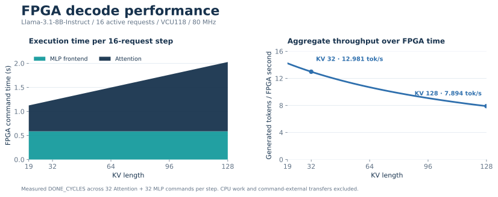
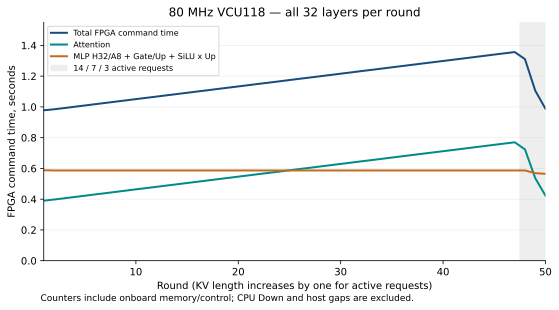
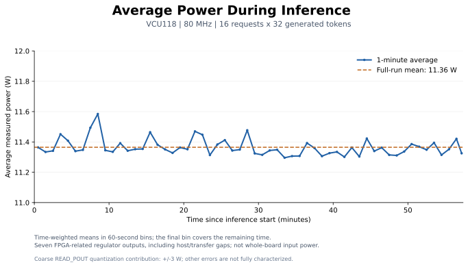

# FPGA speed, resources and full-run power

This report concerns the released **Decode16, 80 MHz** image, SHA-256
`96df1a5c1bf4174921bc02ccd88df4066dece3d62b491acb3106bb90ac0ffc85`.
The model is Llama-3.1-8B-Instruct, checkpoint identity
`8a09c60f3256779c16925f8209c9399ba4a1ee0406caf65bd2637ffd99287d6d`.

## FPGA command speed — current fixed-16-request run

The latest board measurement keeps **16 active requests through KV=128** using
the same released bitstream. It records 128 steps, 8,192 commands and 1,784
generated tokens. The plot selects the **110 steps at KV=19–128 that each emit
16 tokens**. Earlier steps include prompt processing and mixed prompt/decode.
Each KV length is one observation from this continuous run, not a repeated-run mean.

Each step executes 32 Attention and 32 MLP commands. Reported time is
`sum(DONE_CYCLES) / 80,000,000`; aggregate throughput is `16 / FPGA time`.
Counters include command-internal memory/control work, computation and drain.
**CPU Down, normalization/residuals, LM head and command-external transfers/waits
are excluded.** MLP here is the FPGA H32/A8 + Gate/Up + scale restoration +
SiLU×Up path. These are FPGA execution metrics, not full-model wall-clock rates.



| KV length | Active requests | Attention, 32 layers | MLP frontend, 32 layers | Total FPGA time | Tokens / FPGA second |
| ---: | ---: | ---: | ---: | ---: | ---: |
| 20 | 16 | 0.546444 s | 0.586748 s | 1.133192 s | **14.119** |
| 32 | 16 | 0.645800 s | 0.586758 s | 1.232558 s | **12.981** |
| 48 | 16 | 0.778308 s | 0.586757 s | 1.365065 s | **11.721** |
| 64 | 16 | 0.910592 s | 0.586770 s | 1.497361 s | **10.685** |
| 80 | 16 | 1.042869 s | 0.586743 s | 1.629611 s | **9.818** |
| 96 | 16 | 1.175346 s | 0.586740 s | 1.762085 s | **9.080** |
| 112 | 16 | 1.307725 s | 0.586760 s | 1.894485 s | **8.446** |
| 128 | 16 | 1.440162 s | 0.586734 s | 2.026896 s | **7.894** |

Between KV32 and KV128, Attention grows from 0.645800 s to 1.440162 s while
MLP stays near 0.58675 s. No requests retire in this plotted interval; there is
no end-of-run batch reduction in this comparison. The counter data locates the
growth in the Attention command, without attributing exact fractions to KV
reads, QK, Softmax or PV.

[All 128 steps](evidence/kv128_chat16/results/fpga_performance_rounds.csv) ·
[8,192 raw command counters](evidence/kv128_chat16/results/commands.csv) ·
[Source hashes and formulas](evidence/kv128_chat16/results/fpga_performance_provenance.json) ·
[Measurement methods and complete dataset](evidence/kv128_chat16/README.md)

## Earlier 16×32-token run — changing active request count

This separate historical run stops each request after 32 generated tokens.
The final three rounds have **14, 7 and 3 active requests**, so their falling
latency is not comparable to the fixed-16-request KV sweep above.

<details>
<summary>Earlier run: original counters, request-retirement figure and reproduction</summary>

The original completed generation has sixteen independent requests, 16–19 input
tokens per request and a budget of 32 generated tokens each. It completed all
512 generated tokens in 50 rounds / 3,200 commands. All requests stopped at the
length limit; no EOS occurred. Requests maintain incremental KV and are retired
individually: the last three rounds have 14, 7 and 3 active slots.

Each round issues Attention followed by MLP for each of 32 layers. `DONE_CYCLES`
is the 80 MHz core controller's command counter, starting after descriptor
acceptance and ending at completion, including input/metadata/KV/weight access,
engine execution and drain. It saturates at `0xffffffff`; the analyzer rejects
saturated counters. These measurements **exclude CPU Down, normalization,
residuals, LM head and command-external PCIe/host waits**.

`FPGA command time = sum(DONE_CYCLES) / 80,000,000`.

| Quantity | Measured result |
| --- | ---: |
| Total command cycles, including prompt processing | 4,657,857,236 |
| Total FPGA command time | **58.22321545 s** |
| Attention command time | 28.9239739875 s |
| MLP online H32/A8 + Gate/Up + scale restoration + SiLU×Up | 29.2992414625 s |
| Fully populated rounds | 47 |
| Pure decode rounds, after all active inputs come from generated tokens | 31 |
| Tokens emitted in those pure decode rounds | 472 |
| FPGA command time in those pure decode rounds | 38.26224145 s |

The total exceeds 32-bit range because it sums many unsaturated commands using
Python integers. `512 / 58.2232` must not be presented as complete-model
throughput: the denominator includes prompt work and omits Host Down and the
other host operations. Speed reporting here uses time for the actual FPGA
operators and makes no extrapolation to unmeasured parallel scheduling.

| KV length | Active requests | Workload phase | Attention, all 32 layers | MLP, all 32 layers | Total FPGA time |
| ---: | ---: | --- | ---: | ---: | ---: |
| 1 | 16 | Prompt | 0.390120 s | 0.587853 s | 0.977973 s |
| 16 | 16 | Prompt / generation mixed | 0.513349 s | 0.586729 s | 1.100078 s |
| 20 | 16 | Decode | 0.546368 s | 0.586754 s | **1.133121 s** |
| 32 | 16 | Decode | 0.645942 s | 0.586726 s | **1.232669 s** |
| 47 | 16 | Decode | 0.769827 s | 0.586755 s | **1.356583 s** |
| 48 | 14 | Decode, requests retiring | 0.723830 s | 0.586749 s | 1.310579 s |
| 49 | 7 | Decode, requests retiring | 0.536944 s | 0.569267 s | 1.106212 s |
| 50 | 3 | Decode, requests retiring | 0.423255 s | 0.564865 s | 0.988121 s |

At KV length 32, average per-layer command time is **20.186 ms Attention +
18.335 ms MLP**. Within the FPGA-assigned operations this corresponds to
`16 / 1.232669 = 12.98` active-request positions per FPGA second. It is a
hardware-operator processing rate, not an end-to-end LLM generation rate.

The last three points use smaller active batches. Their lower command times
must not be interpreted as improved fixed-16-request performance at longer KV.
The figure retains all original observations and displays the active count
separately; the dashed tail marks the changed workload.



Recompute directly from the published, unchanged runtime record:

```bash
python3 tools/analyze_performance.py docs/evidence/inference_chat16/run.json --output outputs/recomputed
```

The analyzer validates command IDs, layer/opcode order, masks, incremental
positions, per-round counter sums and committed generated tokens. See
[metrics](evidence/inference_chat16/fpga_metrics.json),
[all 3,200 command counters](evidence/inference_chat16/fpga_commands.csv),
[50 rounds](evidence/inference_chat16/fpga_rounds.csv),
[exact requests and outputs](evidence/inference_chat16/outputs.json), and
[artifact provenance](evidence/inference_chat16/provenance.json).
The input `run.json` SHA-256 is
`5f3dd85adc361d7cc6460e76ad218b22b200d1e2ec278777606f006aadcbcf70`.

</details>

## Hardware resources and timing

The device is **xcvu9p-flga2104-2L-e**, VCU118. Core frequency is **80 MHz**;
the two DDR controller user interfaces run at **200 MHz**.

| Resource | Synthesized | Fully placed |
| --- | ---: | ---: |
| LUT | 730,715 | **701,775** |
| Flip-flop | 971,057 | **954,554** |
| BRAM36 equivalent | 709 | **709** |
| URAM | 304 | **304** |
| DSP | 5,389 | **5,389** |

The 709 BRAM36-equivalent tiles comprise 695 RAMB36 + 28 RAMB18.
Placed LUT distribution is SLR0 212,319 / SLR1 286,402 / SLR2 203,054.
The final routed utilization was **not separately reported**: later routing and
hold repair may change small logic counts, so the placed counts above are not
relabeled as final routed counts.

| Final routed check | Result |
| --- | ---: |
| Setup WNS | **+0.017 ns** |
| Hold WHS | **+0.002 ns** |
| Pulse-width WPWS | 0.000 ns |
| Failing setup / hold / pulse endpoints | 0 / 0 / 0 |
| Routable nets | 1,712,169 |
| Unrouted nets / routing errors | 0 / 0 |

[Source reports and their original/published hashes](evidence/final/resources_timing_manifest.json)
separate synthesized, placed and routed evidence. The final routed checkpoint
identity is `3b6e401051cef12ba14ff4ebe9e9b3ef142fcdddfa851b0053c97cf718e608c3`.
The large checkpoint is not required to use the supplied bitstream; RTL and
project-generation inputs are included for fresh builds.

## Full-inference power

The final release includes a continuous measurement over idle-before, the
complete 16-request × 32-token run, and idle-after. Its observed quantities are
**seven VCU118 regulator output rails associated with the FPGA**. They do not
include the entire board's 12 V input, the host computer, or every possible
chip-related rail. See [measurement procedure](POWER_MEASUREMENT.md) for the
sensor connections, raw conversions and integration method.

| Full 16-request × 32-token inference window | Result |
| --- | ---: |
| Window duration, used only for energy integration | 3,443.137508 s |
| Time-weighted mean of the seven measured rails | **11.3648 W** |
| Integrated energy | **39,130.65 J (10.8696 Wh)** |
| Valid complete sweeps, including adjacent idle windows | 2,947 |
| Model-window sampling coverage | **100%** |
| Median / maximum sweep midpoint interval | 1.1682 / 1.3732 s |
| Excluded long sampling gaps | 0 |
| Idle-before / idle-after mean | 11.3374 / 11.3120 W |
| FPGA command time in this power run | 58.2254338 s |
| FPGA counter-time fraction of the model energy window | 1.6911% |

The 50-round model execution returned successfully; all 512 generated token IDs
match the previous recorded run. This establishes repeatability, not independent
numerical accuracy. The power run has its own counters; the speed tables above
refer to the separately identified original generation record.

**The original measurement wrapper ended with `FAIL: Sampler stop timeout`.**
After all inference and idle windows had ended, the sampler had saved a valid
complete evidence JSON file. Its redundant second serialization/output to the
console exceeded the shutdown limit. Its successful native exit was
not observed. The guard stopped its owned process, released the lease, and left
no owned survivors. The continuously written JSONL retained every complete
sweep. Independent decoding of all **20,629 rail observations** and integration
confirmed full coverage of all three windows. The published receipt retains
this failure and unknown sampler exit; the data is qualified as valid observed
windows, not a wholly successful measurement process. The public sampler now
writes a small final summary instead of serializing the entire sample history
again; validation of that change is reported separately.

The mean includes host computation and transfer gaps. It is not continuous
full-utilization FPGA power. The approximately 0.040 W increase over the average
of the idle windows is **not resolved** by these sensors: three READ_POUT rails
alone contribute ±3 W sum / ±6 W difference quantization uncertainty. These
numbers do not include the other four rails' sensor and calibration errors.



See the [complete power dataset](evidence/power_chat16/README.md),
[derived results](evidence/power_chat16/summary.json),
[original stage status](evidence/power_chat16/receipt.json), and
[independent raw-data review](evidence/final/power_controller_review.json).
The analysis command and the explicit handling of this recorded finalization
failure are documented in [Power measurement](POWER_MEASUREMENT.md).

## What has been verified

The released bitstream completed the real 16-request workload and earlier
scoped board diagnostics. Its full-model output is observable in the records;
**an independent whole-model numerical oracle comparison was not run**.
A repeated run can establish deterministic repeatability, not independent
numerical accuracy. The example responses are often incomplete because of the
32-token generation limit.

The portable project entry passed fresh Vivado block-design validation and
complete IP output/wrapper generation. The two reader protocol testbenches
passed XSim. The portable runtime passed focused CPU, protocol and preservation
checks. See [build validation](evidence/final/build_validation.json),
[transport tests](evidence/final/transport_tests.json), and
[runtime validation](evidence/final/runtime_validation.json), and
[controller release review](evidence/final/release_validation.json).
A complete fresh physical rebuild, complete model re-export and deployment of
the portable wrapper on a second host have not been repeated for this release.
