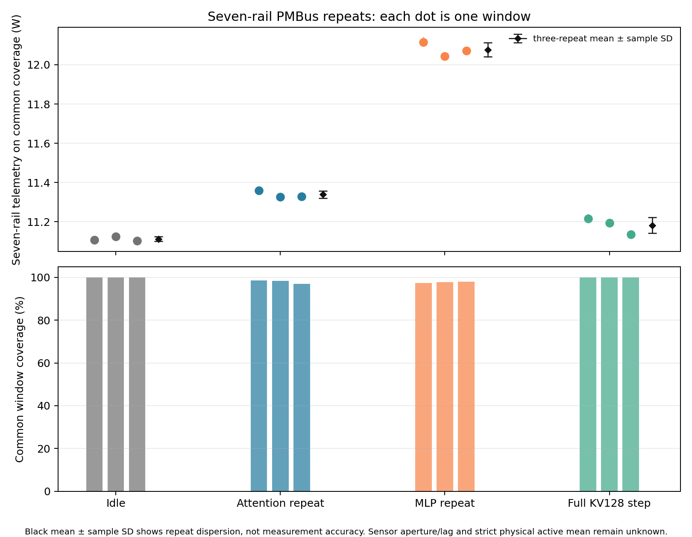
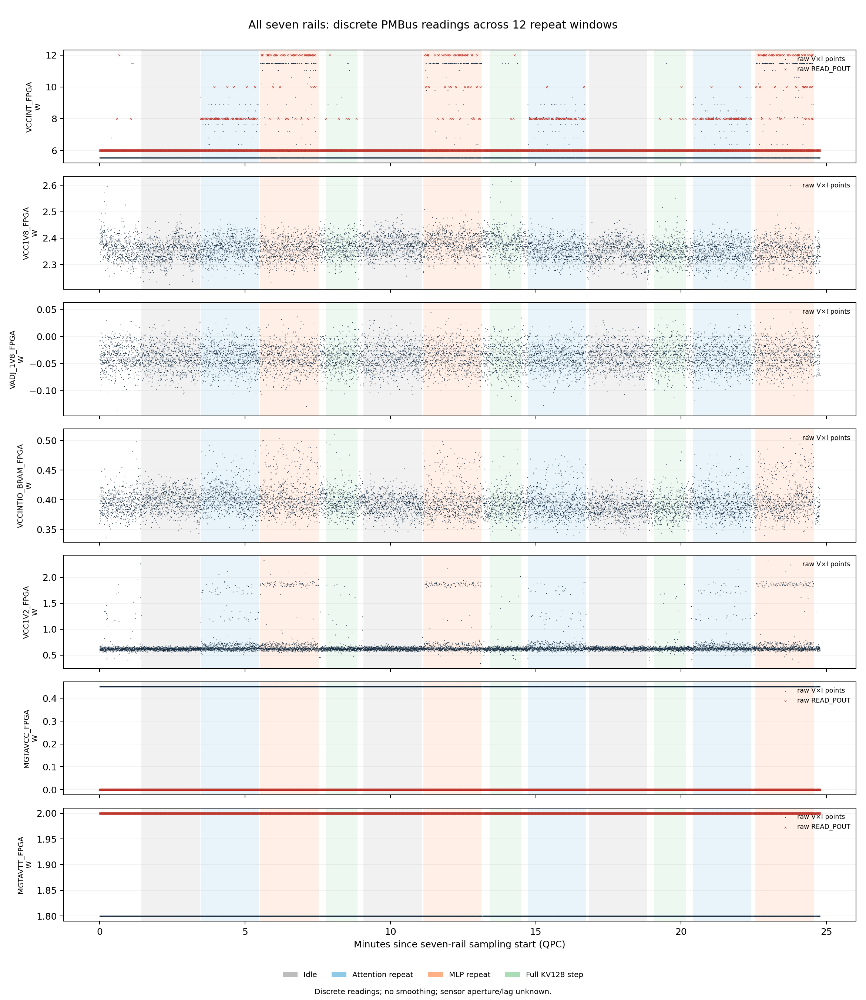

# KV128, active16: repeated seven-rail PMBus measurements

Measured and published 2026-11-02 (Asia/Shanghai). **PARTIAL_WITH_LIMITS:** all twelve planned windows were collected; six have complete common time coverage, while the six Attention/MLP replay windows have gaps. The released VCU118/XCVU9P Decode16 **80 MHz bitstream is unchanged**. No RTL edit, synthesis, implementation or programming was performed.

The model is Llama-3.1-8B-Instruct, with the released Attention W8 / Gate-Up W4 / online A8 / KV12 numerical configuration. All 16 requests execute position 127 with committed KV history at positions 0–126. Each complete-step repeat restores the same real checkpoint and includes **32 Attention + 32 MLP commands, CPU operators including Down, LM head and token commit**. These are technical repeats, not three independent prompts or three entire 128-step trajectories.

## Results and scope

| Workload, three repeats each | Seven-rail mean ± sample SD / W | Common time coverage | Supported statistic |
| --- | ---: | ---: | --- |
| Idle | 11.112454 ± 0.011856 | 100% | Complete-window telemetry mean |
| Repeated Attention, layers 0/8/16/24/31 | 11.339012 ± 0.018545 | 97.0574–98.5315% | Covered-time mean only; full-window mean null |
| Repeated MLP frontend, layer 0 | 12.076557 ± 0.035709 | 97.4958–97.9212% | Covered-time mean only; full-window mean null |
| Complete KV128 decode step | **11.182172 ± 0.040880** | **100%** | Complete-window telemetry mean |

The electrical boundary is **seven selected regulator outputs**, not all VCU118 supply inputs, the whole FPGA chip or the host system. Each rail is the product of sequential VOUT and IOUT reads. Repeat SD describes repeat dispersion, not instrument accuracy. For prose, use approximately **11.18 W (repeat SD 0.04 W)** with this boundary and window stated.

The complete steps take 65.4053732 / 65.4006318 / 65.6950058 s; FPGA DONE counters sum to 2.027063375 / 2.0268113625 / 2.027130700 s. CPU and host gaps remain inside the power window. These controlled replay wall times are not a speedup comparison with the earlier natural-inference capture.



[Full Chinese report and per-rail values](REPORT.md) · [Window CSV](results/window_summary.csv) · [Rail/window CSV](results/main_004_window_rail_v2.csv) · [Machine-readable summary](results/summary.json) · [Download complete raw evidence](DOWNLOADS.md)

## What the higher-resolution readout establishes

MAX20751 VOUT_MODE is 0x20: VID voltage is `0.25 + (raw - 1) / 200`. Measured voltages are 0.85 / 0.90 / 1.20 V. IOUT has a 0.5 A step; READ_POUT has a 2 W step. VCCINT V×I therefore has a **0.425 W code step** and 15 observed levels from 5.525 to 11.475 W, while POUT still reports 6/8/10/12 W. MGTAVCC remains 0.45 W by V×I (POUT 0 W), and MGTAVTT 1.80 W (POUT 2 W): their raw codes never change. This improves decoding and digital spacing, not proven physical accuracy; a constant or zero code does not establish constant or zero physical power.

The four MAX15301 rails use mode 0x14 and VOUT/4096. Their documented command set does not include READ_POUT, so its raw code and read times are explicitly null rather than fabricated. Negative VADJ current codes are retained. Light-load offset, calibration or small reverse current could contribute; this experiment does not distinguish those causes. [Code-spacing CSV](results/resolution.csv) · [Official-source audit](source/references/source_facts.md).



## Sampling, coverage and command observations

A 60 s read-only pilot fixed the target sweep period at 140 ms and the gap limit at 420 ms **before** collection. Actual sweep intervals have median 142.0070 ms, P95 176.1067 ms and maximum 540.9238 ms. There are 10,116 sweeps, 70,812 rail points and 171,993 register reads including mode/calibration reads, with zero read errors. MAX20751's listed updates are 512 µs for IOUT and 3 ms for VOUT/POUT; internal averaging/age remains unknown. MAX15301 update/averaging windows are also unknown. Host read count is not an independent sensor sample count.

Each rail is interpolated separately between valid adjacent observations. Long gaps remain disconnected. Seven-rail means use the **intersection of all seven supported time sets**, with no boundary extrapolation. All six replay windows have gaps, so their complete-window means remain null. Gaps need not be random and the covered means cannot stand in for an exact full-window value.

Conditional BUSY data are a separate arithmetic distribution of V/I transaction envelopes wholly contained in a conservative BUSY inner window. They are not time-weighted command power. No command has enough common seven-rail coverage within BUSY to establish an active sum; strict physical active power, active energy, J/token and whole-board input power remain null. [Conditional points](results/main_004_busy_points_v2.csv) · [Opcode/layer strata](results/main_004_busy_by_opcode_layer_v2.csv) · [Command cycles and host gaps](results/main_004_commands_v2.csv).

## Completion, correctness and original failure

All **9,129 commands** complete with DONE/ACK: 9,055 inside the twelve measured windows and 74 qualification/restore checks outside. The three full steps each complete all 64 commands; all 16 token IDs and the six archived target input/output checks match. Five layers have byte-exact historical KV comparisons; the remaining 27 have format/continuity checks but no independent old per-layer history hash. An independent full-model numerical oracle is not established.

The original launcher [receipt](native/main_004/receipt.json) stays **FAIL**. Command 14365 finished before the first host status poll, so BUSY was not observed; DONE cycles and output were valid. Command 10084 has only one BUSY observation, also insufficient for an inner window. Both inner windows stay null. Workload exit is 0 and sampler metadata is COMPLETE, but its native process exit was not captured and remains null. Offline data validation does not rewrite these original process states. [Method acceptance](source/method_review.md) · [Postcheck](native/identity_after_launcher.json).

## Files and offline reproduction

The [homepage presentation figure (PNG)](showcase/sevenrail_power_telemetry.png) is the user-supplied 1394 × 936 image, published byte for byte as a separate presentation asset. It is additional to the frozen Release archive and its publication manifest.

This Git directory is a **readable subset**: compact tables, six PNG figures, four compact SVG figures, selected receipts, methods and frozen analysis code. All six full SVGs, raw V/I/P read envelopes, all command/XDMA logs, failed attempts and frozen acquisition scripts are in the unchanged **56,091,268-byte Release archive**. Its 229 members pass manifest/SHA checks. The 256 MiB KV snapshot is explicitly excluded; its hash/inspection records remain, so the power package alone cannot independently recheck that entire binary. Earlier superseded derived outputs are retained locally and omitted from this package.

From the repository root, Python 3.11+:

```bash
python3 tools/release/verify_power_repeat_asset.py \
  --download outputs/ScaleLLM_KV128_SevenRail_PMBus_20261102.zip --recompute
```

This verifies the ZIP and every manifest member, then extracts only the necessary inputs and runs the frozen analyzer offline. It must reproduce the archived analysis JSON byte for byte. No FPGA, Vivado, model weights or vendor runtime is required; plotting additionally needs Matplotlib. [Actual validation receipt](validation.json) · [Download and file index](DOWNLOADS.md) · [Public-copy provenance](PUBLICATION_MANIFEST.json).
