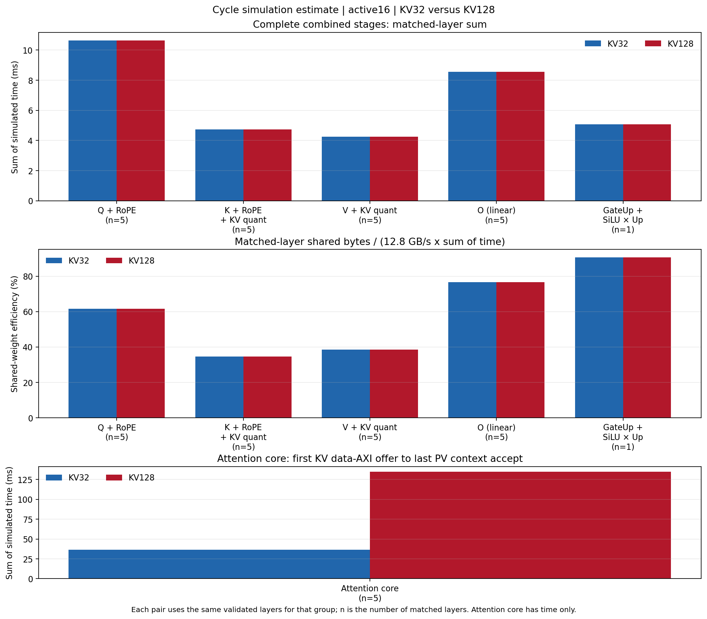

# KV32 / KV128 cycle simulation, Decode16 at 80 MHz

This directory publishes the **cycle-simulation estimates** for the released ScaleLLM VCU118 Decode16 design. It pairs five independently validated Attention layers (0, 8, 16, 24, 31) at each KV length and one Gate/Up layer (0) at each KV length. All 12 selected commands completed, and every simulated output matched its captured board output byte for byte. These are selected-layer measurements, not a 32-layer operator trace.

Read the [results and limits](REPORT.md) before using the numbers. The [machine-readable summary](summary.json), [method](method.json), [source identity](source_identity.json), [coverage](coverage.json), [raw-log index](raw_logs_index.json), and [file checksums](MANIFEST.json) make the published selection auditable. The eight CSVs below retain null values for unmeasured layers.

| Data | Contents |
| --- | --- |
| [Stages by layer](stages_by_layer.csv) | All 384 candidate rows; 52 validated, 332 unmeasured |
| [Group aggregates](group_aggregate.csv) | Per-KV sums and shared-weight efficiency |
| [Paired layers](kv32_kv128_paired.csv) | KV32/KV128 values side by side, including missing layers |
| [Matched aggregates](kv32_kv128_matched_aggregate.csv) | Same-layer ΣT and ΣD/ΣT comparisons |
| [Full service windows](service_windows_by_layer.csv) | First weight offer, dispatch, end, and two efficiency boundaries |
| [Preparation and dependency](preparation_and_dependency.csv) | Non-additive parent intervals labelled explicitly |
| [Disjoint command partition](command_disjoint_partition.csv) | Command-envelope conservation without double counting |
| [Board cross-check](command_crosscheck.csv) | Simulated and captured board command counters kept separate |

The [SVG version of the figure](matched_duration_comparison.svg) is suitable for enlargement. Actual board command counters, 128-step inference, 1,784 generated tokens, and conditional PMBus observations are already published in the [board evidence directory](../kv128_chat16/README.md); they are linked rather than copied here. The public board results and the frozen simulation source package were compared byte for byte for the summary, tokens, power summary, auxiliary outcome, transfer receipt, command CSV, and both power CSVs.

The complete raw logs, input and gold bytes, source snapshots, failed-attempt index, and offline recomputation tools are in the [GitHub Release asset](DOWNLOADS.md). The asset is 781,288,611 bytes and has SHA-256 `bdd7c7281dace4d26604918da4801bb02e0d8eaf0a0781ab75d7896361b9b38b`. This Git directory contains the readable result set; the large archive is a Release asset.
