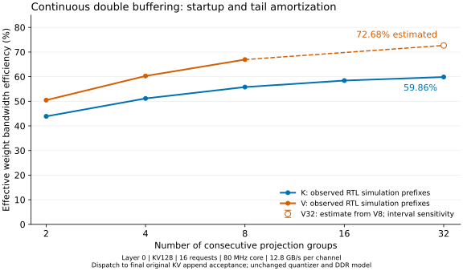

# Independent K/V double-buffer RTL evidence

**2026-11-02 · FRAGMENT_PASS · RTL cycle-simulation estimates.** An isolated
Decode16 controller copy overlaps the next projection group with the preceding
group's RoPE/KV quantization. The published FPGA bitstream and release RTL are
unchanged. No synthesis, implementation or programming was performed.

The real workload is Llama-3.1-8B-Instruct, layer 0, command 8129, 16 active
requests, KV128 at position 127, core 80 MHz and DDR interface 200 MHz.

| Scope | Sealed cycles / efficiency | Candidate cycles / efficiency | Evidence |
| --- | ---: | ---: | --- |
| K, 32 groups | 75,911 / 34.533% | 43,791 / **59.863%** | Both complete local windows simulated |
| V, 8 groups | 17,046 / 38.447% | 9,790 / **66.942%** | Both eight-group windows simulated |
| V, 32 groups | 68,206 / 38.434% | 36,070 / **72.676%** | Prior complete sealed replay; **candidate extrapolated from V8** |

All 640 appended records, request tags, write addresses and the complete 8 MiB
KV image match between the selected candidate and baseline runs. Quantizer
count, arithmetic, rounding and DDR service model are unchanged. Full candidate
V32, complete Attention, other layers, implementation resources and board/model
speedups remain untested.

- [Method, timing boundaries and limitations](REPORT.md)
- [Per-group boundaries and observed waits](groups.csv)
- [Measured local windows and extrapolations](summary.csv)
- [Measured continuous prefixes](prefixes.csv)
- [Machine-readable results](results.json)
- [Raw evidence download and offline verification](DOWNLOADS.md)
- [Passed verification receipt](validation.json)
- [Archive member inventory](archive_members.json)

`MEASURED` in these CSVs means directly observed **in RTL simulation**, not on
the FPGA. A group is an output block, not a model layer. The earlier two-group
prototype is preserved in the archive; its forced-stop timing is not combined
with these continuous-run prefixes.

The [released-RTL KV32/KV128 comparison](../kv32_kv128_cycle_sim/README.md) and
[board inference and power records](../kv128_chat16/README.md) remain separate,
unchanged evidence for the released image.
