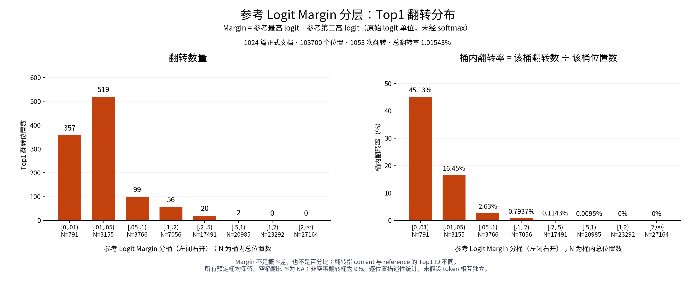

# 按参考 Logit Margin 分层的 Top1 翻转

Margin定义：参考版本最高logit减去第二高logit，温度1、未经softmax的原始logit单位，不是概率差或百分比。Top1翻转指current/reference Top1 ID不同，采用原数据的最小词表ID并列规则。

数据只来自R006/session_S001/analysis_manifest.json指定的64个正式组；未扫描/纳入qualification或重复attempt。全部1024文档、103700位置、1053翻转核对通过，总翻转率1.01542912%。每篇原top1_match_count、逐位置ID与matches、原margin certificate全部一致。

## 固定分桶主表

| 参考Margin桶 | 总位置数 | 翻转数 | 桶内翻转率 | 占1053翻转比例 | 累计翻转数 | 累计翻转比例 |
|---|---:|---:|---:|---:|---:|---:|
| [0,0.01) | 791 | 357 | 45.132743% | 33.903134% | 357 | 33.903134% |
| [0.01,0.05) | 3155 | 519 | 16.450079% | 49.287749% | 876 | 83.190883% |
| [0.05,0.1) | 3766 | 99 | 2.628784% | 9.401709% | 975 | 92.592593% |
| [0.1,0.2) | 7056 | 56 | 0.793651% | 5.318139% | 1031 | 97.910731% |
| [0.2,0.5) | 17491 | 20 | 0.114345% | 1.899335% | 1051 | 99.810066% |
| [0.5,1) | 20985 | 2 | 0.009531% | 0.189934% | 1053 | 100.000000% |
| [1,2) | 23292 | 0 | 0.000000% | 0.000000% | 1053 | 100.000000% |
| [2,∞) | 27164 | 0 | 0.000000% | 0.000000% | 1053 | 100.000000% |

累计比例按Margin从小到大累加1053次翻转。全部桶非空；若空桶则率应为NA，不能写0%。分桶方案在读取全量结果前固定于protocol.json。

83.190883%的翻转位于Margin<0.05，92.592593%位于<0.1，99.810066%位于<0.5。Margin≥1的位置共有50456个，观察到0次翻转；这是该冻结数据集的描述，不是对其他输入的不翻转保证。

## 零Margin及非法值

恰好Margin=0（参考Top1并列）0位置、0翻转，翻转率NA（无样本）。此项为首桶的重叠子集，不能再加入总数。负Margin0、非有限Margin0；Margin=0与原reference_top1_tie_counts>1逐位置一致。全部103700条TV仅按doc_id+position键对齐保留，未扩大推理或进行额外模型计算。

## 翻转位置Margin分位数

| 分位数 | 原始logit Margin |
|---|---:|
| 0% | 4.95910644531e-05 |
| 5% | 0.0012767791748 |
| 25% | 0.00705432891846 |
| 50% | 0.017430305481 |
| 75% | 0.0352230072021 |
| 90% | 0.0759853363037 |
| 95% | 0.122556114197 |
| 99% | 0.315294570923 |
| 100% | 0.639048576355 |

最大翻转Margin=0.639048576355，平均=0.0338257692705。高Margin清单预定义为margin≥1.0（最后两个桶）；共0条，high_margin_flips_ge1.csv仍保留表头。另将全部翻转按Margin降序排列，保留最高20条，避免高Margin为空时隐藏最大案例。

## Margin最大的翻转案例

| 文档ID | 位置(0起) | 参考Margin | reference Top1 ID | current Top1 ID | 对齐TV |
|---|---:|---:|---:|---:|---:|
| c4_official_validation_first10000:7541 | 107 | 0.6390485764 | 11 | 24814 | 0.08277755971 |
| c4_official_validation_first10000:9908 | 27 | 0.6289539337 | 1373 | 4034 | 0.2972007361 |
| c4_official_validation_first10000:9738 | 103 | 0.483259201 | 3851 | 1690 | 0.1898937967 |
| c4_official_validation_first10000:6218 | 93 | 0.4631767273 | 13 | 323 | 0.1113932188 |
| c4_official_validation_first10000:4369 | 3 | 0.4039096832 | 13016 | 5097 | 0.1289422577 |
| c4_official_validation_first10000:6462 | 4 | 0.4035081863 | 198 | 0 | 0.09160375836 |
| c4_official_validation_first10000:6462 | 49 | 0.3996047974 | 4731 | 505 | 0.1558977046 |
| c4_official_validation_first10000:1053 | 11 | 0.3801612854 | 279 | 902 | 0.09174815051 |
| c4_official_validation_first10000:8094 | 48 | 0.3318977356 | 2134 | 6727 | 0.076107468 |
| c4_official_validation_first10000:529 | 43 | 0.3240375519 | 15300 | 2128 | 0.0994470241 |

结论仅描述该冻结集合：翻转集中在参考前两名logit较接近的位置。翻转不等于任务标签判错，也未确定是哪一层/算子导致。未新增置信区间或独立token假设。没有GPU/模型重跑，未改历史源或三摘要。

[主表CSV](buckets.csv) · [全部103700位置CSV](positions.csv) · [1053翻转CSV](top1_flips.csv) · [高Margin≥1清单](high_margin_flips_ge1.csv) · [最高Margin20条](highest_margin_flips_top20.csv) · [源SHA](source_manifest.json) · [独立CSV复核](independent_csv_checks.json) · [固定方案](protocol.json)
