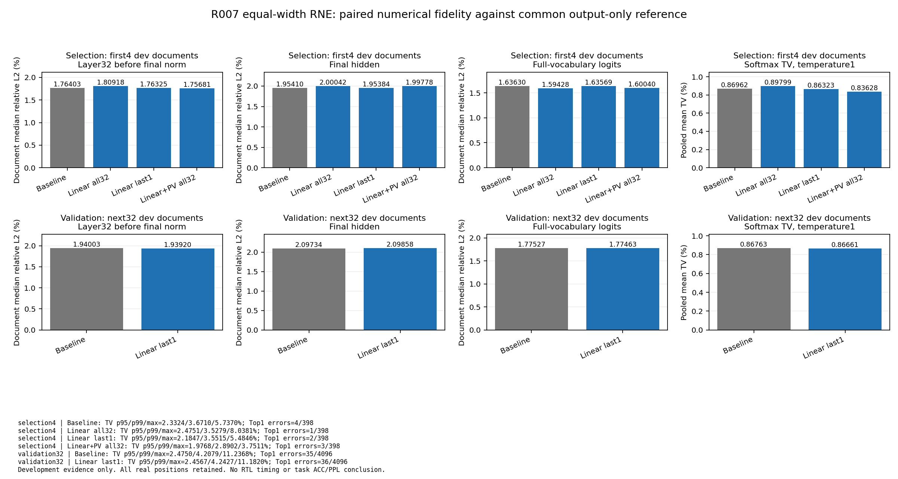

# R007 等位宽 RNE 快速优化试验终态

工程执行已完成，方法判断为 **inconclusive：本批没有验证出满足联合不退要求的纠正方案**。最后一层 Linear RNE 在独立 next32dev 的平均 TV 略有改善，但 final hidden L2 中位与 Top1 不一致数变差；当前结果不支持推广到生产。Root最终审核尚未记录。

实际 GPU0 单模型驻留前向116次（dev4五臂，next32三臂），36文档/4494真实位置，所有计划文档完成；候选比较80组，原始张量、逐文档/逐位置和尾部全部保留。dev4仅用于候选筛选，next32为另一组开发文档验证；不称heldout正式1024。

## 固定候选与初筛

仅改变中间Linear组对齐和可选PV项右移，使用有符号floor quotient/remainder精确nearest-even，inactive code先把effective shift置0。guard/acc位宽、wrap、出口half-away/sat、QK、权重整数码、ScaleCode/Hadamard/format05、Host与LUT保持原路径。无末端reference校准。

| dev4配置（398位置） | L32 pre-norm L2中位% | finalhidden L2中位% | fullvocab logit L2中位% | meanTV% | Top1不一致 | 选择结论 |
|---|---:|---:|---:|---:|---:|---|
| baseline | 1.764027760 | 1.954097014 | 1.636304878 | 0.869617818 | 4/398 | 基线 |
| linear_last1 | 1.763250520 | 1.953841926 | 1.635691370 | 0.863229513 | 2/398 | 仅此满足初筛联合规则 |
| linear_all32 | 1.809176056 | 2.000419311 | 1.594277144 | 0.897987000 | 1/398 | finalhidden中位变差，不合格 |
| linear_pv_all32 | 1.756805348 | 1.997781373 | 1.600403007 | 0.836277839 | 3/398 | finalhidden中位变差，不合格 |

选择规则在推理前冻结：在finalhidden/logit L2文档中位不劣且Top1总错数不增加的候选中取pooled meanTV最小者。规则本身未强制TV小于baseline，工程额外如实检查：本次last1初筛meanTV确实下降0.73461%。PV-all32虽然meanTV更低，finalhidden中位相对变差2.23553%，因此未绕过联合规则选中。

## 下一组32开发文档验证（4096位置）

以下L2为相对L2百分数；TV为概率质量百分数。差值为candidate−baseline（百分点，负数表示下降）；相对变化使用单独文字说明。

| 指标 | baseline | Linear-last1 RNE | 差值（百分点） |
|---|---:|---:|---:|
| L32 pre-norm L2 文档中位% | 1.940032317 | 1.939197037 | -0.000835280 |
| L32 pre-norm L2 文档均值% | 2.140028448 | 2.140045564 | +0.000017115 |
| L32 pre-norm L2 文档P95% | 3.718232629 | 3.719051735 | +0.000819105 |
| L32 pre-norm L2 文档最大% | 4.007739419 | 4.007011671 | -0.000727749 |
| L32 pre-norm L2 合并能量% | 2.191681942 | 2.191778246 | +0.000096303 |
| finalhidden L2 文档中位% | 2.097337280 | 2.098582422 | +0.001245142 |
| finalhidden L2 文档均值% | 2.327616249 | 2.327608199 | -0.000008050 |
| finalhidden L2 文档P95% | 3.827172906 | 3.827748278 | +0.000575373 |
| finalhidden L2 文档最大% | 4.529040524 | 4.527966712 | -0.001073813 |
| finalhidden L2 合并能量% | 2.426232009 | 2.426228985 | -0.000003023 |
| fullvocab logit L2 文档中位% | 1.775272383 | 1.774625834 | -0.000646549 |
| fullvocab logit L2 文档均值% | 1.948462707 | 1.948564918 | +0.000102211 |
| fullvocab logit L2 文档P95% | 3.159569849 | 3.158091820 | -0.001478029 |
| fullvocab logit L2 文档最大% | 3.649796988 | 3.651321969 | +0.001524982 |
| fullvocab logit L2 合并能量% | 2.018127696 | 2.018363087 | +0.000235391 |
| TV pooled mean% | 0.867630920 | 0.866613218 | -0.001017701 |
| TV 位置中位% | 0.692172113 | 0.689181470 | -0.002990643 |
| TV 位置P95% | 2.474970284 | 2.456746171 | -0.018224113 |
| TV 位置P99% | 4.207869798 | 4.242743280 | +0.034873482 |
| TV 位置最大% | 11.236764994 | 11.181976208 | -0.054788786 |
| Top1一致率% | 99.145507812 | 99.121093750 | -0.024414062 |

meanTV相对下降 **0.11730%**；L32 pre-norm L2中位相对下降 **0.04305%**；logit L2中位相对下降 **0.03642%**；finalhidden L2中位相对上升 **0.05937%**。Top1不一致由 **35/4096增至36/4096**。TVP99上升，P95与最大值下降，不能只用较好尾部代表全体。

| TV尾部计数（位置） | baseline | last1 |
|---|---:|---:|
| >1% | 1360 | 1345 |
| >5% | 25 | 26 |
| >10% | 1 | 1 |

逐文档方向（improved/worse/equal）：L32 L2为18/14/0，finalhidden为17/15/0，logit为16/16/0，meanTV为19/13/0；Top1不一致数为2/3/27。所有不利文档保留于[逐文档差值](per_document_deltas.csv)，全部位置见[位置指标](per_position_metrics.csv)。

## 资格、资源与真实退出

CPU17059例独立Fraction oracle通过。GPU511 signed/tie向量、30个Linear输出和256个PV输出与独立CPU期望一致；窄位宽负对照产生预期18次guard和16次acc overflow。Inactive线性shift126/PV shift63、非正shift、负数tie均覆盖。独立AST检查证明除声明RNE替换外Linear wrapper/kernel及PV路径保持一致。A015独立静态审核另有49188个signed helper检查0 mismatch。

前4 baseline/reference与R006双finalhidden哈希、L32/logit L2、逐位置Top1/TV全等。每臂重新运行全部32层动态activation/KV编码，192坐标覆盖；共享buffer对象/存储/版本签名不变，消费源SHA结束复核不变。

所有实测candidate/baseline的activation/linear格式错误、有限guard/acc overflow、fixed/linear/rope/PV/SwiGLU saturation/overflow、KV clip均0。QK的既有score clamp非0：selection baseline/last1各52442，validation各542597；该数保留而非伪称所有计数0。OUTPUT_ONLY参考的有限位宽guard/acc计数为null，不当成0。

GPU wall **665.205s**，loader36.398s、attach347.182s。峰值allocated **14.197GiB**、采样RSS峰值 **1.763GiB**、采样GPU free最低 **32.900GiB**；所有资源低于原上限。GPU进程PID/PGID864316于2026-10-20T00:57:01.272Z被pidfd实际观测退出，捕获Linux /proc zombie exit_code0，随后/proc消失且GPU无此PID；worker自写receipt与外部生命周期证据分别保存。

| next32耗时（32文档合计，秒） | baseline | last1 |
|---|---:|---:|
| forward | 58.330886 | 58.477305 |
| head测量 | 3.384310 | 3.596035 |

单次串行测量包含编译/调度差异；不作硬件时序或稳定加速声明。原生命周期observer因Python缺少os.pidfd_open失败，错误保全；v2 Linux syscall observer成功，不掩盖该基础设施修复。

## CPU独立复核与图

80组原NPZ的hidden L2独立复算全通过，最大L2差1.151e-13；head输入hash、Top1 IDs重新计数、TV概率质量/范围/聚合均通过。另在固定doc indices0/4/35、位置0/T//2/T−1做18个独立CPU FP64全词表head配对见证，TV与生产FP32head最大差5.882e-7、Top1 IDs全部一致、概率质量误差<=1.111e-15。该见证换了head数值精度，明确不称全部位置的bitwise FP32 GEMM证明。

CPU analysis与head见证子进程均真实native0且parent wait/reaped，分别8.014s、10.521s；GPU阶段结束后才开始，未新增GPU推理。

## 适用范围与未决风险

本批说明相同位宽的中间RNE没有在所测下一组32开发文档上同时改善全部联合指标；方法对更广数据的效果仍不确定。RNE无逐点不劣保证，统计无偏性仍需分布假设。最后一层修改无法消除早期层已累积的全部差异。未运行其他候选的next32、全1024、PPL/ACC、RTL、综合/实现或时序；不把软件功能验证当作硬件性能证据。生产源保持原版本。

原始来源与命令见[AT001 manifest](../../AT001_rne_equalwidth_dev36/manifest.json)、[GPU退出](../../AT001_rne_equalwidth_dev36/external_lifecycle_receipt_v2.json)、[本次独立复核](independent_checks.json)、[FP64head见证](../head_witness/independent_head_witness.json)、[AT002真实收据](../execution_receipt.json)。
