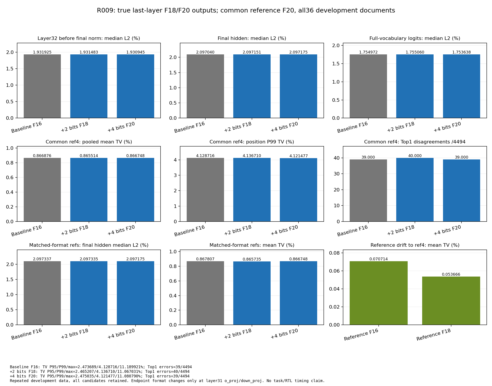

# R009：第32层真实出口F18/F20六臂开发试验

工程执行完成。只在index31 o_proj/down_proj增加真实输出小数位，保留前31层和其他第32层节点；两档与所有参考在全部36开发文档上完成。Root最终结果审核尚未记录。全局数值改善依据下表报告，未据微小波动采用生产版本。

## 固定ref4主比较（36文档/4494真实位置）

所有主比较共享同一F20 OUTPUT_ONLY参考；L2为文档中位百分数，TV为概率质量百分数。

| 配置 | 第32层pre-norm L2% | finalhidden L2% | 全词表logit L2% | pooled meanTV% | Top1不一致 |
|---|---:|---:|---:|---:|---:|
| baseline_b0 | 1.931924726 | 2.097039955 | 1.754972086 | 0.866875513 | 39/4494 |
| candidate_b2 | 1.931482537 | 2.097150969 | 1.755059598 | 0.865514105 | 40/4494 |
| candidate_b4 | 1.930945450 | 2.097175368 | 1.753638070 | 0.866748062 | 39/4494 |

candidate_b2 相对baseline的meanTV降低 +0.157048%；L32/finalhidden/logit L2中位相对降低 +0.022889/-0.005294/-0.004987%；Top1错数变化 +1。这里降低为负即退步。

candidate_b4 相对baseline的meanTV降低 +0.014702%；L32/finalhidden/logit L2中位相对降低 +0.050689/-0.006457/+0.076014%；Top1错数变化 +0。这里降低为负即退步。

## 全部L2统计与尾部

差异小不代表普遍无损。保留文档中位/均值/P95/最大及合并能量、位置TV所有尾部。

| 指标% | baseline | +2位 | +4位 |
|---|---:|---:|---:|
| L32 pre-norm 文档中位 | 1.931924726 | 1.931482537 | 1.930945450 |
| L32 pre-norm 文档均值 | 2.098485679 | 2.098490862 | 2.098347932 |
| L32 pre-norm 文档P95 | 3.640319044 | 3.640570896 | 3.640456317 |
| L32 pre-norm 文档最大 | 4.007441453 | 4.007502703 | 4.007417788 |
| L32 pre-norm 合并能量 | 2.163057620 | 2.163056468 | 2.162922634 |
| finalhidden 文档中位 | 2.097039955 | 2.097150969 | 2.097175368 |
| finalhidden 文档均值 | 2.284926856 | 2.284946363 | 2.284971617 |
| finalhidden 文档P95 | 3.771913118 | 3.772306646 | 3.772381787 |
| finalhidden 文档最大 | 4.529114139 | 4.529037465 | 4.528953494 |
| finalhidden 合并能量 | 2.394902529 | 2.394969561 | 2.394995281 |
| fullvocab logit 文档中位 | 1.754972086 | 1.755059598 | 1.753638070 |
| fullvocab logit 文档均值 | 1.899253656 | 1.899377465 | 1.899185417 |
| fullvocab logit 文档P95 | 3.113462389 | 3.114548638 | 3.115908681 |
| fullvocab logit 文档最大 | 3.648660181 | 3.649661697 | 3.649123608 |
| fullvocab logit 合并能量 | 1.984787973 | 1.984893386 | 1.984906484 |
| TV pooled mean | 0.866875513 | 0.865514105 | 0.866748062 |
| TV位置中位 | 0.699291805 | 0.696082979 | 0.702315478 |
| TV位置P95 | 2.473688780 | 2.465206962 | 2.475035174 |
| TV位置P99 | 4.128715957 | 4.136709709 | 4.121477137 |
| TV位置最大 | 11.189920850 | 11.067031363 | 11.080789905 |

| TV尾部位置计数 | baseline | +2位 | +4位 |
|---|---:|---:|---:|
| >1% | 1488 | 1497 | 1500 |
| >5% | 27 | 25 | 24 |
| >10% | 1 | 1 | 1 |

逐文档方向（improved/worse/equal）全部保留：

candidate_b2：layer32_pre_norm=18/18/0, final_hidden=22/14/0, logits=17/19/0, tv=24/12/0, top1_errors=2/3/31。

candidate_b4：layer32_pre_norm=22/14/0, final_hidden=18/18/0, logits=21/15/0, tv=20/16/0, top1_errors=1/1/34。

## 同格式配对与参考漂移

同格式比较消除出口格式差异，仍包含前31层CURRENT与OUTPUT_ONLY轨迹的差异，不能称为仅第32层纯局部舍入误差。ref0/ref2至ref4的变化单列，不能把移动参考带来的变化作为候选成果。

| 同格式配置 | L32 L2中位% | finalhidden L2中位% | logit L2中位% | meanTV% | Top1不一致 |
|---|---:|---:|---:|---:|---:|
| baseline_b0 | 1.932514027 | 2.097337280 | 1.756038070 | 0.867806884 | 39/4494 |
| candidate_b2 | 1.931250523 | 2.097334850 | 1.755496372 | 0.865734517 | 41/4494 |
| candidate_b4 | 1.930945450 | 2.097175368 | 1.753638070 | 0.866748062 | 39/4494 |

| 参考漂移至ref4 | L32 L2中位% | finalhidden L2中位% | logit L2中位% | meanTV% | Top1不一致 |
|---|---:|---:|---:|---:|---:|
| output_only_reference_b0 | 0.169433528 | 0.191495302 | 0.151688079 | 0.070713908 | 0/4494 |
| output_only_reference_b2 | 0.138971986 | 0.155318267 | 0.125388928 | 0.053666413 | 1/4494 |

## 原前4篇/398位置固定ref4分组

| 配置 | L32 L2中位% | finalhidden L2中位% | logit L2中位% | meanTV% | Top1不一致 |
|---|---:|---:|---:|---:|---:|
| baseline_b0 | 1.763582187 | 1.953769311 | 1.635095559 | 0.868463193 | 4/398 |
| candidate_b2 | 1.763760073 | 1.954201777 | 1.634997939 | 0.868672782 | 4/398 |
| candidate_b4 | 1.763525271 | 1.954007072 | 1.634998504 | 0.866707868 | 4/398 |

## 原next32篇/4096位置固定ref4分组

| 配置 | L32 L2中位% | finalhidden L2中位% | logit L2中位% | meanTV% | Top1不一致 |
|---|---:|---:|---:|---:|---:|
| baseline_b0 | 1.939132795 | 2.097039955 | 1.775326570 | 0.866721242 | 35/4096 |
| candidate_b2 | 1.938555049 | 2.097150969 | 1.774483412 | 0.865207183 | 36/4096 |
| candidate_b4 | 1.938350401 | 2.097175368 | 1.774261196 | 0.866751968 | 35/4096 |

## 实现与边界

仅index31 o_proj与down_proj：b2/b4的中间F24+b、guard/acc原宽度+b，保持floor组对齐，最终half-away drop8；o_proj输出S26/F18或S28/F20，down_proj输出S34/F18或S36/F20，真实int64存储。临时effective output_width避开旧S24符号重解释；原shift合法性从delta+24+b重建。输出进入HF残差前以FP32只缩放一次，合成除2^(16+b)，Attention辅助概率不改。HostFP32有限24位有效精度仍可能丢弃大幅值低位；新增定点LSB并不保证Host保留每一位。

独立wide参考与candidate分开：exact quotient/remainder、k=total_shift−(16+b)、common_bits=shift_max−(16+b)，expanded clamp/int64；其余OUTPUT_ONLY原算法保持。生产format05/ABI及所有旧冻结源不变，新增格式只属于实验overlay。

## 资格、一致性与独立复核

CPU2781 integer/Fraction及4 Host缩放/正常异常恢复情景通过；另432宽度modulo/sat检查保留。GPU实际b0原生产raw/counter相同，宽Attention正码超过旧S24、Down正码超过int32均正确，独立Fraction参考通过。AT001/2在模型加载前检出legal_shift漏加b并自然失败，未修改期待值；新core_v2修复后AT003资格通过，原失败版本完整保留。

全部216forward覆盖192个动态编码坐标/臂。前31层组内hash的4464次独立逐层比较通过，288个Host缩放事件均为FP32且每出口恰好一次，原attrs/functions/buffers恢复通过。baseline/ref0全部raw哈希与R007和旧指标全等。

独立CPU复算252组finalhidden NPZ、54组可用pre-norm raw，最大L2绝对差4.245e-13；其余pre-norm按合同仅保留能量/hash，不虚称全raw独立复算。Top1 IDs重算、TV质量/范围/聚合核查通过。固定doc0/4/35与位置0/T//2/T−1的63个CPU FP64 fullvocab head见证TV差最大1.002e-06，Top1 IDs全等=True，质量误差最大1.11e-15。此见证不是全部位置的bitwise FP32证明。

| common-ref4 current臂审计 | format错误 | guard/acc overflow | output sat/overflow及KV clip | QK score clamp |
|---|---:|---:|---:|---:|
| baseline_b0 | 0 | 0 | 0 | 595039 |
| candidate_b2 | 0 | 0 | 0 | 595039 |
| candidate_b4 | 0 | 0 | 0 | 595039 |

所有参考有限guard/acc计数为null，不当成0。QK原有clamp是实际计数，未隐藏。

## 资源、命令和退出

AT003 GPU wall 850.573203s；含两次未装模型资格失败的累计GPU阶段855.182747s，低于2400s。模型只装配一次。峰值allocated14.1970GiB，采样RSS2.0809GiB、freeGPU最低32.8682GiB，均在合同内。外部pidfd观测退出于2026-10-20T01:48:02.023934+00:00，/proc消失=True、GPU残留该PID=False；Linux/proc退出状态={'state': 'Z', 'linux_proc_exit_code': 0}。worker自写收据与外部证据分开。

| 36篇合计runtime（秒） | baseline | +2位 | +4位 |
|---|---:|---:|---:|
| forward | 75.153846 | 75.955793 | 75.589831 |
| common-ref4 head测量 | 4.097790 | 4.177941 | 4.159252 |

这些是单次软件GPU实测，含调度/编译等因素，不作RTL资源、频率或稳定加速结论。实际命令、源/输入SHA、checkpoint消费身份见AT003 manifest/stream_loader_validation；全部消费源结束复核不变。CPU审计子进程native0且parent wait/reaped，GPU结束后运行。

## 图、明细和适用范围

[逐文档全部差值](per_document_deltas.csv) · [全部位置TV/Top1](per_position_metrics.csv) · [独立复核](independent_checks.json) · [独立汇总](independent_summary.json) · [原始GPU结果](../../AT003_true_exit_precision_dev36/result.json) · [FP64head见证](../head_witness/head_witness.json)

同一组已用开发数据的重复验证，不是新的heldout或正式1024；两档均全测，未按结果筛除文档。前31层累计误差仍保留，最后两出口加位数不能消除既有所有差异。没有任务ACC/PPL、RTL实现/综合/时序、板级测量或普遍无损证明；没有修改生产源或自动启动后继GPU阶段。
