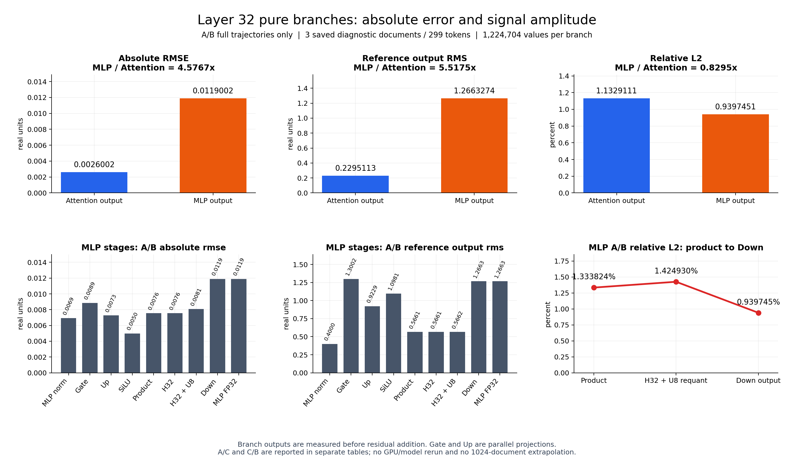

# Attention 与 MLP 纯分支输出比较

范围：第32层、同3篇保存诊断文档/299位置，残差相加前的实际FP32纯分支输出；每分支1,224,704个数值。同一批输入轨迹A/B，不是1024篇结论。所有图中数值已从保存raw重算，原冻结源和已发布三摘要未修改。

| 纯分支 A/B | 绝对RMSE | 参考RMS | 相对L2% |
|---|---:|---:|---:|
| attention_output | 0.00260015949 | 0.22951133410 | 1.13291115 |
| mlp_output | 0.01190024956 | 1.26632737159 | 0.93974511 |

MLP绝对RMSE为Attention的4.57674倍，同时参考输出RMS为5.51749倍；相对L2为0.82950倍，反而较低。因而“MLP更高”只在这批数据的绝对误差上成立，不能描述为相对误差更高。

## MLP全轨迹A/B逐stage

| stage | 输出数值N | 绝对RMSE | 参考RMS | 相对L2% |
|---|---:|---:|---:|---:|
| post_attention_norm | 1224704 | 0.0069135706 | 0.4000193187 | 1.72830918 |
| gate_proj | 4286464 | 0.0088653153 | 1.3001823785 | 0.68185167 |
| up_proj | 4286464 | 0.0072663409 | 0.9228874963 | 0.78734850 |
| silu | 4286464 | 0.0049876214 | 1.0981324581 | 0.45419124 |
| gated_product | 4286464 | 0.0075509369 | 0.5661120561 | 1.33382373 |
| prepare3_hadamard | 4286464 | 0.0075507854 | 0.5661004528 | 1.33382429 |
| prepare3_dequant | 4286464 | 0.0080677489 | 0.5661857739 | 1.42492964 |
| down_proj | 1224704 | 0.0119002501 | 1.2663273716 | 0.93974515 |
| mlp_output | 1224704 | 0.0119002496 | 1.2663273716 | 0.93974511 |

AB中product→Hadamard+U8反量化相对L2为1.33382373%→1.42492964%，对应绝对RMSE0.00755094→0.00806775；这是本轮全轨迹差。Down之后绝对RMSE升至0.01190025，但参考RMS也升至1.26632737，因此相对L2下降至0.93974515%。不能把Down绝对误差变大直接解释成其舍入质量变差。

SiLU/up两路已有输入差经过门乘组合；整数恒等式逐数核验将门乘传播项与门乘本身roundoff差分开，详见summary.json。基础动态量化/LUT规则仍在参考中；A/B沿不同输入传播，不能唯一归因某个舍入点。

## A/C与C/B：独立口径，不能移植为A/B效应

| stage | A/B相对L2% | A/C同层入口L2% | C/B继承输入L2% |
|---|---:|---:|---:|
| post_attention_norm | 1.72830918 | 0.03203299 | 1.72829651 |
| gate_proj | 0.68185167 | 0.07728231 | 0.68173570 |
| up_proj | 0.78734850 | 0.08973216 | 0.78676456 |
| silu | 0.45419124 | 0.08261964 | 0.45411314 |
| gated_product | 1.33382373 | 0.17894192 | 1.33290457 |
| prepare3_hadamard | 1.33382429 | 0.17894505 | 1.33290468 |
| prepare3_dequant | 1.42492964 | 0.39201502 | 1.42454542 |
| down_proj | 0.93974515 | 0.25336882 | 0.93896352 |
| mlp_output | 0.93974511 | 0.25336882 | 0.93896357 |

CB纯MLP相对L2=0.93896357%，与AB=0.93974511%几乎相同：在这3篇诊断中，保留上游输入差异、使用参考块的输出仍保留该分支差。这说明已有输入差异足以产生此量级的分支差；A/C项仍有交叉抵消，不能称其完全可忽略，也不能确定全32层某量化算子的全局因果占比。OUTPUT_ONLY仍保留基础量化、ScaleCode、LUT/SwiGLU、共同出口及Host。

A/C的product0.17894192%→prepare3dequant0.39201502%属于相同层入口下、层内已经分化的算术/重编码响应；不是A/B的放大倍数。A/C、C/B的完整绝对RMSE/参考RMS/能量分别保存在mlp_separate_trajectories.csv；未保存C raw的stage只引用冻结指标和来源身份，不虚称全raw独立重算。

## 数据边界

R006全1024有纯MLP自由轨迹分支统计，但缺少第一次残差相加前的纯Attention自由轨迹分支统计。o_proj同输入局部误差行不能代替该纯分支A/B。因此当前不能做全1024的同口径两分支比较，也不把3篇结果推广为1024篇。

[机器统计与源SHA](summary.json) · [纯分支表](pure_branch_AB.csv) · [逐文档](per_document_pure_branch_AB.csv) · [MLP AB表](mlp_AB_stages.csv) · [AC/CB分开表](mlp_separate_trajectories.csv)
