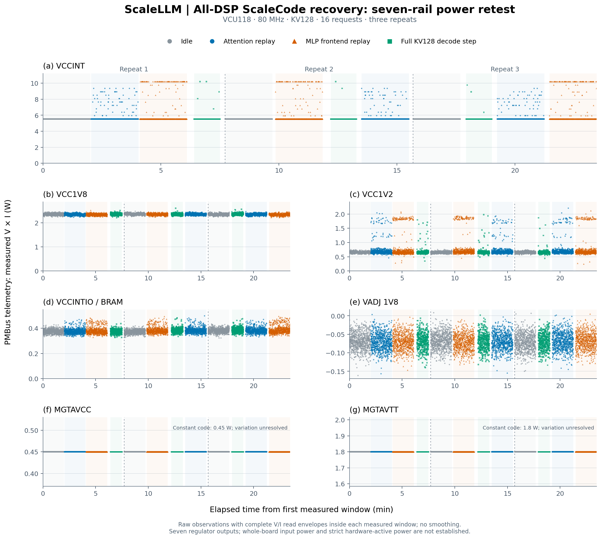

# All-DSP hardware: seven-rail power retest

**2026-11-15 · Dell / VCU118 · Decode16 · 80 MHz · KV128 · 16 requests**

This retest follows the seven-rail method documented in `main`, using the exact all-DSP image whose SHA-256 is `5d78519aa10695be564f668d5a41a0e5554e282c31d39f648534a7dc01ab72f7`. All 12 scheduled windows completed. The result is **PARTIAL_WITH_LIMITS** because nine windows have incomplete common coverage and the sensors' aperture, lag and absolute accuracy remain unestablished.

| Workload, three technical repeats | Covered-time mean ± sample SD / W | Common coverage | Full-window means established |
| --- | ---: | --- | ---: |
| Idle | 11.090993 ± 0.006155 | 99.96046–100% | 2/3 |
| Attention replay, five layers | 11.343160 ± 0.015590 | 97.52732–98.32836% | 0/3 |
| MLP frontend replay, L0 | 11.826220 ± 0.046526 | 96.87886–98.36237% | 0/3 |
| Complete KV128 step | 11.138985 ± 0.013304 | 99.19497–100% | 1/3 |

These values are the equally weighted means of three **covered-time** means. Only idle1, idle3 and full3 have full common coverage. The complete-step workload includes CPU Down, LM head and token commit, but the electrical boundary includes only seven board regulator outputs. These are not whole-board input power, host-system power, or strict FPGA-BUSY power. Repeat SD is not sensor accuracy.

[Detailed report and historical comparison](REPORT.md) · [Machine-readable results](results/summary.json) · [Per-window CSV](results/window_summary.csv) · [Independent review](source/independent/final_review.md)



[PNG](showcase/sevenrail_power_telemetry.png) · [SVG](showcase/sevenrail_power_telemetry.svg) · [Plot provenance](showcase/sevenrail_power_telemetry.json)

## Download

The [power evidence Release](https://github.com/zwj276765037-lab/ScaleLLM/releases/tag/resource-optimization-power-20261115) supplements the [hardware Release](https://github.com/zwj276765037-lab/ScaleLLM/releases/tag/resource-optimization-20261115).

- [Standalone raw evidence ZIP](https://github.com/zwj276765037-lab/ScaleLLM/releases/download/resource-optimization-power-20261115/ScaleLLM_Resource_optimization_Power_Retest_20261115.zip)
- [SHA256SUMS](https://github.com/zwj276765037-lab/ScaleLLM/releases/download/resource-optimization-power-20261115/SHA256SUMS)
- [Actual extraction and recomputation receipt](https://github.com/zwj276765037-lab/ScaleLLM/releases/download/resource-optimization-power-20261115/validation.json)
- [Exact asset sizes, SHA-256 and download URLs](https://github.com/zwj276765037-lab/ScaleLLM/releases/download/resource-optimization-power-20261115/downloads.json)

The archive includes all **132 transferred remote files (861,122,432 bytes)**, additional transfer/closure records, the frozen qualification preview, raw register and XDMA logs, both analysis implementations, reports and plots. Each payload member has a size and SHA-256 in `MANIFEST.json`. The archive contains no model weights, vendor binaries, full private KV snapshot or duplicate bitstream. The private snapshot was actually reopened and verified by the internal audit; public recomputation explicitly records that it does not reopen those undistributed bytes.

Archive layout:

```text
resource_optimization_power/
  MANIFEST.json
  raw/                                  # immutable measurement and transfer evidence
  analysis/                             # frozen engineering analyzer and sibling module
  resource_optimization/power_retest/    # this report, scripts, results and independent audit
  tools/                                # archive verifier and plot generator
  LICENSE
  NOTICE
```

Post-archive `downloads.json` and `validation.json` are supplied beside the ZIP to avoid circular hashes. Historical source links in the bundled reports may refer to the repository.

## Verify and recompute offline

Python **3.11 or later** is sufficient for integrity verification and numerical recomputation; Matplotlib is needed only to regenerate figures. No board access or proprietary runtime is needed. Run the following from a checkout of `Resource_optimization`, with the ZIP and `SHA256SUMS` downloaded into the current directory. Destinations must be new; no original evidence is overwritten.

```bash
sha256sum --check SHA256SUMS
python3 tools/verify_resource_power.py \
  ScaleLLM_Resource_optimization_Power_Retest_20261115.zip \
  --extract power-reproduction --output power-integrity.json
cd power-reproduction/resource_optimization_power
mkdir recomputed

python3 analysis/kv128_sevenrail_windows.py \
  --metadata raw/main_001/telemetry.json \
  --jsonl raw/main_001/telemetry.jsonl \
  --windows raw/main_001/workload/windows.jsonl \
  --commands raw/main_001/commands.jsonl \
  --target-period-ms 150 \
  --output recomputed/engineering.json

python3 resource_optimization/power_retest/source/independent/audit_retest.py \
  --run raw/main_001 --pilot raw/pilot_001 --restore raw/restore_001 \
  --owner-receipt raw/board_owner.json --source-dir raw/source_as_run \
  --reference-manifest resource_optimization/power_retest/source/independent/qualification_001_final_independent.json \
  --engineering-analysis recomputed/engineering.json \
  --sensitivity-gap-ms 420 --output recomputed/independent.json
```

Expected: engineering status `PARTIAL_WITH_LIMITS`; independent `numerical_and_command_checks=PASS`, `engineering_comparison.status=PASS`, `differences=[]`. The independent program decodes raw register bytes and calculates intervals separately from the engineering analyzer. The absolute numeric tolerance is `1e-10`; the original maximum difference was `3.552713678800501e-14`. Byte identity of the engineering JSON in the published environment is SHA-256 `4581d39b78b6ca1538803665d053ee7f5b819d08249e87e5726949cfa081dfaa`; minor serialization differences on another Python version should be evaluated using the numerical comparison.

The main result uses the pilot-frozen **150 ms target / 450 ms gap threshold**. The `420 ms` argument requests a separate gap sensitivity check on the same raw data; it does not change the primary result or simulate the historical 140 ms sampling cadence.

Optional figure regeneration, from the extracted archive root:

```bash
python3 tools/plot_resource_power.py \
  --metadata raw/main_001/telemetry.json \
  --telemetry raw/main_001/telemetry.jsonl \
  --windows raw/main_001/workload/windows.jsonl \
  --output-prefix recomputed/sevenrail_power_telemetry
```

The plot retains negative readings and constant telemetry codes. It uses all observations whose complete V/I read envelopes lie inside each displayed window, without smoothing or downsampling. Statistical integration uses the full raw sequences, including eligible observations bracketing window boundaries.

## Completion evidence

- **9,137** commands completed and ACKed: 74 qualification/equivalence commands and 9,063 within formal windows.
- **9,399** sweeps, **65,793** rail points, **159,804** register reads, **zero read errors**.
- Workload, sampler, launcher and final guardian native exit codes: **0**; final CSR idle, owned processes closed, lease released.
- Complete 256 MiB KV restoration was checked against the actual sealed snapshot; five layers also have independently captured old KV history. The other 27 layers retain the independent-history oracle limitation.

[Engineering record](source/results.md) · [Internal audit](source/independent/main_001_independent.json) · [Public recomputation](source/independent/main_001_public_recompute.json) · [Closure](results/closure.json)
