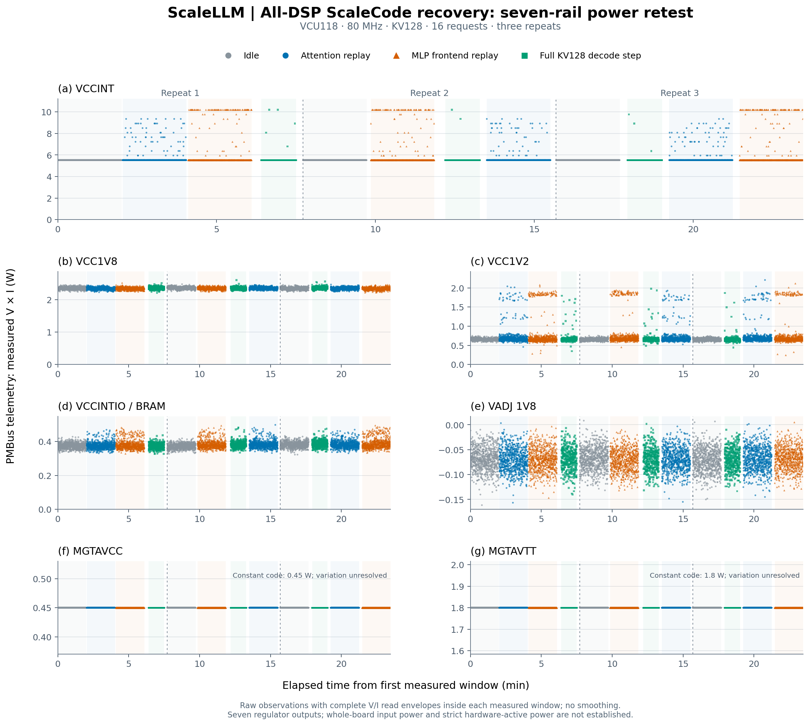

# 全 DSP 版本七轨功耗补测报告

测量日期：**2026-11-15（Asia/Shanghai）**。Dell / VCU118，Decode16，80 MHz，16 请求，KV128。正式运行身份为 `kv128_sevenrail_main_20261115T014454Z`。四类负载各三次、共 **12/12** 窗口采集完成；采集、工作负载和阶段程序的真实退出码均为 **0**。最终测量结论为 **PARTIAL_WITH_LIMITS**。

本次实际使用的 bitstream SHA-256：

```text
5d78519aa10695be564f668d5a41a0e5554e282c31d39f648534a7dc01ab72f7
```

[机器可读结果](results/summary.json) · [逐窗 CSV](results/window_summary.csv) · [独立审核](source/independent/main_001_independent.json) · [完整原始证据 Release](https://github.com/zwj276765037-lab/ScaleLLM/releases/tag/resource-optimization-power-20261115)

## 1. 本次可以报告的功耗

以下统计量是**七条指定稳压器输出在实际共同覆盖区间上的 VOUT × IOUT 时间加权均值**。先分别求每个窗口的均值，再对三个技术重复等权平均并计算样本标准差。重复 SD 描述重复间离散程度，不是仪器准确度、校准误差或置信区间。

| 工况，每类 n=3 | 共同覆盖段均值 ± 重复 SD / W | 三次共同覆盖范围 | 已建立全窗均值 |
| --- | ---: | --- | ---: |
| 空闲 | **11.090993 ± 0.006155** | 99.96046–100.00000% | 2/3 |
| 重复 Attention（五层循环） | **11.343160 ± 0.015590** | 97.52732–98.32836% | 0/3 |
| 重复 MLP 前端（L0） | **11.826220 ± 0.046526** | 96.87886–98.36237% | 0/3 |
| 完整 KV128 解码步 | **11.138985 ± 0.013304** | 99.19497–100.00000% | 1/3 |

仅 **idle1、idle3、full3** 共三个窗口建立了完整窗口均值。其余九窗有实际观测缺口，`full_window_mean=null`；没有补零、跨越超限缺口插值或用已覆盖均值冒充全窗均值。尤其 **11.138985 ± 0.013304 W 是完整 KV128 工作负载的三次覆盖段均值，不能称为三次完整窗口平均功耗**。唯一完整覆盖的 full3 窗口均值为 **11.131464 W**，它只是一轮测量。

电气边界为 VCCINT、VCC1V8、VADJ、VCCINTIO/BRAM、VCC1V2、MGTAVCC、MGTAVTT 七轨。未测电源轨、稳压器损耗和 Dell 主机功耗均未计入，因此不是 VCU118 整板输入功耗，也不是整套主机–FPGA 系统功耗。

## 2. 三组实际遥测



[PNG](showcase/sevenrail_power_telemetry.png) · [SVG](showcase/sevenrail_power_telemetry.svg) · [图的输入身份和逐类点数](showcase/sevenrail_power_telemetry.json) · [重复均值及覆盖图](results/repeat_summary.png)

图中显示 V/I 读取包络完整落在各正式窗口内的原始观测，未平滑或抽样。时间积分使用完整原始序列，包括窗口外可用于夹住边界的观测；图的点选择不代替统计积分规则。负 VADJ 读数保留。两条 MGT 的恒定编码仅说明本次未分辨到变化，不能解释为精确物理恒定功耗。

## 3. 十二个窗口及覆盖范围

| 工况 | 重复 | 窗口 / s | 命令数 | 共同覆盖 / % | 缺失 / s | 覆盖段均值 / W | 全窗均值 / W |
| --- | ---: | ---: | ---: | ---: | ---: | ---: | ---: |
| 空闲 | 1 | 120.363045 | 0 | 100.00000 | 0.000000 | 11.089656 | 11.089656 |
| 重复 Attention（五层循环） | 1 | 120.462347 | 1,190 | 98.32836 | 2.013702 | 11.359481 | 未建立 |
| 重复 MLP 前端（L0） | 1 | 120.038800 | 1,769 | 96.87886 | 3.746575 | 11.819127 | 未建立 |
| 完整 KV128 解码步 | 1 | 65.754649 | 64 | 99.19497 | 0.529343 | 11.154346 | 未建立 |
| 空闲 | 2 | 120.439687 | 0 | 99.96046 | 0.047621 | 11.097706 | 未建立 |
| 重复 MLP 前端（L0） | 2 | 120.032751 | 1,775 | 97.89405 | 2.527832 | 11.783648 | 未建立 |
| 完整 KV128 解码步 | 2 | 65.302644 | 64 | 99.27881 | 0.470953 | 11.131146 | 未建立 |
| 重复 Attention（五层循环） | 2 | 120.471037 | 1,165 | 97.52732 | 2.978868 | 11.328423 | 未建立 |
| 空闲 | 3 | 120.033442 | 0 | 100.00000 | 0.000000 | 11.085616 | 11.085616 |
| 完整 KV128 解码步 | 3 | 65.333715 | 64 | 100.00000 | 0.000000 | 11.131464 | 11.131464 |
| 重复 Attention（五层循环） | 3 | 120.053331 | 1,170 | 97.73379 | 2.720657 | 11.341576 | 未建立 |
| 重复 MLP 前端（L0） | 3 | 120.009083 | 1,802 | 98.36237 | 1.965303 | 11.875886 | 未建立 |

完整 KV128 步各执行 64 条命令，包含 32 层 Attention/MLP、CPU Down、LM head 和 token commit。它们实际持续 **65.754649 / 65.302644 / 65.333716 s**；对应 FPGA DONE 周期时间只有 **2.026811 / 2.026906 / 2.026758 s**。功率时间窗包含 CPU 工作所占的时间，但电气读数仍只属于板卡七轨；不能用这个均值计算纯 FPGA BUSY 功率或执行期能量。

固定顺序为 `idle→A→M→full`、`idle→M→full→A`、`idle→full→A→M`。Attention 按 L0→8→16→24→31 完整循环，三窗分别 1,190 / 1,165 / 1,170 命令；MLP 仅 L0 Gate/Up + SiLU×Up，三窗分别 1,769 / 1,775 / 1,802 命令。CPU Down 仅属于完整步。所有规定时长、每轨至少 200 个有效观测及输出/ACK 检查均通过。

## 4. 与 main 历史数据的关系

旧版对应 `96df1a5c…` 位流，来源为 [2026-11-02 报告](../../docs/evidence/kv128_sevenrail_power/REPORT.md)。本次使用 `5d78519a…` 位流。下表列出已记录的均值，保留各自统计范围。

| 工况 | 旧版 2026-11-02 / W | 新版 2026-11-15 / W | 新减旧 / W |
| --- | ---: | ---: | ---: |
| 空闲 | 11.112454 | 11.090993 | -0.021461 |
| 重复 Attention（五层循环） | 11.339012 | 11.343160 | +0.004148 |
| 重复 MLP 前端（L0） | 12.076557 | 11.826220 | -0.250337 |
| 完整 KV128 解码步 | 11.182172 | 11.138985 | -0.043187 |

旧版空闲与完整步均为三次完整覆盖窗口；新版这两类分别只有 2/3 和 1/3 完整覆盖，表中的新版总体是覆盖段统计。两次 Attention/MLP 均有各自的覆盖缺口。采集日期、实际覆盖、采样周期及未控制的温度/校准状态不同，不能把观测差额全部归因于 DSP 映射，也不能据此建立严格节能比例。

本次 MLP 覆盖段均值比历史值低约 **0.250 W**，这是上述边界下的观测差额。完整步新旧值也具有不同覆盖范围，不能直接宣称完整推理功耗下降。

## 5. 采样和数值规则

新的 60 秒只读预检完成 538 轮、3,766 轨点、9,167 次读取，读取错误为 0，真实退出码为 0。原始 `sweep.start_ticks` 的 537 个起点间隔最近秩 p95 为 **118.3493 ms**，按原规则 `D=ceil_10ms(max(100ms,1.25×p95))`，在正式采集前固定 **D=150 ms、G=3D=450 ms**。早期使用首 V 读取起点得到的 118.3577 ms 记录保留，两者导出相同 D/G；正式方法采用实际 sweep 起点。

旧版为 140/420 ms。新主结果只使用预先冻结的 150/450 ms；实际正式扫描间隔中位 **157.6596 ms**、p95 **189.4612 ms**、最大 **1,128.5555 ms**。名义周期不代表传感器的独立采样率。逐读原码、前后 QPC、轮转次序、CAL 只读值和实际迟到记录全部保留。

每轨先按相邻观测作分段线性积分，再取七轨共同支持区间；读取包络或点间隔超过 G 时断开，不外推、不填缺口。四条 MAX15301 不读取文档未支持的 POUT；三条 MAX20751 保留独立 POUT 作为异步、粗量化对照。VID、Linear11 和负电流按封存合同独立解码，未改电压或校准设置。

另在查看正式功耗前登记了 **G=420 ms** 的单独敏感性复算，实际采样记录仍为 150 ms。相对主结果，最大的覆盖段均值变化为 **0.014377 W**（MLP1）；full3 的覆盖降至 **99.3291%**。该结果只说明缺口阈值敏感性，不替代 450 ms 主结果，也不模拟一次 140 ms 采集。

传感器内部平均窗口、读数年龄及绝对准确度仍未建立。所有严格物理 BUSY 均值、执行期物理能量、J/token 和整板输入功率保持未建立。

[本轮合同](source/design.md) · [原采样合同](../../docs/evidence/kv128_sevenrail_power/source/design.md) · [独立 pilot 核查](source/independent/pilot_001_independent.json)

## 6. 新镜像、状态恢复与数值核验

本轮在板卡独占租约内，将确切新位流加载到 SRAM：目标 `Digilent/210308B76D50`、器件 `xcvu9p_0`，编程进程退出 0、Startup HIGH。编程后一次全 `FFFFFFFF` PCIe 读数通过重启唯一 XDMA 设备恢复；主机未重启、驱动未修改、Flash 未写入。严格 CSR/80 MHz 和双 DDR 各 196,608 字节读回通过。

本次恢复了封存的 268,435,456 字节 KV 快照，SHA-256 `fa610d68fab6045573a355313f78808c93b7273dbf1edc2e8f61bc3ea1ad81c8`。独立程序用实际快照字节核对全部 256 个 1 MiB 写入/回读块，32 层各 8 MiB 均一致；不以先前 50 轮推理的残留 DDR 状态冒充 KV128。

16 槽的 prompt、generated history、epoch1、position127 从封存参考重建。新位流先执行完整 64 条资格命令；16 个 token、六条选中 input/完整 output、host before/after 状态和完整 KV 保持均与参考一致。三次正式完整步继续验证这些条件。五层有旧独立捕获的历史字节，另外 27 层缺独立旧历史 oracle 的限制保留；完整模型独立数学 oracle 仍为 **NOT_ESTABLISHED**。

总计 **9,137** 条命令完成并 ACK，其中 **74** 条是正式窗口之外的资格/等价验证，正式窗内 **9,063** 条。命令 10329、12688、17100 未观测到 BUSY，11048 不足两次 BUSY 观测；相应四条保守内窗留空，真实 DONE、输出和 ACK 记录保留。没有补造 BUSY 边界。

[稳定资格审核](source/independent/qualification_001_final_independent.json) · [实际快照恢复审核](source/independent/restore_001_independent.json) · [公开无私有快照的日志核查](source/independent/restore_001_public_log_audit.json)

## 7. 完成、独立复算与原始证据

正式采集保存 **9,399** sweeps、**65,793** rail points、**159,804** register reads，API 读取错误 **0**。workload、sampler 和阶段 launcher 原生退出码均为 **0**；最终 CSR 空闲、38 项运行时源码身份通过、自有进程与编程服务退出、guardian 真实退出 0 且租约释放，候选保留于易失 SRAM。

132 个远端原始文件、共 **861,122,432 字节**逐项 size/SHA 校验通过。清单 SHA-256 为 `61788ae90ffcfe914568d39add8fb360feeedc2b2a0eb4f2bc06b29d03d85d99`。独立程序不调用工程分析器函数，直接解码原码并复算 12 窗、逐轨、共同覆盖、去边 10 秒和 BUSY 条件统计；与工程积分最大绝对数值差为 **3.552713678800501×10⁻¹⁴**，差异清单为空。验证通过不消除覆盖及传感器范围限制。

初次恢复入口的 Python 导入失败发生在板操作前，原回执保留。外层监护识别根 PID 时存在 .NET/CIM 出生时间约 0.4 µs 的精度差，经 PID、命令和原时间核对后归一，修正证据保留；主 launcher/runtime 资源保护始终运行。整个阶段和正式采集没有累计固定墙钟强停，测量窗口的预定时长及故障/内存/磁盘保护保留。

[工程完成记录](source/results.md) · [采集回执](results/collection_receipt.json) · [关闭回执](results/closure.json) · [传输校验](results/transfer_verification.json) · [内部完整审核](source/independent/main_001_independent.json) · [公开复算审核](source/independent/main_001_public_recompute.json)

## 8. 下载和复算

完整原始日志、失败尝试、实际脚本、工程分析和独立审核放在[功耗 Release](https://github.com/zwj276765037-lab/ScaleLLM/releases/tag/resource-optimization-power-20261115)；精确大小、SHA-256 和解压复算命令见 [README](README.md)。模型权重、厂商运行库、完整私有 KV 快照不重新分发。

公开复算能够重新解码全部功耗原码、验证命令与输出身份、重算覆盖和统计，并核对已封存的参考身份记录。它不会重新打开未分发的完整 KV 或原捕获二进制；该差异在公开审核字段中明确记录。内部审核确实读取并重哈希了这些文件。实际测量、独立复算和发布文件完整性是分别登记的证据。
