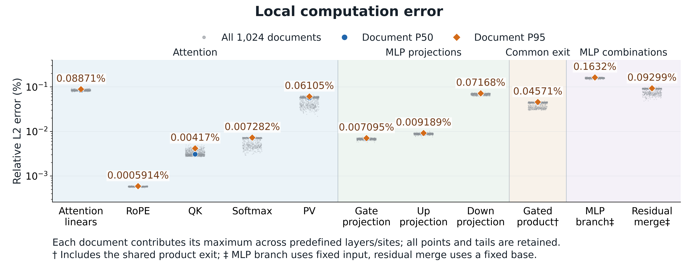
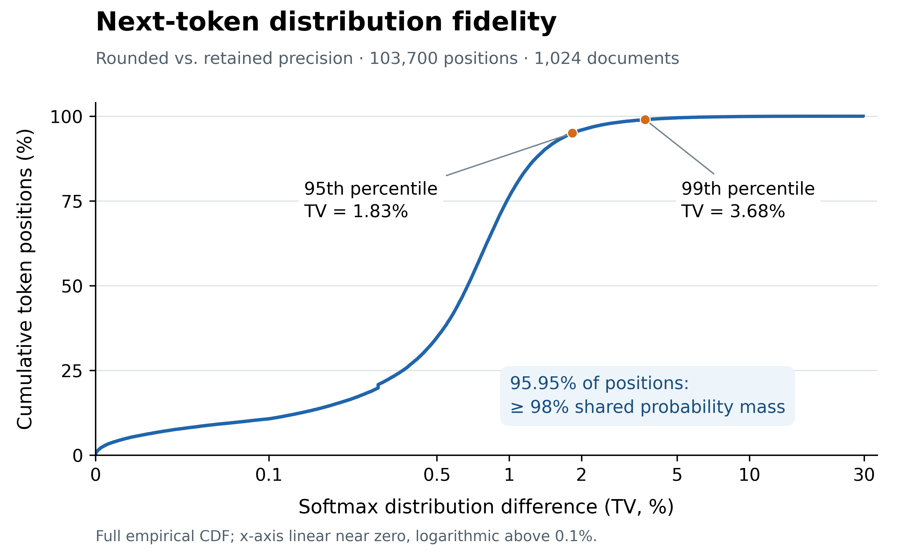
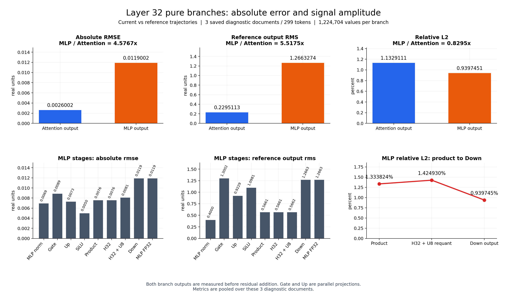

# ScaleLLM 多级舍入：局部数值精度与解码稳定性

本报告汇总已完成的局部算子误差、全词表分数及概率变化、Top-1翻转、Margin分层和分支诊断。论文使用两张独立的英文图，均由Python／Matplotlib直接读取实验数据绘制，输出为600 dpi PNG。图1保留横向局部算子布局；图2仅展示**相同前缀下，最终完整词表Softmax分布的TV累积分布**，集中评价输出分布的数值保真度。Top-1一致率作为文字补充，Margin、logit覆盖和详细诊断保留在报告中。累计向量相对L2保留在附录作诊断，不混入图1局部算子列。

**主要结论：在来自C4、AG News和IMDb的1024条文本前缀、103,700个相同前缀预测位置上，舍入实现与数值参考的最高分token在102,647个位置一致，占98.984571%。** 这里的1024是源文本条数，每条最多取128个token；数据集组成和测试过程见第1节。这是已测位置上的单步贪心解码一致性，不能等同于自由生成整段回答一致、采样结果一致或任务ACC不变。所有数值来自已有结果，本次补充数据口径没有重新执行模型。

相关论文在ACC和数值误差之外的评估方式，已另存为[11篇论文评估指标调研与新图建议](12_literature_evaluation_survey/相关论文评估指标调研.md)。其中完整回答质量比较属于待测设计，不是本报告新增的实验结果。

用户已授权执行完整回答质量比较，并选择子智能体匿名盲评作为初步评估。[新实验进度](13_response_quality/进度.md)独立记录数据、生成资格与运行状态；尚未完成的评分不并入本文已测结论。

## 1. 数据与参照

### 1.1 这1024条样本来自什么测试集

本实验构建了一个**多领域文本前缀数值保真度评估集**，使用公开文本语料作为语言模型推理输入。1024表示选中的源文档条数；实际送入模型的是每条文档开头最多128个token，而非完整长文。数据组成如下。

| 数据集 | 实际使用的来源划分 | 文本类型 | 去重后的可选文档数 | 本次选取条数及文档占比 | 实际有效位置数 |
|---|---|---|---:|---:|---:|
| C4 | 本地冻结的官方validation前10,000条 | 通用网页正文，域标记`web` | 10,000 | 512（50%） | 58,757 |
| AG News | 官方test划分的本地冻结文件 | 新闻文本，域标记`news` | 7,600 | 256（25%） | 13,116 |
| IMDb | 官方test划分的本地冻结文件 | 电影评论，域标记`reviews` | 24,801 | 256（25%） | 31,827 |
| **合计** | 三个来源按固定配额组合 | 三类自然文本 | **42,401** | **1,024（100%）** | **103,700** |

“可选文档数”来自本次准备流程的去重清单，不能解释为这些数据集的官方总规模。尤其C4的候选范围限定在已保存的validation前10,000条。三个来源都只读取文本字段；AG News的新闻类别标签、IMDb的情感标签没有用于这次数值评估。因此，本节衡量的是模型处理这些文本时的数值保真度，文中的Top-1一致率也不是新闻分类或影评情感分类的准确率。

来源文件分别为`c4_official/validation_first10000.jsonl`、`ag_news/test.parquet`和`imdb/test.parquet`，其本地版本身份、字节数及SHA-256见[原始文档选择清单](../../project/E012_multistage_rounding_precision/experiment_results/runs/R003/attempts/AT001_clean_document_manifest/document_manifest.json)。现有清单以这些冻结文件为依据，没有记录可据以补写的上游数据集revision。

### 1.2 如何选择文本和准备输入

1. **整理候选文档。** 读取非空文本，保留来源、原始行号和文档ID；用Unicode NFC及空白规范化后的相同文本、规范化URL建立重复簇，每簇保留一个代表。准备流程还检查与既有工程试跑文本的包含重合，本次记录的排除簇数为0。该检查不等同于语义近重复去除或模型训练数据去污染。
2. **按领域固定配额选择。** 使用种子`2026101903`，在每个领域内按`SHA256(seed:eval:doc_id)`排序，分别取512、256、256条，选择时不使用数值误差或模型输出。1024条及其顺序随后冻结；这是一组可复现的固定配额样本，不按三个完整语料库的规模加权。
3. **生成短文本前缀。** 使用Llama-3.1-8B-Instruct对应的冻结分词器，设置`add_special_tokens=True`、`truncation=True`、`max_length=128`、`padding=False`。直接编码原始文本，不添加问答或聊天模板，不跨文档拼接；长度口径包含分词器自动添加的特殊token。网页前缀长度为22–128，新闻为21–104，影评为55–128；整体均值为101.2695个token。原文完整分词长度未保存，因此只报告前缀长度，不据达到128的样本数推算实际截断文档数。
4. **覆盖全部有效位置。** 每条前缀的所有非padding位置都参与配对比较，得到`58,757 + 13,116 + 31,827 = 103,700`个位置。执行时按“2条网页、1条新闻、1条影评”交错排列，分为64个、每组16条的执行批次；批次只是运行组织单位，不增加统计样本数。

每条文档的来源ID、文本哈希、重复簇ID、分词产物身份和实际长度保存在[冻结文本前缀清单](01_full1024/provenance/frozen_document_stream.json)；执行顺序见[正式批次计划](01_full1024/provenance/formal_batch_plan.json)。另行准备的WikiText-2 train/dev文档各64条，不计入这1024条评估文本。

### 1.3 模型具体怎样进行推理比较

对每条固定token序列，分别执行当前多级舍入实现与数值参考实现的32层因果前向计算，再经过最终归一化和词表输出层。在位置`t`，两版始终接收同一段原文token前缀，比较对应的隐藏向量、128,256维logit向量及温度1下的完整词表Softmax分布。

这是**使用原文固定前缀的配对前向测试（teacher forcing）**：即使某个位置两版的最高分token不同，后续位置仍输入数据集中给定的原文token，不将任一版本自己预测的token反馈为下一步输入。因此，103,700表示同前缀条件下的预测位置覆盖量，不表示自由生成了103,700个token，也不表示完成了1024次独立问答。Top-1比较以参考实现的最高分token为一致性参照，不以原文下一词或数据集分类标签作为正确答案。

### 1.4 模型、比较范围与统计分母

| 项目 | 范围 |
|---|---|
| 模型 | Llama-3.1-8B-Instruct，32个解码块，隐藏维度4096 |
| 词表 | 128,256个token |
| 全量输入 | C4 validation网页512条、AG News test新闻256条、IMDb test影评256条；均为最多128 token的前缀 |
| 有效预测位置 | 103,700个；包含实际编码序列的全部有效位置，不含padding |
| 全词表分数对 | `103,700 × 128,256 = 13,300,147,200`对同位置、同词表项的logit |
| Softmax | 完整词表，温度1 |
| 第32层纯分支诊断 | 3篇、299位置；每分支1,224,704个输出数值 |
| 第32层逐数舍入审计 | 15篇、1,746位置；两类投影各7,151,616个数值 |
| 低Margin定性抽样 | 从876个Margin < 0.05翻转位置随机抽100例，来自93篇 |

参照为本实验规定的保留中间精度计算。基础量化、ScaleCode、LUT等算法规则和共同出口按原协议保留，**并非完全取消量化的FP32整模型**。

不同结果使用的统计分母如下，不能相互替换：

- **局部算子分位数：** 先对每条文档在预定义层/节点集合取相对L2误差最大值，再在1024条文档上取分位数；具体节点集合见第3节。
- **Top-1翻转率和主文的位置级TV分布：** 以103,700个有效位置等权统计，较长前缀贡献较多位置；文档级等权TV另行列示。文档配额为50%/25%/25%，不意味着位置权重也为这一比例。
- **logit绝对差覆盖率：** 以13,300,147,200个同位置、同词表项的分数对为分母。这一数量表示覆盖规模，不是独立样本量。

1024条文档及其token没有被证明相互独立，分位数和比例均为该冻结集合的描述性统计。本组短前缀实验直接支持已测输入范围内的数值误差与单步预测稳定性；完整回答质量由另行设计的自由生成评估提供证据，任务ACC由相应有标签任务单独衡量。本组结果不直接外推到长上下文或多步生成后的全部新前缀。

### 1.5 数据来源和本工程副本的适用范围

本节1024条结果继承原E012实验的冻结数据：局部误差、logit覆盖与Top-1来自已完成的R005计算，TV来自R006的1024条实测；合并时核对了旧指标和最终隐藏向量身份。它们随工程复制到`ScaleLLM_MLP_fix`目录，不能仅因目录更名就视为对当前MLP修正版重新执行的测试。本次只补充已有结果的来源和统计口径。

原始来源清单保留了文件身份，但未认证这些语料在模型训练及全部历史调试中从未使用。因此使用“固定评估集合”这一表述，不声称严格的全历史未见测试集。完整数据及模型、输入、会话身份见[全量数据目录](01_full1024/README.md)、[完成清单](01_full1024/provenance/analysis_manifest.json)和[来源清单](package_sources.json)。

## 2. 指标定义

设当前实现输出为 \(x\)，参考输出为 \(r\)，比较元素数为 \(N\)。

- **绝对RMSE**：\(\sqrt{\sum_i(x_i-r_i)^2/N}\)。
- **参考RMS**：\(\sqrt{\sum_i r_i^2/N}\)，表示参考信号幅度。
- **相对L2误差**：\(100\|x-r\|_2/\|r\|_2\%\)。在相同元素集合上等于“绝对RMSE ÷ 参考RMS × 100%”。它不是逐元素误差上界。
- **logit绝对差覆盖率**：全部位置、全部词表中满足 \(|z^{current}-z^{ref}|\le\tau\) 的分数对比例。阈值 \(\tau\) 是原始logit单位，不是百分比；它与第4节逐位置的实测最大扰动 \(\epsilon\) 区分。
- **TV**：每个位置的 \(\frac12\sum_v|p^{current}_v-p^{ref}_v|\)。报告中的TV百分数等于该概率质量差乘100，不是相对L2误差。
- **Top-1翻转**：同一位置两版本的完整词表最高分token ID不同。
- **参考Logit Margin**：\(m=z^{ref}_{(1)}-z^{ref}_{(2)}\)。始终使用参考版本前两名分数差，不使用翻转后的差。

## 3. 全量Attention与MLP局部误差

以下数值单位均为相对L2百分数。对每篇文本，先取相应节点在32层内的**最大张量相对L2误差**，再对1024篇计算分位数。它们不是所有标量的误差分位数。

| 类别 | 节点 | P50 | P95 | P99 | 最大值 |
|---|---|---:|---:|---:|---:|
| Attention | 线性投影Q/K/V/O | 0.08375456% | 0.08870712% | 0.09063446% | 0.11471736% |
| Attention | RoPE旋转位置编码 | 0.00057690% | 0.00059142% | 0.00059918% | 0.00060881% |
| Attention | QK打分 | 0.00308298% | 0.00416969% | 0.00467475% | 0.00560677% |
| Attention | 注意力Softmax | 0.00699735% | 0.00728196% | 0.00735112% | 0.00763353% |
| Attention | PV加权 | 0.05634821% | 0.06105131% | 0.06301022% | 0.06588341% |
| MLP | Gate投影 | 0.00676867% | 0.00709539% | 0.00720082% | 0.00796556% |
| MLP | Up投影 | 0.00881315% | 0.00918906% | 0.00934802% | 0.01021872% |
| MLP | Down投影 | 0.06968079% | 0.07167732% | 0.07243131% | 0.07638033% |
| 共同出口 | 门控乘积出口损失 | 0.04378723% | 0.04570844% | 0.04640661% | 0.04823665% |
| MLP组合 | 整个MLP分支，同入口 | 0.15782708% | 0.16322653% | 0.16581754% | 0.17171612% |
| MLP组合 | 固定残差基底相加 | 0.08986782% | 0.09299327% | 0.09471300% | 0.10171500% |

口径细分：

- Q/K/V/O每篇共128个投影节点，RoPE共64个节点，其余上述单算子通常各32个节点。它们在当前轨迹的相同实际节点输入上，比较当前计算与保留中间精度参照。
- “整个MLP分支”固定相同MLP入口，参照在分支内部重新计算动态量化码，不能视为一个线性算子的舍入误差。
- “固定残差基底相加”固定第二次残差相加的基底，仅比较MLP分支变化引起的和的差异；不是整块网络的自由传播误差。
- “门控乘积出口损失”比较实际S32/F16出口与同一实际LUT输出、Up输出的精确未舍入乘积，**包含共同出口损失**，不是额外中间舍入的单独损失。

数据：[局部算子汇总CSV](01_full1024/operator_error_summary.csv)。完整文档级结果保存在全量aggregate中。

[图1：英文局部算子误差PNG](09_two_english_figures/figure_1_local_operator_error.png) · [Python绘图脚本](09_two_english_figures/plot_two_figures.py) · [绘图数据](09_two_english_figures/plot_data.json)。

**图1说明。** 展示11项局部计算：每个灰点对应一篇文本在该类跨层节点上的最大张量相对L2，蓝色圆点和橙色菱形分别为1024篇的中位数与P95。共同出口和MLP组合的参照区别见本节口径说明；图中不包含累计输出向量误差。

**Figure 1 caption.** Local numerical fidelity under multistage rounding across 32 layers on 1,024 documents. Each gray point is a document's maximum tensor-relative L2 error across the corresponding layer sites; blue circles and orange diamonds indicate the median and 95th percentile across documents. The retained-precision reference preserves base quantization and lookup semantics. The common-exit product includes exit rounding, the composite MLP comparison fixes the branch entrance, and the residual merge uses a fixed residual base. All 11,264 document-level points are retained.

## 4. 最终解码稳定性：评价32层传播后的输出影响

[图2：英文输出分布保真度PNG](10_output_distribution_fidelity/figure_2_output_distribution_fidelity.png) · [Python绘图脚本](10_output_distribution_fidelity/plot_output_fidelity.py) · [精确统计与绘图来源](10_output_distribution_fidelity/figure_statistics.json)。

**图2说明。** 单图只有一条完整经验累积分布曲线：横轴为逐位置完整词表Softmax的TV，纵轴为误差不超过对应阈值的位置占比。TV的95分位为约1.83%，99分位为约3.68%。99,501 / 103,700个位置满足TV ≤ 2%，占95.950820%；这些位置的两版输出分布共享至少98%的概率质量。图中使用完整103,700个位置，保留最大TV 29.720074%的尾部；横轴在0至0.1%附近线性、超过0.1%后对数缩放。2%是便于读者解释的展示阈值，不是预先制定的质量合格线。

**该指标为什么有直接意义。** 对同一前缀，设参考和舍入后的完整词表概率分别为 \(p,q\)，定义共享概率质量

\[
O(p,q)=\sum_v\min(p_v,q_v)
=\frac12\sum_v(p_v+q_v-|p_v-q_v|)
=1-\mathrm{TV}(p,q).
\]

因此TV ≤ 2%恰好等价于两分布共享概率质量至少98%。这不是额外实验或另一个性能指标，而是TV的等价解释。对任意词表子集 \(A\)，还有 \(|p(A)-q(A)|\le\mathrm{TV}(p,q)\)，所以这些位置上任一词或词组候选集合的总概率改变不超过2个百分点。这里的集合指下一token的候选ID集合，并非后续整段文本的语义事件。

共享概率质量不是任务正确率、同随机种子采样的实测一致率，也不保证每个低概率token的相对误差都小。当前参考保留基础量化、LUT和共同出口；本图评估额外中间舍入的分布影响，不能冒充相对完全未量化FP32模型的结果。论文应由图1支撑局部数值精度、图2支撑最终输出分布保真度，并由独立任务ACC支撑任务质量结论。

**Figure 2 caption.** Next-token distribution fidelity of rounded inference relative to the retained-intermediate-precision reference. The empirical CDF includes all 103,700 identical-prefix positions from 1,024 documents, using full-vocabulary softmax at temperature 1. TV is at most 2% at 95.95% of positions, equivalent to at least 98% shared probability mass, since \(\sum_v\min(p_v,q_v)=1-\mathrm{TV}(p,q)\). The 95th and 99th percentiles are approximately 1.83% and 3.68%, respectively; the full tail up to 29.72% is retained. The reference preserves base quantization and lookup semantics. Separately measured greedy next-token agreement is 98.985%. These measurements assess single-step distribution fidelity under identical prefixes, rather than task accuracy or free-generation equivalence.

图中标记采用经验累积分布的逆分位数，即第 \(\lceil qN\rceil\) 个顺序统计量；报告既有表格保留线性插值分位数。两者精确值均保存于绘图统计文件，图上两位小数显示一致，未改变原表格或输入数据。

### 4.1 直接测量：绝大多数已测位置的贪心token不变

对于同一输入前缀，贪心解码选择完整词表的最高分token。因此，比较当前与参考的Top-1 token ID，直接回答“舍入引起的全部传播差异是否改变了这个位置的贪心解码选择”。

| 已测位置的互斥分类 | 位置数 | 占103,700个位置 |
|---|---:|---:|
| 满足Margin稳定充分条件，且Top-1不变 | 82,728 | 79.776278% |
| 未满足该充分条件，但实测Top-1仍不变 | 19,919 | 19.208293% |
| 实测Top-1改变 | 1,053 | 1.015429% |
| 合计 | 103,700 | 100% |

前两项合计为102,647个不变位置，即**98.984571%的单步贪心token保持一致**。第二项不能叫作“不稳定”，因为不满足一个充分条件并不意味着必须翻转；最后一项完整保留，不能视为舍入没有影响。

数据：[全部位置与证书字段](03_top1_margin/positions.csv)、[Top-1统计](01_full1024/top1_summary.json)。

### 4.2 数学充分条件：为什么部分位置可以保证Top-1不变

在一个固定位置，记参考logit向量为 \(z\)，当前实现为 \(\hat z=z+\delta\)。令参考最高分token为 \(i\)，定义

\[
m=z_i-\max_{j\ne i}z_j,\qquad
\epsilon=\max_v|\hat z_v-z_v|.
\]

这里 \(\epsilon\) 遍历完整128,256项词表，单位为原始logit；它不是相对L2，也不是TV。如果 \(m>2\epsilon\)，则对于任意其他token \(j\)，

\[
\hat z_i-\hat z_j
=(z_i-z_j)+(\delta_i-\delta_j)
\ge m-2\epsilon>0.
\]

所以参考最高分token在当前输出中仍严格领先，**该位置的贪心解码必然不变**。严格大于号同时避免了并列最高分的处理歧义。

在当前全部103,700个位置中，82,728个满足该充分条件，占79.776278%，其中观察到0次Top-1翻转。条件使用的是这些已测输出的实际最大扰动，属于对已测位置的后验稳定核验；不是预先给出的全输入舍入误差上界，也不保证尚未测试的前缀。

### 4.3 翻转集中在哪里，概率分布改变多少

- 在1,053次翻转中，876次的参考Margin < 0.05，占83.190883%；975次的Margin < 0.1，占92.592593%。
- Margin ≥ 1的50,456个位置观察到0次翻转。该结果只针对当前样本；低Margin也不意味着语义影响一定很小。
- 全词表分数对中，98.130653%的绝对logit差不超过0.1，99.844413%不超过0.2。大量低分词同样进入这一分母，所以覆盖率是辅助数值证据，不能代替Top-1核验。
- Softmax后逐位置TV的中位数为0.671021%、P95为1.830183%、P99为3.681844%，最大值29.720074%。主图保留完整尾部；TV说明概率分布的差异，不保证给定采样过程选择相同token。

**可用于论文正文的结论：**

> Across 103,700 identical-prefix prediction positions from 1,024 documents, multistage rounding preserves the greedy next-token choice of the retained-intermediate-precision reference at 98.985% of positions. A sufficient argmax-stability condition, \(m>2\|\hat z-z\|_\infty\), holds at 79.776% of the evaluated positions, all with unchanged Top-1 tokens. Among observed Top-1 changes, 92.593% occur when the reference logit margin is below 0.1. The position-wise softmax TV has a median of 0.671% and a 95th percentile of 1.830%. These measurements assess single-step decoding consistency under identical prefixes.

上述证据支持“绝大多数已测位置的贪心解码选择不变”。已有任务ACC应独立关联；当前数据不支持进一步写成“累计误差对实际推理质量没有影响”或“完整生成结果几乎不变”。第8节保留低Margin翻转中的内容、逻辑和不确定样本，防止将小Margin直接解释为无害。

## 5. 第32层Attention与MLP纯分支对比

本节仅使用3篇、299个位置的保存诊断结果。两个输出都取在**各自残差相加之前**，含前31层已经形成的输入差异。下表是合池能量计算，不是文档分位数。

| 分支 | 绝对RMSE | 参考RMS | 相对L2 |
|---|---:|---:|---:|
| Attention纯分支 | 0.00260015949 | 0.22951133410 | 1.13291115% |
| MLP纯分支 | 0.01190024956 | 1.26632737159 | 0.93974511% |

MLP绝对RMSE为Attention的4.57674倍，同时参考输出幅度为5.51749倍；相对误差反而较低。不能只凭绝对误差把MLP判断为相对数值精度更差。较大的绝对误差仍会进入残差相加，不能因此忽略其最终影响。

| MLP内部节点，当前与参考各自传播 | 绝对RMSE | 参考RMS | 相对L2 |
|---|---:|---:|---:|
| MLP入口归一化后 | 0.00691357 | 0.40001932 | 1.72830918% |
| Gate投影 | 0.00886532 | 1.30018238 | 0.68185167% |
| Up投影 | 0.00726634 | 0.92288750 | 0.78734850% |
| SiLU输出 | 0.00498762 | 1.09813246 | 0.45419124% |
| 门控乘积 | 0.00755094 | 0.56611206 | 1.33382373% |
| Hadamard及重编码反量化后 | 0.00806775 | 0.56618577 | 1.42492964% |
| Down投影后实际MLP输出 | 0.01190025 | 1.26632737 | 0.93974511% |

门控乘法逐数分解满足
\[
\Delta(su)=u_{ref}\Delta s+s_{ref}\Delta u+\Delta s\Delta u.
\]
在4,286,464个乘积上，两个一阶加权扰动项RMSE分别为0.00475446和0.00607258，二阶项为0.00007896；共同出口舍入差RMSE为0.00000622。各项有交叉项，不能将能量直接当作可加的因果百分比。

保留上游输入差异、把第32层改用参考计算后，MLP分支相对误差仍为0.93896357%，与当前0.93974511%接近。这说明已有输入差异足以产生当前量级的分支差异，不支持把全部差异归给最后一层新增舍入，也没有给出全32层各算子的全局因果贡献排序。

全1024篇保存结果缺少同口径的纯Attention自由传播分支输出，故**该分支对比只能报告3篇**。不能用全量Attention局部O投影误差，或Attention加残差后的误差，替代缺失的纯分支指标。

数据与证据：[分支分析目录](02_attention_mlp_layer32/README.md)。

## 6. 全词表logit、Softmax与Top-1

### 6.1 单个logit绝对差覆盖率

分母为全部13,300,147,200对分数，阈值单位为原始logit。

| 绝对差阈值 | 覆盖率 |
|---:|---:|
| ≤0.01 | 26.968397% |
| ≤0.02 | 49.820674% |
| ≤0.05 | 86.820683% |
| ≤0.1 | 98.130653% |
| ≤0.2 | 99.844413% |
| ≤0.5 | 99.991921% |
| ≤1.0 | 99.998613% |

完整12个阈值及原始计数：[覆盖率CSV](01_full1024/vocabulary_coverage.csv)。

### 6.2 Softmax之后的TV

| 103,700个位置的TV分布 | 值 |
|---|---:|
| 中位数 | 0.671021% |
| P95 | 1.830183% |
| P99 | 3.681844% |
| 最大值 | 29.720074% |
| 均值 | 0.777878% |

位置加权统计与“先计算每篇平均TV，再对1024篇统计”不同；两种口径分别保存在 [TV汇总CSV](01_full1024/TV_summary.csv)。逐位置和逐文档明细均保留。

### 6.3 Top-1

| 指标 | 结果 |
|---|---:|
| 位置数 | 103,700 |
| 一致位置 | 102,647 |
| 翻转位置 | 1,053 |
| 位置加权一致率 | 98.98457088% |
| 文档等权一致率均值 | 98.99443859% |
| 所有已测位置均一致的文档 | 397 / 1024 = 38.76953125% |

这三种一致率不能混称：按位置的一致率、按文档等权平均的一致率和整篇所有位置一致比例是不同指标。以上不是任务ACC，也不是自由生成整段答案的一致率。

## 7. 按参考Logit Margin分层统计Top-1翻转

Margin为参考Top-1减Top-2的logit差。固定桶左闭右开，所有8桶保留。原始计数与逐篇Top-1统计独立核对一致，负值、非有限Margin及恰为0的并列位置均为0。

| 参考Margin | 总位置数 | 翻转数 | 占1,053次翻转 | 桶内翻转率 |
|---|---:|---:|---:|---:|
| [0, 0.01) | 791 | 357 | 33.903134% | 45.132743% |
| [0.01, 0.05) | 3,155 | 519 | 49.287749% | 16.450079% |
| [0.05, 0.1) | 3,766 | 99 | 9.401709% | 2.628784% |
| [0.1, 0.2) | 7,056 | 56 | 5.318139% | 0.793651% |
| [0.2, 0.5) | 17,491 | 20 | 1.899335% | 0.114345% |
| [0.5, 1) | 20,985 | 2 | 0.189934% | 0.009531% |
| [1, 2) | 23,292 | 0 | 0% | 0% |
| [2, ∞) | 27,164 | 0 | 0% | 0% |
| 合计 | 103,700 | 1,053 | 100% | 1.015429% |

- Margin < 0.05：876次翻转，占83.190883%。
- Margin < 0.1：975次翻转，占92.592593%；该范围仅含全部位置的7.436837%。
- Margin < 0.5：1,051次翻转，占99.810066%。
- Margin ≥ 1：50,456个位置观察到0次翻转，不是对所有输入的保证。
- 翻转位置Margin中位数0.01743031，P95为0.12255611，最大值0.63904858。

第4.2节给出了 \(m>2\epsilon\) 保证Top-1不变的推导。本数据中82,728个位置满足并通过该检查，均未翻转；其余19,919个Top-1不变位置没有被这一较保守的充分条件覆盖。

[分桶CSV](03_top1_margin/buckets.csv) · [全部位置](03_top1_margin/positions.csv) · [1,053条翻转](03_top1_margin/top1_flips.csv)。

## 8. Margin < 0.05 的100例随机定性审阅

从876次翻转中，按(doc_id, position)排序后使用固定种子20261020无放回抽100例，先冻结名单，再解码和分类。来自93篇文档：网页54例、影评33例、新闻13例。

两次独立AI评阅分别读取100条完整可用前缀与两候选，冻结标签后比较；84例初始一致，16例逐条裁决。**这是AI定性审阅，尚未经独立人工标注，也不是完整推理过程质量评测。**

| 最终类别 | 数量 / 100 | 边界 |
|---|---:|---|
| 局部格式变化 | 1 | 未见当前局部内容改变，不保证后续不变 |
| 局部措辞或语法变化 | 28 | 未见明确命题反转，不代表严格同义 |
| 内容、事实或指代差异 | 24 | 不判定哪一版本正确 |
| 逻辑连接变化 | 1 | 未确认同一完整命题真值相反 |
| 上下文或续文不足 | 46 | 不计入“无害” |

| 样本 | 参考 → 舍入 | 局部观察 |
|---|---|---|
| S009 | `- → --` | 新闻电头分隔符 |
| S050 | `badly → severely` | 近似程度措辞 |
| S020 | `4 → 5` | 比赛统计数量变化 |
| S024 | `38 → 39` | 人物年龄变化 |
| S028 | `David → Mark` | 发言者姓名变化 |
| S092 | `yr → week` | 传闻发生时间范围变化 |
| S094 | `except → and` | 例外与并列补充的逻辑连接变化 |
| S096 | `looking → not` | 否定对象尚未完整，归不确定并重点标记 |

没有确认Yes ↔ No式同一完整命题的反转，但不能将数字、人名和逻辑相关变化当成等价替换。也不能把内容候选不同直接认作舍入版本任务出错。

子词差异需要保留不确定性：S031的Analyst是Analysts的前缀，下一步仍可能补s，单个token不足以确认最终单复数发生变化。原文后续未被机械拼接到候选后冒充生成结果。

两次评阅在初次字段探查中均意外看到S001原文下一token辅助字段；该例仍归不确定，未当作正确答案。其余99例的评阅视图排除了该辅助字段。完整原始标注、分歧与裁决均保留。

[100例可搜索上下文与标注](04_qualitative_100/reconciled/review.html) · [100例CSV](04_qualitative_100/reconciled/annotated_samples.csv) · [完整定性报告](04_qualitative_100/reconciled/report.md)。

## 9. 第32层舍入与累计误差诊断

[诊断目录](05_layer32_diagnosis/README.md)保留两组不同范围的证据：

1. **15篇、1,746位置的出口逐数审计。** Attention输出投影和MLP Down出口均有F24到F16的8位小数舍入。仅该最后切位的实测最大绝对差为0.00000762939453125；该值不是全部累计误差上界。原数、舍入后数值、逐阈值计数和Host FP32差异见原报告副本。
2. **3篇、299位置的单块诊断。** 含第32块多节点的当前/参考路径、相同层入口对照及替换诊断。相同“整层入口”不等于所有内部算子入口相同。不同对照的放大倍数和能量不能交叉使用，也不能直接解释成互不重叠的因果占比。

局部舍入误差小，不能单独保证32层累计输出误差同样小；已有输入差异、动态重编码、门控乘法与残差相加中的信号抵消需要分别考察。现有诊断定位了具体传播现象，但未完成全32层每个舍入点的全局因果贡献排序。

## 10. 文件组织与复核

本目录提供汇总CSV、完整aggregate JSON、逐位置Margin/TV明细、1,053条翻转清单、随机100例全部上下文与初始/最终标注、既有Python PNG及小规模诊断数据。

原始大体积张量、模型权重、运行缓存和无关日志不重复复制；来源路径和SHA256用于回到原实验核查。报告副本为适应本目录而调整的链接在来源清单中标明；不改写原实验文件。

查看 [单图及当前报告核验](10_output_distribution_fidelity/verification.json)、[单图统计与来源](10_output_distribution_fidelity/figure_statistics.json)、[图1来源清单](09_two_english_figures/source_manifest.json) 和 [原数据来源清单](package_sources.json)。[前版双图核验](09_two_english_figures/verification.json)、[前版独立审核](08_paper_fidelity_decoding_v1/independent_review.json)与[首版独立包核验](independent_package_review.json)记录的是各自版本的图和报告身份；旧审核不自动覆盖当前排版。本次收敛为单图前的报告保存在 [前版报告快照](10_output_distribution_fidelity/provenance/完整分析报告_before_single_output_figure.md)，更早的修订快照见 [拆图前快照](09_two_english_figures/provenance/完整分析报告_before_two_english_figures.md)与[原报告快照](08_paper_fidelity_decoding_v1/provenance/完整分析报告_before_paper_revision.md)。当前图2从已独立核验的逐位置TV重新绘制，图1继续使用09版；原始运行数据、原表格和已有图均未改写。

本汇总没有新增任务ACC、PPL或自由生成质量实验；已有ACC应在确认模型、权重和舍入实现一致后另行关联，不能用本报告数值指标替代。

## 附录A. 累计向量相对L2：保留的诊断结果

本表用于研究误差传播和定位节点，不进入论文主图的局部算子列，也不将数值百分数解释成任务准确率下降。当前与参考路径分别传播各自的中间输出；每篇对该节点所有有效位置和通道计算相对L2，再统计1024篇文档的分位数。

| 输出节点 | 文档P50 | 文档P95 |
|---|---:|---:|
| 第8块输出 | 0.204108% | 0.231472% |
| 第16块输出 | 0.342256% | 0.422218% |
| 第24块输出 | 0.599712% | 0.818376% |
| 第31块输出 | 0.996593% | 1.621519% |
| 第32块输出，最终RMSNorm之前 | 1.431620% | 2.439764% |
| 最终隐藏向量，最终RMSNorm之后 | 1.570580% | 2.847756% |
| 全词表logits | 1.228031% | 2.207453% |

1.432%与1.571%对应最终归一化前后两个不同节点。它们也不是逐标量相对误差均值、32层误差百分数之和，或单个最坏token的误差。

完整数据：[逐层汇总](01_full1024/layer_error_summary.csv)；分子、分母复核：[残差RMSE与参考RMS](06_metric_definition_audit/residual_RMSE_reference_RMS.csv)。原有 [六面板诊断总览](07_redesigned_figures_v1/main_overview.png) 和 [第32层残差分解图](07_redesigned_figures_v1/layer32_residual_detail.png) 保留供进一步分析。
